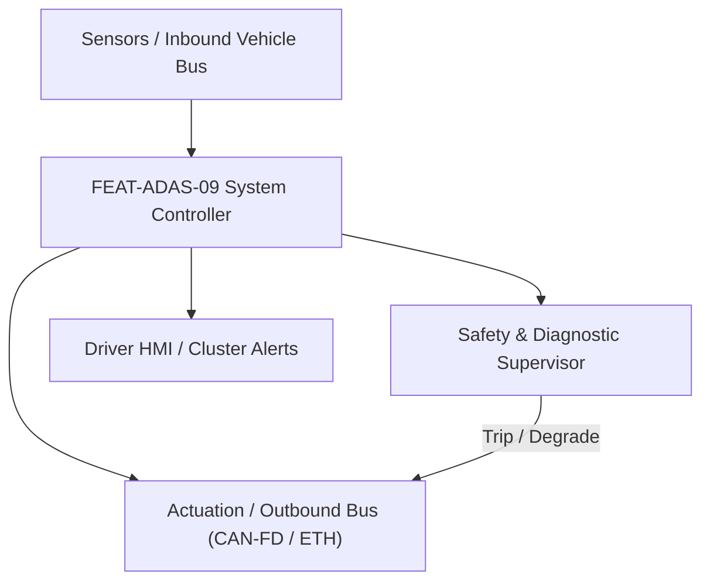
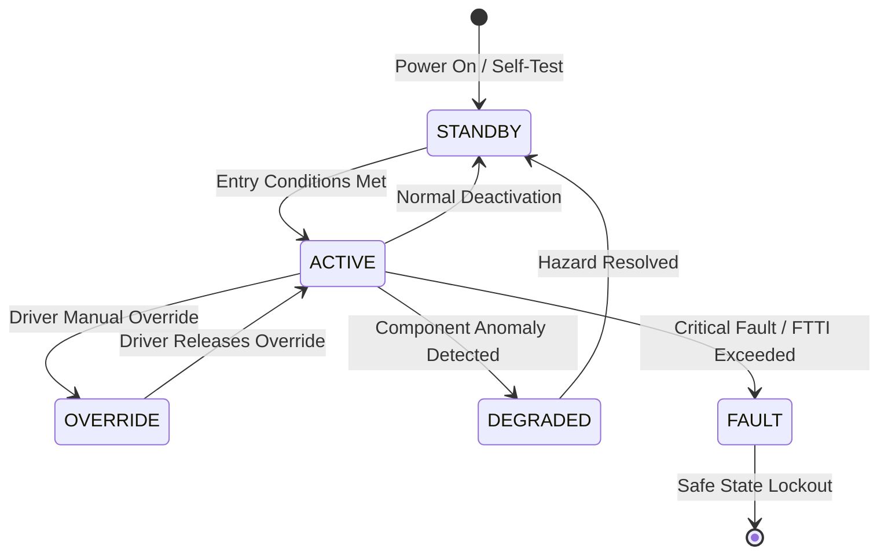

# System Requirements Specification: Rear Cross Traffic Alert & Braking (RCTA-RCTB)
**Feature ID:** `FEAT-ADAS-09`  
**Domain:** ADAS & Autonomous Driving  
**Target ASIL:** ASIL B  
**Compliance Standard:** ISO 26262:2018 (Part 4 - System Development) / ASPICE PAM v3.1 (SYS.2, SYS.3)  
**Parent Master Specification:** [`spec.md`](file:///c:/Workset/AntiGravityProjects/TestOptimisationExperiement/spec.md#feat-adas-09-rcta)  
**Derived Software Specification:** [`FEAT-ADAS-09_RCTA_SwReq.md`](file:///c:/Workset/AntiGravityProjects/TestOptimisationExperiement/software_requirements/FEAT-ADAS-09_RCTA_SwReq.md)

---

## 1. Feature Overview & Operational Scope

Detects cross-traffic vehicles, cyclists, and pedestrians approaching from the left or right while reversing out of parking spaces, issuing warnings and applying autonomous braking.

### Operational Context Architecture

---

## 2. Activation Logic & Operational States

- **Preconditions:** Reverse gear (R) selected, vehicle speed <= 15 km/h, rear radar sensors unblocked.
- **Entry Conditions:** Target approaching laterally from left/right rear corners with TTC <= 2.5s (alert) or TTC <= 1.0s (braking).
- **Deactivation Conditions:** Vehicle shifted out of Reverse, target passes, or vehicle brought to standstill for > 2.0s.
- **Driver Override Behavior:** Driver applying hard accelerator press overrides autonomous braking after 1.5s hold.
- **Operational State Progression:**  
  `REVERSE_STANDBY` -> `CROSS_TRAFFIC_ALERT` -> `EMERGENCY_REVERSING_BRAKE` -> `BRAKE_HOLD` -> `SUPPRESSED`

### State Transition Diagram

---

## 3. Functional Safety & Failure Mitigation Concept

- **Functional Safety Goal:** SG-RCTA-01: Prevent reversing collisions into lateral crossing traffic; avoid unintended sudden stops without hazard.
- **Fault Tolerant Time Interval (FTTI):** 80 ms
- **Safe State Definition:** Release autonomous brake request to 0.0 m/s².
- **Warning & Escalation Strategy:** Rearview camera screen flashes directional red arrows; high-frequency pulsed acoustic chime.

### Failure Modes & Degradation Handling
- **Corner Radar Blinded:** If trailer attached or bicycle rack blocks rear radars, automatically disable RCTA and notify driver.

---

## 4. System Requirements (SYS_REQ)
*(Note: Each System Requirement is systematically partitioned into multiple Child Software Requirements)*

### `SYS-ADAS-09-01`: Lateral Approaching Cross-Traffic Kinematics Detection
- **Planned Release:** R100
- **ASIL Rating:** ASIL B
- **Parent Feature:** [`FEAT-ADAS-09`](file:///c:/Workset/AntiGravityProjects/TestOptimisationExperiement/spec.md#feat-adas-09)
- **Requirement Statement:**
  > The System SHALL detect lateral cross-traffic approaching at speeds from 5 km/h to 35 km/h up to 35 m away using rear corner radars, evaluating lateral Time-to-Collision (TTC) within <= 20 ms.
- **Activation Logic:** Active whenever transmission gear is in REVERSE.
- **Fault Tolerant Time Interval (FTTI):** 60 ms
- **Safe State Action:** Invalidate cross-traffic tracks; extinguish warning icons.
- **Failure Detection & Reaction:** If radar detects stationary parked vehicle as crossing target, filter out via zero Doppler speed.
- **Input Interfaces:** `Rear_Left_Radar_Targets, Rear_Right_Radar_Targets, Ego_Reverse_Speed`
- **Output Interfaces:** `RCTA_Cross_Threat_Left (boolean), RCTA_Cross_Threat_Right (boolean), Threat_TTC_Sec`
- **System Verification Method:** Perpendicular reversing track tests with moving target vehicles.
- **Derived Child Software Requirements (1:N Link):**
  - [`SWR-ADAS-09-01`](file:///c:/Workset/AntiGravityProjects/TestOptimisationExperiement/software_requirements/FEAT-ADAS-09_RCTA_SwReq.md#swr-adas-09-01)
  - [`SWR-ADAS-09-02`](file:///c:/Workset/AntiGravityProjects/TestOptimisationExperiement/software_requirements/FEAT-ADAS-09_RCTA_SwReq.md#swr-adas-09-02)

### `SYS-ADAS-09-02`: Autonomous Reversing Emergency Deceleration Intervention
- **Planned Release:** R100
- **ASIL Rating:** ASIL B
- **Parent Feature:** [`FEAT-ADAS-09`](file:///c:/Workset/AntiGravityProjects/TestOptimisationExperiement/spec.md#feat-adas-09)
- **Requirement Statement:**
  > The System SHALL command autonomous emergency braking (up to -6.0 m/s²) in <= 80 ms if reversing collision is imminent (TTC <= 1.0s), holding the vehicle stopped for 2.0 seconds.
- **Activation Logic:** Active when Threat_TTC <= 1.0s and vehicle is moving in reverse.
- **Fault Tolerant Time Interval (FTTI):** 80 ms
- **Safe State Action:** Release brake pressure after 2.0s standstill hold.
- **Failure Detection & Reaction:** If hydraulic brake actuator fails to respond, engage electronic parking brake (EPB).
- **Input Interfaces:** `Threat_TTC_Sec, Vehicle_Speed_Mps, Driver_Brake_Override`
- **Output Interfaces:** `RCTB_Brake_Request_Mps2, Camera_HMI_Directional_Arrow`
- **System Verification Method:** Euro NCAP Backover and Rear Cross Traffic test protocols.
- **Derived Child Software Requirements (1:N Link):**
  - [`SWR-ADAS-09-03`](file:///c:/Workset/AntiGravityProjects/TestOptimisationExperiement/software_requirements/FEAT-ADAS-09_RCTA_SwReq.md#swr-adas-09-03)
  - [`SWR-ADAS-09-04`](file:///c:/Workset/AntiGravityProjects/TestOptimisationExperiement/software_requirements/FEAT-ADAS-09_RCTA_SwReq.md#swr-adas-09-04)

### `SYS-ADAS-09-03`: Reversing Camera Dynamic Trajectory Overlay & Guidance Bounding Box
- **Planned Release:** R100
- **ASIL Rating:** ASIL B
- **Parent Feature:** [`FEAT-ADAS-09`](file:///c:/Workset/AntiGravityProjects/TestOptimisationExperiement/spec.md#feat-adas-09)
- **Requirement Statement:**
  > The System SHALL render dynamic curved trajectory guide lines overlaid on reversing camera video display at 30 fps, highlighting approaching cross-traffic targets with flashing red bounding boxes and directional arrows.
- **Activation Logic:** Active whenever reverse gear is engaged.
- **Fault Tolerant Time Interval (FTTI):** 80 ms
- **Safe State Action:** Display raw camera video stream without overlay graphics.
- **Failure Detection & Reaction:** If graphics overlay processor crashes, display static guidelines from camera firmware.
- **Input Interfaces:** `Rearview_Camera_Video_Stream, Steering_Wheel_Angle_Deg, Cross_Threat_Kinematics`
- **Output Interfaces:** `Infotainment_Video_Display_Buffer, Cross_Threat_Bounding_Boxes[4]`
- **System Verification Method:** Camera frame latency and trajectory alignment testing according to FMVSS 111.
- **Derived Child Software Requirements (1:N Link):**
  - [`SWR-ADAS-09-05`](file:///c:/Workset/AntiGravityProjects/TestOptimisationExperiement/software_requirements/FEAT-ADAS-09_RCTA_SwReq.md#swr-adas-09-05)
  - [`SWR-ADAS-09-06`](file:///c:/Workset/AntiGravityProjects/TestOptimisationExperiement/software_requirements/FEAT-ADAS-09_RCTA_SwReq.md#swr-adas-09-06)

### `SYS-ADAS-09-04`: Low-Height Obstacle & Bolted Bollard Proximity Clamper
- **Planned Release:** R100
- **ASIL Rating:** ASIL B
- **Parent Feature:** [`FEAT-ADAS-09`](file:///c:/Workset/AntiGravityProjects/TestOptimisationExperiement/spec.md#feat-adas-09)
- **Requirement Statement:**
  > The System SHALL detect low-height stationary obstacles (parking bollards, concrete stops, fire hydrants) behind bumper (< 1.5 m) using 4 rear ultrasonic sensors, automatically braking to prevent vehicle bumper damage.
- **Activation Logic:** Active when reversing speed < 10 km/h.
- **Fault Tolerant Time Interval (FTTI):** 50 ms
- **Safe State Action:** Clamp brakes; sound continuous parking buzzer tone.
- **Failure Detection & Reaction:** Inhibit auto-braking if ultrasonic sensors are covered with snow/ice.
- **Input Interfaces:** `Rear_Ultrasonic_Distances_Cm[4], Ego_Reverse_Speed_Mps`
- **Output Interfaces:** `Ultrasonic_Stop_Brake_Req, Obstacle_Distance_Zone_Enum`
- **System Verification Method:** Standard 75 mm low pipe obstacle reverse impact tests.
- **Derived Child Software Requirements (1:N Link):**
  - [`SWR-ADAS-09-07`](file:///c:/Workset/AntiGravityProjects/TestOptimisationExperiement/software_requirements/FEAT-ADAS-09_RCTA_SwReq.md#swr-adas-09-07)
  - [`SWR-ADAS-09-08`](file:///c:/Workset/AntiGravityProjects/TestOptimisationExperiement/software_requirements/FEAT-ADAS-09_RCTA_SwReq.md#swr-adas-09-08)

### `SYS-ADAS-09-05`: Reverse Gear Selection Trigger & System State Initialization
- **Planned Release:** R200
- **ASIL Rating:** ASIL B
- **Parent Feature:** [`FEAT-ADAS-09`](file:///c:/Workset/AntiGravityProjects/TestOptimisationExperiement/spec.md#feat-adas-09)
- **Requirement Statement:**
  > The System SHALL Arm rear cross traffic monitoring within 100 ms of driver selecting REVERSE gear.
- **Activation Logic:** Active during normal vehicle operation when feature state is active.
- **Fault Tolerant Time Interval (FTTI):** 50 ms
- **Safe State Action:** Transition to safe state or safe degradation tier within FTTI budget.
- **Failure Detection & Reaction:** Isolate faulted channel, latch DEM diagnostic trouble code, and inform driver.
- **Input Interfaces:** `Sensor signals, vehicle dynamics data, and bus frames via RTE.`
- **Output Interfaces:** `Actuator commands, diagnostic event flags, and cluster alerts.`
- **System Verification Method:** HiL test bench and dynamometer automated verification.
- **Derived Child Software Requirements (1:N Link):**
  - [`SWR-ADAS-09-09`](file:///c:/Workset/AntiGravityProjects/TestOptimisationExperiement/software_requirements/FEAT-ADAS-09_RCTA_SwReq.md#swr-adas-09-09)
  - [`SWR-ADAS-09-10`](file:///c:/Workset/AntiGravityProjects/TestOptimisationExperiement/software_requirements/FEAT-ADAS-09_RCTA_SwReq.md#swr-adas-09-10)

### `SYS-ADAS-09-06`: Rear Corner Radar 150-Degree Ultra-Wide Crossing Target Scanner
- **Planned Release:** R200
- **ASIL Rating:** ASIL B
- **Parent Feature:** [`FEAT-ADAS-09`](file:///c:/Workset/AntiGravityProjects/TestOptimisationExperiement/spec.md#feat-adas-09)
- **Requirement Statement:**
  > The System SHALL Scan cross traffic approaching perpendicularly from left and right at speeds from 5 to 40 km/h.
- **Activation Logic:** Active during normal vehicle operation when feature state is active.
- **Fault Tolerant Time Interval (FTTI):** 30 ms
- **Safe State Action:** Transition to safe state or safe degradation tier within FTTI budget.
- **Failure Detection & Reaction:** Isolate faulted channel, latch DEM diagnostic trouble code, and inform driver.
- **Input Interfaces:** `Sensor signals, vehicle dynamics data, and bus frames via RTE.`
- **Output Interfaces:** `Actuator commands, diagnostic event flags, and cluster alerts.`
- **System Verification Method:** HiL test bench and dynamometer automated verification.
- **Derived Child Software Requirements (1:N Link):**
  - [`SWR-ADAS-09-11`](file:///c:/Workset/AntiGravityProjects/TestOptimisationExperiement/software_requirements/FEAT-ADAS-09_RCTA_SwReq.md#swr-adas-09-11)
  - [`SWR-ADAS-09-12`](file:///c:/Workset/AntiGravityProjects/TestOptimisationExperiement/software_requirements/FEAT-ADAS-09_RCTA_SwReq.md#swr-adas-09-12)

### `SYS-ADAS-09-07`: Crossing Vehicle Lateral Path Intersection & TTC Predictor
- **Planned Release:** R300
- **ASIL Rating:** ASIL B
- **Parent Feature:** [`FEAT-ADAS-09`](file:///c:/Workset/AntiGravityProjects/TestOptimisationExperiement/spec.md#feat-adas-09)
- **Requirement Statement:**
  > The System SHALL Compute projected collision point behind vehicle; assert warning if TTC <= 2.5 seconds.
- **Activation Logic:** Active during normal vehicle operation when feature state is active.
- **Fault Tolerant Time Interval (FTTI):** 30 ms
- **Safe State Action:** Transition to safe state or safe degradation tier within FTTI budget.
- **Failure Detection & Reaction:** Isolate faulted channel, latch DEM diagnostic trouble code, and inform driver.
- **Input Interfaces:** `Sensor signals, vehicle dynamics data, and bus frames via RTE.`
- **Output Interfaces:** `Actuator commands, diagnostic event flags, and cluster alerts.`
- **System Verification Method:** HiL test bench and dynamometer automated verification.
- **Derived Child Software Requirements (1:N Link):**
  - [`SWR-ADAS-09-13`](file:///c:/Workset/AntiGravityProjects/TestOptimisationExperiement/software_requirements/FEAT-ADAS-09_RCTA_SwReq.md#swr-adas-09-13)
  - [`SWR-ADAS-09-14`](file:///c:/Workset/AntiGravityProjects/TestOptimisationExperiement/software_requirements/FEAT-ADAS-09_RCTA_SwReq.md#swr-adas-09-14)

### `SYS-ADAS-09-08`: 3-Stage Driver Warning Alert (Visual Graphic, Audio Chime, HUD)
- **Planned Release:** R300
- **ASIL Rating:** ASIL B
- **Parent Feature:** [`FEAT-ADAS-09`](file:///c:/Workset/AntiGravityProjects/TestOptimisationExperiement/spec.md#feat-adas-09)
- **Requirement Statement:**
  > The System SHALL Display directional red flashing arrows on reverse camera screen and sound directional chimes.
- **Activation Logic:** Active during normal vehicle operation when feature state is active.
- **Fault Tolerant Time Interval (FTTI):** 40 ms
- **Safe State Action:** Transition to safe state or safe degradation tier within FTTI budget.
- **Failure Detection & Reaction:** Isolate faulted channel, latch DEM diagnostic trouble code, and inform driver.
- **Input Interfaces:** `Sensor signals, vehicle dynamics data, and bus frames via RTE.`
- **Output Interfaces:** `Actuator commands, diagnostic event flags, and cluster alerts.`
- **System Verification Method:** HiL test bench and dynamometer automated verification.
- **Derived Child Software Requirements (1:N Link):**
  - [`SWR-ADAS-09-15`](file:///c:/Workset/AntiGravityProjects/TestOptimisationExperiement/software_requirements/FEAT-ADAS-09_RCTA_SwReq.md#swr-adas-09-15)
  - [`SWR-ADAS-09-16`](file:///c:/Workset/AntiGravityProjects/TestOptimisationExperiement/software_requirements/FEAT-ADAS-09_RCTA_SwReq.md#swr-adas-09-16)

### `SYS-ADAS-09-09`: Rear Cross Traffic Autonomous Braking (RCTB) Trigger Governor
- **Planned Release:** R300
- **ASIL Rating:** ASIL B
- **Parent Feature:** [`FEAT-ADAS-09`](file:///c:/Workset/AntiGravityProjects/TestOptimisationExperiement/spec.md#feat-adas-09)
- **Requirement Statement:**
  > The System SHALL Command full braking stop (-6.0 m/s²) in <= 120 ms if crossing vehicle TTC drops below 1.2s.
- **Activation Logic:** Active during normal vehicle operation when feature state is active.
- **Fault Tolerant Time Interval (FTTI):** 20 ms
- **Safe State Action:** Transition to safe state or safe degradation tier within FTTI budget.
- **Failure Detection & Reaction:** Isolate faulted channel, latch DEM diagnostic trouble code, and inform driver.
- **Input Interfaces:** `Sensor signals, vehicle dynamics data, and bus frames via RTE.`
- **Output Interfaces:** `Actuator commands, diagnostic event flags, and cluster alerts.`
- **System Verification Method:** HiL test bench and dynamometer automated verification.
- **Derived Child Software Requirements (1:N Link):**
  - [`SWR-ADAS-09-17`](file:///c:/Workset/AntiGravityProjects/TestOptimisationExperiement/software_requirements/FEAT-ADAS-09_RCTA_SwReq.md#swr-adas-09-17)
  - [`SWR-ADAS-09-18`](file:///c:/Workset/AntiGravityProjects/TestOptimisationExperiement/software_requirements/FEAT-ADAS-09_RCTA_SwReq.md#swr-adas-09-18)

### `SYS-ADAS-09-10`: Rear Bumper Ultrasonic Sensor Close-Range Fusion Gatekeeper
- **Planned Release:** R400
- **ASIL Rating:** ASIL B
- **Parent Feature:** [`FEAT-ADAS-09`](file:///c:/Workset/AntiGravityProjects/TestOptimisationExperiement/spec.md#feat-adas-09)
- **Requirement Statement:**
  > The System SHALL Cross-validate radar detections with rear ultrasonic sensors to confirm close-range obstacles.
- **Activation Logic:** Active during normal vehicle operation when feature state is active.
- **Fault Tolerant Time Interval (FTTI):** 30 ms
- **Safe State Action:** Transition to safe state or safe degradation tier within FTTI budget.
- **Failure Detection & Reaction:** Isolate faulted channel, latch DEM diagnostic trouble code, and inform driver.
- **Input Interfaces:** `Sensor signals, vehicle dynamics data, and bus frames via RTE.`
- **Output Interfaces:** `Actuator commands, diagnostic event flags, and cluster alerts.`
- **System Verification Method:** HiL test bench and dynamometer automated verification.
- **Derived Child Software Requirements (1:N Link):**
  - [`SWR-ADAS-09-19`](file:///c:/Workset/AntiGravityProjects/TestOptimisationExperiement/software_requirements/FEAT-ADAS-09_RCTA_SwReq.md#swr-adas-09-19)
  - [`SWR-ADAS-09-20`](file:///c:/Workset/AntiGravityProjects/TestOptimisationExperiement/software_requirements/FEAT-ADAS-09_RCTA_SwReq.md#swr-adas-09-20)

### `SYS-ADAS-09-11`: Pedestrian & Cyclist Low-Profile Crossing Target Detector
- **Planned Release:** R400
- **ASIL Rating:** ASIL B
- **Parent Feature:** [`FEAT-ADAS-09`](file:///c:/Workset/AntiGravityProjects/TestOptimisationExperiement/spec.md#feat-adas-09)
- **Requirement Statement:**
  > The System SHALL Detect walking pedestrians (speed 1-5 km/h) crossing behind vehicle in low-light parking conditions.
- **Activation Logic:** Active during normal vehicle operation when feature state is active.
- **Fault Tolerant Time Interval (FTTI):** 40 ms
- **Safe State Action:** Transition to safe state or safe degradation tier within FTTI budget.
- **Failure Detection & Reaction:** Isolate faulted channel, latch DEM diagnostic trouble code, and inform driver.
- **Input Interfaces:** `Sensor signals, vehicle dynamics data, and bus frames via RTE.`
- **Output Interfaces:** `Actuator commands, diagnostic event flags, and cluster alerts.`
- **System Verification Method:** HiL test bench and dynamometer automated verification.
- **Derived Child Software Requirements (1:N Link):**
  - [`SWR-ADAS-09-21`](file:///c:/Workset/AntiGravityProjects/TestOptimisationExperiement/software_requirements/FEAT-ADAS-09_RCTA_SwReq.md#swr-adas-09-21)
  - [`SWR-ADAS-09-22`](file:///c:/Workset/AntiGravityProjects/TestOptimisationExperiement/software_requirements/FEAT-ADAS-09_RCTA_SwReq.md#swr-adas-09-22)

### `SYS-ADAS-09-12`: Trailer Hitch Engagement Automatic RCTB Deactivation
- **Planned Release:** R400
- **ASIL Rating:** ASIL B
- **Parent Feature:** [`FEAT-ADAS-09`](file:///c:/Workset/AntiGravityProjects/TestOptimisationExperiement/spec.md#feat-adas-09)
- **Requirement Statement:**
  > The System SHALL Automatically suppress autonomous reverse braking when trailer is hitched to prevent false stops.
- **Activation Logic:** Active during normal vehicle operation when feature state is active.
- **Fault Tolerant Time Interval (FTTI):** 100 ms
- **Safe State Action:** Transition to safe state or safe degradation tier within FTTI budget.
- **Failure Detection & Reaction:** Isolate faulted channel, latch DEM diagnostic trouble code, and inform driver.
- **Input Interfaces:** `Sensor signals, vehicle dynamics data, and bus frames via RTE.`
- **Output Interfaces:** `Actuator commands, diagnostic event flags, and cluster alerts.`
- **System Verification Method:** HiL test bench and dynamometer automated verification.
- **Derived Child Software Requirements (1:N Link):**
  - [`SWR-ADAS-09-23`](file:///c:/Workset/AntiGravityProjects/TestOptimisationExperiement/software_requirements/FEAT-ADAS-09_RCTA_SwReq.md#swr-adas-09-23)
  - [`SWR-ADAS-09-24`](file:///c:/Workset/AntiGravityProjects/TestOptimisationExperiement/software_requirements/FEAT-ADAS-09_RCTA_SwReq.md#swr-adas-09-24)

### `SYS-ADAS-09-13`: Driver Throttle Override & Standstill Release Sequence
- **Planned Release:** R500
- **ASIL Rating:** ASIL B
- **Parent Feature:** [`FEAT-ADAS-09`](file:///c:/Workset/AntiGravityProjects/TestOptimisationExperiement/spec.md#feat-adas-09)
- **Requirement Statement:**
  > The System SHALL Release autonomous brake hold after 2.0s standstill or if driver depresses accelerator pedal firmly.
- **Activation Logic:** Active during normal vehicle operation when feature state is active.
- **Fault Tolerant Time Interval (FTTI):** 50 ms
- **Safe State Action:** Transition to safe state or safe degradation tier within FTTI budget.
- **Failure Detection & Reaction:** Isolate faulted channel, latch DEM diagnostic trouble code, and inform driver.
- **Input Interfaces:** `Sensor signals, vehicle dynamics data, and bus frames via RTE.`
- **Output Interfaces:** `Actuator commands, diagnostic event flags, and cluster alerts.`
- **System Verification Method:** HiL test bench and dynamometer automated verification.
- **Derived Child Software Requirements (1:N Link):**
  - [`SWR-ADAS-09-25`](file:///c:/Workset/AntiGravityProjects/TestOptimisationExperiement/software_requirements/FEAT-ADAS-09_RCTA_SwReq.md#swr-adas-09-25)
  - [`SWR-ADAS-09-26`](file:///c:/Workset/AntiGravityProjects/TestOptimisationExperiement/software_requirements/FEAT-ADAS-09_RCTA_SwReq.md#swr-adas-09-26)

### `SYS-ADAS-09-14`: Rear Camera Video Feed Dirt & Snow Obstruction Detector
- **Planned Release:** R500
- **ASIL Rating:** ASIL B
- **Parent Feature:** [`FEAT-ADAS-09`](file:///c:/Workset/AntiGravityProjects/TestOptimisationExperiement/spec.md#feat-adas-09)
- **Requirement Statement:**
  > The System SHALL Detect obscured rear camera lens and trigger cluster alert notifying driver to clean lens.
- **Activation Logic:** Active during normal vehicle operation when feature state is active.
- **Fault Tolerant Time Interval (FTTI):** 200 ms
- **Safe State Action:** Transition to safe state or safe degradation tier within FTTI budget.
- **Failure Detection & Reaction:** Isolate faulted channel, latch DEM diagnostic trouble code, and inform driver.
- **Input Interfaces:** `Sensor signals, vehicle dynamics data, and bus frames via RTE.`
- **Output Interfaces:** `Actuator commands, diagnostic event flags, and cluster alerts.`
- **System Verification Method:** HiL test bench and dynamometer automated verification.
- **Derived Child Software Requirements (1:N Link):**
  - [`SWR-ADAS-09-27`](file:///c:/Workset/AntiGravityProjects/TestOptimisationExperiement/software_requirements/FEAT-ADAS-09_RCTA_SwReq.md#swr-adas-09-27)
  - [`SWR-ADAS-09-28`](file:///c:/Workset/AntiGravityProjects/TestOptimisationExperiement/software_requirements/FEAT-ADAS-09_RCTA_SwReq.md#swr-adas-09-28)

### `SYS-ADAS-09-15`: DEM Diagnostic Event Reporting & Non-Volatile Error Latching
- **Planned Release:** R500
- **ASIL Rating:** ASIL B
- **Parent Feature:** [`FEAT-ADAS-09`](file:///c:/Workset/AntiGravityProjects/TestOptimisationExperiement/spec.md#feat-adas-09)
- **Requirement Statement:**
  > The System SHALL Log DTCs for rear corner radar communication timeout and internal sensor processing faults.
- **Activation Logic:** Active during normal vehicle operation when feature state is active.
- **Fault Tolerant Time Interval (FTTI):** 100 ms
- **Safe State Action:** Transition to safe state or safe degradation tier within FTTI budget.
- **Failure Detection & Reaction:** Isolate faulted channel, latch DEM diagnostic trouble code, and inform driver.
- **Input Interfaces:** `Sensor signals, vehicle dynamics data, and bus frames via RTE.`
- **Output Interfaces:** `Actuator commands, diagnostic event flags, and cluster alerts.`
- **System Verification Method:** HiL test bench and dynamometer automated verification.
- **Derived Child Software Requirements (1:N Link):**
  - [`SWR-ADAS-09-29`](file:///c:/Workset/AntiGravityProjects/TestOptimisationExperiement/software_requirements/FEAT-ADAS-09_RCTA_SwReq.md#swr-adas-09-29)
  - [`SWR-ADAS-09-30`](file:///c:/Workset/AntiGravityProjects/TestOptimisationExperiement/software_requirements/FEAT-ADAS-09_RCTA_SwReq.md#swr-adas-09-30)

---

## 5. System-to-Software Traceability Summary

| System Requirement ID | Planned Release | ASIL | Title | Derived Software Requirements (1:N) | Verification Method |
| :--- | :---: | :--- | :--- | :--- | :--- |
| `SYS-ADAS-09-01` | **`R100`** | ASIL B | Lateral Approaching Cross-Traffic Kinematics Detection | [`SWR-ADAS-09-01`](file:///c:/Workset/AntiGravityProjects/TestOptimisationExperiement/software_requirements/FEAT-ADAS-09_RCTA_SwReq.md#swr-adas-09-01), [`SWR-ADAS-09-02`](file:///c:/Workset/AntiGravityProjects/TestOptimisationExperiement/software_requirements/FEAT-ADAS-09_RCTA_SwReq.md#swr-adas-09-02) | Perpendicular reversing track tests with moving target vehicles. |
| `SYS-ADAS-09-02` | **`R100`** | ASIL B | Autonomous Reversing Emergency Deceleration Intervention | [`SWR-ADAS-09-03`](file:///c:/Workset/AntiGravityProjects/TestOptimisationExperiement/software_requirements/FEAT-ADAS-09_RCTA_SwReq.md#swr-adas-09-03), [`SWR-ADAS-09-04`](file:///c:/Workset/AntiGravityProjects/TestOptimisationExperiement/software_requirements/FEAT-ADAS-09_RCTA_SwReq.md#swr-adas-09-04) | Euro NCAP Backover and Rear Cross Traffic test protocols. |
| `SYS-ADAS-09-03` | **`R100`** | ASIL B | Reversing Camera Dynamic Trajectory Overlay & Guidance Bounding Box | [`SWR-ADAS-09-05`](file:///c:/Workset/AntiGravityProjects/TestOptimisationExperiement/software_requirements/FEAT-ADAS-09_RCTA_SwReq.md#swr-adas-09-05), [`SWR-ADAS-09-06`](file:///c:/Workset/AntiGravityProjects/TestOptimisationExperiement/software_requirements/FEAT-ADAS-09_RCTA_SwReq.md#swr-adas-09-06) | Camera frame latency and trajectory alignment testing according to FMVSS 111. |
| `SYS-ADAS-09-04` | **`R100`** | ASIL B | Low-Height Obstacle & Bolted Bollard Proximity Clamper | [`SWR-ADAS-09-07`](file:///c:/Workset/AntiGravityProjects/TestOptimisationExperiement/software_requirements/FEAT-ADAS-09_RCTA_SwReq.md#swr-adas-09-07), [`SWR-ADAS-09-08`](file:///c:/Workset/AntiGravityProjects/TestOptimisationExperiement/software_requirements/FEAT-ADAS-09_RCTA_SwReq.md#swr-adas-09-08) | Standard 75 mm low pipe obstacle reverse impact tests. |
| `SYS-ADAS-09-05` | **`R200`** | ASIL B | Reverse Gear Selection Trigger & System State Initialization | [`SWR-ADAS-09-09`](file:///c:/Workset/AntiGravityProjects/TestOptimisationExperiement/software_requirements/FEAT-ADAS-09_RCTA_SwReq.md#swr-adas-09-09), [`SWR-ADAS-09-10`](file:///c:/Workset/AntiGravityProjects/TestOptimisationExperiement/software_requirements/FEAT-ADAS-09_RCTA_SwReq.md#swr-adas-09-10) | HiL test bench and dynamometer automated verification. |
| `SYS-ADAS-09-06` | **`R200`** | ASIL B | Rear Corner Radar 150-Degree Ultra-Wide Crossing Target Scanner | [`SWR-ADAS-09-11`](file:///c:/Workset/AntiGravityProjects/TestOptimisationExperiement/software_requirements/FEAT-ADAS-09_RCTA_SwReq.md#swr-adas-09-11), [`SWR-ADAS-09-12`](file:///c:/Workset/AntiGravityProjects/TestOptimisationExperiement/software_requirements/FEAT-ADAS-09_RCTA_SwReq.md#swr-adas-09-12) | HiL test bench and dynamometer automated verification. |
| `SYS-ADAS-09-07` | **`R300`** | ASIL B | Crossing Vehicle Lateral Path Intersection & TTC Predictor | [`SWR-ADAS-09-13`](file:///c:/Workset/AntiGravityProjects/TestOptimisationExperiement/software_requirements/FEAT-ADAS-09_RCTA_SwReq.md#swr-adas-09-13), [`SWR-ADAS-09-14`](file:///c:/Workset/AntiGravityProjects/TestOptimisationExperiement/software_requirements/FEAT-ADAS-09_RCTA_SwReq.md#swr-adas-09-14) | HiL test bench and dynamometer automated verification. |
| `SYS-ADAS-09-08` | **`R300`** | ASIL B | 3-Stage Driver Warning Alert (Visual Graphic, Audio Chime, HUD) | [`SWR-ADAS-09-15`](file:///c:/Workset/AntiGravityProjects/TestOptimisationExperiement/software_requirements/FEAT-ADAS-09_RCTA_SwReq.md#swr-adas-09-15), [`SWR-ADAS-09-16`](file:///c:/Workset/AntiGravityProjects/TestOptimisationExperiement/software_requirements/FEAT-ADAS-09_RCTA_SwReq.md#swr-adas-09-16) | HiL test bench and dynamometer automated verification. |
| `SYS-ADAS-09-09` | **`R300`** | ASIL B | Rear Cross Traffic Autonomous Braking (RCTB) Trigger Governor | [`SWR-ADAS-09-17`](file:///c:/Workset/AntiGravityProjects/TestOptimisationExperiement/software_requirements/FEAT-ADAS-09_RCTA_SwReq.md#swr-adas-09-17), [`SWR-ADAS-09-18`](file:///c:/Workset/AntiGravityProjects/TestOptimisationExperiement/software_requirements/FEAT-ADAS-09_RCTA_SwReq.md#swr-adas-09-18) | HiL test bench and dynamometer automated verification. |
| `SYS-ADAS-09-10` | **`R400`** | ASIL B | Rear Bumper Ultrasonic Sensor Close-Range Fusion Gatekeeper | [`SWR-ADAS-09-19`](file:///c:/Workset/AntiGravityProjects/TestOptimisationExperiement/software_requirements/FEAT-ADAS-09_RCTA_SwReq.md#swr-adas-09-19), [`SWR-ADAS-09-20`](file:///c:/Workset/AntiGravityProjects/TestOptimisationExperiement/software_requirements/FEAT-ADAS-09_RCTA_SwReq.md#swr-adas-09-20) | HiL test bench and dynamometer automated verification. |
| `SYS-ADAS-09-11` | **`R400`** | ASIL B | Pedestrian & Cyclist Low-Profile Crossing Target Detector | [`SWR-ADAS-09-21`](file:///c:/Workset/AntiGravityProjects/TestOptimisationExperiement/software_requirements/FEAT-ADAS-09_RCTA_SwReq.md#swr-adas-09-21), [`SWR-ADAS-09-22`](file:///c:/Workset/AntiGravityProjects/TestOptimisationExperiement/software_requirements/FEAT-ADAS-09_RCTA_SwReq.md#swr-adas-09-22) | HiL test bench and dynamometer automated verification. |
| `SYS-ADAS-09-12` | **`R400`** | ASIL B | Trailer Hitch Engagement Automatic RCTB Deactivation | [`SWR-ADAS-09-23`](file:///c:/Workset/AntiGravityProjects/TestOptimisationExperiement/software_requirements/FEAT-ADAS-09_RCTA_SwReq.md#swr-adas-09-23), [`SWR-ADAS-09-24`](file:///c:/Workset/AntiGravityProjects/TestOptimisationExperiement/software_requirements/FEAT-ADAS-09_RCTA_SwReq.md#swr-adas-09-24) | HiL test bench and dynamometer automated verification. |
| `SYS-ADAS-09-13` | **`R500`** | ASIL B | Driver Throttle Override & Standstill Release Sequence | [`SWR-ADAS-09-25`](file:///c:/Workset/AntiGravityProjects/TestOptimisationExperiement/software_requirements/FEAT-ADAS-09_RCTA_SwReq.md#swr-adas-09-25), [`SWR-ADAS-09-26`](file:///c:/Workset/AntiGravityProjects/TestOptimisationExperiement/software_requirements/FEAT-ADAS-09_RCTA_SwReq.md#swr-adas-09-26) | HiL test bench and dynamometer automated verification. |
| `SYS-ADAS-09-14` | **`R500`** | ASIL B | Rear Camera Video Feed Dirt & Snow Obstruction Detector | [`SWR-ADAS-09-27`](file:///c:/Workset/AntiGravityProjects/TestOptimisationExperiement/software_requirements/FEAT-ADAS-09_RCTA_SwReq.md#swr-adas-09-27), [`SWR-ADAS-09-28`](file:///c:/Workset/AntiGravityProjects/TestOptimisationExperiement/software_requirements/FEAT-ADAS-09_RCTA_SwReq.md#swr-adas-09-28) | HiL test bench and dynamometer automated verification. |
| `SYS-ADAS-09-15` | **`R500`** | ASIL B | DEM Diagnostic Event Reporting & Non-Volatile Error Latching | [`SWR-ADAS-09-29`](file:///c:/Workset/AntiGravityProjects/TestOptimisationExperiement/software_requirements/FEAT-ADAS-09_RCTA_SwReq.md#swr-adas-09-29), [`SWR-ADAS-09-30`](file:///c:/Workset/AntiGravityProjects/TestOptimisationExperiement/software_requirements/FEAT-ADAS-09_RCTA_SwReq.md#swr-adas-09-30) | HiL test bench and dynamometer automated verification. |

- **Upstream Feature Link:** [`spec.md` (FEAT-ADAS-09)](file:///c:/Workset/AntiGravityProjects/TestOptimisationExperiement/spec.md#feat-adas-09)
- **Software Requirements Specification:** [`FEAT-ADAS-09_RCTA_SwReq.md`](file:///c:/Workset/AntiGravityProjects/TestOptimisationExperiement/software_requirements/FEAT-ADAS-09_RCTA_SwReq.md)
