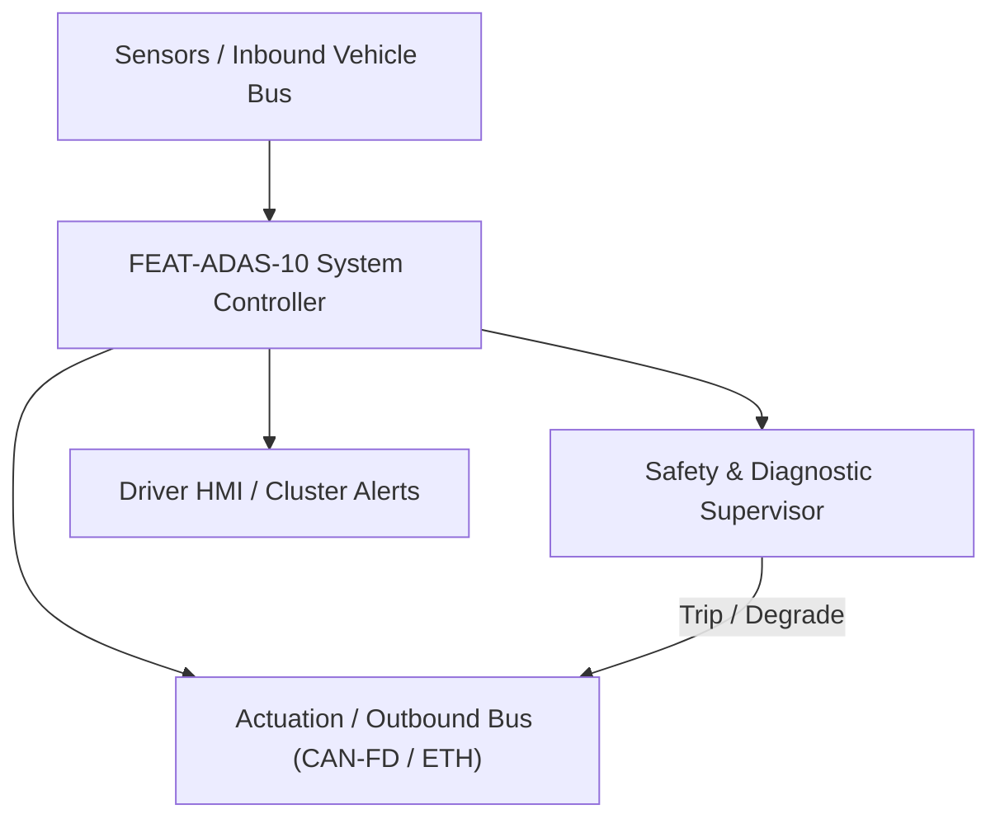
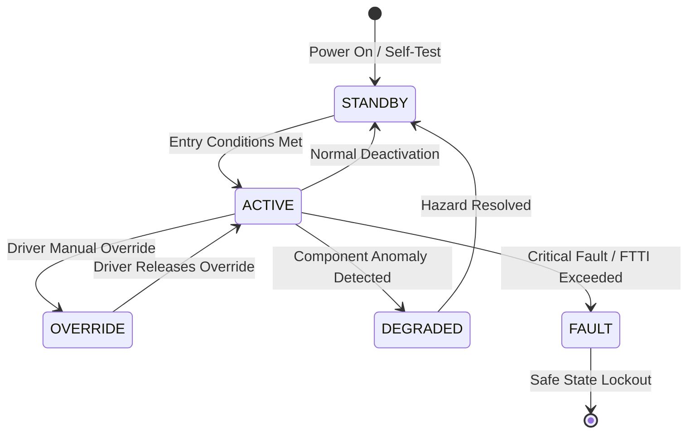

# System Requirements Specification: Intelligent Speed Assist & Traffic Sign Recognition (ISA-TSR)
**Feature ID:** `FEAT-ADAS-10`  
**Domain:** ADAS & Autonomous Driving  
**Target ASIL:** ASIL B  
**Compliance Standard:** ISO 26262:2018 (Part 4 - System Development) / ASPICE PAM v3.1 (SYS.2, SYS.3)  
**Parent Master Specification:** [`spec.md`](file:///c:/Workset/AntiGravityProjects/TestOptimisationExperiement/spec.md#feat-adas-10-isa)  
**Derived Software Specification:** [`FEAT-ADAS-10_ISA_SwReq.md`](file:///c:/Workset/AntiGravityProjects/TestOptimisationExperiement/software_requirements/FEAT-ADAS-10_ISA_SwReq.md)

---

## 1. Feature Overview & Operational Scope

Recognizes optical traffic signs, fuses with navigation speed limit data, and provides automated speed limit adoption to comply with EU GSR regulations.

### Operational Context Architecture

---

## 2. Activation Logic & Operational States

- **Preconditions:** Ignition in RUN, front camera active, navigation map database loaded.
- **Entry Conditions:** Always active by default at vehicle start (EU GSR mandate); driver can toggle audio overspeed chime.
- **Deactivation Conditions:** Autonomous speed limiting disengaged if driver presses throttle kickdown (> 85% travel).
- **Driver Override Behavior:** Throttle kickdown immediately overrides speed limiter for passing maneuvers.
- **Operational State Progression:**  
  `SIGN_SCANNING` -> `SPEED_LIMIT_POSTED` -> `OVERSPEED_WARNING` -> `SPEED_LIMITER_ENGAGED` -> `DEGRADED_MAP_ONLY`

### State Transition Diagram

---

## 3. Functional Safety & Failure Mitigation Concept

- **Functional Safety Goal:** SG-ISA-01: Prevent unexpected severe deceleration due to misrecognized speed signs.
- **Fault Tolerant Time Interval (FTTI):** 500 ms
- **Safe State Definition:** Revert to baseline driver manual accelerator control; display unconfirmed sign with question mark.
- **Warning & Escalation Strategy:** Flashing speed limit icon on cluster and head-up display when v_ego > speed_limit + 3 km/h.

### Failure Modes & Degradation Handling
- **Camera Obscured:** If camera blinded by low sun angle, rely purely on GPS map database speed limit.
- **Conflicting Limits:** If optical camera reads 40 km/h but map says 100 km/h (temporary construction), prioritize the optical camera sign.

---

## 4. System Requirements (SYS_REQ)
*(Note: Each System Requirement is systematically partitioned into multiple Child Software Requirements)*

### `SYS-ADAS-10-01`: Camera Traffic Sign Optical Recognition & Nav Map Fusion
- **Planned Release:** R100
- **ASIL Rating:** ASIL B
- **Parent Feature:** [`FEAT-ADAS-10`](file:///c:/Workset/AntiGravityProjects/TestOptimisationExperiement/spec.md#feat-adas-10)
- **Requirement Statement:**
  > The System SHALL detect standard circular and rectangular speed signs (including electronic LED variable message signs) with >= 95% accuracy up to 80 m, fusing detections with GPS digital map speed limits within 100 ms.
- **Activation Logic:** Active at all times while driving.
- **Fault Tolerant Time Interval (FTTI):** 250 ms
- **Safe State Action:** Display last known confirmed speed limit or null indicator.
- **Failure Detection & Reaction:** If sign confidence < 75%, do not post limit to cluster.
- **Input Interfaces:** `Front_Camera_Video_Feed, Navigation_Speed_Limit_Data, GPS_Speed`
- **Output Interfaces:** `Arbitrated_Speed_Limit_Kmph, Sign_Source_Type, Conditional_Rain_Sign_Flag`
- **System Verification Method:** Euro NCAP speed assist test protocol and Vienna Convention sign catalog.
- **Derived Child Software Requirements (1:N Link):**
  - [`SWR-ADAS-10-01`](file:///c:/Workset/AntiGravityProjects/TestOptimisationExperiement/software_requirements/FEAT-ADAS-10_ISA_SwReq.md#swr-adas-10-01)
  - [`SWR-ADAS-10-02`](file:///c:/Workset/AntiGravityProjects/TestOptimisationExperiement/software_requirements/FEAT-ADAS-10_ISA_SwReq.md#swr-adas-10-02)

### `SYS-ADAS-10-02`: Overspeed Visual-Acoustic Alerting & Speed Limiter Interface
- **Planned Release:** R100
- **ASIL Rating:** ASIL B
- **Parent Feature:** [`FEAT-ADAS-10`](file:///c:/Workset/AntiGravityProjects/TestOptimisationExperiement/spec.md#feat-adas-10)
- **Requirement Statement:**
  > The System SHALL alert driver within 1.0s if speed exceeds posted limit by > 3 km/h, and clamp powertrain cruise control setpoint to matched limit if Intelligent Speed Limiter mode is active.
- **Activation Logic:** Active when v_ego > Arbitrated_Speed_Limit + 3 km/h.
- **Fault Tolerant Time Interval (FTTI):** 500 ms
- **Safe State Action:** Release cruise setpoint clamping; silence chime.
- **Failure Detection & Reaction:** If speedometer CAN signal missing, disable overspeed alerts.
- **Input Interfaces:** `Vehicle_Speed_Kmph, Arbitrated_Speed_Limit_Kmph, ISA_Limiter_Active`
- **Output Interfaces:** `ISA_Alert_Level (uint8), VCU_Cruise_Speed_Cap_Kmph`
- **System Verification Method:** HIL testing against European Commission GSR Annex II requirements.
- **Derived Child Software Requirements (1:N Link):**
  - [`SWR-ADAS-10-03`](file:///c:/Workset/AntiGravityProjects/TestOptimisationExperiement/software_requirements/FEAT-ADAS-10_ISA_SwReq.md#swr-adas-10-03)
  - [`SWR-ADAS-10-04`](file:///c:/Workset/AntiGravityProjects/TestOptimisationExperiement/software_requirements/FEAT-ADAS-10_ISA_SwReq.md#swr-adas-10-04)

### `SYS-ADAS-10-03`: Electronic Horizon Map Speed Limit Fusion & Conditional Signs
- **Planned Release:** R100
- **ASIL Rating:** ASIL A
- **Parent Feature:** [`FEAT-ADAS-10`](file:///c:/Workset/AntiGravityProjects/TestOptimisationExperiement/spec.md#feat-adas-10)
- **Requirement Statement:**
  > The System SHALL fuse optical TSR speed signs with electronic navigation horizon digital map data, correctly resolving conditional speed limits (e.g. 'In Rain', 'Time of Day', 'School Zone', 'Exit 40 km/h') based on vehicle sensors.
- **Activation Logic:** Active whenever vehicle is traveling on mapped public roads.
- **Fault Tolerant Time Interval (FTTI):** 250 ms
- **Safe State Action:** Default to general road class speed limit.
- **Failure Detection & Reaction:** If conditional condition cannot be verified (e.g. rain sensor uncertain), display both limits on cluster.
- **Input Interfaces:** `Camera_Conditional_SubSign_Enum, Rain_Sensor_Status, Clock_Time_OfDay, Navigation_Road_Type`
- **Output Interfaces:** `Resolved_Active_Speed_Limit_Kmph, Conditional_Sign_Active_Flag`
- **System Verification Method:** Euro NCAP Speed Assist Systems conditional sign test catalog.
- **Derived Child Software Requirements (1:N Link):**
  - [`SWR-ADAS-10-05`](file:///c:/Workset/AntiGravityProjects/TestOptimisationExperiement/software_requirements/FEAT-ADAS-10_ISA_SwReq.md#swr-adas-10-05)
  - [`SWR-ADAS-10-06`](file:///c:/Workset/AntiGravityProjects/TestOptimisationExperiement/software_requirements/FEAT-ADAS-10_ISA_SwReq.md#swr-adas-10-06)

### `SYS-ADAS-10-04`: Autonomous Speed Adaptation & Powertrain Torque Soft-Clamping
- **Planned Release:** R200
- **ASIL Rating:** ASIL A / EU 2019/2144
- **Parent Feature:** [`FEAT-ADAS-10`](file:///c:/Workset/AntiGravityProjects/TestOptimisationExperiement/spec.md#feat-adas-10)
- **Requirement Statement:**
  > The System SHALL support driver-selectable Intelligent Speed Limiter mode: Automatically restricting maximum powertrain propulsion torque to prevent vehicle speed from exceeding active posted speed limit + tolerance (+-0 to +5 km/h).
- **Activation Logic:** Active when driver enables 'Intelligent Speed Limiter' mode.
- **Fault Tolerant Time Interval (FTTI):** 200 ms
- **Safe State Action:** Release torque restriction; allow driver 100% standard accelerator pedal control.
- **Failure Detection & Reaction:** Driver accelerator kickdown (> 80% pedal travel) immediately overrides limiter.
- **Input Interfaces:** `Resolved_Active_Speed_Limit_Kmph, Driver_Throttle_Pedal_Pct, Actual_Vehicle_Speed_Kmph`
- **Output Interfaces:** `VCU_Max_Allowable_Torque_Nm, Speed_Limiter_Active_Flag`
- **System Verification Method:** EU General Safety Regulation (EU 2019/2144) ISA vehicle type-approval testing.
- **Derived Child Software Requirements (1:N Link):**
  - [`SWR-ADAS-10-07`](file:///c:/Workset/AntiGravityProjects/TestOptimisationExperiement/software_requirements/FEAT-ADAS-10_ISA_SwReq.md#swr-adas-10-07)
  - [`SWR-ADAS-10-08`](file:///c:/Workset/AntiGravityProjects/TestOptimisationExperiement/software_requirements/FEAT-ADAS-10_ISA_SwReq.md#swr-adas-10-08)

### `SYS-ADAS-10-05`: Front Camera Traffic Sign Deep Learning Detection & Classification
- **Planned Release:** R200
- **ASIL Rating:** ASIL B
- **Parent Feature:** [`FEAT-ADAS-10`](file:///c:/Workset/AntiGravityProjects/TestOptimisationExperiement/spec.md#feat-adas-10)
- **Requirement Statement:**
  > The System SHALL Detect circular and rectangular regulatory speed limit signs with classification accuracy >= 98%.
- **Activation Logic:** Active during normal vehicle operation when feature state is active.
- **Fault Tolerant Time Interval (FTTI):** 50 ms
- **Safe State Action:** Transition to safe state or safe degradation tier within FTTI budget.
- **Failure Detection & Reaction:** Isolate faulted channel, latch DEM diagnostic trouble code, and inform driver.
- **Input Interfaces:** `Sensor signals, vehicle dynamics data, and bus frames via RTE.`
- **Output Interfaces:** `Actuator commands, diagnostic event flags, and cluster alerts.`
- **System Verification Method:** HiL test bench and dynamometer automated verification.
- **Derived Child Software Requirements (1:N Link):**
  - [`SWR-ADAS-10-09`](file:///c:/Workset/AntiGravityProjects/TestOptimisationExperiement/software_requirements/FEAT-ADAS-10_ISA_SwReq.md#swr-adas-10-09)
  - [`SWR-ADAS-10-10`](file:///c:/Workset/AntiGravityProjects/TestOptimisationExperiement/software_requirements/FEAT-ADAS-10_ISA_SwReq.md#swr-adas-10-10)

### `SYS-ADAS-10-06`: Digital Navigation Map Speed Limit Database Fusion Engine
- **Planned Release:** R200
- **ASIL Rating:** ASIL B
- **Parent Feature:** [`FEAT-ADAS-10`](file:///c:/Workset/AntiGravityProjects/TestOptimisationExperiement/spec.md#feat-adas-10)
- **Requirement Statement:**
  > The System SHALL Fuse visual camera signs with digital map vector speed attributes, resolving conflicting values.
- **Activation Logic:** Active during normal vehicle operation when feature state is active.
- **Fault Tolerant Time Interval (FTTI):** 100 ms
- **Safe State Action:** Transition to safe state or safe degradation tier within FTTI budget.
- **Failure Detection & Reaction:** Isolate faulted channel, latch DEM diagnostic trouble code, and inform driver.
- **Input Interfaces:** `Sensor signals, vehicle dynamics data, and bus frames via RTE.`
- **Output Interfaces:** `Actuator commands, diagnostic event flags, and cluster alerts.`
- **System Verification Method:** HiL test bench and dynamometer automated verification.
- **Derived Child Software Requirements (1:N Link):**
  - [`SWR-ADAS-10-11`](file:///c:/Workset/AntiGravityProjects/TestOptimisationExperiement/software_requirements/FEAT-ADAS-10_ISA_SwReq.md#swr-adas-10-11)
  - [`SWR-ADAS-10-12`](file:///c:/Workset/AntiGravityProjects/TestOptimisationExperiement/software_requirements/FEAT-ADAS-10_ISA_SwReq.md#swr-adas-10-12)

### `SYS-ADAS-10-07`: Electronic Overhead Variable Message Sign (VMS) LED Reader
- **Planned Release:** R300
- **ASIL Rating:** ASIL B
- **Parent Feature:** [`FEAT-ADAS-10`](file:///c:/Workset/AntiGravityProjects/TestOptimisationExperiement/spec.md#feat-adas-10)
- **Requirement Statement:**
  > The System SHALL Read dynamic LED variable speed signs on overhead highway gantries across varying illumination.
- **Activation Logic:** Active during normal vehicle operation when feature state is active.
- **Fault Tolerant Time Interval (FTTI):** 50 ms
- **Safe State Action:** Transition to safe state or safe degradation tier within FTTI budget.
- **Failure Detection & Reaction:** Isolate faulted channel, latch DEM diagnostic trouble code, and inform driver.
- **Input Interfaces:** `Sensor signals, vehicle dynamics data, and bus frames via RTE.`
- **Output Interfaces:** `Actuator commands, diagnostic event flags, and cluster alerts.`
- **System Verification Method:** HiL test bench and dynamometer automated verification.
- **Derived Child Software Requirements (1:N Link):**
  - [`SWR-ADAS-10-13`](file:///c:/Workset/AntiGravityProjects/TestOptimisationExperiement/software_requirements/FEAT-ADAS-10_ISA_SwReq.md#swr-adas-10-13)
  - [`SWR-ADAS-10-14`](file:///c:/Workset/AntiGravityProjects/TestOptimisationExperiement/software_requirements/FEAT-ADAS-10_ISA_SwReq.md#swr-adas-10-14)

### `SYS-ADAS-10-08`: Conditional Weather & Time-of-Day Supplementary Sign Evaluator
- **Planned Release:** R300
- **ASIL Rating:** ASIL B
- **Parent Feature:** [`FEAT-ADAS-10`](file:///c:/Workset/AntiGravityProjects/TestOptimisationExperiement/spec.md#feat-adas-10)
- **Requirement Statement:**
  > The System SHALL Parse auxiliary signs (e.g. 'In Wet Weather', 'School Zone 7-9 AM') against rain and clock inputs.
- **Activation Logic:** Active during normal vehicle operation when feature state is active.
- **Fault Tolerant Time Interval (FTTI):** 100 ms
- **Safe State Action:** Transition to safe state or safe degradation tier within FTTI budget.
- **Failure Detection & Reaction:** Isolate faulted channel, latch DEM diagnostic trouble code, and inform driver.
- **Input Interfaces:** `Sensor signals, vehicle dynamics data, and bus frames via RTE.`
- **Output Interfaces:** `Actuator commands, diagnostic event flags, and cluster alerts.`
- **System Verification Method:** HiL test bench and dynamometer automated verification.
- **Derived Child Software Requirements (1:N Link):**
  - [`SWR-ADAS-10-15`](file:///c:/Workset/AntiGravityProjects/TestOptimisationExperiement/software_requirements/FEAT-ADAS-10_ISA_SwReq.md#swr-adas-10-15)
  - [`SWR-ADAS-10-16`](file:///c:/Workset/AntiGravityProjects/TestOptimisationExperiement/software_requirements/FEAT-ADAS-10_ISA_SwReq.md#swr-adas-10-16)

### `SYS-ADAS-10-09`: Instrument Cluster & Head-Up Display Speed Limit Icon Dispatcher
- **Planned Release:** R300
- **ASIL Rating:** ASIL B
- **Parent Feature:** [`FEAT-ADAS-10`](file:///c:/Workset/AntiGravityProjects/TestOptimisationExperiement/spec.md#feat-adas-10)
- **Requirement Statement:**
  > The System SHALL Render recognized speed limit badge on instrument cluster and HUD within 150 ms of sign passing.
- **Activation Logic:** Active during normal vehicle operation when feature state is active.
- **Fault Tolerant Time Interval (FTTI):** 50 ms
- **Safe State Action:** Transition to safe state or safe degradation tier within FTTI budget.
- **Failure Detection & Reaction:** Isolate faulted channel, latch DEM diagnostic trouble code, and inform driver.
- **Input Interfaces:** `Sensor signals, vehicle dynamics data, and bus frames via RTE.`
- **Output Interfaces:** `Actuator commands, diagnostic event flags, and cluster alerts.`
- **System Verification Method:** HiL test bench and dynamometer automated verification.
- **Derived Child Software Requirements (1:N Link):**
  - [`SWR-ADAS-10-17`](file:///c:/Workset/AntiGravityProjects/TestOptimisationExperiement/software_requirements/FEAT-ADAS-10_ISA_SwReq.md#swr-adas-10-17)
  - [`SWR-ADAS-10-18`](file:///c:/Workset/AntiGravityProjects/TestOptimisationExperiement/software_requirements/FEAT-ADAS-10_ISA_SwReq.md#swr-adas-10-18)

### `SYS-ADAS-10-10`: Overspeed Visual & Acoustic Warning Escalation Manager
- **Planned Release:** R400
- **ASIL Rating:** ASIL B
- **Parent Feature:** [`FEAT-ADAS-10`](file:///c:/Workset/AntiGravityProjects/TestOptimisationExperiement/spec.md#feat-adas-10)
- **Requirement Statement:**
  > The System SHALL Flash speed badge and sound acoustic chime when vehicle speed exceeds limit by > 3 km/h.
- **Activation Logic:** Active during normal vehicle operation when feature state is active.
- **Fault Tolerant Time Interval (FTTI):** 100 ms
- **Safe State Action:** Transition to safe state or safe degradation tier within FTTI budget.
- **Failure Detection & Reaction:** Isolate faulted channel, latch DEM diagnostic trouble code, and inform driver.
- **Input Interfaces:** `Sensor signals, vehicle dynamics data, and bus frames via RTE.`
- **Output Interfaces:** `Actuator commands, diagnostic event flags, and cluster alerts.`
- **System Verification Method:** HiL test bench and dynamometer automated verification.
- **Derived Child Software Requirements (1:N Link):**
  - [`SWR-ADAS-10-19`](file:///c:/Workset/AntiGravityProjects/TestOptimisationExperiement/software_requirements/FEAT-ADAS-10_ISA_SwReq.md#swr-adas-10-19)
  - [`SWR-ADAS-10-20`](file:///c:/Workset/AntiGravityProjects/TestOptimisationExperiement/software_requirements/FEAT-ADAS-10_ISA_SwReq.md#swr-adas-10-20)

### `SYS-ADAS-10-11`: Haptic Accelerator Pedal Counter-Force Pushback Actuator
- **Planned Release:** R400
- **ASIL Rating:** ASIL A
- **Parent Feature:** [`FEAT-ADAS-10`](file:///c:/Workset/AntiGravityProjects/TestOptimisationExperiement/spec.md#feat-adas-10)
- **Requirement Statement:**
  > The System SHALL Apply up to 15 N counter-force to accelerator pedal to prompt driver to ease off throttle.
- **Activation Logic:** Active during normal vehicle operation when feature state is active.
- **Fault Tolerant Time Interval (FTTI):** 50 ms
- **Safe State Action:** Transition to safe state or safe degradation tier within FTTI budget.
- **Failure Detection & Reaction:** Isolate faulted channel, latch DEM diagnostic trouble code, and inform driver.
- **Input Interfaces:** `Sensor signals, vehicle dynamics data, and bus frames via RTE.`
- **Output Interfaces:** `Actuator commands, diagnostic event flags, and cluster alerts.`
- **System Verification Method:** HiL test bench and dynamometer automated verification.
- **Derived Child Software Requirements (1:N Link):**
  - [`SWR-ADAS-10-21`](file:///c:/Workset/AntiGravityProjects/TestOptimisationExperiement/software_requirements/FEAT-ADAS-10_ISA_SwReq.md#swr-adas-10-21)
  - [`SWR-ADAS-10-22`](file:///c:/Workset/AntiGravityProjects/TestOptimisationExperiement/software_requirements/FEAT-ADAS-10_ISA_SwReq.md#swr-adas-10-22)

### `SYS-ADAS-10-12`: Voluntary Intelligent Speed Limiter (ISL) Powertrain Torque Clamp
- **Planned Release:** R400
- **ASIL Rating:** ASIL B
- **Parent Feature:** [`FEAT-ADAS-10`](file:///c:/Workset/AntiGravityProjects/TestOptimisationExperiement/spec.md#feat-adas-10)
- **Requirement Statement:**
  > The System SHALL Clamp powertrain propulsion torque to prevent exceeding posted limit when ISL mode enabled.
- **Activation Logic:** Active during normal vehicle operation when feature state is active.
- **Fault Tolerant Time Interval (FTTI):** 30 ms
- **Safe State Action:** Transition to safe state or safe degradation tier within FTTI budget.
- **Failure Detection & Reaction:** Isolate faulted channel, latch DEM diagnostic trouble code, and inform driver.
- **Input Interfaces:** `Sensor signals, vehicle dynamics data, and bus frames via RTE.`
- **Output Interfaces:** `Actuator commands, diagnostic event flags, and cluster alerts.`
- **System Verification Method:** HiL test bench and dynamometer automated verification.
- **Derived Child Software Requirements (1:N Link):**
  - [`SWR-ADAS-10-23`](file:///c:/Workset/AntiGravityProjects/TestOptimisationExperiement/software_requirements/FEAT-ADAS-10_ISA_SwReq.md#swr-adas-10-23)
  - [`SWR-ADAS-10-24`](file:///c:/Workset/AntiGravityProjects/TestOptimisationExperiement/software_requirements/FEAT-ADAS-10_ISA_SwReq.md#swr-adas-10-24)

### `SYS-ADAS-10-13`: Temporary Construction & Work Zone Speed Sign Adaptation
- **Planned Release:** R500
- **ASIL Rating:** ASIL B
- **Parent Feature:** [`FEAT-ADAS-10`](file:///c:/Workset/AntiGravityProjects/TestOptimisationExperiement/spec.md#feat-adas-10)
- **Requirement Statement:**
  > The System SHALL Prioritize yellow/orange construction speed signs over standard permanent map speed attributes.
- **Activation Logic:** Active during normal vehicle operation when feature state is active.
- **Fault Tolerant Time Interval (FTTI):** 100 ms
- **Safe State Action:** Transition to safe state or safe degradation tier within FTTI budget.
- **Failure Detection & Reaction:** Isolate faulted channel, latch DEM diagnostic trouble code, and inform driver.
- **Input Interfaces:** `Sensor signals, vehicle dynamics data, and bus frames via RTE.`
- **Output Interfaces:** `Actuator commands, diagnostic event flags, and cluster alerts.`
- **System Verification Method:** HiL test bench and dynamometer automated verification.
- **Derived Child Software Requirements (1:N Link):**
  - [`SWR-ADAS-10-25`](file:///c:/Workset/AntiGravityProjects/TestOptimisationExperiement/software_requirements/FEAT-ADAS-10_ISA_SwReq.md#swr-adas-10-25)
  - [`SWR-ADAS-10-26`](file:///c:/Workset/AntiGravityProjects/TestOptimisationExperiement/software_requirements/FEAT-ADAS-10_ISA_SwReq.md#swr-adas-10-26)

### `SYS-ADAS-10-14`: Driver Kickdown Accelerator Emergency Override Gate
- **Planned Release:** R500
- **ASIL Rating:** ASIL B
- **Parent Feature:** [`FEAT-ADAS-10`](file:///c:/Workset/AntiGravityProjects/TestOptimisationExperiement/spec.md#feat-adas-10)
- **Requirement Statement:**
  > The System SHALL Immediately suspend speed limitation clamp if driver depresses accelerator pedal past kickdown detent.
- **Activation Logic:** Active during normal vehicle operation when feature state is active.
- **Fault Tolerant Time Interval (FTTI):** 20 ms
- **Safe State Action:** Transition to safe state or safe degradation tier within FTTI budget.
- **Failure Detection & Reaction:** Isolate faulted channel, latch DEM diagnostic trouble code, and inform driver.
- **Input Interfaces:** `Sensor signals, vehicle dynamics data, and bus frames via RTE.`
- **Output Interfaces:** `Actuator commands, diagnostic event flags, and cluster alerts.`
- **System Verification Method:** HiL test bench and dynamometer automated verification.
- **Derived Child Software Requirements (1:N Link):**
  - [`SWR-ADAS-10-27`](file:///c:/Workset/AntiGravityProjects/TestOptimisationExperiement/software_requirements/FEAT-ADAS-10_ISA_SwReq.md#swr-adas-10-27)
  - [`SWR-ADAS-10-28`](file:///c:/Workset/AntiGravityProjects/TestOptimisationExperiement/software_requirements/FEAT-ADAS-10_ISA_SwReq.md#swr-adas-10-28)

### `SYS-ADAS-10-15`: DEM UNECE R154 Compliance Logging & Camera Lens Health Monitor
- **Planned Release:** R500
- **ASIL Rating:** ASIL B
- **Parent Feature:** [`FEAT-ADAS-10`](file:///c:/Workset/AntiGravityProjects/TestOptimisationExperiement/spec.md#feat-adas-10)
- **Requirement Statement:**
  > The System SHALL Log camera obstruction status and ensure compliance with European ISA regulatory standards.
- **Activation Logic:** Active during normal vehicle operation when feature state is active.
- **Fault Tolerant Time Interval (FTTI):** 200 ms
- **Safe State Action:** Transition to safe state or safe degradation tier within FTTI budget.
- **Failure Detection & Reaction:** Isolate faulted channel, latch DEM diagnostic trouble code, and inform driver.
- **Input Interfaces:** `Sensor signals, vehicle dynamics data, and bus frames via RTE.`
- **Output Interfaces:** `Actuator commands, diagnostic event flags, and cluster alerts.`
- **System Verification Method:** HiL test bench and dynamometer automated verification.
- **Derived Child Software Requirements (1:N Link):**
  - [`SWR-ADAS-10-29`](file:///c:/Workset/AntiGravityProjects/TestOptimisationExperiement/software_requirements/FEAT-ADAS-10_ISA_SwReq.md#swr-adas-10-29)
  - [`SWR-ADAS-10-30`](file:///c:/Workset/AntiGravityProjects/TestOptimisationExperiement/software_requirements/FEAT-ADAS-10_ISA_SwReq.md#swr-adas-10-30)

---

## 5. System-to-Software Traceability Summary

| System Requirement ID | Planned Release | ASIL | Title | Derived Software Requirements (1:N) | Verification Method |
| :--- | :---: | :--- | :--- | :--- | :--- |
| `SYS-ADAS-10-01` | **`R100`** | ASIL B | Camera Traffic Sign Optical Recognition & Nav Map Fusion | [`SWR-ADAS-10-01`](file:///c:/Workset/AntiGravityProjects/TestOptimisationExperiement/software_requirements/FEAT-ADAS-10_ISA_SwReq.md#swr-adas-10-01), [`SWR-ADAS-10-02`](file:///c:/Workset/AntiGravityProjects/TestOptimisationExperiement/software_requirements/FEAT-ADAS-10_ISA_SwReq.md#swr-adas-10-02) | Euro NCAP speed assist test protocol and Vienna Convention sign catalog. |
| `SYS-ADAS-10-02` | **`R100`** | ASIL B | Overspeed Visual-Acoustic Alerting & Speed Limiter Interface | [`SWR-ADAS-10-03`](file:///c:/Workset/AntiGravityProjects/TestOptimisationExperiement/software_requirements/FEAT-ADAS-10_ISA_SwReq.md#swr-adas-10-03), [`SWR-ADAS-10-04`](file:///c:/Workset/AntiGravityProjects/TestOptimisationExperiement/software_requirements/FEAT-ADAS-10_ISA_SwReq.md#swr-adas-10-04) | HIL testing against European Commission GSR Annex II requirements. |
| `SYS-ADAS-10-03` | **`R100`** | ASIL A | Electronic Horizon Map Speed Limit Fusion & Conditional Signs | [`SWR-ADAS-10-05`](file:///c:/Workset/AntiGravityProjects/TestOptimisationExperiement/software_requirements/FEAT-ADAS-10_ISA_SwReq.md#swr-adas-10-05), [`SWR-ADAS-10-06`](file:///c:/Workset/AntiGravityProjects/TestOptimisationExperiement/software_requirements/FEAT-ADAS-10_ISA_SwReq.md#swr-adas-10-06) | Euro NCAP Speed Assist Systems conditional sign test catalog. |
| `SYS-ADAS-10-04` | **`R200`** | ASIL A / EU 2019/2144 | Autonomous Speed Adaptation & Powertrain Torque Soft-Clamping | [`SWR-ADAS-10-07`](file:///c:/Workset/AntiGravityProjects/TestOptimisationExperiement/software_requirements/FEAT-ADAS-10_ISA_SwReq.md#swr-adas-10-07), [`SWR-ADAS-10-08`](file:///c:/Workset/AntiGravityProjects/TestOptimisationExperiement/software_requirements/FEAT-ADAS-10_ISA_SwReq.md#swr-adas-10-08) | EU General Safety Regulation (EU 2019/2144) ISA vehicle type-approval testing. |
| `SYS-ADAS-10-05` | **`R200`** | ASIL B | Front Camera Traffic Sign Deep Learning Detection & Classification | [`SWR-ADAS-10-09`](file:///c:/Workset/AntiGravityProjects/TestOptimisationExperiement/software_requirements/FEAT-ADAS-10_ISA_SwReq.md#swr-adas-10-09), [`SWR-ADAS-10-10`](file:///c:/Workset/AntiGravityProjects/TestOptimisationExperiement/software_requirements/FEAT-ADAS-10_ISA_SwReq.md#swr-adas-10-10) | HiL test bench and dynamometer automated verification. |
| `SYS-ADAS-10-06` | **`R200`** | ASIL B | Digital Navigation Map Speed Limit Database Fusion Engine | [`SWR-ADAS-10-11`](file:///c:/Workset/AntiGravityProjects/TestOptimisationExperiement/software_requirements/FEAT-ADAS-10_ISA_SwReq.md#swr-adas-10-11), [`SWR-ADAS-10-12`](file:///c:/Workset/AntiGravityProjects/TestOptimisationExperiement/software_requirements/FEAT-ADAS-10_ISA_SwReq.md#swr-adas-10-12) | HiL test bench and dynamometer automated verification. |
| `SYS-ADAS-10-07` | **`R300`** | ASIL B | Electronic Overhead Variable Message Sign (VMS) LED Reader | [`SWR-ADAS-10-13`](file:///c:/Workset/AntiGravityProjects/TestOptimisationExperiement/software_requirements/FEAT-ADAS-10_ISA_SwReq.md#swr-adas-10-13), [`SWR-ADAS-10-14`](file:///c:/Workset/AntiGravityProjects/TestOptimisationExperiement/software_requirements/FEAT-ADAS-10_ISA_SwReq.md#swr-adas-10-14) | HiL test bench and dynamometer automated verification. |
| `SYS-ADAS-10-08` | **`R300`** | ASIL B | Conditional Weather & Time-of-Day Supplementary Sign Evaluator | [`SWR-ADAS-10-15`](file:///c:/Workset/AntiGravityProjects/TestOptimisationExperiement/software_requirements/FEAT-ADAS-10_ISA_SwReq.md#swr-adas-10-15), [`SWR-ADAS-10-16`](file:///c:/Workset/AntiGravityProjects/TestOptimisationExperiement/software_requirements/FEAT-ADAS-10_ISA_SwReq.md#swr-adas-10-16) | HiL test bench and dynamometer automated verification. |
| `SYS-ADAS-10-09` | **`R300`** | ASIL B | Instrument Cluster & Head-Up Display Speed Limit Icon Dispatcher | [`SWR-ADAS-10-17`](file:///c:/Workset/AntiGravityProjects/TestOptimisationExperiement/software_requirements/FEAT-ADAS-10_ISA_SwReq.md#swr-adas-10-17), [`SWR-ADAS-10-18`](file:///c:/Workset/AntiGravityProjects/TestOptimisationExperiement/software_requirements/FEAT-ADAS-10_ISA_SwReq.md#swr-adas-10-18) | HiL test bench and dynamometer automated verification. |
| `SYS-ADAS-10-10` | **`R400`** | ASIL B | Overspeed Visual & Acoustic Warning Escalation Manager | [`SWR-ADAS-10-19`](file:///c:/Workset/AntiGravityProjects/TestOptimisationExperiement/software_requirements/FEAT-ADAS-10_ISA_SwReq.md#swr-adas-10-19), [`SWR-ADAS-10-20`](file:///c:/Workset/AntiGravityProjects/TestOptimisationExperiement/software_requirements/FEAT-ADAS-10_ISA_SwReq.md#swr-adas-10-20) | HiL test bench and dynamometer automated verification. |
| `SYS-ADAS-10-11` | **`R400`** | ASIL A | Haptic Accelerator Pedal Counter-Force Pushback Actuator | [`SWR-ADAS-10-21`](file:///c:/Workset/AntiGravityProjects/TestOptimisationExperiement/software_requirements/FEAT-ADAS-10_ISA_SwReq.md#swr-adas-10-21), [`SWR-ADAS-10-22`](file:///c:/Workset/AntiGravityProjects/TestOptimisationExperiement/software_requirements/FEAT-ADAS-10_ISA_SwReq.md#swr-adas-10-22) | HiL test bench and dynamometer automated verification. |
| `SYS-ADAS-10-12` | **`R400`** | ASIL B | Voluntary Intelligent Speed Limiter (ISL) Powertrain Torque Clamp | [`SWR-ADAS-10-23`](file:///c:/Workset/AntiGravityProjects/TestOptimisationExperiement/software_requirements/FEAT-ADAS-10_ISA_SwReq.md#swr-adas-10-23), [`SWR-ADAS-10-24`](file:///c:/Workset/AntiGravityProjects/TestOptimisationExperiement/software_requirements/FEAT-ADAS-10_ISA_SwReq.md#swr-adas-10-24) | HiL test bench and dynamometer automated verification. |
| `SYS-ADAS-10-13` | **`R500`** | ASIL B | Temporary Construction & Work Zone Speed Sign Adaptation | [`SWR-ADAS-10-25`](file:///c:/Workset/AntiGravityProjects/TestOptimisationExperiement/software_requirements/FEAT-ADAS-10_ISA_SwReq.md#swr-adas-10-25), [`SWR-ADAS-10-26`](file:///c:/Workset/AntiGravityProjects/TestOptimisationExperiement/software_requirements/FEAT-ADAS-10_ISA_SwReq.md#swr-adas-10-26) | HiL test bench and dynamometer automated verification. |
| `SYS-ADAS-10-14` | **`R500`** | ASIL B | Driver Kickdown Accelerator Emergency Override Gate | [`SWR-ADAS-10-27`](file:///c:/Workset/AntiGravityProjects/TestOptimisationExperiement/software_requirements/FEAT-ADAS-10_ISA_SwReq.md#swr-adas-10-27), [`SWR-ADAS-10-28`](file:///c:/Workset/AntiGravityProjects/TestOptimisationExperiement/software_requirements/FEAT-ADAS-10_ISA_SwReq.md#swr-adas-10-28) | HiL test bench and dynamometer automated verification. |
| `SYS-ADAS-10-15` | **`R500`** | ASIL B | DEM UNECE R154 Compliance Logging & Camera Lens Health Monitor | [`SWR-ADAS-10-29`](file:///c:/Workset/AntiGravityProjects/TestOptimisationExperiement/software_requirements/FEAT-ADAS-10_ISA_SwReq.md#swr-adas-10-29), [`SWR-ADAS-10-30`](file:///c:/Workset/AntiGravityProjects/TestOptimisationExperiement/software_requirements/FEAT-ADAS-10_ISA_SwReq.md#swr-adas-10-30) | HiL test bench and dynamometer automated verification. |

- **Upstream Feature Link:** [`spec.md` (FEAT-ADAS-10)](file:///c:/Workset/AntiGravityProjects/TestOptimisationExperiement/spec.md#feat-adas-10)
- **Software Requirements Specification:** [`FEAT-ADAS-10_ISA_SwReq.md`](file:///c:/Workset/AntiGravityProjects/TestOptimisationExperiement/software_requirements/FEAT-ADAS-10_ISA_SwReq.md)
