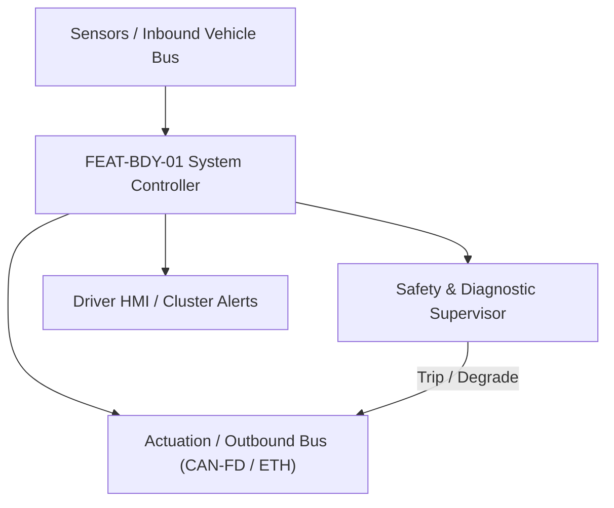
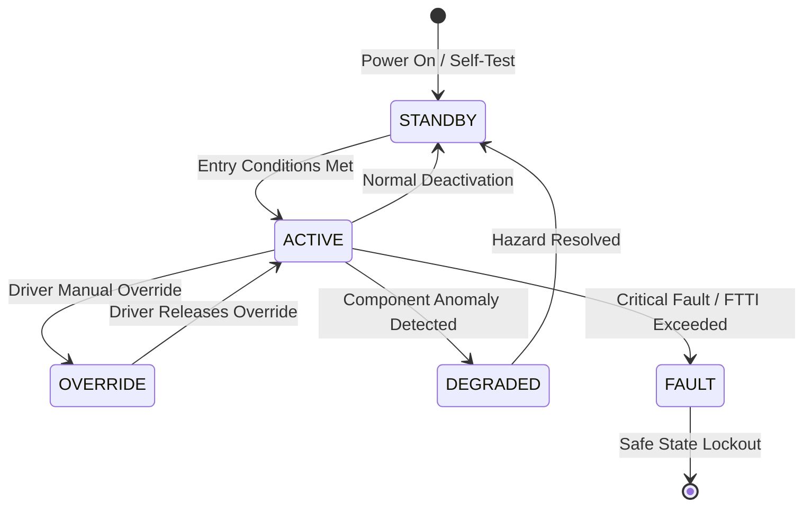

# System Requirements Specification: Passive Entry Passive Start & Digital Key (PEPS)
**Feature ID:** `FEAT-BDY-01`  
**Domain:** Body, Lighting & Restraints  
**Target ASIL:** ASIL B / ISO 21434  
**Compliance Standard:** ISO 26262:2018 (Part 4 - System Development) / ASPICE PAM v3.1 (SYS.2, SYS.3)  
**Parent Master Specification:** [`spec.md`](file:///c:/Workset/AntiGravityProjects/TestOptimisationExperiement/spec.md#feat-bdy-01-peps)  
**Derived Software Specification:** [`FEAT-BDY-01_PEPS_SwReq.md`](file:///c:/Workset/AntiGravityProjects/TestOptimisationExperiement/software_requirements/FEAT-BDY-01_PEPS_SwReq.md)

---

## 1. Feature Overview & Operational Scope

Authenticates smartphone fobs and keyfobs via Bluetooth Low Energy (BLE) and Ultra-Wideband (UWB) IEEE 802.15.4z secure ranging to enable hands-free entry and driveaway authorization.

### Operational Context Architecture

---

## 2. Activation Logic & Operational States

- **Preconditions:** 12V vehicle battery voltage >= 11.5V, UWB anchor transceiver network synchronized, BCM active.
- **Entry Conditions:** Authorized smartphone or keyfob enters exterior BLE advertising zone (< 15 m) and initiates UWB secure ranging (< 6 m).
- **Deactivation Conditions:** Key moves outside 2.5 m perimeter for > 2.0s (walk-away lock), or vehicle start button pressed with key validated.
- **Driver Override Behavior:** Physical mechanical emergency key blade in driver door handle unlocks door mechanically in case of dead battery.
- **Operational State Progression:**  
  `SLEEP_POLLING` -> `BLE_DISCOVERY` -> `UWB_RANGING_ACTIVE` -> `WELCOME_ZONE_UNLOCKED` -> `CABIN_INTERIOR_CONFIRMED` -> `IMMOBILIZER_AUTHENTICATED` -> `WALK_AWAY_LOCKED` -> `SECURITY_ATTACK_LOCKOUT`

### State Transition Diagram

---

## 3. Functional Safety & Failure Mitigation Concept

- **Functional Safety Goal:** SG-PEPS-01: Prevent unauthorized vehicle unlock or motor startup; protect against relay station attacks.
- **Fault Tolerant Time Interval (FTTI):** 200 ms for entry ranging; 50 ms for start button authorization.
- **Safe State Definition:** Lock doors; refuse start authorization token to powertrain VCU; lock electronic steering column.
- **Warning & Escalation Strategy:** Display 'Key Not Detected in Vehicle' on instrument cluster; exterior horn chirp if key is locked inside.

### Failure Modes & Degradation Handling
- **Relay Attack Detected:** If UWB Time-of-Flight timestamp sequence fails Scrambled Timestamp Sequence (STS) cryptographic integrity, trigger security alert and lockout.
- **Uwb Anchor Failure:** If 1 of 4 exterior UWB anchors fails, continue with 3-anchor trilateration with degraded 25 cm spatial accuracy.

---

## 4. System Requirements (SYS_REQ)
*(Note: Each System Requirement is systematically partitioned into multiple Child Software Requirements)*

### `SYS-BDY-01-01`: IEEE 802.15.4z UWB Secure Time-of-Flight Multilateration
- **Planned Release:** R100
- **ASIL Rating:** ASIL B / ISO 21434
- **Parent Feature:** [`FEAT-BDY-01`](file:///c:/Workset/AntiGravityProjects/TestOptimisationExperiement/spec.md#feat-bdy-01)
- **Requirement Statement:**
  > The System SHALL compute keyfob 3D Cartesian coordinates relative to vehicle center with < 10 cm spatial accuracy using at least 4 UWB anchor transceivers at <= 50 ms period, verifying cryptographic STS tokens to prevent relay attacks.
- **Activation Logic:** Active when keyfob is within BLE discovery range (< 10 m).
- **Fault Tolerant Time Interval (FTTI):** 100 ms
- **Safe State Action:** Invalidate distance estimate; refuse unlock sequence.
- **Failure Detection & Reaction:** If distance measurement exhibits negative phase velocity (relay spoofing indicator), trip security lockout.
- **Input Interfaces:** `4x_UWB_Transceiver_Packets (SPI), BLE_RSSI_Metrics, STS_Crypto_Noncelist`
- **Output Interfaces:** `Key_Position_X_Y_Z_Cm, Distance_Integrity_Verified (boolean)`
- **System Verification Method:** Anechoic RF chamber relay attack injection test suite.
- **Derived Child Software Requirements (1:N Link):**
  - [`SWR-BDY-01-01`](file:///c:/Workset/AntiGravityProjects/TestOptimisationExperiement/software_requirements/FEAT-BDY-01_PEPS_SwReq.md#swr-bdy-01-01)
  - [`SWR-BDY-01-02`](file:///c:/Workset/AntiGravityProjects/TestOptimisationExperiement/software_requirements/FEAT-BDY-01_PEPS_SwReq.md#swr-bdy-01-02)

### `SYS-BDY-01-02`: Zone State Automation & Cryptographic Immobilizer Handshake
- **Planned Release:** R100
- **ASIL Rating:** ASIL B
- **Parent Feature:** [`FEAT-BDY-01`](file:///c:/Workset/AntiGravityProjects/TestOptimisationExperiement/spec.md#feat-bdy-01)
- **Requirement Statement:**
  > The System SHALL command welcome puddle lights at < 3.0 m, door unlocking at < 1.5 m, walk-away lock at > 2.5 m, and execute an AES-128 challenge-response session to authorize vehicle powertrain start within <= 50 ms of Start Button press.
- **Activation Logic:** Active during vehicle ingress and startup.
- **Fault Tolerant Time Interval (FTTI):** 50 ms
- **Safe State Action:** Withhold start authorization token from VCU; maintain immobilizer lock.
- **Failure Detection & Reaction:** If challenge-response token mismatch occurs, lock start button for 5.0 seconds.
- **Input Interfaces:** `Key_Position_X_Y_Z_Cm, Door_Capacitive_Touch_Sensors, Start_Button_Switch_State`
- **Output Interfaces:** `BCM_Door_Lock_Motors_PDU, VCU_Start_Authorize_Token`
- **System Verification Method:** Vehicle ingress user-experience validation and immobilizer penetration testing.
- **Derived Child Software Requirements (1:N Link):**
  - [`SWR-BDY-01-03`](file:///c:/Workset/AntiGravityProjects/TestOptimisationExperiement/software_requirements/FEAT-BDY-01_PEPS_SwReq.md#swr-bdy-01-03)
  - [`SWR-BDY-01-04`](file:///c:/Workset/AntiGravityProjects/TestOptimisationExperiement/software_requirements/FEAT-BDY-01_PEPS_SwReq.md#swr-bdy-01-04)

### `SYS-BDY-01-03`: IEEE 802.15.4z UWB Cryptographic Time-of-Flight Anti-Relay Bounding
- **Planned Release:** R100
- **ASIL Rating:** ASIL B / ISO 21434
- **Parent Feature:** [`FEAT-BDY-01`](file:///c:/Workset/AntiGravityProjects/TestOptimisationExperiement/spec.md#feat-bdy-01)
- **Requirement Statement:**
  > The System SHALL compute cryptographically authenticated Ultra-Wideband (UWB) Time-of-Flight distance (0 to 10 m with +-5 cm accuracy) using Scrambled Timestamp Sequence (STS) to prevent relay-station attacks.
- **Activation Logic:** Active when smartphone or key fob enters BLE range (< 10 m).
- **Fault Tolerant Time Interval (FTTI):** 50 ms
- **Safe State Action:** Keep vehicle doors locked; prohibit engine/drive start.
- **Failure Detection & Reaction:** If UWB ranging timestamps show physical anomaly or phase variance, abort authentication.
- **Input Interfaces:** `UWB_STS_Encrypted_Frames, UWB_Transceiver_Antennas[5], BLE_RSSI_Dbm`
- **Output Interfaces:** `Cryptographic_Distance_Meters, Relay_Attack_Detected_Flag, Key_Zone_Enum`
- **System Verification Method:** Car Connectivity Consortium (CCC) Digital Key Release 3 compliance and RF relay attack bench testing.
- **Derived Child Software Requirements (1:N Link):**
  - [`SWR-BDY-01-05`](file:///c:/Workset/AntiGravityProjects/TestOptimisationExperiement/software_requirements/FEAT-BDY-01_PEPS_SwReq.md#swr-bdy-01-05)
  - [`SWR-BDY-01-06`](file:///c:/Workset/AntiGravityProjects/TestOptimisationExperiement/software_requirements/FEAT-BDY-01_PEPS_SwReq.md#swr-bdy-01-06)

### `SYS-BDY-01-04`: Welcome Carpet Light Choreography & Walk-Away Auto-Lock
- **Planned Release:** R200
- **ASIL Rating:** QM
- **Parent Feature:** [`FEAT-BDY-01`](file:///c:/Workset/AntiGravityProjects/TestOptimisationExperiement/spec.md#feat-bdy-01)
- **Requirement Statement:**
  > The System SHALL orchestrate dynamic LED ground projection carpet lighting when key approaches within 3.0 m, and automatically lock all doors, close windows, fold mirrors, and arm alarm when key walks away (> 2.5 m for > 3.0s).
- **Activation Logic:** Active in vehicle parked state.
- **Fault Tolerant Time Interval (FTTI):** 200 ms
- **Safe State Action:** Lock all doors; arm ultrasonic interior intrusion alarm.
- **Failure Detection & Reaction:** If key remains inside cabin, prohibit walk-away auto lock to prevent locking keys inside.
- **Input Interfaces:** `Key_Zone_Enum, Key_Distance_Meters, Door_Ajar_Status_Bits, Driver_Seat_Occupied`
- **Output Interfaces:** `Door_Lock_Actuator_Cmd, Welcome_Carpet_LED_Duty, Security_Alarm_Armed_Flag`
- **System Verification Method:** Proximity perimeter approach and departure automation testing across 500 walk cycles.
- **Derived Child Software Requirements (1:N Link):**
  - [`SWR-BDY-01-07`](file:///c:/Workset/AntiGravityProjects/TestOptimisationExperiement/software_requirements/FEAT-BDY-01_PEPS_SwReq.md#swr-bdy-01-07)
  - [`SWR-BDY-01-08`](file:///c:/Workset/AntiGravityProjects/TestOptimisationExperiement/software_requirements/FEAT-BDY-01_PEPS_SwReq.md#swr-bdy-01-08)

### `SYS-BDY-01-05`: Ultra-Wideband (UWB) Time-of-Flight Decimeter-Level Distance Ranging
- **Planned Release:** R200
- **ASIL Rating:** ASIL B
- **Parent Feature:** [`FEAT-BDY-01`](file:///c:/Workset/AntiGravityProjects/TestOptimisationExperiement/spec.md#feat-bdy-01)
- **Requirement Statement:**
  > The System SHALL Measure time-of-flight distance between vehicle transceivers and digital smartphone key with accuracy <= 10 cm.
- **Activation Logic:** Active during normal vehicle operation when feature state is active.
- **Fault Tolerant Time Interval (FTTI):** 50 ms
- **Safe State Action:** Transition to safe state or safe degradation tier within FTTI budget.
- **Failure Detection & Reaction:** Isolate faulted channel, latch DEM diagnostic trouble code, and inform driver.
- **Input Interfaces:** `Sensor signals, vehicle dynamics data, and bus frames via RTE.`
- **Output Interfaces:** `Actuator commands, diagnostic event flags, and cluster alerts.`
- **System Verification Method:** HiL test bench and dynamometer automated verification.
- **Derived Child Software Requirements (1:N Link):**
  - [`SWR-BDY-01-09`](file:///c:/Workset/AntiGravityProjects/TestOptimisationExperiement/software_requirements/FEAT-BDY-01_PEPS_SwReq.md#swr-bdy-01-09)
  - [`SWR-BDY-01-10`](file:///c:/Workset/AntiGravityProjects/TestOptimisationExperiement/software_requirements/FEAT-BDY-01_PEPS_SwReq.md#swr-bdy-01-10)

### `SYS-BDY-01-06`: Bluetooth Low Energy (BLE) RSSI Distance Proximity Channel Initiator
- **Planned Release:** R200
- **ASIL Rating:** ASIL B
- **Parent Feature:** [`FEAT-BDY-01`](file:///c:/Workset/AntiGravityProjects/TestOptimisationExperiement/spec.md#feat-bdy-01)
- **Requirement Statement:**
  > The System SHALL Detect approaching authorized smartphone key at 15 m distance to initiate wake-up lighting sequence.
- **Activation Logic:** Active during normal vehicle operation when feature state is active.
- **Fault Tolerant Time Interval (FTTI):** 100 ms
- **Safe State Action:** Transition to safe state or safe degradation tier within FTTI budget.
- **Failure Detection & Reaction:** Isolate faulted channel, latch DEM diagnostic trouble code, and inform driver.
- **Input Interfaces:** `Sensor signals, vehicle dynamics data, and bus frames via RTE.`
- **Output Interfaces:** `Actuator commands, diagnostic event flags, and cluster alerts.`
- **System Verification Method:** HiL test bench and dynamometer automated verification.
- **Derived Child Software Requirements (1:N Link):**
  - [`SWR-BDY-01-11`](file:///c:/Workset/AntiGravityProjects/TestOptimisationExperiement/software_requirements/FEAT-BDY-01_PEPS_SwReq.md#swr-bdy-01-11)
  - [`SWR-BDY-01-12`](file:///c:/Workset/AntiGravityProjects/TestOptimisationExperiement/software_requirements/FEAT-BDY-01_PEPS_SwReq.md#swr-bdy-01-12)

### `SYS-BDY-01-07`: Cryptographic Challenge-Response Rolling Code Anti-Relay Attack Validator
- **Planned Release:** R300
- **ASIL Rating:** ASIL B
- **Parent Feature:** [`FEAT-BDY-01`](file:///c:/Workset/AntiGravityProjects/TestOptimisationExperiement/spec.md#feat-bdy-01)
- **Requirement Statement:**
  > The System SHALL Execute AES-128 cryptographic exchange with rolling counter: Invalidate key session if latency > 30 ms (relay attack).
- **Activation Logic:** Active during normal vehicle operation when feature state is active.
- **Fault Tolerant Time Interval (FTTI):** 20 ms
- **Safe State Action:** Transition to safe state or safe degradation tier within FTTI budget.
- **Failure Detection & Reaction:** Isolate faulted channel, latch DEM diagnostic trouble code, and inform driver.
- **Input Interfaces:** `Sensor signals, vehicle dynamics data, and bus frames via RTE.`
- **Output Interfaces:** `Actuator commands, diagnostic event flags, and cluster alerts.`
- **System Verification Method:** HiL test bench and dynamometer automated verification.
- **Derived Child Software Requirements (1:N Link):**
  - [`SWR-BDY-01-13`](file:///c:/Workset/AntiGravityProjects/TestOptimisationExperiement/software_requirements/FEAT-BDY-01_PEPS_SwReq.md#swr-bdy-01-13)
  - [`SWR-BDY-01-14`](file:///c:/Workset/AntiGravityProjects/TestOptimisationExperiement/software_requirements/FEAT-BDY-01_PEPS_SwReq.md#swr-bdy-01-14)

### `SYS-BDY-01-08`: Interior vs Exterior Transceiver Key Spatial Localization Classifier
- **Planned Release:** R300
- **ASIL Rating:** ASIL B
- **Parent Feature:** [`FEAT-BDY-01`](file:///c:/Workset/AntiGravityProjects/TestOptimisationExperiement/spec.md#feat-bdy-01)
- **Requirement Statement:**
  > The System SHALL Distinguish whether authenticated key is inside or outside vehicle cabin to prevent uncommanded door lockouts.
- **Activation Logic:** Active during normal vehicle operation when feature state is active.
- **Fault Tolerant Time Interval (FTTI):** 50 ms
- **Safe State Action:** Transition to safe state or safe degradation tier within FTTI budget.
- **Failure Detection & Reaction:** Isolate faulted channel, latch DEM diagnostic trouble code, and inform driver.
- **Input Interfaces:** `Sensor signals, vehicle dynamics data, and bus frames via RTE.`
- **Output Interfaces:** `Actuator commands, diagnostic event flags, and cluster alerts.`
- **System Verification Method:** HiL test bench and dynamometer automated verification.
- **Derived Child Software Requirements (1:N Link):**
  - [`SWR-BDY-01-15`](file:///c:/Workset/AntiGravityProjects/TestOptimisationExperiement/software_requirements/FEAT-BDY-01_PEPS_SwReq.md#swr-bdy-01-15)
  - [`SWR-BDY-01-16`](file:///c:/Workset/AntiGravityProjects/TestOptimisationExperiement/software_requirements/FEAT-BDY-01_PEPS_SwReq.md#swr-bdy-01-16)

### `SYS-BDY-01-09`: Capacitive Door Handle Touch Sensor Approach & Grasp Debouncer
- **Planned Release:** R300
- **ASIL Rating:** ASIL B
- **Parent Feature:** [`FEAT-BDY-01`](file:///c:/Workset/AntiGravityProjects/TestOptimisationExperiement/spec.md#feat-bdy-01)
- **Requirement Statement:**
  > The System SHALL Sample door handle capacitive sensors: Unlock door latch within <= 150 ms of driver grasp detection.
- **Activation Logic:** Active during normal vehicle operation when feature state is active.
- **Fault Tolerant Time Interval (FTTI):** 30 ms
- **Safe State Action:** Transition to safe state or safe degradation tier within FTTI budget.
- **Failure Detection & Reaction:** Isolate faulted channel, latch DEM diagnostic trouble code, and inform driver.
- **Input Interfaces:** `Sensor signals, vehicle dynamics data, and bus frames via RTE.`
- **Output Interfaces:** `Actuator commands, diagnostic event flags, and cluster alerts.`
- **System Verification Method:** HiL test bench and dynamometer automated verification.
- **Derived Child Software Requirements (1:N Link):**
  - [`SWR-BDY-01-17`](file:///c:/Workset/AntiGravityProjects/TestOptimisationExperiement/software_requirements/FEAT-BDY-01_PEPS_SwReq.md#swr-bdy-01-17)
  - [`SWR-BDY-01-18`](file:///c:/Workset/AntiGravityProjects/TestOptimisationExperiement/software_requirements/FEAT-BDY-01_PEPS_SwReq.md#swr-bdy-01-18)

### `SYS-BDY-01-10`: Push-Button Start Ignition Relay Dual-Channel Interlock Supervisor
- **Planned Release:** R400
- **ASIL Rating:** ASIL B
- **Parent Feature:** [`FEAT-BDY-01`](file:///c:/Workset/AntiGravityProjects/TestOptimisationExperiement/spec.md#feat-bdy-01)
- **Requirement Statement:**
  > The System SHALL Verify authenticated key is inside cabin and brake pedal is depressed prior to closing starter/inverter relays.
- **Activation Logic:** Active during normal vehicle operation when feature state is active.
- **Fault Tolerant Time Interval (FTTI):** 20 ms
- **Safe State Action:** Transition to safe state or safe degradation tier within FTTI budget.
- **Failure Detection & Reaction:** Isolate faulted channel, latch DEM diagnostic trouble code, and inform driver.
- **Input Interfaces:** `Sensor signals, vehicle dynamics data, and bus frames via RTE.`
- **Output Interfaces:** `Actuator commands, diagnostic event flags, and cluster alerts.`
- **System Verification Method:** HiL test bench and dynamometer automated verification.
- **Derived Child Software Requirements (1:N Link):**
  - [`SWR-BDY-01-19`](file:///c:/Workset/AntiGravityProjects/TestOptimisationExperiement/software_requirements/FEAT-BDY-01_PEPS_SwReq.md#swr-bdy-01-19)
  - [`SWR-BDY-01-20`](file:///c:/Workset/AntiGravityProjects/TestOptimisationExperiement/software_requirements/FEAT-BDY-01_PEPS_SwReq.md#swr-bdy-01-20)

### `SYS-BDY-01-11`: Near-Field Communication (NFC) B-Pillar Backup Key Card Reader
- **Planned Release:** R400
- **ASIL Rating:** ASIL B
- **Parent Feature:** [`FEAT-BDY-01`](file:///c:/Workset/AntiGravityProjects/TestOptimisationExperiement/spec.md#feat-bdy-01)
- **Requirement Statement:**
  > The System SHALL Authenticate physical NFC smart card placed on B-pillar transceiver to allow vehicle ingress upon dead phone battery.
- **Activation Logic:** Active during normal vehicle operation when feature state is active.
- **Fault Tolerant Time Interval (FTTI):** 50 ms
- **Safe State Action:** Transition to safe state or safe degradation tier within FTTI budget.
- **Failure Detection & Reaction:** Isolate faulted channel, latch DEM diagnostic trouble code, and inform driver.
- **Input Interfaces:** `Sensor signals, vehicle dynamics data, and bus frames via RTE.`
- **Output Interfaces:** `Actuator commands, diagnostic event flags, and cluster alerts.`
- **System Verification Method:** HiL test bench and dynamometer automated verification.
- **Derived Child Software Requirements (1:N Link):**
  - [`SWR-BDY-01-21`](file:///c:/Workset/AntiGravityProjects/TestOptimisationExperiement/software_requirements/FEAT-BDY-01_PEPS_SwReq.md#swr-bdy-01-21)
  - [`SWR-BDY-01-22`](file:///c:/Workset/AntiGravityProjects/TestOptimisationExperiement/software_requirements/FEAT-BDY-01_PEPS_SwReq.md#swr-bdy-01-22)

### `SYS-BDY-01-12`: Walk-Away Automatic Door Latch Locking & Perimeter Arming Governor
- **Planned Release:** R400
- **ASIL Rating:** ASIL B
- **Parent Feature:** [`FEAT-BDY-01`](file:///c:/Workset/AntiGravityProjects/TestOptimisationExperiement/spec.md#feat-bdy-01)
- **Requirement Statement:**
  > The System SHALL Lock all doors, fold side mirrors, and arm perimeter anti-theft alarm when key distance exceeds 2.5 m.
- **Activation Logic:** Active during normal vehicle operation when feature state is active.
- **Fault Tolerant Time Interval (FTTI):** 200 ms
- **Safe State Action:** Transition to safe state or safe degradation tier within FTTI budget.
- **Failure Detection & Reaction:** Isolate faulted channel, latch DEM diagnostic trouble code, and inform driver.
- **Input Interfaces:** `Sensor signals, vehicle dynamics data, and bus frames via RTE.`
- **Output Interfaces:** `Actuator commands, diagnostic event flags, and cluster alerts.`
- **System Verification Method:** HiL test bench and dynamometer automated verification.
- **Derived Child Software Requirements (1:N Link):**
  - [`SWR-BDY-01-23`](file:///c:/Workset/AntiGravityProjects/TestOptimisationExperiement/software_requirements/FEAT-BDY-01_PEPS_SwReq.md#swr-bdy-01-23)
  - [`SWR-BDY-01-24`](file:///c:/Workset/AntiGravityProjects/TestOptimisationExperiement/software_requirements/FEAT-BDY-01_PEPS_SwReq.md#swr-bdy-01-24)

### `SYS-BDY-01-13`: Keyless Entry Battery Low State-of-Charge HMI Warning Dispatcher
- **Planned Release:** R500
- **ASIL Rating:** ASIL A
- **Parent Feature:** [`FEAT-BDY-01`](file:///c:/Workset/AntiGravityProjects/TestOptimisationExperiement/spec.md#feat-bdy-01)
- **Requirement Statement:**
  > The System SHALL Detect low battery voltage in physical key fob transceiver and prompt cluster notification 'Replace Key Battery'.
- **Activation Logic:** Active during normal vehicle operation when feature state is active.
- **Fault Tolerant Time Interval (FTTI):** 500 ms
- **Safe State Action:** Transition to safe state or safe degradation tier within FTTI budget.
- **Failure Detection & Reaction:** Isolate faulted channel, latch DEM diagnostic trouble code, and inform driver.
- **Input Interfaces:** `Sensor signals, vehicle dynamics data, and bus frames via RTE.`
- **Output Interfaces:** `Actuator commands, diagnostic event flags, and cluster alerts.`
- **System Verification Method:** HiL test bench and dynamometer automated verification.
- **Derived Child Software Requirements (1:N Link):**
  - [`SWR-BDY-01-25`](file:///c:/Workset/AntiGravityProjects/TestOptimisationExperiement/software_requirements/FEAT-BDY-01_PEPS_SwReq.md#swr-bdy-01-25)
  - [`SWR-BDY-01-26`](file:///c:/Workset/AntiGravityProjects/TestOptimisationExperiement/software_requirements/FEAT-BDY-01_PEPS_SwReq.md#swr-bdy-01-26)

### `SYS-BDY-01-14`: DEM Digital Key Security Intrusion Diagnostics & Tamper Recorder
- **Planned Release:** R500
- **ASIL Rating:** ASIL B
- **Parent Feature:** [`FEAT-BDY-01`](file:///c:/Workset/AntiGravityProjects/TestOptimisationExperiement/spec.md#feat-bdy-01)
- **Requirement Statement:**
  > The System SHALL Log unauthorized access attempts, cryptographic replay attacks, and transceiver hardware faults to NVM.
- **Activation Logic:** Active during normal vehicle operation when feature state is active.
- **Fault Tolerant Time Interval (FTTI):** 100 ms
- **Safe State Action:** Transition to safe state or safe degradation tier within FTTI budget.
- **Failure Detection & Reaction:** Isolate faulted channel, latch DEM diagnostic trouble code, and inform driver.
- **Input Interfaces:** `Sensor signals, vehicle dynamics data, and bus frames via RTE.`
- **Output Interfaces:** `Actuator commands, diagnostic event flags, and cluster alerts.`
- **System Verification Method:** HiL test bench and dynamometer automated verification.
- **Derived Child Software Requirements (1:N Link):**
  - [`SWR-BDY-01-27`](file:///c:/Workset/AntiGravityProjects/TestOptimisationExperiement/software_requirements/FEAT-BDY-01_PEPS_SwReq.md#swr-bdy-01-27)
  - [`SWR-BDY-01-28`](file:///c:/Workset/AntiGravityProjects/TestOptimisationExperiement/software_requirements/FEAT-BDY-01_PEPS_SwReq.md#swr-bdy-01-28)

### `SYS-BDY-01-15`: Vehicle Anti-Theft Siren & Immobilizer High-Security Interlock
- **Planned Release:** R500
- **ASIL Rating:** ASIL B
- **Parent Feature:** [`FEAT-BDY-01`](file:///c:/Workset/AntiGravityProjects/TestOptimisationExperiement/spec.md#feat-bdy-01)
- **Requirement Statement:**
  > The System SHALL Trigger anti-theft alarm siren and inhibit powertrain start if unauthorized door entry is detected.
- **Activation Logic:** Active during normal vehicle operation when feature state is active.
- **Fault Tolerant Time Interval (FTTI):** 20 ms
- **Safe State Action:** Transition to safe state or safe degradation tier within FTTI budget.
- **Failure Detection & Reaction:** Isolate faulted channel, latch DEM diagnostic trouble code, and inform driver.
- **Input Interfaces:** `Sensor signals, vehicle dynamics data, and bus frames via RTE.`
- **Output Interfaces:** `Actuator commands, diagnostic event flags, and cluster alerts.`
- **System Verification Method:** HiL test bench and dynamometer automated verification.
- **Derived Child Software Requirements (1:N Link):**
  - [`SWR-BDY-01-29`](file:///c:/Workset/AntiGravityProjects/TestOptimisationExperiement/software_requirements/FEAT-BDY-01_PEPS_SwReq.md#swr-bdy-01-29)
  - [`SWR-BDY-01-30`](file:///c:/Workset/AntiGravityProjects/TestOptimisationExperiement/software_requirements/FEAT-BDY-01_PEPS_SwReq.md#swr-bdy-01-30)

---

## 5. System-to-Software Traceability Summary

| System Requirement ID | Planned Release | ASIL | Title | Derived Software Requirements (1:N) | Verification Method |
| :--- | :---: | :--- | :--- | :--- | :--- |
| `SYS-BDY-01-01` | **`R100`** | ASIL B / ISO 21434 | IEEE 802.15.4z UWB Secure Time-of-Flight Multilateration | [`SWR-BDY-01-01`](file:///c:/Workset/AntiGravityProjects/TestOptimisationExperiement/software_requirements/FEAT-BDY-01_PEPS_SwReq.md#swr-bdy-01-01), [`SWR-BDY-01-02`](file:///c:/Workset/AntiGravityProjects/TestOptimisationExperiement/software_requirements/FEAT-BDY-01_PEPS_SwReq.md#swr-bdy-01-02) | Anechoic RF chamber relay attack injection test suite. |
| `SYS-BDY-01-02` | **`R100`** | ASIL B | Zone State Automation & Cryptographic Immobilizer Handshake | [`SWR-BDY-01-03`](file:///c:/Workset/AntiGravityProjects/TestOptimisationExperiement/software_requirements/FEAT-BDY-01_PEPS_SwReq.md#swr-bdy-01-03), [`SWR-BDY-01-04`](file:///c:/Workset/AntiGravityProjects/TestOptimisationExperiement/software_requirements/FEAT-BDY-01_PEPS_SwReq.md#swr-bdy-01-04) | Vehicle ingress user-experience validation and immobilizer penetration testing. |
| `SYS-BDY-01-03` | **`R100`** | ASIL B / ISO 21434 | IEEE 802.15.4z UWB Cryptographic Time-of-Flight Anti-Relay Bounding | [`SWR-BDY-01-05`](file:///c:/Workset/AntiGravityProjects/TestOptimisationExperiement/software_requirements/FEAT-BDY-01_PEPS_SwReq.md#swr-bdy-01-05), [`SWR-BDY-01-06`](file:///c:/Workset/AntiGravityProjects/TestOptimisationExperiement/software_requirements/FEAT-BDY-01_PEPS_SwReq.md#swr-bdy-01-06) | Car Connectivity Consortium (CCC) Digital Key Release 3 compliance and RF relay attack bench testing. |
| `SYS-BDY-01-04` | **`R200`** | QM | Welcome Carpet Light Choreography & Walk-Away Auto-Lock | [`SWR-BDY-01-07`](file:///c:/Workset/AntiGravityProjects/TestOptimisationExperiement/software_requirements/FEAT-BDY-01_PEPS_SwReq.md#swr-bdy-01-07), [`SWR-BDY-01-08`](file:///c:/Workset/AntiGravityProjects/TestOptimisationExperiement/software_requirements/FEAT-BDY-01_PEPS_SwReq.md#swr-bdy-01-08) | Proximity perimeter approach and departure automation testing across 500 walk cycles. |
| `SYS-BDY-01-05` | **`R200`** | ASIL B | Ultra-Wideband (UWB) Time-of-Flight Decimeter-Level Distance Ranging | [`SWR-BDY-01-09`](file:///c:/Workset/AntiGravityProjects/TestOptimisationExperiement/software_requirements/FEAT-BDY-01_PEPS_SwReq.md#swr-bdy-01-09), [`SWR-BDY-01-10`](file:///c:/Workset/AntiGravityProjects/TestOptimisationExperiement/software_requirements/FEAT-BDY-01_PEPS_SwReq.md#swr-bdy-01-10) | HiL test bench and dynamometer automated verification. |
| `SYS-BDY-01-06` | **`R200`** | ASIL B | Bluetooth Low Energy (BLE) RSSI Distance Proximity Channel Initiator | [`SWR-BDY-01-11`](file:///c:/Workset/AntiGravityProjects/TestOptimisationExperiement/software_requirements/FEAT-BDY-01_PEPS_SwReq.md#swr-bdy-01-11), [`SWR-BDY-01-12`](file:///c:/Workset/AntiGravityProjects/TestOptimisationExperiement/software_requirements/FEAT-BDY-01_PEPS_SwReq.md#swr-bdy-01-12) | HiL test bench and dynamometer automated verification. |
| `SYS-BDY-01-07` | **`R300`** | ASIL B | Cryptographic Challenge-Response Rolling Code Anti-Relay Attack Validator | [`SWR-BDY-01-13`](file:///c:/Workset/AntiGravityProjects/TestOptimisationExperiement/software_requirements/FEAT-BDY-01_PEPS_SwReq.md#swr-bdy-01-13), [`SWR-BDY-01-14`](file:///c:/Workset/AntiGravityProjects/TestOptimisationExperiement/software_requirements/FEAT-BDY-01_PEPS_SwReq.md#swr-bdy-01-14) | HiL test bench and dynamometer automated verification. |
| `SYS-BDY-01-08` | **`R300`** | ASIL B | Interior vs Exterior Transceiver Key Spatial Localization Classifier | [`SWR-BDY-01-15`](file:///c:/Workset/AntiGravityProjects/TestOptimisationExperiement/software_requirements/FEAT-BDY-01_PEPS_SwReq.md#swr-bdy-01-15), [`SWR-BDY-01-16`](file:///c:/Workset/AntiGravityProjects/TestOptimisationExperiement/software_requirements/FEAT-BDY-01_PEPS_SwReq.md#swr-bdy-01-16) | HiL test bench and dynamometer automated verification. |
| `SYS-BDY-01-09` | **`R300`** | ASIL B | Capacitive Door Handle Touch Sensor Approach & Grasp Debouncer | [`SWR-BDY-01-17`](file:///c:/Workset/AntiGravityProjects/TestOptimisationExperiement/software_requirements/FEAT-BDY-01_PEPS_SwReq.md#swr-bdy-01-17), [`SWR-BDY-01-18`](file:///c:/Workset/AntiGravityProjects/TestOptimisationExperiement/software_requirements/FEAT-BDY-01_PEPS_SwReq.md#swr-bdy-01-18) | HiL test bench and dynamometer automated verification. |
| `SYS-BDY-01-10` | **`R400`** | ASIL B | Push-Button Start Ignition Relay Dual-Channel Interlock Supervisor | [`SWR-BDY-01-19`](file:///c:/Workset/AntiGravityProjects/TestOptimisationExperiement/software_requirements/FEAT-BDY-01_PEPS_SwReq.md#swr-bdy-01-19), [`SWR-BDY-01-20`](file:///c:/Workset/AntiGravityProjects/TestOptimisationExperiement/software_requirements/FEAT-BDY-01_PEPS_SwReq.md#swr-bdy-01-20) | HiL test bench and dynamometer automated verification. |
| `SYS-BDY-01-11` | **`R400`** | ASIL B | Near-Field Communication (NFC) B-Pillar Backup Key Card Reader | [`SWR-BDY-01-21`](file:///c:/Workset/AntiGravityProjects/TestOptimisationExperiement/software_requirements/FEAT-BDY-01_PEPS_SwReq.md#swr-bdy-01-21), [`SWR-BDY-01-22`](file:///c:/Workset/AntiGravityProjects/TestOptimisationExperiement/software_requirements/FEAT-BDY-01_PEPS_SwReq.md#swr-bdy-01-22) | HiL test bench and dynamometer automated verification. |
| `SYS-BDY-01-12` | **`R400`** | ASIL B | Walk-Away Automatic Door Latch Locking & Perimeter Arming Governor | [`SWR-BDY-01-23`](file:///c:/Workset/AntiGravityProjects/TestOptimisationExperiement/software_requirements/FEAT-BDY-01_PEPS_SwReq.md#swr-bdy-01-23), [`SWR-BDY-01-24`](file:///c:/Workset/AntiGravityProjects/TestOptimisationExperiement/software_requirements/FEAT-BDY-01_PEPS_SwReq.md#swr-bdy-01-24) | HiL test bench and dynamometer automated verification. |
| `SYS-BDY-01-13` | **`R500`** | ASIL A | Keyless Entry Battery Low State-of-Charge HMI Warning Dispatcher | [`SWR-BDY-01-25`](file:///c:/Workset/AntiGravityProjects/TestOptimisationExperiement/software_requirements/FEAT-BDY-01_PEPS_SwReq.md#swr-bdy-01-25), [`SWR-BDY-01-26`](file:///c:/Workset/AntiGravityProjects/TestOptimisationExperiement/software_requirements/FEAT-BDY-01_PEPS_SwReq.md#swr-bdy-01-26) | HiL test bench and dynamometer automated verification. |
| `SYS-BDY-01-14` | **`R500`** | ASIL B | DEM Digital Key Security Intrusion Diagnostics & Tamper Recorder | [`SWR-BDY-01-27`](file:///c:/Workset/AntiGravityProjects/TestOptimisationExperiement/software_requirements/FEAT-BDY-01_PEPS_SwReq.md#swr-bdy-01-27), [`SWR-BDY-01-28`](file:///c:/Workset/AntiGravityProjects/TestOptimisationExperiement/software_requirements/FEAT-BDY-01_PEPS_SwReq.md#swr-bdy-01-28) | HiL test bench and dynamometer automated verification. |
| `SYS-BDY-01-15` | **`R500`** | ASIL B | Vehicle Anti-Theft Siren & Immobilizer High-Security Interlock | [`SWR-BDY-01-29`](file:///c:/Workset/AntiGravityProjects/TestOptimisationExperiement/software_requirements/FEAT-BDY-01_PEPS_SwReq.md#swr-bdy-01-29), [`SWR-BDY-01-30`](file:///c:/Workset/AntiGravityProjects/TestOptimisationExperiement/software_requirements/FEAT-BDY-01_PEPS_SwReq.md#swr-bdy-01-30) | HiL test bench and dynamometer automated verification. |

- **Upstream Feature Link:** [`spec.md` (FEAT-BDY-01)](file:///c:/Workset/AntiGravityProjects/TestOptimisationExperiement/spec.md#feat-bdy-01)
- **Software Requirements Specification:** [`FEAT-BDY-01_PEPS_SwReq.md`](file:///c:/Workset/AntiGravityProjects/TestOptimisationExperiement/software_requirements/FEAT-BDY-01_PEPS_SwReq.md)
