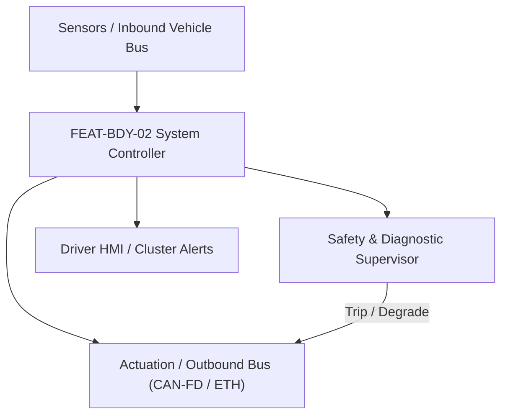
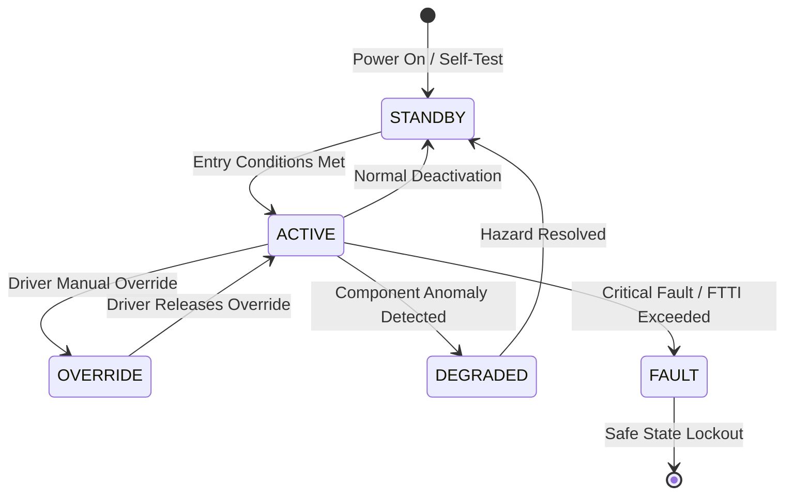

# System Requirements Specification: Adaptive Driving Beam Matrix Headlights (ADB)
**Feature ID:** `FEAT-BDY-02`  
**Domain:** Body, Lighting & Restraints  
**Target ASIL:** ASIL B  
**Compliance Standard:** ISO 26262:2018 (Part 4 - System Development) / ASPICE PAM v3.1 (SYS.2, SYS.3)  
**Parent Master Specification:** [`spec.md`](file:///c:/Workset/AntiGravityProjects/TestOptimisationExperiement/spec.md#feat-bdy-02-adb)  
**Derived Software Specification:** [`FEAT-BDY-02_ADB_SwReq.md`](file:///c:/Workset/AntiGravityProjects/TestOptimisationExperiement/software_requirements/FEAT-BDY-02_ADB_SwReq.md)

---

## 1. Feature Overview & Operational Scope

Dynamically carves out glare-free shadow masks around oncoming and leading vehicles using 84 to 1024 LED matrix pixels while maintaining high-beam road illumination elsewhere.

### Operational Context Architecture

---

## 2. Activation Logic & Operational States

- **Preconditions:** Vehicle light switch in AUTO, vehicle speed > 30 km/h, ambient light level < 300 lux (night-time).
- **Entry Conditions:** High-beam auto mode activated; forward camera detects target vehicles on road ahead.
- **Deactivation Conditions:** Vehicle slows to < 20 km/h, high ambient street lighting detected (> 500 lux), or driver manually switches to low-beam.
- **Driver Override Behavior:** Driver flashing high-beam lever unconditionally commands 100% full high beam illumination.
- **Operational State Progression:**  
  `DAYTIME_OFF` -> `LOW_BEAM_ACTIVE` -> `FULL_HIGH_BEAM` -> `MATRIX_SHADOW_CARVING` -> `URBAN_SPEED_SUPPRESSION` -> `FAILSAFE_LOW_BEAM`

### State Transition Diagram

---

## 3. Functional Safety & Failure Mitigation Concept

- **Functional Safety Goal:** SG-ADB-01: Prevent glare to other road users (illuminance at opposing driver eye point <= 1.0 lux) while maximizing driver night visibility.
- **Fault Tolerant Time Interval (FTTI):** 100 ms
- **Safe State Definition:** Immediately switch all LED pixels to standard low-beam pattern.
- **Warning & Escalation Strategy:** Display blue high-beam icon with auto 'A' symbol; display yellow lighting fault icon if matrix driver fails.

### Failure Modes & Degradation Handling
- **Camera Lighting Packet Timeout:** If camera vehicle target stream halts for > 60 ms, drop from matrix mode to standard low beam within 100 ms.
- **Matrix Led String Short:** If open/short detected on LED string, extinguish affected sector and compensate with adjacent pixels.

---

## 4. System Requirements (SYS_REQ)
*(Note: Each System Requirement is systematically partitioned into multiple Child Software Requirements)*

### `SYS-BDY-02-01`: Camera Object Azimuth Angle & Angular Width Tracking
- **Planned Release:** R100
- **ASIL Rating:** ASIL B
- **Parent Feature:** [`FEAT-BDY-02`](file:///c:/Workset/AntiGravityProjects/TestOptimisationExperiement/spec.md#feat-bdy-02)
- **Requirement Statement:**
  > The System SHALL compute the horizontal azimuth angle (+-30 deg) and angular bounding box width of all oncoming and leading vehicles with 0.2 deg precision at >= 30 Hz.
- **Activation Logic:** Active at night-time when vehicle speed > 25 km/h.
- **Fault Tolerant Time Interval (FTTI):** 80 ms
- **Safe State Action:** Enforce standard low beam cut-off line.
- **Failure Detection & Reaction:** If target range is ambiguous, expand shadow mask width by +3.0 degrees safety buffer.
- **Input Interfaces:** `Camera_Target_Tracks (Ethernet, 30 Hz), Steering_Wheel_Angle, Vehicle_Speed`
- **Output Interfaces:** `Shadow_Cutout_Angles[8] (struct Cutout_t), Target_Count`
- **System Verification Method:** Night-time photometric glare measurement with goniometer on test track.
- **Derived Child Software Requirements (1:N Link):**
  - [`SWR-BDY-02-01`](file:///c:/Workset/AntiGravityProjects/TestOptimisationExperiement/software_requirements/FEAT-BDY-02_ADB_SwReq.md#swr-bdy-02-01)
  - [`SWR-BDY-02-02`](file:///c:/Workset/AntiGravityProjects/TestOptimisationExperiement/software_requirements/FEAT-BDY-02_ADB_SwReq.md#swr-bdy-02-02)

### `SYS-BDY-02-02`: Individual LED Matrix Pixel PWM Duty Modulation & Slew Limiting
- **Planned Release:** R100
- **ASIL Rating:** ASIL B
- **Parent Feature:** [`FEAT-BDY-02`](file:///c:/Workset/AntiGravityProjects/TestOptimisationExperiement/spec.md#feat-bdy-02)
- **Requirement Statement:**
  > The System SHALL modulate current duty cycles across matrix LED pixels (84 to 1024 pixels per headlamp) without visible flicker (PWM frequency >= 1 kHz), transitioning pixels in <= 30 ms.
- **Activation Logic:** Active when matrix high beam is enabled.
- **Fault Tolerant Time Interval (FTTI):** 50 ms
- **Safe State Action:** Turn off high-beam matrix LED banks; retain standard low-beam projector.
- **Failure Detection & Reaction:** If matrix driver reports over-temperature (> 125°C), derate overall LED current by 40%.
- **Input Interfaces:** `Shadow_Cutout_Angles[8], Ambient_Light_Lux, Headlamp_Leveling_Angle`
- **Output Interfaces:** `Left_Matrix_LED_Duty_Array, Right_Matrix_LED_Duty_Array`
- **System Verification Method:** High-speed photometric camera evaluation adhering to SAE J3069 / ECE R123.
- **Derived Child Software Requirements (1:N Link):**
  - [`SWR-BDY-02-03`](file:///c:/Workset/AntiGravityProjects/TestOptimisationExperiement/software_requirements/FEAT-BDY-02_ADB_SwReq.md#swr-bdy-02-03)
  - [`SWR-BDY-02-04`](file:///c:/Workset/AntiGravityProjects/TestOptimisationExperiement/software_requirements/FEAT-BDY-02_ADB_SwReq.md#swr-bdy-02-04)

### `SYS-BDY-02-03`: Matrix LED Headlamp 84-Pixel Array Independent Dimming Controller
- **Planned Release:** R100
- **ASIL Rating:** ASIL B
- **Parent Feature:** [`FEAT-BDY-02`](file:///c:/Workset/AntiGravityProjects/TestOptimisationExperiement/spec.md#feat-bdy-02)
- **Requirement Statement:**
  > The System SHALL Modulate PWM current to 84 independent micro-LED emitters to create dynamic shadow masks around vehicles.
- **Activation Logic:** Active during normal vehicle operation when feature state is active.
- **Fault Tolerant Time Interval (FTTI):** 20 ms
- **Safe State Action:** Transition to safe state or safe degradation tier within FTTI budget.
- **Failure Detection & Reaction:** Isolate faulted channel, latch DEM diagnostic trouble code, and inform driver.
- **Input Interfaces:** `Sensor signals, vehicle dynamics data, and bus frames via RTE.`
- **Output Interfaces:** `Actuator commands, diagnostic event flags, and cluster alerts.`
- **System Verification Method:** HiL test bench and dynamometer automated verification.
- **Derived Child Software Requirements (1:N Link):**
  - [`SWR-BDY-02-05`](file:///c:/Workset/AntiGravityProjects/TestOptimisationExperiement/software_requirements/FEAT-BDY-02_ADB_SwReq.md#swr-bdy-02-05)
  - [`SWR-BDY-02-06`](file:///c:/Workset/AntiGravityProjects/TestOptimisationExperiement/software_requirements/FEAT-BDY-02_ADB_SwReq.md#swr-bdy-02-06)

### `SYS-BDY-02-04`: Front Camera Oncoming & Preceding Vehicle Headlamp/Taillamp Tracker
- **Planned Release:** R200
- **ASIL Rating:** ASIL B
- **Parent Feature:** [`FEAT-BDY-02`](file:///c:/Workset/AntiGravityProjects/TestOptimisationExperiement/spec.md#feat-bdy-02)
- **Requirement Statement:**
  > The System SHALL Track coordinates and light intensity of forward vehicles up to 400 m ahead at 30 fps frame rate.
- **Activation Logic:** Active during normal vehicle operation when feature state is active.
- **Fault Tolerant Time Interval (FTTI):** 30 ms
- **Safe State Action:** Transition to safe state or safe degradation tier within FTTI budget.
- **Failure Detection & Reaction:** Isolate faulted channel, latch DEM diagnostic trouble code, and inform driver.
- **Input Interfaces:** `Sensor signals, vehicle dynamics data, and bus frames via RTE.`
- **Output Interfaces:** `Actuator commands, diagnostic event flags, and cluster alerts.`
- **System Verification Method:** HiL test bench and dynamometer automated verification.
- **Derived Child Software Requirements (1:N Link):**
  - [`SWR-BDY-02-07`](file:///c:/Workset/AntiGravityProjects/TestOptimisationExperiement/software_requirements/FEAT-BDY-02_ADB_SwReq.md#swr-bdy-02-07)
  - [`SWR-BDY-02-08`](file:///c:/Workset/AntiGravityProjects/TestOptimisationExperiement/software_requirements/FEAT-BDY-02_ADB_SwReq.md#swr-bdy-02-08)

### `SYS-BDY-02-05`: High-Speed Dynamic Glare-Free Shadow Mask Polygon Generator
- **Planned Release:** R200
- **ASIL Rating:** ASIL B
- **Parent Feature:** [`FEAT-BDY-02`](file:///c:/Workset/AntiGravityProjects/TestOptimisationExperiement/spec.md#feat-bdy-02)
- **Requirement Statement:**
  > The System SHALL Calculate spatial exclusion box around detected vehicles, dimming target LEDs to < 1.0 lux glare limit.
- **Activation Logic:** Active during normal vehicle operation when feature state is active.
- **Fault Tolerant Time Interval (FTTI):** 20 ms
- **Safe State Action:** Transition to safe state or safe degradation tier within FTTI budget.
- **Failure Detection & Reaction:** Isolate faulted channel, latch DEM diagnostic trouble code, and inform driver.
- **Input Interfaces:** `Sensor signals, vehicle dynamics data, and bus frames via RTE.`
- **Output Interfaces:** `Actuator commands, diagnostic event flags, and cluster alerts.`
- **System Verification Method:** HiL test bench and dynamometer automated verification.
- **Derived Child Software Requirements (1:N Link):**
  - [`SWR-BDY-02-09`](file:///c:/Workset/AntiGravityProjects/TestOptimisationExperiement/software_requirements/FEAT-BDY-02_ADB_SwReq.md#swr-bdy-02-09)
  - [`SWR-BDY-02-10`](file:///c:/Workset/AntiGravityProjects/TestOptimisationExperiement/software_requirements/FEAT-BDY-02_ADB_SwReq.md#swr-bdy-02-10)

### `SYS-BDY-02-06`: Vehicle Pitch Dynamic Leveling Sensor Axle Deflection Compensator
- **Planned Release:** R200
- **ASIL Rating:** ASIL B
- **Parent Feature:** [`FEAT-BDY-02`](file:///c:/Workset/AntiGravityProjects/TestOptimisationExperiement/spec.md#feat-bdy-02)
- **Requirement Statement:**
  > The System SHALL Compensate headlight vertical aim angle based on front/rear axle ride height sensors to eliminate glare over crests.
- **Activation Logic:** Active during normal vehicle operation when feature state is active.
- **Fault Tolerant Time Interval (FTTI):** 50 ms
- **Safe State Action:** Transition to safe state or safe degradation tier within FTTI budget.
- **Failure Detection & Reaction:** Isolate faulted channel, latch DEM diagnostic trouble code, and inform driver.
- **Input Interfaces:** `Sensor signals, vehicle dynamics data, and bus frames via RTE.`
- **Output Interfaces:** `Actuator commands, diagnostic event flags, and cluster alerts.`
- **System Verification Method:** HiL test bench and dynamometer automated verification.
- **Derived Child Software Requirements (1:N Link):**
  - [`SWR-BDY-02-11`](file:///c:/Workset/AntiGravityProjects/TestOptimisationExperiement/software_requirements/FEAT-BDY-02_ADB_SwReq.md#swr-bdy-02-11)
  - [`SWR-BDY-02-12`](file:///c:/Workset/AntiGravityProjects/TestOptimisationExperiement/software_requirements/FEAT-BDY-02_ADB_SwReq.md#swr-bdy-02-12)

### `SYS-BDY-02-07`: Steering Angle Predictive Cornering Light Beam Swivel Commander
- **Planned Release:** R300
- **ASIL Rating:** ASIL B
- **Parent Feature:** [`FEAT-BDY-02`](file:///c:/Workset/AntiGravityProjects/TestOptimisationExperiement/spec.md#feat-bdy-02)
- **Requirement Statement:**
  > The System SHALL Swivel auxiliary LED cornering light beams up to +-15° into upcoming turns based on steering wheel angle.
- **Activation Logic:** Active during normal vehicle operation when feature state is active.
- **Fault Tolerant Time Interval (FTTI):** 30 ms
- **Safe State Action:** Transition to safe state or safe degradation tier within FTTI budget.
- **Failure Detection & Reaction:** Isolate faulted channel, latch DEM diagnostic trouble code, and inform driver.
- **Input Interfaces:** `Sensor signals, vehicle dynamics data, and bus frames via RTE.`
- **Output Interfaces:** `Actuator commands, diagnostic event flags, and cluster alerts.`
- **System Verification Method:** HiL test bench and dynamometer automated verification.
- **Derived Child Software Requirements (1:N Link):**
  - [`SWR-BDY-02-13`](file:///c:/Workset/AntiGravityProjects/TestOptimisationExperiement/software_requirements/FEAT-BDY-02_ADB_SwReq.md#swr-bdy-02-13)
  - [`SWR-BDY-02-14`](file:///c:/Workset/AntiGravityProjects/TestOptimisationExperiement/software_requirements/FEAT-BDY-02_ADB_SwReq.md#swr-bdy-02-14)

### `SYS-BDY-02-08`: Ambient Light & Twilight Automatic High-Beam Transition Sequencer
- **Planned Release:** R300
- **ASIL Rating:** ASIL B
- **Parent Feature:** [`FEAT-BDY-02`](file:///c:/Workset/AntiGravityProjects/TestOptimisationExperiement/spec.md#feat-bdy-02)
- **Requirement Statement:**
  > The System SHALL Transition smoothly between low beam and matrix high beam when ambient illuminance drops below 10 lux.
- **Activation Logic:** Active during normal vehicle operation when feature state is active.
- **Fault Tolerant Time Interval (FTTI):** 100 ms
- **Safe State Action:** Transition to safe state or safe degradation tier within FTTI budget.
- **Failure Detection & Reaction:** Isolate faulted channel, latch DEM diagnostic trouble code, and inform driver.
- **Input Interfaces:** `Sensor signals, vehicle dynamics data, and bus frames via RTE.`
- **Output Interfaces:** `Actuator commands, diagnostic event flags, and cluster alerts.`
- **System Verification Method:** HiL test bench and dynamometer automated verification.
- **Derived Child Software Requirements (1:N Link):**
  - [`SWR-BDY-02-15`](file:///c:/Workset/AntiGravityProjects/TestOptimisationExperiement/software_requirements/FEAT-BDY-02_ADB_SwReq.md#swr-bdy-02-15)
  - [`SWR-BDY-02-16`](file:///c:/Workset/AntiGravityProjects/TestOptimisationExperiement/software_requirements/FEAT-BDY-02_ADB_SwReq.md#swr-bdy-02-16)

### `SYS-BDY-02-09`: City Low-Speed Broad Pedestrian Illumination Spread Optimizer
- **Planned Release:** R300
- **ASIL Rating:** ASIL B
- **Parent Feature:** [`FEAT-BDY-02`](file:///c:/Workset/AntiGravityProjects/TestOptimisationExperiement/spec.md#feat-bdy-02)
- **Requirement Statement:**
  > The System SHALL Widen horizontal low-beam spread pattern at speeds < 50 km/h to illuminate sidewalks and pedestrians.
- **Activation Logic:** Active during normal vehicle operation when feature state is active.
- **Fault Tolerant Time Interval (FTTI):** 100 ms
- **Safe State Action:** Transition to safe state or safe degradation tier within FTTI budget.
- **Failure Detection & Reaction:** Isolate faulted channel, latch DEM diagnostic trouble code, and inform driver.
- **Input Interfaces:** `Sensor signals, vehicle dynamics data, and bus frames via RTE.`
- **Output Interfaces:** `Actuator commands, diagnostic event flags, and cluster alerts.`
- **System Verification Method:** HiL test bench and dynamometer automated verification.
- **Derived Child Software Requirements (1:N Link):**
  - [`SWR-BDY-02-17`](file:///c:/Workset/AntiGravityProjects/TestOptimisationExperiement/software_requirements/FEAT-BDY-02_ADB_SwReq.md#swr-bdy-02-17)
  - [`SWR-BDY-02-18`](file:///c:/Workset/AntiGravityProjects/TestOptimisationExperiement/software_requirements/FEAT-BDY-02_ADB_SwReq.md#swr-bdy-02-18)

### `SYS-BDY-02-10`: Highway High-Speed Long-Distance Concentrated Beam Booster
- **Planned Release:** R400
- **ASIL Rating:** ASIL B
- **Parent Feature:** [`FEAT-BDY-02`](file:///c:/Workset/AntiGravityProjects/TestOptimisationExperiement/spec.md#feat-bdy-02)
- **Requirement Statement:**
  > The System SHALL Concentrate central LED beam flux to extend illumination distance to 600 m at vehicle speeds > 110 km/h.
- **Activation Logic:** Active during normal vehicle operation when feature state is active.
- **Fault Tolerant Time Interval (FTTI):** 100 ms
- **Safe State Action:** Transition to safe state or safe degradation tier within FTTI budget.
- **Failure Detection & Reaction:** Isolate faulted channel, latch DEM diagnostic trouble code, and inform driver.
- **Input Interfaces:** `Sensor signals, vehicle dynamics data, and bus frames via RTE.`
- **Output Interfaces:** `Actuator commands, diagnostic event flags, and cluster alerts.`
- **System Verification Method:** HiL test bench and dynamometer automated verification.
- **Derived Child Software Requirements (1:N Link):**
  - [`SWR-BDY-02-19`](file:///c:/Workset/AntiGravityProjects/TestOptimisationExperiement/software_requirements/FEAT-BDY-02_ADB_SwReq.md#swr-bdy-02-19)
  - [`SWR-BDY-02-20`](file:///c:/Workset/AntiGravityProjects/TestOptimisationExperiement/software_requirements/FEAT-BDY-02_ADB_SwReq.md#swr-bdy-02-20)

### `SYS-BDY-02-11`: Matrix Headlamp Heatsink Multi-Point Thermal Over-Temperature Derater
- **Planned Release:** R400
- **ASIL Rating:** ASIL B
- **Parent Feature:** [`FEAT-BDY-02`](file:///c:/Workset/AntiGravityProjects/TestOptimisationExperiement/spec.md#feat-bdy-02)
- **Requirement Statement:**
  > The System SHALL Derate LED forward drive current by 30% if headlamp aluminum heatsink temperature exceeds 85 °C.
- **Activation Logic:** Active during normal vehicle operation when feature state is active.
- **Fault Tolerant Time Interval (FTTI):** 500 ms
- **Safe State Action:** Transition to safe state or safe degradation tier within FTTI budget.
- **Failure Detection & Reaction:** Isolate faulted channel, latch DEM diagnostic trouble code, and inform driver.
- **Input Interfaces:** `Sensor signals, vehicle dynamics data, and bus frames via RTE.`
- **Output Interfaces:** `Actuator commands, diagnostic event flags, and cluster alerts.`
- **System Verification Method:** HiL test bench and dynamometer automated verification.
- **Derived Child Software Requirements (1:N Link):**
  - [`SWR-BDY-02-21`](file:///c:/Workset/AntiGravityProjects/TestOptimisationExperiement/software_requirements/FEAT-BDY-02_ADB_SwReq.md#swr-bdy-02-21)
  - [`SWR-BDY-02-22`](file:///c:/Workset/AntiGravityProjects/TestOptimisationExperiement/software_requirements/FEAT-BDY-02_ADB_SwReq.md#swr-bdy-02-22)

### `SYS-BDY-02-12`: Adverse Weather & Fog/Snow Back-Glare Light Dispersion Minimizer
- **Planned Release:** R400
- **ASIL Rating:** ASIL B
- **Parent Feature:** [`FEAT-BDY-02`](file:///c:/Workset/AntiGravityProjects/TestOptimisationExperiement/spec.md#feat-bdy-02)
- **Requirement Statement:**
  > The System SHALL Reduce upper matrix beam intensity during fog or heavy snow to prevent blinding reflections back into driver eyes.
- **Activation Logic:** Active during normal vehicle operation when feature state is active.
- **Fault Tolerant Time Interval (FTTI):** 200 ms
- **Safe State Action:** Transition to safe state or safe degradation tier within FTTI budget.
- **Failure Detection & Reaction:** Isolate faulted channel, latch DEM diagnostic trouble code, and inform driver.
- **Input Interfaces:** `Sensor signals, vehicle dynamics data, and bus frames via RTE.`
- **Output Interfaces:** `Actuator commands, diagnostic event flags, and cluster alerts.`
- **System Verification Method:** HiL test bench and dynamometer automated verification.
- **Derived Child Software Requirements (1:N Link):**
  - [`SWR-BDY-02-23`](file:///c:/Workset/AntiGravityProjects/TestOptimisationExperiement/software_requirements/FEAT-BDY-02_ADB_SwReq.md#swr-bdy-02-23)
  - [`SWR-BDY-02-24`](file:///c:/Workset/AntiGravityProjects/TestOptimisationExperiement/software_requirements/FEAT-BDY-02_ADB_SwReq.md#swr-bdy-02-24)

### `SYS-BDY-02-13`: Matrix LED Module Pixel Short/Open Circuit Hardware Safing Monitor
- **Planned Release:** R500
- **ASIL Rating:** ASIL B
- **Parent Feature:** [`FEAT-BDY-02`](file:///c:/Workset/AntiGravityProjects/TestOptimisationExperiement/spec.md#feat-bdy-02)
- **Requirement Statement:**
  > The System SHALL Detect burnt-out LED emitter pixels and re-balance drive current to adjacent pixels, logging DTC.
- **Activation Logic:** Active during normal vehicle operation when feature state is active.
- **Fault Tolerant Time Interval (FTTI):** 50 ms
- **Safe State Action:** Transition to safe state or safe degradation tier within FTTI budget.
- **Failure Detection & Reaction:** Isolate faulted channel, latch DEM diagnostic trouble code, and inform driver.
- **Input Interfaces:** `Sensor signals, vehicle dynamics data, and bus frames via RTE.`
- **Output Interfaces:** `Actuator commands, diagnostic event flags, and cluster alerts.`
- **System Verification Method:** HiL test bench and dynamometer automated verification.
- **Derived Child Software Requirements (1:N Link):**
  - [`SWR-BDY-02-25`](file:///c:/Workset/AntiGravityProjects/TestOptimisationExperiement/software_requirements/FEAT-BDY-02_ADB_SwReq.md#swr-bdy-02-25)
  - [`SWR-BDY-02-26`](file:///c:/Workset/AntiGravityProjects/TestOptimisationExperiement/software_requirements/FEAT-BDY-02_ADB_SwReq.md#swr-bdy-02-26)

### `SYS-BDY-02-14`: DEM Matrix Lighting Diagnostic Event Manager & Fault Code Latcher
- **Planned Release:** R500
- **ASIL Rating:** ASIL B
- **Parent Feature:** [`FEAT-BDY-02`](file:///c:/Workset/AntiGravityProjects/TestOptimisationExperiement/spec.md#feat-bdy-02)
- **Requirement Statement:**
  > The System SHALL Manage diagnostic trouble codes for leveling motor stall, camera feed timeout, and LED driver overvoltage.
- **Activation Logic:** Active during normal vehicle operation when feature state is active.
- **Fault Tolerant Time Interval (FTTI):** 100 ms
- **Safe State Action:** Transition to safe state or safe degradation tier within FTTI budget.
- **Failure Detection & Reaction:** Isolate faulted channel, latch DEM diagnostic trouble code, and inform driver.
- **Input Interfaces:** `Sensor signals, vehicle dynamics data, and bus frames via RTE.`
- **Output Interfaces:** `Actuator commands, diagnostic event flags, and cluster alerts.`
- **System Verification Method:** HiL test bench and dynamometer automated verification.
- **Derived Child Software Requirements (1:N Link):**
  - [`SWR-BDY-02-27`](file:///c:/Workset/AntiGravityProjects/TestOptimisationExperiement/software_requirements/FEAT-BDY-02_ADB_SwReq.md#swr-bdy-02-27)
  - [`SWR-BDY-02-28`](file:///c:/Workset/AntiGravityProjects/TestOptimisationExperiement/software_requirements/FEAT-BDY-02_ADB_SwReq.md#swr-bdy-02-28)

### `SYS-BDY-02-15`: Driver Matrix Lighting Mode Configuration & Instrument Cluster HMI
- **Planned Release:** R500
- **ASIL Rating:** ASIL A
- **Parent Feature:** [`FEAT-BDY-02`](file:///c:/Workset/AntiGravityProjects/TestOptimisationExperiement/spec.md#feat-bdy-02)
- **Requirement Statement:**
  > The System SHALL Display matrix high beam active status icon and driver sensitivity preference settings on cluster.
- **Activation Logic:** Active during normal vehicle operation when feature state is active.
- **Fault Tolerant Time Interval (FTTI):** 200 ms
- **Safe State Action:** Transition to safe state or safe degradation tier within FTTI budget.
- **Failure Detection & Reaction:** Isolate faulted channel, latch DEM diagnostic trouble code, and inform driver.
- **Input Interfaces:** `Sensor signals, vehicle dynamics data, and bus frames via RTE.`
- **Output Interfaces:** `Actuator commands, diagnostic event flags, and cluster alerts.`
- **System Verification Method:** HiL test bench and dynamometer automated verification.
- **Derived Child Software Requirements (1:N Link):**
  - [`SWR-BDY-02-29`](file:///c:/Workset/AntiGravityProjects/TestOptimisationExperiement/software_requirements/FEAT-BDY-02_ADB_SwReq.md#swr-bdy-02-29)
  - [`SWR-BDY-02-30`](file:///c:/Workset/AntiGravityProjects/TestOptimisationExperiement/software_requirements/FEAT-BDY-02_ADB_SwReq.md#swr-bdy-02-30)

---

## 5. System-to-Software Traceability Summary

| System Requirement ID | Planned Release | ASIL | Title | Derived Software Requirements (1:N) | Verification Method |
| :--- | :---: | :--- | :--- | :--- | :--- |
| `SYS-BDY-02-01` | **`R100`** | ASIL B | Camera Object Azimuth Angle & Angular Width Tracking | [`SWR-BDY-02-01`](file:///c:/Workset/AntiGravityProjects/TestOptimisationExperiement/software_requirements/FEAT-BDY-02_ADB_SwReq.md#swr-bdy-02-01), [`SWR-BDY-02-02`](file:///c:/Workset/AntiGravityProjects/TestOptimisationExperiement/software_requirements/FEAT-BDY-02_ADB_SwReq.md#swr-bdy-02-02) | Night-time photometric glare measurement with goniometer on test track. |
| `SYS-BDY-02-02` | **`R100`** | ASIL B | Individual LED Matrix Pixel PWM Duty Modulation & Slew Limiting | [`SWR-BDY-02-03`](file:///c:/Workset/AntiGravityProjects/TestOptimisationExperiement/software_requirements/FEAT-BDY-02_ADB_SwReq.md#swr-bdy-02-03), [`SWR-BDY-02-04`](file:///c:/Workset/AntiGravityProjects/TestOptimisationExperiement/software_requirements/FEAT-BDY-02_ADB_SwReq.md#swr-bdy-02-04) | High-speed photometric camera evaluation adhering to SAE J3069 / ECE R123. |
| `SYS-BDY-02-03` | **`R100`** | ASIL B | Matrix LED Headlamp 84-Pixel Array Independent Dimming Controller | [`SWR-BDY-02-05`](file:///c:/Workset/AntiGravityProjects/TestOptimisationExperiement/software_requirements/FEAT-BDY-02_ADB_SwReq.md#swr-bdy-02-05), [`SWR-BDY-02-06`](file:///c:/Workset/AntiGravityProjects/TestOptimisationExperiement/software_requirements/FEAT-BDY-02_ADB_SwReq.md#swr-bdy-02-06) | HiL test bench and dynamometer automated verification. |
| `SYS-BDY-02-04` | **`R200`** | ASIL B | Front Camera Oncoming & Preceding Vehicle Headlamp/Taillamp Tracker | [`SWR-BDY-02-07`](file:///c:/Workset/AntiGravityProjects/TestOptimisationExperiement/software_requirements/FEAT-BDY-02_ADB_SwReq.md#swr-bdy-02-07), [`SWR-BDY-02-08`](file:///c:/Workset/AntiGravityProjects/TestOptimisationExperiement/software_requirements/FEAT-BDY-02_ADB_SwReq.md#swr-bdy-02-08) | HiL test bench and dynamometer automated verification. |
| `SYS-BDY-02-05` | **`R200`** | ASIL B | High-Speed Dynamic Glare-Free Shadow Mask Polygon Generator | [`SWR-BDY-02-09`](file:///c:/Workset/AntiGravityProjects/TestOptimisationExperiement/software_requirements/FEAT-BDY-02_ADB_SwReq.md#swr-bdy-02-09), [`SWR-BDY-02-10`](file:///c:/Workset/AntiGravityProjects/TestOptimisationExperiement/software_requirements/FEAT-BDY-02_ADB_SwReq.md#swr-bdy-02-10) | HiL test bench and dynamometer automated verification. |
| `SYS-BDY-02-06` | **`R200`** | ASIL B | Vehicle Pitch Dynamic Leveling Sensor Axle Deflection Compensator | [`SWR-BDY-02-11`](file:///c:/Workset/AntiGravityProjects/TestOptimisationExperiement/software_requirements/FEAT-BDY-02_ADB_SwReq.md#swr-bdy-02-11), [`SWR-BDY-02-12`](file:///c:/Workset/AntiGravityProjects/TestOptimisationExperiement/software_requirements/FEAT-BDY-02_ADB_SwReq.md#swr-bdy-02-12) | HiL test bench and dynamometer automated verification. |
| `SYS-BDY-02-07` | **`R300`** | ASIL B | Steering Angle Predictive Cornering Light Beam Swivel Commander | [`SWR-BDY-02-13`](file:///c:/Workset/AntiGravityProjects/TestOptimisationExperiement/software_requirements/FEAT-BDY-02_ADB_SwReq.md#swr-bdy-02-13), [`SWR-BDY-02-14`](file:///c:/Workset/AntiGravityProjects/TestOptimisationExperiement/software_requirements/FEAT-BDY-02_ADB_SwReq.md#swr-bdy-02-14) | HiL test bench and dynamometer automated verification. |
| `SYS-BDY-02-08` | **`R300`** | ASIL B | Ambient Light & Twilight Automatic High-Beam Transition Sequencer | [`SWR-BDY-02-15`](file:///c:/Workset/AntiGravityProjects/TestOptimisationExperiement/software_requirements/FEAT-BDY-02_ADB_SwReq.md#swr-bdy-02-15), [`SWR-BDY-02-16`](file:///c:/Workset/AntiGravityProjects/TestOptimisationExperiement/software_requirements/FEAT-BDY-02_ADB_SwReq.md#swr-bdy-02-16) | HiL test bench and dynamometer automated verification. |
| `SYS-BDY-02-09` | **`R300`** | ASIL B | City Low-Speed Broad Pedestrian Illumination Spread Optimizer | [`SWR-BDY-02-17`](file:///c:/Workset/AntiGravityProjects/TestOptimisationExperiement/software_requirements/FEAT-BDY-02_ADB_SwReq.md#swr-bdy-02-17), [`SWR-BDY-02-18`](file:///c:/Workset/AntiGravityProjects/TestOptimisationExperiement/software_requirements/FEAT-BDY-02_ADB_SwReq.md#swr-bdy-02-18) | HiL test bench and dynamometer automated verification. |
| `SYS-BDY-02-10` | **`R400`** | ASIL B | Highway High-Speed Long-Distance Concentrated Beam Booster | [`SWR-BDY-02-19`](file:///c:/Workset/AntiGravityProjects/TestOptimisationExperiement/software_requirements/FEAT-BDY-02_ADB_SwReq.md#swr-bdy-02-19), [`SWR-BDY-02-20`](file:///c:/Workset/AntiGravityProjects/TestOptimisationExperiement/software_requirements/FEAT-BDY-02_ADB_SwReq.md#swr-bdy-02-20) | HiL test bench and dynamometer automated verification. |
| `SYS-BDY-02-11` | **`R400`** | ASIL B | Matrix Headlamp Heatsink Multi-Point Thermal Over-Temperature Derater | [`SWR-BDY-02-21`](file:///c:/Workset/AntiGravityProjects/TestOptimisationExperiement/software_requirements/FEAT-BDY-02_ADB_SwReq.md#swr-bdy-02-21), [`SWR-BDY-02-22`](file:///c:/Workset/AntiGravityProjects/TestOptimisationExperiement/software_requirements/FEAT-BDY-02_ADB_SwReq.md#swr-bdy-02-22) | HiL test bench and dynamometer automated verification. |
| `SYS-BDY-02-12` | **`R400`** | ASIL B | Adverse Weather & Fog/Snow Back-Glare Light Dispersion Minimizer | [`SWR-BDY-02-23`](file:///c:/Workset/AntiGravityProjects/TestOptimisationExperiement/software_requirements/FEAT-BDY-02_ADB_SwReq.md#swr-bdy-02-23), [`SWR-BDY-02-24`](file:///c:/Workset/AntiGravityProjects/TestOptimisationExperiement/software_requirements/FEAT-BDY-02_ADB_SwReq.md#swr-bdy-02-24) | HiL test bench and dynamometer automated verification. |
| `SYS-BDY-02-13` | **`R500`** | ASIL B | Matrix LED Module Pixel Short/Open Circuit Hardware Safing Monitor | [`SWR-BDY-02-25`](file:///c:/Workset/AntiGravityProjects/TestOptimisationExperiement/software_requirements/FEAT-BDY-02_ADB_SwReq.md#swr-bdy-02-25), [`SWR-BDY-02-26`](file:///c:/Workset/AntiGravityProjects/TestOptimisationExperiement/software_requirements/FEAT-BDY-02_ADB_SwReq.md#swr-bdy-02-26) | HiL test bench and dynamometer automated verification. |
| `SYS-BDY-02-14` | **`R500`** | ASIL B | DEM Matrix Lighting Diagnostic Event Manager & Fault Code Latcher | [`SWR-BDY-02-27`](file:///c:/Workset/AntiGravityProjects/TestOptimisationExperiement/software_requirements/FEAT-BDY-02_ADB_SwReq.md#swr-bdy-02-27), [`SWR-BDY-02-28`](file:///c:/Workset/AntiGravityProjects/TestOptimisationExperiement/software_requirements/FEAT-BDY-02_ADB_SwReq.md#swr-bdy-02-28) | HiL test bench and dynamometer automated verification. |
| `SYS-BDY-02-15` | **`R500`** | ASIL A | Driver Matrix Lighting Mode Configuration & Instrument Cluster HMI | [`SWR-BDY-02-29`](file:///c:/Workset/AntiGravityProjects/TestOptimisationExperiement/software_requirements/FEAT-BDY-02_ADB_SwReq.md#swr-bdy-02-29), [`SWR-BDY-02-30`](file:///c:/Workset/AntiGravityProjects/TestOptimisationExperiement/software_requirements/FEAT-BDY-02_ADB_SwReq.md#swr-bdy-02-30) | HiL test bench and dynamometer automated verification. |

- **Upstream Feature Link:** [`spec.md` (FEAT-BDY-02)](file:///c:/Workset/AntiGravityProjects/TestOptimisationExperiement/spec.md#feat-bdy-02)
- **Software Requirements Specification:** [`FEAT-BDY-02_ADB_SwReq.md`](file:///c:/Workset/AntiGravityProjects/TestOptimisationExperiement/software_requirements/FEAT-BDY-02_ADB_SwReq.md)
