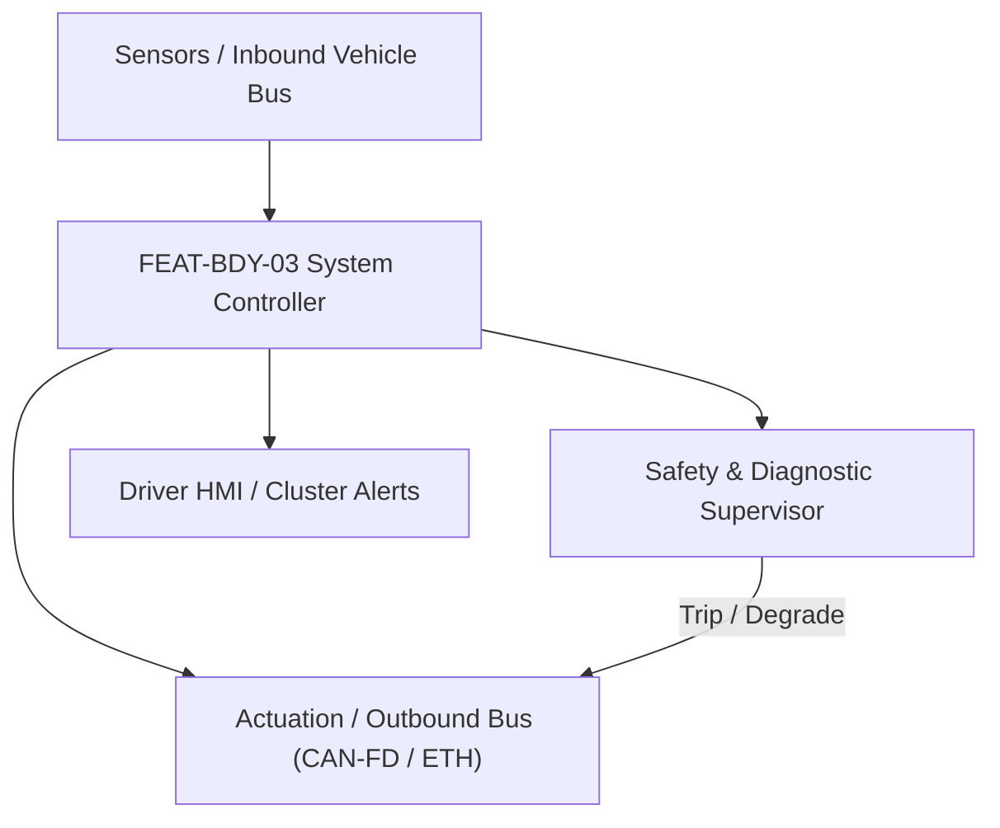
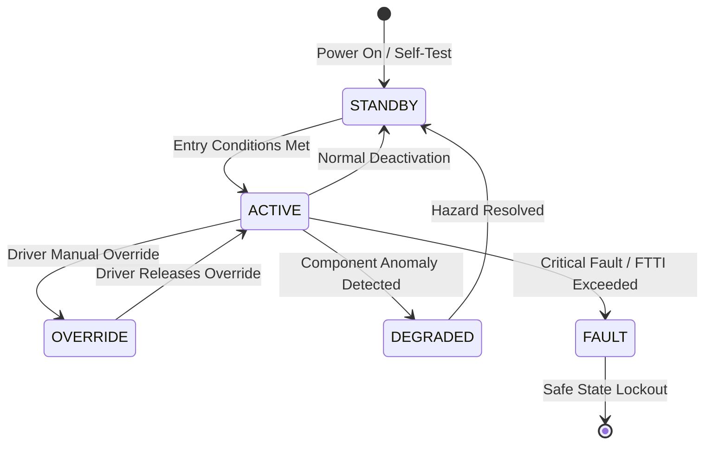

# System Requirements Specification: Supplemental Restraint System & Airbag Deployment (SRS)
**Feature ID:** `FEAT-BDY-03`  
**Domain:** Body, Lighting & Restraints  
**Target ASIL:** ASIL D  
**Compliance Standard:** ISO 26262:2018 (Part 4 - System Development) / ASPICE PAM v3.1 (SYS.2, SYS.3)  
**Parent Master Specification:** [`spec.md`](file:///c:/Workset/AntiGravityProjects/TestOptimisationExperiement/spec.md#feat-bdy-03-srs)  
**Derived Software Specification:** [`FEAT-BDY-03_SRS_SwReq.md`](file:///c:/Workset/AntiGravityProjects/TestOptimisationExperiement/software_requirements/FEAT-BDY-03_SRS_SwReq.md)

---

## 1. Feature Overview & Operational Scope

Processes high-G crash accelerometers and pressure sensors to trigger squib deployment of frontal airbags, side curtains, pretensioners, and high-voltage pyrofuses in <= 15 ms.

### Operational Context Architecture

---

## 2. Activation Logic & Operational States

- **Preconditions:** Ignition in RUN, airbag capacitor energy reserve charged (> 25V), occupant classification sensors healthy.
- **Entry Conditions:** Crash deceleration impulse delta_v exceeds calibrated deployment threshold.
- **Deactivation Conditions:** Deployment squibs fired (permanent state) or power down.
- **Driver Override Behavior:** Passenger airbag manual disable switch (or baby seat detected) suppresses passenger frontal airbag deployment.
- **Operational State Progression:**  
  `SELF_TEST_HEALTHY` -> `PRE_CRASH_ARMED` -> `STAGE_1_BELT_TENSION` -> `STAGE_2_AIRBAG_FIRE` -> `CRASH_RECORD_STORED` -> `FAULT_LOCKED`

### State Transition Diagram

---

## 3. Functional Safety & Failure Mitigation Concept

- **Functional Safety Goal:** SG-SRS-01: Guarantee airbag squib deployment within 15 ms during severe crash; absolutely prevent inadvertent deployment during normal driving or pothole impacts.
- **Fault Tolerant Time Interval (FTTI):** 5 ms
- **Safe State Definition:** Hardware arming safing sensor prevents firing unless independent mechanical/MEMS safing sensor confirms crash.
- **Warning & Escalation Strategy:** Airbag red warning lamp permanently illuminated if any squib loop has open or short circuit.

### Failure Modes & Degradation Handling
- **Inadvertent Fire Prevention:** Hardware dual-switched squibs (High-Side Switch + Low-Side Switch) require BOTH software microcontroller AND independent hardware safing sensor to conduct simultaneously.
- **Power Loss During Crash:** Internal reservoir capacitors maintain sufficient electrical energy to deploy all squibs for at least 150 ms following 12V battery severing.

---

## 4. System Requirements (SYS_REQ)
*(Note: Each System Requirement is systematically partitioned into multiple Child Software Requirements)*

### `SYS-BDY-03-01`: Dual-Axis Crash Pulse Integration & Velocity Change (Delta-V) Calculation
- **Planned Release:** R100
- **ASIL Rating:** ASIL D
- **Parent Feature:** [`FEAT-BDY-03`](file:///c:/Workset/AntiGravityProjects/TestOptimisationExperiement/spec.md#feat-bdy-03)
- **Requirement Statement:**
  > The System SHALL sample crash accelerometers (+-100g front, +-50g lateral, door cavity pressure) at 4 kHz (<= 0.25 ms), integrating deceleration into crash velocity change (Delta-V) and crash severity index within <= 10 ms.
- **Activation Logic:** Active at all times while vehicle is powered.
- **Fault Tolerant Time Interval (FTTI):** 2 ms
- **Safe State Action:** Do not fire squibs; assert airbag warning lamp.
- **Failure Detection & Reaction:** If one crash sensor fails self-test, fallback to redundant centralized tunnel sensor.
- **Input Interfaces:** `2x_Front_Crash_Sensors, 2x_Side_Pressure_Sensors, Central_High_G_IMU`
- **Output Interfaces:** `Crash_Delta_V_Mps, Crash_Severity_Index (uint8), Crash_Type_Enum`
- **System Verification Method:** Crash barrier barrier-impact sled testing across FMVSS 208 and 214 protocols.
- **Derived Child Software Requirements (1:N Link):**
  - [`SWR-BDY-03-01`](file:///c:/Workset/AntiGravityProjects/TestOptimisationExperiement/software_requirements/FEAT-BDY-03_SRS_SwReq.md#swr-bdy-03-01)
  - [`SWR-BDY-03-02`](file:///c:/Workset/AntiGravityProjects/TestOptimisationExperiement/software_requirements/FEAT-BDY-03_SRS_SwReq.md#swr-bdy-03-02)

### `SYS-BDY-03-02`: Hardware Safing Interlock & Multi-Stage Squib Deployment
- **Planned Release:** R400
- **ASIL Rating:** ASIL D
- **Parent Feature:** [`FEAT-BDY-03`](file:///c:/Workset/AntiGravityProjects/TestOptimisationExperiement/spec.md#feat-bdy-03)
- **Requirement Statement:**
  > The System SHALL fire squib loops (driver/passenger frontal, curtain, knee, seatbelt pretensioners, HV pyrofuse) with firing current >= 1.75 A for >= 2.0 ms only when hardware safing sensor AND software algorithm agree within <= 2 ms.
- **Activation Logic:** Active upon crash threshold exceedance.
- **Fault Tolerant Time Interval (FTTI):** 2 ms
- **Safe State Action:** Keep high-side squib drivers open.
- **Failure Detection & Reaction:** If squib loop resistance deviates outside [1.8, 2.5] ohms during self-test, report squib loop fault.
- **Input Interfaces:** `Crash_Severity_Index, Hardware_Safing_Sensor_State, Occupant_Classification_Weight`
- **Output Interfaces:** `Squib_Firing_Lines[16], HV_Battery_Pyrofuse_Trigger, ECall_Activation_PDU`
- **System Verification Method:** Hardware squib fire timing bench testing with dummy pyrotechnic loads.
- **Derived Child Software Requirements (1:N Link):**
  - [`SWR-BDY-03-03`](file:///c:/Workset/AntiGravityProjects/TestOptimisationExperiement/software_requirements/FEAT-BDY-03_SRS_SwReq.md#swr-bdy-03-03)
  - [`SWR-BDY-03-04`](file:///c:/Workset/AntiGravityProjects/TestOptimisationExperiement/software_requirements/FEAT-BDY-03_SRS_SwReq.md#swr-bdy-03-04)

### `SYS-BDY-03-03`: Multi-Axis Front, Side & Rollover Crash Severity Classification
- **Planned Release:** R100
- **ASIL Rating:** ASIL D
- **Parent Feature:** [`FEAT-BDY-03`](file:///c:/Workset/AntiGravityProjects/TestOptimisationExperiement/spec.md#feat-bdy-03)
- **Requirement Statement:**
  > The System SHALL sample central and satellite accelerometers at 4 kHz, evaluating Velocity Drop (Delta_V), Crash Energy Integral, and Roll Angular Momentum in <= 8 ms to classify crash severity tier (No-Fire, Stage 1 Low-Speed, Stage 2 High-Speed, Rollover).
- **Activation Logic:** Active at all times when ignition is ON.
- **Fault Tolerant Time Interval (FTTI):** 8 ms
- **Safe State Action:** Inhibit pyrotechnic squib firing in low-severity impacts to avoid unnecessary repair costs.
- **Failure Detection & Reaction:** If satellite crash sensor communication drops, rely on central ECU dual-core accelerometers.
- **Input Interfaces:** `Crash_Accel_X_Y_Z_Array[6], Angular_Rate_Roll_Pitch_Yaw, Satellite_Bus_Health`
- **Output Interfaces:** `Crash_Severity_Level_Enum, Crash_Direction_Angle_Deg, Deployment_Fire_Permit_Flag`
- **System Verification Method:** Physical sled crash pulses (FMVSS 208, 214, 226) across rigid barrier and offset deformable barrier impacts.
- **Derived Child Software Requirements (1:N Link):**
  - [`SWR-BDY-03-06`](file:///c:/Workset/AntiGravityProjects/TestOptimisationExperiement/software_requirements/FEAT-BDY-03_SRS_SwReq.md#swr-bdy-03-06)
  - [`SWR-BDY-03-07`](file:///c:/Workset/AntiGravityProjects/TestOptimisationExperiement/software_requirements/FEAT-BDY-03_SRS_SwReq.md#swr-bdy-03-07)

### `SYS-BDY-03-04`: Dual-Stage Airbag Squib Firing Timing & Seatbelt Pretensioner Coordination
- **Planned Release:** R100
- **ASIL Rating:** ASIL D
- **Parent Feature:** [`FEAT-BDY-03`](file:///c:/Workset/AntiGravityProjects/TestOptimisationExperiement/spec.md#feat-bdy-03)
- **Requirement Statement:**
  > The System SHALL fire pyrotechnic seatbelt pretensioners in <= 12 ms, Stage 1 airbag squibs in <= 18 ms, and Stage 2 airbag squibs with variable delay (15 to 45 ms depending on crash severity and occupant position) to optimize occupant deceleration trajectory.
- **Activation Logic:** Active upon Deployment_Fire_Permit_Flag.
- **Fault Tolerant Time Interval (FTTI):** 2 ms for squib pulse generation.
- **Safe State Action:** Open high-side and low-side firing transistors after 2.0 ms squib current pulse.
- **Failure Detection & Reaction:** If squib loop resistance is out of spec (< 1.5 ohm or > 5.5 ohm), log latched DTC B0001.
- **Input Interfaces:** `Crash_Severity_Level_Enum, Occupant_Weight_Class_Enum, Seat_Track_Position_Sensor`
- **Output Interfaces:** `Squib_Fire_Command_Bitmask[16], Pretensioner_Fire_Bitmask[4]`
- **System Verification Method:** High-speed camera deployment test and squib current pulse profile measurement.
- **Derived Child Software Requirements (1:N Link):**
  - [`SWR-BDY-03-08`](file:///c:/Workset/AntiGravityProjects/TestOptimisationExperiement/software_requirements/FEAT-BDY-03_SRS_SwReq.md#swr-bdy-03-08)
  - [`SWR-BDY-03-09`](file:///c:/Workset/AntiGravityProjects/TestOptimisationExperiement/software_requirements/FEAT-BDY-03_SRS_SwReq.md#swr-bdy-03-09)

### `SYS-BDY-03-05`: Occupant Classification Child-Seat Suppression & HV Pyrofuse Cut-Off
- **Planned Release:** R200
- **ASIL Rating:** ASIL D
- **Parent Feature:** [`FEAT-BDY-03`](file:///c:/Workset/AntiGravityProjects/TestOptimisationExperiement/spec.md#feat-bdy-03)
- **Requirement Statement:**
  > The System SHALL automatically suppress passenger frontal airbag if passenger seat is occupied by child safety seat (< 15 kg according to FMVSS 208), and transmit dedicated hardware discrete crash pulse to blow high-voltage traction pyrofuse in <= 2 ms.
- **Activation Logic:** Active in all vehicle states.
- **Fault Tolerant Time Interval (FTTI):** 2 ms for HV pyrofuse pulse.
- **Safe State Action:** De-energize 400V/800V traction battery; turn on hazard lights and unlock doors.
- **Failure Detection & Reaction:** Default passenger airbag to ENABLED if occupant classification sensor is defective.
- **Input Interfaces:** `Passenger_Seat_Bladder_Weight_Sensor_Kg, Child_Seat_ISOFIX_Switch, Crash_Deploy_Confirmed`
- **Output Interfaces:** `Passenger_Airbag_Suppressed_TellTale, HV_Pyrofuse_Discrete_Trigger_Pin`
- **System Verification Method:** FMVSS 208 child dummy suppression tests and high-voltage pyrofuse explosive bench testing.
- **Derived Child Software Requirements (1:N Link):**
  - [`SWR-BDY-03-10`](file:///c:/Workset/AntiGravityProjects/TestOptimisationExperiement/software_requirements/FEAT-BDY-03_SRS_SwReq.md#swr-bdy-03-10)
  - [`SWR-BDY-03-11`](file:///c:/Workset/AntiGravityProjects/TestOptimisationExperiement/software_requirements/FEAT-BDY-03_SRS_SwReq.md#swr-bdy-03-11)

### `SYS-BDY-03-06`: Central Crash Sensor 6-DOF IMU Accelerometer Longitudinal Impact Evaluator
- **Planned Release:** R200
- **ASIL Rating:** ASIL D
- **Parent Feature:** [`FEAT-BDY-03`](file:///c:/Workset/AntiGravityProjects/TestOptimisationExperiement/spec.md#feat-bdy-03)
- **Requirement Statement:**
  > The System SHALL Sample central crash accelerometers at 2000 Hz, calculating crash velocity change Delta-V within 15 ms.
- **Activation Logic:** Active during normal vehicle operation when feature state is active.
- **Fault Tolerant Time Interval (FTTI):** 1 ms
- **Safe State Action:** Transition to safe state or safe degradation tier within FTTI budget.
- **Failure Detection & Reaction:** Isolate faulted channel, latch DEM diagnostic trouble code, and inform driver.
- **Input Interfaces:** `Sensor signals, vehicle dynamics data, and bus frames via RTE.`
- **Output Interfaces:** `Actuator commands, diagnostic event flags, and cluster alerts.`
- **System Verification Method:** HiL test bench and dynamometer automated verification.
- **Derived Child Software Requirements (1:N Link):**
  - [`SWR-BDY-03-11`](file:///c:/Workset/AntiGravityProjects/TestOptimisationExperiement/software_requirements/FEAT-BDY-03_SRS_SwReq.md#swr-bdy-03-11)
  - [`SWR-BDY-03-12`](file:///c:/Workset/AntiGravityProjects/TestOptimisationExperiement/software_requirements/FEAT-BDY-03_SRS_SwReq.md#swr-bdy-03-12)

### `SYS-BDY-03-07`: Front Bumper Left/Right Satellite Crash Accelerometer Cross-Checker
- **Planned Release:** R200
- **ASIL Rating:** ASIL D
- **Parent Feature:** [`FEAT-BDY-03`](file:///c:/Workset/AntiGravityProjects/TestOptimisationExperiement/spec.md#feat-bdy-03)
- **Requirement Statement:**
  > The System SHALL Validate satellite crash sensor signals against central IMU to confirm genuine frontal barrier impact.
- **Activation Logic:** Active during normal vehicle operation when feature state is active.
- **Fault Tolerant Time Interval (FTTI):** 1 ms
- **Safe State Action:** Transition to safe state or safe degradation tier within FTTI budget.
- **Failure Detection & Reaction:** Isolate faulted channel, latch DEM diagnostic trouble code, and inform driver.
- **Input Interfaces:** `Sensor signals, vehicle dynamics data, and bus frames via RTE.`
- **Output Interfaces:** `Actuator commands, diagnostic event flags, and cluster alerts.`
- **System Verification Method:** HiL test bench and dynamometer automated verification.
- **Derived Child Software Requirements (1:N Link):**
  - [`SWR-BDY-03-13`](file:///c:/Workset/AntiGravityProjects/TestOptimisationExperiement/software_requirements/FEAT-BDY-03_SRS_SwReq.md#swr-bdy-03-13)
  - [`SWR-BDY-03-14`](file:///c:/Workset/AntiGravityProjects/TestOptimisationExperiement/software_requirements/FEAT-BDY-03_SRS_SwReq.md#swr-bdy-03-14)

### `SYS-BDY-03-08`: B-Pillar Side Impact Pressure Satellite Sensor Pulse Integrator
- **Planned Release:** R300
- **ASIL Rating:** ASIL D
- **Parent Feature:** [`FEAT-BDY-03`](file:///c:/Workset/AntiGravityProjects/TestOptimisationExperiement/spec.md#feat-bdy-03)
- **Requirement Statement:**
  > The System SHALL Integrate door cavity air pressure pulse signals to detect T-bone side collisions within <= 8.0 ms.
- **Activation Logic:** Active during normal vehicle operation when feature state is active.
- **Fault Tolerant Time Interval (FTTI):** 1 ms
- **Safe State Action:** Transition to safe state or safe degradation tier within FTTI budget.
- **Failure Detection & Reaction:** Isolate faulted channel, latch DEM diagnostic trouble code, and inform driver.
- **Input Interfaces:** `Sensor signals, vehicle dynamics data, and bus frames via RTE.`
- **Output Interfaces:** `Actuator commands, diagnostic event flags, and cluster alerts.`
- **System Verification Method:** HiL test bench and dynamometer automated verification.
- **Derived Child Software Requirements (1:N Link):**
  - [`SWR-BDY-03-15`](file:///c:/Workset/AntiGravityProjects/TestOptimisationExperiement/software_requirements/FEAT-BDY-03_SRS_SwReq.md#swr-bdy-03-15)
  - [`SWR-BDY-03-16`](file:///c:/Workset/AntiGravityProjects/TestOptimisationExperiement/software_requirements/FEAT-BDY-03_SRS_SwReq.md#swr-bdy-03-16)

### `SYS-BDY-03-09`: Hardware Safing Accelerometer Independent Analog Interlock Circuit
- **Planned Release:** R400
- **ASIL Rating:** ASIL D
- **Parent Feature:** [`FEAT-BDY-03`](file:///c:/Workset/AntiGravityProjects/TestOptimisationExperiement/spec.md#feat-bdy-03)
- **Requirement Statement:**
  > The System SHALL Hardware analog safing sensor independently gates deployment power rail, preventing uncommanded firing.
- **Activation Logic:** Active during normal vehicle operation when feature state is active.
- **Fault Tolerant Time Interval (FTTI):** 1 ms
- **Safe State Action:** Transition to safe state or safe degradation tier within FTTI budget.
- **Failure Detection & Reaction:** Isolate faulted channel, latch DEM diagnostic trouble code, and inform driver.
- **Input Interfaces:** `Sensor signals, vehicle dynamics data, and bus frames via RTE.`
- **Output Interfaces:** `Actuator commands, diagnostic event flags, and cluster alerts.`
- **System Verification Method:** HiL test bench and dynamometer automated verification.
- **Derived Child Software Requirements (1:N Link):**
  - [`SWR-BDY-03-17`](file:///c:/Workset/AntiGravityProjects/TestOptimisationExperiement/software_requirements/FEAT-BDY-03_SRS_SwReq.md#swr-bdy-03-17)
  - [`SWR-BDY-03-18`](file:///c:/Workset/AntiGravityProjects/TestOptimisationExperiement/software_requirements/FEAT-BDY-03_SRS_SwReq.md#swr-bdy-03-18)

### `SYS-BDY-03-10`: Dual-Stage Front Driver & Passenger Airbag Pyrotechnic Squib Firing Law
- **Planned Release:** R300
- **ASIL Rating:** ASIL D
- **Parent Feature:** [`FEAT-BDY-03`](file:///c:/Workset/AntiGravityProjects/TestOptimisationExperiement/spec.md#feat-bdy-03)
- **Requirement Statement:**
  > The System SHALL Fire Stage 1 squib (1.75 A for 2.0 ms) and Stage 2 squib timed 20-40 ms later based on crash severity.
- **Activation Logic:** Active during normal vehicle operation when feature state is active.
- **Fault Tolerant Time Interval (FTTI):** 1 ms
- **Safe State Action:** Transition to safe state or safe degradation tier within FTTI budget.
- **Failure Detection & Reaction:** Isolate faulted channel, latch DEM diagnostic trouble code, and inform driver.
- **Input Interfaces:** `Sensor signals, vehicle dynamics data, and bus frames via RTE.`
- **Output Interfaces:** `Actuator commands, diagnostic event flags, and cluster alerts.`
- **System Verification Method:** HiL test bench and dynamometer automated verification.
- **Derived Child Software Requirements (1:N Link):**
  - [`SWR-BDY-03-19`](file:///c:/Workset/AntiGravityProjects/TestOptimisationExperiement/software_requirements/FEAT-BDY-03_SRS_SwReq.md#swr-bdy-03-19)
  - [`SWR-BDY-03-20`](file:///c:/Workset/AntiGravityProjects/TestOptimisationExperiement/software_requirements/FEAT-BDY-03_SRS_SwReq.md#swr-bdy-03-20)

### `SYS-BDY-03-11`: Side Curtain Airbag & Seat-Mounted Thorax Airbag Deployment Driver
- **Planned Release:** R300
- **ASIL Rating:** ASIL D
- **Parent Feature:** [`FEAT-BDY-03`](file:///c:/Workset/AntiGravityProjects/TestOptimisationExperiement/spec.md#feat-bdy-03)
- **Requirement Statement:**
  > The System SHALL Deploy rollover curtain airbags in <= 10 ms upon detecting vehicle roll rate exceeding 60 °/s with tilt > 35°.
- **Activation Logic:** Active during normal vehicle operation when feature state is active.
- **Fault Tolerant Time Interval (FTTI):** 1 ms
- **Safe State Action:** Transition to safe state or safe degradation tier within FTTI budget.
- **Failure Detection & Reaction:** Isolate faulted channel, latch DEM diagnostic trouble code, and inform driver.
- **Input Interfaces:** `Sensor signals, vehicle dynamics data, and bus frames via RTE.`
- **Output Interfaces:** `Actuator commands, diagnostic event flags, and cluster alerts.`
- **System Verification Method:** HiL test bench and dynamometer automated verification.
- **Derived Child Software Requirements (1:N Link):**
  - [`SWR-BDY-03-21`](file:///c:/Workset/AntiGravityProjects/TestOptimisationExperiement/software_requirements/FEAT-BDY-03_SRS_SwReq.md#swr-bdy-03-21)
  - [`SWR-BDY-03-22`](file:///c:/Workset/AntiGravityProjects/TestOptimisationExperiement/software_requirements/FEAT-BDY-03_SRS_SwReq.md#swr-bdy-03-22)

### `SYS-BDY-03-12`: Pyrotechnic Seatbelt Pretensioner & Dynamic Load Limiter Trigger
- **Planned Release:** R400
- **ASIL Rating:** ASIL D
- **Parent Feature:** [`FEAT-BDY-03`](file:///c:/Workset/AntiGravityProjects/TestOptimisationExperiement/spec.md#feat-bdy-03)
- **Requirement Statement:**
  > The System SHALL Fire pretensioner squibs in <= 5.0 ms of impact to retract 10 cm of seatbelt slack, locking occupant chest.
- **Activation Logic:** Active during normal vehicle operation when feature state is active.
- **Fault Tolerant Time Interval (FTTI):** 1 ms
- **Safe State Action:** Transition to safe state or safe degradation tier within FTTI budget.
- **Failure Detection & Reaction:** Isolate faulted channel, latch DEM diagnostic trouble code, and inform driver.
- **Input Interfaces:** `Sensor signals, vehicle dynamics data, and bus frames via RTE.`
- **Output Interfaces:** `Actuator commands, diagnostic event flags, and cluster alerts.`
- **System Verification Method:** HiL test bench and dynamometer automated verification.
- **Derived Child Software Requirements (1:N Link):**
  - [`SWR-BDY-03-23`](file:///c:/Workset/AntiGravityProjects/TestOptimisationExperiement/software_requirements/FEAT-BDY-03_SRS_SwReq.md#swr-bdy-03-23)
  - [`SWR-BDY-03-24`](file:///c:/Workset/AntiGravityProjects/TestOptimisationExperiement/software_requirements/FEAT-BDY-03_SRS_SwReq.md#swr-bdy-03-24)

### `SYS-BDY-03-13`: Passenger Seat Occupant Detection System (ODS) Weight & Child Seat Classifier
- **Planned Release:** R400
- **ASIL Rating:** ASIL B
- **Parent Feature:** [`FEAT-BDY-03`](file:///c:/Workset/AntiGravityProjects/TestOptimisationExperiement/spec.md#feat-bdy-03)
- **Requirement Statement:**
  > The System SHALL Classify passenger seat occupancy: Suppress passenger airbag deployment if weight < 15 kg (child seat).
- **Activation Logic:** Active during normal vehicle operation when feature state is active.
- **Fault Tolerant Time Interval (FTTI):** 100 ms
- **Safe State Action:** Transition to safe state or safe degradation tier within FTTI budget.
- **Failure Detection & Reaction:** Isolate faulted channel, latch DEM diagnostic trouble code, and inform driver.
- **Input Interfaces:** `Sensor signals, vehicle dynamics data, and bus frames via RTE.`
- **Output Interfaces:** `Actuator commands, diagnostic event flags, and cluster alerts.`
- **System Verification Method:** HiL test bench and dynamometer automated verification.
- **Derived Child Software Requirements (1:N Link):**
  - [`SWR-BDY-03-25`](file:///c:/Workset/AntiGravityProjects/TestOptimisationExperiement/software_requirements/FEAT-BDY-03_SRS_SwReq.md#swr-bdy-03-25)
  - [`SWR-BDY-03-26`](file:///c:/Workset/AntiGravityProjects/TestOptimisationExperiement/software_requirements/FEAT-BDY-03_SRS_SwReq.md#swr-bdy-03-26)

### `SYS-BDY-03-14`: Deployment Energy Reserve Storage Capacitor Bank Voltage Monitor
- **Planned Release:** R400
- **ASIL Rating:** ASIL D
- **Parent Feature:** [`FEAT-BDY-03`](file:///c:/Workset/AntiGravityProjects/TestOptimisationExperiement/spec.md#feat-bdy-03)
- **Requirement Statement:**
  > The System SHALL Monitor backup firing capacitor bank: Guarantee sufficient stored energy (33V, 4700 µF) to fire squibs after battery cut.
- **Activation Logic:** Active during normal vehicle operation when feature state is active.
- **Fault Tolerant Time Interval (FTTI):** 10 ms
- **Safe State Action:** Transition to safe state or safe degradation tier within FTTI budget.
- **Failure Detection & Reaction:** Isolate faulted channel, latch DEM diagnostic trouble code, and inform driver.
- **Input Interfaces:** `Sensor signals, vehicle dynamics data, and bus frames via RTE.`
- **Output Interfaces:** `Actuator commands, diagnostic event flags, and cluster alerts.`
- **System Verification Method:** HiL test bench and dynamometer automated verification.
- **Derived Child Software Requirements (1:N Link):**
  - [`SWR-BDY-03-27`](file:///c:/Workset/AntiGravityProjects/TestOptimisationExperiement/software_requirements/FEAT-BDY-03_SRS_SwReq.md#swr-bdy-03-27)
  - [`SWR-BDY-03-28`](file:///c:/Workset/AntiGravityProjects/TestOptimisationExperiement/software_requirements/FEAT-BDY-03_SRS_SwReq.md#swr-bdy-03-28)

### `SYS-BDY-03-15`: Post-Crash High-Voltage Battery Contactor Pyrofuse Immediate E-Trip
- **Planned Release:** R500
- **ASIL Rating:** ASIL D
- **Parent Feature:** [`FEAT-BDY-03`](file:///c:/Workset/AntiGravityProjects/TestOptimisationExperiement/spec.md#feat-bdy-03)
- **Requirement Statement:**
  > The System SHALL Broadcast hardwired crash confirmation signal to BMS to fire pyrofuse and de-energize 800V bus in <= 5 ms.
- **Activation Logic:** Active during normal vehicle operation when feature state is active.
- **Fault Tolerant Time Interval (FTTI):** 2 ms
- **Safe State Action:** Transition to safe state or safe degradation tier within FTTI budget.
- **Failure Detection & Reaction:** Isolate faulted channel, latch DEM diagnostic trouble code, and inform driver.
- **Input Interfaces:** `Sensor signals, vehicle dynamics data, and bus frames via RTE.`
- **Output Interfaces:** `Actuator commands, diagnostic event flags, and cluster alerts.`
- **System Verification Method:** HiL test bench and dynamometer automated verification.
- **Derived Child Software Requirements (1:N Link):**
  - [`SWR-BDY-03-29`](file:///c:/Workset/AntiGravityProjects/TestOptimisationExperiement/software_requirements/FEAT-BDY-03_SRS_SwReq.md#swr-bdy-03-29)
  - [`SWR-BDY-03-30`](file:///c:/Workset/AntiGravityProjects/TestOptimisationExperiement/software_requirements/FEAT-BDY-03_SRS_SwReq.md#swr-bdy-03-30)

### `SYS-BDY-03-16`: Post-Crash Automatic Door Unlock, Hazard Flashers & Interior Light Egress Trigger
- **Planned Release:** R500
- **ASIL Rating:** ASIL B
- **Parent Feature:** [`FEAT-BDY-03`](file:///c:/Workset/AntiGravityProjects/TestOptimisationExperiement/spec.md#feat-bdy-03)
- **Requirement Statement:**
  > The System SHALL Unlock all doors, turn on interior cabin lamps, and activate hazard lights immediately following crash.
- **Activation Logic:** Active during normal vehicle operation when feature state is active.
- **Fault Tolerant Time Interval (FTTI):** 20 ms
- **Safe State Action:** Transition to safe state or safe degradation tier within FTTI budget.
- **Failure Detection & Reaction:** Isolate faulted channel, latch DEM diagnostic trouble code, and inform driver.
- **Input Interfaces:** `Sensor signals, vehicle dynamics data, and bus frames via RTE.`
- **Output Interfaces:** `Actuator commands, diagnostic event flags, and cluster alerts.`
- **System Verification Method:** HiL test bench and dynamometer automated verification.
- **Derived Child Software Requirements (1:N Link):**
  - [`SWR-BDY-03-31`](file:///c:/Workset/AntiGravityProjects/TestOptimisationExperiement/software_requirements/FEAT-BDY-03_SRS_SwReq.md#swr-bdy-03-31)
  - [`SWR-BDY-03-32`](file:///c:/Workset/AntiGravityProjects/TestOptimisationExperiement/software_requirements/FEAT-BDY-03_SRS_SwReq.md#swr-bdy-03-32)

### `SYS-BDY-03-17`: DEM Restraints Squib Resistance Line Continuity Diagnostic Monitor
- **Planned Release:** R500
- **ASIL Rating:** ASIL D
- **Parent Feature:** [`FEAT-BDY-03`](file:///c:/Workset/AntiGravityProjects/TestOptimisationExperiement/spec.md#feat-bdy-03)
- **Requirement Statement:**
  > The System SHALL Measure resistance of all squib firing loops (1.8 to 2.5 Ohm): Log DTC B0001 upon open or short circuit.
- **Activation Logic:** Active during normal vehicle operation when feature state is active.
- **Fault Tolerant Time Interval (FTTI):** 50 ms
- **Safe State Action:** Transition to safe state or safe degradation tier within FTTI budget.
- **Failure Detection & Reaction:** Isolate faulted channel, latch DEM diagnostic trouble code, and inform driver.
- **Input Interfaces:** `Sensor signals, vehicle dynamics data, and bus frames via RTE.`
- **Output Interfaces:** `Actuator commands, diagnostic event flags, and cluster alerts.`
- **System Verification Method:** HiL test bench and dynamometer automated verification.
- **Derived Child Software Requirements (1:N Link):**
  - [`SWR-BDY-03-33`](file:///c:/Workset/AntiGravityProjects/TestOptimisationExperiement/software_requirements/FEAT-BDY-03_SRS_SwReq.md#swr-bdy-03-33)
  - [`SWR-BDY-03-34`](file:///c:/Workset/AntiGravityProjects/TestOptimisationExperiement/software_requirements/FEAT-BDY-03_SRS_SwReq.md#swr-bdy-03-34)

---

## 5. System-to-Software Traceability Summary

| System Requirement ID | Planned Release | ASIL | Title | Derived Software Requirements (1:N) | Verification Method |
| :--- | :---: | :--- | :--- | :--- | :--- |
| `SYS-BDY-03-01` | **`R100`** | ASIL D | Dual-Axis Crash Pulse Integration & Velocity Change (Delta-V) Calculation | [`SWR-BDY-03-01`](file:///c:/Workset/AntiGravityProjects/TestOptimisationExperiement/software_requirements/FEAT-BDY-03_SRS_SwReq.md#swr-bdy-03-01), [`SWR-BDY-03-02`](file:///c:/Workset/AntiGravityProjects/TestOptimisationExperiement/software_requirements/FEAT-BDY-03_SRS_SwReq.md#swr-bdy-03-02) | Crash barrier barrier-impact sled testing across FMVSS 208 and 214 protocols. |
| `SYS-BDY-03-02` | **`R400`** | ASIL D | Hardware Safing Interlock & Multi-Stage Squib Deployment | [`SWR-BDY-03-03`](file:///c:/Workset/AntiGravityProjects/TestOptimisationExperiement/software_requirements/FEAT-BDY-03_SRS_SwReq.md#swr-bdy-03-03), [`SWR-BDY-03-04`](file:///c:/Workset/AntiGravityProjects/TestOptimisationExperiement/software_requirements/FEAT-BDY-03_SRS_SwReq.md#swr-bdy-03-04) | Hardware squib fire timing bench testing with dummy pyrotechnic loads. |
| `SYS-BDY-03-03` | **`R100`** | ASIL D | Multi-Axis Front, Side & Rollover Crash Severity Classification | [`SWR-BDY-03-06`](file:///c:/Workset/AntiGravityProjects/TestOptimisationExperiement/software_requirements/FEAT-BDY-03_SRS_SwReq.md#swr-bdy-03-06), [`SWR-BDY-03-07`](file:///c:/Workset/AntiGravityProjects/TestOptimisationExperiement/software_requirements/FEAT-BDY-03_SRS_SwReq.md#swr-bdy-03-07) | Physical sled crash pulses (FMVSS 208, 214, 226) across rigid barrier and offset deformable barrier impacts. |
| `SYS-BDY-03-04` | **`R100`** | ASIL D | Dual-Stage Airbag Squib Firing Timing & Seatbelt Pretensioner Coordination | [`SWR-BDY-03-08`](file:///c:/Workset/AntiGravityProjects/TestOptimisationExperiement/software_requirements/FEAT-BDY-03_SRS_SwReq.md#swr-bdy-03-08), [`SWR-BDY-03-09`](file:///c:/Workset/AntiGravityProjects/TestOptimisationExperiement/software_requirements/FEAT-BDY-03_SRS_SwReq.md#swr-bdy-03-09) | High-speed camera deployment test and squib current pulse profile measurement. |
| `SYS-BDY-03-05` | **`R200`** | ASIL D | Occupant Classification Child-Seat Suppression & HV Pyrofuse Cut-Off | [`SWR-BDY-03-10`](file:///c:/Workset/AntiGravityProjects/TestOptimisationExperiement/software_requirements/FEAT-BDY-03_SRS_SwReq.md#swr-bdy-03-10), [`SWR-BDY-03-11`](file:///c:/Workset/AntiGravityProjects/TestOptimisationExperiement/software_requirements/FEAT-BDY-03_SRS_SwReq.md#swr-bdy-03-11) | FMVSS 208 child dummy suppression tests and high-voltage pyrofuse explosive bench testing. |
| `SYS-BDY-03-06` | **`R200`** | ASIL D | Central Crash Sensor 6-DOF IMU Accelerometer Longitudinal Impact Evaluator | [`SWR-BDY-03-11`](file:///c:/Workset/AntiGravityProjects/TestOptimisationExperiement/software_requirements/FEAT-BDY-03_SRS_SwReq.md#swr-bdy-03-11), [`SWR-BDY-03-12`](file:///c:/Workset/AntiGravityProjects/TestOptimisationExperiement/software_requirements/FEAT-BDY-03_SRS_SwReq.md#swr-bdy-03-12) | HiL test bench and dynamometer automated verification. |
| `SYS-BDY-03-07` | **`R200`** | ASIL D | Front Bumper Left/Right Satellite Crash Accelerometer Cross-Checker | [`SWR-BDY-03-13`](file:///c:/Workset/AntiGravityProjects/TestOptimisationExperiement/software_requirements/FEAT-BDY-03_SRS_SwReq.md#swr-bdy-03-13), [`SWR-BDY-03-14`](file:///c:/Workset/AntiGravityProjects/TestOptimisationExperiement/software_requirements/FEAT-BDY-03_SRS_SwReq.md#swr-bdy-03-14) | HiL test bench and dynamometer automated verification. |
| `SYS-BDY-03-08` | **`R300`** | ASIL D | B-Pillar Side Impact Pressure Satellite Sensor Pulse Integrator | [`SWR-BDY-03-15`](file:///c:/Workset/AntiGravityProjects/TestOptimisationExperiement/software_requirements/FEAT-BDY-03_SRS_SwReq.md#swr-bdy-03-15), [`SWR-BDY-03-16`](file:///c:/Workset/AntiGravityProjects/TestOptimisationExperiement/software_requirements/FEAT-BDY-03_SRS_SwReq.md#swr-bdy-03-16) | HiL test bench and dynamometer automated verification. |
| `SYS-BDY-03-09` | **`R400`** | ASIL D | Hardware Safing Accelerometer Independent Analog Interlock Circuit | [`SWR-BDY-03-17`](file:///c:/Workset/AntiGravityProjects/TestOptimisationExperiement/software_requirements/FEAT-BDY-03_SRS_SwReq.md#swr-bdy-03-17), [`SWR-BDY-03-18`](file:///c:/Workset/AntiGravityProjects/TestOptimisationExperiement/software_requirements/FEAT-BDY-03_SRS_SwReq.md#swr-bdy-03-18) | HiL test bench and dynamometer automated verification. |
| `SYS-BDY-03-10` | **`R300`** | ASIL D | Dual-Stage Front Driver & Passenger Airbag Pyrotechnic Squib Firing Law | [`SWR-BDY-03-19`](file:///c:/Workset/AntiGravityProjects/TestOptimisationExperiement/software_requirements/FEAT-BDY-03_SRS_SwReq.md#swr-bdy-03-19), [`SWR-BDY-03-20`](file:///c:/Workset/AntiGravityProjects/TestOptimisationExperiement/software_requirements/FEAT-BDY-03_SRS_SwReq.md#swr-bdy-03-20) | HiL test bench and dynamometer automated verification. |
| `SYS-BDY-03-11` | **`R300`** | ASIL D | Side Curtain Airbag & Seat-Mounted Thorax Airbag Deployment Driver | [`SWR-BDY-03-21`](file:///c:/Workset/AntiGravityProjects/TestOptimisationExperiement/software_requirements/FEAT-BDY-03_SRS_SwReq.md#swr-bdy-03-21), [`SWR-BDY-03-22`](file:///c:/Workset/AntiGravityProjects/TestOptimisationExperiement/software_requirements/FEAT-BDY-03_SRS_SwReq.md#swr-bdy-03-22) | HiL test bench and dynamometer automated verification. |
| `SYS-BDY-03-12` | **`R400`** | ASIL D | Pyrotechnic Seatbelt Pretensioner & Dynamic Load Limiter Trigger | [`SWR-BDY-03-23`](file:///c:/Workset/AntiGravityProjects/TestOptimisationExperiement/software_requirements/FEAT-BDY-03_SRS_SwReq.md#swr-bdy-03-23), [`SWR-BDY-03-24`](file:///c:/Workset/AntiGravityProjects/TestOptimisationExperiement/software_requirements/FEAT-BDY-03_SRS_SwReq.md#swr-bdy-03-24) | HiL test bench and dynamometer automated verification. |
| `SYS-BDY-03-13` | **`R400`** | ASIL B | Passenger Seat Occupant Detection System (ODS) Weight & Child Seat Classifier | [`SWR-BDY-03-25`](file:///c:/Workset/AntiGravityProjects/TestOptimisationExperiement/software_requirements/FEAT-BDY-03_SRS_SwReq.md#swr-bdy-03-25), [`SWR-BDY-03-26`](file:///c:/Workset/AntiGravityProjects/TestOptimisationExperiement/software_requirements/FEAT-BDY-03_SRS_SwReq.md#swr-bdy-03-26) | HiL test bench and dynamometer automated verification. |
| `SYS-BDY-03-14` | **`R400`** | ASIL D | Deployment Energy Reserve Storage Capacitor Bank Voltage Monitor | [`SWR-BDY-03-27`](file:///c:/Workset/AntiGravityProjects/TestOptimisationExperiement/software_requirements/FEAT-BDY-03_SRS_SwReq.md#swr-bdy-03-27), [`SWR-BDY-03-28`](file:///c:/Workset/AntiGravityProjects/TestOptimisationExperiement/software_requirements/FEAT-BDY-03_SRS_SwReq.md#swr-bdy-03-28) | HiL test bench and dynamometer automated verification. |
| `SYS-BDY-03-15` | **`R500`** | ASIL D | Post-Crash High-Voltage Battery Contactor Pyrofuse Immediate E-Trip | [`SWR-BDY-03-29`](file:///c:/Workset/AntiGravityProjects/TestOptimisationExperiement/software_requirements/FEAT-BDY-03_SRS_SwReq.md#swr-bdy-03-29), [`SWR-BDY-03-30`](file:///c:/Workset/AntiGravityProjects/TestOptimisationExperiement/software_requirements/FEAT-BDY-03_SRS_SwReq.md#swr-bdy-03-30) | HiL test bench and dynamometer automated verification. |
| `SYS-BDY-03-16` | **`R500`** | ASIL B | Post-Crash Automatic Door Unlock, Hazard Flashers & Interior Light Egress Trigger | [`SWR-BDY-03-31`](file:///c:/Workset/AntiGravityProjects/TestOptimisationExperiement/software_requirements/FEAT-BDY-03_SRS_SwReq.md#swr-bdy-03-31), [`SWR-BDY-03-32`](file:///c:/Workset/AntiGravityProjects/TestOptimisationExperiement/software_requirements/FEAT-BDY-03_SRS_SwReq.md#swr-bdy-03-32) | HiL test bench and dynamometer automated verification. |
| `SYS-BDY-03-17` | **`R500`** | ASIL D | DEM Restraints Squib Resistance Line Continuity Diagnostic Monitor | [`SWR-BDY-03-33`](file:///c:/Workset/AntiGravityProjects/TestOptimisationExperiement/software_requirements/FEAT-BDY-03_SRS_SwReq.md#swr-bdy-03-33), [`SWR-BDY-03-34`](file:///c:/Workset/AntiGravityProjects/TestOptimisationExperiement/software_requirements/FEAT-BDY-03_SRS_SwReq.md#swr-bdy-03-34) | HiL test bench and dynamometer automated verification. |

- **Upstream Feature Link:** [`spec.md` (FEAT-BDY-03)](file:///c:/Workset/AntiGravityProjects/TestOptimisationExperiement/spec.md#feat-bdy-03)
- **Software Requirements Specification:** [`FEAT-BDY-03_SRS_SwReq.md`](file:///c:/Workset/AntiGravityProjects/TestOptimisationExperiement/software_requirements/FEAT-BDY-03_SRS_SwReq.md)
