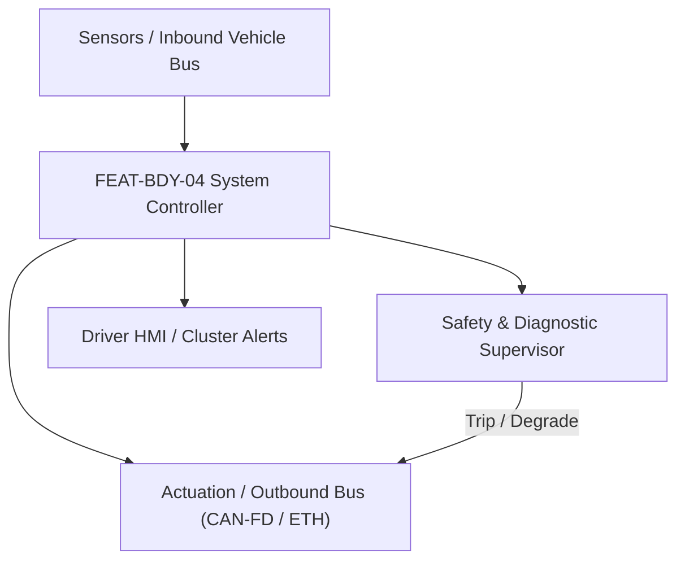
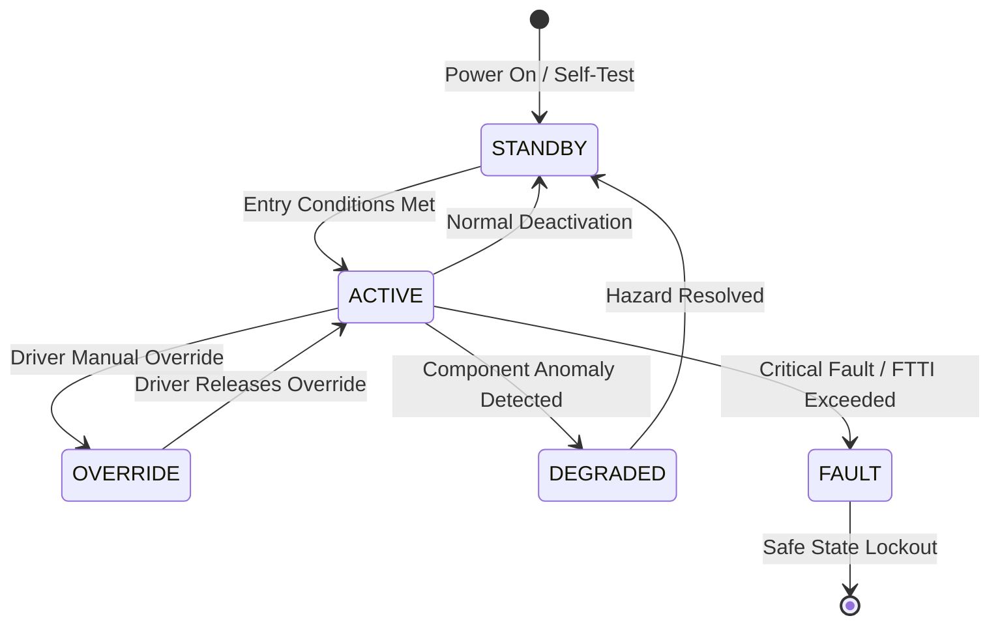

# System Requirements Specification: Intelligent Multi-Zone HVAC & Cabin Air Quality (HVAC-AQ)
**Feature ID:** `FEAT-BDY-04`  
**Domain:** Body, Lighting & Restraints  
**Target ASIL:** ASIL A / QM  
**Compliance Standard:** ISO 26262:2018 (Part 4 - System Development) / ASPICE PAM v3.1 (SYS.2, SYS.3)  
**Parent Master Specification:** [`spec.md`](file:///c:/Workset/AntiGravityProjects/TestOptimisationExperiement/spec.md#feat-bdy-04-hvac)  
**Derived Software Specification:** [`FEAT-BDY-04_HVAC_SwReq.md`](file:///c:/Workset/AntiGravityProjects/TestOptimisationExperiement/software_requirements/FEAT-BDY-04_HVAC_SwReq.md)

---

## 1. Feature Overview & Operational Scope

Quad-zone climate comfort system integrating heat pump thermal expansion valves, solar radiation angle tracking, cabin PM2.5 laser scattering sensors, and high-voltage negative ion purification.

### Operational Context Architecture

---

## 2. Activation Logic & Operational States

- **Preconditions:** 12V system voltage >= 11.5V, High-Voltage traction battery connected (for 400V/800V electric A/C scroll compressor), cabin blower healthy.
- **Entry Conditions:** Ignition in RUN or pre-conditioning requested via smartphone telematics; AUTO climate mode engaged.
- **Deactivation Conditions:** Driver presses OFF button, vehicle shutdown, or high-voltage battery SOC drops below 15% during remote preconditioning.
- **Driver Override Behavior:** Driver manual fan speed or vent position overrides AUTO mode for that zone; Windshield Defrost button unconditionally commands maximum heat and blower to windshield within 200 ms.
- **Operational State Progression:**  
  `OFF` -> `PRE_CONDITIONING` -> `AUTO_CLIMATE_REGULATION` -> `MAX_DEFROST_CLEARING` -> `AIR_QUALITY_PURIFICATION` -> `ECO_HEAT_PUMP_RECIRC` -> `EVAPORATOR_DE-ICE` -> `HVAC_FAULT_DEGRADED`

### State Transition Diagram

---

## 3. Functional Safety & Failure Mitigation Concept

- **Functional Safety Goal:** SG-HVAC-01: Ensure rapid windshield defrosting / defogging to guarantee driver forward field of view (ECE R43 / FMVSS 103); prevent refrigerant leaks into passenger compartment.
- **Fault Tolerant Time Interval (FTTI):** 200 ms for defrost vent flap override; 1000 ms for refrigerant leak isolation.
- **Safe State Definition:** Force defrost vent flaps 100% open to windshield; command blower speed to 80%; isolate cabin refrigerant solenoid valve.
- **Warning & Escalation Strategy:** Display defrost active indicator on climate screen; alert driver if cabin CO2 or PM2.5 levels reach hazardous concentrations.

### Failure Modes & Degradation Handling
- **Cabin Temperature Sensor Fault:** If cabin temp thermistor fails open/short, substitute estimated temperature based on ambient sensor and thermal cabin model.
- **Defrost Stepper Motor Jam:** If defrost flap position feedback does not change, pulse stepper motor with maximum reverse current, then default other vents closed to force air upwards.
- **Pm25 Sensor Optical Obscuration:** If laser particle counter baseline drifts, enter periodic 10-minute fresh air purge cycle.

---

## 4. System Requirements (SYS_REQ)
*(Note: Each System Requirement is systematically partitioned into multiple Child Software Requirements)*

### `SYS-BDY-04-01`: Quad-Zone Thermal Comfort Model & Solar Radiation Compensation
- **Planned Release:** R100
- **ASIL Rating:** QM
- **Parent Feature:** [`FEAT-BDY-04`](file:///c:/Workset/AntiGravityProjects/TestOptimisationExperiement/spec.md#feat-bdy-04)
- **Requirement Statement:**
  > The System SHALL sample 4 interior zone temperature thermistors, ambient temperature, vehicle velocity, and dual-zone solar elevation/azimuth pyranometer at 10 Hz, calculating required air discharge temperature (+-0.5°C) and blower air mass for each occupant zone.
- **Activation Logic:** Active at all times when climate control is enabled.
- **Fault Tolerant Time Interval (FTTI):** 1000 ms
- **Safe State Action:** Default to fixed 22.0°C discharge temperature and medium fan speed.
- **Failure Detection & Reaction:** If solar pyranometer fails, assume zero solar irradiation and rely on ambient sensor.
- **Input Interfaces:** `Cabin_Temp_FL_FR_RL_RR_DegC, Ambient_Temp_DegC, Solar_Elevation_Deg, Solar_Azimuth_Deg, Solar_Intensity_W_M2`
- **Output Interfaces:** `Target_Discharge_Temp_Array[4], Target_Blower_CFM_Array[4]`
- **System Verification Method:** Climatic wind tunnel validation across -30°C to +50°C solar radiation environments.
- **Derived Child Software Requirements (1:N Link):**
  - [`SWR-BDY-04-01`](file:///c:/Workset/AntiGravityProjects/TestOptimisationExperiement/software_requirements/FEAT-BDY-04_HVAC_SwReq.md#swr-bdy-04-01)
  - [`SWR-BDY-04-02`](file:///c:/Workset/AntiGravityProjects/TestOptimisationExperiement/software_requirements/FEAT-BDY-04_HVAC_SwReq.md#swr-bdy-04-02)

### `SYS-BDY-04-02`: Laser PM2.5 / CO2 Cabin Air Quality Monitoring & Multi-Stage Ionization
- **Planned Release:** R100
- **ASIL Rating:** ASIL A
- **Parent Feature:** [`FEAT-BDY-04`](file:///c:/Workset/AntiGravityProjects/TestOptimisationExperiement/spec.md#feat-bdy-04)
- **Requirement Statement:**
  > The System SHALL sample cabin and ambient PM2.5 laser scattering sensors (0-500 ug/m³) and NDIR CO2 sensors (400-5000 ppm) at 1 Hz, automatically commanding motorized recirculation flap and high-voltage negative ion generator in <= 2.0 seconds when ambient pollution spikes.
- **Activation Logic:** Active when Air Quality Management is turned on.
- **Fault Tolerant Time Interval (FTTI):** 2000 ms
- **Safe State Action:** Open fresh air flap to 25% minimum to prevent passenger drowsiness from CO2 buildup.
- **Failure Detection & Reaction:** If CO2 sensor reports > 2500 ppm, override recirculation mode and force 100% fresh air intake.
- **Input Interfaces:** `PM25_Cabin_Ug_M3, PM25_Ambient_Ug_M3, CO2_Cabin_PPM, Recirc_Flap_Position`
- **Output Interfaces:** `Recirc_Flap_Motor_Cmd, Ionizer_HV_Enable_Flag, HEPA_Filter_Purge_Level`
- **System Verification Method:** Smoke chamber aerosol particle filtration efficiency and CO2 purge rate testing.
- **Derived Child Software Requirements (1:N Link):**
  - [`SWR-BDY-04-03`](file:///c:/Workset/AntiGravityProjects/TestOptimisationExperiement/software_requirements/FEAT-BDY-04_HVAC_SwReq.md#swr-bdy-04-03)
  - [`SWR-BDY-04-04`](file:///c:/Workset/AntiGravityProjects/TestOptimisationExperiement/software_requirements/FEAT-BDY-04_HVAC_SwReq.md#swr-bdy-04-04)

### `SYS-BDY-04-03`: Cabin 4-Zone Temperature Setpoint & Solar Radiation Flux Balancer
- **Planned Release:** R100
- **ASIL Rating:** ASIL A
- **Parent Feature:** [`FEAT-BDY-04`](file:///c:/Workset/AntiGravityProjects/TestOptimisationExperiement/spec.md#feat-bdy-04)
- **Requirement Statement:**
  > The System SHALL Balance climate setpoints across 4 independent cabin quadrants based on multi-zone solar radiation sensors.
- **Activation Logic:** Active during normal vehicle operation when feature state is active.
- **Fault Tolerant Time Interval (FTTI):** 200 ms
- **Safe State Action:** Transition to safe state or safe degradation tier within FTTI budget.
- **Failure Detection & Reaction:** Isolate faulted channel, latch DEM diagnostic trouble code, and inform driver.
- **Input Interfaces:** `Sensor signals, vehicle dynamics data, and bus frames via RTE.`
- **Output Interfaces:** `Actuator commands, diagnostic event flags, and cluster alerts.`
- **System Verification Method:** HiL test bench and dynamometer automated verification.
- **Derived Child Software Requirements (1:N Link):**
  - [`SWR-BDY-04-05`](file:///c:/Workset/AntiGravityProjects/TestOptimisationExperiement/software_requirements/FEAT-BDY-04_HVAC_SwReq.md#swr-bdy-04-05)
  - [`SWR-BDY-04-06`](file:///c:/Workset/AntiGravityProjects/TestOptimisationExperiement/software_requirements/FEAT-BDY-04_HVAC_SwReq.md#swr-bdy-04-06)

### `SYS-BDY-04-04`: Particulate Matter (PM2.5) & VOC Cabin Air Quality Sensor Observer
- **Planned Release:** R100
- **ASIL Rating:** ASIL A
- **Parent Feature:** [`FEAT-BDY-04`](file:///c:/Workset/AntiGravityProjects/TestOptimisationExperiement/spec.md#feat-bdy-04)
- **Requirement Statement:**
  > The System SHALL Sample laser PM2.5 and metal-oxide VOC sensors; activate cabin air recirculation if PM2.5 > 35 µg/m³.
- **Activation Logic:** Active during normal vehicle operation when feature state is active.
- **Fault Tolerant Time Interval (FTTI):** 500 ms
- **Safe State Action:** Transition to safe state or safe degradation tier within FTTI budget.
- **Failure Detection & Reaction:** Isolate faulted channel, latch DEM diagnostic trouble code, and inform driver.
- **Input Interfaces:** `Sensor signals, vehicle dynamics data, and bus frames via RTE.`
- **Output Interfaces:** `Actuator commands, diagnostic event flags, and cluster alerts.`
- **System Verification Method:** HiL test bench and dynamometer automated verification.
- **Derived Child Software Requirements (1:N Link):**
  - [`SWR-BDY-04-07`](file:///c:/Workset/AntiGravityProjects/TestOptimisationExperiement/software_requirements/FEAT-BDY-04_HVAC_SwReq.md#swr-bdy-04-07)
  - [`SWR-BDY-04-08`](file:///c:/Workset/AntiGravityProjects/TestOptimisationExperiement/software_requirements/FEAT-BDY-04_HVAC_SwReq.md#swr-bdy-04-08)

### `SYS-BDY-04-05`: Automated Fresh Air / Recirculation Damper Stepper Motor Servocontrol
- **Planned Release:** R200
- **ASIL Rating:** ASIL A
- **Parent Feature:** [`FEAT-BDY-04`](file:///c:/Workset/AntiGravityProjects/TestOptimisationExperiement/spec.md#feat-bdy-04)
- **Requirement Statement:**
  > The System SHALL Position motorized intake air flaps to switch between fresh air and high-efficiency HEPA recirculation.
- **Activation Logic:** Active during normal vehicle operation when feature state is active.
- **Fault Tolerant Time Interval (FTTI):** 100 ms
- **Safe State Action:** Transition to safe state or safe degradation tier within FTTI budget.
- **Failure Detection & Reaction:** Isolate faulted channel, latch DEM diagnostic trouble code, and inform driver.
- **Input Interfaces:** `Sensor signals, vehicle dynamics data, and bus frames via RTE.`
- **Output Interfaces:** `Actuator commands, diagnostic event flags, and cluster alerts.`
- **System Verification Method:** HiL test bench and dynamometer automated verification.
- **Derived Child Software Requirements (1:N Link):**
  - [`SWR-BDY-04-09`](file:///c:/Workset/AntiGravityProjects/TestOptimisationExperiement/software_requirements/FEAT-BDY-04_HVAC_SwReq.md#swr-bdy-04-09)
  - [`SWR-BDY-04-10`](file:///c:/Workset/AntiGravityProjects/TestOptimisationExperiement/software_requirements/FEAT-BDY-04_HVAC_SwReq.md#swr-bdy-04-10)

### `SYS-BDY-04-06`: Brushless Multi-Zone HVAC Blower Fan PWM Speed Governor
- **Planned Release:** R200
- **ASIL Rating:** ASIL A
- **Parent Feature:** [`FEAT-BDY-04`](file:///c:/Workset/AntiGravityProjects/TestOptimisationExperiement/spec.md#feat-bdy-04)
- **Requirement Statement:**
  > The System SHALL Regulate 12V brushless blower motor speed via PWM across 7 discrete flow levels with soft-start ramp.
- **Activation Logic:** Active during normal vehicle operation when feature state is active.
- **Fault Tolerant Time Interval (FTTI):** 100 ms
- **Safe State Action:** Transition to safe state or safe degradation tier within FTTI budget.
- **Failure Detection & Reaction:** Isolate faulted channel, latch DEM diagnostic trouble code, and inform driver.
- **Input Interfaces:** `Sensor signals, vehicle dynamics data, and bus frames via RTE.`
- **Output Interfaces:** `Actuator commands, diagnostic event flags, and cluster alerts.`
- **System Verification Method:** HiL test bench and dynamometer automated verification.
- **Derived Child Software Requirements (1:N Link):**
  - [`SWR-BDY-04-11`](file:///c:/Workset/AntiGravityProjects/TestOptimisationExperiement/software_requirements/FEAT-BDY-04_HVAC_SwReq.md#swr-bdy-04-11)
  - [`SWR-BDY-04-12`](file:///c:/Workset/AntiGravityProjects/TestOptimisationExperiement/software_requirements/FEAT-BDY-04_HVAC_SwReq.md#swr-bdy-04-12)

### `SYS-BDY-04-07`: Air Distribution Face, Footwell & Defrost Flap Actuator Synchronizer
- **Planned Release:** R300
- **ASIL Rating:** ASIL A
- **Parent Feature:** [`FEAT-BDY-04`](file:///c:/Workset/AntiGravityProjects/TestOptimisationExperiement/spec.md#feat-bdy-04)
- **Requirement Statement:**
  > The System SHALL Synchronize LIN bus stepper motor flap actuators to route airflow according to driver mode selection.
- **Activation Logic:** Active during normal vehicle operation when feature state is active.
- **Fault Tolerant Time Interval (FTTI):** 100 ms
- **Safe State Action:** Transition to safe state or safe degradation tier within FTTI budget.
- **Failure Detection & Reaction:** Isolate faulted channel, latch DEM diagnostic trouble code, and inform driver.
- **Input Interfaces:** `Sensor signals, vehicle dynamics data, and bus frames via RTE.`
- **Output Interfaces:** `Actuator commands, diagnostic event flags, and cluster alerts.`
- **System Verification Method:** HiL test bench and dynamometer automated verification.
- **Derived Child Software Requirements (1:N Link):**
  - [`SWR-BDY-04-13`](file:///c:/Workset/AntiGravityProjects/TestOptimisationExperiement/software_requirements/FEAT-BDY-04_HVAC_SwReq.md#swr-bdy-04-13)
  - [`SWR-BDY-04-14`](file:///c:/Workset/AntiGravityProjects/TestOptimisationExperiement/software_requirements/FEAT-BDY-04_HVAC_SwReq.md#swr-bdy-04-14)

### `SYS-BDY-04-08`: Windshield Humidity Sensor & Predictive Glass Defogging Governor
- **Planned Release:** R300
- **ASIL Rating:** ASIL A
- **Parent Feature:** [`FEAT-BDY-04`](file:///c:/Workset/AntiGravityProjects/TestOptimisationExperiement/spec.md#feat-bdy-04)
- **Requirement Statement:**
  > The System SHALL Monitor windshield relative humidity: Turn on AC compressor and defrost vents before condensation forms.
- **Activation Logic:** Active during normal vehicle operation when feature state is active.
- **Fault Tolerant Time Interval (FTTI):** 200 ms
- **Safe State Action:** Transition to safe state or safe degradation tier within FTTI budget.
- **Failure Detection & Reaction:** Isolate faulted channel, latch DEM diagnostic trouble code, and inform driver.
- **Input Interfaces:** `Sensor signals, vehicle dynamics data, and bus frames via RTE.`
- **Output Interfaces:** `Actuator commands, diagnostic event flags, and cluster alerts.`
- **System Verification Method:** HiL test bench and dynamometer automated verification.
- **Derived Child Software Requirements (1:N Link):**
  - [`SWR-BDY-04-15`](file:///c:/Workset/AntiGravityProjects/TestOptimisationExperiement/software_requirements/FEAT-BDY-04_HVAC_SwReq.md#swr-bdy-04-15)
  - [`SWR-BDY-04-16`](file:///c:/Workset/AntiGravityProjects/TestOptimisationExperiement/software_requirements/FEAT-BDY-04_HVAC_SwReq.md#swr-bdy-04-16)

### `SYS-BDY-04-09`: High-Voltage Cabin Air Electric Ionizer & Fragrance Dispenser Driver
- **Planned Release:** R300
- **ASIL Rating:** ASIL A
- **Parent Feature:** [`FEAT-BDY-04`](file:///c:/Workset/AntiGravityProjects/TestOptimisationExperiement/spec.md#feat-bdy-04)
- **Requirement Statement:**
  > The System SHALL Control negative ion generator and motorized fragrance cartridge dispenser to purify cabin atmosphere.
- **Activation Logic:** Active during normal vehicle operation when feature state is active.
- **Fault Tolerant Time Interval (FTTI):** 500 ms
- **Safe State Action:** Transition to safe state or safe degradation tier within FTTI budget.
- **Failure Detection & Reaction:** Isolate faulted channel, latch DEM diagnostic trouble code, and inform driver.
- **Input Interfaces:** `Sensor signals, vehicle dynamics data, and bus frames via RTE.`
- **Output Interfaces:** `Actuator commands, diagnostic event flags, and cluster alerts.`
- **System Verification Method:** HiL test bench and dynamometer automated verification.
- **Derived Child Software Requirements (1:N Link):**
  - [`SWR-BDY-04-17`](file:///c:/Workset/AntiGravityProjects/TestOptimisationExperiement/software_requirements/FEAT-BDY-04_HVAC_SwReq.md#swr-bdy-04-17)
  - [`SWR-BDY-04-18`](file:///c:/Workset/AntiGravityProjects/TestOptimisationExperiement/software_requirements/FEAT-BDY-04_HVAC_SwReq.md#swr-bdy-04-18)

### `SYS-BDY-04-10`: Heated Steering Wheel & Multi-Stage Heated/Ventilated Seat Coordinator
- **Planned Release:** R400
- **ASIL Rating:** ASIL A
- **Parent Feature:** [`FEAT-BDY-04`](file:///c:/Workset/AntiGravityProjects/TestOptimisationExperiement/spec.md#feat-bdy-04)
- **Requirement Statement:**
  > The System SHALL Coordinate seat heating/ventilation PWM currents to reach target occupant surface thermal comfort.
- **Activation Logic:** Active during normal vehicle operation when feature state is active.
- **Fault Tolerant Time Interval (FTTI):** 200 ms
- **Safe State Action:** Transition to safe state or safe degradation tier within FTTI budget.
- **Failure Detection & Reaction:** Isolate faulted channel, latch DEM diagnostic trouble code, and inform driver.
- **Input Interfaces:** `Sensor signals, vehicle dynamics data, and bus frames via RTE.`
- **Output Interfaces:** `Actuator commands, diagnostic event flags, and cluster alerts.`
- **System Verification Method:** HiL test bench and dynamometer automated verification.
- **Derived Child Software Requirements (1:N Link):**
  - [`SWR-BDY-04-19`](file:///c:/Workset/AntiGravityProjects/TestOptimisationExperiement/software_requirements/FEAT-BDY-04_HVAC_SwReq.md#swr-bdy-04-19)
  - [`SWR-BDY-04-20`](file:///c:/Workset/AntiGravityProjects/TestOptimisationExperiement/software_requirements/FEAT-BDY-04_HVAC_SwReq.md#swr-bdy-04-20)

### `SYS-BDY-04-11`: Sub-Zero Ambient Heat Pump Auxiliary Heating Mode Request Arbitrator
- **Planned Release:** R400
- **ASIL Rating:** ASIL B
- **Parent Feature:** [`FEAT-BDY-04`](file:///c:/Workset/AntiGravityProjects/TestOptimisationExperiement/spec.md#feat-bdy-04)
- **Requirement Statement:**
  > The System SHALL Request thermal heat pump auxiliary cabin heat or PTC supplementary warmth during extreme winter cold.
- **Activation Logic:** Active during normal vehicle operation when feature state is active.
- **Fault Tolerant Time Interval (FTTI):** 500 ms
- **Safe State Action:** Transition to safe state or safe degradation tier within FTTI budget.
- **Failure Detection & Reaction:** Isolate faulted channel, latch DEM diagnostic trouble code, and inform driver.
- **Input Interfaces:** `Sensor signals, vehicle dynamics data, and bus frames via RTE.`
- **Output Interfaces:** `Actuator commands, diagnostic event flags, and cluster alerts.`
- **System Verification Method:** HiL test bench and dynamometer automated verification.
- **Derived Child Software Requirements (1:N Link):**
  - [`SWR-BDY-04-21`](file:///c:/Workset/AntiGravityProjects/TestOptimisationExperiement/software_requirements/FEAT-BDY-04_HVAC_SwReq.md#swr-bdy-04-21)
  - [`SWR-BDY-04-22`](file:///c:/Workset/AntiGravityProjects/TestOptimisationExperiement/software_requirements/FEAT-BDY-04_HVAC_SwReq.md#swr-bdy-04-22)

### `SYS-BDY-04-12`: Eco-Mode Cabin Occupancy-Based Thermal Zone Energy Conservator
- **Planned Release:** R400
- **ASIL Rating:** ASIL A
- **Parent Feature:** [`FEAT-BDY-04`](file:///c:/Workset/AntiGravityProjects/TestOptimisationExperiement/spec.md#feat-bdy-04)
- **Requirement Statement:**
  > The System SHALL Shut down climate conditioning to unoccupied passenger seats when ECO driving mode is active.
- **Activation Logic:** Active during normal vehicle operation when feature state is active.
- **Fault Tolerant Time Interval (FTTI):** 1000 ms
- **Safe State Action:** Transition to safe state or safe degradation tier within FTTI budget.
- **Failure Detection & Reaction:** Isolate faulted channel, latch DEM diagnostic trouble code, and inform driver.
- **Input Interfaces:** `Sensor signals, vehicle dynamics data, and bus frames via RTE.`
- **Output Interfaces:** `Actuator commands, diagnostic event flags, and cluster alerts.`
- **System Verification Method:** HiL test bench and dynamometer automated verification.
- **Derived Child Software Requirements (1:N Link):**
  - [`SWR-BDY-04-23`](file:///c:/Workset/AntiGravityProjects/TestOptimisationExperiement/software_requirements/FEAT-BDY-04_HVAC_SwReq.md#swr-bdy-04-23)
  - [`SWR-BDY-04-24`](file:///c:/Workset/AntiGravityProjects/TestOptimisationExperiement/software_requirements/FEAT-BDY-04_HVAC_SwReq.md#swr-bdy-04-24)

### `SYS-BDY-04-13`: HVAC LIN Stepper Motor Jam & Flap Travel Endpoint Self-Calibration
- **Planned Release:** R500
- **ASIL Rating:** ASIL A
- **Parent Feature:** [`FEAT-BDY-04`](file:///c:/Workset/AntiGravityProjects/TestOptimisationExperiement/spec.md#feat-bdy-04)
- **Requirement Statement:**
  > The System SHALL Execute stall-detection homing sequence at key-on to calibrate flap physical endpoints (0-100%).
- **Activation Logic:** Active during normal vehicle operation when feature state is active.
- **Fault Tolerant Time Interval (FTTI):** 1000 ms
- **Safe State Action:** Transition to safe state or safe degradation tier within FTTI budget.
- **Failure Detection & Reaction:** Isolate faulted channel, latch DEM diagnostic trouble code, and inform driver.
- **Input Interfaces:** `Sensor signals, vehicle dynamics data, and bus frames via RTE.`
- **Output Interfaces:** `Actuator commands, diagnostic event flags, and cluster alerts.`
- **System Verification Method:** HiL test bench and dynamometer automated verification.
- **Derived Child Software Requirements (1:N Link):**
  - [`SWR-BDY-04-25`](file:///c:/Workset/AntiGravityProjects/TestOptimisationExperiement/software_requirements/FEAT-BDY-04_HVAC_SwReq.md#swr-bdy-04-25)
  - [`SWR-BDY-04-26`](file:///c:/Workset/AntiGravityProjects/TestOptimisationExperiement/software_requirements/FEAT-BDY-04_HVAC_SwReq.md#swr-bdy-04-26)

### `SYS-BDY-04-14`: DEM HVAC Climate Sensor Diagnostic Event Manager & Fault Logger
- **Planned Release:** R500
- **ASIL Rating:** ASIL A
- **Parent Feature:** [`FEAT-BDY-04`](file:///c:/Workset/AntiGravityProjects/TestOptimisationExperiement/spec.md#feat-bdy-04)
- **Requirement Statement:**
  > The System SHALL Qualify diagnostic trouble codes for temperature thermistor open circuit and flap motor stalls.
- **Activation Logic:** Active during normal vehicle operation when feature state is active.
- **Fault Tolerant Time Interval (FTTI):** 200 ms
- **Safe State Action:** Transition to safe state or safe degradation tier within FTTI budget.
- **Failure Detection & Reaction:** Isolate faulted channel, latch DEM diagnostic trouble code, and inform driver.
- **Input Interfaces:** `Sensor signals, vehicle dynamics data, and bus frames via RTE.`
- **Output Interfaces:** `Actuator commands, diagnostic event flags, and cluster alerts.`
- **System Verification Method:** HiL test bench and dynamometer automated verification.
- **Derived Child Software Requirements (1:N Link):**
  - [`SWR-BDY-04-27`](file:///c:/Workset/AntiGravityProjects/TestOptimisationExperiement/software_requirements/FEAT-BDY-04_HVAC_SwReq.md#swr-bdy-04-27)
  - [`SWR-BDY-04-28`](file:///c:/Workset/AntiGravityProjects/TestOptimisationExperiement/software_requirements/FEAT-BDY-04_HVAC_SwReq.md#swr-bdy-04-28)

### `SYS-BDY-04-15`: Driver Central Touchscreen Climate Control HMI & Voice Command Interface
- **Planned Release:** R500
- **ASIL Rating:** ASIL A
- **Parent Feature:** [`FEAT-BDY-04`](file:///c:/Workset/AntiGravityProjects/TestOptimisationExperiement/spec.md#feat-bdy-04)
- **Requirement Statement:**
  > The System SHALL Process temperature target adjustments and fan speed changes from central display and voice assistant.
- **Activation Logic:** Active during normal vehicle operation when feature state is active.
- **Fault Tolerant Time Interval (FTTI):** 100 ms
- **Safe State Action:** Transition to safe state or safe degradation tier within FTTI budget.
- **Failure Detection & Reaction:** Isolate faulted channel, latch DEM diagnostic trouble code, and inform driver.
- **Input Interfaces:** `Sensor signals, vehicle dynamics data, and bus frames via RTE.`
- **Output Interfaces:** `Actuator commands, diagnostic event flags, and cluster alerts.`
- **System Verification Method:** HiL test bench and dynamometer automated verification.
- **Derived Child Software Requirements (1:N Link):**
  - [`SWR-BDY-04-29`](file:///c:/Workset/AntiGravityProjects/TestOptimisationExperiement/software_requirements/FEAT-BDY-04_HVAC_SwReq.md#swr-bdy-04-29)
  - [`SWR-BDY-04-30`](file:///c:/Workset/AntiGravityProjects/TestOptimisationExperiement/software_requirements/FEAT-BDY-04_HVAC_SwReq.md#swr-bdy-04-30)

---

## 5. System-to-Software Traceability Summary

| System Requirement ID | Planned Release | ASIL | Title | Derived Software Requirements (1:N) | Verification Method |
| :--- | :---: | :--- | :--- | :--- | :--- |
| `SYS-BDY-04-01` | **`R100`** | QM | Quad-Zone Thermal Comfort Model & Solar Radiation Compensation | [`SWR-BDY-04-01`](file:///c:/Workset/AntiGravityProjects/TestOptimisationExperiement/software_requirements/FEAT-BDY-04_HVAC_SwReq.md#swr-bdy-04-01), [`SWR-BDY-04-02`](file:///c:/Workset/AntiGravityProjects/TestOptimisationExperiement/software_requirements/FEAT-BDY-04_HVAC_SwReq.md#swr-bdy-04-02) | Climatic wind tunnel validation across -30°C to +50°C solar radiation environments. |
| `SYS-BDY-04-02` | **`R100`** | ASIL A | Laser PM2.5 / CO2 Cabin Air Quality Monitoring & Multi-Stage Ionization | [`SWR-BDY-04-03`](file:///c:/Workset/AntiGravityProjects/TestOptimisationExperiement/software_requirements/FEAT-BDY-04_HVAC_SwReq.md#swr-bdy-04-03), [`SWR-BDY-04-04`](file:///c:/Workset/AntiGravityProjects/TestOptimisationExperiement/software_requirements/FEAT-BDY-04_HVAC_SwReq.md#swr-bdy-04-04) | Smoke chamber aerosol particle filtration efficiency and CO2 purge rate testing. |
| `SYS-BDY-04-03` | **`R100`** | ASIL A | Cabin 4-Zone Temperature Setpoint & Solar Radiation Flux Balancer | [`SWR-BDY-04-05`](file:///c:/Workset/AntiGravityProjects/TestOptimisationExperiement/software_requirements/FEAT-BDY-04_HVAC_SwReq.md#swr-bdy-04-05), [`SWR-BDY-04-06`](file:///c:/Workset/AntiGravityProjects/TestOptimisationExperiement/software_requirements/FEAT-BDY-04_HVAC_SwReq.md#swr-bdy-04-06) | HiL test bench and dynamometer automated verification. |
| `SYS-BDY-04-04` | **`R100`** | ASIL A | Particulate Matter (PM2.5) & VOC Cabin Air Quality Sensor Observer | [`SWR-BDY-04-07`](file:///c:/Workset/AntiGravityProjects/TestOptimisationExperiement/software_requirements/FEAT-BDY-04_HVAC_SwReq.md#swr-bdy-04-07), [`SWR-BDY-04-08`](file:///c:/Workset/AntiGravityProjects/TestOptimisationExperiement/software_requirements/FEAT-BDY-04_HVAC_SwReq.md#swr-bdy-04-08) | HiL test bench and dynamometer automated verification. |
| `SYS-BDY-04-05` | **`R200`** | ASIL A | Automated Fresh Air / Recirculation Damper Stepper Motor Servocontrol | [`SWR-BDY-04-09`](file:///c:/Workset/AntiGravityProjects/TestOptimisationExperiement/software_requirements/FEAT-BDY-04_HVAC_SwReq.md#swr-bdy-04-09), [`SWR-BDY-04-10`](file:///c:/Workset/AntiGravityProjects/TestOptimisationExperiement/software_requirements/FEAT-BDY-04_HVAC_SwReq.md#swr-bdy-04-10) | HiL test bench and dynamometer automated verification. |
| `SYS-BDY-04-06` | **`R200`** | ASIL A | Brushless Multi-Zone HVAC Blower Fan PWM Speed Governor | [`SWR-BDY-04-11`](file:///c:/Workset/AntiGravityProjects/TestOptimisationExperiement/software_requirements/FEAT-BDY-04_HVAC_SwReq.md#swr-bdy-04-11), [`SWR-BDY-04-12`](file:///c:/Workset/AntiGravityProjects/TestOptimisationExperiement/software_requirements/FEAT-BDY-04_HVAC_SwReq.md#swr-bdy-04-12) | HiL test bench and dynamometer automated verification. |
| `SYS-BDY-04-07` | **`R300`** | ASIL A | Air Distribution Face, Footwell & Defrost Flap Actuator Synchronizer | [`SWR-BDY-04-13`](file:///c:/Workset/AntiGravityProjects/TestOptimisationExperiement/software_requirements/FEAT-BDY-04_HVAC_SwReq.md#swr-bdy-04-13), [`SWR-BDY-04-14`](file:///c:/Workset/AntiGravityProjects/TestOptimisationExperiement/software_requirements/FEAT-BDY-04_HVAC_SwReq.md#swr-bdy-04-14) | HiL test bench and dynamometer automated verification. |
| `SYS-BDY-04-08` | **`R300`** | ASIL A | Windshield Humidity Sensor & Predictive Glass Defogging Governor | [`SWR-BDY-04-15`](file:///c:/Workset/AntiGravityProjects/TestOptimisationExperiement/software_requirements/FEAT-BDY-04_HVAC_SwReq.md#swr-bdy-04-15), [`SWR-BDY-04-16`](file:///c:/Workset/AntiGravityProjects/TestOptimisationExperiement/software_requirements/FEAT-BDY-04_HVAC_SwReq.md#swr-bdy-04-16) | HiL test bench and dynamometer automated verification. |
| `SYS-BDY-04-09` | **`R300`** | ASIL A | High-Voltage Cabin Air Electric Ionizer & Fragrance Dispenser Driver | [`SWR-BDY-04-17`](file:///c:/Workset/AntiGravityProjects/TestOptimisationExperiement/software_requirements/FEAT-BDY-04_HVAC_SwReq.md#swr-bdy-04-17), [`SWR-BDY-04-18`](file:///c:/Workset/AntiGravityProjects/TestOptimisationExperiement/software_requirements/FEAT-BDY-04_HVAC_SwReq.md#swr-bdy-04-18) | HiL test bench and dynamometer automated verification. |
| `SYS-BDY-04-10` | **`R400`** | ASIL A | Heated Steering Wheel & Multi-Stage Heated/Ventilated Seat Coordinator | [`SWR-BDY-04-19`](file:///c:/Workset/AntiGravityProjects/TestOptimisationExperiement/software_requirements/FEAT-BDY-04_HVAC_SwReq.md#swr-bdy-04-19), [`SWR-BDY-04-20`](file:///c:/Workset/AntiGravityProjects/TestOptimisationExperiement/software_requirements/FEAT-BDY-04_HVAC_SwReq.md#swr-bdy-04-20) | HiL test bench and dynamometer automated verification. |
| `SYS-BDY-04-11` | **`R400`** | ASIL B | Sub-Zero Ambient Heat Pump Auxiliary Heating Mode Request Arbitrator | [`SWR-BDY-04-21`](file:///c:/Workset/AntiGravityProjects/TestOptimisationExperiement/software_requirements/FEAT-BDY-04_HVAC_SwReq.md#swr-bdy-04-21), [`SWR-BDY-04-22`](file:///c:/Workset/AntiGravityProjects/TestOptimisationExperiement/software_requirements/FEAT-BDY-04_HVAC_SwReq.md#swr-bdy-04-22) | HiL test bench and dynamometer automated verification. |
| `SYS-BDY-04-12` | **`R400`** | ASIL A | Eco-Mode Cabin Occupancy-Based Thermal Zone Energy Conservator | [`SWR-BDY-04-23`](file:///c:/Workset/AntiGravityProjects/TestOptimisationExperiement/software_requirements/FEAT-BDY-04_HVAC_SwReq.md#swr-bdy-04-23), [`SWR-BDY-04-24`](file:///c:/Workset/AntiGravityProjects/TestOptimisationExperiement/software_requirements/FEAT-BDY-04_HVAC_SwReq.md#swr-bdy-04-24) | HiL test bench and dynamometer automated verification. |
| `SYS-BDY-04-13` | **`R500`** | ASIL A | HVAC LIN Stepper Motor Jam & Flap Travel Endpoint Self-Calibration | [`SWR-BDY-04-25`](file:///c:/Workset/AntiGravityProjects/TestOptimisationExperiement/software_requirements/FEAT-BDY-04_HVAC_SwReq.md#swr-bdy-04-25), [`SWR-BDY-04-26`](file:///c:/Workset/AntiGravityProjects/TestOptimisationExperiement/software_requirements/FEAT-BDY-04_HVAC_SwReq.md#swr-bdy-04-26) | HiL test bench and dynamometer automated verification. |
| `SYS-BDY-04-14` | **`R500`** | ASIL A | DEM HVAC Climate Sensor Diagnostic Event Manager & Fault Logger | [`SWR-BDY-04-27`](file:///c:/Workset/AntiGravityProjects/TestOptimisationExperiement/software_requirements/FEAT-BDY-04_HVAC_SwReq.md#swr-bdy-04-27), [`SWR-BDY-04-28`](file:///c:/Workset/AntiGravityProjects/TestOptimisationExperiement/software_requirements/FEAT-BDY-04_HVAC_SwReq.md#swr-bdy-04-28) | HiL test bench and dynamometer automated verification. |
| `SYS-BDY-04-15` | **`R500`** | ASIL A | Driver Central Touchscreen Climate Control HMI & Voice Command Interface | [`SWR-BDY-04-29`](file:///c:/Workset/AntiGravityProjects/TestOptimisationExperiement/software_requirements/FEAT-BDY-04_HVAC_SwReq.md#swr-bdy-04-29), [`SWR-BDY-04-30`](file:///c:/Workset/AntiGravityProjects/TestOptimisationExperiement/software_requirements/FEAT-BDY-04_HVAC_SwReq.md#swr-bdy-04-30) | HiL test bench and dynamometer automated verification. |

- **Upstream Feature Link:** [`spec.md` (FEAT-BDY-04)](file:///c:/Workset/AntiGravityProjects/TestOptimisationExperiement/spec.md#feat-bdy-04)
- **Software Requirements Specification:** [`FEAT-BDY-04_HVAC_SwReq.md`](file:///c:/Workset/AntiGravityProjects/TestOptimisationExperiement/software_requirements/FEAT-BDY-04_HVAC_SwReq.md)
