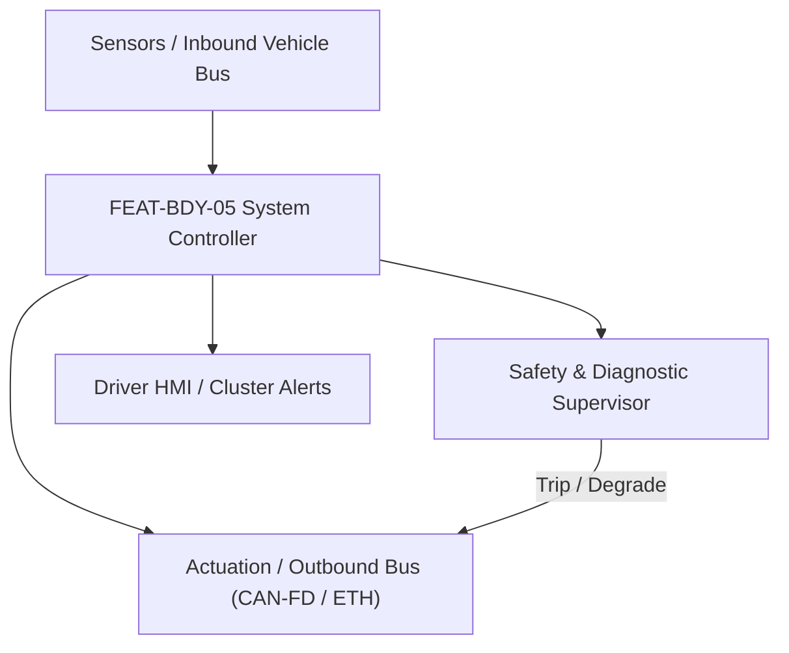
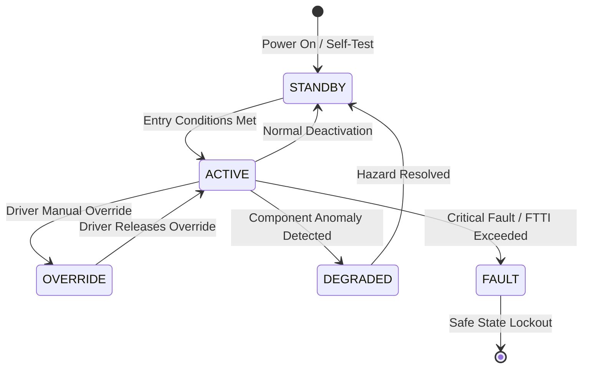

# System Requirements Specification: Smart Power Closures with Anti-Pinch Protection (SPC)
**Feature ID:** `FEAT-BDY-05`  
**Domain:** Body, Lighting & Restraints  
**Target ASIL:** ASIL B / FMVSS 118  
**Compliance Standard:** ISO 26262:2018 (Part 4 - System Development) / ASPICE PAM v3.1 (SYS.2, SYS.3)  
**Parent Master Specification:** [`spec.md`](file:///c:/Workset/AntiGravityProjects/TestOptimisationExperiement/spec.md#feat-bdy-05-spc)  
**Derived Software Specification:** [`FEAT-BDY-05_SPC_SwReq.md`](file:///c:/Workset/AntiGravityProjects/TestOptimisationExperiement/software_requirements/FEAT-BDY-05_SPC_SwReq.md)

---

## 1. Feature Overview & Operational Scope

Mechatronic closure orchestration for hands-free power tailgate, flush deployable door handles, and frameless power windows with optical and hall-effect anti-pinch safety reversal.

### Operational Context Architecture

---

## 2. Activation Logic & Operational States

- **Preconditions:** 12V auxiliary battery >= 11.8V, vehicle speed == 0 km/h (for tailgate / doors), vehicle gear in PARK.
- **Entry Conditions:** User triggers capacitive kick sensor, tailgate switch, key fob button, or vehicle approaches with authenticated digital key.
- **Deactivation Conditions:** Vehicle shifted out of PARK, vehicle speed > 3 km/h, or closure cycle successfully cinched.
- **Driver Override Behavior:** Manual push/pull of door or tailgate during motorized motion immediately releases electromagnetic clutch to allow 100% manual effort.
- **Operational State Progression:**  
  `IDLE_CLOSED` -> `HANDLE_DEPLOYED` -> `POWER_OPENING` -> `HOLD_OPEN` -> `POWER_CLOSING` -> `OBSTACLE_PINCH_REVERSAL` -> `CINCH_LATCHING` -> `MANUAL_OVERRIDE_CLUTCH` -> `MOTOR_THERMAL_LOCKOUT`

### State Transition Diagram

---

## 3. Functional Safety & Failure Mitigation Concept

- **Functional Safety Goal:** SG-SPC-01: Prevent entrapment and crushing injuries; reverse motorized closing motion within 100 ms if obstacle resistance > 100 N detected (FMVSS 118 / ECE R21).
- **Fault Tolerant Time Interval (FTTI):** 50 ms for pinch sensor strip; 100 ms for motor ripple anti-pinch detection.
- **Safe State Definition:** Immediately stop motor drive within 30 ms and reverse travel by >= 150 mm.
- **Warning & Escalation Strategy:** Continuous 85 dB audible beeper and flashing hazard lamps during power tailgate opening/closing travel.

### Failure Modes & Degradation Handling
- **Hall Sensor Count Loss:** If motor hall effect pulse missing while motor current is flowing, assume stall / pinch and reverse motion immediately.
- **Optical Pinch Strip Short:** If resistive pinch edge sensor circuit shorts or opens, inhibit all motorized closing operations (allow manual close only).
- **Strut Spindle Jam:** If dual tailgate spindles become desynchronized by > 10 mm, stop both motors and release clutches to avoid twisting tailgate panel.

---

## 4. System Requirements (SYS_REQ)
*(Note: Each System Requirement is systematically partitioned into multiple Child Software Requirements)*

### `SYS-BDY-05-01`: Capacitive Foot-Kick Gesture Recognition & Digital Key Verification
- **Planned Release:** R100
- **ASIL Rating:** QM
- **Parent Feature:** [`FEAT-BDY-05`](file:///c:/Workset/AntiGravityProjects/TestOptimisationExperiement/spec.md#feat-bdy-05)
- **Requirement Statement:**
  > The System SHALL sample dual capacitive kick sensing antennas under rear bumper at 50 Hz, validating forward-backward kicking gesture kinematics within 400 ms, while verifying authenticated digital key presence (< 1.2 m) before unlatching tailgate.
- **Activation Logic:** Active when vehicle is stationary in PARK.
- **Fault Tolerant Time Interval (FTTI):** 200 ms
- **Safe State Action:** Do not open tailgate; keep primary latch locked.
- **Failure Detection & Reaction:** Ignore capacitive signals if water puddles or heavy rain introduce continuous ground coupling.
- **Input Interfaces:** `Kick_Antenna_Capacitance_Upper_Pf, Kick_Antenna_Capacitance_Lower_Pf, Digital_Key_Rear_Rssi`
- **Output Interfaces:** `Kick_Gesture_Detected_Flag (boolean), Tailgate_Unlock_Authorize_Cmd`
- **System Verification Method:** Gesture false-positive rejection tests with walking pedestrians, pets, and falling rain.
- **Derived Child Software Requirements (1:N Link):**
  - [`SWR-BDY-05-01`](file:///c:/Workset/AntiGravityProjects/TestOptimisationExperiement/software_requirements/FEAT-BDY-05_SPC_SwReq.md#swr-bdy-05-01)
  - [`SWR-BDY-05-02`](file:///c:/Workset/AntiGravityProjects/TestOptimisationExperiement/software_requirements/FEAT-BDY-05_SPC_SwReq.md#swr-bdy-05-02)

### `SYS-BDY-05-02`: Dual-Spindle Motor Velocity Profiling & Cinch Latch Actuation
- **Planned Release:** R100
- **ASIL Rating:** ASIL B
- **Parent Feature:** [`FEAT-BDY-05`](file:///c:/Workset/AntiGravityProjects/TestOptimisationExperiement/spec.md#feat-bdy-05)
- **Requirement Statement:**
  > The System SHALL synchronize dual electromechanical spindle actuators to open/close tailgate over 4.5 seconds following an S-curve acceleration profile, transitioning to electric cinch motor to pull latch into secondary striker in <= 1.0 second.
- **Activation Logic:** Active upon authorized open or close trigger.
- **Fault Tolerant Time Interval (FTTI):** 50 ms
- **Safe State Action:** Reverse spindle motion by >= 150 mm; de-energize cinch puller.
- **Failure Detection & Reaction:** If cinch motor stalls before secondary striker engages, release cinch and latch warning.
- **Input Interfaces:** `Tailgate_Open_Request_Flag, Spindle_Hall_Pulses_Left, Spindle_Hall_Pulses_Right, Cinch_Microswitch_State`
- **Output Interfaces:** `Spindle_Motor_HBridge_Left_PWM, Spindle_Motor_HBridge_Right_PWM, Cinch_Motor_Relay_Cmd`
- **System Verification Method:** Spindle endurance life test over 50,000 cycles across -40°C to +80°C.
- **Derived Child Software Requirements (1:N Link):**
  - [`SWR-BDY-05-03`](file:///c:/Workset/AntiGravityProjects/TestOptimisationExperiement/software_requirements/FEAT-BDY-05_SPC_SwReq.md#swr-bdy-05-03)
  - [`SWR-BDY-05-04`](file:///c:/Workset/AntiGravityProjects/TestOptimisationExperiement/software_requirements/FEAT-BDY-05_SPC_SwReq.md#swr-bdy-05-04)

### `SYS-BDY-05-03`: Anti-Pinch Resistive Sensor & Motor Current Ripple Observer
- **Planned Release:** R100
- **ASIL Rating:** ASIL B / FMVSS 118
- **Parent Feature:** [`FEAT-BDY-05`](file:///c:/Workset/AntiGravityProjects/TestOptimisationExperiement/spec.md#feat-bdy-05)
- **Requirement Statement:**
  > The System SHALL monitor rubber contact pinch sensor strips (pressure drop < 1000 ohms) and sample motor current ripples at 1 kHz: If closing force exceeds 100 N at any point between 4 mm and 200 mm from seal, system SHALL reverse motion in <= 100 ms.
- **Activation Logic:** Active during all motorized closing operations.
- **Fault Tolerant Time Interval (FTTI):** 50 ms
- **Safe State Action:** Reverse motor direction to open tailgate by >= 150 mm within 100 ms.
- **Failure Detection & Reaction:** If pinch strip disconnects, latch DTC B12D4 and prohibit power close.
- **Input Interfaces:** `Pinch_Strip_Resistance_Ohms, Motor_Current_Sample_A, Spindle_Position_Mm`
- **Output Interfaces:** `AntiPinch_Triggered_Flag (boolean), Emergency_Reverse_Command`
- **System Verification Method:** FMVSS 118 calibrated spring-loaded pinch test rod (5 N/mm, 10 N/mm, 20 N/mm, 65 N/mm).
- **Derived Child Software Requirements (1:N Link):**
  - [`SWR-BDY-05-05`](file:///c:/Workset/AntiGravityProjects/TestOptimisationExperiement/software_requirements/FEAT-BDY-05_SPC_SwReq.md#swr-bdy-05-05)
  - [`SWR-BDY-05-06`](file:///c:/Workset/AntiGravityProjects/TestOptimisationExperiement/software_requirements/FEAT-BDY-05_SPC_SwReq.md#swr-bdy-05-06)

### `SYS-BDY-05-04`: Power Liftgate & Window Dual Hall Sensor Position & Velocity Tracker
- **Planned Release:** R100
- **ASIL Rating:** ASIL B
- **Parent Feature:** [`FEAT-BDY-05`](file:///c:/Workset/AntiGravityProjects/TestOptimisationExperiement/spec.md#feat-bdy-05)
- **Requirement Statement:**
  > The System SHALL Count magnetic Hall sensor quadrature pulses to determine closure glass/lid position and closing velocity.
- **Activation Logic:** Active during normal vehicle operation when feature state is active.
- **Fault Tolerant Time Interval (FTTI):** 5 ms
- **Safe State Action:** Transition to safe state or safe degradation tier within FTTI budget.
- **Failure Detection & Reaction:** Isolate faulted channel, latch DEM diagnostic trouble code, and inform driver.
- **Input Interfaces:** `Sensor signals, vehicle dynamics data, and bus frames via RTE.`
- **Output Interfaces:** `Actuator commands, diagnostic event flags, and cluster alerts.`
- **System Verification Method:** HiL test bench and dynamometer automated verification.
- **Derived Child Software Requirements (1:N Link):**
  - [`SWR-BDY-05-07`](file:///c:/Workset/AntiGravityProjects/TestOptimisationExperiement/software_requirements/FEAT-BDY-05_SPC_SwReq.md#swr-bdy-05-07)
  - [`SWR-BDY-05-08`](file:///c:/Workset/AntiGravityProjects/TestOptimisationExperiement/software_requirements/FEAT-BDY-05_SPC_SwReq.md#swr-bdy-05-08)

### `SYS-BDY-05-05`: FMVSS 118 Compliance Non-Reversal Anti-Pinch Force Observer
- **Planned Release:** R200
- **ASIL Rating:** ASIL B
- **Parent Feature:** [`FEAT-BDY-05`](file:///c:/Workset/AntiGravityProjects/TestOptimisationExperiement/spec.md#feat-bdy-05)
- **Requirement Statement:**
  > The System SHALL Differentiate motor velocity: Detect pinch resistance force (> 100 N) and reverse motor in <= 50 ms.
- **Activation Logic:** Active during normal vehicle operation when feature state is active.
- **Fault Tolerant Time Interval (FTTI):** 5 ms
- **Safe State Action:** Transition to safe state or safe degradation tier within FTTI budget.
- **Failure Detection & Reaction:** Isolate faulted channel, latch DEM diagnostic trouble code, and inform driver.
- **Input Interfaces:** `Sensor signals, vehicle dynamics data, and bus frames via RTE.`
- **Output Interfaces:** `Actuator commands, diagnostic event flags, and cluster alerts.`
- **System Verification Method:** HiL test bench and dynamometer automated verification.
- **Derived Child Software Requirements (1:N Link):**
  - [`SWR-BDY-05-09`](file:///c:/Workset/AntiGravityProjects/TestOptimisationExperiement/software_requirements/FEAT-BDY-05_SPC_SwReq.md#swr-bdy-05-09)
  - [`SWR-BDY-05-10`](file:///c:/Workset/AntiGravityProjects/TestOptimisationExperiement/software_requirements/FEAT-BDY-05_SPC_SwReq.md#swr-bdy-05-10)

### `SYS-BDY-05-06`: Optical Infrared & Capacitive Seal Contactless Obstacle Detector
- **Planned Release:** R200
- **ASIL Rating:** ASIL B
- **Parent Feature:** [`FEAT-BDY-05`](file:///c:/Workset/AntiGravityProjects/TestOptimisationExperiement/spec.md#feat-bdy-05)
- **Requirement Statement:**
  > The System SHALL Detect human fingers approaching seal before physical contact, halting motor motion immediately.
- **Activation Logic:** Active during normal vehicle operation when feature state is active.
- **Fault Tolerant Time Interval (FTTI):** 10 ms
- **Safe State Action:** Transition to safe state or safe degradation tier within FTTI budget.
- **Failure Detection & Reaction:** Isolate faulted channel, latch DEM diagnostic trouble code, and inform driver.
- **Input Interfaces:** `Sensor signals, vehicle dynamics data, and bus frames via RTE.`
- **Output Interfaces:** `Actuator commands, diagnostic event flags, and cluster alerts.`
- **System Verification Method:** HiL test bench and dynamometer automated verification.
- **Derived Child Software Requirements (1:N Link):**
  - [`SWR-BDY-05-11`](file:///c:/Workset/AntiGravityProjects/TestOptimisationExperiement/software_requirements/FEAT-BDY-05_SPC_SwReq.md#swr-bdy-05-11)
  - [`SWR-BDY-05-12`](file:///c:/Workset/AntiGravityProjects/TestOptimisationExperiement/software_requirements/FEAT-BDY-05_SPC_SwReq.md#swr-bdy-05-12)

### `SYS-BDY-05-07`: Power Liftgate Spindle Drive DC Motor H-Bridge PWM Driver
- **Planned Release:** R300
- **ASIL Rating:** ASIL B
- **Parent Feature:** [`FEAT-BDY-05`](file:///c:/Workset/AntiGravityProjects/TestOptimisationExperiement/spec.md#feat-bdy-05)
- **Requirement Statement:**
  > The System SHALL Control dual high-current H-bridge power stages driving spindle screw actuators with soft-stop ramping.
- **Activation Logic:** Active during normal vehicle operation when feature state is active.
- **Fault Tolerant Time Interval (FTTI):** 5 ms
- **Safe State Action:** Transition to safe state or safe degradation tier within FTTI budget.
- **Failure Detection & Reaction:** Isolate faulted channel, latch DEM diagnostic trouble code, and inform driver.
- **Input Interfaces:** `Sensor signals, vehicle dynamics data, and bus frames via RTE.`
- **Output Interfaces:** `Actuator commands, diagnostic event flags, and cluster alerts.`
- **System Verification Method:** HiL test bench and dynamometer automated verification.
- **Derived Child Software Requirements (1:N Link):**
  - [`SWR-BDY-05-13`](file:///c:/Workset/AntiGravityProjects/TestOptimisationExperiement/software_requirements/FEAT-BDY-05_SPC_SwReq.md#swr-bdy-05-13)
  - [`SWR-BDY-05-14`](file:///c:/Workset/AntiGravityProjects/TestOptimisationExperiement/software_requirements/FEAT-BDY-05_SPC_SwReq.md#swr-bdy-05-14)

### `SYS-BDY-05-08`: Automatic Power Cincher Latch Motor Pull-In Sequence Governor
- **Planned Release:** R300
- **ASIL Rating:** ASIL B
- **Parent Feature:** [`FEAT-BDY-05`](file:///c:/Workset/AntiGravityProjects/TestOptimisationExperiement/spec.md#feat-bdy-05)
- **Requirement Statement:**
  > The System SHALL Engage motorized secondary latch cincher to pull liftgate or door from primary catch into full seal lock.
- **Activation Logic:** Active during normal vehicle operation when feature state is active.
- **Fault Tolerant Time Interval (FTTI):** 20 ms
- **Safe State Action:** Transition to safe state or safe degradation tier within FTTI budget.
- **Failure Detection & Reaction:** Isolate faulted channel, latch DEM diagnostic trouble code, and inform driver.
- **Input Interfaces:** `Sensor signals, vehicle dynamics data, and bus frames via RTE.`
- **Output Interfaces:** `Actuator commands, diagnostic event flags, and cluster alerts.`
- **System Verification Method:** HiL test bench and dynamometer automated verification.
- **Derived Child Software Requirements (1:N Link):**
  - [`SWR-BDY-05-15`](file:///c:/Workset/AntiGravityProjects/TestOptimisationExperiement/software_requirements/FEAT-BDY-05_SPC_SwReq.md#swr-bdy-05-15)
  - [`SWR-BDY-05-16`](file:///c:/Workset/AntiGravityProjects/TestOptimisationExperiement/software_requirements/FEAT-BDY-05_SPC_SwReq.md#swr-bdy-05-16)

### `SYS-BDY-05-09`: Vehicle Motion Interlock Speed Gatekeeper (Door/Trunk Lockout)
- **Planned Release:** R300
- **ASIL Rating:** ASIL B
- **Parent Feature:** [`FEAT-BDY-05`](file:///c:/Workset/AntiGravityProjects/TestOptimisationExperiement/spec.md#feat-bdy-05)
- **Requirement Statement:**
  > The System SHALL Inhibit power door or liftgate opening commands whenever vehicle speed exceeds 3.0 km/h.
- **Activation Logic:** Active during normal vehicle operation when feature state is active.
- **Fault Tolerant Time Interval (FTTI):** 20 ms
- **Safe State Action:** Transition to safe state or safe degradation tier within FTTI budget.
- **Failure Detection & Reaction:** Isolate faulted channel, latch DEM diagnostic trouble code, and inform driver.
- **Input Interfaces:** `Sensor signals, vehicle dynamics data, and bus frames via RTE.`
- **Output Interfaces:** `Actuator commands, diagnostic event flags, and cluster alerts.`
- **System Verification Method:** HiL test bench and dynamometer automated verification.
- **Derived Child Software Requirements (1:N Link):**
  - [`SWR-BDY-05-17`](file:///c:/Workset/AntiGravityProjects/TestOptimisationExperiement/software_requirements/FEAT-BDY-05_SPC_SwReq.md#swr-bdy-05-17)
  - [`SWR-BDY-05-18`](file:///c:/Workset/AntiGravityProjects/TestOptimisationExperiement/software_requirements/FEAT-BDY-05_SPC_SwReq.md#swr-bdy-05-18)

### `SYS-BDY-05-10`: Tailgate Hands-Free Foot Kick Ultrasonic Sensor Gesture Recognizer
- **Planned Release:** R400
- **ASIL Rating:** ASIL B
- **Parent Feature:** [`FEAT-BDY-05`](file:///c:/Workset/AntiGravityProjects/TestOptimisationExperiement/spec.md#feat-bdy-05)
- **Requirement Statement:**
  > The System SHALL Process rear bumper kick sensor signals to validate intentional opening kick gesture under tailgate.
- **Activation Logic:** Active during normal vehicle operation when feature state is active.
- **Fault Tolerant Time Interval (FTTI):** 50 ms
- **Safe State Action:** Transition to safe state or safe degradation tier within FTTI budget.
- **Failure Detection & Reaction:** Isolate faulted channel, latch DEM diagnostic trouble code, and inform driver.
- **Input Interfaces:** `Sensor signals, vehicle dynamics data, and bus frames via RTE.`
- **Output Interfaces:** `Actuator commands, diagnostic event flags, and cluster alerts.`
- **System Verification Method:** HiL test bench and dynamometer automated verification.
- **Derived Child Software Requirements (1:N Link):**
  - [`SWR-BDY-05-19`](file:///c:/Workset/AntiGravityProjects/TestOptimisationExperiement/software_requirements/FEAT-BDY-05_SPC_SwReq.md#swr-bdy-05-19)
  - [`SWR-BDY-05-20`](file:///c:/Workset/AntiGravityProjects/TestOptimisationExperiement/software_requirements/FEAT-BDY-05_SPC_SwReq.md#swr-bdy-05-20)

### `SYS-BDY-05-11`: Door Mechanical Resistance Wind Gust & Inclined Parking Gravity Compensator
- **Planned Release:** R400
- **ASIL Rating:** ASIL B
- **Parent Feature:** [`FEAT-BDY-05`](file:///c:/Workset/AntiGravityProjects/TestOptimisationExperiement/spec.md#feat-bdy-05)
- **Requirement Statement:**
  > The System SHALL Adjust motor closing torque profile dynamically when vehicle is parked on steep grades or in high winds.
- **Activation Logic:** Active during normal vehicle operation when feature state is active.
- **Fault Tolerant Time Interval (FTTI):** 20 ms
- **Safe State Action:** Transition to safe state or safe degradation tier within FTTI budget.
- **Failure Detection & Reaction:** Isolate faulted channel, latch DEM diagnostic trouble code, and inform driver.
- **Input Interfaces:** `Sensor signals, vehicle dynamics data, and bus frames via RTE.`
- **Output Interfaces:** `Actuator commands, diagnostic event flags, and cluster alerts.`
- **System Verification Method:** HiL test bench and dynamometer automated verification.
- **Derived Child Software Requirements (1:N Link):**
  - [`SWR-BDY-05-21`](file:///c:/Workset/AntiGravityProjects/TestOptimisationExperiement/software_requirements/FEAT-BDY-05_SPC_SwReq.md#swr-bdy-05-21)
  - [`SWR-BDY-05-22`](file:///c:/Workset/AntiGravityProjects/TestOptimisationExperiement/software_requirements/FEAT-BDY-05_SPC_SwReq.md#swr-bdy-05-22)

### `SYS-BDY-05-12`: Power Closure DC Motor Thermal Overload Duty Cycle Guard
- **Planned Release:** R400
- **ASIL Rating:** ASIL B
- **Parent Feature:** [`FEAT-BDY-05`](file:///c:/Workset/AntiGravityProjects/TestOptimisationExperiement/spec.md#feat-bdy-05)
- **Requirement Statement:**
  > The System SHALL Inhibit repeated power closure activations if motor internal temperature exceeds 110 °C.
- **Activation Logic:** Active during normal vehicle operation when feature state is active.
- **Fault Tolerant Time Interval (FTTI):** 100 ms
- **Safe State Action:** Transition to safe state or safe degradation tier within FTTI budget.
- **Failure Detection & Reaction:** Isolate faulted channel, latch DEM diagnostic trouble code, and inform driver.
- **Input Interfaces:** `Sensor signals, vehicle dynamics data, and bus frames via RTE.`
- **Output Interfaces:** `Actuator commands, diagnostic event flags, and cluster alerts.`
- **System Verification Method:** HiL test bench and dynamometer automated verification.
- **Derived Child Software Requirements (1:N Link):**
  - [`SWR-BDY-05-23`](file:///c:/Workset/AntiGravityProjects/TestOptimisationExperiement/software_requirements/FEAT-BDY-05_SPC_SwReq.md#swr-bdy-05-23)
  - [`SWR-BDY-05-24`](file:///c:/Workset/AntiGravityProjects/TestOptimisationExperiement/software_requirements/FEAT-BDY-05_SPC_SwReq.md#swr-bdy-05-24)

### `SYS-BDY-05-13`: Power Window Emergency Express-Up Window Closure Safe Stop Logic
- **Planned Release:** R500
- **ASIL Rating:** ASIL B
- **Parent Feature:** [`FEAT-BDY-05`](file:///c:/Workset/AntiGravityProjects/TestOptimisationExperiement/spec.md#feat-bdy-05)
- **Requirement Statement:**
  > The System SHALL Halt one-touch express up window travel and reverse by 125 mm upon anti-pinch trigger.
- **Activation Logic:** Active during normal vehicle operation when feature state is active.
- **Fault Tolerant Time Interval (FTTI):** 10 ms
- **Safe State Action:** Transition to safe state or safe degradation tier within FTTI budget.
- **Failure Detection & Reaction:** Isolate faulted channel, latch DEM diagnostic trouble code, and inform driver.
- **Input Interfaces:** `Sensor signals, vehicle dynamics data, and bus frames via RTE.`
- **Output Interfaces:** `Actuator commands, diagnostic event flags, and cluster alerts.`
- **System Verification Method:** HiL test bench and dynamometer automated verification.
- **Derived Child Software Requirements (1:N Link):**
  - [`SWR-BDY-05-25`](file:///c:/Workset/AntiGravityProjects/TestOptimisationExperiement/software_requirements/FEAT-BDY-05_SPC_SwReq.md#swr-bdy-05-25)
  - [`SWR-BDY-05-26`](file:///c:/Workset/AntiGravityProjects/TestOptimisationExperiement/software_requirements/FEAT-BDY-05_SPC_SwReq.md#swr-bdy-05-26)

### `SYS-BDY-05-14`: DEM Power Closures Hall Sensor Fault Diagnostics & DTC Latcher
- **Planned Release:** R500
- **ASIL Rating:** ASIL B
- **Parent Feature:** [`FEAT-BDY-05`](file:///c:/Workset/AntiGravityProjects/TestOptimisationExperiement/spec.md#feat-bdy-05)
- **Requirement Statement:**
  > The System SHALL Detect missing Hall pulses while motor current is flowing (stall condition) and log DTC B1025.
- **Activation Logic:** Active during normal vehicle operation when feature state is active.
- **Fault Tolerant Time Interval (FTTI):** 50 ms
- **Safe State Action:** Transition to safe state or safe degradation tier within FTTI budget.
- **Failure Detection & Reaction:** Isolate faulted channel, latch DEM diagnostic trouble code, and inform driver.
- **Input Interfaces:** `Sensor signals, vehicle dynamics data, and bus frames via RTE.`
- **Output Interfaces:** `Actuator commands, diagnostic event flags, and cluster alerts.`
- **System Verification Method:** HiL test bench and dynamometer automated verification.
- **Derived Child Software Requirements (1:N Link):**
  - [`SWR-BDY-05-27`](file:///c:/Workset/AntiGravityProjects/TestOptimisationExperiement/software_requirements/FEAT-BDY-05_SPC_SwReq.md#swr-bdy-05-27)
  - [`SWR-BDY-05-28`](file:///c:/Workset/AntiGravityProjects/TestOptimisationExperiement/software_requirements/FEAT-BDY-05_SPC_SwReq.md#swr-bdy-05-28)

### `SYS-BDY-05-15`: Acoustic Warning Chime & Exterior Lamp Flasher Annunciation Driver
- **Planned Release:** R500
- **ASIL Rating:** ASIL A
- **Parent Feature:** [`FEAT-BDY-05`](file:///c:/Workset/AntiGravityProjects/TestOptimisationExperiement/spec.md#feat-bdy-05)
- **Requirement Statement:**
  > The System SHALL Sound exterior acoustic beeper and flash hazard lamps during automated liftgate opening/closing.
- **Activation Logic:** Active during normal vehicle operation when feature state is active.
- **Fault Tolerant Time Interval (FTTI):** 50 ms
- **Safe State Action:** Transition to safe state or safe degradation tier within FTTI budget.
- **Failure Detection & Reaction:** Isolate faulted channel, latch DEM diagnostic trouble code, and inform driver.
- **Input Interfaces:** `Sensor signals, vehicle dynamics data, and bus frames via RTE.`
- **Output Interfaces:** `Actuator commands, diagnostic event flags, and cluster alerts.`
- **System Verification Method:** HiL test bench and dynamometer automated verification.
- **Derived Child Software Requirements (1:N Link):**
  - [`SWR-BDY-05-29`](file:///c:/Workset/AntiGravityProjects/TestOptimisationExperiement/software_requirements/FEAT-BDY-05_SPC_SwReq.md#swr-bdy-05-29)
  - [`SWR-BDY-05-30`](file:///c:/Workset/AntiGravityProjects/TestOptimisationExperiement/software_requirements/FEAT-BDY-05_SPC_SwReq.md#swr-bdy-05-30)

---

## 5. System-to-Software Traceability Summary

| System Requirement ID | Planned Release | ASIL | Title | Derived Software Requirements (1:N) | Verification Method |
| :--- | :---: | :--- | :--- | :--- | :--- |
| `SYS-BDY-05-01` | **`R100`** | QM | Capacitive Foot-Kick Gesture Recognition & Digital Key Verification | [`SWR-BDY-05-01`](file:///c:/Workset/AntiGravityProjects/TestOptimisationExperiement/software_requirements/FEAT-BDY-05_SPC_SwReq.md#swr-bdy-05-01), [`SWR-BDY-05-02`](file:///c:/Workset/AntiGravityProjects/TestOptimisationExperiement/software_requirements/FEAT-BDY-05_SPC_SwReq.md#swr-bdy-05-02) | Gesture false-positive rejection tests with walking pedestrians, pets, and falling rain. |
| `SYS-BDY-05-02` | **`R100`** | ASIL B | Dual-Spindle Motor Velocity Profiling & Cinch Latch Actuation | [`SWR-BDY-05-03`](file:///c:/Workset/AntiGravityProjects/TestOptimisationExperiement/software_requirements/FEAT-BDY-05_SPC_SwReq.md#swr-bdy-05-03), [`SWR-BDY-05-04`](file:///c:/Workset/AntiGravityProjects/TestOptimisationExperiement/software_requirements/FEAT-BDY-05_SPC_SwReq.md#swr-bdy-05-04) | Spindle endurance life test over 50,000 cycles across -40°C to +80°C. |
| `SYS-BDY-05-03` | **`R100`** | ASIL B / FMVSS 118 | Anti-Pinch Resistive Sensor & Motor Current Ripple Observer | [`SWR-BDY-05-05`](file:///c:/Workset/AntiGravityProjects/TestOptimisationExperiement/software_requirements/FEAT-BDY-05_SPC_SwReq.md#swr-bdy-05-05), [`SWR-BDY-05-06`](file:///c:/Workset/AntiGravityProjects/TestOptimisationExperiement/software_requirements/FEAT-BDY-05_SPC_SwReq.md#swr-bdy-05-06) | FMVSS 118 calibrated spring-loaded pinch test rod (5 N/mm, 10 N/mm, 20 N/mm, 65 N/mm). |
| `SYS-BDY-05-04` | **`R100`** | ASIL B | Power Liftgate & Window Dual Hall Sensor Position & Velocity Tracker | [`SWR-BDY-05-07`](file:///c:/Workset/AntiGravityProjects/TestOptimisationExperiement/software_requirements/FEAT-BDY-05_SPC_SwReq.md#swr-bdy-05-07), [`SWR-BDY-05-08`](file:///c:/Workset/AntiGravityProjects/TestOptimisationExperiement/software_requirements/FEAT-BDY-05_SPC_SwReq.md#swr-bdy-05-08) | HiL test bench and dynamometer automated verification. |
| `SYS-BDY-05-05` | **`R200`** | ASIL B | FMVSS 118 Compliance Non-Reversal Anti-Pinch Force Observer | [`SWR-BDY-05-09`](file:///c:/Workset/AntiGravityProjects/TestOptimisationExperiement/software_requirements/FEAT-BDY-05_SPC_SwReq.md#swr-bdy-05-09), [`SWR-BDY-05-10`](file:///c:/Workset/AntiGravityProjects/TestOptimisationExperiement/software_requirements/FEAT-BDY-05_SPC_SwReq.md#swr-bdy-05-10) | HiL test bench and dynamometer automated verification. |
| `SYS-BDY-05-06` | **`R200`** | ASIL B | Optical Infrared & Capacitive Seal Contactless Obstacle Detector | [`SWR-BDY-05-11`](file:///c:/Workset/AntiGravityProjects/TestOptimisationExperiement/software_requirements/FEAT-BDY-05_SPC_SwReq.md#swr-bdy-05-11), [`SWR-BDY-05-12`](file:///c:/Workset/AntiGravityProjects/TestOptimisationExperiement/software_requirements/FEAT-BDY-05_SPC_SwReq.md#swr-bdy-05-12) | HiL test bench and dynamometer automated verification. |
| `SYS-BDY-05-07` | **`R300`** | ASIL B | Power Liftgate Spindle Drive DC Motor H-Bridge PWM Driver | [`SWR-BDY-05-13`](file:///c:/Workset/AntiGravityProjects/TestOptimisationExperiement/software_requirements/FEAT-BDY-05_SPC_SwReq.md#swr-bdy-05-13), [`SWR-BDY-05-14`](file:///c:/Workset/AntiGravityProjects/TestOptimisationExperiement/software_requirements/FEAT-BDY-05_SPC_SwReq.md#swr-bdy-05-14) | HiL test bench and dynamometer automated verification. |
| `SYS-BDY-05-08` | **`R300`** | ASIL B | Automatic Power Cincher Latch Motor Pull-In Sequence Governor | [`SWR-BDY-05-15`](file:///c:/Workset/AntiGravityProjects/TestOptimisationExperiement/software_requirements/FEAT-BDY-05_SPC_SwReq.md#swr-bdy-05-15), [`SWR-BDY-05-16`](file:///c:/Workset/AntiGravityProjects/TestOptimisationExperiement/software_requirements/FEAT-BDY-05_SPC_SwReq.md#swr-bdy-05-16) | HiL test bench and dynamometer automated verification. |
| `SYS-BDY-05-09` | **`R300`** | ASIL B | Vehicle Motion Interlock Speed Gatekeeper (Door/Trunk Lockout) | [`SWR-BDY-05-17`](file:///c:/Workset/AntiGravityProjects/TestOptimisationExperiement/software_requirements/FEAT-BDY-05_SPC_SwReq.md#swr-bdy-05-17), [`SWR-BDY-05-18`](file:///c:/Workset/AntiGravityProjects/TestOptimisationExperiement/software_requirements/FEAT-BDY-05_SPC_SwReq.md#swr-bdy-05-18) | HiL test bench and dynamometer automated verification. |
| `SYS-BDY-05-10` | **`R400`** | ASIL B | Tailgate Hands-Free Foot Kick Ultrasonic Sensor Gesture Recognizer | [`SWR-BDY-05-19`](file:///c:/Workset/AntiGravityProjects/TestOptimisationExperiement/software_requirements/FEAT-BDY-05_SPC_SwReq.md#swr-bdy-05-19), [`SWR-BDY-05-20`](file:///c:/Workset/AntiGravityProjects/TestOptimisationExperiement/software_requirements/FEAT-BDY-05_SPC_SwReq.md#swr-bdy-05-20) | HiL test bench and dynamometer automated verification. |
| `SYS-BDY-05-11` | **`R400`** | ASIL B | Door Mechanical Resistance Wind Gust & Inclined Parking Gravity Compensator | [`SWR-BDY-05-21`](file:///c:/Workset/AntiGravityProjects/TestOptimisationExperiement/software_requirements/FEAT-BDY-05_SPC_SwReq.md#swr-bdy-05-21), [`SWR-BDY-05-22`](file:///c:/Workset/AntiGravityProjects/TestOptimisationExperiement/software_requirements/FEAT-BDY-05_SPC_SwReq.md#swr-bdy-05-22) | HiL test bench and dynamometer automated verification. |
| `SYS-BDY-05-12` | **`R400`** | ASIL B | Power Closure DC Motor Thermal Overload Duty Cycle Guard | [`SWR-BDY-05-23`](file:///c:/Workset/AntiGravityProjects/TestOptimisationExperiement/software_requirements/FEAT-BDY-05_SPC_SwReq.md#swr-bdy-05-23), [`SWR-BDY-05-24`](file:///c:/Workset/AntiGravityProjects/TestOptimisationExperiement/software_requirements/FEAT-BDY-05_SPC_SwReq.md#swr-bdy-05-24) | HiL test bench and dynamometer automated verification. |
| `SYS-BDY-05-13` | **`R500`** | ASIL B | Power Window Emergency Express-Up Window Closure Safe Stop Logic | [`SWR-BDY-05-25`](file:///c:/Workset/AntiGravityProjects/TestOptimisationExperiement/software_requirements/FEAT-BDY-05_SPC_SwReq.md#swr-bdy-05-25), [`SWR-BDY-05-26`](file:///c:/Workset/AntiGravityProjects/TestOptimisationExperiement/software_requirements/FEAT-BDY-05_SPC_SwReq.md#swr-bdy-05-26) | HiL test bench and dynamometer automated verification. |
| `SYS-BDY-05-14` | **`R500`** | ASIL B | DEM Power Closures Hall Sensor Fault Diagnostics & DTC Latcher | [`SWR-BDY-05-27`](file:///c:/Workset/AntiGravityProjects/TestOptimisationExperiement/software_requirements/FEAT-BDY-05_SPC_SwReq.md#swr-bdy-05-27), [`SWR-BDY-05-28`](file:///c:/Workset/AntiGravityProjects/TestOptimisationExperiement/software_requirements/FEAT-BDY-05_SPC_SwReq.md#swr-bdy-05-28) | HiL test bench and dynamometer automated verification. |
| `SYS-BDY-05-15` | **`R500`** | ASIL A | Acoustic Warning Chime & Exterior Lamp Flasher Annunciation Driver | [`SWR-BDY-05-29`](file:///c:/Workset/AntiGravityProjects/TestOptimisationExperiement/software_requirements/FEAT-BDY-05_SPC_SwReq.md#swr-bdy-05-29), [`SWR-BDY-05-30`](file:///c:/Workset/AntiGravityProjects/TestOptimisationExperiement/software_requirements/FEAT-BDY-05_SPC_SwReq.md#swr-bdy-05-30) | HiL test bench and dynamometer automated verification. |

- **Upstream Feature Link:** [`spec.md` (FEAT-BDY-05)](file:///c:/Workset/AntiGravityProjects/TestOptimisationExperiement/spec.md#feat-bdy-05)
- **Software Requirements Specification:** [`FEAT-BDY-05_SPC_SwReq.md`](file:///c:/Workset/AntiGravityProjects/TestOptimisationExperiement/software_requirements/FEAT-BDY-05_SPC_SwReq.md)
