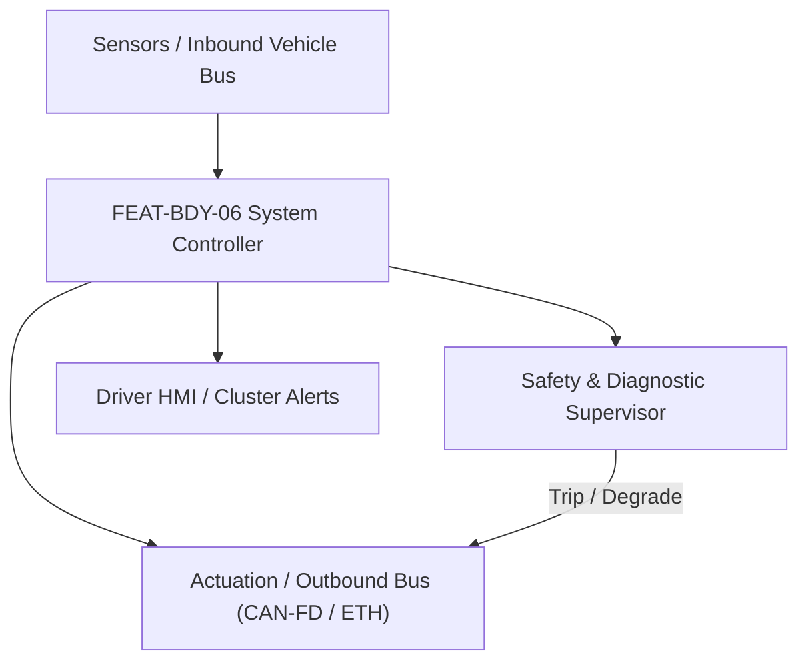
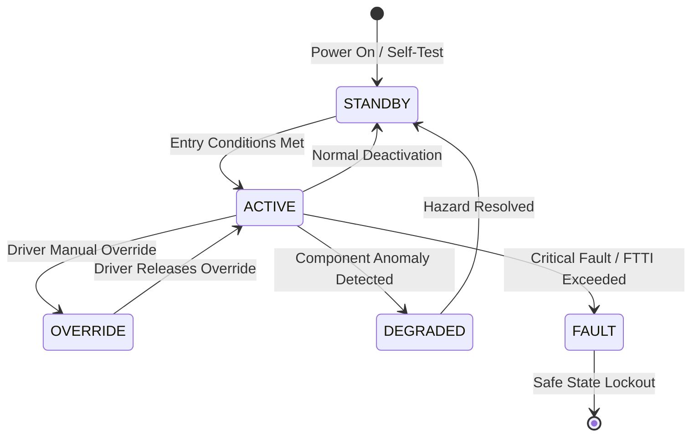

# System Requirements Specification: Dynamic Electrochromic Smart Glass Roof (EC-ROOF)
**Feature ID:** `FEAT-BDY-06`  
**Domain:** Body, Lighting & Restraints  
**Target ASIL:** ASIL A / QM  
**Compliance Standard:** ISO 26262:2018 (Part 4 - System Development) / ASPICE PAM v3.1 (SYS.2, SYS.3)  
**Parent Master Specification:** [`spec.md`](file:///c:/Workset/AntiGravityProjects/TestOptimisationExperiement/spec.md#feat-bdy-06-ec-roof)  
**Derived Software Specification:** [`FEAT-BDY-06_EC-ROOF_SwReq.md`](file:///c:/Workset/AntiGravityProjects/TestOptimisationExperiement/software_requirements/FEAT-BDY-06_EC-ROOF_SwReq.md)

---

## 1. Feature Overview & Operational Scope

Multi-segment SPD (Suspended Particle Device) and electrochromic panoramic glass roof control with variable optical transmittance (0.5% to 55%), segmented privacy zoning, and UV/IR heat rejection management.

### Operational Context Architecture

---

## 2. Activation Logic & Operational States

- **Preconditions:** 12V system voltage >= 11.5V, high-voltage AC inverter for smart glass operational, roof glass controller initialized.
- **Entry Conditions:** Ignition in RUN or pre-conditioning mode active; occupant selects tint level via overhead slider or infotainment.
- **Deactivation Conditions:** Ignition OFF and vehicle locked (transitions to 100% opaque thermal sleep mode to block cabin solar heating).
- **Driver Override Behavior:** Manual touch slider on overhead console provides instant override of automated solar tinting; emergency glass defrost clears frost.
- **Operational State Progression:**  
  `OPAQUE_OFF` -> `TINT_TRANSITIONING` -> `TRANSPARENT_FULL` -> `SEGMENTED_PRIVACY` -> `SOLAR_AUTO_HEAT_BLOCK` -> `CABIN_PARK_SLEEP_OPAQUE` -> `EC_VOLTAGE_FAULT`

### State Transition Diagram

---

## 3. Functional Safety & Failure Mitigation Concept

- **Functional Safety Goal:** SG-ECR-01: Prevent high-voltage AC insulation breakdown to vehicle chassis (< 110V AC @ 400 Hz); maintain driver visibility through electrochromic windshield tint band.
- **Fault Tolerant Time Interval (FTTI):** 50 ms for AC insulation fault; 200 ms for voltage regulation.
- **Safe State Definition:** Discharge electrochromic glass electrodes; disconnect AC drive inverter (glass naturally defaults to opaque safe state).
- **Warning & Escalation Strategy:** Display 'Smart Glass Service Required' alert if segment electrode open circuit detected.

### Failure Modes & Degradation Handling
- **Ac Inverter Short Circuit:** If bridge current > 2.0A, trip fast electronic fuse in < 5 ms to protect smart glass PVB interlayer.
- **Ambient Solar Sensor Fault:** Default glass tint to 50% intermediate state if ambient solar pyranometer signal is invalid.

---

## 4. System Requirements (SYS_REQ)
*(Note: Each System Requirement is systematically partitioned into multiple Child Software Requirements)*

### `SYS-BDY-06-01`: Segmented Suspended Particle Device (SPD) Optical Transmittance Synthesis
- **Planned Release:** R100
- **ASIL Rating:** QM
- **Parent Feature:** [`FEAT-BDY-06`](file:///c:/Workset/AntiGravityProjects/TestOptimisationExperiement/spec.md#feat-bdy-06)
- **Requirement Statement:**
  > The System SHALL modulate AC drive voltage (0 to 110V AC RMS @ 400 Hz) across 9 individual glass segments to control light transmittance smoothly from 0.5% (dark opaque) to 55% (clear transparent) within <= 3.0 seconds.
- **Activation Logic:** Active at all times when vehicle is powered.
- **Fault Tolerant Time Interval (FTTI):** 200 ms
- **Safe State Action:** Zero AC drive voltage; return all segments to 0.5% opaque quiescent state.
- **Failure Detection & Reaction:** If individual segment electrode breaks, isolate segment and maintain others.
- **Input Interfaces:** `Requested_Tint_Level_Pct_Array[9], Glass_Internal_Temp_DegC, 12V_Supply_Voltage`
- **Output Interfaces:** `SPD_Inverter_AC_Voltage_RMS, Segment_Select_Triac_Gating[9]`
- **System Verification Method:** Spectrophotometer optical transmittance curve and haze factor measurements.
- **Derived Child Software Requirements (1:N Link):**
  - [`SWR-BDY-06-01`](file:///c:/Workset/AntiGravityProjects/TestOptimisationExperiement/software_requirements/FEAT-BDY-06_EC-ROOF_SwReq.md#swr-bdy-06-01)
  - [`SWR-BDY-06-02`](file:///c:/Workset/AntiGravityProjects/TestOptimisationExperiement/software_requirements/FEAT-BDY-06_EC-ROOF_SwReq.md#swr-bdy-06-02)

### `SYS-BDY-06-02`: Solar Heat Flux Load Reduction & Galvanic Chassis Isolation Supervision
- **Planned Release:** R100
- **ASIL Rating:** ASIL A
- **Parent Feature:** [`FEAT-BDY-06`](file:///c:/Workset/AntiGravityProjects/TestOptimisationExperiement/spec.md#feat-bdy-06)
- **Requirement Statement:**
  > The System SHALL evaluate ambient solar irradiation (W/m²) and vehicle interior temperature to automatically adjust roof tint to reject up to 98% of solar infrared heat, while continuously monitoring 400 Hz AC chassis leakage current (< 1.0 mA).
- **Activation Logic:** Active during daylight driving and remote cabin preconditioning.
- **Fault Tolerant Time Interval (FTTI):** 50 ms
- **Safe State Action:** Disconnect AC inverter; isolate high-voltage drive circuit.
- **Failure Detection & Reaction:** If AC leakage to vehicle ground exceeds 1.0 mA, immediately shut down inverter.
- **Input Interfaces:** `Solar_Flux_Sensor_W_M2, Cabin_Temp_DegC, Glass_Chassis_Leakage_Current_ADC`
- **Output Interfaces:** `Auto_Tint_Target_Pct, Inverter_Isolation_Relay_Cmd (boolean)`
- **System Verification Method:** Thermal cabin soak chamber testing measuring HVAC energy savings and dielectric breakdown test.
- **Derived Child Software Requirements (1:N Link):**
  - [`SWR-BDY-06-03`](file:///c:/Workset/AntiGravityProjects/TestOptimisationExperiement/software_requirements/FEAT-BDY-06_EC-ROOF_SwReq.md#swr-bdy-06-03)
  - [`SWR-BDY-06-04`](file:///c:/Workset/AntiGravityProjects/TestOptimisationExperiement/software_requirements/FEAT-BDY-06_EC-ROOF_SwReq.md#swr-bdy-06-04)

### `SYS-BDY-06-03`: Electrochromic Glass Segmented Suspended Particle Device (SPD) PWM Driver
- **Planned Release:** R100
- **ASIL Rating:** ASIL A
- **Parent Feature:** [`FEAT-BDY-06`](file:///c:/Workset/AntiGravityProjects/TestOptimisationExperiement/spec.md#feat-bdy-06)
- **Requirement Statement:**
  > The System SHALL Modulate 110V AC high-frequency PWM drive to SPD glass film to alter roof glass tint from 5% to 65%.
- **Activation Logic:** Active during normal vehicle operation when feature state is active.
- **Fault Tolerant Time Interval (FTTI):** 20 ms
- **Safe State Action:** Transition to safe state or safe degradation tier within FTTI budget.
- **Failure Detection & Reaction:** Isolate faulted channel, latch DEM diagnostic trouble code, and inform driver.
- **Input Interfaces:** `Sensor signals, vehicle dynamics data, and bus frames via RTE.`
- **Output Interfaces:** `Actuator commands, diagnostic event flags, and cluster alerts.`
- **System Verification Method:** HiL test bench and dynamometer automated verification.
- **Derived Child Software Requirements (1:N Link):**
  - [`SWR-BDY-06-05`](file:///c:/Workset/AntiGravityProjects/TestOptimisationExperiement/software_requirements/FEAT-BDY-06_EC-ROOF_SwReq.md#swr-bdy-06-05)
  - [`SWR-BDY-06-06`](file:///c:/Workset/AntiGravityProjects/TestOptimisationExperiement/software_requirements/FEAT-BDY-06_EC-ROOF_SwReq.md#swr-bdy-06-06)

### `SYS-BDY-06-04`: Multi-Zone Glass Roof Segment Independent Opacity Area Controller
- **Planned Release:** R200
- **ASIL Rating:** ASIL A
- **Parent Feature:** [`FEAT-BDY-06`](file:///c:/Workset/AntiGravityProjects/TestOptimisationExperiement/spec.md#feat-bdy-06)
- **Requirement Statement:**
  > The System SHALL Control opacity of 9 independent glass roof segments individually (e.g. driver opaque, passenger clear).
- **Activation Logic:** Active during normal vehicle operation when feature state is active.
- **Fault Tolerant Time Interval (FTTI):** 50 ms
- **Safe State Action:** Transition to safe state or safe degradation tier within FTTI budget.
- **Failure Detection & Reaction:** Isolate faulted channel, latch DEM diagnostic trouble code, and inform driver.
- **Input Interfaces:** `Sensor signals, vehicle dynamics data, and bus frames via RTE.`
- **Output Interfaces:** `Actuator commands, diagnostic event flags, and cluster alerts.`
- **System Verification Method:** HiL test bench and dynamometer automated verification.
- **Derived Child Software Requirements (1:N Link):**
  - [`SWR-BDY-06-07`](file:///c:/Workset/AntiGravityProjects/TestOptimisationExperiement/software_requirements/FEAT-BDY-06_EC-ROOF_SwReq.md#swr-bdy-06-07)
  - [`SWR-BDY-06-08`](file:///c:/Workset/AntiGravityProjects/TestOptimisationExperiement/software_requirements/FEAT-BDY-06_EC-ROOF_SwReq.md#swr-bdy-06-08)

### `SYS-BDY-06-05`: Ambient Sunlight Pyranometer Sensor Light Intensity Auto-Tinter
- **Planned Release:** R200
- **ASIL Rating:** ASIL A
- **Parent Feature:** [`FEAT-BDY-06`](file:///c:/Workset/AntiGravityProjects/TestOptimisationExperiement/spec.md#feat-bdy-06)
- **Requirement Statement:**
  > The System SHALL Automatically tint glass roof dark when ambient solar irradiance exceeds 600 W/m² to reduce cabin heat.
- **Activation Logic:** Active during normal vehicle operation when feature state is active.
- **Fault Tolerant Time Interval (FTTI):** 200 ms
- **Safe State Action:** Transition to safe state or safe degradation tier within FTTI budget.
- **Failure Detection & Reaction:** Isolate faulted channel, latch DEM diagnostic trouble code, and inform driver.
- **Input Interfaces:** `Sensor signals, vehicle dynamics data, and bus frames via RTE.`
- **Output Interfaces:** `Actuator commands, diagnostic event flags, and cluster alerts.`
- **System Verification Method:** HiL test bench and dynamometer automated verification.
- **Derived Child Software Requirements (1:N Link):**
  - [`SWR-BDY-06-09`](file:///c:/Workset/AntiGravityProjects/TestOptimisationExperiement/software_requirements/FEAT-BDY-06_EC-ROOF_SwReq.md#swr-bdy-06-09)
  - [`SWR-BDY-06-10`](file:///c:/Workset/AntiGravityProjects/TestOptimisationExperiement/software_requirements/FEAT-BDY-06_EC-ROOF_SwReq.md#swr-bdy-06-10)

### `SYS-BDY-06-06`: Cabin Thermal Heat Load Reduction & HVAC Efficiency Coordinator
- **Planned Release:** R200
- **ASIL Rating:** ASIL A
- **Parent Feature:** [`FEAT-BDY-06`](file:///c:/Workset/AntiGravityProjects/TestOptimisationExperiement/spec.md#feat-bdy-06)
- **Requirement Statement:**
  > The System SHALL Coordinate roof glass darkening with cabin HVAC to reduce air conditioning compressor electrical load by 15%.
- **Activation Logic:** Active during normal vehicle operation when feature state is active.
- **Fault Tolerant Time Interval (FTTI):** 500 ms
- **Safe State Action:** Transition to safe state or safe degradation tier within FTTI budget.
- **Failure Detection & Reaction:** Isolate faulted channel, latch DEM diagnostic trouble code, and inform driver.
- **Input Interfaces:** `Sensor signals, vehicle dynamics data, and bus frames via RTE.`
- **Output Interfaces:** `Actuator commands, diagnostic event flags, and cluster alerts.`
- **System Verification Method:** HiL test bench and dynamometer automated verification.
- **Derived Child Software Requirements (1:N Link):**
  - [`SWR-BDY-06-11`](file:///c:/Workset/AntiGravityProjects/TestOptimisationExperiement/software_requirements/FEAT-BDY-06_EC-ROOF_SwReq.md#swr-bdy-06-11)
  - [`SWR-BDY-06-12`](file:///c:/Workset/AntiGravityProjects/TestOptimisationExperiement/software_requirements/FEAT-BDY-06_EC-ROOF_SwReq.md#swr-bdy-06-12)

### `SYS-BDY-06-07`: Vehicle Parked Anti-Thermal Sunshield Automatic Darkening State Engine
- **Planned Release:** R300
- **ASIL Rating:** ASIL A
- **Parent Feature:** [`FEAT-BDY-06`](file:///c:/Workset/AntiGravityProjects/TestOptimisationExperiement/spec.md#feat-bdy-06)
- **Requirement Statement:**
  > The System SHALL Transition all roof segments to 100% opaque mode when vehicle is parked in direct sunlight.
- **Activation Logic:** Active during normal vehicle operation when feature state is active.
- **Fault Tolerant Time Interval (FTTI):** 1000 ms
- **Safe State Action:** Transition to safe state or safe degradation tier within FTTI budget.
- **Failure Detection & Reaction:** Isolate faulted channel, latch DEM diagnostic trouble code, and inform driver.
- **Input Interfaces:** `Sensor signals, vehicle dynamics data, and bus frames via RTE.`
- **Output Interfaces:** `Actuator commands, diagnostic event flags, and cluster alerts.`
- **System Verification Method:** HiL test bench and dynamometer automated verification.
- **Derived Child Software Requirements (1:N Link):**
  - [`SWR-BDY-06-13`](file:///c:/Workset/AntiGravityProjects/TestOptimisationExperiement/software_requirements/FEAT-BDY-06_EC-ROOF_SwReq.md#swr-bdy-06-13)
  - [`SWR-BDY-06-14`](file:///c:/Workset/AntiGravityProjects/TestOptimisationExperiement/software_requirements/FEAT-BDY-06_EC-ROOF_SwReq.md#swr-bdy-06-14)

### `SYS-BDY-06-08`: Sub-Zero Ambient Glass Film Switching Latency Temperature Compensator
- **Planned Release:** R300
- **ASIL Rating:** ASIL A
- **Parent Feature:** [`FEAT-BDY-06`](file:///c:/Workset/AntiGravityProjects/TestOptimisationExperiement/spec.md#feat-bdy-06)
- **Requirement Statement:**
  > The System SHALL Adjust AC drive voltage amplitude to compensate for slower liquid crystal / SPD particle response at -20 °C.
- **Activation Logic:** Active during normal vehicle operation when feature state is active.
- **Fault Tolerant Time Interval (FTTI):** 500 ms
- **Safe State Action:** Transition to safe state or safe degradation tier within FTTI budget.
- **Failure Detection & Reaction:** Isolate faulted channel, latch DEM diagnostic trouble code, and inform driver.
- **Input Interfaces:** `Sensor signals, vehicle dynamics data, and bus frames via RTE.`
- **Output Interfaces:** `Actuator commands, diagnostic event flags, and cluster alerts.`
- **System Verification Method:** HiL test bench and dynamometer automated verification.
- **Derived Child Software Requirements (1:N Link):**
  - [`SWR-BDY-06-15`](file:///c:/Workset/AntiGravityProjects/TestOptimisationExperiement/software_requirements/FEAT-BDY-06_EC-ROOF_SwReq.md#swr-bdy-06-15)
  - [`SWR-BDY-06-16`](file:///c:/Workset/AntiGravityProjects/TestOptimisationExperiement/software_requirements/FEAT-BDY-06_EC-ROOF_SwReq.md#swr-bdy-06-16)

### `SYS-BDY-06-09`: Electrochromic High-Voltage Inverter Circuit Short-Circuit Hardware Safing
- **Planned Release:** R400
- **ASIL Rating:** ASIL B
- **Parent Feature:** [`FEAT-BDY-06`](file:///c:/Workset/AntiGravityProjects/TestOptimisationExperiement/spec.md#feat-bdy-06)
- **Requirement Statement:**
  > The System SHALL Hardware crowbar shuts down 110V AC glass power supply within <= 5 ms if glass crack or short is detected.
- **Activation Logic:** Active during normal vehicle operation when feature state is active.
- **Fault Tolerant Time Interval (FTTI):** 5 ms
- **Safe State Action:** Transition to safe state or safe degradation tier within FTTI budget.
- **Failure Detection & Reaction:** Isolate faulted channel, latch DEM diagnostic trouble code, and inform driver.
- **Input Interfaces:** `Sensor signals, vehicle dynamics data, and bus frames via RTE.`
- **Output Interfaces:** `Actuator commands, diagnostic event flags, and cluster alerts.`
- **System Verification Method:** HiL test bench and dynamometer automated verification.
- **Derived Child Software Requirements (1:N Link):**
  - [`SWR-BDY-06-17`](file:///c:/Workset/AntiGravityProjects/TestOptimisationExperiement/software_requirements/FEAT-BDY-06_EC-ROOF_SwReq.md#swr-bdy-06-17)
  - [`SWR-BDY-06-18`](file:///c:/Workset/AntiGravityProjects/TestOptimisationExperiement/software_requirements/FEAT-BDY-06_EC-ROOF_SwReq.md#swr-bdy-06-18)

### `SYS-BDY-06-10`: Glass Film Leakage Current Resistance Insulation Fault Monitor
- **Planned Release:** R400
- **ASIL Rating:** ASIL B
- **Parent Feature:** [`FEAT-BDY-06`](file:///c:/Workset/AntiGravityProjects/TestOptimisationExperiement/spec.md#feat-bdy-06)
- **Requirement Statement:**
  > The System SHALL Measure insulation resistance between glass electrochromic layers and vehicle chassis ground.
- **Activation Logic:** Active during normal vehicle operation when feature state is active.
- **Fault Tolerant Time Interval (FTTI):** 50 ms
- **Safe State Action:** Transition to safe state or safe degradation tier within FTTI budget.
- **Failure Detection & Reaction:** Isolate faulted channel, latch DEM diagnostic trouble code, and inform driver.
- **Input Interfaces:** `Sensor signals, vehicle dynamics data, and bus frames via RTE.`
- **Output Interfaces:** `Actuator commands, diagnostic event flags, and cluster alerts.`
- **System Verification Method:** HiL test bench and dynamometer automated verification.
- **Derived Child Software Requirements (1:N Link):**
  - [`SWR-BDY-06-19`](file:///c:/Workset/AntiGravityProjects/TestOptimisationExperiement/software_requirements/FEAT-BDY-06_EC-ROOF_SwReq.md#swr-bdy-06-19)
  - [`SWR-BDY-06-20`](file:///c:/Workset/AntiGravityProjects/TestOptimisationExperiement/software_requirements/FEAT-BDY-06_EC-ROOF_SwReq.md#swr-bdy-06-20)

### `SYS-BDY-06-11`: Driver Overhead Console Gesture & Slide Touch Control Interface
- **Planned Release:** R400
- **ASIL Rating:** ASIL A
- **Parent Feature:** [`FEAT-BDY-06`](file:///c:/Workset/AntiGravityProjects/TestOptimisationExperiement/spec.md#feat-bdy-06)
- **Requirement Statement:**
  > The System SHALL Decode overhead swipe gestures to allow intuitive fingertip opacity dimming of roof segments.
- **Activation Logic:** Active during normal vehicle operation when feature state is active.
- **Fault Tolerant Time Interval (FTTI):** 50 ms
- **Safe State Action:** Transition to safe state or safe degradation tier within FTTI budget.
- **Failure Detection & Reaction:** Isolate faulted channel, latch DEM diagnostic trouble code, and inform driver.
- **Input Interfaces:** `Sensor signals, vehicle dynamics data, and bus frames via RTE.`
- **Output Interfaces:** `Actuator commands, diagnostic event flags, and cluster alerts.`
- **System Verification Method:** HiL test bench and dynamometer automated verification.
- **Derived Child Software Requirements (1:N Link):**
  - [`SWR-BDY-06-21`](file:///c:/Workset/AntiGravityProjects/TestOptimisationExperiement/software_requirements/FEAT-BDY-06_EC-ROOF_SwReq.md#swr-bdy-06-21)
  - [`SWR-BDY-06-22`](file:///c:/Workset/AntiGravityProjects/TestOptimisationExperiement/software_requirements/FEAT-BDY-06_EC-ROOF_SwReq.md#swr-bdy-06-22)

### `SYS-BDY-06-12`: Vehicle Crash Emergency Roof Instantaneous Clear Transparency Interlock
- **Planned Release:** R400
- **ASIL Rating:** ASIL A
- **Parent Feature:** [`FEAT-BDY-06`](file:///c:/Workset/AntiGravityProjects/TestOptimisationExperiement/spec.md#feat-bdy-06)
- **Requirement Statement:**
  > The System SHALL Clear glass roof transparency immediately upon airbag deployment signal to facilitate passenger rescue.
- **Activation Logic:** Active during normal vehicle operation when feature state is active.
- **Fault Tolerant Time Interval (FTTI):** 20 ms
- **Safe State Action:** Transition to safe state or safe degradation tier within FTTI budget.
- **Failure Detection & Reaction:** Isolate faulted channel, latch DEM diagnostic trouble code, and inform driver.
- **Input Interfaces:** `Sensor signals, vehicle dynamics data, and bus frames via RTE.`
- **Output Interfaces:** `Actuator commands, diagnostic event flags, and cluster alerts.`
- **System Verification Method:** HiL test bench and dynamometer automated verification.
- **Derived Child Software Requirements (1:N Link):**
  - [`SWR-BDY-06-23`](file:///c:/Workset/AntiGravityProjects/TestOptimisationExperiement/software_requirements/FEAT-BDY-06_EC-ROOF_SwReq.md#swr-bdy-06-23)
  - [`SWR-BDY-06-24`](file:///c:/Workset/AntiGravityProjects/TestOptimisationExperiement/software_requirements/FEAT-BDY-06_EC-ROOF_SwReq.md#swr-bdy-06-24)

### `SYS-BDY-06-13`: DEM Electrochromic Roof Power Supply Diagnostics & DTC Logger
- **Planned Release:** R500
- **ASIL Rating:** ASIL A
- **Parent Feature:** [`FEAT-BDY-06`](file:///c:/Workset/AntiGravityProjects/TestOptimisationExperiement/spec.md#feat-bdy-06)
- **Requirement Statement:**
  > The System SHALL Qualify diagnostic trouble codes for glass film open-circuit, inverter failure, and solar sensor faults.
- **Activation Logic:** Active during normal vehicle operation when feature state is active.
- **Fault Tolerant Time Interval (FTTI):** 100 ms
- **Safe State Action:** Transition to safe state or safe degradation tier within FTTI budget.
- **Failure Detection & Reaction:** Isolate faulted channel, latch DEM diagnostic trouble code, and inform driver.
- **Input Interfaces:** `Sensor signals, vehicle dynamics data, and bus frames via RTE.`
- **Output Interfaces:** `Actuator commands, diagnostic event flags, and cluster alerts.`
- **System Verification Method:** HiL test bench and dynamometer automated verification.
- **Derived Child Software Requirements (1:N Link):**
  - [`SWR-BDY-06-25`](file:///c:/Workset/AntiGravityProjects/TestOptimisationExperiement/software_requirements/FEAT-BDY-06_EC-ROOF_SwReq.md#swr-bdy-06-25)
  - [`SWR-BDY-06-26`](file:///c:/Workset/AntiGravityProjects/TestOptimisationExperiement/software_requirements/FEAT-BDY-06_EC-ROOF_SwReq.md#swr-bdy-06-26)

### `SYS-BDY-06-14`: Central Touchscreen Roof Opacity Slider Graphic Display Serializer
- **Planned Release:** R500
- **ASIL Rating:** ASIL A
- **Parent Feature:** [`FEAT-BDY-06`](file:///c:/Workset/AntiGravityProjects/TestOptimisationExperiement/spec.md#feat-bdy-06)
- **Requirement Statement:**
  > The System SHALL Broadcast active roof segment opacity percentages to central touchscreen infotainment display.
- **Activation Logic:** Active during normal vehicle operation when feature state is active.
- **Fault Tolerant Time Interval (FTTI):** 100 ms
- **Safe State Action:** Transition to safe state or safe degradation tier within FTTI budget.
- **Failure Detection & Reaction:** Isolate faulted channel, latch DEM diagnostic trouble code, and inform driver.
- **Input Interfaces:** `Sensor signals, vehicle dynamics data, and bus frames via RTE.`
- **Output Interfaces:** `Actuator commands, diagnostic event flags, and cluster alerts.`
- **System Verification Method:** HiL test bench and dynamometer automated verification.
- **Derived Child Software Requirements (1:N Link):**
  - [`SWR-BDY-06-27`](file:///c:/Workset/AntiGravityProjects/TestOptimisationExperiement/software_requirements/FEAT-BDY-06_EC-ROOF_SwReq.md#swr-bdy-06-27)
  - [`SWR-BDY-06-28`](file:///c:/Workset/AntiGravityProjects/TestOptimisationExperiement/software_requirements/FEAT-BDY-06_EC-ROOF_SwReq.md#swr-bdy-06-28)

### `SYS-BDY-06-15`: Non-Volatile Electrochromic Glass Cumulative Operating Hours Tracker
- **Planned Release:** R500
- **ASIL Rating:** ASIL A
- **Parent Feature:** [`FEAT-BDY-06`](file:///c:/Workset/AntiGravityProjects/TestOptimisationExperiement/spec.md#feat-bdy-06)
- **Requirement Statement:**
  > The System SHALL Record lifetime hours of energized glass operation to monitor long-term SPD film optical durability.
- **Activation Logic:** Active during normal vehicle operation when feature state is active.
- **Fault Tolerant Time Interval (FTTI):** 2000 ms
- **Safe State Action:** Transition to safe state or safe degradation tier within FTTI budget.
- **Failure Detection & Reaction:** Isolate faulted channel, latch DEM diagnostic trouble code, and inform driver.
- **Input Interfaces:** `Sensor signals, vehicle dynamics data, and bus frames via RTE.`
- **Output Interfaces:** `Actuator commands, diagnostic event flags, and cluster alerts.`
- **System Verification Method:** HiL test bench and dynamometer automated verification.
- **Derived Child Software Requirements (1:N Link):**
  - [`SWR-BDY-06-29`](file:///c:/Workset/AntiGravityProjects/TestOptimisationExperiement/software_requirements/FEAT-BDY-06_EC-ROOF_SwReq.md#swr-bdy-06-29)
  - [`SWR-BDY-06-30`](file:///c:/Workset/AntiGravityProjects/TestOptimisationExperiement/software_requirements/FEAT-BDY-06_EC-ROOF_SwReq.md#swr-bdy-06-30)

---

## 5. System-to-Software Traceability Summary

| System Requirement ID | Planned Release | ASIL | Title | Derived Software Requirements (1:N) | Verification Method |
| :--- | :---: | :--- | :--- | :--- | :--- |
| `SYS-BDY-06-01` | **`R100`** | QM | Segmented Suspended Particle Device (SPD) Optical Transmittance Synthesis | [`SWR-BDY-06-01`](file:///c:/Workset/AntiGravityProjects/TestOptimisationExperiement/software_requirements/FEAT-BDY-06_EC-ROOF_SwReq.md#swr-bdy-06-01), [`SWR-BDY-06-02`](file:///c:/Workset/AntiGravityProjects/TestOptimisationExperiement/software_requirements/FEAT-BDY-06_EC-ROOF_SwReq.md#swr-bdy-06-02) | Spectrophotometer optical transmittance curve and haze factor measurements. |
| `SYS-BDY-06-02` | **`R100`** | ASIL A | Solar Heat Flux Load Reduction & Galvanic Chassis Isolation Supervision | [`SWR-BDY-06-03`](file:///c:/Workset/AntiGravityProjects/TestOptimisationExperiement/software_requirements/FEAT-BDY-06_EC-ROOF_SwReq.md#swr-bdy-06-03), [`SWR-BDY-06-04`](file:///c:/Workset/AntiGravityProjects/TestOptimisationExperiement/software_requirements/FEAT-BDY-06_EC-ROOF_SwReq.md#swr-bdy-06-04) | Thermal cabin soak chamber testing measuring HVAC energy savings and dielectric breakdown test. |
| `SYS-BDY-06-03` | **`R100`** | ASIL A | Electrochromic Glass Segmented Suspended Particle Device (SPD) PWM Driver | [`SWR-BDY-06-05`](file:///c:/Workset/AntiGravityProjects/TestOptimisationExperiement/software_requirements/FEAT-BDY-06_EC-ROOF_SwReq.md#swr-bdy-06-05), [`SWR-BDY-06-06`](file:///c:/Workset/AntiGravityProjects/TestOptimisationExperiement/software_requirements/FEAT-BDY-06_EC-ROOF_SwReq.md#swr-bdy-06-06) | HiL test bench and dynamometer automated verification. |
| `SYS-BDY-06-04` | **`R200`** | ASIL A | Multi-Zone Glass Roof Segment Independent Opacity Area Controller | [`SWR-BDY-06-07`](file:///c:/Workset/AntiGravityProjects/TestOptimisationExperiement/software_requirements/FEAT-BDY-06_EC-ROOF_SwReq.md#swr-bdy-06-07), [`SWR-BDY-06-08`](file:///c:/Workset/AntiGravityProjects/TestOptimisationExperiement/software_requirements/FEAT-BDY-06_EC-ROOF_SwReq.md#swr-bdy-06-08) | HiL test bench and dynamometer automated verification. |
| `SYS-BDY-06-05` | **`R200`** | ASIL A | Ambient Sunlight Pyranometer Sensor Light Intensity Auto-Tinter | [`SWR-BDY-06-09`](file:///c:/Workset/AntiGravityProjects/TestOptimisationExperiement/software_requirements/FEAT-BDY-06_EC-ROOF_SwReq.md#swr-bdy-06-09), [`SWR-BDY-06-10`](file:///c:/Workset/AntiGravityProjects/TestOptimisationExperiement/software_requirements/FEAT-BDY-06_EC-ROOF_SwReq.md#swr-bdy-06-10) | HiL test bench and dynamometer automated verification. |
| `SYS-BDY-06-06` | **`R200`** | ASIL A | Cabin Thermal Heat Load Reduction & HVAC Efficiency Coordinator | [`SWR-BDY-06-11`](file:///c:/Workset/AntiGravityProjects/TestOptimisationExperiement/software_requirements/FEAT-BDY-06_EC-ROOF_SwReq.md#swr-bdy-06-11), [`SWR-BDY-06-12`](file:///c:/Workset/AntiGravityProjects/TestOptimisationExperiement/software_requirements/FEAT-BDY-06_EC-ROOF_SwReq.md#swr-bdy-06-12) | HiL test bench and dynamometer automated verification. |
| `SYS-BDY-06-07` | **`R300`** | ASIL A | Vehicle Parked Anti-Thermal Sunshield Automatic Darkening State Engine | [`SWR-BDY-06-13`](file:///c:/Workset/AntiGravityProjects/TestOptimisationExperiement/software_requirements/FEAT-BDY-06_EC-ROOF_SwReq.md#swr-bdy-06-13), [`SWR-BDY-06-14`](file:///c:/Workset/AntiGravityProjects/TestOptimisationExperiement/software_requirements/FEAT-BDY-06_EC-ROOF_SwReq.md#swr-bdy-06-14) | HiL test bench and dynamometer automated verification. |
| `SYS-BDY-06-08` | **`R300`** | ASIL A | Sub-Zero Ambient Glass Film Switching Latency Temperature Compensator | [`SWR-BDY-06-15`](file:///c:/Workset/AntiGravityProjects/TestOptimisationExperiement/software_requirements/FEAT-BDY-06_EC-ROOF_SwReq.md#swr-bdy-06-15), [`SWR-BDY-06-16`](file:///c:/Workset/AntiGravityProjects/TestOptimisationExperiement/software_requirements/FEAT-BDY-06_EC-ROOF_SwReq.md#swr-bdy-06-16) | HiL test bench and dynamometer automated verification. |
| `SYS-BDY-06-09` | **`R400`** | ASIL B | Electrochromic High-Voltage Inverter Circuit Short-Circuit Hardware Safing | [`SWR-BDY-06-17`](file:///c:/Workset/AntiGravityProjects/TestOptimisationExperiement/software_requirements/FEAT-BDY-06_EC-ROOF_SwReq.md#swr-bdy-06-17), [`SWR-BDY-06-18`](file:///c:/Workset/AntiGravityProjects/TestOptimisationExperiement/software_requirements/FEAT-BDY-06_EC-ROOF_SwReq.md#swr-bdy-06-18) | HiL test bench and dynamometer automated verification. |
| `SYS-BDY-06-10` | **`R400`** | ASIL B | Glass Film Leakage Current Resistance Insulation Fault Monitor | [`SWR-BDY-06-19`](file:///c:/Workset/AntiGravityProjects/TestOptimisationExperiement/software_requirements/FEAT-BDY-06_EC-ROOF_SwReq.md#swr-bdy-06-19), [`SWR-BDY-06-20`](file:///c:/Workset/AntiGravityProjects/TestOptimisationExperiement/software_requirements/FEAT-BDY-06_EC-ROOF_SwReq.md#swr-bdy-06-20) | HiL test bench and dynamometer automated verification. |
| `SYS-BDY-06-11` | **`R400`** | ASIL A | Driver Overhead Console Gesture & Slide Touch Control Interface | [`SWR-BDY-06-21`](file:///c:/Workset/AntiGravityProjects/TestOptimisationExperiement/software_requirements/FEAT-BDY-06_EC-ROOF_SwReq.md#swr-bdy-06-21), [`SWR-BDY-06-22`](file:///c:/Workset/AntiGravityProjects/TestOptimisationExperiement/software_requirements/FEAT-BDY-06_EC-ROOF_SwReq.md#swr-bdy-06-22) | HiL test bench and dynamometer automated verification. |
| `SYS-BDY-06-12` | **`R400`** | ASIL A | Vehicle Crash Emergency Roof Instantaneous Clear Transparency Interlock | [`SWR-BDY-06-23`](file:///c:/Workset/AntiGravityProjects/TestOptimisationExperiement/software_requirements/FEAT-BDY-06_EC-ROOF_SwReq.md#swr-bdy-06-23), [`SWR-BDY-06-24`](file:///c:/Workset/AntiGravityProjects/TestOptimisationExperiement/software_requirements/FEAT-BDY-06_EC-ROOF_SwReq.md#swr-bdy-06-24) | HiL test bench and dynamometer automated verification. |
| `SYS-BDY-06-13` | **`R500`** | ASIL A | DEM Electrochromic Roof Power Supply Diagnostics & DTC Logger | [`SWR-BDY-06-25`](file:///c:/Workset/AntiGravityProjects/TestOptimisationExperiement/software_requirements/FEAT-BDY-06_EC-ROOF_SwReq.md#swr-bdy-06-25), [`SWR-BDY-06-26`](file:///c:/Workset/AntiGravityProjects/TestOptimisationExperiement/software_requirements/FEAT-BDY-06_EC-ROOF_SwReq.md#swr-bdy-06-26) | HiL test bench and dynamometer automated verification. |
| `SYS-BDY-06-14` | **`R500`** | ASIL A | Central Touchscreen Roof Opacity Slider Graphic Display Serializer | [`SWR-BDY-06-27`](file:///c:/Workset/AntiGravityProjects/TestOptimisationExperiement/software_requirements/FEAT-BDY-06_EC-ROOF_SwReq.md#swr-bdy-06-27), [`SWR-BDY-06-28`](file:///c:/Workset/AntiGravityProjects/TestOptimisationExperiement/software_requirements/FEAT-BDY-06_EC-ROOF_SwReq.md#swr-bdy-06-28) | HiL test bench and dynamometer automated verification. |
| `SYS-BDY-06-15` | **`R500`** | ASIL A | Non-Volatile Electrochromic Glass Cumulative Operating Hours Tracker | [`SWR-BDY-06-29`](file:///c:/Workset/AntiGravityProjects/TestOptimisationExperiement/software_requirements/FEAT-BDY-06_EC-ROOF_SwReq.md#swr-bdy-06-29), [`SWR-BDY-06-30`](file:///c:/Workset/AntiGravityProjects/TestOptimisationExperiement/software_requirements/FEAT-BDY-06_EC-ROOF_SwReq.md#swr-bdy-06-30) | HiL test bench and dynamometer automated verification. |

- **Upstream Feature Link:** [`spec.md` (FEAT-BDY-06)](file:///c:/Workset/AntiGravityProjects/TestOptimisationExperiement/spec.md#feat-bdy-06)
- **Software Requirements Specification:** [`FEAT-BDY-06_EC-ROOF_SwReq.md`](file:///c:/Workset/AntiGravityProjects/TestOptimisationExperiement/software_requirements/FEAT-BDY-06_EC-ROOF_SwReq.md)
