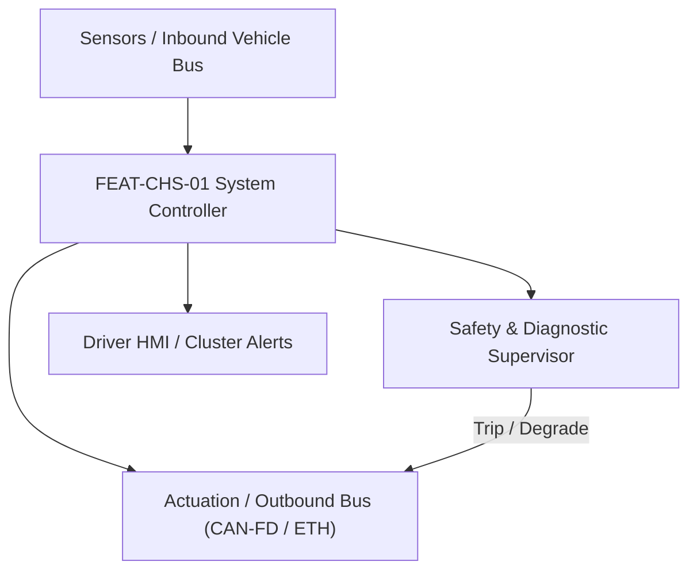
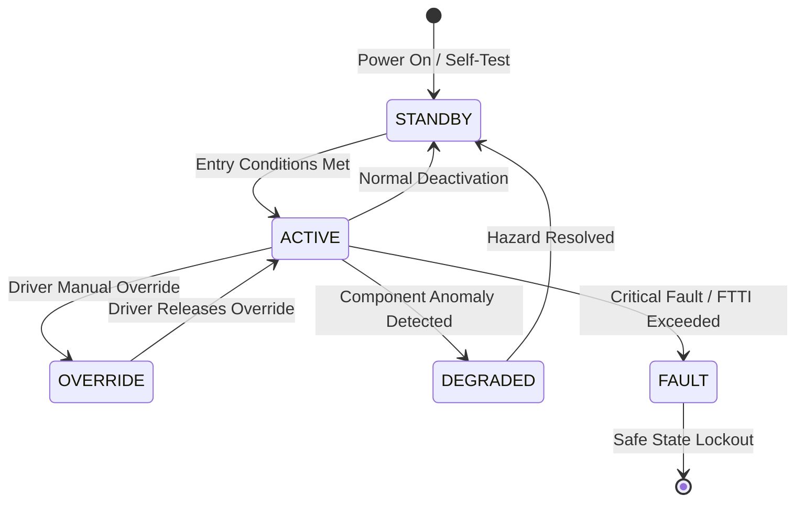

# System Requirements Specification: Electronic Stability Control (ESC)
**Feature ID:** `FEAT-CHS-01`  
**Domain:** Vehicle Motion & Chassis Control  
**Target ASIL:** ASIL D  
**Compliance Standard:** ISO 26262:2018 (Part 4 - System Development) / ASPICE PAM v3.1 (SYS.2, SYS.3)  
**Parent Master Specification:** [`spec.md`](file:///c:/Workset/AntiGravityProjects/TestOptimisationExperiement/spec.md#feat-chs-01-esc)  
**Derived Software Specification:** [`FEAT-CHS-01_ESC_SwReq.md`](file:///c:/Workset/AntiGravityProjects/TestOptimisationExperiement/software_requirements/FEAT-CHS-01_ESC_SwReq.md)

---

## 1. Feature Overview & Operational Scope

Stabilizes vehicle yaw dynamics during extreme cornering and low-friction situations by applying individual-wheel hydraulic braking and demanding powertrain torque reductions.

### Operational Context Architecture

---

## 2. Activation Logic & Operational States

- **Preconditions:** Ignition in RUN, vehicle speed > 8 km/h, hydraulic pressure sensor healthy, 6-DOF IMU calibrated.
- **Entry Conditions:** Yaw rate error (|Delta_YawRate| > 0.08 rad/s) OR vehicle sideslip angle (|Beta| > 4.5 deg) exceeds dynamic instability threshold.
- **Deactivation Conditions:** Vehicle yaw rate and sideslip return within linear stable envelope for > 200 ms, or vehicle comes to complete stop.
- **Driver Override Behavior:** Driver can select 'ESC Sport' (raising intervention threshold by 40%), but system cannot be completely defeated if collision is detected.
- **Operational State Progression:**  
  `MONITORING` -> `UNDERSTEER_INTERVENTION` -> `OVERSTEER_INTERVENTION` -> `SPLIT_MU_STABILIZATION` -> `TRACTION_CONTROL_ACTIVE` -> `DEGRADED_PASSIVE` -> `FAULT_SHUTDOWN`

### State Transition Diagram

---

## 3. Functional Safety & Failure Mitigation Concept

- **Functional Safety Goal:** SG-ESC-01: Prevent uncontrolled vehicle spin-out or drift-out; avoid unintended asymmetric braking on dry straight roads.
- **Fault Tolerant Time Interval (FTTI):** 40 ms
- **Safe State Definition:** De-energize all hydraulic solenoid valves (return to open circuit); restore 100% standard driver hydraulic pass-through.
- **Warning & Escalation Strategy:** Flashing ESC amber icon on cluster during active intervention; steady amber icon if system has faulted.

### Failure Modes & Degradation Handling
- **Hydraulic Valve Stuck:** If pressure sensor reveals valve failure to release pressure, immediately fire high-pressure relief valve to depressurize circuit.
- **Imu Drift:** If IMU yaw rate sensor drifts by > 0.04 rad/s while vehicle is driving straight, isolate sensor and fallback to wheel speed differential estimation.

---

## 4. System Requirements (SYS_REQ)
*(Note: Each System Requirement is systematically partitioned into multiple Child Software Requirements)*

### `SYS-CHS-01-01`: Bicycle Reference Model & Vehicle Sideslip Observer
- **Planned Release:** R100
- **ASIL Rating:** ASIL D
- **Parent Feature:** [`FEAT-CHS-01`](file:///c:/Workset/AntiGravityProjects/TestOptimisationExperiement/spec.md#feat-chs-01)
- **Requirement Statement:**
  > The System SHALL sample 6-DOF IMU (yaw rate, lateral acceleration) and 4 wheel speed sensors at 100 Hz, calculating desired yaw rate and vehicle body sideslip angle (Beta +- 0.5 deg) at <= 10 ms period.
- **Activation Logic:** Active at all times while vehicle speed > 8 km/h.
- **Fault Tolerant Time Interval (FTTI):** 30 ms
- **Safe State Action:** Invalidate observer outputs; suspend active ESC interventions.
- **Failure Detection & Reaction:** If wheel speed pulse drops, isolate affected wheel and use remaining 3 wheels for velocity estimation.
- **Input Interfaces:** `IMU_Yaw_Rate_RadS, IMU_Lat_Accel_Mps2, 4x_Wheel_Speed_Ticks, Steering_Wheel_Angle_Deg`
- **Output Interfaces:** `YawRate_Error_RadS, Vehicle_Sideslip_Beta_Rad, Road_Friction_Mu_Est`
- **System Verification Method:** Chassis dynamometer and skid-pad testing against ISO 7401 lateral transient standards.
- **Derived Child Software Requirements (1:N Link):**
  - [`SWR-CHS-01-01`](file:///c:/Workset/AntiGravityProjects/TestOptimisationExperiement/software_requirements/FEAT-CHS-01_ESC_SwReq.md#swr-chs-01-01)
  - [`SWR-CHS-01-02`](file:///c:/Workset/AntiGravityProjects/TestOptimisationExperiement/software_requirements/FEAT-CHS-01_ESC_SwReq.md#swr-chs-01-02)

### `SYS-CHS-01-02`: Differential Individual-Wheel Pressure & Engine Torque Reduction
- **Planned Release:** R500
- **ASIL Rating:** ASIL D
- **Parent Feature:** [`FEAT-CHS-01`](file:///c:/Workset/AntiGravityProjects/TestOptimisationExperiement/spec.md#feat-chs-01)
- **Requirement Statement:**
  > The System SHALL build up hydraulic braking pressure up to 120 bar on targeted individual wheels in <= 120 ms to create corrective yaw moments, while demanding fast powertrain torque reduction via CAN-FD in <= 20 ms.
- **Activation Logic:** Active when YawRate_Error or Sideslip_Beta exceeds instability envelope.
- **Fault Tolerant Time Interval (FTTI):** 40 ms
- **Safe State Action:** Open hydraulic release valves; zero torque reduction request.
- **Failure Detection & Reaction:** If hydraulic pump motor overheats, limit maximum intervention duration to 5.0 seconds.
- **Input Interfaces:** `YawRate_Error_RadS, Vehicle_Sideslip_Beta_Rad, Driver_Master_Cylinder_Pressure`
- **Output Interfaces:** `Target_Caliper_Pressure_FL/FR/RL/RR (bar), VCU_Torque_Clamp_Req_Nm`
- **System Verification Method:** FMVSS 126 / ECE R13H 'Sine with Dwell' vehicle test maneuver.
- **Derived Child Software Requirements (1:N Link):**
  - [`SWR-CHS-01-03`](file:///c:/Workset/AntiGravityProjects/TestOptimisationExperiement/software_requirements/FEAT-CHS-01_ESC_SwReq.md#swr-chs-01-03)
  - [`SWR-CHS-01-04`](file:///c:/Workset/AntiGravityProjects/TestOptimisationExperiement/software_requirements/FEAT-CHS-01_ESC_SwReq.md#swr-chs-01-04)

### `SYS-CHS-01-03`: Split-Mu Low-Friction Differential Braking & Steer-Correction
- **Planned Release:** R100
- **ASIL Rating:** ASIL D
- **Parent Feature:** [`FEAT-CHS-01`](file:///c:/Workset/AntiGravityProjects/TestOptimisationExperiement/spec.md#feat-chs-01)
- **Requirement Statement:**
  > The System SHALL detect split-friction road surfaces (e.g. ice on right wheels, dry asphalt on left wheels during braking), commanding asymmetric caliper pressure and electric power steering counter-torque (+-2.5 Nm) in <= 30 ms to prevent vehicle swerving.
- **Activation Logic:** Active during emergency braking when friction difference |Delta_mu| > 0.3.
- **Fault Tolerant Time Interval (FTTI):** 30 ms
- **Safe State Action:** Symmetrize braking pressures; zero EPS counter-steering torque.
- **Failure Detection & Reaction:** If EPS communication drops, reduce braking pressure on high-friction wheels to preserve directional stability.
- **Input Interfaces:** `Wheel_Speed_Ticks_Array[4], Master_Cylinder_Pressure_Bar, EPS_Actual_Torque_Nm`
- **Output Interfaces:** `Split_Mu_Pressure_FL_FR_RL_RR_Bar, EPS_Counter_Steer_Demand_Nm`
- **System Verification Method:** FMVSS 126 split-mu braking track testing at 80 km/h.
- **Derived Child Software Requirements (1:N Link):**
  - [`SWR-CHS-01-05`](file:///c:/Workset/AntiGravityProjects/TestOptimisationExperiement/software_requirements/FEAT-CHS-01_ESC_SwReq.md#swr-chs-01-05)
  - [`SWR-CHS-01-06`](file:///c:/Workset/AntiGravityProjects/TestOptimisationExperiement/software_requirements/FEAT-CHS-01_ESC_SwReq.md#swr-chs-01-06)

### `SYS-CHS-01-04`: Active Rollover Mitigation (ARM) & Tripping Prevention
- **Planned Release:** R100
- **ASIL Rating:** ASIL D
- **Parent Feature:** [`FEAT-CHS-01`](file:///c:/Workset/AntiGravityProjects/TestOptimisationExperiement/spec.md#feat-chs-01)
- **Requirement Statement:**
  > The System SHALL sample 6-DOF IMU roll rate (p_roll) and lateral acceleration (a_y) at 100 Hz: If estimated wheel lift is detected, system SHALL build 80 bar braking pressure on outer front wheel in <= 80 ms while clamping powertrain torque to zero to mitigate rollover.
- **Activation Logic:** Active when vehicle speed > 30 km/h and roll risk index > 0.8.
- **Fault Tolerant Time Interval (FTTI):** 40 ms
- **Safe State Action:** Release brake pressure once roll angle drops below 3.0 degrees.
- **Failure Detection & Reaction:** If IMU roll gyro faults, estimate roll risk from lateral acceleration and steering angle.
- **Input Interfaces:** `IMU_Roll_Rate_RadS, IMU_Lateral_Accel_Mps2, Suspension_Deflection_Array[4]`
- **Output Interfaces:** `ARM_Intervention_Pressure_OuterFront_Bar, Powertrain_Torque_Kill_Cmd`
- **System Verification Method:** NHTSA Fishhook maneuver dynamic rollover stability tests.
- **Derived Child Software Requirements (1:N Link):**
  - [`SWR-CHS-01-07`](file:///c:/Workset/AntiGravityProjects/TestOptimisationExperiement/software_requirements/FEAT-CHS-01_ESC_SwReq.md#swr-chs-01-07)
  - [`SWR-CHS-01-08`](file:///c:/Workset/AntiGravityProjects/TestOptimisationExperiement/software_requirements/FEAT-CHS-01_ESC_SwReq.md#swr-chs-01-08)

### `SYS-CHS-01-05`: Emergency Hydraulic Brake Assist (HBA) Dynamic Pressure Booster
- **Planned Release:** R200
- **ASIL Rating:** ASIL D
- **Parent Feature:** [`FEAT-CHS-01`](file:///c:/Workset/AntiGravityProjects/TestOptimisationExperiement/spec.md#feat-chs-01)
- **Requirement Statement:**
  > The System SHALL detect panic braking (pedal travel rate d(pedal)/dt > 300 %/s or pressure rise dP/dt > 200 bar/s) and automatically override driver pedal force to command full ABS lock-limit pressure (120 bar) in <= 60 ms.
- **Activation Logic:** Active at speeds > 10 km/h upon panic brake depression.
- **Fault Tolerant Time Interval (FTTI):** 30 ms
- **Safe State Action:** Rely on driver manual physical hydraulic master cylinder pressure.
- **Failure Detection & Reaction:** Release booster override immediately when driver releases brake pedal.
- **Input Interfaces:** `Brake_Pedal_Depression_Rate_Pct_S, Master_Cylinder_Pressure_Rise_Bar_S`
- **Output Interfaces:** `HBA_Full_Pressure_Boost_Cmd (boolean), Caliper_Pressure_Boost_Bar`
- **System Verification Method:** ECE R13H Brake Assist System emergency stopping distance verification.
- **Derived Child Software Requirements (1:N Link):**
  - [`SWR-CHS-01-09`](file:///c:/Workset/AntiGravityProjects/TestOptimisationExperiement/software_requirements/FEAT-CHS-01_ESC_SwReq.md#swr-chs-01-09)
  - [`SWR-CHS-01-10`](file:///c:/Workset/AntiGravityProjects/TestOptimisationExperiement/software_requirements/FEAT-CHS-01_ESC_SwReq.md#swr-chs-01-10)

### `SYS-CHS-01-06`: Traction Control System (TCS) Wheel Slip Acceleration Limiter
- **Planned Release:** R200
- **ASIL Rating:** ASIL D
- **Parent Feature:** [`FEAT-CHS-01`](file:///c:/Workset/AntiGravityProjects/TestOptimisationExperiement/spec.md#feat-chs-01)
- **Requirement Statement:**
  > The System SHALL sample all four wheel speed sensors at 100 Hz, detect excessive driven wheel slip (> 10% relative to vehicle reference speed), and command motor torque reduction in <= 15 ms while applying drive wheel brake intervention.
- **Activation Logic:** Active during vehicle acceleration when drive wheel slip exceeds threshold.
- **Fault Tolerant Time Interval (FTTI):** 30 ms
- **Safe State Action:** Zero TCS brake pressure request; restore driver requested torque.
- **Failure Detection & Reaction:** If one wheel speed sensor drops out, estimate axle speed from opposite wheel.
- **Input Interfaces:** `Wheel_Speed_Ticks_Array[4], Longitudinal_Acceleration_Mps2, Driver_Torque_Demand_Nm`
- **Output Interfaces:** `TCS_Brake_Pressure_FL_FR_RL_RR_Bar, TCS_Torque_Clamp_Nm`
- **System Verification Method:** Low-friction ice track launch acceleration testing according to ISO 14512.
- **Derived Child Software Requirements (1:N Link):**
  - [`SWR-CHS-01-11`](file:///c:/Workset/AntiGravityProjects/TestOptimisationExperiement/software_requirements/FEAT-CHS-01_ESC_SwReq.md#swr-chs-01-11)
  - [`SWR-CHS-01-12`](file:///c:/Workset/AntiGravityProjects/TestOptimisationExperiement/software_requirements/FEAT-CHS-01_ESC_SwReq.md#swr-chs-01-12)

### `SYS-CHS-01-07`: Hydraulic Brake Proportioning & Electronic Brakeforce Distribution (EBD)
- **Planned Release:** R200
- **ASIL Rating:** ASIL D
- **Parent Feature:** [`FEAT-CHS-01`](file:///c:/Workset/AntiGravityProjects/TestOptimisationExperiement/spec.md#feat-chs-01)
- **Requirement Statement:**
  > The System SHALL compute dynamic rear-axle brake pressure proportioning based on dynamic axle load transfer, limiting rear caliper pressure to prevent rear wheel lockup prior to front wheel lockup across all vehicle payloads.
- **Activation Logic:** Active on every braking event from 10 km/h to 250 km/h.
- **Fault Tolerant Time Interval (FTTI):** 25 ms
- **Safe State Action:** Revert to fixed baseline mechanical hydraulic proportioning curve.
- **Failure Detection & Reaction:** If rear pressure sensor faults, cap rear pressure to 65% of front master pressure.
- **Input Interfaces:** `Master_Cylinder_Pressure_Bar, Longitudinal_Decel_Mps2, Suspension_Deflection_FL_FR_RL_RR`
- **Output Interfaces:** `EBD_Max_Rear_Pressure_Limit_Bar, EBD_Rear_Inlet_Valve_Hold_Flag`
- **System Verification Method:** FMVSS 135 rear wheel lockup prevention test on high-mu and low-mu surfaces.
- **Derived Child Software Requirements (1:N Link):**
  - [`SWR-CHS-01-13`](file:///c:/Workset/AntiGravityProjects/TestOptimisationExperiement/software_requirements/FEAT-CHS-01_ESC_SwReq.md#swr-chs-01-13)
  - [`SWR-CHS-01-14`](file:///c:/Workset/AntiGravityProjects/TestOptimisationExperiement/software_requirements/FEAT-CHS-01_ESC_SwReq.md#swr-chs-01-14)

### `SYS-CHS-01-08`: Anti-Lock Braking System (ABS) High-Frequency Pressure Modulation
- **Planned Release:** R300
- **ASIL Rating:** ASIL D
- **Parent Feature:** [`FEAT-CHS-01`](file:///c:/Workset/AntiGravityProjects/TestOptimisationExperiement/spec.md#feat-chs-01)
- **Requirement Statement:**
  > The System SHALL modulate individual wheel hydraulic caliper pressure between 0 bar and 140 bar at up to 25 Hz modulation frequency when wheel slip exceeds optimal tire friction peak (slip ratio > 15%), maintaining maximum steerability and shortest stopping distance.
- **Activation Logic:** Active during heavy braking when individual wheel deceleration exceeds -12.0 m/s².
- **Fault Tolerant Time Interval (FTTI):** 20 ms
- **Safe State Action:** Open all inlet solenoid valves; vent outlet valves to unpressurized reservoir.
- **Failure Detection & Reaction:** If wheel solenoid valve sticks closed, open dump circuit to prevent wheel lockup.
- **Input Interfaces:** `Individual_Wheel_Slip_Ratio_Array[4], Wheel_Rotational_Decel_Mps2, Master_Pressure_Bar`
- **Output Interfaces:** `ABS_Valve_Duty_Cycle_FL_FR_RL_RR, ABS_Return_Pump_Motor_Cmd`
- **System Verification Method:** ECE R13H Annex 6 ABS performance test on split-mu and transition road surfaces.
- **Derived Child Software Requirements (1:N Link):**
  - [`SWR-CHS-01-15`](file:///c:/Workset/AntiGravityProjects/TestOptimisationExperiement/software_requirements/FEAT-CHS-01_ESC_SwReq.md#swr-chs-01-15)
  - [`SWR-CHS-01-16`](file:///c:/Workset/AntiGravityProjects/TestOptimisationExperiement/software_requirements/FEAT-CHS-01_ESC_SwReq.md#swr-chs-01-16)

### `SYS-CHS-01-09`: Hill Start Assist (HSA) & Drive-Off Rollback Suppression
- **Planned Release:** R300
- **ASIL Rating:** ASIL B
- **Parent Feature:** [`FEAT-CHS-01`](file:///c:/Workset/AntiGravityProjects/TestOptimisationExperiement/spec.md#feat-chs-01)
- **Requirement Statement:**
  > The System SHALL hold foundation brake pressure (minimum 25 bar) on uphill inclines (> 3.0% grade) for up to 2000 ms after driver releases the brake pedal, releasing pressure in <= 50 ms once powertrain delivered torque exceeds incline roll resistance.
- **Activation Logic:** Active at standstill (0 km/h) on road grades > 3.0%.
- **Fault Tolerant Time Interval (FTTI):** 100 ms
- **Safe State Action:** Release hydraulic hold pressure; illuminate hill-hold indicator.
- **Failure Detection & Reaction:** If incline sensor signal is corrupted, engage EPB automatic hold.
- **Input Interfaces:** `IMU_Pitch_Angle_Deg, Master_Pressure_Bar, Powertrain_Delivered_Torque_Nm, Gear_Selection_Enum`
- **Output Interfaces:** `HSA_Brake_Hold_Pressure_Cmd_Bar, HSA_Status_Enum`
- **System Verification Method:** 15% and 30% incline vehicle launch roll-back distance testing (< 5 cm roll).
- **Derived Child Software Requirements (1:N Link):**
  - [`SWR-CHS-01-17`](file:///c:/Workset/AntiGravityProjects/TestOptimisationExperiement/software_requirements/FEAT-CHS-01_ESC_SwReq.md#swr-chs-01-17)
  - [`SWR-CHS-01-18`](file:///c:/Workset/AntiGravityProjects/TestOptimisationExperiement/software_requirements/FEAT-CHS-01_ESC_SwReq.md#swr-chs-01-18)

### `SYS-CHS-01-10`: Hydraulic Brake Fade Compensation (HBFC) Thermal Booster
- **Planned Release:** R300
- **ASIL Rating:** ASIL D
- **Parent Feature:** [`FEAT-CHS-01`](file:///c:/Workset/AntiGravityProjects/TestOptimisationExperiement/spec.md#feat-chs-01)
- **Requirement Statement:**
  > The System SHALL estimate brake rotor temperature via energy dissipation observer: When thermal rotor fade causes deceleration loss (|a_x| < 0.6g at 100 bar master pressure), system SHALL automatically boost hydraulic line pressure by up to +40 bar using ESC return pump.
- **Activation Logic:** Active when estimated brake rotor temperature > 450 °C and pedal pressure is high.
- **Fault Tolerant Time Interval (FTTI):** 40 ms
- **Safe State Action:** Zero supplementary hydraulic boost; rely on driver manual pedal force.
- **Failure Detection & Reaction:** If pump motor overheats, clamp boost pressure to +15 bar.
- **Input Interfaces:** `Master_Pressure_Bar, Vehicle_Decel_Mps2, Brake_Thermal_Energy_Observer_DegC`
- **Output Interfaces:** `HBFC_Supplementary_Pressure_Bar, Brake_Overheat_Warning_Flag`
- **System Verification Method:** AMS brake fade endurance test sequence (10 consecutive 100-0 km/h stops).
- **Derived Child Software Requirements (1:N Link):**
  - [`SWR-CHS-01-19`](file:///c:/Workset/AntiGravityProjects/TestOptimisationExperiement/software_requirements/FEAT-CHS-01_ESC_SwReq.md#swr-chs-01-19)
  - [`SWR-CHS-01-20`](file:///c:/Workset/AntiGravityProjects/TestOptimisationExperiement/software_requirements/FEAT-CHS-01_ESC_SwReq.md#swr-chs-01-20)

### `SYS-CHS-01-11`: Trailer Stability Assist (TSA) Snaking Oscillation Damper
- **Planned Release:** R400
- **ASIL Rating:** ASIL D
- **Parent Feature:** [`FEAT-CHS-01`](file:///c:/Workset/AntiGravityProjects/TestOptimisationExperiement/spec.md#feat-chs-01)
- **Requirement Statement:**
  > The System SHALL sample IMU yaw rate at 100 Hz, detect alternating trailer snaking yaw oscillations (frequency 0.8 Hz to 1.5 Hz, yaw rate amplitude > 0.05 rad/s), and apply alternating individual front caliper braking in <= 40 ms to dampen oscillation.
- **Activation Logic:** Active at speeds > 60 km/h when trailer hitch electrical socket is connected.
- **Fault Tolerant Time Interval (FTTI):** 40 ms
- **Safe State Action:** Suspend differential braking; apply symmetrical gentle deceleration.
- **Failure Detection & Reaction:** If trailer connection signal fluctuates, verify trailer presence via yaw spectrum.
- **Input Interfaces:** `IMU_Yaw_Rate_RadS, Trailer_Attached_Flag, Vehicle_Speed_Kmph, Steering_Angle_Deg`
- **Output Interfaces:** `TSA_Brake_Pressure_FL_FR_Bar, Powertrain_Torque_Damp_Cmd_Nm`
- **System Verification Method:** ISO 11555-1 trailer yaw stability dynamic proving ground test.
- **Derived Child Software Requirements (1:N Link):**
  - [`SWR-CHS-01-21`](file:///c:/Workset/AntiGravityProjects/TestOptimisationExperiement/software_requirements/FEAT-CHS-01_ESC_SwReq.md#swr-chs-01-21)
  - [`SWR-CHS-01-22`](file:///c:/Workset/AntiGravityProjects/TestOptimisationExperiement/software_requirements/FEAT-CHS-01_ESC_SwReq.md#swr-chs-01-22)

### `SYS-CHS-01-12`: Brake Disc Wiping (BDW) Wet Weather Film Remover
- **Planned Release:** R400
- **ASIL Rating:** ASIL B
- **Parent Feature:** [`FEAT-CHS-01`](file:///c:/Workset/AntiGravityProjects/TestOptimisationExperiement/spec.md#feat-chs-01)
- **Requirement Statement:**
  > The System SHALL detect windshield wiper continuous operation (wiper stage 1 or 2): System SHALL cyclically apply 1.5 bar caliper pressure for 500 ms every 180 seconds to wipe water film from brake discs without inducing noticeable vehicle deceleration (decel < 0.02 m/s²).
- **Activation Logic:** Active at vehicle speeds > 50 km/h while wipers are active.
- **Fault Tolerant Time Interval (FTTI):** 500 ms
- **Safe State Action:** Zero wiping pressure; disable BDW function.
- **Failure Detection & Reaction:** Inhibit wiping if driver is depressing accelerator pedal > 30%.
- **Input Interfaces:** `Windshield_Wiper_State_Enum, Rain_Sensor_Intensity, Vehicle_Speed_Kmph`
- **Output Interfaces:** `BDW_Caliper_Wiping_Pressure_Bar, BDW_Cycle_Active_Flag`
- **System Verification Method:** Wet-weather brake pedal initial response distance test (ISO 21994).
- **Derived Child Software Requirements (1:N Link):**
  - [`SWR-CHS-01-23`](file:///c:/Workset/AntiGravityProjects/TestOptimisationExperiement/software_requirements/FEAT-CHS-01_ESC_SwReq.md#swr-chs-01-23)
  - [`SWR-CHS-01-24`](file:///c:/Workset/AntiGravityProjects/TestOptimisationExperiement/software_requirements/FEAT-CHS-01_ESC_SwReq.md#swr-chs-01-24)

### `SYS-CHS-01-13`: Automatic Emergency Braking (AEB) Deceleration Decoupling & Pressure Actuation
- **Planned Release:** R500
- **ASIL Rating:** ASIL D
- **Parent Feature:** [`FEAT-CHS-01`](file:///c:/Workset/AntiGravityProjects/TestOptimisationExperiement/spec.md#feat-chs-01)
- **Requirement Statement:**
  > The System SHALL receive AEB autonomous deceleration demands (up to -9.0 m/s²) over chassis CAN-FD with E2E Profile 5 CRC, building 100 bar hydraulic pressure across all four calipers in <= 150 ms with tracking error <= 3.0 bar.
- **Activation Logic:** Active upon valid E2E-protected AEB trigger frame.
- **Fault Tolerant Time Interval (FTTI):** 25 ms
- **Safe State Action:** Release autonomous pressure; transition to driver manual hydraulic pass-through.
- **Failure Detection & Reaction:** If CAN-FD communication drops, abort autonomous pressure build within 40 ms.
- **Input Interfaces:** `AEB_Decel_Demand_Mps2, AEB_Request_Valid_Flag, Master_Pressure_Bar`
- **Output Interfaces:** `ESC_Autonomous_Pressure_Cmd_Bar, ESC_Pressure_Build_Active_Flag`
- **System Verification Method:** Euro NCAP AEB dynamic track stopping distance verification.
- **Derived Child Software Requirements (1:N Link):**
  - [`SWR-CHS-01-25`](file:///c:/Workset/AntiGravityProjects/TestOptimisationExperiement/software_requirements/FEAT-CHS-01_ESC_SwReq.md#swr-chs-01-25)
  - [`SWR-CHS-01-26`](file:///c:/Workset/AntiGravityProjects/TestOptimisationExperiement/software_requirements/FEAT-CHS-01_ESC_SwReq.md#swr-chs-01-26)

### `SYS-CHS-01-14`: Torque Vectoring by Braking (TVB) Agility Enhancer
- **Planned Release:** R500
- **ASIL Rating:** ASIL B
- **Parent Feature:** [`FEAT-CHS-01`](file:///c:/Workset/AntiGravityProjects/TestOptimisationExperiement/spec.md#feat-chs-01)
- **Requirement Statement:**
  > The System SHALL detect high lateral acceleration cornering (a_y > 0.4g, understeer gradient > 1.2): System SHALL apply light hydraulic pressure (5 to 25 bar) to the inside rear wheel in <= 30 ms to induce a yaw moment into the turn without slowing vehicle.
- **Activation Logic:** Active in DRIVE mode during dry high-speed cornering without brake pedal depression.
- **Fault Tolerant Time Interval (FTTI):** 50 ms
- **Safe State Action:** Zero TVB inside wheel pressure; maintain neutral open differential.
- **Failure Detection & Reaction:** Inhibit TVB if brake rotor temperature exceeds 350 °C.
- **Input Interfaces:** `Steering_Angle_Deg, Lateral_Acceleration_Mps2, Vehicle_Speed_Kmph, Accelerator_Pedal_Pct`
- **Output Interfaces:** `TVB_Inside_Rear_Caliper_Pressure_Bar, TVB_Active_Status_Flag`
- **System Verification Method:** Skid-pad steady-state cornering radius and yaw responsiveness evaluation.
- **Derived Child Software Requirements (1:N Link):**
  - [`SWR-CHS-01-27`](file:///c:/Workset/AntiGravityProjects/TestOptimisationExperiement/software_requirements/FEAT-CHS-01_ESC_SwReq.md#swr-chs-01-27)
  - [`SWR-CHS-01-28`](file:///c:/Workset/AntiGravityProjects/TestOptimisationExperiement/software_requirements/FEAT-CHS-01_ESC_SwReq.md#swr-chs-01-28)

### `SYS-CHS-01-15`: Electronic Stability Control Watchdog & Core Lockstep Safing Monitor
- **Planned Release:** R400
- **ASIL Rating:** ASIL D
- **Parent Feature:** [`FEAT-CHS-01`](file:///c:/Workset/AntiGravityProjects/TestOptimisationExperiement/spec.md#feat-chs-01)
- **Requirement Statement:**
  > The System SHALL execute continuous hardware watchdog challenge-response and cross-core lockstep ALU comparison at 1000 Hz: If CPU cores diverge or execution flow exceeds 2.0 ms deadline, hardware safing relay SHALL de-energize all 12 hydraulic valves to open state within <= 4.0 ms.
- **Activation Logic:** Active at all times when ECU is powered.
- **Fault Tolerant Time Interval (FTTI):** 10 ms
- **Safe State Action:** De-energize all solenoid valves; restore 100% mechanical master cylinder pass-through.
- **Failure Detection & Reaction:** Hardware reset and latch unrecoverable safety shutdown until key-off.
- **Input Interfaces:** `CPU_Core0_Token, CPU_Core1_Token, Hardware_Watchdog_Heartbeat`
- **Output Interfaces:** `ESC_Safing_Relay_State, Core_Compare_Fault_Line`
- **System Verification Method:** Clock glitching and ALU register bit-flip fault injection testing.
- **Derived Child Software Requirements (1:N Link):**
  - [`SWR-CHS-01-29`](file:///c:/Workset/AntiGravityProjects/TestOptimisationExperiement/software_requirements/FEAT-CHS-01_ESC_SwReq.md#swr-chs-01-29)
  - [`SWR-CHS-01-30`](file:///c:/Workset/AntiGravityProjects/TestOptimisationExperiement/software_requirements/FEAT-CHS-01_ESC_SwReq.md#swr-chs-01-30)
  - [`SWR-CHS-01-31`](file:///c:/Workset/AntiGravityProjects/TestOptimisationExperiement/software_requirements/FEAT-CHS-01_ESC_SwReq.md#swr-chs-01-31)

### `SYS-CHS-01-16`: Diagnostic Event Management (DEM) & Hydraulic Valve Stiction Self-Test
- **Planned Release:** R500
- **ASIL Rating:** ASIL D
- **Parent Feature:** [`FEAT-CHS-01`](file:///c:/Workset/AntiGravityProjects/TestOptimisationExperiement/spec.md#feat-chs-01)
- **Requirement Statement:**
  > The System SHALL perform an automated hydraulic valve micro-pulse self-test upon vehicle startup: Measure coil inductive flyback decay current (< 500 µs), confirm zero hydraulic pressure rise, and qualify DTCs with freeze-frame storage in non-volatile memory within <= 50 ms.
- **Activation Logic:** Active at vehicle power-up during ignition ON self-test sequence.
- **Fault Tolerant Time Interval (FTTI):** 100 ms
- **Safe State Action:** Inhibit active ESC interventions; latch amber tell-tale on cluster.
- **Failure Detection & Reaction:** If valve coil open/short detected, disable affected circuit and record DTC C1020.
- **Input Interfaces:** `Solenoid_Coil_Current_ADC_Array[12], Startup_SelfTest_Trigger_Flag`
- **Output Interfaces:** `Valve_Health_Bitmask, Dem_Event_ESC_Valve_Status`
- **System Verification Method:** Automated ISO 14229 UDS diagnostic compliance test bench.
- **Derived Child Software Requirements (1:N Link):**
  - [`SWR-CHS-01-32`](file:///c:/Workset/AntiGravityProjects/TestOptimisationExperiement/software_requirements/FEAT-CHS-01_ESC_SwReq.md#swr-chs-01-32)
  - [`SWR-CHS-01-33`](file:///c:/Workset/AntiGravityProjects/TestOptimisationExperiement/software_requirements/FEAT-CHS-01_ESC_SwReq.md#swr-chs-01-33)
  - [`SWR-CHS-01-34`](file:///c:/Workset/AntiGravityProjects/TestOptimisationExperiement/software_requirements/FEAT-CHS-01_ESC_SwReq.md#swr-chs-01-34)
  - [`SWR-CHS-01-35`](file:///c:/Workset/AntiGravityProjects/TestOptimisationExperiement/software_requirements/FEAT-CHS-01_ESC_SwReq.md#swr-chs-01-35)
  - [`SWR-CHS-01-36`](file:///c:/Workset/AntiGravityProjects/TestOptimisationExperiement/software_requirements/FEAT-CHS-01_ESC_SwReq.md#swr-chs-01-36)

---

## 5. System-to-Software Traceability Summary

| System Requirement ID | Planned Release | ASIL | Title | Derived Software Requirements (1:N) | Verification Method |
| :--- | :---: | :--- | :--- | :--- | :--- |
| `SYS-CHS-01-01` | **`R100`** | ASIL D | Bicycle Reference Model & Vehicle Sideslip Observer | [`SWR-CHS-01-01`](file:///c:/Workset/AntiGravityProjects/TestOptimisationExperiement/software_requirements/FEAT-CHS-01_ESC_SwReq.md#swr-chs-01-01), [`SWR-CHS-01-02`](file:///c:/Workset/AntiGravityProjects/TestOptimisationExperiement/software_requirements/FEAT-CHS-01_ESC_SwReq.md#swr-chs-01-02) | Chassis dynamometer and skid-pad testing against ISO 7401 lateral transient standards. |
| `SYS-CHS-01-02` | **`R500`** | ASIL D | Differential Individual-Wheel Pressure & Engine Torque Reduction | [`SWR-CHS-01-03`](file:///c:/Workset/AntiGravityProjects/TestOptimisationExperiement/software_requirements/FEAT-CHS-01_ESC_SwReq.md#swr-chs-01-03), [`SWR-CHS-01-04`](file:///c:/Workset/AntiGravityProjects/TestOptimisationExperiement/software_requirements/FEAT-CHS-01_ESC_SwReq.md#swr-chs-01-04) | FMVSS 126 / ECE R13H 'Sine with Dwell' vehicle test maneuver. |
| `SYS-CHS-01-03` | **`R100`** | ASIL D | Split-Mu Low-Friction Differential Braking & Steer-Correction | [`SWR-CHS-01-05`](file:///c:/Workset/AntiGravityProjects/TestOptimisationExperiement/software_requirements/FEAT-CHS-01_ESC_SwReq.md#swr-chs-01-05), [`SWR-CHS-01-06`](file:///c:/Workset/AntiGravityProjects/TestOptimisationExperiement/software_requirements/FEAT-CHS-01_ESC_SwReq.md#swr-chs-01-06) | FMVSS 126 split-mu braking track testing at 80 km/h. |
| `SYS-CHS-01-04` | **`R100`** | ASIL D | Active Rollover Mitigation (ARM) & Tripping Prevention | [`SWR-CHS-01-07`](file:///c:/Workset/AntiGravityProjects/TestOptimisationExperiement/software_requirements/FEAT-CHS-01_ESC_SwReq.md#swr-chs-01-07), [`SWR-CHS-01-08`](file:///c:/Workset/AntiGravityProjects/TestOptimisationExperiement/software_requirements/FEAT-CHS-01_ESC_SwReq.md#swr-chs-01-08) | NHTSA Fishhook maneuver dynamic rollover stability tests. |
| `SYS-CHS-01-05` | **`R200`** | ASIL D | Emergency Hydraulic Brake Assist (HBA) Dynamic Pressure Booster | [`SWR-CHS-01-09`](file:///c:/Workset/AntiGravityProjects/TestOptimisationExperiement/software_requirements/FEAT-CHS-01_ESC_SwReq.md#swr-chs-01-09), [`SWR-CHS-01-10`](file:///c:/Workset/AntiGravityProjects/TestOptimisationExperiement/software_requirements/FEAT-CHS-01_ESC_SwReq.md#swr-chs-01-10) | ECE R13H Brake Assist System emergency stopping distance verification. |
| `SYS-CHS-01-06` | **`R200`** | ASIL D | Traction Control System (TCS) Wheel Slip Acceleration Limiter | [`SWR-CHS-01-11`](file:///c:/Workset/AntiGravityProjects/TestOptimisationExperiement/software_requirements/FEAT-CHS-01_ESC_SwReq.md#swr-chs-01-11), [`SWR-CHS-01-12`](file:///c:/Workset/AntiGravityProjects/TestOptimisationExperiement/software_requirements/FEAT-CHS-01_ESC_SwReq.md#swr-chs-01-12) | Low-friction ice track launch acceleration testing according to ISO 14512. |
| `SYS-CHS-01-07` | **`R200`** | ASIL D | Hydraulic Brake Proportioning & Electronic Brakeforce Distribution (EBD) | [`SWR-CHS-01-13`](file:///c:/Workset/AntiGravityProjects/TestOptimisationExperiement/software_requirements/FEAT-CHS-01_ESC_SwReq.md#swr-chs-01-13), [`SWR-CHS-01-14`](file:///c:/Workset/AntiGravityProjects/TestOptimisationExperiement/software_requirements/FEAT-CHS-01_ESC_SwReq.md#swr-chs-01-14) | FMVSS 135 rear wheel lockup prevention test on high-mu and low-mu surfaces. |
| `SYS-CHS-01-08` | **`R300`** | ASIL D | Anti-Lock Braking System (ABS) High-Frequency Pressure Modulation | [`SWR-CHS-01-15`](file:///c:/Workset/AntiGravityProjects/TestOptimisationExperiement/software_requirements/FEAT-CHS-01_ESC_SwReq.md#swr-chs-01-15), [`SWR-CHS-01-16`](file:///c:/Workset/AntiGravityProjects/TestOptimisationExperiement/software_requirements/FEAT-CHS-01_ESC_SwReq.md#swr-chs-01-16) | ECE R13H Annex 6 ABS performance test on split-mu and transition road surfaces. |
| `SYS-CHS-01-09` | **`R300`** | ASIL B | Hill Start Assist (HSA) & Drive-Off Rollback Suppression | [`SWR-CHS-01-17`](file:///c:/Workset/AntiGravityProjects/TestOptimisationExperiement/software_requirements/FEAT-CHS-01_ESC_SwReq.md#swr-chs-01-17), [`SWR-CHS-01-18`](file:///c:/Workset/AntiGravityProjects/TestOptimisationExperiement/software_requirements/FEAT-CHS-01_ESC_SwReq.md#swr-chs-01-18) | 15% and 30% incline vehicle launch roll-back distance testing (< 5 cm roll). |
| `SYS-CHS-01-10` | **`R300`** | ASIL D | Hydraulic Brake Fade Compensation (HBFC) Thermal Booster | [`SWR-CHS-01-19`](file:///c:/Workset/AntiGravityProjects/TestOptimisationExperiement/software_requirements/FEAT-CHS-01_ESC_SwReq.md#swr-chs-01-19), [`SWR-CHS-01-20`](file:///c:/Workset/AntiGravityProjects/TestOptimisationExperiement/software_requirements/FEAT-CHS-01_ESC_SwReq.md#swr-chs-01-20) | AMS brake fade endurance test sequence (10 consecutive 100-0 km/h stops). |
| `SYS-CHS-01-11` | **`R400`** | ASIL D | Trailer Stability Assist (TSA) Snaking Oscillation Damper | [`SWR-CHS-01-21`](file:///c:/Workset/AntiGravityProjects/TestOptimisationExperiement/software_requirements/FEAT-CHS-01_ESC_SwReq.md#swr-chs-01-21), [`SWR-CHS-01-22`](file:///c:/Workset/AntiGravityProjects/TestOptimisationExperiement/software_requirements/FEAT-CHS-01_ESC_SwReq.md#swr-chs-01-22) | ISO 11555-1 trailer yaw stability dynamic proving ground test. |
| `SYS-CHS-01-12` | **`R400`** | ASIL B | Brake Disc Wiping (BDW) Wet Weather Film Remover | [`SWR-CHS-01-23`](file:///c:/Workset/AntiGravityProjects/TestOptimisationExperiement/software_requirements/FEAT-CHS-01_ESC_SwReq.md#swr-chs-01-23), [`SWR-CHS-01-24`](file:///c:/Workset/AntiGravityProjects/TestOptimisationExperiement/software_requirements/FEAT-CHS-01_ESC_SwReq.md#swr-chs-01-24) | Wet-weather brake pedal initial response distance test (ISO 21994). |
| `SYS-CHS-01-13` | **`R500`** | ASIL D | Automatic Emergency Braking (AEB) Deceleration Decoupling & Pressure Actuation | [`SWR-CHS-01-25`](file:///c:/Workset/AntiGravityProjects/TestOptimisationExperiement/software_requirements/FEAT-CHS-01_ESC_SwReq.md#swr-chs-01-25), [`SWR-CHS-01-26`](file:///c:/Workset/AntiGravityProjects/TestOptimisationExperiement/software_requirements/FEAT-CHS-01_ESC_SwReq.md#swr-chs-01-26) | Euro NCAP AEB dynamic track stopping distance verification. |
| `SYS-CHS-01-14` | **`R500`** | ASIL B | Torque Vectoring by Braking (TVB) Agility Enhancer | [`SWR-CHS-01-27`](file:///c:/Workset/AntiGravityProjects/TestOptimisationExperiement/software_requirements/FEAT-CHS-01_ESC_SwReq.md#swr-chs-01-27), [`SWR-CHS-01-28`](file:///c:/Workset/AntiGravityProjects/TestOptimisationExperiement/software_requirements/FEAT-CHS-01_ESC_SwReq.md#swr-chs-01-28) | Skid-pad steady-state cornering radius and yaw responsiveness evaluation. |
| `SYS-CHS-01-15` | **`R400`** | ASIL D | Electronic Stability Control Watchdog & Core Lockstep Safing Monitor | [`SWR-CHS-01-29`](file:///c:/Workset/AntiGravityProjects/TestOptimisationExperiement/software_requirements/FEAT-CHS-01_ESC_SwReq.md#swr-chs-01-29), [`SWR-CHS-01-30`](file:///c:/Workset/AntiGravityProjects/TestOptimisationExperiement/software_requirements/FEAT-CHS-01_ESC_SwReq.md#swr-chs-01-30), [`SWR-CHS-01-31`](file:///c:/Workset/AntiGravityProjects/TestOptimisationExperiement/software_requirements/FEAT-CHS-01_ESC_SwReq.md#swr-chs-01-31) | Clock glitching and ALU register bit-flip fault injection testing. |
| `SYS-CHS-01-16` | **`R500`** | ASIL D | Diagnostic Event Management (DEM) & Hydraulic Valve Stiction Self-Test | [`SWR-CHS-01-32`](file:///c:/Workset/AntiGravityProjects/TestOptimisationExperiement/software_requirements/FEAT-CHS-01_ESC_SwReq.md#swr-chs-01-32), [`SWR-CHS-01-33`](file:///c:/Workset/AntiGravityProjects/TestOptimisationExperiement/software_requirements/FEAT-CHS-01_ESC_SwReq.md#swr-chs-01-33), [`SWR-CHS-01-34`](file:///c:/Workset/AntiGravityProjects/TestOptimisationExperiement/software_requirements/FEAT-CHS-01_ESC_SwReq.md#swr-chs-01-34), [`SWR-CHS-01-35`](file:///c:/Workset/AntiGravityProjects/TestOptimisationExperiement/software_requirements/FEAT-CHS-01_ESC_SwReq.md#swr-chs-01-35), [`SWR-CHS-01-36`](file:///c:/Workset/AntiGravityProjects/TestOptimisationExperiement/software_requirements/FEAT-CHS-01_ESC_SwReq.md#swr-chs-01-36) | Automated ISO 14229 UDS diagnostic compliance test bench. |

- **Upstream Feature Link:** [`spec.md` (FEAT-CHS-01)](file:///c:/Workset/AntiGravityProjects/TestOptimisationExperiement/spec.md#feat-chs-01)
- **Software Requirements Specification:** [`FEAT-CHS-01_ESC_SwReq.md`](file:///c:/Workset/AntiGravityProjects/TestOptimisationExperiement/software_requirements/FEAT-CHS-01_ESC_SwReq.md)
