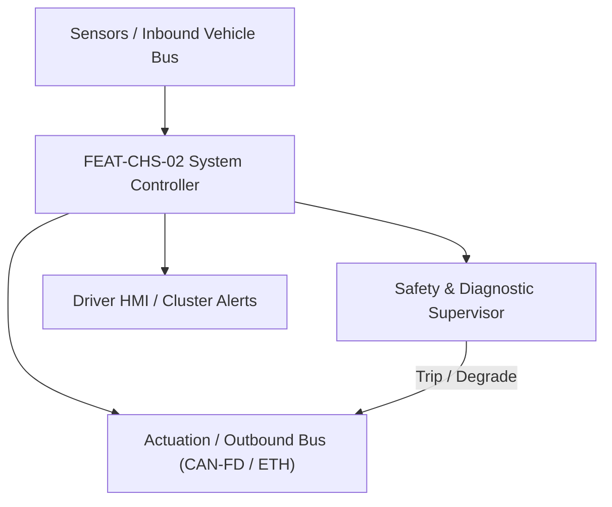
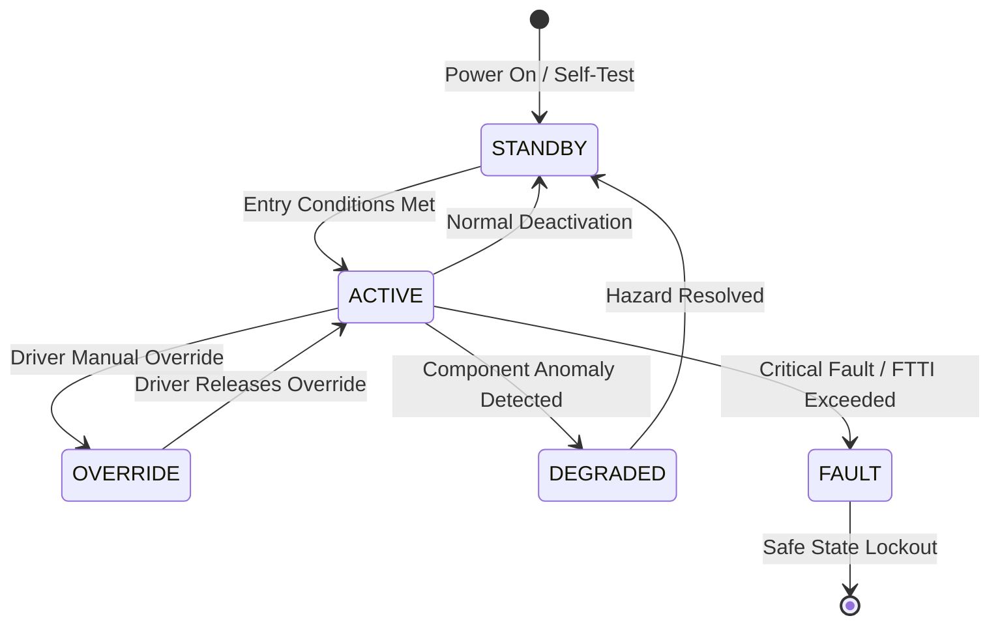

# System Requirements Specification: Steer-by-Wire Handwheel & Rack Control (SbW)
**Feature ID:** `FEAT-CHS-02`  
**Domain:** Vehicle Motion & Chassis Control  
**Target ASIL:** ASIL D  
**Compliance Standard:** ISO 26262:2018 (Part 4 - System Development) / ASPICE PAM v3.1 (SYS.2, SYS.3)  
**Parent Master Specification:** [`spec.md`](file:///c:/Workset/AntiGravityProjects/TestOptimisationExperiement/spec.md#feat-chs-02-sbw)  
**Derived Software Specification:** [`FEAT-CHS-02_SbW_SwReq.md`](file:///c:/Workset/AntiGravityProjects/TestOptimisationExperiement/software_requirements/FEAT-CHS-02_SbW_SwReq.md)

---

## 1. Feature Overview & Operational Scope

Decoupled steering system replacing mechanical steering column with dual-redundant roadwheel rack actuators and a force-feedback handwheel actuator.

### Operational Context Architecture

---

## 2. Activation Logic & Operational States

- **Preconditions:** Dual independent 12V/48V power supplies healthy, dual microcontrollers synchronized, rack resolvers calibrated.
- **Entry Conditions:** Vehicle power-up; handwheel homing completed; both redundant actuator channels reporting operational readiness.
- **Deactivation Conditions:** Power shutdown or irrecoverable mechanical rack jam.
- **Driver Override Behavior:** Driver physical handwheel torque is continuously tracked and converted to roadwheel angle; force-feedback motor provides synthesized road feel.
- **Operational State Progression:**  
  `INITIALIZING` -> `CALIBRATED_ACTIVE` -> `VARIABLE_RATIO_TRACKING` -> `SINGLE_CHANNEL_DEGRADED` -> `FORCE_FEEDBACK_LIMP` -> `CRITICAL_LOCKOUT`

### State Transition Diagram

---

## 3. Functional Safety & Failure Mitigation Concept

- **Functional Safety Goal:** SG-SBW-01: Guarantee fail-operational lateral directional control; zero uncommanded steering motion; fail-operational redundancy upon any single electrical fault.
- **Fault Tolerant Time Interval (FTTI):** 15 ms
- **Safe State Definition:** Secondary redundant motor takes over 100% rack steering control without interruption; limit maximum vehicle speed to 80 km/h.
- **Warning & Escalation Strategy:** Immediate red steering wheel warning chime on cluster; prompt 'Steering System Fault - Drive to Service'.

### Failure Modes & Degradation Handling
- **Handwheel Sensor Mismatch:** Triple-redundant sensor voting isolates corrupted channel; remaining two channels maintain control.
- **Primary Motor Open Circuit:** Dual-inverter bridge detects open phase in < 2 ms; secondary winding motor takes over 100% rack force in <= 5 ms.

---

## 4. System Requirements (SYS_REQ)
*(Note: Each System Requirement is systematically partitioned into multiple Child Software Requirements)*

### `SYS-CHS-02-01`: Triple-Redundant Handwheel Angle Acquisition & 2oo3 Voting
- **Planned Release:** R100
- **ASIL Rating:** ASIL D
- **Parent Feature:** [`FEAT-CHS-02`](file:///c:/Workset/AntiGravityProjects/TestOptimisationExperiement/spec.md#feat-chs-02)
- **Requirement Statement:**
  > The System SHALL Triple-Redundant Handwheel Angle Acquisition & 2oo3 Voting across galvanically isolated channels.
- **Activation Logic:** Active in all operating states
- **Fault Tolerant Time Interval (FTTI):** Sample rate 1000 Hz
- **Safe State Action:** Secondary redundant motor takes over or graceful safe-stop executed.
- **Failure Detection & Reaction:** Isolate channel within FTTI and log DEM diagnostic trouble code.
- **Input Interfaces:** `Sensor signals and bus inputs via RTE.`
- **Output Interfaces:** `Inverter PWM duty cycles, feedback torque, and diagnostic flags.`
- **System Verification Method:** HiL bench testing and hardware dynamometer validation.
- **Derived Child Software Requirements (1:N Link):**
  - [`SWR-CHS-02-01`](file:///c:/Workset/AntiGravityProjects/TestOptimisationExperiement/software_requirements/FEAT-CHS-02_SbW_SwReq.md#swr-chs-02-01)
  - [`SWR-CHS-02-02`](file:///c:/Workset/AntiGravityProjects/TestOptimisationExperiement/software_requirements/FEAT-CHS-02_SbW_SwReq.md#swr-chs-02-02)
  - [`SWR-CHS-02-03`](file:///c:/Workset/AntiGravityProjects/TestOptimisationExperiement/software_requirements/FEAT-CHS-02_SbW_SwReq.md#swr-chs-02-03)

### `SYS-CHS-02-02`: Dual Handwheel Torsion Bar Torque Acquisition & Plausibility Cross-Check
- **Planned Release:** R100
- **ASIL Rating:** ASIL D
- **Parent Feature:** [`FEAT-CHS-02`](file:///c:/Workset/AntiGravityProjects/TestOptimisationExperiement/spec.md#feat-chs-02)
- **Requirement Statement:**
  > The System SHALL Dual Handwheel Torsion Bar Torque Acquisition & Plausibility Cross-Check with physical deadband filter.
- **Activation Logic:** Active during manual and ADAS driving
- **Fault Tolerant Time Interval (FTTI):** Sample rate 1000 Hz
- **Safe State Action:** Secondary redundant motor takes over or graceful safe-stop executed.
- **Failure Detection & Reaction:** Isolate channel within FTTI and log DEM diagnostic trouble code.
- **Input Interfaces:** `Sensor signals and bus inputs via RTE.`
- **Output Interfaces:** `Inverter PWM duty cycles, feedback torque, and diagnostic flags.`
- **System Verification Method:** HiL bench testing and hardware dynamometer validation.
- **Derived Child Software Requirements (1:N Link):**
  - [`SWR-CHS-02-04`](file:///c:/Workset/AntiGravityProjects/TestOptimisationExperiement/software_requirements/FEAT-CHS-02_SbW_SwReq.md#swr-chs-02-04)
  - [`SWR-CHS-02-05`](file:///c:/Workset/AntiGravityProjects/TestOptimisationExperiement/software_requirements/FEAT-CHS-02_SbW_SwReq.md#swr-chs-02-05)

### `SYS-CHS-02-03`: Closed-Loop Dual-Winding Roadwheel Rack Angle Servocontrol
- **Planned Release:** R100
- **ASIL Rating:** ASIL D
- **Parent Feature:** [`FEAT-CHS-02`](file:///c:/Workset/AntiGravityProjects/TestOptimisationExperiement/spec.md#feat-chs-02)
- **Requirement Statement:**
  > The System SHALL Closed-Loop Dual-Winding Roadwheel Rack Angle Servocontrol with cascaded position/velocity/current loop.
- **Activation Logic:** CALIBRATED_ACTIVE, VARIABLE_RATIO_TRACKING
- **Fault Tolerant Time Interval (FTTI):** Closed-loop bandwidth >= 18 Hz
- **Safe State Action:** Secondary redundant motor takes over or graceful safe-stop executed.
- **Failure Detection & Reaction:** Isolate channel within FTTI and log DEM diagnostic trouble code.
- **Input Interfaces:** `Sensor signals and bus inputs via RTE.`
- **Output Interfaces:** `Inverter PWM duty cycles, feedback torque, and diagnostic flags.`
- **System Verification Method:** HiL bench testing and hardware dynamometer validation.
- **Derived Child Software Requirements (1:N Link):**
  - [`SWR-CHS-02-06`](file:///c:/Workset/AntiGravityProjects/TestOptimisationExperiement/software_requirements/FEAT-CHS-02_SbW_SwReq.md#swr-chs-02-06)
  - [`SWR-CHS-02-07`](file:///c:/Workset/AntiGravityProjects/TestOptimisationExperiement/software_requirements/FEAT-CHS-02_SbW_SwReq.md#swr-chs-02-07)
  - [`SWR-CHS-02-08`](file:///c:/Workset/AntiGravityProjects/TestOptimisationExperiement/software_requirements/FEAT-CHS-02_SbW_SwReq.md#swr-chs-02-08)

### `SYS-CHS-02-04`: Dynamic Handwheel Force-Feedback Road-Feel & Aligning Moment Synthesizer based on Pacejka brush model
- **Planned Release:** R100
- **ASIL Rating:** ASIL D
- **Parent Feature:** [`FEAT-CHS-02`](file:///c:/Workset/AntiGravityProjects/TestOptimisationExperiement/spec.md#feat-chs-02)
- **Requirement Statement:**
  > The System SHALL Dynamic Handwheel Force-Feedback Road-Feel & Aligning Moment Synthesizer based on Pacejka brush model.
- **Activation Logic:** CALIBRATED_ACTIVE, VARIABLE_RATIO_TRACKING
- **Fault Tolerant Time Interval (FTTI):** Aligning torque delivery up to +-8.5 Nm
- **Safe State Action:** Secondary redundant motor takes over or graceful safe-stop executed.
- **Failure Detection & Reaction:** Isolate channel within FTTI and log DEM diagnostic trouble code.
- **Input Interfaces:** `Sensor signals and bus inputs via RTE.`
- **Output Interfaces:** `Inverter PWM duty cycles, feedback torque, and diagnostic flags.`
- **System Verification Method:** HiL bench testing and hardware dynamometer validation.
- **Derived Child Software Requirements (1:N Link):**
  - [`SWR-CHS-02-09`](file:///c:/Workset/AntiGravityProjects/TestOptimisationExperiement/software_requirements/FEAT-CHS-02_SbW_SwReq.md#swr-chs-02-09)
  - [`SWR-CHS-02-10`](file:///c:/Workset/AntiGravityProjects/TestOptimisationExperiement/software_requirements/FEAT-CHS-02_SbW_SwReq.md#swr-chs-02-10)
  - [`SWR-CHS-02-11`](file:///c:/Workset/AntiGravityProjects/TestOptimisationExperiement/software_requirements/FEAT-CHS-02_SbW_SwReq.md#swr-chs-02-11)

### `SYS-CHS-02-05`: Vehicle Speed-Scheduled Variable Steering Ratio (VSR) Computation
- **Planned Release:** R100
- **ASIL Rating:** ASIL D
- **Parent Feature:** [`FEAT-CHS-02`](file:///c:/Workset/AntiGravityProjects/TestOptimisationExperiement/spec.md#feat-chs-02)
- **Requirement Statement:**
  > The System SHALL Vehicle Speed-Scheduled Variable Steering Ratio (VSR) Computation with continuous transition laws.
- **Activation Logic:** VARIABLE_RATIO_TRACKING, ADAS_COORDINATED_STEER
- **Fault Tolerant Time Interval (FTTI):** Ratio range 8.0:1 (<= 15 km/h) to 16.5:1 (>= 120 km/h)
- **Safe State Action:** Secondary redundant motor takes over or graceful safe-stop executed.
- **Failure Detection & Reaction:** Isolate channel within FTTI and log DEM diagnostic trouble code.
- **Input Interfaces:** `Sensor signals and bus inputs via RTE.`
- **Output Interfaces:** `Inverter PWM duty cycles, feedback torque, and diagnostic flags.`
- **System Verification Method:** HiL bench testing and hardware dynamometer validation.
- **Derived Child Software Requirements (1:N Link):**
  - [`SWR-CHS-02-12`](file:///c:/Workset/AntiGravityProjects/TestOptimisationExperiement/software_requirements/FEAT-CHS-02_SbW_SwReq.md#swr-chs-02-12)
  - [`SWR-CHS-02-13`](file:///c:/Workset/AntiGravityProjects/TestOptimisationExperiement/software_requirements/FEAT-CHS-02_SbW_SwReq.md#swr-chs-02-13)

### `SYS-CHS-02-06`: Dual-Channel High-Precision Rack Resolver Position & Velocity Tracking
- **Planned Release:** R100
- **ASIL Rating:** ASIL D
- **Parent Feature:** [`FEAT-CHS-02`](file:///c:/Workset/AntiGravityProjects/TestOptimisationExperiement/spec.md#feat-chs-02)
- **Requirement Statement:**
  > The System SHALL Dual-Channel High-Precision Rack Resolver Position & Velocity Tracking with differential observer.
- **Activation Logic:** Active in all operating states
- **Fault Tolerant Time Interval (FTTI):** Resolver-to-Digital resolution 16-bit
- **Safe State Action:** Secondary redundant motor takes over or graceful safe-stop executed.
- **Failure Detection & Reaction:** Isolate channel within FTTI and log DEM diagnostic trouble code.
- **Input Interfaces:** `Sensor signals and bus inputs via RTE.`
- **Output Interfaces:** `Inverter PWM duty cycles, feedback torque, and diagnostic flags.`
- **System Verification Method:** HiL bench testing and hardware dynamometer validation.
- **Derived Child Software Requirements (1:N Link):**
  - [`SWR-CHS-02-14`](file:///c:/Workset/AntiGravityProjects/TestOptimisationExperiement/software_requirements/FEAT-CHS-02_SbW_SwReq.md#swr-chs-02-14)
  - [`SWR-CHS-02-15`](file:///c:/Workset/AntiGravityProjects/TestOptimisationExperiement/software_requirements/FEAT-CHS-02_SbW_SwReq.md#swr-chs-02-15)

### `SYS-CHS-02-07`: Symmetrical Dual-Inverter 50/50 Torque Sharing & Current Balance Control between motor windings
- **Planned Release:** R200
- **ASIL Rating:** ASIL D
- **Parent Feature:** [`FEAT-CHS-02`](file:///c:/Workset/AntiGravityProjects/TestOptimisationExperiement/spec.md#feat-chs-02)
- **Requirement Statement:**
  > The System SHALL Symmetrical Dual-Inverter 50/50 Torque Sharing & Current Balance Control between motor windings.
- **Activation Logic:** CALIBRATED_ACTIVE, VARIABLE_RATIO_TRACKING
- **Fault Tolerant Time Interval (FTTI):** Current imbalance <= 4.0% of nominal
- **Safe State Action:** Secondary redundant motor takes over or graceful safe-stop executed.
- **Failure Detection & Reaction:** Isolate channel within FTTI and log DEM diagnostic trouble code.
- **Input Interfaces:** `Sensor signals and bus inputs via RTE.`
- **Output Interfaces:** `Inverter PWM duty cycles, feedback torque, and diagnostic flags.`
- **System Verification Method:** HiL bench testing and hardware dynamometer validation.
- **Derived Child Software Requirements (1:N Link):**
  - [`SWR-CHS-02-17`](file:///c:/Workset/AntiGravityProjects/TestOptimisationExperiement/software_requirements/FEAT-CHS-02_SbW_SwReq.md#swr-chs-02-17)
  - [`SWR-CHS-02-18`](file:///c:/Workset/AntiGravityProjects/TestOptimisationExperiement/software_requirements/FEAT-CHS-02_SbW_SwReq.md#swr-chs-02-18)
  - [`SWR-CHS-02-19`](file:///c:/Workset/AntiGravityProjects/TestOptimisationExperiement/software_requirements/FEAT-CHS-02_SbW_SwReq.md#swr-chs-02-19)

### `SYS-CHS-02-08`: Instantaneous Single-Channel Fault Isolation & 100% Inverter Failover Takeover without loss of control
- **Planned Release:** R400
- **ASIL Rating:** ASIL D
- **Parent Feature:** [`FEAT-CHS-02`](file:///c:/Workset/AntiGravityProjects/TestOptimisationExperiement/spec.md#feat-chs-02)
- **Requirement Statement:**
  > The System SHALL Instantaneous Single-Channel Fault Isolation & 100% Inverter Failover Takeover without loss of control.
- **Activation Logic:** SINGLE_CHANNEL_DEGRADED transition
- **Fault Tolerant Time Interval (FTTI):** Fault detection to full takeover <= 5.0 ms
- **Safe State Action:** Secondary redundant motor takes over or graceful safe-stop executed.
- **Failure Detection & Reaction:** Isolate channel within FTTI and log DEM diagnostic trouble code.
- **Input Interfaces:** `Sensor signals and bus inputs via RTE.`
- **Output Interfaces:** `Inverter PWM duty cycles, feedback torque, and diagnostic flags.`
- **System Verification Method:** HiL bench testing and hardware dynamometer validation.
- **Derived Child Software Requirements (1:N Link):**
  - [`SWR-CHS-02-20`](file:///c:/Workset/AntiGravityProjects/TestOptimisationExperiement/software_requirements/FEAT-CHS-02_SbW_SwReq.md#swr-chs-02-20)
  - [`SWR-CHS-02-21`](file:///c:/Workset/AntiGravityProjects/TestOptimisationExperiement/software_requirements/FEAT-CHS-02_SbW_SwReq.md#swr-chs-02-21)
  - [`SWR-CHS-02-22`](file:///c:/Workset/AntiGravityProjects/TestOptimisationExperiement/software_requirements/FEAT-CHS-02_SbW_SwReq.md#swr-chs-02-22)

### `SYS-CHS-02-09`: Virtual Mechanical End-Stop Simulation & Progressive Soft-Bump Active Barrier at extreme handwheel angles
- **Planned Release:** R200
- **ASIL Rating:** ASIL D
- **Parent Feature:** [`FEAT-CHS-02`](file:///c:/Workset/AntiGravityProjects/TestOptimisationExperiement/spec.md#feat-chs-02)
- **Requirement Statement:**
  > The System SHALL Virtual Mechanical End-Stop Simulation & Progressive Soft-Bump Active Barrier at extreme handwheel angles.
- **Activation Logic:** VARIABLE_RATIO_TRACKING near travel limits
- **Fault Tolerant Time Interval (FTTI):** Counter-torque gradient 18.0 Nm/deg up to 10.0 Nm clamp
- **Safe State Action:** Secondary redundant motor takes over or graceful safe-stop executed.
- **Failure Detection & Reaction:** Isolate channel within FTTI and log DEM diagnostic trouble code.
- **Input Interfaces:** `Sensor signals and bus inputs via RTE.`
- **Output Interfaces:** `Inverter PWM duty cycles, feedback torque, and diagnostic flags.`
- **System Verification Method:** HiL bench testing and hardware dynamometer validation.
- **Derived Child Software Requirements (1:N Link):**
  - [`SWR-CHS-02-23`](file:///c:/Workset/AntiGravityProjects/TestOptimisationExperiement/software_requirements/FEAT-CHS-02_SbW_SwReq.md#swr-chs-02-23)
  - [`SWR-CHS-02-24`](file:///c:/Workset/AntiGravityProjects/TestOptimisationExperiement/software_requirements/FEAT-CHS-02_SbW_SwReq.md#swr-chs-02-24)

### `SYS-CHS-02-10`: High-Frequency Road Surface Texture & Rumble Strip Haptic Feedback Injection
- **Planned Release:** R200
- **ASIL Rating:** ASIL B
- **Parent Feature:** [`FEAT-CHS-02`](file:///c:/Workset/AntiGravityProjects/TestOptimisationExperiement/spec.md#feat-chs-02)
- **Requirement Statement:**
  > The System SHALL High-Frequency Road Surface Texture & Rumble Strip Haptic Feedback Injection.
- **Activation Logic:** VARIABLE_RATIO_TRACKING on rough roads
- **Fault Tolerant Time Interval (FTTI):** Bandpass frequency 15 Hz to 45 Hz
- **Safe State Action:** Secondary redundant motor takes over or graceful safe-stop executed.
- **Failure Detection & Reaction:** Isolate channel within FTTI and log DEM diagnostic trouble code.
- **Input Interfaces:** `Sensor signals and bus inputs via RTE.`
- **Output Interfaces:** `Inverter PWM duty cycles, feedback torque, and diagnostic flags.`
- **System Verification Method:** HiL bench testing and hardware dynamometer validation.
- **Derived Child Software Requirements (1:N Link):**
  - [`SWR-CHS-02-25`](file:///c:/Workset/AntiGravityProjects/TestOptimisationExperiement/software_requirements/FEAT-CHS-02_SbW_SwReq.md#swr-chs-02-25)
  - [`SWR-CHS-02-26`](file:///c:/Workset/AntiGravityProjects/TestOptimisationExperiement/software_requirements/FEAT-CHS-02_SbW_SwReq.md#swr-chs-02-26)

### `SYS-CHS-02-11`: Active Centering & High-Speed Directional Self-Straightening Restorative Torque Synthesis
- **Planned Release:** R200
- **ASIL Rating:** ASIL D
- **Parent Feature:** [`FEAT-CHS-02`](file:///c:/Workset/AntiGravityProjects/TestOptimisationExperiement/spec.md#feat-chs-02)
- **Requirement Statement:**
  > The System SHALL Active Centering & High-Speed Directional Self-Straightening Restorative Torque Synthesis.
- **Activation Logic:** VARIABLE_RATIO_TRACKING, low align moment
- **Fault Tolerant Time Interval (FTTI):** Return velocity 35°/s at 30 km/h
- **Safe State Action:** Secondary redundant motor takes over or graceful safe-stop executed.
- **Failure Detection & Reaction:** Isolate channel within FTTI and log DEM diagnostic trouble code.
- **Input Interfaces:** `Sensor signals and bus inputs via RTE.`
- **Output Interfaces:** `Inverter PWM duty cycles, feedback torque, and diagnostic flags.`
- **System Verification Method:** HiL bench testing and hardware dynamometer validation.
- **Derived Child Software Requirements (1:N Link):**
  - [`SWR-CHS-02-27`](file:///c:/Workset/AntiGravityProjects/TestOptimisationExperiement/software_requirements/FEAT-CHS-02_SbW_SwReq.md#swr-chs-02-27)
  - [`SWR-CHS-02-28`](file:///c:/Workset/AntiGravityProjects/TestOptimisationExperiement/software_requirements/FEAT-CHS-02_SbW_SwReq.md#swr-chs-02-28)

### `SYS-CHS-02-12`: Dual 12V/48V Electrical Bus Monitoring & Dynamic Brownout Voltage Derating
- **Planned Release:** R400
- **ASIL Rating:** ASIL D
- **Parent Feature:** [`FEAT-CHS-02`](file:///c:/Workset/AntiGravityProjects/TestOptimisationExperiement/spec.md#feat-chs-02)
- **Requirement Statement:**
  > The System SHALL Dual 12V/48V Electrical Bus Monitoring & Dynamic Brownout Voltage Derating.
- **Activation Logic:** Active in all operating states
- **Fault Tolerant Time Interval (FTTI):** Voltage sampling 100 Hz
- **Safe State Action:** Secondary redundant motor takes over or graceful safe-stop executed.
- **Failure Detection & Reaction:** Isolate channel within FTTI and log DEM diagnostic trouble code.
- **Input Interfaces:** `Sensor signals and bus inputs via RTE.`
- **Output Interfaces:** `Inverter PWM duty cycles, feedback torque, and diagnostic flags.`
- **System Verification Method:** HiL bench testing and hardware dynamometer validation.
- **Derived Child Software Requirements (1:N Link):**
  - [`SWR-CHS-02-29`](file:///c:/Workset/AntiGravityProjects/TestOptimisationExperiement/software_requirements/FEAT-CHS-02_SbW_SwReq.md#swr-chs-02-29)
  - [`SWR-CHS-02-30`](file:///c:/Workset/AntiGravityProjects/TestOptimisationExperiement/software_requirements/FEAT-CHS-02_SbW_SwReq.md#swr-chs-02-30)
  - [`SWR-CHS-02-31`](file:///c:/Workset/AntiGravityProjects/TestOptimisationExperiement/software_requirements/FEAT-CHS-02_SbW_SwReq.md#swr-chs-02-31)

### `SYS-CHS-02-13`: Multi-Zone Actuator & Inverter Junction Thermal Protection & Derating Envelopes
- **Planned Release:** R300
- **ASIL Rating:** ASIL B
- **Parent Feature:** [`FEAT-CHS-02`](file:///c:/Workset/AntiGravityProjects/TestOptimisationExperiement/spec.md#feat-chs-02)
- **Requirement Statement:**
  > The System SHALL Multi-Zone Actuator & Inverter Junction Thermal Protection & Derating Envelopes.
- **Activation Logic:** Active in all operating states
- **Fault Tolerant Time Interval (FTTI):** Sampling period 100 ms
- **Safe State Action:** Secondary redundant motor takes over or graceful safe-stop executed.
- **Failure Detection & Reaction:** Isolate channel within FTTI and log DEM diagnostic trouble code.
- **Input Interfaces:** `Sensor signals and bus inputs via RTE.`
- **Output Interfaces:** `Inverter PWM duty cycles, feedback torque, and diagnostic flags.`
- **System Verification Method:** HiL bench testing and hardware dynamometer validation.
- **Derived Child Software Requirements (1:N Link):**
  - [`SWR-CHS-02-32`](file:///c:/Workset/AntiGravityProjects/TestOptimisationExperiement/software_requirements/FEAT-CHS-02_SbW_SwReq.md#swr-chs-02-32)
  - [`SWR-CHS-02-33`](file:///c:/Workset/AntiGravityProjects/TestOptimisationExperiement/software_requirements/FEAT-CHS-02_SbW_SwReq.md#swr-chs-02-33)

### `SYS-CHS-02-14`: Dual-Domain E2E CAN-FD & Automotive Ethernet Communication Supervision
- **Planned Release:** R300
- **ASIL Rating:** ASIL D
- **Parent Feature:** [`FEAT-CHS-02`](file:///c:/Workset/AntiGravityProjects/TestOptimisationExperiement/spec.md#feat-chs-02)
- **Requirement Statement:**
  > The System SHALL Dual-Domain E2E CAN-FD & Automotive Ethernet Communication Supervision with CRC-16 & Alive Counter.
- **Activation Logic:** Active in all operating states
- **Fault Tolerant Time Interval (FTTI):** Message cycle 2.0 ms
- **Safe State Action:** Secondary redundant motor takes over or graceful safe-stop executed.
- **Failure Detection & Reaction:** Isolate channel within FTTI and log DEM diagnostic trouble code.
- **Input Interfaces:** `Sensor signals and bus inputs via RTE.`
- **Output Interfaces:** `Inverter PWM duty cycles, feedback torque, and diagnostic flags.`
- **System Verification Method:** HiL bench testing and hardware dynamometer validation.
- **Derived Child Software Requirements (1:N Link):**
  - [`SWR-CHS-02-34`](file:///c:/Workset/AntiGravityProjects/TestOptimisationExperiement/software_requirements/FEAT-CHS-02_SbW_SwReq.md#swr-chs-02-34)
  - [`SWR-CHS-02-35`](file:///c:/Workset/AntiGravityProjects/TestOptimisationExperiement/software_requirements/FEAT-CHS-02_SbW_SwReq.md#swr-chs-02-35)
  - [`SWR-CHS-02-36`](file:///c:/Workset/AntiGravityProjects/TestOptimisationExperiement/software_requirements/FEAT-CHS-02_SbW_SwReq.md#swr-chs-02-36)

### `SYS-CHS-02-15`: Autonomous Driving Motion Request Arbitration & Seamless Driver Manual Override Detection
- **Planned Release:** R300
- **ASIL Rating:** ASIL D
- **Parent Feature:** [`FEAT-CHS-02`](file:///c:/Workset/AntiGravityProjects/TestOptimisationExperiement/spec.md#feat-chs-02)
- **Requirement Statement:**
  > The System SHALL Autonomous Driving Motion Request Arbitration & Seamless Driver Manual Override Detection.
- **Activation Logic:** ADAS_COORDINATED_STEER mode
- **Fault Tolerant Time Interval (FTTI):** Driver override torque threshold 1.80 Nm for > 50 ms
- **Safe State Action:** Secondary redundant motor takes over or graceful safe-stop executed.
- **Failure Detection & Reaction:** Isolate channel within FTTI and log DEM diagnostic trouble code.
- **Input Interfaces:** `Sensor signals and bus inputs via RTE.`
- **Output Interfaces:** `Inverter PWM duty cycles, feedback torque, and diagnostic flags.`
- **System Verification Method:** HiL bench testing and hardware dynamometer validation.
- **Derived Child Software Requirements (1:N Link):**
  - [`SWR-CHS-02-37`](file:///c:/Workset/AntiGravityProjects/TestOptimisationExperiement/software_requirements/FEAT-CHS-02_SbW_SwReq.md#swr-chs-02-37)
  - [`SWR-CHS-02-38`](file:///c:/Workset/AntiGravityProjects/TestOptimisationExperiement/software_requirements/FEAT-CHS-02_SbW_SwReq.md#swr-chs-02-38)
  - [`SWR-CHS-02-39`](file:///c:/Workset/AntiGravityProjects/TestOptimisationExperiement/software_requirements/FEAT-CHS-02_SbW_SwReq.md#swr-chs-02-39)

### `SYS-CHS-02-16`: Unintended Steering Motion Hardware Safing & Cross-Core Lockstep Monitoring
- **Planned Release:** R400
- **ASIL Rating:** ASIL D
- **Parent Feature:** [`FEAT-CHS-02`](file:///c:/Workset/AntiGravityProjects/TestOptimisationExperiement/spec.md#feat-chs-02)
- **Requirement Statement:**
  > The System SHALL Unintended Steering Motion Hardware Safing & Cross-Core Lockstep Monitoring with independent kill relay.
- **Activation Logic:** Active in all operating states
- **Fault Tolerant Time Interval (FTTI):** Divergence trip latency <= 2.0 ms
- **Safe State Action:** Secondary redundant motor takes over or graceful safe-stop executed.
- **Failure Detection & Reaction:** Isolate channel within FTTI and log DEM diagnostic trouble code.
- **Input Interfaces:** `Sensor signals and bus inputs via RTE.`
- **Output Interfaces:** `Inverter PWM duty cycles, feedback torque, and diagnostic flags.`
- **System Verification Method:** HiL bench testing and hardware dynamometer validation.
- **Derived Child Software Requirements (1:N Link):**
  - [`SWR-CHS-02-40`](file:///c:/Workset/AntiGravityProjects/TestOptimisationExperiement/software_requirements/FEAT-CHS-02_SbW_SwReq.md#swr-chs-02-40)
  - [`SWR-CHS-02-41`](file:///c:/Workset/AntiGravityProjects/TestOptimisationExperiement/software_requirements/FEAT-CHS-02_SbW_SwReq.md#swr-chs-02-41)
  - [`SWR-CHS-02-42`](file:///c:/Workset/AntiGravityProjects/TestOptimisationExperiement/software_requirements/FEAT-CHS-02_SbW_SwReq.md#swr-chs-02-42)

### `SYS-CHS-02-17`: Mechanical Rack Jam Detection & Tie-Rod Peak Structural Force Clamping
- **Planned Release:** R300
- **ASIL Rating:** ASIL D
- **Parent Feature:** [`FEAT-CHS-02`](file:///c:/Workset/AntiGravityProjects/TestOptimisationExperiement/spec.md#feat-chs-02)
- **Requirement Statement:**
  > The System SHALL Mechanical Rack Jam Detection & Tie-Rod Peak Structural Force Clamping.
- **Activation Logic:** Active in all operating states
- **Fault Tolerant Time Interval (FTTI):** Current limit clamped at 14.5 kN axial tie-rod force
- **Safe State Action:** Secondary redundant motor takes over or graceful safe-stop executed.
- **Failure Detection & Reaction:** Isolate channel within FTTI and log DEM diagnostic trouble code.
- **Input Interfaces:** `Sensor signals and bus inputs via RTE.`
- **Output Interfaces:** `Inverter PWM duty cycles, feedback torque, and diagnostic flags.`
- **System Verification Method:** HiL bench testing and hardware dynamometer validation.
- **Derived Child Software Requirements (1:N Link):**
  - [`SWR-CHS-02-43`](file:///c:/Workset/AntiGravityProjects/TestOptimisationExperiement/software_requirements/FEAT-CHS-02_SbW_SwReq.md#swr-chs-02-43)
  - [`SWR-CHS-02-44`](file:///c:/Workset/AntiGravityProjects/TestOptimisationExperiement/software_requirements/FEAT-CHS-02_SbW_SwReq.md#swr-chs-02-44)

### `SYS-CHS-02-18`: Driver Optical, Acoustic & Haptic Steering Warning Escalation HMI on Cluster & Steering Wheel
- **Planned Release:** R300
- **ASIL Rating:** ASIL B
- **Parent Feature:** [`FEAT-CHS-02`](file:///c:/Workset/AntiGravityProjects/TestOptimisationExperiement/spec.md#feat-chs-02)
- **Requirement Statement:**
  > The System SHALL Driver Optical, Acoustic & Haptic Steering Warning Escalation HMI on Cluster & Steering Wheel.
- **Activation Logic:** SINGLE_CHANNEL_DEGRADED, FORCE_FEEDBACK_LIMP
- **Fault Tolerant Time Interval (FTTI):** HMI frame transmission <= 10.0 ms
- **Safe State Action:** Secondary redundant motor takes over or graceful safe-stop executed.
- **Failure Detection & Reaction:** Isolate channel within FTTI and log DEM diagnostic trouble code.
- **Input Interfaces:** `Sensor signals and bus inputs via RTE.`
- **Output Interfaces:** `Inverter PWM duty cycles, feedback torque, and diagnostic flags.`
- **System Verification Method:** HiL bench testing and hardware dynamometer validation.
- **Derived Child Software Requirements (1:N Link):**
  - [`SWR-CHS-02-45`](file:///c:/Workset/AntiGravityProjects/TestOptimisationExperiement/software_requirements/FEAT-CHS-02_SbW_SwReq.md#swr-chs-02-45)
  - [`SWR-CHS-02-46`](file:///c:/Workset/AntiGravityProjects/TestOptimisationExperiement/software_requirements/FEAT-CHS-02_SbW_SwReq.md#swr-chs-02-46)

### `SYS-CHS-02-19`: Fail-Operational Degraded Safe-Stop Trajectory & Emergency Vehicle Speed Capping
- **Planned Release:** R400
- **ASIL Rating:** ASIL D
- **Parent Feature:** [`FEAT-CHS-02`](file:///c:/Workset/AntiGravityProjects/TestOptimisationExperiement/spec.md#feat-chs-02)
- **Requirement Statement:**
  > The System SHALL Fail-Operational Degraded Safe-Stop Trajectory & Emergency Vehicle Speed Capping.
- **Activation Logic:** EMERGENCY_SAFE_STOP mode
- **Fault Tolerant Time Interval (FTTI):** Powertrain speed cap 80 km/h (Tier 2) or 0 km/h controlled stop
- **Safe State Action:** Secondary redundant motor takes over or graceful safe-stop executed.
- **Failure Detection & Reaction:** Isolate channel within FTTI and log DEM diagnostic trouble code.
- **Input Interfaces:** `Sensor signals and bus inputs via RTE.`
- **Output Interfaces:** `Inverter PWM duty cycles, feedback torque, and diagnostic flags.`
- **System Verification Method:** HiL bench testing and hardware dynamometer validation.
- **Derived Child Software Requirements (1:N Link):**
  - [`SWR-CHS-02-47`](file:///c:/Workset/AntiGravityProjects/TestOptimisationExperiement/software_requirements/FEAT-CHS-02_SbW_SwReq.md#swr-chs-02-47)
  - [`SWR-CHS-02-48`](file:///c:/Workset/AntiGravityProjects/TestOptimisationExperiement/software_requirements/FEAT-CHS-02_SbW_SwReq.md#swr-chs-02-48)
  - [`SWR-CHS-02-49`](file:///c:/Workset/AntiGravityProjects/TestOptimisationExperiement/software_requirements/FEAT-CHS-02_SbW_SwReq.md#swr-chs-02-49)

### `SYS-CHS-02-20`: Comprehensive Diagnostic Event Management (DEM) & Non-Volatile Freeze-Frame Latching
- **Planned Release:** R500
- **ASIL Rating:** ASIL B
- **Parent Feature:** [`FEAT-CHS-02`](file:///c:/Workset/AntiGravityProjects/TestOptimisationExperiement/spec.md#feat-chs-02)
- **Requirement Statement:**
  > The System SHALL Comprehensive Diagnostic Event Management (DEM) & Non-Volatile Freeze-Frame Latching.
- **Activation Logic:** Fault condition qualification
- **Fault Tolerant Time Interval (FTTI):** Debounce counter time 20 ms
- **Safe State Action:** Secondary redundant motor takes over or graceful safe-stop executed.
- **Failure Detection & Reaction:** Isolate channel within FTTI and log DEM diagnostic trouble code.
- **Input Interfaces:** `Sensor signals and bus inputs via RTE.`
- **Output Interfaces:** `Inverter PWM duty cycles, feedback torque, and diagnostic flags.`
- **System Verification Method:** HiL bench testing and hardware dynamometer validation.
- **Derived Child Software Requirements (1:N Link):**
  - [`SWR-CHS-02-50`](file:///c:/Workset/AntiGravityProjects/TestOptimisationExperiement/software_requirements/FEAT-CHS-02_SbW_SwReq.md#swr-chs-02-50)
  - [`SWR-CHS-02-51`](file:///c:/Workset/AntiGravityProjects/TestOptimisationExperiement/software_requirements/FEAT-CHS-02_SbW_SwReq.md#swr-chs-02-51)

### `SYS-CHS-02-01`: ASIL D
- **Planned Release:** R400
- **ASIL Rating:** Triplicated sensor fault injection HIL bench (open/short/drift)
- **Parent Feature:** [`FEAT-CHS-02`](file:///c:/Workset/AntiGravityProjects/TestOptimisationExperiement/spec.md#feat-chs-02)
- **Requirement Statement:**
  > The System SHALL ASIL D.
- **Activation Logic:** Triple Handwheel Angle Acquisition & 2oo3 Voting
- **Fault Tolerant Time Interval (FTTI):** [`SWR-CHS-02-01`](file:///c:/Workset/AntiGravityProjects/TestOptimisationExperiement/software_requirements/FEAT-CHS-02_SbW_SwReq.md#swr-chs-02-01), [`SWR-CHS-02-02`](file:///c:/Workset/AntiGravityProjects/TestOptimisationExperiement/software_requirements/FEAT-CHS-02_SbW_SwReq.md#swr-chs-02-02), [`SWR-CHS-02-03`](file:///c:/Workset/AntiGravityProjects/TestOptimisationExperiement/software_requirements/FEAT-CHS-02_SbW_SwReq.md#swr-chs-02-03)
- **Safe State Action:** Secondary redundant motor takes over or graceful safe-stop executed.
- **Failure Detection & Reaction:** Isolate channel within FTTI and log DEM diagnostic trouble code.
- **Input Interfaces:** `Sensor signals and bus inputs via RTE.`
- **Output Interfaces:** `Inverter PWM duty cycles, feedback torque, and diagnostic flags.`
- **System Verification Method:** HiL bench testing and hardware dynamometer validation.
- **Derived Child Software Requirements (1:N Link):**
  - [`SWR-CHS-02-01`](file:///c:/Workset/AntiGravityProjects/TestOptimisationExperiement/software_requirements/FEAT-CHS-02_SbW_SwReq.md#swr-chs-02-01)
  - [`SWR-CHS-02-02`](file:///c:/Workset/AntiGravityProjects/TestOptimisationExperiement/software_requirements/FEAT-CHS-02_SbW_SwReq.md#swr-chs-02-02)
  - [`SWR-CHS-02-03`](file:///c:/Workset/AntiGravityProjects/TestOptimisationExperiement/software_requirements/FEAT-CHS-02_SbW_SwReq.md#swr-chs-02-03)

### `SYS-CHS-02-03`: ASIL D
- **Planned Release:** R400
- **ASIL Rating:** Loaded dynamic steering rack test bench measuring phase lag
- **Parent Feature:** [`FEAT-CHS-02`](file:///c:/Workset/AntiGravityProjects/TestOptimisationExperiement/spec.md#feat-chs-02)
- **Requirement Statement:**
  > The System SHALL ASIL D.
- **Activation Logic:** Closed-Loop Roadwheel Rack Servocontrol
- **Fault Tolerant Time Interval (FTTI):** [`SWR-CHS-02-06`](file:///c:/Workset/AntiGravityProjects/TestOptimisationExperiement/software_requirements/FEAT-CHS-02_SbW_SwReq.md#swr-chs-02-06), [`SWR-CHS-02-07`](file:///c:/Workset/AntiGravityProjects/TestOptimisationExperiement/software_requirements/FEAT-CHS-02_SbW_SwReq.md#swr-chs-02-07), [`SWR-CHS-02-08`](file:///c:/Workset/AntiGravityProjects/TestOptimisationExperiement/software_requirements/FEAT-CHS-02_SbW_SwReq.md#swr-chs-02-08)
- **Safe State Action:** Secondary redundant motor takes over or graceful safe-stop executed.
- **Failure Detection & Reaction:** Isolate channel within FTTI and log DEM diagnostic trouble code.
- **Input Interfaces:** `Sensor signals and bus inputs via RTE.`
- **Output Interfaces:** `Inverter PWM duty cycles, feedback torque, and diagnostic flags.`
- **System Verification Method:** HiL bench testing and hardware dynamometer validation.
- **Derived Child Software Requirements (1:N Link):**
  - [`SWR-CHS-02-06`](file:///c:/Workset/AntiGravityProjects/TestOptimisationExperiement/software_requirements/FEAT-CHS-02_SbW_SwReq.md#swr-chs-02-06)
  - [`SWR-CHS-02-07`](file:///c:/Workset/AntiGravityProjects/TestOptimisationExperiement/software_requirements/FEAT-CHS-02_SbW_SwReq.md#swr-chs-02-07)
  - [`SWR-CHS-02-08`](file:///c:/Workset/AntiGravityProjects/TestOptimisationExperiement/software_requirements/FEAT-CHS-02_SbW_SwReq.md#swr-chs-02-08)

### `SYS-CHS-02-05`: ASIL D
- **Planned Release:** R400
- **ASIL Rating:** Parking slalom and high-speed lane change proving ground tests
- **Parent Feature:** [`FEAT-CHS-02`](file:///c:/Workset/AntiGravityProjects/TestOptimisationExperiement/spec.md#feat-chs-02)
- **Requirement Statement:**
  > The System SHALL ASIL D.
- **Activation Logic:** Speed-Scheduled Variable Steering Ratio
- **Fault Tolerant Time Interval (FTTI):** [`SWR-CHS-02-12`](file:///c:/Workset/AntiGravityProjects/TestOptimisationExperiement/software_requirements/FEAT-CHS-02_SbW_SwReq.md#swr-chs-02-12), [`SWR-CHS-02-13`](file:///c:/Workset/AntiGravityProjects/TestOptimisationExperiement/software_requirements/FEAT-CHS-02_SbW_SwReq.md#swr-chs-02-13)
- **Safe State Action:** Secondary redundant motor takes over or graceful safe-stop executed.
- **Failure Detection & Reaction:** Isolate channel within FTTI and log DEM diagnostic trouble code.
- **Input Interfaces:** `Sensor signals and bus inputs via RTE.`
- **Output Interfaces:** `Inverter PWM duty cycles, feedback torque, and diagnostic flags.`
- **System Verification Method:** HiL bench testing and hardware dynamometer validation.
- **Derived Child Software Requirements (1:N Link):**
  - [`SWR-CHS-02-12`](file:///c:/Workset/AntiGravityProjects/TestOptimisationExperiement/software_requirements/FEAT-CHS-02_SbW_SwReq.md#swr-chs-02-12)
  - [`SWR-CHS-02-13`](file:///c:/Workset/AntiGravityProjects/TestOptimisationExperiement/software_requirements/FEAT-CHS-02_SbW_SwReq.md#swr-chs-02-13)

### `SYS-CHS-02-07`: ASIL D
- **Planned Release:** R400
- **ASIL Rating:** Dual-bridge inverter current probe balance validation
- **Parent Feature:** [`FEAT-CHS-02`](file:///c:/Workset/AntiGravityProjects/TestOptimisationExperiement/spec.md#feat-chs-02)
- **Requirement Statement:**
  > The System SHALL ASIL D.
- **Activation Logic:** Dual-Inverter 50/50 Torque Sharing & Current Balance
- **Fault Tolerant Time Interval (FTTI):** [`SWR-CHS-02-16`](file:///c:/Workset/AntiGravityProjects/TestOptimisationExperiement/software_requirements/FEAT-CHS-02_SbW_SwReq.md#swr-chs-02-16), [`SWR-CHS-02-17`](file:///c:/Workset/AntiGravityProjects/TestOptimisationExperiement/software_requirements/FEAT-CHS-02_SbW_SwReq.md#swr-chs-02-17), [`SWR-CHS-02-18`](file:///c:/Workset/AntiGravityProjects/TestOptimisationExperiement/software_requirements/FEAT-CHS-02_SbW_SwReq.md#swr-chs-02-18)
- **Safe State Action:** Secondary redundant motor takes over or graceful safe-stop executed.
- **Failure Detection & Reaction:** Isolate channel within FTTI and log DEM diagnostic trouble code.
- **Input Interfaces:** `Sensor signals and bus inputs via RTE.`
- **Output Interfaces:** `Inverter PWM duty cycles, feedback torque, and diagnostic flags.`
- **System Verification Method:** HiL bench testing and hardware dynamometer validation.
- **Derived Child Software Requirements (1:N Link):**
  - [`SWR-CHS-02-17`](file:///c:/Workset/AntiGravityProjects/TestOptimisationExperiement/software_requirements/FEAT-CHS-02_SbW_SwReq.md#swr-chs-02-17)
  - [`SWR-CHS-02-18`](file:///c:/Workset/AntiGravityProjects/TestOptimisationExperiement/software_requirements/FEAT-CHS-02_SbW_SwReq.md#swr-chs-02-18)
  - [`SWR-CHS-02-19`](file:///c:/Workset/AntiGravityProjects/TestOptimisationExperiement/software_requirements/FEAT-CHS-02_SbW_SwReq.md#swr-chs-02-19)

### `SYS-CHS-02-09`: ASIL D
- **Planned Release:** R500
- **ASIL Rating:** Handwheel lock-to-lock hard strike robot test stand
- **Parent Feature:** [`FEAT-CHS-02`](file:///c:/Workset/AntiGravityProjects/TestOptimisationExperiement/spec.md#feat-chs-02)
- **Requirement Statement:**
  > The System SHALL ASIL D.
- **Activation Logic:** Virtual Mechanical End-Stop Simulation
- **Fault Tolerant Time Interval (FTTI):** [`SWR-CHS-02-22`](file:///c:/Workset/AntiGravityProjects/TestOptimisationExperiement/software_requirements/FEAT-CHS-02_SbW_SwReq.md#swr-chs-02-22), [`SWR-CHS-02-23`](file:///c:/Workset/AntiGravityProjects/TestOptimisationExperiement/software_requirements/FEAT-CHS-02_SbW_SwReq.md#swr-chs-02-23)
- **Safe State Action:** Secondary redundant motor takes over or graceful safe-stop executed.
- **Failure Detection & Reaction:** Isolate channel within FTTI and log DEM diagnostic trouble code.
- **Input Interfaces:** `Sensor signals and bus inputs via RTE.`
- **Output Interfaces:** `Inverter PWM duty cycles, feedback torque, and diagnostic flags.`
- **System Verification Method:** HiL bench testing and hardware dynamometer validation.
- **Derived Child Software Requirements (1:N Link):**
  - [`SWR-CHS-02-23`](file:///c:/Workset/AntiGravityProjects/TestOptimisationExperiement/software_requirements/FEAT-CHS-02_SbW_SwReq.md#swr-chs-02-23)
  - [`SWR-CHS-02-24`](file:///c:/Workset/AntiGravityProjects/TestOptimisationExperiement/software_requirements/FEAT-CHS-02_SbW_SwReq.md#swr-chs-02-24)

### `SYS-CHS-02-11`: ASIL D
- **Planned Release:** R500
- **ASIL Rating:** Low-speed U-turn handwheel release return test
- **Parent Feature:** [`FEAT-CHS-02`](file:///c:/Workset/AntiGravityProjects/TestOptimisationExperiement/spec.md#feat-chs-02)
- **Requirement Statement:**
  > The System SHALL ASIL D.
- **Activation Logic:** Active Centering & High-Speed Restorative Torque
- **Fault Tolerant Time Interval (FTTI):** [`SWR-CHS-02-26`](file:///c:/Workset/AntiGravityProjects/TestOptimisationExperiement/software_requirements/FEAT-CHS-02_SbW_SwReq.md#swr-chs-02-26), [`SWR-CHS-02-27`](file:///c:/Workset/AntiGravityProjects/TestOptimisationExperiement/software_requirements/FEAT-CHS-02_SbW_SwReq.md#swr-chs-02-27)
- **Safe State Action:** Secondary redundant motor takes over or graceful safe-stop executed.
- **Failure Detection & Reaction:** Isolate channel within FTTI and log DEM diagnostic trouble code.
- **Input Interfaces:** `Sensor signals and bus inputs via RTE.`
- **Output Interfaces:** `Inverter PWM duty cycles, feedback torque, and diagnostic flags.`
- **System Verification Method:** HiL bench testing and hardware dynamometer validation.
- **Derived Child Software Requirements (1:N Link):**
  - [`SWR-CHS-02-27`](file:///c:/Workset/AntiGravityProjects/TestOptimisationExperiement/software_requirements/FEAT-CHS-02_SbW_SwReq.md#swr-chs-02-27)
  - [`SWR-CHS-02-28`](file:///c:/Workset/AntiGravityProjects/TestOptimisationExperiement/software_requirements/FEAT-CHS-02_SbW_SwReq.md#swr-chs-02-28)

### `SYS-CHS-02-13`: ASIL B
- **Planned Release:** R500
- **ASIL Rating:** Thermal chamber continuous high-load steering dyno test
- **Parent Feature:** [`FEAT-CHS-02`](file:///c:/Workset/AntiGravityProjects/TestOptimisationExperiement/spec.md#feat-chs-02)
- **Requirement Statement:**
  > The System SHALL ASIL B.
- **Activation Logic:** Multi-Zone Actuator & Inverter Thermal Derating
- **Fault Tolerant Time Interval (FTTI):** [`SWR-CHS-02-31`](file:///c:/Workset/AntiGravityProjects/TestOptimisationExperiement/software_requirements/FEAT-CHS-02_SbW_SwReq.md#swr-chs-02-31), [`SWR-CHS-02-32`](file:///c:/Workset/AntiGravityProjects/TestOptimisationExperiement/software_requirements/FEAT-CHS-02_SbW_SwReq.md#swr-chs-02-32)
- **Safe State Action:** Secondary redundant motor takes over or graceful safe-stop executed.
- **Failure Detection & Reaction:** Isolate channel within FTTI and log DEM diagnostic trouble code.
- **Input Interfaces:** `Sensor signals and bus inputs via RTE.`
- **Output Interfaces:** `Inverter PWM duty cycles, feedback torque, and diagnostic flags.`
- **System Verification Method:** HiL bench testing and hardware dynamometer validation.
- **Derived Child Software Requirements (1:N Link):**
  - [`SWR-CHS-02-32`](file:///c:/Workset/AntiGravityProjects/TestOptimisationExperiement/software_requirements/FEAT-CHS-02_SbW_SwReq.md#swr-chs-02-32)
  - [`SWR-CHS-02-33`](file:///c:/Workset/AntiGravityProjects/TestOptimisationExperiement/software_requirements/FEAT-CHS-02_SbW_SwReq.md#swr-chs-02-33)

### `SYS-CHS-02-15`: ASIL D
- **Planned Release:** R500
- **ASIL Rating:** HIL simulated ADAS trajectory with robot driver intervention
- **Parent Feature:** [`FEAT-CHS-02`](file:///c:/Workset/AntiGravityProjects/TestOptimisationExperiement/spec.md#feat-chs-02)
- **Requirement Statement:**
  > The System SHALL ASIL D.
- **Activation Logic:** ADAS Request Arbitration & Driver Override Detection
- **Fault Tolerant Time Interval (FTTI):** [`SWR-CHS-02-36`](file:///c:/Workset/AntiGravityProjects/TestOptimisationExperiement/software_requirements/FEAT-CHS-02_SbW_SwReq.md#swr-chs-02-36), [`SWR-CHS-02-37`](file:///c:/Workset/AntiGravityProjects/TestOptimisationExperiement/software_requirements/FEAT-CHS-02_SbW_SwReq.md#swr-chs-02-37), [`SWR-CHS-02-38`](file:///c:/Workset/AntiGravityProjects/TestOptimisationExperiement/software_requirements/FEAT-CHS-02_SbW_SwReq.md#swr-chs-02-38)
- **Safe State Action:** Secondary redundant motor takes over or graceful safe-stop executed.
- **Failure Detection & Reaction:** Isolate channel within FTTI and log DEM diagnostic trouble code.
- **Input Interfaces:** `Sensor signals and bus inputs via RTE.`
- **Output Interfaces:** `Inverter PWM duty cycles, feedback torque, and diagnostic flags.`
- **System Verification Method:** HiL bench testing and hardware dynamometer validation.
- **Derived Child Software Requirements (1:N Link):**
  - [`SWR-CHS-02-37`](file:///c:/Workset/AntiGravityProjects/TestOptimisationExperiement/software_requirements/FEAT-CHS-02_SbW_SwReq.md#swr-chs-02-37)
  - [`SWR-CHS-02-38`](file:///c:/Workset/AntiGravityProjects/TestOptimisationExperiement/software_requirements/FEAT-CHS-02_SbW_SwReq.md#swr-chs-02-38)
  - [`SWR-CHS-02-39`](file:///c:/Workset/AntiGravityProjects/TestOptimisationExperiement/software_requirements/FEAT-CHS-02_SbW_SwReq.md#swr-chs-02-39)

### `SYS-CHS-02-17`: ASIL D
- **Planned Release:** R500
- **ASIL Rating:** Physical mechanical rack wedge clamp stall dynamometer test
- **Parent Feature:** [`FEAT-CHS-02`](file:///c:/Workset/AntiGravityProjects/TestOptimisationExperiement/spec.md#feat-chs-02)
- **Requirement Statement:**
  > The System SHALL ASIL D.
- **Activation Logic:** Mechanical Rack Jam Detection & Tie-Rod Load Limit
- **Fault Tolerant Time Interval (FTTI):** [`SWR-CHS-02-42`](file:///c:/Workset/AntiGravityProjects/TestOptimisationExperiement/software_requirements/FEAT-CHS-02_SbW_SwReq.md#swr-chs-02-42), [`SWR-CHS-02-43`](file:///c:/Workset/AntiGravityProjects/TestOptimisationExperiement/software_requirements/FEAT-CHS-02_SbW_SwReq.md#swr-chs-02-43)
- **Safe State Action:** Secondary redundant motor takes over or graceful safe-stop executed.
- **Failure Detection & Reaction:** Isolate channel within FTTI and log DEM diagnostic trouble code.
- **Input Interfaces:** `Sensor signals and bus inputs via RTE.`
- **Output Interfaces:** `Inverter PWM duty cycles, feedback torque, and diagnostic flags.`
- **System Verification Method:** HiL bench testing and hardware dynamometer validation.
- **Derived Child Software Requirements (1:N Link):**
  - [`SWR-CHS-02-43`](file:///c:/Workset/AntiGravityProjects/TestOptimisationExperiement/software_requirements/FEAT-CHS-02_SbW_SwReq.md#swr-chs-02-43)
  - [`SWR-CHS-02-44`](file:///c:/Workset/AntiGravityProjects/TestOptimisationExperiement/software_requirements/FEAT-CHS-02_SbW_SwReq.md#swr-chs-02-44)

### `SYS-CHS-02-19`: ASIL D
- **Planned Release:** R500
- **ASIL Rating:** Complete vehicle proving ground emergency pull-over maneuver
- **Parent Feature:** [`FEAT-CHS-02`](file:///c:/Workset/AntiGravityProjects/TestOptimisationExperiement/spec.md#feat-chs-02)
- **Requirement Statement:**
  > The System SHALL ASIL D.
- **Activation Logic:** Degraded Safe-Stop Trajectory & Speed Capping
- **Fault Tolerant Time Interval (FTTI):** [`SWR-CHS-02-46`](file:///c:/Workset/AntiGravityProjects/TestOptimisationExperiement/software_requirements/FEAT-CHS-02_SbW_SwReq.md#swr-chs-02-46), [`SWR-CHS-02-47`](file:///c:/Workset/AntiGravityProjects/TestOptimisationExperiement/software_requirements/FEAT-CHS-02_SbW_SwReq.md#swr-chs-02-47), [`SWR-CHS-02-48`](file:///c:/Workset/AntiGravityProjects/TestOptimisationExperiement/software_requirements/FEAT-CHS-02_SbW_SwReq.md#swr-chs-02-48)
- **Safe State Action:** Secondary redundant motor takes over or graceful safe-stop executed.
- **Failure Detection & Reaction:** Isolate channel within FTTI and log DEM diagnostic trouble code.
- **Input Interfaces:** `Sensor signals and bus inputs via RTE.`
- **Output Interfaces:** `Inverter PWM duty cycles, feedback torque, and diagnostic flags.`
- **System Verification Method:** HiL bench testing and hardware dynamometer validation.
- **Derived Child Software Requirements (1:N Link):**
  - [`SWR-CHS-02-47`](file:///c:/Workset/AntiGravityProjects/TestOptimisationExperiement/software_requirements/FEAT-CHS-02_SbW_SwReq.md#swr-chs-02-47)
  - [`SWR-CHS-02-48`](file:///c:/Workset/AntiGravityProjects/TestOptimisationExperiement/software_requirements/FEAT-CHS-02_SbW_SwReq.md#swr-chs-02-48)
  - [`SWR-CHS-02-49`](file:///c:/Workset/AntiGravityProjects/TestOptimisationExperiement/software_requirements/FEAT-CHS-02_SbW_SwReq.md#swr-chs-02-49)

---

## 5. System-to-Software Traceability Summary

| System Requirement ID | Planned Release | ASIL | Title | Derived Software Requirements (1:N) | Verification Method |
| :--- | :---: | :--- | :--- | :--- | :--- |
| `SYS-CHS-02-01` | **`R100`** | ASIL D | Triple-Redundant Handwheel Angle Acquisition & 2oo3 Voting | [`SWR-CHS-02-01`](file:///c:/Workset/AntiGravityProjects/TestOptimisationExperiement/software_requirements/FEAT-CHS-02_SbW_SwReq.md#swr-chs-02-01), [`SWR-CHS-02-02`](file:///c:/Workset/AntiGravityProjects/TestOptimisationExperiement/software_requirements/FEAT-CHS-02_SbW_SwReq.md#swr-chs-02-02), [`SWR-CHS-02-03`](file:///c:/Workset/AntiGravityProjects/TestOptimisationExperiement/software_requirements/FEAT-CHS-02_SbW_SwReq.md#swr-chs-02-03) | HiL bench testing and hardware dynamometer validation. |
| `SYS-CHS-02-02` | **`R100`** | ASIL D | Dual Handwheel Torsion Bar Torque Acquisition & Plausibility Cross-Check | [`SWR-CHS-02-04`](file:///c:/Workset/AntiGravityProjects/TestOptimisationExperiement/software_requirements/FEAT-CHS-02_SbW_SwReq.md#swr-chs-02-04), [`SWR-CHS-02-05`](file:///c:/Workset/AntiGravityProjects/TestOptimisationExperiement/software_requirements/FEAT-CHS-02_SbW_SwReq.md#swr-chs-02-05) | HiL bench testing and hardware dynamometer validation. |
| `SYS-CHS-02-03` | **`R100`** | ASIL D | Closed-Loop Dual-Winding Roadwheel Rack Angle Servocontrol | [`SWR-CHS-02-06`](file:///c:/Workset/AntiGravityProjects/TestOptimisationExperiement/software_requirements/FEAT-CHS-02_SbW_SwReq.md#swr-chs-02-06), [`SWR-CHS-02-07`](file:///c:/Workset/AntiGravityProjects/TestOptimisationExperiement/software_requirements/FEAT-CHS-02_SbW_SwReq.md#swr-chs-02-07), [`SWR-CHS-02-08`](file:///c:/Workset/AntiGravityProjects/TestOptimisationExperiement/software_requirements/FEAT-CHS-02_SbW_SwReq.md#swr-chs-02-08) | HiL bench testing and hardware dynamometer validation. |
| `SYS-CHS-02-04` | **`R100`** | ASIL D | Dynamic Handwheel Force-Feedback Road-Feel & Aligning Moment Synthesizer based on Pacejka brush model | [`SWR-CHS-02-09`](file:///c:/Workset/AntiGravityProjects/TestOptimisationExperiement/software_requirements/FEAT-CHS-02_SbW_SwReq.md#swr-chs-02-09), [`SWR-CHS-02-10`](file:///c:/Workset/AntiGravityProjects/TestOptimisationExperiement/software_requirements/FEAT-CHS-02_SbW_SwReq.md#swr-chs-02-10), [`SWR-CHS-02-11`](file:///c:/Workset/AntiGravityProjects/TestOptimisationExperiement/software_requirements/FEAT-CHS-02_SbW_SwReq.md#swr-chs-02-11) | HiL bench testing and hardware dynamometer validation. |
| `SYS-CHS-02-05` | **`R100`** | ASIL D | Vehicle Speed-Scheduled Variable Steering Ratio (VSR) Computation | [`SWR-CHS-02-12`](file:///c:/Workset/AntiGravityProjects/TestOptimisationExperiement/software_requirements/FEAT-CHS-02_SbW_SwReq.md#swr-chs-02-12), [`SWR-CHS-02-13`](file:///c:/Workset/AntiGravityProjects/TestOptimisationExperiement/software_requirements/FEAT-CHS-02_SbW_SwReq.md#swr-chs-02-13) | HiL bench testing and hardware dynamometer validation. |
| `SYS-CHS-02-06` | **`R100`** | ASIL D | Dual-Channel High-Precision Rack Resolver Position & Velocity Tracking | [`SWR-CHS-02-14`](file:///c:/Workset/AntiGravityProjects/TestOptimisationExperiement/software_requirements/FEAT-CHS-02_SbW_SwReq.md#swr-chs-02-14), [`SWR-CHS-02-15`](file:///c:/Workset/AntiGravityProjects/TestOptimisationExperiement/software_requirements/FEAT-CHS-02_SbW_SwReq.md#swr-chs-02-15) | HiL bench testing and hardware dynamometer validation. |
| `SYS-CHS-02-07` | **`R200`** | ASIL D | Symmetrical Dual-Inverter 50/50 Torque Sharing & Current Balance Control between motor windings | [`SWR-CHS-02-17`](file:///c:/Workset/AntiGravityProjects/TestOptimisationExperiement/software_requirements/FEAT-CHS-02_SbW_SwReq.md#swr-chs-02-17), [`SWR-CHS-02-18`](file:///c:/Workset/AntiGravityProjects/TestOptimisationExperiement/software_requirements/FEAT-CHS-02_SbW_SwReq.md#swr-chs-02-18), [`SWR-CHS-02-19`](file:///c:/Workset/AntiGravityProjects/TestOptimisationExperiement/software_requirements/FEAT-CHS-02_SbW_SwReq.md#swr-chs-02-19) | HiL bench testing and hardware dynamometer validation. |
| `SYS-CHS-02-08` | **`R400`** | ASIL D | Instantaneous Single-Channel Fault Isolation & 100% Inverter Failover Takeover without loss of control | [`SWR-CHS-02-20`](file:///c:/Workset/AntiGravityProjects/TestOptimisationExperiement/software_requirements/FEAT-CHS-02_SbW_SwReq.md#swr-chs-02-20), [`SWR-CHS-02-21`](file:///c:/Workset/AntiGravityProjects/TestOptimisationExperiement/software_requirements/FEAT-CHS-02_SbW_SwReq.md#swr-chs-02-21), [`SWR-CHS-02-22`](file:///c:/Workset/AntiGravityProjects/TestOptimisationExperiement/software_requirements/FEAT-CHS-02_SbW_SwReq.md#swr-chs-02-22) | HiL bench testing and hardware dynamometer validation. |
| `SYS-CHS-02-09` | **`R200`** | ASIL D | Virtual Mechanical End-Stop Simulation & Progressive Soft-Bump Active Barrier at extreme handwheel angles | [`SWR-CHS-02-23`](file:///c:/Workset/AntiGravityProjects/TestOptimisationExperiement/software_requirements/FEAT-CHS-02_SbW_SwReq.md#swr-chs-02-23), [`SWR-CHS-02-24`](file:///c:/Workset/AntiGravityProjects/TestOptimisationExperiement/software_requirements/FEAT-CHS-02_SbW_SwReq.md#swr-chs-02-24) | HiL bench testing and hardware dynamometer validation. |
| `SYS-CHS-02-10` | **`R200`** | ASIL B | High-Frequency Road Surface Texture & Rumble Strip Haptic Feedback Injection | [`SWR-CHS-02-25`](file:///c:/Workset/AntiGravityProjects/TestOptimisationExperiement/software_requirements/FEAT-CHS-02_SbW_SwReq.md#swr-chs-02-25), [`SWR-CHS-02-26`](file:///c:/Workset/AntiGravityProjects/TestOptimisationExperiement/software_requirements/FEAT-CHS-02_SbW_SwReq.md#swr-chs-02-26) | HiL bench testing and hardware dynamometer validation. |
| `SYS-CHS-02-11` | **`R200`** | ASIL D | Active Centering & High-Speed Directional Self-Straightening Restorative Torque Synthesis | [`SWR-CHS-02-27`](file:///c:/Workset/AntiGravityProjects/TestOptimisationExperiement/software_requirements/FEAT-CHS-02_SbW_SwReq.md#swr-chs-02-27), [`SWR-CHS-02-28`](file:///c:/Workset/AntiGravityProjects/TestOptimisationExperiement/software_requirements/FEAT-CHS-02_SbW_SwReq.md#swr-chs-02-28) | HiL bench testing and hardware dynamometer validation. |
| `SYS-CHS-02-12` | **`R400`** | ASIL D | Dual 12V/48V Electrical Bus Monitoring & Dynamic Brownout Voltage Derating | [`SWR-CHS-02-29`](file:///c:/Workset/AntiGravityProjects/TestOptimisationExperiement/software_requirements/FEAT-CHS-02_SbW_SwReq.md#swr-chs-02-29), [`SWR-CHS-02-30`](file:///c:/Workset/AntiGravityProjects/TestOptimisationExperiement/software_requirements/FEAT-CHS-02_SbW_SwReq.md#swr-chs-02-30), [`SWR-CHS-02-31`](file:///c:/Workset/AntiGravityProjects/TestOptimisationExperiement/software_requirements/FEAT-CHS-02_SbW_SwReq.md#swr-chs-02-31) | HiL bench testing and hardware dynamometer validation. |
| `SYS-CHS-02-13` | **`R300`** | ASIL B | Multi-Zone Actuator & Inverter Junction Thermal Protection & Derating Envelopes | [`SWR-CHS-02-32`](file:///c:/Workset/AntiGravityProjects/TestOptimisationExperiement/software_requirements/FEAT-CHS-02_SbW_SwReq.md#swr-chs-02-32), [`SWR-CHS-02-33`](file:///c:/Workset/AntiGravityProjects/TestOptimisationExperiement/software_requirements/FEAT-CHS-02_SbW_SwReq.md#swr-chs-02-33) | HiL bench testing and hardware dynamometer validation. |
| `SYS-CHS-02-14` | **`R300`** | ASIL D | Dual-Domain E2E CAN-FD & Automotive Ethernet Communication Supervision | [`SWR-CHS-02-34`](file:///c:/Workset/AntiGravityProjects/TestOptimisationExperiement/software_requirements/FEAT-CHS-02_SbW_SwReq.md#swr-chs-02-34), [`SWR-CHS-02-35`](file:///c:/Workset/AntiGravityProjects/TestOptimisationExperiement/software_requirements/FEAT-CHS-02_SbW_SwReq.md#swr-chs-02-35), [`SWR-CHS-02-36`](file:///c:/Workset/AntiGravityProjects/TestOptimisationExperiement/software_requirements/FEAT-CHS-02_SbW_SwReq.md#swr-chs-02-36) | HiL bench testing and hardware dynamometer validation. |
| `SYS-CHS-02-15` | **`R300`** | ASIL D | Autonomous Driving Motion Request Arbitration & Seamless Driver Manual Override Detection | [`SWR-CHS-02-37`](file:///c:/Workset/AntiGravityProjects/TestOptimisationExperiement/software_requirements/FEAT-CHS-02_SbW_SwReq.md#swr-chs-02-37), [`SWR-CHS-02-38`](file:///c:/Workset/AntiGravityProjects/TestOptimisationExperiement/software_requirements/FEAT-CHS-02_SbW_SwReq.md#swr-chs-02-38), [`SWR-CHS-02-39`](file:///c:/Workset/AntiGravityProjects/TestOptimisationExperiement/software_requirements/FEAT-CHS-02_SbW_SwReq.md#swr-chs-02-39) | HiL bench testing and hardware dynamometer validation. |
| `SYS-CHS-02-16` | **`R400`** | ASIL D | Unintended Steering Motion Hardware Safing & Cross-Core Lockstep Monitoring | [`SWR-CHS-02-40`](file:///c:/Workset/AntiGravityProjects/TestOptimisationExperiement/software_requirements/FEAT-CHS-02_SbW_SwReq.md#swr-chs-02-40), [`SWR-CHS-02-41`](file:///c:/Workset/AntiGravityProjects/TestOptimisationExperiement/software_requirements/FEAT-CHS-02_SbW_SwReq.md#swr-chs-02-41), [`SWR-CHS-02-42`](file:///c:/Workset/AntiGravityProjects/TestOptimisationExperiement/software_requirements/FEAT-CHS-02_SbW_SwReq.md#swr-chs-02-42) | HiL bench testing and hardware dynamometer validation. |
| `SYS-CHS-02-17` | **`R300`** | ASIL D | Mechanical Rack Jam Detection & Tie-Rod Peak Structural Force Clamping | [`SWR-CHS-02-43`](file:///c:/Workset/AntiGravityProjects/TestOptimisationExperiement/software_requirements/FEAT-CHS-02_SbW_SwReq.md#swr-chs-02-43), [`SWR-CHS-02-44`](file:///c:/Workset/AntiGravityProjects/TestOptimisationExperiement/software_requirements/FEAT-CHS-02_SbW_SwReq.md#swr-chs-02-44) | HiL bench testing and hardware dynamometer validation. |
| `SYS-CHS-02-18` | **`R300`** | ASIL B | Driver Optical, Acoustic & Haptic Steering Warning Escalation HMI on Cluster & Steering Wheel | [`SWR-CHS-02-45`](file:///c:/Workset/AntiGravityProjects/TestOptimisationExperiement/software_requirements/FEAT-CHS-02_SbW_SwReq.md#swr-chs-02-45), [`SWR-CHS-02-46`](file:///c:/Workset/AntiGravityProjects/TestOptimisationExperiement/software_requirements/FEAT-CHS-02_SbW_SwReq.md#swr-chs-02-46) | HiL bench testing and hardware dynamometer validation. |
| `SYS-CHS-02-19` | **`R400`** | ASIL D | Fail-Operational Degraded Safe-Stop Trajectory & Emergency Vehicle Speed Capping | [`SWR-CHS-02-47`](file:///c:/Workset/AntiGravityProjects/TestOptimisationExperiement/software_requirements/FEAT-CHS-02_SbW_SwReq.md#swr-chs-02-47), [`SWR-CHS-02-48`](file:///c:/Workset/AntiGravityProjects/TestOptimisationExperiement/software_requirements/FEAT-CHS-02_SbW_SwReq.md#swr-chs-02-48), [`SWR-CHS-02-49`](file:///c:/Workset/AntiGravityProjects/TestOptimisationExperiement/software_requirements/FEAT-CHS-02_SbW_SwReq.md#swr-chs-02-49) | HiL bench testing and hardware dynamometer validation. |
| `SYS-CHS-02-20` | **`R500`** | ASIL B | Comprehensive Diagnostic Event Management (DEM) & Non-Volatile Freeze-Frame Latching | [`SWR-CHS-02-50`](file:///c:/Workset/AntiGravityProjects/TestOptimisationExperiement/software_requirements/FEAT-CHS-02_SbW_SwReq.md#swr-chs-02-50), [`SWR-CHS-02-51`](file:///c:/Workset/AntiGravityProjects/TestOptimisationExperiement/software_requirements/FEAT-CHS-02_SbW_SwReq.md#swr-chs-02-51) | HiL bench testing and hardware dynamometer validation. |
| `SYS-CHS-02-01` | **`R400`** | Triplicated sensor fault injection HIL bench (open/short/drift) | ASIL D | [`SWR-CHS-02-01`](file:///c:/Workset/AntiGravityProjects/TestOptimisationExperiement/software_requirements/FEAT-CHS-02_SbW_SwReq.md#swr-chs-02-01), [`SWR-CHS-02-02`](file:///c:/Workset/AntiGravityProjects/TestOptimisationExperiement/software_requirements/FEAT-CHS-02_SbW_SwReq.md#swr-chs-02-02), [`SWR-CHS-02-03`](file:///c:/Workset/AntiGravityProjects/TestOptimisationExperiement/software_requirements/FEAT-CHS-02_SbW_SwReq.md#swr-chs-02-03) | HiL bench testing and hardware dynamometer validation. |
| `SYS-CHS-02-03` | **`R400`** | Loaded dynamic steering rack test bench measuring phase lag | ASIL D | [`SWR-CHS-02-06`](file:///c:/Workset/AntiGravityProjects/TestOptimisationExperiement/software_requirements/FEAT-CHS-02_SbW_SwReq.md#swr-chs-02-06), [`SWR-CHS-02-07`](file:///c:/Workset/AntiGravityProjects/TestOptimisationExperiement/software_requirements/FEAT-CHS-02_SbW_SwReq.md#swr-chs-02-07), [`SWR-CHS-02-08`](file:///c:/Workset/AntiGravityProjects/TestOptimisationExperiement/software_requirements/FEAT-CHS-02_SbW_SwReq.md#swr-chs-02-08) | HiL bench testing and hardware dynamometer validation. |
| `SYS-CHS-02-05` | **`R400`** | Parking slalom and high-speed lane change proving ground tests | ASIL D | [`SWR-CHS-02-12`](file:///c:/Workset/AntiGravityProjects/TestOptimisationExperiement/software_requirements/FEAT-CHS-02_SbW_SwReq.md#swr-chs-02-12), [`SWR-CHS-02-13`](file:///c:/Workset/AntiGravityProjects/TestOptimisationExperiement/software_requirements/FEAT-CHS-02_SbW_SwReq.md#swr-chs-02-13) | HiL bench testing and hardware dynamometer validation. |
| `SYS-CHS-02-07` | **`R400`** | Dual-bridge inverter current probe balance validation | ASIL D | [`SWR-CHS-02-17`](file:///c:/Workset/AntiGravityProjects/TestOptimisationExperiement/software_requirements/FEAT-CHS-02_SbW_SwReq.md#swr-chs-02-17), [`SWR-CHS-02-18`](file:///c:/Workset/AntiGravityProjects/TestOptimisationExperiement/software_requirements/FEAT-CHS-02_SbW_SwReq.md#swr-chs-02-18), [`SWR-CHS-02-19`](file:///c:/Workset/AntiGravityProjects/TestOptimisationExperiement/software_requirements/FEAT-CHS-02_SbW_SwReq.md#swr-chs-02-19) | HiL bench testing and hardware dynamometer validation. |
| `SYS-CHS-02-09` | **`R500`** | Handwheel lock-to-lock hard strike robot test stand | ASIL D | [`SWR-CHS-02-23`](file:///c:/Workset/AntiGravityProjects/TestOptimisationExperiement/software_requirements/FEAT-CHS-02_SbW_SwReq.md#swr-chs-02-23), [`SWR-CHS-02-24`](file:///c:/Workset/AntiGravityProjects/TestOptimisationExperiement/software_requirements/FEAT-CHS-02_SbW_SwReq.md#swr-chs-02-24) | HiL bench testing and hardware dynamometer validation. |
| `SYS-CHS-02-11` | **`R500`** | Low-speed U-turn handwheel release return test | ASIL D | [`SWR-CHS-02-27`](file:///c:/Workset/AntiGravityProjects/TestOptimisationExperiement/software_requirements/FEAT-CHS-02_SbW_SwReq.md#swr-chs-02-27), [`SWR-CHS-02-28`](file:///c:/Workset/AntiGravityProjects/TestOptimisationExperiement/software_requirements/FEAT-CHS-02_SbW_SwReq.md#swr-chs-02-28) | HiL bench testing and hardware dynamometer validation. |
| `SYS-CHS-02-13` | **`R500`** | Thermal chamber continuous high-load steering dyno test | ASIL B | [`SWR-CHS-02-32`](file:///c:/Workset/AntiGravityProjects/TestOptimisationExperiement/software_requirements/FEAT-CHS-02_SbW_SwReq.md#swr-chs-02-32), [`SWR-CHS-02-33`](file:///c:/Workset/AntiGravityProjects/TestOptimisationExperiement/software_requirements/FEAT-CHS-02_SbW_SwReq.md#swr-chs-02-33) | HiL bench testing and hardware dynamometer validation. |
| `SYS-CHS-02-15` | **`R500`** | HIL simulated ADAS trajectory with robot driver intervention | ASIL D | [`SWR-CHS-02-37`](file:///c:/Workset/AntiGravityProjects/TestOptimisationExperiement/software_requirements/FEAT-CHS-02_SbW_SwReq.md#swr-chs-02-37), [`SWR-CHS-02-38`](file:///c:/Workset/AntiGravityProjects/TestOptimisationExperiement/software_requirements/FEAT-CHS-02_SbW_SwReq.md#swr-chs-02-38), [`SWR-CHS-02-39`](file:///c:/Workset/AntiGravityProjects/TestOptimisationExperiement/software_requirements/FEAT-CHS-02_SbW_SwReq.md#swr-chs-02-39) | HiL bench testing and hardware dynamometer validation. |
| `SYS-CHS-02-17` | **`R500`** | Physical mechanical rack wedge clamp stall dynamometer test | ASIL D | [`SWR-CHS-02-43`](file:///c:/Workset/AntiGravityProjects/TestOptimisationExperiement/software_requirements/FEAT-CHS-02_SbW_SwReq.md#swr-chs-02-43), [`SWR-CHS-02-44`](file:///c:/Workset/AntiGravityProjects/TestOptimisationExperiement/software_requirements/FEAT-CHS-02_SbW_SwReq.md#swr-chs-02-44) | HiL bench testing and hardware dynamometer validation. |
| `SYS-CHS-02-19` | **`R500`** | Complete vehicle proving ground emergency pull-over maneuver | ASIL D | [`SWR-CHS-02-47`](file:///c:/Workset/AntiGravityProjects/TestOptimisationExperiement/software_requirements/FEAT-CHS-02_SbW_SwReq.md#swr-chs-02-47), [`SWR-CHS-02-48`](file:///c:/Workset/AntiGravityProjects/TestOptimisationExperiement/software_requirements/FEAT-CHS-02_SbW_SwReq.md#swr-chs-02-48), [`SWR-CHS-02-49`](file:///c:/Workset/AntiGravityProjects/TestOptimisationExperiement/software_requirements/FEAT-CHS-02_SbW_SwReq.md#swr-chs-02-49) | HiL bench testing and hardware dynamometer validation. |

- **Upstream Feature Link:** [`spec.md` (FEAT-CHS-02)](file:///c:/Workset/AntiGravityProjects/TestOptimisationExperiement/spec.md#feat-chs-02)
- **Software Requirements Specification:** [`FEAT-CHS-02_SbW_SwReq.md`](file:///c:/Workset/AntiGravityProjects/TestOptimisationExperiement/software_requirements/FEAT-CHS-02_SbW_SwReq.md)
