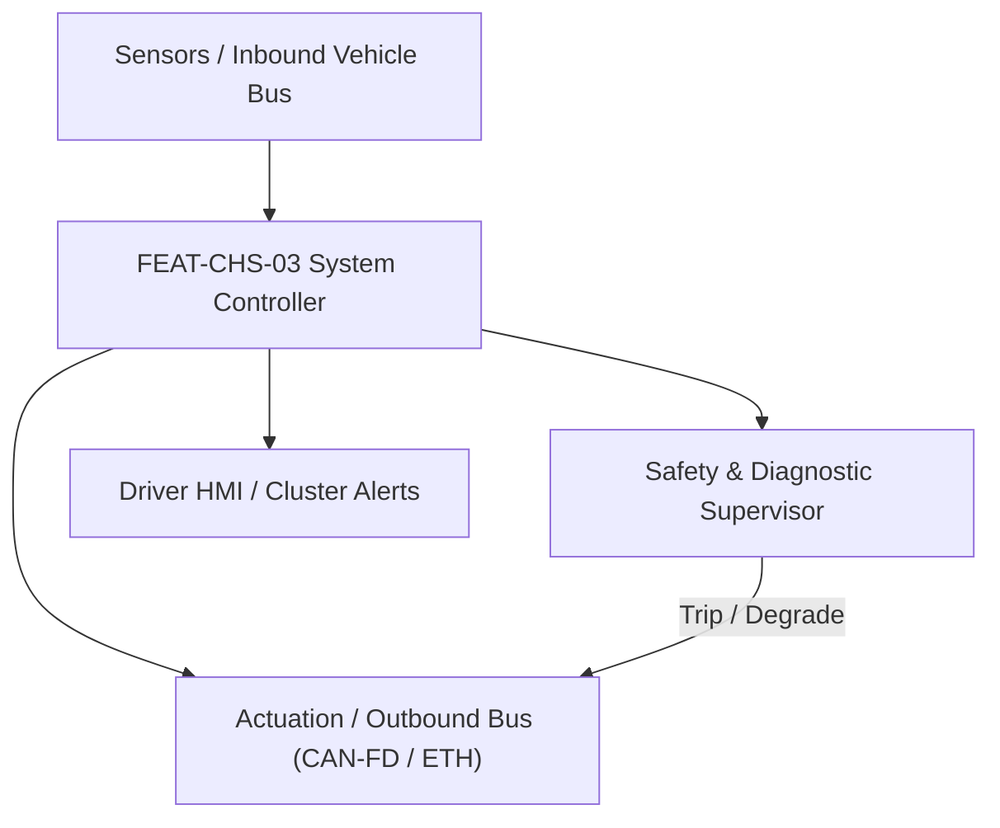
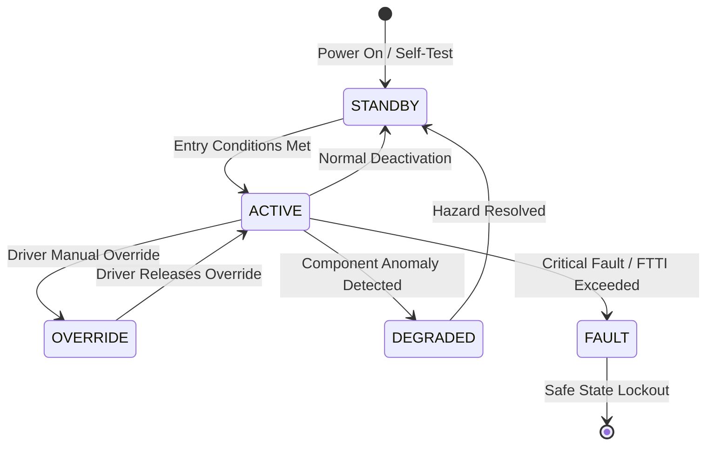

# System Requirements Specification: Electro-Hydraulic Brake-by-Wire Deceleration (BbW)
**Feature ID:** `FEAT-CHS-03`  
**Domain:** Vehicle Motion & Chassis Control  
**Target ASIL:** ASIL D  
**Compliance Standard:** ISO 26262:2018 (Part 4 - System Development) / ASPICE PAM v3.1 (SYS.2, SYS.3)  
**Parent Master Specification:** [`spec.md`](file:///c:/Workset/AntiGravityProjects/TestOptimisationExperiement/spec.md#feat-chs-03-bbw)  
**Derived Software Specification:** [`FEAT-CHS-03_BbW_SwReq.md`](file:///c:/Workset/AntiGravityProjects/TestOptimisationExperiement/software_requirements/FEAT-CHS-03_BbW_SwReq.md)

---

## 1. Feature Overview & Operational Scope

Decoupled integrated brake-by-wire system (One-Box / Two-Box) providing pedal feel emulation and ultra-fast active brake pressure buildup (< 150 ms to 100 bar).

### Operational Context Architecture

---

## 2. Activation Logic & Operational States

- **Preconditions:** Dual hydraulic circuits pressurized, dual ECU power domains healthy, fluid reservoir level normal.
- **Entry Conditions:** Driver applies brake pedal OR autonomous ADAS function (AEB/ACC) requests deceleration.
- **Deactivation Conditions:** Pedal released, autonomous request zero, pressure vented to reservoir.
- **Driver Override Behavior:** Complete electrical power failure opens mechanical push-through valves, enabling direct driver leg-power hydraulic braking adhering to ECE R13H.
- **Operational State Progression:**  
  `MONITORING` -> `PEDAL_TRACKING` -> `AUTONOMOUS_PRESSURE_BUILD` -> `ABS_PRESSURE_MODULATION` -> `FALLBACK_PUSH_THROUGH` -> `FAULT_LOCKOUT`

### State Transition Diagram

---

## 3. Functional Safety & Failure Mitigation Concept

- **Functional Safety Goal:** SG-BBW-01: Guarantee vehicle stopping capability under any single electrical or hydraulic failure; maintain pedal deceleration feel.
- **Fault Tolerant Time Interval (FTTI):** 20 ms
- **Safe State Definition:** Open mechanical push-through isolation valve; allow driver mechanical pedal pressure to reach front calipers directly.
- **Warning & Escalation Strategy:** Brake red warning lamp on instrument cluster; continuous audible alarm.

### Failure Modes & Degradation Handling
- **Booster Motor Fault:** If electric brushless motor drive fails, open hydraulic separation valve in < 15 ms to engage direct hydraulic push-through.
- **Fluid Leak:** If pressure sensor in circuit 1 fails to build pressure, isolate circuit 1 via solenoid valve; maintain 100% braking on circuit 2.

---

## 4. System Requirements (SYS_REQ)
*(Note: Each System Requirement is systematically partitioned into multiple Child Software Requirements)*

### `SYS-CHS-03-01`: Brake Pedal Stroke Emulation & Deceleration Intent Mapping
- **Planned Release:** R100
- **ASIL Rating:** ASIL D
- **Parent Feature:** [`FEAT-CHS-03`](file:///c:/Workset/AntiGravityProjects/TestOptimisationExperiement/spec.md#feat-chs-03)
- **Requirement Statement:**
  > The System SHALL measure brake pedal travel stroke (< 0.1 mm resolution) and pedal force via dual redundant sensors at <= 2 ms period, mapping driver input into target vehicle deceleration (up to -1.0 g) with < 10 ms latency.
- **Activation Logic:** Active at all times when vehicle is energized.
- **Fault Tolerant Time Interval (FTTI):** 20 ms
- **Safe State Action:** Revert to hydraulic push-through backup mode.
- **Failure Detection & Reaction:** If travel sensor channels disagree by > 2.0 mm, switch to pedal force hydraulic pressure backup sensor.
- **Input Interfaces:** `Dual_Pedal_Stroke_Sensors, Dual_Pedal_Force_Sensors`
- **Output Interfaces:** `Target_Vehicle_Deceleration_Mps2, Driver_Braking_Active_Flag`
- **System Verification Method:** Pedal robot test stand measuring pedal travel vs. deceleration consistency.
- **Derived Child Software Requirements (1:N Link):**
  - [`SWR-CHS-03-01`](file:///c:/Workset/AntiGravityProjects/TestOptimisationExperiement/software_requirements/FEAT-CHS-03_BbW_SwReq.md#swr-chs-03-01)
  - [`SWR-CHS-03-02`](file:///c:/Workset/AntiGravityProjects/TestOptimisationExperiement/software_requirements/FEAT-CHS-03_BbW_SwReq.md#swr-chs-03-02)

### `SYS-CHS-03-02`: Electric Plunger High-Speed Hydraulic Pressure Regulation
- **Planned Release:** R100
- **ASIL Rating:** ASIL D
- **Parent Feature:** [`FEAT-CHS-03`](file:///c:/Workset/AntiGravityProjects/TestOptimisationExperiement/spec.md#feat-chs-03)
- **Requirement Statement:**
  > The System SHALL drive a brushless electric plunger pump to generate hydraulic pressure from 0 to 100 bar in <= 150 ms with +-1.5 bar steady-state precision, distributing pressure to four calipers.
- **Activation Logic:** Active during all braking events.
- **Fault Tolerant Time Interval (FTTI):** 20 ms
- **Safe State Action:** De-energize plunger motor; open push-through backup valves.
- **Failure Detection & Reaction:** If plunger jams, trigger secondary electronic brake booster channel.
- **Input Interfaces:** `Target_Vehicle_Deceleration_Mps2, Wheel_Speeds, Caliper_Pressure_Sensors[4]`
- **Output Interfaces:** `Plunger_Motor_PWM_Cmd, Solenoid_Valve_PWM_Cmds[8]`
- **System Verification Method:** High-pressure hydraulic test rig verifying pressure rise time and acoustic noise.
- **Derived Child Software Requirements (1:N Link):**
  - [`SWR-CHS-03-03`](file:///c:/Workset/AntiGravityProjects/TestOptimisationExperiement/software_requirements/FEAT-CHS-03_BbW_SwReq.md#swr-chs-03-03)
  - [`SWR-CHS-03-04`](file:///c:/Workset/AntiGravityProjects/TestOptimisationExperiement/software_requirements/FEAT-CHS-03_BbW_SwReq.md#swr-chs-03-04)

### `SYS-CHS-03-03`: Decoupled Hydraulic Pedal Feel Emulator & Force-Travel Curve
- **Planned Release:** R100
- **ASIL Rating:** ASIL D
- **Parent Feature:** [`FEAT-CHS-03`](file:///c:/Workset/AntiGravityProjects/TestOptimisationExperiement/spec.md#feat-chs-03)
- **Requirement Statement:**
  > The System SHALL decouple brake pedal mechanically from wheel calipers in normal mode: Driving a spring-loaded hydraulic simulator cylinder to deliver progressive non-linear pedal feel (0 to 60 mm travel with 500 N force @ 60 mm) independent of regenerative braking.
- **Activation Logic:** Active at all times when BbW system is energized.
- **Fault Tolerant Time Interval (FTTI):** 20 ms
- **Safe State Action:** Open mechanical bypass valve; couple pedal directly to master cylinder (100% passive fallback).
- **Failure Detection & Reaction:** If pedal emulator valve leaks, open fallback bypass in <= 20 ms.
- **Input Interfaces:** `Brake_Pedal_Force_Sensor_N, Brake_Pedal_Travel_Mm, Emulator_Chamber_Pressure_Bar`
- **Output Interfaces:** `Emulator_Solenoid_Valve_State, Decoupled_Pedal_Active_Flag`
- **System Verification Method:** Pedal force-travel characteristic hysteresis curve test according to FMVSS 135.
- **Derived Child Software Requirements (1:N Link):**
  - [`SWR-CHS-03-05`](file:///c:/Workset/AntiGravityProjects/TestOptimisationExperiement/software_requirements/FEAT-CHS-03_BbW_SwReq.md#swr-chs-03-05)
  - [`SWR-CHS-03-06`](file:///c:/Workset/AntiGravityProjects/TestOptimisationExperiement/software_requirements/FEAT-CHS-03_BbW_SwReq.md#swr-chs-03-06)

### `SYS-CHS-03-04`: Passive Mechanical Fallback Hydraulic Valve & Dual Circuit Isolation
- **Planned Release:** R100
- **ASIL Rating:** ASIL D
- **Parent Feature:** [`FEAT-CHS-03`](file:///c:/Workset/AntiGravityProjects/TestOptimisationExperiement/spec.md#feat-chs-03)
- **Requirement Statement:**
  > The System SHALL feature normally-open spring-return hydraulic isolation valves: Upon complete electrical power loss (12V cut) or dual micro crash, valves SHALL de-energize within <= 15 ms, reconnecting driver pedal mechanically to front wheel calipers to guarantee >= 0.44g deceleration (ECE R13H fallback requirement).
- **Activation Logic:** Continuous passive safety architecture.
- **Fault Tolerant Time Interval (FTTI):** 15 ms
- **Safe State Action:** Mechanical hydraulic circuit closed; zero electronics required for braking.
- **Failure Detection & Reaction:** Maintain manual brake pass-through if primary boost cylinder fails.
- **Input Interfaces:** `Dual_12V_Power_Good_Signals, Microcontroller_Heartbeat_Line`
- **Output Interfaces:** `Normally_Open_Isolation_Valve_State, Failsafe_Hydraulic_Connected_Flag`
- **System Verification Method:** Total electrical disconnect stopping distance test on FMVSS 135 proving ground.
- **Derived Child Software Requirements (1:N Link):**
  - [`SWR-CHS-03-07`](file:///c:/Workset/AntiGravityProjects/TestOptimisationExperiement/software_requirements/FEAT-CHS-03_BbW_SwReq.md#swr-chs-03-07)
  - [`SWR-CHS-03-08`](file:///c:/Workset/AntiGravityProjects/TestOptimisationExperiement/software_requirements/FEAT-CHS-03_BbW_SwReq.md#swr-chs-03-08)

### `SYS-CHS-03-05`: Dual Redundant Hydraulic Circuit Pressure Transducer Cross-Monitor
- **Planned Release:** R200
- **ASIL Rating:** ASIL D
- **Parent Feature:** [`FEAT-CHS-03`](file:///c:/Workset/AntiGravityProjects/TestOptimisationExperiement/spec.md#feat-chs-03)
- **Requirement Statement:**
  > The System SHALL Cross-check primary and secondary circuit pressure sensors: If discrepancy > 4.0 bar, isolate affected circuit.
- **Activation Logic:** Active during normal vehicle operation when feature state is active.
- **Fault Tolerant Time Interval (FTTI):** 10 ms
- **Safe State Action:** Transition to safe state or safe degradation tier within FTTI budget.
- **Failure Detection & Reaction:** Isolate faulted channel, latch DEM diagnostic trouble code, and inform driver.
- **Input Interfaces:** `Sensor signals, vehicle dynamics data, and bus frames via RTE.`
- **Output Interfaces:** `Actuator commands, diagnostic event flags, and cluster alerts.`
- **System Verification Method:** HiL test bench and dynamometer automated verification.
- **Derived Child Software Requirements (1:N Link):**
  - [`SWR-CHS-03-09`](file:///c:/Workset/AntiGravityProjects/TestOptimisationExperiement/software_requirements/FEAT-CHS-03_BbW_SwReq.md#swr-chs-03-09)
  - [`SWR-CHS-03-10`](file:///c:/Workset/AntiGravityProjects/TestOptimisationExperiement/software_requirements/FEAT-CHS-03_BbW_SwReq.md#swr-chs-03-10)

### `SYS-CHS-03-06`: Electric Brake Plunger Motor Hall & Resolver Angle Decoupled Decoder
- **Planned Release:** R200
- **ASIL Rating:** ASIL D
- **Parent Feature:** [`FEAT-CHS-03`](file:///c:/Workset/AntiGravityProjects/TestOptimisationExperiement/spec.md#feat-chs-03)
- **Requirement Statement:**
  > The System SHALL Decode high-speed motor position to regulate electric plunger displacement with precision +-0.05 mm.
- **Activation Logic:** Active during normal vehicle operation when feature state is active.
- **Fault Tolerant Time Interval (FTTI):** 1 ms
- **Safe State Action:** Transition to safe state or safe degradation tier within FTTI budget.
- **Failure Detection & Reaction:** Isolate faulted channel, latch DEM diagnostic trouble code, and inform driver.
- **Input Interfaces:** `Sensor signals, vehicle dynamics data, and bus frames via RTE.`
- **Output Interfaces:** `Actuator commands, diagnostic event flags, and cluster alerts.`
- **System Verification Method:** HiL test bench and dynamometer automated verification.
- **Derived Child Software Requirements (1:N Link):**
  - [`SWR-CHS-03-11`](file:///c:/Workset/AntiGravityProjects/TestOptimisationExperiement/software_requirements/FEAT-CHS-03_BbW_SwReq.md#swr-chs-03-11)
  - [`SWR-CHS-03-12`](file:///c:/Workset/AntiGravityProjects/TestOptimisationExperiement/software_requirements/FEAT-CHS-03_BbW_SwReq.md#swr-chs-03-12)

### `SYS-CHS-03-07`: Decoupled Brake Pedal Force-Displacement Active Hysteresis Shaper
- **Planned Release:** R200
- **ASIL Rating:** ASIL D
- **Parent Feature:** [`FEAT-CHS-03`](file:///c:/Workset/AntiGravityProjects/TestOptimisationExperiement/spec.md#feat-chs-03)
- **Requirement Statement:**
  > The System SHALL Modulate pedal feel simulator hydraulic orifice valve to create 15% tactile return hysteresis.
- **Activation Logic:** Active during normal vehicle operation when feature state is active.
- **Fault Tolerant Time Interval (FTTI):** 10 ms
- **Safe State Action:** Transition to safe state or safe degradation tier within FTTI budget.
- **Failure Detection & Reaction:** Isolate faulted channel, latch DEM diagnostic trouble code, and inform driver.
- **Input Interfaces:** `Sensor signals, vehicle dynamics data, and bus frames via RTE.`
- **Output Interfaces:** `Actuator commands, diagnostic event flags, and cluster alerts.`
- **System Verification Method:** HiL test bench and dynamometer automated verification.
- **Derived Child Software Requirements (1:N Link):**
  - [`SWR-CHS-03-13`](file:///c:/Workset/AntiGravityProjects/TestOptimisationExperiement/software_requirements/FEAT-CHS-03_BbW_SwReq.md#swr-chs-03-13)
  - [`SWR-CHS-03-14`](file:///c:/Workset/AntiGravityProjects/TestOptimisationExperiement/software_requirements/FEAT-CHS-03_BbW_SwReq.md#swr-chs-03-14)

### `SYS-CHS-03-08`: Foundation Caliper Pad Knock-Back Clearance Active Eliminator
- **Planned Release:** R300
- **ASIL Rating:** ASIL D
- **Parent Feature:** [`FEAT-CHS-03`](file:///c:/Workset/AntiGravityProjects/TestOptimisationExperiement/spec.md#feat-chs-03)
- **Requirement Statement:**
  > The System SHALL Pulse 2.5 bar hydraulic pressure following severe cornering to restore zero pad-to-rotor clearance gap.
- **Activation Logic:** Active during normal vehicle operation when feature state is active.
- **Fault Tolerant Time Interval (FTTI):** 20 ms
- **Safe State Action:** Transition to safe state or safe degradation tier within FTTI budget.
- **Failure Detection & Reaction:** Isolate faulted channel, latch DEM diagnostic trouble code, and inform driver.
- **Input Interfaces:** `Sensor signals, vehicle dynamics data, and bus frames via RTE.`
- **Output Interfaces:** `Actuator commands, diagnostic event flags, and cluster alerts.`
- **System Verification Method:** HiL test bench and dynamometer automated verification.
- **Derived Child Software Requirements (1:N Link):**
  - [`SWR-CHS-03-15`](file:///c:/Workset/AntiGravityProjects/TestOptimisationExperiement/software_requirements/FEAT-CHS-03_BbW_SwReq.md#swr-chs-03-15)
  - [`SWR-CHS-03-16`](file:///c:/Workset/AntiGravityProjects/TestOptimisationExperiement/software_requirements/FEAT-CHS-03_BbW_SwReq.md#swr-chs-03-16)

### `SYS-CHS-03-09`: Brake Fluid Vaporization & Temperature Dependent Pressure Compensator
- **Planned Release:** R300
- **ASIL Rating:** ASIL D
- **Parent Feature:** [`FEAT-CHS-03`](file:///c:/Workset/AntiGravityProjects/TestOptimisationExperiement/spec.md#feat-chs-03)
- **Requirement Statement:**
  > The System SHALL Increase plunger stroke target if brake fluid boiling point degradation or seal compliance expands.
- **Activation Logic:** Active during normal vehicle operation when feature state is active.
- **Fault Tolerant Time Interval (FTTI):** 50 ms
- **Safe State Action:** Transition to safe state or safe degradation tier within FTTI budget.
- **Failure Detection & Reaction:** Isolate faulted channel, latch DEM diagnostic trouble code, and inform driver.
- **Input Interfaces:** `Sensor signals, vehicle dynamics data, and bus frames via RTE.`
- **Output Interfaces:** `Actuator commands, diagnostic event flags, and cluster alerts.`
- **System Verification Method:** HiL test bench and dynamometer automated verification.
- **Derived Child Software Requirements (1:N Link):**
  - [`SWR-CHS-03-17`](file:///c:/Workset/AntiGravityProjects/TestOptimisationExperiement/software_requirements/FEAT-CHS-03_BbW_SwReq.md#swr-chs-03-17)
  - [`SWR-CHS-03-18`](file:///c:/Workset/AntiGravityProjects/TestOptimisationExperiement/software_requirements/FEAT-CHS-03_BbW_SwReq.md#swr-chs-03-18)

### `SYS-CHS-03-10`: Passive Hydraulic Mechanical Push-Through Solenoid Power Cut Safing
- **Planned Release:** R400
- **ASIL Rating:** ASIL D
- **Parent Feature:** [`FEAT-CHS-03`](file:///c:/Workset/AntiGravityProjects/TestOptimisationExperiement/spec.md#feat-chs-03)
- **Requirement Statement:**
  > The System SHALL De-energize normally-open separation valves in <= 15 ms upon complete power loss, enabling manual braking.
- **Activation Logic:** Active during normal vehicle operation when feature state is active.
- **Fault Tolerant Time Interval (FTTI):** 5 ms
- **Safe State Action:** Transition to safe state or safe degradation tier within FTTI budget.
- **Failure Detection & Reaction:** Isolate faulted channel, latch DEM diagnostic trouble code, and inform driver.
- **Input Interfaces:** `Sensor signals, vehicle dynamics data, and bus frames via RTE.`
- **Output Interfaces:** `Actuator commands, diagnostic event flags, and cluster alerts.`
- **System Verification Method:** HiL test bench and dynamometer automated verification.
- **Derived Child Software Requirements (1:N Link):**
  - [`SWR-CHS-03-19`](file:///c:/Workset/AntiGravityProjects/TestOptimisationExperiement/software_requirements/FEAT-CHS-03_BbW_SwReq.md#swr-chs-03-19)
  - [`SWR-CHS-03-20`](file:///c:/Workset/AntiGravityProjects/TestOptimisationExperiement/software_requirements/FEAT-CHS-03_BbW_SwReq.md#swr-chs-03-20)

### `SYS-CHS-03-11`: Brake Fluid Low Level Reservoir Reed Switch Debouncer & Warning Gate
- **Planned Release:** R400
- **ASIL Rating:** ASIL B
- **Parent Feature:** [`FEAT-CHS-03`](file:///c:/Workset/AntiGravityProjects/TestOptimisationExperiement/spec.md#feat-chs-03)
- **Requirement Statement:**
  > The System SHALL Debounce fluid level sensor to illuminate master brake warning tell-tale before air enters master cylinder.
- **Activation Logic:** Active during normal vehicle operation when feature state is active.
- **Fault Tolerant Time Interval (FTTI):** 100 ms
- **Safe State Action:** Transition to safe state or safe degradation tier within FTTI budget.
- **Failure Detection & Reaction:** Isolate faulted channel, latch DEM diagnostic trouble code, and inform driver.
- **Input Interfaces:** `Sensor signals, vehicle dynamics data, and bus frames via RTE.`
- **Output Interfaces:** `Actuator commands, diagnostic event flags, and cluster alerts.`
- **System Verification Method:** HiL test bench and dynamometer automated verification.
- **Derived Child Software Requirements (1:N Link):**
  - [`SWR-CHS-03-21`](file:///c:/Workset/AntiGravityProjects/TestOptimisationExperiement/software_requirements/FEAT-CHS-03_BbW_SwReq.md#swr-chs-03-21)
  - [`SWR-CHS-03-22`](file:///c:/Workset/AntiGravityProjects/TestOptimisationExperiement/software_requirements/FEAT-CHS-03_BbW_SwReq.md#swr-chs-03-22)

### `SYS-CHS-03-12`: Dynamic Electronic Brake Proportioning (EBD) Under Variable Payloads
- **Planned Release:** R400
- **ASIL Rating:** ASIL D
- **Parent Feature:** [`FEAT-CHS-03`](file:///c:/Workset/AntiGravityProjects/TestOptimisationExperiement/spec.md#feat-chs-03)
- **Requirement Statement:**
  > The System SHALL Modulate front/rear caliper pressure ratio based on axle load cells and deceleration gradient.
- **Activation Logic:** Active during normal vehicle operation when feature state is active.
- **Fault Tolerant Time Interval (FTTI):** 10 ms
- **Safe State Action:** Transition to safe state or safe degradation tier within FTTI budget.
- **Failure Detection & Reaction:** Isolate faulted channel, latch DEM diagnostic trouble code, and inform driver.
- **Input Interfaces:** `Sensor signals, vehicle dynamics data, and bus frames via RTE.`
- **Output Interfaces:** `Actuator commands, diagnostic event flags, and cluster alerts.`
- **System Verification Method:** HiL test bench and dynamometer automated verification.
- **Derived Child Software Requirements (1:N Link):**
  - [`SWR-CHS-03-23`](file:///c:/Workset/AntiGravityProjects/TestOptimisationExperiement/software_requirements/FEAT-CHS-03_BbW_SwReq.md#swr-chs-03-23)
  - [`SWR-CHS-03-24`](file:///c:/Workset/AntiGravityProjects/TestOptimisationExperiement/software_requirements/FEAT-CHS-03_BbW_SwReq.md#swr-chs-03-24)

### `SYS-CHS-03-13`: Secondary Brake Boost Redundant Channel Autonomous Takeover Engine
- **Planned Release:** R400
- **ASIL Rating:** ASIL D
- **Parent Feature:** [`FEAT-CHS-03`](file:///c:/Workset/AntiGravityProjects/TestOptimisationExperiement/spec.md#feat-chs-03)
- **Requirement Statement:**
  > The System SHALL Ramp secondary electronic brake booster channel to 100% capacity in <= 20 ms if primary channel faults.
- **Activation Logic:** Active during normal vehicle operation when feature state is active.
- **Fault Tolerant Time Interval (FTTI):** 10 ms
- **Safe State Action:** Transition to safe state or safe degradation tier within FTTI budget.
- **Failure Detection & Reaction:** Isolate faulted channel, latch DEM diagnostic trouble code, and inform driver.
- **Input Interfaces:** `Sensor signals, vehicle dynamics data, and bus frames via RTE.`
- **Output Interfaces:** `Actuator commands, diagnostic event flags, and cluster alerts.`
- **System Verification Method:** HiL test bench and dynamometer automated verification.
- **Derived Child Software Requirements (1:N Link):**
  - [`SWR-CHS-03-25`](file:///c:/Workset/AntiGravityProjects/TestOptimisationExperiement/software_requirements/FEAT-CHS-03_BbW_SwReq.md#swr-chs-03-25)
  - [`SWR-CHS-03-26`](file:///c:/Workset/AntiGravityProjects/TestOptimisationExperiement/software_requirements/FEAT-CHS-03_BbW_SwReq.md#swr-chs-03-26)

### `SYS-CHS-03-14`: Dual Core Lockstep CPU Execution Flow & Watchdog Supervisor
- **Planned Release:** R400
- **ASIL Rating:** ASIL D
- **Parent Feature:** [`FEAT-CHS-03`](file:///c:/Workset/AntiGravityProjects/TestOptimisationExperiement/spec.md#feat-chs-03)
- **Requirement Statement:**
  > The System SHALL Execute cyclic challenge-response with external watchdog ASIC; reset and cut valves upon execution crash.
- **Activation Logic:** Active during normal vehicle operation when feature state is active.
- **Fault Tolerant Time Interval (FTTI):** 2 ms
- **Safe State Action:** Transition to safe state or safe degradation tier within FTTI budget.
- **Failure Detection & Reaction:** Isolate faulted channel, latch DEM diagnostic trouble code, and inform driver.
- **Input Interfaces:** `Sensor signals, vehicle dynamics data, and bus frames via RTE.`
- **Output Interfaces:** `Actuator commands, diagnostic event flags, and cluster alerts.`
- **System Verification Method:** HiL test bench and dynamometer automated verification.
- **Derived Child Software Requirements (1:N Link):**
  - [`SWR-CHS-03-27`](file:///c:/Workset/AntiGravityProjects/TestOptimisationExperiement/software_requirements/FEAT-CHS-03_BbW_SwReq.md#swr-chs-03-27)
  - [`SWR-CHS-03-28`](file:///c:/Workset/AntiGravityProjects/TestOptimisationExperiement/software_requirements/FEAT-CHS-03_BbW_SwReq.md#swr-chs-03-28)

### `SYS-CHS-03-15`: DEM Brake System Hydraulic Leakage Diagnostics & Freeze-Frame Storage
- **Planned Release:** R500
- **ASIL Rating:** ASIL D
- **Parent Feature:** [`FEAT-CHS-03`](file:///c:/Workset/AntiGravityProjects/TestOptimisationExperiement/spec.md#feat-chs-03)
- **Requirement Statement:**
  > The System SHALL Detect caliper circuit fluid leak by monitoring plunger volume vs pressure buildup; latch DTC C1102.
- **Activation Logic:** Active during normal vehicle operation when feature state is active.
- **Fault Tolerant Time Interval (FTTI):** 20 ms
- **Safe State Action:** Transition to safe state or safe degradation tier within FTTI budget.
- **Failure Detection & Reaction:** Isolate faulted channel, latch DEM diagnostic trouble code, and inform driver.
- **Input Interfaces:** `Sensor signals, vehicle dynamics data, and bus frames via RTE.`
- **Output Interfaces:** `Actuator commands, diagnostic event flags, and cluster alerts.`
- **System Verification Method:** HiL test bench and dynamometer automated verification.
- **Derived Child Software Requirements (1:N Link):**
  - [`SWR-CHS-03-29`](file:///c:/Workset/AntiGravityProjects/TestOptimisationExperiement/software_requirements/FEAT-CHS-03_BbW_SwReq.md#swr-chs-03-29)
  - [`SWR-CHS-03-30`](file:///c:/Workset/AntiGravityProjects/TestOptimisationExperiement/software_requirements/FEAT-CHS-03_BbW_SwReq.md#swr-chs-03-30)

### `SYS-CHS-03-16`: Non-Volatile Brake Service Duty Cycles & Caliper Wear Buffer
- **Planned Release:** R500
- **ASIL Rating:** ASIL B
- **Parent Feature:** [`FEAT-CHS-03`](file:///c:/Workset/AntiGravityProjects/TestOptimisationExperiement/spec.md#feat-chs-03)
- **Requirement Statement:**
  > The System SHALL Log lifetime brake applications, maximum peak pressures, and thermal exposure in non-volatile flash.
- **Activation Logic:** Active during normal vehicle operation when feature state is active.
- **Fault Tolerant Time Interval (FTTI):** 1000 ms
- **Safe State Action:** Transition to safe state or safe degradation tier within FTTI budget.
- **Failure Detection & Reaction:** Isolate faulted channel, latch DEM diagnostic trouble code, and inform driver.
- **Input Interfaces:** `Sensor signals, vehicle dynamics data, and bus frames via RTE.`
- **Output Interfaces:** `Actuator commands, diagnostic event flags, and cluster alerts.`
- **System Verification Method:** HiL test bench and dynamometer automated verification.
- **Derived Child Software Requirements (1:N Link):**
  - [`SWR-CHS-03-31`](file:///c:/Workset/AntiGravityProjects/TestOptimisationExperiement/software_requirements/FEAT-CHS-03_BbW_SwReq.md#swr-chs-03-31)
  - [`SWR-CHS-03-32`](file:///c:/Workset/AntiGravityProjects/TestOptimisationExperiement/software_requirements/FEAT-CHS-03_BbW_SwReq.md#swr-chs-03-32)

---

## 5. System-to-Software Traceability Summary

| System Requirement ID | Planned Release | ASIL | Title | Derived Software Requirements (1:N) | Verification Method |
| :--- | :---: | :--- | :--- | :--- | :--- |
| `SYS-CHS-03-01` | **`R100`** | ASIL D | Brake Pedal Stroke Emulation & Deceleration Intent Mapping | [`SWR-CHS-03-01`](file:///c:/Workset/AntiGravityProjects/TestOptimisationExperiement/software_requirements/FEAT-CHS-03_BbW_SwReq.md#swr-chs-03-01), [`SWR-CHS-03-02`](file:///c:/Workset/AntiGravityProjects/TestOptimisationExperiement/software_requirements/FEAT-CHS-03_BbW_SwReq.md#swr-chs-03-02) | Pedal robot test stand measuring pedal travel vs. deceleration consistency. |
| `SYS-CHS-03-02` | **`R100`** | ASIL D | Electric Plunger High-Speed Hydraulic Pressure Regulation | [`SWR-CHS-03-03`](file:///c:/Workset/AntiGravityProjects/TestOptimisationExperiement/software_requirements/FEAT-CHS-03_BbW_SwReq.md#swr-chs-03-03), [`SWR-CHS-03-04`](file:///c:/Workset/AntiGravityProjects/TestOptimisationExperiement/software_requirements/FEAT-CHS-03_BbW_SwReq.md#swr-chs-03-04) | High-pressure hydraulic test rig verifying pressure rise time and acoustic noise. |
| `SYS-CHS-03-03` | **`R100`** | ASIL D | Decoupled Hydraulic Pedal Feel Emulator & Force-Travel Curve | [`SWR-CHS-03-05`](file:///c:/Workset/AntiGravityProjects/TestOptimisationExperiement/software_requirements/FEAT-CHS-03_BbW_SwReq.md#swr-chs-03-05), [`SWR-CHS-03-06`](file:///c:/Workset/AntiGravityProjects/TestOptimisationExperiement/software_requirements/FEAT-CHS-03_BbW_SwReq.md#swr-chs-03-06) | Pedal force-travel characteristic hysteresis curve test according to FMVSS 135. |
| `SYS-CHS-03-04` | **`R100`** | ASIL D | Passive Mechanical Fallback Hydraulic Valve & Dual Circuit Isolation | [`SWR-CHS-03-07`](file:///c:/Workset/AntiGravityProjects/TestOptimisationExperiement/software_requirements/FEAT-CHS-03_BbW_SwReq.md#swr-chs-03-07), [`SWR-CHS-03-08`](file:///c:/Workset/AntiGravityProjects/TestOptimisationExperiement/software_requirements/FEAT-CHS-03_BbW_SwReq.md#swr-chs-03-08) | Total electrical disconnect stopping distance test on FMVSS 135 proving ground. |
| `SYS-CHS-03-05` | **`R200`** | ASIL D | Dual Redundant Hydraulic Circuit Pressure Transducer Cross-Monitor | [`SWR-CHS-03-09`](file:///c:/Workset/AntiGravityProjects/TestOptimisationExperiement/software_requirements/FEAT-CHS-03_BbW_SwReq.md#swr-chs-03-09), [`SWR-CHS-03-10`](file:///c:/Workset/AntiGravityProjects/TestOptimisationExperiement/software_requirements/FEAT-CHS-03_BbW_SwReq.md#swr-chs-03-10) | HiL test bench and dynamometer automated verification. |
| `SYS-CHS-03-06` | **`R200`** | ASIL D | Electric Brake Plunger Motor Hall & Resolver Angle Decoupled Decoder | [`SWR-CHS-03-11`](file:///c:/Workset/AntiGravityProjects/TestOptimisationExperiement/software_requirements/FEAT-CHS-03_BbW_SwReq.md#swr-chs-03-11), [`SWR-CHS-03-12`](file:///c:/Workset/AntiGravityProjects/TestOptimisationExperiement/software_requirements/FEAT-CHS-03_BbW_SwReq.md#swr-chs-03-12) | HiL test bench and dynamometer automated verification. |
| `SYS-CHS-03-07` | **`R200`** | ASIL D | Decoupled Brake Pedal Force-Displacement Active Hysteresis Shaper | [`SWR-CHS-03-13`](file:///c:/Workset/AntiGravityProjects/TestOptimisationExperiement/software_requirements/FEAT-CHS-03_BbW_SwReq.md#swr-chs-03-13), [`SWR-CHS-03-14`](file:///c:/Workset/AntiGravityProjects/TestOptimisationExperiement/software_requirements/FEAT-CHS-03_BbW_SwReq.md#swr-chs-03-14) | HiL test bench and dynamometer automated verification. |
| `SYS-CHS-03-08` | **`R300`** | ASIL D | Foundation Caliper Pad Knock-Back Clearance Active Eliminator | [`SWR-CHS-03-15`](file:///c:/Workset/AntiGravityProjects/TestOptimisationExperiement/software_requirements/FEAT-CHS-03_BbW_SwReq.md#swr-chs-03-15), [`SWR-CHS-03-16`](file:///c:/Workset/AntiGravityProjects/TestOptimisationExperiement/software_requirements/FEAT-CHS-03_BbW_SwReq.md#swr-chs-03-16) | HiL test bench and dynamometer automated verification. |
| `SYS-CHS-03-09` | **`R300`** | ASIL D | Brake Fluid Vaporization & Temperature Dependent Pressure Compensator | [`SWR-CHS-03-17`](file:///c:/Workset/AntiGravityProjects/TestOptimisationExperiement/software_requirements/FEAT-CHS-03_BbW_SwReq.md#swr-chs-03-17), [`SWR-CHS-03-18`](file:///c:/Workset/AntiGravityProjects/TestOptimisationExperiement/software_requirements/FEAT-CHS-03_BbW_SwReq.md#swr-chs-03-18) | HiL test bench and dynamometer automated verification. |
| `SYS-CHS-03-10` | **`R400`** | ASIL D | Passive Hydraulic Mechanical Push-Through Solenoid Power Cut Safing | [`SWR-CHS-03-19`](file:///c:/Workset/AntiGravityProjects/TestOptimisationExperiement/software_requirements/FEAT-CHS-03_BbW_SwReq.md#swr-chs-03-19), [`SWR-CHS-03-20`](file:///c:/Workset/AntiGravityProjects/TestOptimisationExperiement/software_requirements/FEAT-CHS-03_BbW_SwReq.md#swr-chs-03-20) | HiL test bench and dynamometer automated verification. |
| `SYS-CHS-03-11` | **`R400`** | ASIL B | Brake Fluid Low Level Reservoir Reed Switch Debouncer & Warning Gate | [`SWR-CHS-03-21`](file:///c:/Workset/AntiGravityProjects/TestOptimisationExperiement/software_requirements/FEAT-CHS-03_BbW_SwReq.md#swr-chs-03-21), [`SWR-CHS-03-22`](file:///c:/Workset/AntiGravityProjects/TestOptimisationExperiement/software_requirements/FEAT-CHS-03_BbW_SwReq.md#swr-chs-03-22) | HiL test bench and dynamometer automated verification. |
| `SYS-CHS-03-12` | **`R400`** | ASIL D | Dynamic Electronic Brake Proportioning (EBD) Under Variable Payloads | [`SWR-CHS-03-23`](file:///c:/Workset/AntiGravityProjects/TestOptimisationExperiement/software_requirements/FEAT-CHS-03_BbW_SwReq.md#swr-chs-03-23), [`SWR-CHS-03-24`](file:///c:/Workset/AntiGravityProjects/TestOptimisationExperiement/software_requirements/FEAT-CHS-03_BbW_SwReq.md#swr-chs-03-24) | HiL test bench and dynamometer automated verification. |
| `SYS-CHS-03-13` | **`R400`** | ASIL D | Secondary Brake Boost Redundant Channel Autonomous Takeover Engine | [`SWR-CHS-03-25`](file:///c:/Workset/AntiGravityProjects/TestOptimisationExperiement/software_requirements/FEAT-CHS-03_BbW_SwReq.md#swr-chs-03-25), [`SWR-CHS-03-26`](file:///c:/Workset/AntiGravityProjects/TestOptimisationExperiement/software_requirements/FEAT-CHS-03_BbW_SwReq.md#swr-chs-03-26) | HiL test bench and dynamometer automated verification. |
| `SYS-CHS-03-14` | **`R400`** | ASIL D | Dual Core Lockstep CPU Execution Flow & Watchdog Supervisor | [`SWR-CHS-03-27`](file:///c:/Workset/AntiGravityProjects/TestOptimisationExperiement/software_requirements/FEAT-CHS-03_BbW_SwReq.md#swr-chs-03-27), [`SWR-CHS-03-28`](file:///c:/Workset/AntiGravityProjects/TestOptimisationExperiement/software_requirements/FEAT-CHS-03_BbW_SwReq.md#swr-chs-03-28) | HiL test bench and dynamometer automated verification. |
| `SYS-CHS-03-15` | **`R500`** | ASIL D | DEM Brake System Hydraulic Leakage Diagnostics & Freeze-Frame Storage | [`SWR-CHS-03-29`](file:///c:/Workset/AntiGravityProjects/TestOptimisationExperiement/software_requirements/FEAT-CHS-03_BbW_SwReq.md#swr-chs-03-29), [`SWR-CHS-03-30`](file:///c:/Workset/AntiGravityProjects/TestOptimisationExperiement/software_requirements/FEAT-CHS-03_BbW_SwReq.md#swr-chs-03-30) | HiL test bench and dynamometer automated verification. |
| `SYS-CHS-03-16` | **`R500`** | ASIL B | Non-Volatile Brake Service Duty Cycles & Caliper Wear Buffer | [`SWR-CHS-03-31`](file:///c:/Workset/AntiGravityProjects/TestOptimisationExperiement/software_requirements/FEAT-CHS-03_BbW_SwReq.md#swr-chs-03-31), [`SWR-CHS-03-32`](file:///c:/Workset/AntiGravityProjects/TestOptimisationExperiement/software_requirements/FEAT-CHS-03_BbW_SwReq.md#swr-chs-03-32) | HiL test bench and dynamometer automated verification. |

- **Upstream Feature Link:** [`spec.md` (FEAT-CHS-03)](file:///c:/Workset/AntiGravityProjects/TestOptimisationExperiement/spec.md#feat-chs-03)
- **Software Requirements Specification:** [`FEAT-CHS-03_BbW_SwReq.md`](file:///c:/Workset/AntiGravityProjects/TestOptimisationExperiement/software_requirements/FEAT-CHS-03_BbW_SwReq.md)
