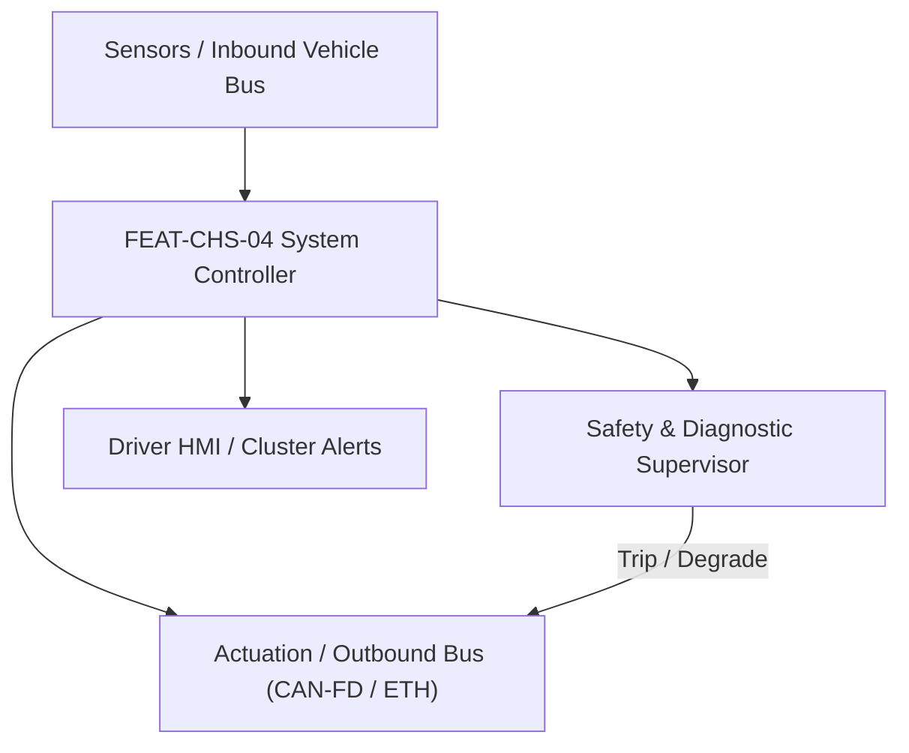
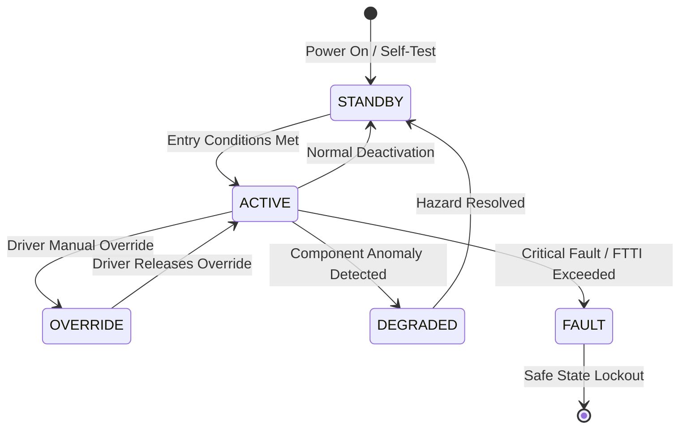

# System Requirements Specification: Electronic Continuous Damping Control & Active Suspension (EDC)
**Feature ID:** `FEAT-CHS-04`  
**Domain:** Vehicle Motion & Chassis Control  
**Target ASIL:** ASIL C  
**Compliance Standard:** ISO 26262:2018 (Part 4 - System Development) / ASPICE PAM v3.1 (SYS.2, SYS.3)  
**Parent Master Specification:** [`spec.md`](file:///c:/Workset/AntiGravityProjects/TestOptimisationExperiement/spec.md#feat-chs-04-edc)  
**Derived Software Specification:** [`FEAT-CHS-04_EDC_SwReq.md`](file:///c:/Workset/AntiGravityProjects/TestOptimisationExperiement/software_requirements/FEAT-CHS-04_EDC_SwReq.md)

---

## 1. Feature Overview & Operational Scope

Continuously adjusts semi-active damper solenoid valve currents at 100 Hz to isolate road vibrations (Skyhook algorithm) and eliminate pitch and roll body motions.

### Operational Context Architecture

---

## 2. Activation Logic & Operational States

- **Preconditions:** 12V power supply healthy, 4 wheel displacement sensors calibrated, vehicle moving.
- **Entry Conditions:** Vehicle speed > 2 km/h; driver selects drive mode (Comfort, Normal, Sport).
- **Deactivation Conditions:** Vehicle parked in PARK with ignition OFF.
- **Driver Override Behavior:** Sudden aggressive steering input (> 100 deg/s) instantly forces dampers to maximum firm setting in < 15 ms to suppress body roll.
- **Operational State Progression:**  
  `MONITORING` -> `COMFORT_SKYHOOK` -> `SPORT_GROUNDHOOK` -> `ROLL_STABILIZATION` -> `ROUGH_ROAD_PROTECTION` -> `FAILSAFE_DEFAULT_DAMPING`

### State Transition Diagram

---

## 3. Functional Safety & Failure Mitigation Concept

- **Functional Safety Goal:** SG-EDC-01: Maintain tire-to-road contact; prevent suspension bottoming out or unstable body roll oscillations.
- **Fault Tolerant Time Interval (FTTI):** 50 ms
- **Safe State Definition:** De-energize all damper solenoids to passive mid-firm default damping setting.
- **Warning & Escalation Strategy:** Yellow suspension warning light on instrument cluster.

### Failure Modes & Degradation Handling
- **Displacement Sensor Failure:** If 1 corner sensor fails, extrapolate corner motion from remaining 3 sensors using chassis planar model.
- **Solenoid Open Circuit:** If front-left damper solenoid coil opens, set front-right damper to passive baseline to maintain axle symmetry.

---

## 4. System Requirements (SYS_REQ)
*(Note: Each System Requirement is systematically partitioned into multiple Child Software Requirements)*

### `SYS-CHS-04-01`: Chassis Body Acceleration & Wheel Kinematic Acquisition
- **Planned Release:** R100
- **ASIL Rating:** ASIL C
- **Parent Feature:** [`FEAT-CHS-04`](file:///c:/Workset/AntiGravityProjects/TestOptimisationExperiement/spec.md#feat-chs-04)
- **Requirement Statement:**
  > The System SHALL sample 3 vertical body accelerometers and 4 corner suspension height sensors at >= 100 Hz, calculating chassis heave, pitch, and roll rates at <= 10 ms period.
- **Activation Logic:** Active when vehicle is moving.
- **Fault Tolerant Time Interval (FTTI):** 50 ms
- **Safe State Action:** Zero body motion velocity estimates; suspend Skyhook control.
- **Failure Detection & Reaction:** If vertical accelerometer saturates, clamp reading to physical bump-stop limit.
- **Input Interfaces:** `3x_Body_Accelerometers, 4x_Height_Sensors, Steering_Wheel_Angle, Vehicle_Speed`
- **Output Interfaces:** `Chassis_Heave_Rate_Mps, Chassis_Pitch_Rate_RadS, Chassis_Roll_Rate_RadS`
- **System Verification Method:** 4-poster suspension shaker rig testing across road roughness profiles.
- **Derived Child Software Requirements (1:N Link):**
  - [`SWR-CHS-04-01`](file:///c:/Workset/AntiGravityProjects/TestOptimisationExperiement/software_requirements/FEAT-CHS-04_EDC_SwReq.md#swr-chs-04-01)
  - [`SWR-CHS-04-02`](file:///c:/Workset/AntiGravityProjects/TestOptimisationExperiement/software_requirements/FEAT-CHS-04_EDC_SwReq.md#swr-chs-04-02)

### `SYS-CHS-04-02`: Skyhook/Groundhook Damping Current Modulation
- **Planned Release:** R100
- **ASIL Rating:** ASIL C
- **Parent Feature:** [`FEAT-CHS-04`](file:///c:/Workset/AntiGravityProjects/TestOptimisationExperiement/spec.md#feat-chs-04)
- **Requirement Statement:**
  > The System SHALL modulate PWM current (0.2A to 1.8A) through four continuously variable proportional damper valves in <= 15 ms, altering damping force between 500 N and 5000 N per corner.
- **Activation Logic:** Active during driving.
- **Fault Tolerant Time Interval (FTTI):** 30 ms
- **Safe State Action:** Set valve current to 0.0 A (mechanical default fail-safe damping).
- **Failure Detection & Reaction:** If solenoid driver reports thermal overload, reduce current by 30%.
- **Input Interfaces:** `Heave_Rate, Pitch_Rate, Roll_Rate, Relative_Damper_Velocities[4]`
- **Output Interfaces:** `Damper_Solenoid_Current_FL/FR/RL/RR (Amps)`
- **System Verification Method:** Damper dynamometer characterization over velocity range -1.5 m/s to +1.5 m/s.
- **Derived Child Software Requirements (1:N Link):**
  - [`SWR-CHS-04-03`](file:///c:/Workset/AntiGravityProjects/TestOptimisationExperiement/software_requirements/FEAT-CHS-04_EDC_SwReq.md#swr-chs-04-03)
  - [`SWR-CHS-04-04`](file:///c:/Workset/AntiGravityProjects/TestOptimisationExperiement/software_requirements/FEAT-CHS-04_EDC_SwReq.md#swr-chs-04-04)

### `SYS-CHS-04-03`: Chassis 3D Rigid Body Modal Motion Observer (Heave, Pitch, Roll)
- **Planned Release:** R100
- **ASIL Rating:** ASIL C
- **Parent Feature:** [`FEAT-CHS-04`](file:///c:/Workset/AntiGravityProjects/TestOptimisationExperiement/spec.md#feat-chs-04)
- **Requirement Statement:**
  > The System SHALL Synthesize rigid body heave velocity, pitch rate, and roll rate from 3 body accelerometers and 4 height sensors.
- **Activation Logic:** Active during normal vehicle operation when feature state is active.
- **Fault Tolerant Time Interval (FTTI):** 10 ms
- **Safe State Action:** Transition to safe state or safe degradation tier within FTTI budget.
- **Failure Detection & Reaction:** Isolate faulted channel, latch DEM diagnostic trouble code, and inform driver.
- **Input Interfaces:** `Sensor signals, vehicle dynamics data, and bus frames via RTE.`
- **Output Interfaces:** `Actuator commands, diagnostic event flags, and cluster alerts.`
- **System Verification Method:** HiL test bench and dynamometer automated verification.
- **Derived Child Software Requirements (1:N Link):**
  - [`SWR-CHS-04-05`](file:///c:/Workset/AntiGravityProjects/TestOptimisationExperiement/software_requirements/FEAT-CHS-04_EDC_SwReq.md#swr-chs-04-05)
  - [`SWR-CHS-04-06`](file:///c:/Workset/AntiGravityProjects/TestOptimisationExperiement/software_requirements/FEAT-CHS-04_EDC_SwReq.md#swr-chs-04-06)

### `SYS-CHS-04-04`: Skyhook Body Inertial Damping Continuously Variable Force Generator
- **Planned Release:** R200
- **ASIL Rating:** ASIL C
- **Parent Feature:** [`FEAT-CHS-04`](file:///c:/Workset/AntiGravityProjects/TestOptimisationExperiement/spec.md#feat-chs-04)
- **Requirement Statement:**
  > The System SHALL Compute Skyhook damping force: F_sky = -C_sky * V_body_vertical, isolating cabin from road surface inputs.
- **Activation Logic:** Active during normal vehicle operation when feature state is active.
- **Fault Tolerant Time Interval (FTTI):** 10 ms
- **Safe State Action:** Transition to safe state or safe degradation tier within FTTI budget.
- **Failure Detection & Reaction:** Isolate faulted channel, latch DEM diagnostic trouble code, and inform driver.
- **Input Interfaces:** `Sensor signals, vehicle dynamics data, and bus frames via RTE.`
- **Output Interfaces:** `Actuator commands, diagnostic event flags, and cluster alerts.`
- **System Verification Method:** HiL test bench and dynamometer automated verification.
- **Derived Child Software Requirements (1:N Link):**
  - [`SWR-CHS-04-07`](file:///c:/Workset/AntiGravityProjects/TestOptimisationExperiement/software_requirements/FEAT-CHS-04_EDC_SwReq.md#swr-chs-04-07)
  - [`SWR-CHS-04-08`](file:///c:/Workset/AntiGravityProjects/TestOptimisationExperiement/software_requirements/FEAT-CHS-04_EDC_SwReq.md#swr-chs-04-08)

### `SYS-CHS-04-05`: Groundhook Wheel Unsprung Mass Hop & Tire Grip Optimizer
- **Planned Release:** R200
- **ASIL Rating:** ASIL C
- **Parent Feature:** [`FEAT-CHS-04`](file:///c:/Workset/AntiGravityProjects/TestOptimisationExperiement/spec.md#feat-chs-04)
- **Requirement Statement:**
  > The System SHALL Modulate damper force at wheel hop resonance (10-14 Hz) to maximize continuous tire-to-road contact.
- **Activation Logic:** Active during normal vehicle operation when feature state is active.
- **Fault Tolerant Time Interval (FTTI):** 10 ms
- **Safe State Action:** Transition to safe state or safe degradation tier within FTTI budget.
- **Failure Detection & Reaction:** Isolate faulted channel, latch DEM diagnostic trouble code, and inform driver.
- **Input Interfaces:** `Sensor signals, vehicle dynamics data, and bus frames via RTE.`
- **Output Interfaces:** `Actuator commands, diagnostic event flags, and cluster alerts.`
- **System Verification Method:** HiL test bench and dynamometer automated verification.
- **Derived Child Software Requirements (1:N Link):**
  - [`SWR-CHS-04-09`](file:///c:/Workset/AntiGravityProjects/TestOptimisationExperiement/software_requirements/FEAT-CHS-04_EDC_SwReq.md#swr-chs-04-09)
  - [`SWR-CHS-04-10`](file:///c:/Workset/AntiGravityProjects/TestOptimisationExperiement/software_requirements/FEAT-CHS-04_EDC_SwReq.md#swr-chs-04-10)

### `SYS-CHS-04-06`: Aggressive Steering Angle Anticipatory Anti-Roll Stiffness Booster
- **Planned Release:** R200
- **ASIL Rating:** ASIL C
- **Parent Feature:** [`FEAT-CHS-04`](file:///c:/Workset/AntiGravityProjects/TestOptimisationExperiement/spec.md#feat-chs-04)
- **Requirement Statement:**
  > The System SHALL Ramp corner dampers to maximum rebound/compression in <= 15 ms upon fast steering inputs (> 120 °/s).
- **Activation Logic:** Active during normal vehicle operation when feature state is active.
- **Fault Tolerant Time Interval (FTTI):** 10 ms
- **Safe State Action:** Transition to safe state or safe degradation tier within FTTI budget.
- **Failure Detection & Reaction:** Isolate faulted channel, latch DEM diagnostic trouble code, and inform driver.
- **Input Interfaces:** `Sensor signals, vehicle dynamics data, and bus frames via RTE.`
- **Output Interfaces:** `Actuator commands, diagnostic event flags, and cluster alerts.`
- **System Verification Method:** HiL test bench and dynamometer automated verification.
- **Derived Child Software Requirements (1:N Link):**
  - [`SWR-CHS-04-11`](file:///c:/Workset/AntiGravityProjects/TestOptimisationExperiement/software_requirements/FEAT-CHS-04_EDC_SwReq.md#swr-chs-04-11)
  - [`SWR-CHS-04-12`](file:///c:/Workset/AntiGravityProjects/TestOptimisationExperiement/software_requirements/FEAT-CHS-04_EDC_SwReq.md#swr-chs-04-12)

### `SYS-CHS-04-07`: Panic Braking Anti-Dive & Hard Acceleration Anti-Squat Pitch Regulator
- **Planned Release:** R300
- **ASIL Rating:** ASIL C
- **Parent Feature:** [`FEAT-CHS-04`](file:///c:/Workset/AntiGravityProjects/TestOptimisationExperiement/spec.md#feat-chs-04)
- **Requirement Statement:**
  > The System SHALL Stiffen front dampers during braking and rear dampers during acceleration to minimize body pitch.
- **Activation Logic:** Active during normal vehicle operation when feature state is active.
- **Fault Tolerant Time Interval (FTTI):** 10 ms
- **Safe State Action:** Transition to safe state or safe degradation tier within FTTI budget.
- **Failure Detection & Reaction:** Isolate faulted channel, latch DEM diagnostic trouble code, and inform driver.
- **Input Interfaces:** `Sensor signals, vehicle dynamics data, and bus frames via RTE.`
- **Output Interfaces:** `Actuator commands, diagnostic event flags, and cluster alerts.`
- **System Verification Method:** HiL test bench and dynamometer automated verification.
- **Derived Child Software Requirements (1:N Link):**
  - [`SWR-CHS-04-13`](file:///c:/Workset/AntiGravityProjects/TestOptimisationExperiement/software_requirements/FEAT-CHS-04_EDC_SwReq.md#swr-chs-04-13)
  - [`SWR-CHS-04-14`](file:///c:/Workset/AntiGravityProjects/TestOptimisationExperiement/software_requirements/FEAT-CHS-04_EDC_SwReq.md#swr-chs-04-14)

### `SYS-CHS-04-08`: Road Roughness Pothole Impact Fast Pressure Relief Protection
- **Planned Release:** R300
- **ASIL Rating:** ASIL C
- **Parent Feature:** [`FEAT-CHS-04`](file:///c:/Workset/AntiGravityProjects/TestOptimisationExperiement/spec.md#feat-chs-04)
- **Requirement Statement:**
  > The System SHALL Detect severe wheel impact acceleration (> 30 m/s²) and soften damper in < 8 ms to protect strut mounts.
- **Activation Logic:** Active during normal vehicle operation when feature state is active.
- **Fault Tolerant Time Interval (FTTI):** 5 ms
- **Safe State Action:** Transition to safe state or safe degradation tier within FTTI budget.
- **Failure Detection & Reaction:** Isolate faulted channel, latch DEM diagnostic trouble code, and inform driver.
- **Input Interfaces:** `Sensor signals, vehicle dynamics data, and bus frames via RTE.`
- **Output Interfaces:** `Actuator commands, diagnostic event flags, and cluster alerts.`
- **System Verification Method:** HiL test bench and dynamometer automated verification.
- **Derived Child Software Requirements (1:N Link):**
  - [`SWR-CHS-04-15`](file:///c:/Workset/AntiGravityProjects/TestOptimisationExperiement/software_requirements/FEAT-CHS-04_EDC_SwReq.md#swr-chs-04-15)
  - [`SWR-CHS-04-16`](file:///c:/Workset/AntiGravityProjects/TestOptimisationExperiement/software_requirements/FEAT-CHS-04_EDC_SwReq.md#swr-chs-04-16)

### `SYS-CHS-04-09`: Proportional Hydraulic Damper Solenoid PWM Current Closed-Loop Driver
- **Planned Release:** R300
- **ASIL Rating:** ASIL C
- **Parent Feature:** [`FEAT-CHS-04`](file:///c:/Workset/AntiGravityProjects/TestOptimisationExperiement/spec.md#feat-chs-04)
- **Requirement Statement:**
  > The System SHALL Regulate solenoid coil current between 0.2A and 1.8A with current tracking error <= 15 mA.
- **Activation Logic:** Active during normal vehicle operation when feature state is active.
- **Fault Tolerant Time Interval (FTTI):** 2 ms
- **Safe State Action:** Transition to safe state or safe degradation tier within FTTI budget.
- **Failure Detection & Reaction:** Isolate faulted channel, latch DEM diagnostic trouble code, and inform driver.
- **Input Interfaces:** `Sensor signals, vehicle dynamics data, and bus frames via RTE.`
- **Output Interfaces:** `Actuator commands, diagnostic event flags, and cluster alerts.`
- **System Verification Method:** HiL test bench and dynamometer automated verification.
- **Derived Child Software Requirements (1:N Link):**
  - [`SWR-CHS-04-17`](file:///c:/Workset/AntiGravityProjects/TestOptimisationExperiement/software_requirements/FEAT-CHS-04_EDC_SwReq.md#swr-chs-04-17)
  - [`SWR-CHS-04-18`](file:///c:/Workset/AntiGravityProjects/TestOptimisationExperiement/software_requirements/FEAT-CHS-04_EDC_SwReq.md#swr-chs-04-18)

### `SYS-CHS-04-10`: Corner Damper Solenoid Coil Multi-Point Thermal Protection Derater
- **Planned Release:** R400
- **ASIL Rating:** ASIL B
- **Parent Feature:** [`FEAT-CHS-04`](file:///c:/Workset/AntiGravityProjects/TestOptimisationExperiement/spec.md#feat-chs-04)
- **Requirement Statement:**
  > The System SHALL Derate continuous coil current if coil temperature exceeds 120 °C to prevent thermal insulation breakdown.
- **Activation Logic:** Active during normal vehicle operation when feature state is active.
- **Fault Tolerant Time Interval (FTTI):** 100 ms
- **Safe State Action:** Transition to safe state or safe degradation tier within FTTI budget.
- **Failure Detection & Reaction:** Isolate faulted channel, latch DEM diagnostic trouble code, and inform driver.
- **Input Interfaces:** `Sensor signals, vehicle dynamics data, and bus frames via RTE.`
- **Output Interfaces:** `Actuator commands, diagnostic event flags, and cluster alerts.`
- **System Verification Method:** HiL test bench and dynamometer automated verification.
- **Derived Child Software Requirements (1:N Link):**
  - [`SWR-CHS-04-19`](file:///c:/Workset/AntiGravityProjects/TestOptimisationExperiement/software_requirements/FEAT-CHS-04_EDC_SwReq.md#swr-chs-04-19)
  - [`SWR-CHS-04-20`](file:///c:/Workset/AntiGravityProjects/TestOptimisationExperiement/software_requirements/FEAT-CHS-04_EDC_SwReq.md#swr-chs-04-20)

### `SYS-CHS-04-11`: Suspension Deflection Height Sensor Plausibility & Geometry Cross-Check
- **Planned Release:** R400
- **ASIL Rating:** ASIL C
- **Parent Feature:** [`FEAT-CHS-04`](file:///c:/Workset/AntiGravityProjects/TestOptimisationExperiement/spec.md#feat-chs-04)
- **Requirement Statement:**
  > The System SHALL Verify height sensors against kinematic planar chassis geometry: Flag sensor drift if discrepancy > 8.0 mm.
- **Activation Logic:** Active during normal vehicle operation when feature state is active.
- **Fault Tolerant Time Interval (FTTI):** 10 ms
- **Safe State Action:** Transition to safe state or safe degradation tier within FTTI budget.
- **Failure Detection & Reaction:** Isolate faulted channel, latch DEM diagnostic trouble code, and inform driver.
- **Input Interfaces:** `Sensor signals, vehicle dynamics data, and bus frames via RTE.`
- **Output Interfaces:** `Actuator commands, diagnostic event flags, and cluster alerts.`
- **System Verification Method:** HiL test bench and dynamometer automated verification.
- **Derived Child Software Requirements (1:N Link):**
  - [`SWR-CHS-04-21`](file:///c:/Workset/AntiGravityProjects/TestOptimisationExperiement/software_requirements/FEAT-CHS-04_EDC_SwReq.md#swr-chs-04-21)
  - [`SWR-CHS-04-22`](file:///c:/Workset/AntiGravityProjects/TestOptimisationExperiement/software_requirements/FEAT-CHS-04_EDC_SwReq.md#swr-chs-04-22)

### `SYS-CHS-04-12`: Fail-Safe Passive Mid-Firm Default Mechanical Hydraulic Fallback Mode
- **Planned Release:** R400
- **ASIL Rating:** ASIL C
- **Parent Feature:** [`FEAT-CHS-04`](file:///c:/Workset/AntiGravityProjects/TestOptimisationExperiement/spec.md#feat-chs-04)
- **Requirement Statement:**
  > The System SHALL De-energize all 4 damper solenoids to 0.0A upon electrical fault, locking dampers in safe mid-firm baseline.
- **Activation Logic:** Active during normal vehicle operation when feature state is active.
- **Fault Tolerant Time Interval (FTTI):** 10 ms
- **Safe State Action:** Transition to safe state or safe degradation tier within FTTI budget.
- **Failure Detection & Reaction:** Isolate faulted channel, latch DEM diagnostic trouble code, and inform driver.
- **Input Interfaces:** `Sensor signals, vehicle dynamics data, and bus frames via RTE.`
- **Output Interfaces:** `Actuator commands, diagnostic event flags, and cluster alerts.`
- **System Verification Method:** HiL test bench and dynamometer automated verification.
- **Derived Child Software Requirements (1:N Link):**
  - [`SWR-CHS-04-23`](file:///c:/Workset/AntiGravityProjects/TestOptimisationExperiement/software_requirements/FEAT-CHS-04_EDC_SwReq.md#swr-chs-04-23)
  - [`SWR-CHS-04-24`](file:///c:/Workset/AntiGravityProjects/TestOptimisationExperiement/software_requirements/FEAT-CHS-04_EDC_SwReq.md#swr-chs-04-24)

### `SYS-CHS-04-13`: DEM Suspension Damping Fault Diagnostics & Valve Open/Short Detector
- **Planned Release:** R500
- **ASIL Rating:** ASIL B
- **Parent Feature:** [`FEAT-CHS-04`](file:///c:/Workset/AntiGravityProjects/TestOptimisationExperiement/spec.md#feat-chs-04)
- **Requirement Statement:**
  > The System SHALL Qualify diagnostic trouble codes for coil open-circuit or height sensor linkage disconnection.
- **Activation Logic:** Active during normal vehicle operation when feature state is active.
- **Fault Tolerant Time Interval (FTTI):** 50 ms
- **Safe State Action:** Transition to safe state or safe degradation tier within FTTI budget.
- **Failure Detection & Reaction:** Isolate faulted channel, latch DEM diagnostic trouble code, and inform driver.
- **Input Interfaces:** `Sensor signals, vehicle dynamics data, and bus frames via RTE.`
- **Output Interfaces:** `Actuator commands, diagnostic event flags, and cluster alerts.`
- **System Verification Method:** HiL test bench and dynamometer automated verification.
- **Derived Child Software Requirements (1:N Link):**
  - [`SWR-CHS-04-25`](file:///c:/Workset/AntiGravityProjects/TestOptimisationExperiement/software_requirements/FEAT-CHS-04_EDC_SwReq.md#swr-chs-04-25)
  - [`SWR-CHS-04-26`](file:///c:/Workset/AntiGravityProjects/TestOptimisationExperiement/software_requirements/FEAT-CHS-04_EDC_SwReq.md#swr-chs-04-26)

### `SYS-CHS-04-14`: Driver Drive Mode Selection (Comfort, Standard, Sport) Characteristic Tuner
- **Planned Release:** R500
- **ASIL Rating:** ASIL B
- **Parent Feature:** [`FEAT-CHS-04`](file:///c:/Workset/AntiGravityProjects/TestOptimisationExperiement/spec.md#feat-chs-04)
- **Requirement Statement:**
  > The System SHALL Interpolate 3D damper force-velocity lookup tables according to active cabin drive mode switch.
- **Activation Logic:** Active during normal vehicle operation when feature state is active.
- **Fault Tolerant Time Interval (FTTI):** 100 ms
- **Safe State Action:** Transition to safe state or safe degradation tier within FTTI budget.
- **Failure Detection & Reaction:** Isolate faulted channel, latch DEM diagnostic trouble code, and inform driver.
- **Input Interfaces:** `Sensor signals, vehicle dynamics data, and bus frames via RTE.`
- **Output Interfaces:** `Actuator commands, diagnostic event flags, and cluster alerts.`
- **System Verification Method:** HiL test bench and dynamometer automated verification.
- **Derived Child Software Requirements (1:N Link):**
  - [`SWR-CHS-04-27`](file:///c:/Workset/AntiGravityProjects/TestOptimisationExperiement/software_requirements/FEAT-CHS-04_EDC_SwReq.md#swr-chs-04-27)
  - [`SWR-CHS-04-28`](file:///c:/Workset/AntiGravityProjects/TestOptimisationExperiement/software_requirements/FEAT-CHS-04_EDC_SwReq.md#swr-chs-04-28)

### `SYS-CHS-04-15`: Non-Volatile Damper Cumulative Energy Dissipation & Wear Life Monitor
- **Planned Release:** R500
- **ASIL Rating:** ASIL B
- **Parent Feature:** [`FEAT-CHS-04`](file:///c:/Workset/AntiGravityProjects/TestOptimisationExperiement/spec.md#feat-chs-04)
- **Requirement Statement:**
  > The System SHALL Integrate damper work done over time to predict shock absorber seal wear and fluid degradation.
- **Activation Logic:** Active during normal vehicle operation when feature state is active.
- **Fault Tolerant Time Interval (FTTI):** 1000 ms
- **Safe State Action:** Transition to safe state or safe degradation tier within FTTI budget.
- **Failure Detection & Reaction:** Isolate faulted channel, latch DEM diagnostic trouble code, and inform driver.
- **Input Interfaces:** `Sensor signals, vehicle dynamics data, and bus frames via RTE.`
- **Output Interfaces:** `Actuator commands, diagnostic event flags, and cluster alerts.`
- **System Verification Method:** HiL test bench and dynamometer automated verification.
- **Derived Child Software Requirements (1:N Link):**
  - [`SWR-CHS-04-29`](file:///c:/Workset/AntiGravityProjects/TestOptimisationExperiement/software_requirements/FEAT-CHS-04_EDC_SwReq.md#swr-chs-04-29)
  - [`SWR-CHS-04-30`](file:///c:/Workset/AntiGravityProjects/TestOptimisationExperiement/software_requirements/FEAT-CHS-04_EDC_SwReq.md#swr-chs-04-30)

---

## 5. System-to-Software Traceability Summary

| System Requirement ID | Planned Release | ASIL | Title | Derived Software Requirements (1:N) | Verification Method |
| :--- | :---: | :--- | :--- | :--- | :--- |
| `SYS-CHS-04-01` | **`R100`** | ASIL C | Chassis Body Acceleration & Wheel Kinematic Acquisition | [`SWR-CHS-04-01`](file:///c:/Workset/AntiGravityProjects/TestOptimisationExperiement/software_requirements/FEAT-CHS-04_EDC_SwReq.md#swr-chs-04-01), [`SWR-CHS-04-02`](file:///c:/Workset/AntiGravityProjects/TestOptimisationExperiement/software_requirements/FEAT-CHS-04_EDC_SwReq.md#swr-chs-04-02) | 4-poster suspension shaker rig testing across road roughness profiles. |
| `SYS-CHS-04-02` | **`R100`** | ASIL C | Skyhook/Groundhook Damping Current Modulation | [`SWR-CHS-04-03`](file:///c:/Workset/AntiGravityProjects/TestOptimisationExperiement/software_requirements/FEAT-CHS-04_EDC_SwReq.md#swr-chs-04-03), [`SWR-CHS-04-04`](file:///c:/Workset/AntiGravityProjects/TestOptimisationExperiement/software_requirements/FEAT-CHS-04_EDC_SwReq.md#swr-chs-04-04) | Damper dynamometer characterization over velocity range -1.5 m/s to +1.5 m/s. |
| `SYS-CHS-04-03` | **`R100`** | ASIL C | Chassis 3D Rigid Body Modal Motion Observer (Heave, Pitch, Roll) | [`SWR-CHS-04-05`](file:///c:/Workset/AntiGravityProjects/TestOptimisationExperiement/software_requirements/FEAT-CHS-04_EDC_SwReq.md#swr-chs-04-05), [`SWR-CHS-04-06`](file:///c:/Workset/AntiGravityProjects/TestOptimisationExperiement/software_requirements/FEAT-CHS-04_EDC_SwReq.md#swr-chs-04-06) | HiL test bench and dynamometer automated verification. |
| `SYS-CHS-04-04` | **`R200`** | ASIL C | Skyhook Body Inertial Damping Continuously Variable Force Generator | [`SWR-CHS-04-07`](file:///c:/Workset/AntiGravityProjects/TestOptimisationExperiement/software_requirements/FEAT-CHS-04_EDC_SwReq.md#swr-chs-04-07), [`SWR-CHS-04-08`](file:///c:/Workset/AntiGravityProjects/TestOptimisationExperiement/software_requirements/FEAT-CHS-04_EDC_SwReq.md#swr-chs-04-08) | HiL test bench and dynamometer automated verification. |
| `SYS-CHS-04-05` | **`R200`** | ASIL C | Groundhook Wheel Unsprung Mass Hop & Tire Grip Optimizer | [`SWR-CHS-04-09`](file:///c:/Workset/AntiGravityProjects/TestOptimisationExperiement/software_requirements/FEAT-CHS-04_EDC_SwReq.md#swr-chs-04-09), [`SWR-CHS-04-10`](file:///c:/Workset/AntiGravityProjects/TestOptimisationExperiement/software_requirements/FEAT-CHS-04_EDC_SwReq.md#swr-chs-04-10) | HiL test bench and dynamometer automated verification. |
| `SYS-CHS-04-06` | **`R200`** | ASIL C | Aggressive Steering Angle Anticipatory Anti-Roll Stiffness Booster | [`SWR-CHS-04-11`](file:///c:/Workset/AntiGravityProjects/TestOptimisationExperiement/software_requirements/FEAT-CHS-04_EDC_SwReq.md#swr-chs-04-11), [`SWR-CHS-04-12`](file:///c:/Workset/AntiGravityProjects/TestOptimisationExperiement/software_requirements/FEAT-CHS-04_EDC_SwReq.md#swr-chs-04-12) | HiL test bench and dynamometer automated verification. |
| `SYS-CHS-04-07` | **`R300`** | ASIL C | Panic Braking Anti-Dive & Hard Acceleration Anti-Squat Pitch Regulator | [`SWR-CHS-04-13`](file:///c:/Workset/AntiGravityProjects/TestOptimisationExperiement/software_requirements/FEAT-CHS-04_EDC_SwReq.md#swr-chs-04-13), [`SWR-CHS-04-14`](file:///c:/Workset/AntiGravityProjects/TestOptimisationExperiement/software_requirements/FEAT-CHS-04_EDC_SwReq.md#swr-chs-04-14) | HiL test bench and dynamometer automated verification. |
| `SYS-CHS-04-08` | **`R300`** | ASIL C | Road Roughness Pothole Impact Fast Pressure Relief Protection | [`SWR-CHS-04-15`](file:///c:/Workset/AntiGravityProjects/TestOptimisationExperiement/software_requirements/FEAT-CHS-04_EDC_SwReq.md#swr-chs-04-15), [`SWR-CHS-04-16`](file:///c:/Workset/AntiGravityProjects/TestOptimisationExperiement/software_requirements/FEAT-CHS-04_EDC_SwReq.md#swr-chs-04-16) | HiL test bench and dynamometer automated verification. |
| `SYS-CHS-04-09` | **`R300`** | ASIL C | Proportional Hydraulic Damper Solenoid PWM Current Closed-Loop Driver | [`SWR-CHS-04-17`](file:///c:/Workset/AntiGravityProjects/TestOptimisationExperiement/software_requirements/FEAT-CHS-04_EDC_SwReq.md#swr-chs-04-17), [`SWR-CHS-04-18`](file:///c:/Workset/AntiGravityProjects/TestOptimisationExperiement/software_requirements/FEAT-CHS-04_EDC_SwReq.md#swr-chs-04-18) | HiL test bench and dynamometer automated verification. |
| `SYS-CHS-04-10` | **`R400`** | ASIL B | Corner Damper Solenoid Coil Multi-Point Thermal Protection Derater | [`SWR-CHS-04-19`](file:///c:/Workset/AntiGravityProjects/TestOptimisationExperiement/software_requirements/FEAT-CHS-04_EDC_SwReq.md#swr-chs-04-19), [`SWR-CHS-04-20`](file:///c:/Workset/AntiGravityProjects/TestOptimisationExperiement/software_requirements/FEAT-CHS-04_EDC_SwReq.md#swr-chs-04-20) | HiL test bench and dynamometer automated verification. |
| `SYS-CHS-04-11` | **`R400`** | ASIL C | Suspension Deflection Height Sensor Plausibility & Geometry Cross-Check | [`SWR-CHS-04-21`](file:///c:/Workset/AntiGravityProjects/TestOptimisationExperiement/software_requirements/FEAT-CHS-04_EDC_SwReq.md#swr-chs-04-21), [`SWR-CHS-04-22`](file:///c:/Workset/AntiGravityProjects/TestOptimisationExperiement/software_requirements/FEAT-CHS-04_EDC_SwReq.md#swr-chs-04-22) | HiL test bench and dynamometer automated verification. |
| `SYS-CHS-04-12` | **`R400`** | ASIL C | Fail-Safe Passive Mid-Firm Default Mechanical Hydraulic Fallback Mode | [`SWR-CHS-04-23`](file:///c:/Workset/AntiGravityProjects/TestOptimisationExperiement/software_requirements/FEAT-CHS-04_EDC_SwReq.md#swr-chs-04-23), [`SWR-CHS-04-24`](file:///c:/Workset/AntiGravityProjects/TestOptimisationExperiement/software_requirements/FEAT-CHS-04_EDC_SwReq.md#swr-chs-04-24) | HiL test bench and dynamometer automated verification. |
| `SYS-CHS-04-13` | **`R500`** | ASIL B | DEM Suspension Damping Fault Diagnostics & Valve Open/Short Detector | [`SWR-CHS-04-25`](file:///c:/Workset/AntiGravityProjects/TestOptimisationExperiement/software_requirements/FEAT-CHS-04_EDC_SwReq.md#swr-chs-04-25), [`SWR-CHS-04-26`](file:///c:/Workset/AntiGravityProjects/TestOptimisationExperiement/software_requirements/FEAT-CHS-04_EDC_SwReq.md#swr-chs-04-26) | HiL test bench and dynamometer automated verification. |
| `SYS-CHS-04-14` | **`R500`** | ASIL B | Driver Drive Mode Selection (Comfort, Standard, Sport) Characteristic Tuner | [`SWR-CHS-04-27`](file:///c:/Workset/AntiGravityProjects/TestOptimisationExperiement/software_requirements/FEAT-CHS-04_EDC_SwReq.md#swr-chs-04-27), [`SWR-CHS-04-28`](file:///c:/Workset/AntiGravityProjects/TestOptimisationExperiement/software_requirements/FEAT-CHS-04_EDC_SwReq.md#swr-chs-04-28) | HiL test bench and dynamometer automated verification. |
| `SYS-CHS-04-15` | **`R500`** | ASIL B | Non-Volatile Damper Cumulative Energy Dissipation & Wear Life Monitor | [`SWR-CHS-04-29`](file:///c:/Workset/AntiGravityProjects/TestOptimisationExperiement/software_requirements/FEAT-CHS-04_EDC_SwReq.md#swr-chs-04-29), [`SWR-CHS-04-30`](file:///c:/Workset/AntiGravityProjects/TestOptimisationExperiement/software_requirements/FEAT-CHS-04_EDC_SwReq.md#swr-chs-04-30) | HiL test bench and dynamometer automated verification. |

- **Upstream Feature Link:** [`spec.md` (FEAT-CHS-04)](file:///c:/Workset/AntiGravityProjects/TestOptimisationExperiement/spec.md#feat-chs-04)
- **Software Requirements Specification:** [`FEAT-CHS-04_EDC_SwReq.md`](file:///c:/Workset/AntiGravityProjects/TestOptimisationExperiement/software_requirements/FEAT-CHS-04_EDC_SwReq.md)
