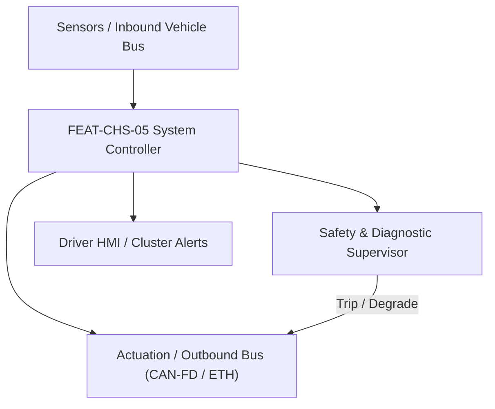
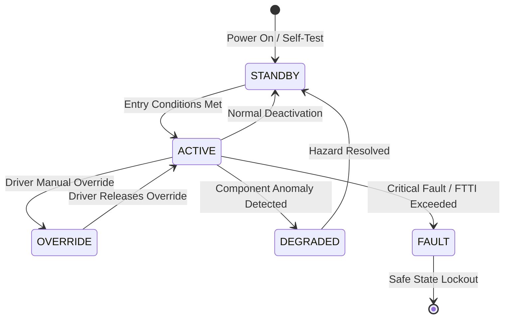

# System Requirements Specification: Electronic Torque Vectoring & All-Wheel Drive (e-AWD)
**Feature ID:** `FEAT-CHS-05`  
**Domain:** Vehicle Motion & Chassis Control  
**Target ASIL:** ASIL D  
**Compliance Standard:** ISO 26262:2018 (Part 4 - System Development) / ASPICE PAM v3.1 (SYS.2, SYS.3)  
**Parent Master Specification:** [`spec.md`](file:///c:/Workset/AntiGravityProjects/TestOptimisationExperiement/spec.md#feat-chs-05-eawd)  
**Derived Software Specification:** [`FEAT-CHS-05_eAWD_SwReq.md`](file:///c:/Workset/AntiGravityProjects/TestOptimisationExperiement/software_requirements/FEAT-CHS-05_eAWD_SwReq.md)

---

## 1. Feature Overview & Operational Scope

Coordinates dual/tri-motor electric drivetrains to distribute independent drive/regen torque between front and rear axles and left/right wheels to optimize agility and traction.

### Operational Context Architecture

---

## 2. Activation Logic & Operational States

- **Preconditions:** Both front and rear inverters operational, high-voltage battery ready, steering and yaw sensors healthy.
- **Entry Conditions:** Vehicle moving in D or R mode.
- **Deactivation Conditions:** Transmission shifted to P or N, or critical failure on both axles.
- **Driver Override Behavior:** ESC stability intervention overrides torque vectoring, prioritizing yaw stabilization over cornering agility.
- **Operational State Progression:**  
  `EFFICIENCY_FWD_OR_RWD` -> `DYNAMIC_AWD_SPLIT` -> `ACTIVE_YAW_VECTORING` -> `OFFROAD_TRACTION_LOCK` -> `LOW_MU_SLIP_CONTROL` -> `FAILSAFE_SINGLE_AXLE`

### State Transition Diagram

---

## 3. Functional Safety & Failure Mitigation Concept

- **Functional Safety Goal:** SG-AWD-01: Prevent unintended yaw moment generation; ensure torque vectoring cannot induce vehicle spin-out.
- **Fault Tolerant Time Interval (FTTI):** 40 ms
- **Safe State Definition:** Equalize left/right wheel torques; fallback to symmetric front/rear axle torque distribution.
- **Warning & Escalation Strategy:** Display 'AWD System Degraded - 2WD Only' banner on driver instrument cluster.

### Failure Modes & Degradation Handling
- **Differential Speed Spike:** If one wheel experiences sudden traction breakaway (ice patch), cut torque to slipping wheel within 15 ms.
- **Rear Inverter Loss:** If rear motor inverter trips, instantaneously transfer 100% propulsion torque to front motor in <= 10 ms.

---

## 4. System Requirements (SYS_REQ)
*(Note: Each System Requirement is systematically partitioned into multiple Child Software Requirements)*

### `SYS-CHS-05-01`: Front-to-Rear Dynamic Axle Torque Allocation
- **Planned Release:** R100
- **ASIL Rating:** ASIL D
- **Parent Feature:** [`FEAT-CHS-05`](file:///c:/Workset/AntiGravityProjects/TestOptimisationExperiement/spec.md#feat-chs-05)
- **Requirement Statement:**
  > The System SHALL dynamically split total driver torque between front and rear axles (from 100:0 to 0:100) based on dynamic axle load transfer, wheel slip, and drive mode at <= 10 ms period.
- **Activation Logic:** Active at all times in DRIVE mode.
- **Fault Tolerant Time Interval (FTTI):** 50 ms
- **Safe State Action:** Default to fixed 50:50 torque split or single-axle propulsion.
- **Failure Detection & Reaction:** If rear motor overtemperature trips, command 100% torque to front axle.
- **Input Interfaces:** `Total_Driver_Torque_Demand_Nm, Vehicle_Accel_Ax, 4x_Wheel_Speeds, Drive_Mode`
- **Output Interfaces:** `Front_Axle_Torque_Cmd_Nm, Rear_Axle_Torque_Cmd_Nm`
- **System Verification Method:** Chassis 4WD dynamometer acceleration and hill-climb testing.
- **Derived Child Software Requirements (1:N Link):**
  - [`SWR-CHS-05-01`](file:///c:/Workset/AntiGravityProjects/TestOptimisationExperiement/software_requirements/FEAT-CHS-05_eAWD_SwReq.md#swr-chs-05-01)
  - [`SWR-CHS-05-02`](file:///c:/Workset/AntiGravityProjects/TestOptimisationExperiement/software_requirements/FEAT-CHS-05_eAWD_SwReq.md#swr-chs-05-02)

### `SYS-CHS-05-02`: Lateral Left-Right Direct Yaw Moment Vectoring
- **Planned Release:** R100
- **ASIL Rating:** ASIL D
- **Parent Feature:** [`FEAT-CHS-05`](file:///c:/Workset/AntiGravityProjects/TestOptimisationExperiement/spec.md#feat-chs-05)
- **Requirement Statement:**
  > The System SHALL apply differential torque (up to +-1200 Nm delta between left and right wheels) during cornering to generate active yaw moment, reducing understeer while verifying stability.
- **Activation Logic:** Active during cornering when vehicle speed > 20 km/h and steering angle > 10 deg.
- **Fault Tolerant Time Interval (FTTI):** 40 ms
- **Safe State Action:** Zero delta torque between left and right wheels (T_left = T_right).
- **Failure Detection & Reaction:** If yaw rate error deviates from linear stability limit, terminate torque vectoring.
- **Input Interfaces:** `Steering_Angle_Deg, Yaw_Rate_RadS, Lateral_Accel_Mps2, Total_Rear_Torque_Nm`
- **Output Interfaces:** `Rear_Left_Motor_Torque_Nm, Rear_Right_Motor_Torque_Nm`
- **System Verification Method:** Handling track lap-time and slalom skid-pad evaluation.
- **Derived Child Software Requirements (1:N Link):**
  - [`SWR-CHS-05-03`](file:///c:/Workset/AntiGravityProjects/TestOptimisationExperiement/software_requirements/FEAT-CHS-05_eAWD_SwReq.md#swr-chs-05-03)
  - [`SWR-CHS-05-04`](file:///c:/Workset/AntiGravityProjects/TestOptimisationExperiement/software_requirements/FEAT-CHS-05_eAWD_SwReq.md#swr-chs-05-04)

### `SYS-CHS-05-03`: Multi-Motor Dual-Axle Real-Time Yaw Disturbance Moment Calculator
- **Planned Release:** R100
- **ASIL Rating:** ASIL D
- **Parent Feature:** [`FEAT-CHS-05`](file:///c:/Workset/AntiGravityProjects/TestOptimisationExperiement/spec.md#feat-chs-05)
- **Requirement Statement:**
  > The System SHALL Compute required stabilizing yaw moment: M_z = C_yaw * (Psi_dot_actual - Psi_dot_target) at 100 Hz.
- **Activation Logic:** Active during normal vehicle operation when feature state is active.
- **Fault Tolerant Time Interval (FTTI):** 10 ms
- **Safe State Action:** Transition to safe state or safe degradation tier within FTTI budget.
- **Failure Detection & Reaction:** Isolate faulted channel, latch DEM diagnostic trouble code, and inform driver.
- **Input Interfaces:** `Sensor signals, vehicle dynamics data, and bus frames via RTE.`
- **Output Interfaces:** `Actuator commands, diagnostic event flags, and cluster alerts.`
- **System Verification Method:** HiL test bench and dynamometer automated verification.
- **Derived Child Software Requirements (1:N Link):**
  - [`SWR-CHS-05-05`](file:///c:/Workset/AntiGravityProjects/TestOptimisationExperiement/software_requirements/FEAT-CHS-05_eAWD_SwReq.md#swr-chs-05-05)
  - [`SWR-CHS-05-06`](file:///c:/Workset/AntiGravityProjects/TestOptimisationExperiement/software_requirements/FEAT-CHS-05_eAWD_SwReq.md#swr-chs-05-06)

### `SYS-CHS-05-04`: Individual Left/Right Wheel Independent Torque Allocation Engine
- **Planned Release:** R200
- **ASIL Rating:** ASIL D
- **Parent Feature:** [`FEAT-CHS-05`](file:///c:/Workset/AntiGravityProjects/TestOptimisationExperiement/spec.md#feat-chs-05)
- **Requirement Statement:**
  > The System SHALL Distribute positive drive torque to outer wheel and regenerative braking to inner wheel during cornering.
- **Activation Logic:** Active during normal vehicle operation when feature state is active.
- **Fault Tolerant Time Interval (FTTI):** 10 ms
- **Safe State Action:** Transition to safe state or safe degradation tier within FTTI budget.
- **Failure Detection & Reaction:** Isolate faulted channel, latch DEM diagnostic trouble code, and inform driver.
- **Input Interfaces:** `Sensor signals, vehicle dynamics data, and bus frames via RTE.`
- **Output Interfaces:** `Actuator commands, diagnostic event flags, and cluster alerts.`
- **System Verification Method:** HiL test bench and dynamometer automated verification.
- **Derived Child Software Requirements (1:N Link):**
  - [`SWR-CHS-05-07`](file:///c:/Workset/AntiGravityProjects/TestOptimisationExperiement/software_requirements/FEAT-CHS-05_eAWD_SwReq.md#swr-chs-05-07)
  - [`SWR-CHS-05-08`](file:///c:/Workset/AntiGravityProjects/TestOptimisationExperiement/software_requirements/FEAT-CHS-05_eAWD_SwReq.md#swr-chs-05-08)

### `SYS-CHS-05-05`: Tire Longitudinal & Lateral Friction Adhesion Circle G-G Diagram Observer
- **Planned Release:** R200
- **ASIL Rating:** ASIL D
- **Parent Feature:** [`FEAT-CHS-05`](file:///c:/Workset/AntiGravityProjects/TestOptimisationExperiement/spec.md#feat-chs-05)
- **Requirement Statement:**
  > The System SHALL Estimate tire grip capacity via friction ellipse, ensuring torque vectoring does not exceed peak traction.
- **Activation Logic:** Active during normal vehicle operation when feature state is active.
- **Fault Tolerant Time Interval (FTTI):** 10 ms
- **Safe State Action:** Transition to safe state or safe degradation tier within FTTI budget.
- **Failure Detection & Reaction:** Isolate faulted channel, latch DEM diagnostic trouble code, and inform driver.
- **Input Interfaces:** `Sensor signals, vehicle dynamics data, and bus frames via RTE.`
- **Output Interfaces:** `Actuator commands, diagnostic event flags, and cluster alerts.`
- **System Verification Method:** HiL test bench and dynamometer automated verification.
- **Derived Child Software Requirements (1:N Link):**
  - [`SWR-CHS-05-09`](file:///c:/Workset/AntiGravityProjects/TestOptimisationExperiement/software_requirements/FEAT-CHS-05_eAWD_SwReq.md#swr-chs-05-09)
  - [`SWR-CHS-05-10`](file:///c:/Workset/AntiGravityProjects/TestOptimisationExperiement/software_requirements/FEAT-CHS-05_eAWD_SwReq.md#swr-chs-05-10)

### `SYS-CHS-05-06`: Front/Rear Axle High-Speed Planetary Torque Split Dynamic Regulator
- **Planned Release:** R200
- **ASIL Rating:** ASIL D
- **Parent Feature:** [`FEAT-CHS-05`](file:///c:/Workset/AntiGravityProjects/TestOptimisationExperiement/spec.md#feat-chs-05)
- **Requirement Statement:**
  > The System SHALL Vary front-to-rear torque split continuously between 100:0 (FWD efficiency) and 20:80 (RWD dynamics).
- **Activation Logic:** Active during normal vehicle operation when feature state is active.
- **Fault Tolerant Time Interval (FTTI):** 10 ms
- **Safe State Action:** Transition to safe state or safe degradation tier within FTTI budget.
- **Failure Detection & Reaction:** Isolate faulted channel, latch DEM diagnostic trouble code, and inform driver.
- **Input Interfaces:** `Sensor signals, vehicle dynamics data, and bus frames via RTE.`
- **Output Interfaces:** `Actuator commands, diagnostic event flags, and cluster alerts.`
- **System Verification Method:** HiL test bench and dynamometer automated verification.
- **Derived Child Software Requirements (1:N Link):**
  - [`SWR-CHS-05-11`](file:///c:/Workset/AntiGravityProjects/TestOptimisationExperiement/software_requirements/FEAT-CHS-05_eAWD_SwReq.md#swr-chs-05-11)
  - [`SWR-CHS-05-12`](file:///c:/Workset/AntiGravityProjects/TestOptimisationExperiement/software_requirements/FEAT-CHS-05_eAWD_SwReq.md#swr-chs-05-12)

### `SYS-CHS-05-07`: Low-Friction Surface Split-Mu Cross-Axle Dynamic Slip Limiter
- **Planned Release:** R300
- **ASIL Rating:** ASIL D
- **Parent Feature:** [`FEAT-CHS-05`](file:///c:/Workset/AntiGravityProjects/TestOptimisationExperiement/spec.md#feat-chs-05)
- **Requirement Statement:**
  > The System SHALL Limit cross-axle wheel speed differential when one wheel encounters ice or snow, simulating locked diff.
- **Activation Logic:** Active during normal vehicle operation when feature state is active.
- **Fault Tolerant Time Interval (FTTI):** 10 ms
- **Safe State Action:** Transition to safe state or safe degradation tier within FTTI budget.
- **Failure Detection & Reaction:** Isolate faulted channel, latch DEM diagnostic trouble code, and inform driver.
- **Input Interfaces:** `Sensor signals, vehicle dynamics data, and bus frames via RTE.`
- **Output Interfaces:** `Actuator commands, diagnostic event flags, and cluster alerts.`
- **System Verification Method:** HiL test bench and dynamometer automated verification.
- **Derived Child Software Requirements (1:N Link):**
  - [`SWR-CHS-05-13`](file:///c:/Workset/AntiGravityProjects/TestOptimisationExperiement/software_requirements/FEAT-CHS-05_eAWD_SwReq.md#swr-chs-05-13)
  - [`SWR-CHS-05-14`](file:///c:/Workset/AntiGravityProjects/TestOptimisationExperiement/software_requirements/FEAT-CHS-05_eAWD_SwReq.md#swr-chs-05-14)

### `SYS-CHS-05-08`: High-Speed Understeer Neutralization & Corner Apex Pull-In Commander
- **Planned Release:** R300
- **ASIL Rating:** ASIL D
- **Parent Feature:** [`FEAT-CHS-05`](file:///c:/Workset/AntiGravityProjects/TestOptimisationExperiement/spec.md#feat-chs-05)
- **Requirement Statement:**
  > The System SHALL Increase outer-rear motor torque by up to +180 Nm to tuck vehicle nose into high-speed corner apexes.
- **Activation Logic:** Active during normal vehicle operation when feature state is active.
- **Fault Tolerant Time Interval (FTTI):** 10 ms
- **Safe State Action:** Transition to safe state or safe degradation tier within FTTI budget.
- **Failure Detection & Reaction:** Isolate faulted channel, latch DEM diagnostic trouble code, and inform driver.
- **Input Interfaces:** `Sensor signals, vehicle dynamics data, and bus frames via RTE.`
- **Output Interfaces:** `Actuator commands, diagnostic event flags, and cluster alerts.`
- **System Verification Method:** HiL test bench and dynamometer automated verification.
- **Derived Child Software Requirements (1:N Link):**
  - [`SWR-CHS-05-15`](file:///c:/Workset/AntiGravityProjects/TestOptimisationExperiement/software_requirements/FEAT-CHS-05_eAWD_SwReq.md#swr-chs-05-15)
  - [`SWR-CHS-05-16`](file:///c:/Workset/AntiGravityProjects/TestOptimisationExperiement/software_requirements/FEAT-CHS-05_eAWD_SwReq.md#swr-chs-05-16)

### `SYS-CHS-05-09`: Oversteer Dynamic Counter-Torque Yaw Dampening Stabilization Loop
- **Planned Release:** R300
- **ASIL Rating:** ASIL D
- **Parent Feature:** [`FEAT-CHS-05`](file:///c:/Workset/AntiGravityProjects/TestOptimisationExperiement/spec.md#feat-chs-05)
- **Requirement Statement:**
  > The System SHALL Reduce outer rear wheel torque and apply forward torque to outer front wheel to catch oversteer slides.
- **Activation Logic:** Active during normal vehicle operation when feature state is active.
- **Fault Tolerant Time Interval (FTTI):** 10 ms
- **Safe State Action:** Transition to safe state or safe degradation tier within FTTI budget.
- **Failure Detection & Reaction:** Isolate faulted channel, latch DEM diagnostic trouble code, and inform driver.
- **Input Interfaces:** `Sensor signals, vehicle dynamics data, and bus frames via RTE.`
- **Output Interfaces:** `Actuator commands, diagnostic event flags, and cluster alerts.`
- **System Verification Method:** HiL test bench and dynamometer automated verification.
- **Derived Child Software Requirements (1:N Link):**
  - [`SWR-CHS-05-17`](file:///c:/Workset/AntiGravityProjects/TestOptimisationExperiement/software_requirements/FEAT-CHS-05_eAWD_SwReq.md#swr-chs-05-17)
  - [`SWR-CHS-05-18`](file:///c:/Workset/AntiGravityProjects/TestOptimisationExperiement/software_requirements/FEAT-CHS-05_eAWD_SwReq.md#swr-chs-05-18)

### `SYS-CHS-05-10`: Multi-Inverter Coordinated CAN-FD Fast Command Dispatcher with E2E CRC
- **Planned Release:** R400
- **ASIL Rating:** ASIL D
- **Parent Feature:** [`FEAT-CHS-05`](file:///c:/Workset/AntiGravityProjects/TestOptimisationExperiement/spec.md#feat-chs-05)
- **Requirement Statement:**
  > The System SHALL Broadcast synchronized torque requests to 4 independent corner inverters with alive counter and CRC.
- **Activation Logic:** Active during normal vehicle operation when feature state is active.
- **Fault Tolerant Time Interval (FTTI):** 2 ms
- **Safe State Action:** Transition to safe state or safe degradation tier within FTTI budget.
- **Failure Detection & Reaction:** Isolate faulted channel, latch DEM diagnostic trouble code, and inform driver.
- **Input Interfaces:** `Sensor signals, vehicle dynamics data, and bus frames via RTE.`
- **Output Interfaces:** `Actuator commands, diagnostic event flags, and cluster alerts.`
- **System Verification Method:** HiL test bench and dynamometer automated verification.
- **Derived Child Software Requirements (1:N Link):**
  - [`SWR-CHS-05-19`](file:///c:/Workset/AntiGravityProjects/TestOptimisationExperiement/software_requirements/FEAT-CHS-05_eAWD_SwReq.md#swr-chs-05-19)
  - [`SWR-CHS-05-20`](file:///c:/Workset/AntiGravityProjects/TestOptimisationExperiement/software_requirements/FEAT-CHS-05_eAWD_SwReq.md#swr-chs-05-20)

### `SYS-CHS-05-11`: Inverter Fast Single-Wheel Cutoff & Symmetrical Neutral Fallback Safing
- **Planned Release:** R400
- **ASIL Rating:** ASIL D
- **Parent Feature:** [`FEAT-CHS-05`](file:///c:/Workset/AntiGravityProjects/TestOptimisationExperiement/spec.md#feat-chs-05)
- **Requirement Statement:**
  > The System SHALL Isolate faulted corner motor within <= 8 ms, zeroing opposite motor vectoring to prevent uncommanded yaw.
- **Activation Logic:** Active during normal vehicle operation when feature state is active.
- **Fault Tolerant Time Interval (FTTI):** 5 ms
- **Safe State Action:** Transition to safe state or safe degradation tier within FTTI budget.
- **Failure Detection & Reaction:** Isolate faulted channel, latch DEM diagnostic trouble code, and inform driver.
- **Input Interfaces:** `Sensor signals, vehicle dynamics data, and bus frames via RTE.`
- **Output Interfaces:** `Actuator commands, diagnostic event flags, and cluster alerts.`
- **System Verification Method:** HiL test bench and dynamometer automated verification.
- **Derived Child Software Requirements (1:N Link):**
  - [`SWR-CHS-05-21`](file:///c:/Workset/AntiGravityProjects/TestOptimisationExperiement/software_requirements/FEAT-CHS-05_eAWD_SwReq.md#swr-chs-05-21)
  - [`SWR-CHS-05-22`](file:///c:/Workset/AntiGravityProjects/TestOptimisationExperiement/software_requirements/FEAT-CHS-05_eAWD_SwReq.md#swr-chs-05-22)

### `SYS-CHS-05-12`: Dual Core Lockstep Torque Comparison & Plausibility Gatekeeper
- **Planned Release:** R500
- **ASIL Rating:** ASIL D
- **Parent Feature:** [`FEAT-CHS-05`](file:///c:/Workset/AntiGravityProjects/TestOptimisationExperiement/spec.md#feat-chs-05)
- **Requirement Statement:**
  > The System SHALL Verify that vectoring torque sum matches total driver accelerator demand within +-5.0 Nm.
- **Activation Logic:** Active during normal vehicle operation when feature state is active.
- **Fault Tolerant Time Interval (FTTI):** 2 ms
- **Safe State Action:** Transition to safe state or safe degradation tier within FTTI budget.
- **Failure Detection & Reaction:** Isolate faulted channel, latch DEM diagnostic trouble code, and inform driver.
- **Input Interfaces:** `Sensor signals, vehicle dynamics data, and bus frames via RTE.`
- **Output Interfaces:** `Actuator commands, diagnostic event flags, and cluster alerts.`
- **System Verification Method:** HiL test bench and dynamometer automated verification.
- **Derived Child Software Requirements (1:N Link):**
  - [`SWR-CHS-05-23`](file:///c:/Workset/AntiGravityProjects/TestOptimisationExperiement/software_requirements/FEAT-CHS-05_eAWD_SwReq.md#swr-chs-05-23)
  - [`SWR-CHS-05-24`](file:///c:/Workset/AntiGravityProjects/TestOptimisationExperiement/software_requirements/FEAT-CHS-05_eAWD_SwReq.md#swr-chs-05-24)

### `SYS-CHS-05-13`: DEM Torque Vectoring Diagnostics & Inverter Communication Fault Logger
- **Planned Release:** R500
- **ASIL Rating:** ASIL B
- **Parent Feature:** [`FEAT-CHS-05`](file:///c:/Workset/AntiGravityProjects/TestOptimisationExperiement/spec.md#feat-chs-05)
- **Requirement Statement:**
  > The System SHALL Qualify diagnostic fault codes upon corner inverter dropouts and latch freeze-frame telemetry.
- **Activation Logic:** Active during normal vehicle operation when feature state is active.
- **Fault Tolerant Time Interval (FTTI):** 50 ms
- **Safe State Action:** Transition to safe state or safe degradation tier within FTTI budget.
- **Failure Detection & Reaction:** Isolate faulted channel, latch DEM diagnostic trouble code, and inform driver.
- **Input Interfaces:** `Sensor signals, vehicle dynamics data, and bus frames via RTE.`
- **Output Interfaces:** `Actuator commands, diagnostic event flags, and cluster alerts.`
- **System Verification Method:** HiL test bench and dynamometer automated verification.
- **Derived Child Software Requirements (1:N Link):**
  - [`SWR-CHS-05-25`](file:///c:/Workset/AntiGravityProjects/TestOptimisationExperiement/software_requirements/FEAT-CHS-05_eAWD_SwReq.md#swr-chs-05-25)
  - [`SWR-CHS-05-26`](file:///c:/Workset/AntiGravityProjects/TestOptimisationExperiement/software_requirements/FEAT-CHS-05_eAWD_SwReq.md#swr-chs-05-26)

### `SYS-CHS-05-14`: Instrument Cluster Dynamic AWD Torque Distribution Graphic Renderer
- **Planned Release:** R500
- **ASIL Rating:** ASIL B
- **Parent Feature:** [`FEAT-CHS-05`](file:///c:/Workset/AntiGravityProjects/TestOptimisationExperiement/spec.md#feat-chs-05)
- **Requirement Statement:**
  > The System SHALL Transmit 4-wheel real-time torque delivery percentages to central instrument cluster display.
- **Activation Logic:** Active during normal vehicle operation when feature state is active.
- **Fault Tolerant Time Interval (FTTI):** 50 ms
- **Safe State Action:** Transition to safe state or safe degradation tier within FTTI budget.
- **Failure Detection & Reaction:** Isolate faulted channel, latch DEM diagnostic trouble code, and inform driver.
- **Input Interfaces:** `Sensor signals, vehicle dynamics data, and bus frames via RTE.`
- **Output Interfaces:** `Actuator commands, diagnostic event flags, and cluster alerts.`
- **System Verification Method:** HiL test bench and dynamometer automated verification.
- **Derived Child Software Requirements (1:N Link):**
  - [`SWR-CHS-05-27`](file:///c:/Workset/AntiGravityProjects/TestOptimisationExperiement/software_requirements/FEAT-CHS-05_eAWD_SwReq.md#swr-chs-05-27)
  - [`SWR-CHS-05-28`](file:///c:/Workset/AntiGravityProjects/TestOptimisationExperiement/software_requirements/FEAT-CHS-05_eAWD_SwReq.md#swr-chs-05-28)

### `SYS-CHS-05-15`: Non-Volatile Thermal Stress & Corner Inverter Energy Throughput Tracker
- **Planned Release:** R500
- **ASIL Rating:** ASIL B
- **Parent Feature:** [`FEAT-CHS-05`](file:///c:/Workset/AntiGravityProjects/TestOptimisationExperiement/spec.md#feat-chs-05)
- **Requirement Statement:**
  > The System SHALL Log cumulative torque vectoring duration and corner thermal stresses in non-volatile storage.
- **Activation Logic:** Active during normal vehicle operation when feature state is active.
- **Fault Tolerant Time Interval (FTTI):** 1000 ms
- **Safe State Action:** Transition to safe state or safe degradation tier within FTTI budget.
- **Failure Detection & Reaction:** Isolate faulted channel, latch DEM diagnostic trouble code, and inform driver.
- **Input Interfaces:** `Sensor signals, vehicle dynamics data, and bus frames via RTE.`
- **Output Interfaces:** `Actuator commands, diagnostic event flags, and cluster alerts.`
- **System Verification Method:** HiL test bench and dynamometer automated verification.
- **Derived Child Software Requirements (1:N Link):**
  - [`SWR-CHS-05-29`](file:///c:/Workset/AntiGravityProjects/TestOptimisationExperiement/software_requirements/FEAT-CHS-05_eAWD_SwReq.md#swr-chs-05-29)
  - [`SWR-CHS-05-30`](file:///c:/Workset/AntiGravityProjects/TestOptimisationExperiement/software_requirements/FEAT-CHS-05_eAWD_SwReq.md#swr-chs-05-30)

---

## 5. System-to-Software Traceability Summary

| System Requirement ID | Planned Release | ASIL | Title | Derived Software Requirements (1:N) | Verification Method |
| :--- | :---: | :--- | :--- | :--- | :--- |
| `SYS-CHS-05-01` | **`R100`** | ASIL D | Front-to-Rear Dynamic Axle Torque Allocation | [`SWR-CHS-05-01`](file:///c:/Workset/AntiGravityProjects/TestOptimisationExperiement/software_requirements/FEAT-CHS-05_eAWD_SwReq.md#swr-chs-05-01), [`SWR-CHS-05-02`](file:///c:/Workset/AntiGravityProjects/TestOptimisationExperiement/software_requirements/FEAT-CHS-05_eAWD_SwReq.md#swr-chs-05-02) | Chassis 4WD dynamometer acceleration and hill-climb testing. |
| `SYS-CHS-05-02` | **`R100`** | ASIL D | Lateral Left-Right Direct Yaw Moment Vectoring | [`SWR-CHS-05-03`](file:///c:/Workset/AntiGravityProjects/TestOptimisationExperiement/software_requirements/FEAT-CHS-05_eAWD_SwReq.md#swr-chs-05-03), [`SWR-CHS-05-04`](file:///c:/Workset/AntiGravityProjects/TestOptimisationExperiement/software_requirements/FEAT-CHS-05_eAWD_SwReq.md#swr-chs-05-04) | Handling track lap-time and slalom skid-pad evaluation. |
| `SYS-CHS-05-03` | **`R100`** | ASIL D | Multi-Motor Dual-Axle Real-Time Yaw Disturbance Moment Calculator | [`SWR-CHS-05-05`](file:///c:/Workset/AntiGravityProjects/TestOptimisationExperiement/software_requirements/FEAT-CHS-05_eAWD_SwReq.md#swr-chs-05-05), [`SWR-CHS-05-06`](file:///c:/Workset/AntiGravityProjects/TestOptimisationExperiement/software_requirements/FEAT-CHS-05_eAWD_SwReq.md#swr-chs-05-06) | HiL test bench and dynamometer automated verification. |
| `SYS-CHS-05-04` | **`R200`** | ASIL D | Individual Left/Right Wheel Independent Torque Allocation Engine | [`SWR-CHS-05-07`](file:///c:/Workset/AntiGravityProjects/TestOptimisationExperiement/software_requirements/FEAT-CHS-05_eAWD_SwReq.md#swr-chs-05-07), [`SWR-CHS-05-08`](file:///c:/Workset/AntiGravityProjects/TestOptimisationExperiement/software_requirements/FEAT-CHS-05_eAWD_SwReq.md#swr-chs-05-08) | HiL test bench and dynamometer automated verification. |
| `SYS-CHS-05-05` | **`R200`** | ASIL D | Tire Longitudinal & Lateral Friction Adhesion Circle G-G Diagram Observer | [`SWR-CHS-05-09`](file:///c:/Workset/AntiGravityProjects/TestOptimisationExperiement/software_requirements/FEAT-CHS-05_eAWD_SwReq.md#swr-chs-05-09), [`SWR-CHS-05-10`](file:///c:/Workset/AntiGravityProjects/TestOptimisationExperiement/software_requirements/FEAT-CHS-05_eAWD_SwReq.md#swr-chs-05-10) | HiL test bench and dynamometer automated verification. |
| `SYS-CHS-05-06` | **`R200`** | ASIL D | Front/Rear Axle High-Speed Planetary Torque Split Dynamic Regulator | [`SWR-CHS-05-11`](file:///c:/Workset/AntiGravityProjects/TestOptimisationExperiement/software_requirements/FEAT-CHS-05_eAWD_SwReq.md#swr-chs-05-11), [`SWR-CHS-05-12`](file:///c:/Workset/AntiGravityProjects/TestOptimisationExperiement/software_requirements/FEAT-CHS-05_eAWD_SwReq.md#swr-chs-05-12) | HiL test bench and dynamometer automated verification. |
| `SYS-CHS-05-07` | **`R300`** | ASIL D | Low-Friction Surface Split-Mu Cross-Axle Dynamic Slip Limiter | [`SWR-CHS-05-13`](file:///c:/Workset/AntiGravityProjects/TestOptimisationExperiement/software_requirements/FEAT-CHS-05_eAWD_SwReq.md#swr-chs-05-13), [`SWR-CHS-05-14`](file:///c:/Workset/AntiGravityProjects/TestOptimisationExperiement/software_requirements/FEAT-CHS-05_eAWD_SwReq.md#swr-chs-05-14) | HiL test bench and dynamometer automated verification. |
| `SYS-CHS-05-08` | **`R300`** | ASIL D | High-Speed Understeer Neutralization & Corner Apex Pull-In Commander | [`SWR-CHS-05-15`](file:///c:/Workset/AntiGravityProjects/TestOptimisationExperiement/software_requirements/FEAT-CHS-05_eAWD_SwReq.md#swr-chs-05-15), [`SWR-CHS-05-16`](file:///c:/Workset/AntiGravityProjects/TestOptimisationExperiement/software_requirements/FEAT-CHS-05_eAWD_SwReq.md#swr-chs-05-16) | HiL test bench and dynamometer automated verification. |
| `SYS-CHS-05-09` | **`R300`** | ASIL D | Oversteer Dynamic Counter-Torque Yaw Dampening Stabilization Loop | [`SWR-CHS-05-17`](file:///c:/Workset/AntiGravityProjects/TestOptimisationExperiement/software_requirements/FEAT-CHS-05_eAWD_SwReq.md#swr-chs-05-17), [`SWR-CHS-05-18`](file:///c:/Workset/AntiGravityProjects/TestOptimisationExperiement/software_requirements/FEAT-CHS-05_eAWD_SwReq.md#swr-chs-05-18) | HiL test bench and dynamometer automated verification. |
| `SYS-CHS-05-10` | **`R400`** | ASIL D | Multi-Inverter Coordinated CAN-FD Fast Command Dispatcher with E2E CRC | [`SWR-CHS-05-19`](file:///c:/Workset/AntiGravityProjects/TestOptimisationExperiement/software_requirements/FEAT-CHS-05_eAWD_SwReq.md#swr-chs-05-19), [`SWR-CHS-05-20`](file:///c:/Workset/AntiGravityProjects/TestOptimisationExperiement/software_requirements/FEAT-CHS-05_eAWD_SwReq.md#swr-chs-05-20) | HiL test bench and dynamometer automated verification. |
| `SYS-CHS-05-11` | **`R400`** | ASIL D | Inverter Fast Single-Wheel Cutoff & Symmetrical Neutral Fallback Safing | [`SWR-CHS-05-21`](file:///c:/Workset/AntiGravityProjects/TestOptimisationExperiement/software_requirements/FEAT-CHS-05_eAWD_SwReq.md#swr-chs-05-21), [`SWR-CHS-05-22`](file:///c:/Workset/AntiGravityProjects/TestOptimisationExperiement/software_requirements/FEAT-CHS-05_eAWD_SwReq.md#swr-chs-05-22) | HiL test bench and dynamometer automated verification. |
| `SYS-CHS-05-12` | **`R500`** | ASIL D | Dual Core Lockstep Torque Comparison & Plausibility Gatekeeper | [`SWR-CHS-05-23`](file:///c:/Workset/AntiGravityProjects/TestOptimisationExperiement/software_requirements/FEAT-CHS-05_eAWD_SwReq.md#swr-chs-05-23), [`SWR-CHS-05-24`](file:///c:/Workset/AntiGravityProjects/TestOptimisationExperiement/software_requirements/FEAT-CHS-05_eAWD_SwReq.md#swr-chs-05-24) | HiL test bench and dynamometer automated verification. |
| `SYS-CHS-05-13` | **`R500`** | ASIL B | DEM Torque Vectoring Diagnostics & Inverter Communication Fault Logger | [`SWR-CHS-05-25`](file:///c:/Workset/AntiGravityProjects/TestOptimisationExperiement/software_requirements/FEAT-CHS-05_eAWD_SwReq.md#swr-chs-05-25), [`SWR-CHS-05-26`](file:///c:/Workset/AntiGravityProjects/TestOptimisationExperiement/software_requirements/FEAT-CHS-05_eAWD_SwReq.md#swr-chs-05-26) | HiL test bench and dynamometer automated verification. |
| `SYS-CHS-05-14` | **`R500`** | ASIL B | Instrument Cluster Dynamic AWD Torque Distribution Graphic Renderer | [`SWR-CHS-05-27`](file:///c:/Workset/AntiGravityProjects/TestOptimisationExperiement/software_requirements/FEAT-CHS-05_eAWD_SwReq.md#swr-chs-05-27), [`SWR-CHS-05-28`](file:///c:/Workset/AntiGravityProjects/TestOptimisationExperiement/software_requirements/FEAT-CHS-05_eAWD_SwReq.md#swr-chs-05-28) | HiL test bench and dynamometer automated verification. |
| `SYS-CHS-05-15` | **`R500`** | ASIL B | Non-Volatile Thermal Stress & Corner Inverter Energy Throughput Tracker | [`SWR-CHS-05-29`](file:///c:/Workset/AntiGravityProjects/TestOptimisationExperiement/software_requirements/FEAT-CHS-05_eAWD_SwReq.md#swr-chs-05-29), [`SWR-CHS-05-30`](file:///c:/Workset/AntiGravityProjects/TestOptimisationExperiement/software_requirements/FEAT-CHS-05_eAWD_SwReq.md#swr-chs-05-30) | HiL test bench and dynamometer automated verification. |

- **Upstream Feature Link:** [`spec.md` (FEAT-CHS-05)](file:///c:/Workset/AntiGravityProjects/TestOptimisationExperiement/spec.md#feat-chs-05)
- **Software Requirements Specification:** [`FEAT-CHS-05_eAWD_SwReq.md`](file:///c:/Workset/AntiGravityProjects/TestOptimisationExperiement/software_requirements/FEAT-CHS-05_eAWD_SwReq.md)
