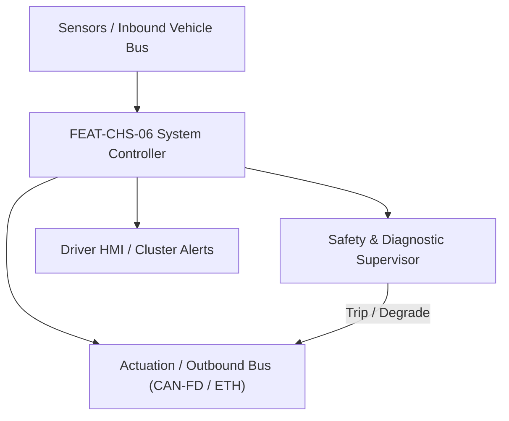
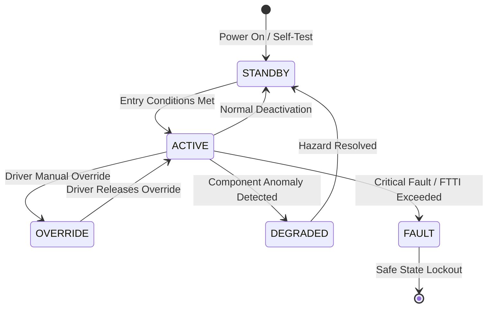

# System Requirements Specification: Electronic Air Suspension with Road Preview (EAS)
**Feature ID:** `FEAT-CHS-06`  
**Domain:** Vehicle Motion & Chassis Control  
**Target ASIL:** ASIL C  
**Compliance Standard:** ISO 26262:2018 (Part 4 - System Development) / ASPICE PAM v3.1 (SYS.2, SYS.3)  
**Parent Master Specification:** [`spec.md`](file:///c:/Workset/AntiGravityProjects/TestOptimisationExperiement/spec.md#feat-chs-06-eas)  
**Derived Software Specification:** [`FEAT-CHS-06_EAS_SwReq.md`](file:///c:/Workset/AntiGravityProjects/TestOptimisationExperiement/software_requirements/FEAT-CHS-06_EAS_SwReq.md)

---

## 1. Feature Overview & Operational Scope

Multi-chamber closed-loop air suspension with ride height adjustment (-40 mm to +60 mm), aerodynamic lowering, cross-articulation leveling, and forward camera preview damping adaptation.

### Operational Context Architecture

---

## 2. Activation Logic & Operational States

- **Preconditions:** 12V system voltage >= 11.5V, air reservoir pressure >= 9.0 bar, all 4 corner height sensors calibrated, tailgate and doors closed.
- **Entry Conditions:** Ignition in RUN, vehicle speed within operational range (-40 mm mode enabled at > 110 km/h; +60 mm off-road mode enabled at < 35 km/h).
- **Deactivation Conditions:** Door or trunk opened during height transition (pinch hazard prevention), or reservoir pressure below 5.5 bar.
- **Driver Override Behavior:** Driver manual height rocker switch overrides auto-leveling within valid speed envelopes; opening any door immediately freezes solenoid valves in < 20 ms.
- **Operational State Progression:**  
  `IDLE_LEVEL` -> `AERODYNAMIC_LOWERING` -> `OFF_ROAD_LIFT` -> `CORNER_AUTO_LEVELING` -> `PREVIEW_POTHOLE_COMPENSATION` -> `COMPRESSOR_CHARGING` -> `OVERTEMP_DEGRADED` -> `AIR_LEAK_LOCKOUT`

### State Transition Diagram

---

## 3. Functional Safety & Failure Mitigation Concept

- **Functional Safety Goal:** SG-EAS-01: Prevent asymmetric vehicle tilt > 3.0 degrees during high-speed travel (> 80 km/h); prevent uncommanded collapse of spring bellows.
- **Fault Tolerant Time Interval (FTTI):** 80 ms for asymmetric valve opening; 200 ms for level regulation.
- **Safe State Definition:** Lock all 4 corner air solenoid valves into pneumatic closed position; suspend compressor operation.
- **Warning & Escalation Strategy:** Level 1: Suspension leveling icon on cluster; Level 2: 'Air Suspension Fault - Max Speed 80 km/h'; Level 3: Red STOP chime if ground clearance critically compromised.

### Failure Modes & Degradation Handling
- **Compressor Overtemperature:** If compressor cylinder head temp exceeds 125°C, shut off compressor motor for 180s cooldown while allowing passive chamber cross-linking.
- **Height Sensor Plausibility:** If any corner sensor signal deviates by > 15 mm from kinematic model, lock affected axle solenoid valves and maintain current air mass.
- **Pneumatic Line Rupture:** If reservoir pressure drops at > 1.0 bar/s without valve commands, isolate reservoir via check valve and freeze all corner valves to prevent belly grounding.

---

## 4. System Requirements (SYS_REQ)
*(Note: Each System Requirement is systematically partitioned into multiple Child Software Requirements)*

### `SYS-CHS-06-01`: Quad-Corner Ride Height Estimation & Target Levelling Control
- **Planned Release:** R100
- **ASIL Rating:** ASIL C
- **Parent Feature:** [`FEAT-CHS-06`](file:///c:/Workset/AntiGravityProjects/TestOptimisationExperiement/spec.md#feat-chs-06)
- **Requirement Statement:**
  > The System SHALL sample 4 inductive suspension height sensors at 100 Hz, compute pitch and roll angles within +-0.1 deg, and command high-speed pneumatic solenoid valves to achieve target ride height (+-3 mm) in <= 15 seconds.
- **Activation Logic:** Active at all times when ignition is RUN and doors are closed.
- **Fault Tolerant Time Interval (FTTI):** 80 ms
- **Safe State Action:** De-energize all 4 corner solenoid valves into spring-return closed state.
- **Failure Detection & Reaction:** If any single height sensor fails, use pitch/roll estimation from chassis IMU to maintain degraded static leveling.
- **Input Interfaces:** `Height_Sensor_FL_FR_RL_RR_Mm, Chassis_IMU_Pitch_Roll, Door_Ajar_Status_Bits`
- **Output Interfaces:** `Solenoid_Valve_Cmd_Array[8], Compressor_Relay_Cmd, Current_Ride_Height_Mode`
- **System Verification Method:** Hydraulic 4-post road simulator durability and pneumatic step-response tests.
- **Derived Child Software Requirements (1:N Link):**
  - [`SWR-CHS-06-01`](file:///c:/Workset/AntiGravityProjects/TestOptimisationExperiement/software_requirements/FEAT-CHS-06_EAS_SwReq.md#swr-chs-06-01)
  - [`SWR-CHS-06-02`](file:///c:/Workset/AntiGravityProjects/TestOptimisationExperiement/software_requirements/FEAT-CHS-06_EAS_SwReq.md#swr-chs-06-02)

### `SYS-CHS-06-02`: Stereo Vision Road Surface Preview & Active Pre-Filling
- **Planned Release:** R100
- **ASIL Rating:** ASIL B
- **Parent Feature:** [`FEAT-CHS-06`](file:///c:/Workset/AntiGravityProjects/TestOptimisationExperiement/spec.md#feat-chs-06)
- **Requirement Statement:**
  > The System SHALL ingest forward stereo camera road profile 3D elevation maps (up to 15 m ahead) and proactively modulate air spring volume in <= 40 ms prior to speed bumps or pothole impacts to reduce vertical chassis acceleration by >= 45%.
- **Activation Logic:** Active when vehicle speed between 20 km/h and 90 km/h with preview camera functional.
- **Fault Tolerant Time Interval (FTTI):** 100 ms
- **Safe State Action:** Revert to standard passive damping and baseline pneumatic stiffness.
- **Failure Detection & Reaction:** If camera confidence drops due to rain/fog, gracefully fade out preview mode over 500 ms.
- **Input Interfaces:** `Camera_Road_Elevation_Map_3D, Ego_Vehicle_Speed_Mps, Chassis_Vertical_Accel_Z`
- **Output Interfaces:** `Preview_Precharge_Volume_FL_FR_RL_RR, Active_Spring_Rate_Config`
- **System Verification Method:** Real-world proving ground speed-bump and Belgian block road surface testing.
- **Derived Child Software Requirements (1:N Link):**
  - [`SWR-CHS-06-03`](file:///c:/Workset/AntiGravityProjects/TestOptimisationExperiement/software_requirements/FEAT-CHS-06_EAS_SwReq.md#swr-chs-06-03)
  - [`SWR-CHS-06-04`](file:///c:/Workset/AntiGravityProjects/TestOptimisationExperiement/software_requirements/FEAT-CHS-06_EAS_SwReq.md#swr-chs-06-04)

### `SYS-CHS-06-03`: Chassis Ride Height Multi-Corner Closed-Loop Leveling Regulator
- **Planned Release:** R100
- **ASIL Rating:** ASIL C
- **Parent Feature:** [`FEAT-CHS-06`](file:///c:/Workset/AntiGravityProjects/TestOptimisationExperiement/spec.md#feat-chs-06)
- **Requirement Statement:**
  > The System SHALL Maintain target suspension ride height across all 4 air springs with steady-state precision +-2.0 mm.
- **Activation Logic:** Active during normal vehicle operation when feature state is active.
- **Fault Tolerant Time Interval (FTTI):** 50 ms
- **Safe State Action:** Transition to safe state or safe degradation tier within FTTI budget.
- **Failure Detection & Reaction:** Isolate faulted channel, latch DEM diagnostic trouble code, and inform driver.
- **Input Interfaces:** `Sensor signals, vehicle dynamics data, and bus frames via RTE.`
- **Output Interfaces:** `Actuator commands, diagnostic event flags, and cluster alerts.`
- **System Verification Method:** HiL test bench and dynamometer automated verification.
- **Derived Child Software Requirements (1:N Link):**
  - [`SWR-CHS-06-05`](file:///c:/Workset/AntiGravityProjects/TestOptimisationExperiement/software_requirements/FEAT-CHS-06_EAS_SwReq.md#swr-chs-06-05)
  - [`SWR-CHS-06-06`](file:///c:/Workset/AntiGravityProjects/TestOptimisationExperiement/software_requirements/FEAT-CHS-06_EAS_SwReq.md#swr-chs-06-06)

### `SYS-CHS-06-04`: Forward Road Preview Stereo Camera Pothole & Bump Active Adjuster
- **Planned Release:** R200
- **ASIL Rating:** ASIL C
- **Parent Feature:** [`FEAT-CHS-06`](file:///c:/Workset/AntiGravityProjects/TestOptimisationExperiement/spec.md#feat-chs-06)
- **Requirement Statement:**
  > The System SHALL Pre-adjust air spring volume 150 ms ahead of upcoming road speed bumps detected by vision preview.
- **Activation Logic:** Active during normal vehicle operation when feature state is active.
- **Fault Tolerant Time Interval (FTTI):** 30 ms
- **Safe State Action:** Transition to safe state or safe degradation tier within FTTI budget.
- **Failure Detection & Reaction:** Isolate faulted channel, latch DEM diagnostic trouble code, and inform driver.
- **Input Interfaces:** `Sensor signals, vehicle dynamics data, and bus frames via RTE.`
- **Output Interfaces:** `Actuator commands, diagnostic event flags, and cluster alerts.`
- **System Verification Method:** HiL test bench and dynamometer automated verification.
- **Derived Child Software Requirements (1:N Link):**
  - [`SWR-CHS-06-07`](file:///c:/Workset/AntiGravityProjects/TestOptimisationExperiement/software_requirements/FEAT-CHS-06_EAS_SwReq.md#swr-chs-06-07)
  - [`SWR-CHS-06-08`](file:///c:/Workset/AntiGravityProjects/TestOptimisationExperiement/software_requirements/FEAT-CHS-06_EAS_SwReq.md#swr-chs-06-08)

### `SYS-CHS-06-05`: Vehicle Speed-Dependent Aerodynamic Ride Height Lowering Scheduler
- **Planned Release:** R200
- **ASIL Rating:** ASIL C
- **Parent Feature:** [`FEAT-CHS-06`](file:///c:/Workset/AntiGravityProjects/TestOptimisationExperiement/spec.md#feat-chs-06)
- **Requirement Statement:**
  > The System SHALL Lower vehicle chassis height by 20 mm at speeds > 120 km/h to reduce aerodynamic drag coefficient by 4%.
- **Activation Logic:** Active during normal vehicle operation when feature state is active.
- **Fault Tolerant Time Interval (FTTI):** 100 ms
- **Safe State Action:** Transition to safe state or safe degradation tier within FTTI budget.
- **Failure Detection & Reaction:** Isolate faulted channel, latch DEM diagnostic trouble code, and inform driver.
- **Input Interfaces:** `Sensor signals, vehicle dynamics data, and bus frames via RTE.`
- **Output Interfaces:** `Actuator commands, diagnostic event flags, and cluster alerts.`
- **System Verification Method:** HiL test bench and dynamometer automated verification.
- **Derived Child Software Requirements (1:N Link):**
  - [`SWR-CHS-06-09`](file:///c:/Workset/AntiGravityProjects/TestOptimisationExperiement/software_requirements/FEAT-CHS-06_EAS_SwReq.md#swr-chs-06-09)
  - [`SWR-CHS-06-10`](file:///c:/Workset/AntiGravityProjects/TestOptimisationExperiement/software_requirements/FEAT-CHS-06_EAS_SwReq.md#swr-chs-06-10)

### `SYS-CHS-06-06`: Pneumatic Air Compressor High-Pressure Reservoir Pressure Servoloop
- **Planned Release:** R200
- **ASIL Rating:** ASIL C
- **Parent Feature:** [`FEAT-CHS-06`](file:///c:/Workset/AntiGravityProjects/TestOptimisationExperiement/spec.md#feat-chs-06)
- **Requirement Statement:**
  > The System SHALL Operate electric air compressor (up to 16.0 bar) to recharge high-pressure air reservoir tank.
- **Activation Logic:** Active during normal vehicle operation when feature state is active.
- **Fault Tolerant Time Interval (FTTI):** 100 ms
- **Safe State Action:** Transition to safe state or safe degradation tier within FTTI budget.
- **Failure Detection & Reaction:** Isolate faulted channel, latch DEM diagnostic trouble code, and inform driver.
- **Input Interfaces:** `Sensor signals, vehicle dynamics data, and bus frames via RTE.`
- **Output Interfaces:** `Actuator commands, diagnostic event flags, and cluster alerts.`
- **System Verification Method:** HiL test bench and dynamometer automated verification.
- **Derived Child Software Requirements (1:N Link):**
  - [`SWR-CHS-06-11`](file:///c:/Workset/AntiGravityProjects/TestOptimisationExperiement/software_requirements/FEAT-CHS-06_EAS_SwReq.md#swr-chs-06-11)
  - [`SWR-CHS-06-12`](file:///c:/Workset/AntiGravityProjects/TestOptimisationExperiement/software_requirements/FEAT-CHS-06_EAS_SwReq.md#swr-chs-06-12)

### `SYS-CHS-06-07`: Multi-Channel Solenoid Valve Block Cross-Corner Inflation Governor
- **Planned Release:** R300
- **ASIL Rating:** ASIL C
- **Parent Feature:** [`FEAT-CHS-06`](file:///c:/Workset/AntiGravityProjects/TestOptimisationExperiement/spec.md#feat-chs-06)
- **Requirement Statement:**
  > The System SHALL Pulse individual corner air spring solenoid valves with PWM duty cycles to adjust corner height.
- **Activation Logic:** Active during normal vehicle operation when feature state is active.
- **Fault Tolerant Time Interval (FTTI):** 20 ms
- **Safe State Action:** Transition to safe state or safe degradation tier within FTTI budget.
- **Failure Detection & Reaction:** Isolate faulted channel, latch DEM diagnostic trouble code, and inform driver.
- **Input Interfaces:** `Sensor signals, vehicle dynamics data, and bus frames via RTE.`
- **Output Interfaces:** `Actuator commands, diagnostic event flags, and cluster alerts.`
- **System Verification Method:** HiL test bench and dynamometer automated verification.
- **Derived Child Software Requirements (1:N Link):**
  - [`SWR-CHS-06-13`](file:///c:/Workset/AntiGravityProjects/TestOptimisationExperiement/software_requirements/FEAT-CHS-06_EAS_SwReq.md#swr-chs-06-13)
  - [`SWR-CHS-06-14`](file:///c:/Workset/AntiGravityProjects/TestOptimisationExperiement/software_requirements/FEAT-CHS-06_EAS_SwReq.md#swr-chs-06-14)

### `SYS-CHS-06-08`: Passenger & Luggage Variable Payload Ingress/Egress Static Leveler
- **Planned Release:** R300
- **ASIL Rating:** ASIL B
- **Parent Feature:** [`FEAT-CHS-06`](file:///c:/Workset/AntiGravityProjects/TestOptimisationExperiement/spec.md#feat-chs-06)
- **Requirement Statement:**
  > The System SHALL Level chassis automatically when passengers enter/exit or heavy luggage is placed in the rear cargo trunk.
- **Activation Logic:** Active during normal vehicle operation when feature state is active.
- **Fault Tolerant Time Interval (FTTI):** 200 ms
- **Safe State Action:** Transition to safe state or safe degradation tier within FTTI budget.
- **Failure Detection & Reaction:** Isolate faulted channel, latch DEM diagnostic trouble code, and inform driver.
- **Input Interfaces:** `Sensor signals, vehicle dynamics data, and bus frames via RTE.`
- **Output Interfaces:** `Actuator commands, diagnostic event flags, and cluster alerts.`
- **System Verification Method:** HiL test bench and dynamometer automated verification.
- **Derived Child Software Requirements (1:N Link):**
  - [`SWR-CHS-06-15`](file:///c:/Workset/AntiGravityProjects/TestOptimisationExperiement/software_requirements/FEAT-CHS-06_EAS_SwReq.md#swr-chs-06-15)
  - [`SWR-CHS-06-16`](file:///c:/Workset/AntiGravityProjects/TestOptimisationExperiement/software_requirements/FEAT-CHS-06_EAS_SwReq.md#swr-chs-06-16)

### `SYS-CHS-06-09`: Terrain Drive Mode Selection (Off-Road High, Standard, Access Low) Manager
- **Planned Release:** R300
- **ASIL Rating:** ASIL B
- **Parent Feature:** [`FEAT-CHS-06`](file:///c:/Workset/AntiGravityProjects/TestOptimisationExperiement/spec.md#feat-chs-06)
- **Requirement Statement:**
  > The System SHALL Transition chassis ground clearance across +50 mm (Off-Road), 0 mm (Standard), and -40 mm (Access mode).
- **Activation Logic:** Active during normal vehicle operation when feature state is active.
- **Fault Tolerant Time Interval (FTTI):** 100 ms
- **Safe State Action:** Transition to safe state or safe degradation tier within FTTI budget.
- **Failure Detection & Reaction:** Isolate faulted channel, latch DEM diagnostic trouble code, and inform driver.
- **Input Interfaces:** `Sensor signals, vehicle dynamics data, and bus frames via RTE.`
- **Output Interfaces:** `Actuator commands, diagnostic event flags, and cluster alerts.`
- **System Verification Method:** HiL test bench and dynamometer automated verification.
- **Derived Child Software Requirements (1:N Link):**
  - [`SWR-CHS-06-17`](file:///c:/Workset/AntiGravityProjects/TestOptimisationExperiement/software_requirements/FEAT-CHS-06_EAS_SwReq.md#swr-chs-06-17)
  - [`SWR-CHS-06-18`](file:///c:/Workset/AntiGravityProjects/TestOptimisationExperiement/software_requirements/FEAT-CHS-06_EAS_SwReq.md#swr-chs-06-18)

### `SYS-CHS-06-10`: Air Compressor Thermal Protection Temperature Sensor & Duty Cycle Guard
- **Planned Release:** R400
- **ASIL Rating:** ASIL B
- **Parent Feature:** [`FEAT-CHS-06`](file:///c:/Workset/AntiGravityProjects/TestOptimisationExperiement/spec.md#feat-chs-06)
- **Requirement Statement:**
  > The System SHALL Halt compressor pumping if compressor cylinder head temperature exceeds 125 °C to prevent seal burnout.
- **Activation Logic:** Active during normal vehicle operation when feature state is active.
- **Fault Tolerant Time Interval (FTTI):** 100 ms
- **Safe State Action:** Transition to safe state or safe degradation tier within FTTI budget.
- **Failure Detection & Reaction:** Isolate faulted channel, latch DEM diagnostic trouble code, and inform driver.
- **Input Interfaces:** `Sensor signals, vehicle dynamics data, and bus frames via RTE.`
- **Output Interfaces:** `Actuator commands, diagnostic event flags, and cluster alerts.`
- **System Verification Method:** HiL test bench and dynamometer automated verification.
- **Derived Child Software Requirements (1:N Link):**
  - [`SWR-CHS-06-19`](file:///c:/Workset/AntiGravityProjects/TestOptimisationExperiement/software_requirements/FEAT-CHS-06_EAS_SwReq.md#swr-chs-06-19)
  - [`SWR-CHS-06-20`](file:///c:/Workset/AntiGravityProjects/TestOptimisationExperiement/software_requirements/FEAT-CHS-06_EAS_SwReq.md#swr-chs-06-20)

### `SYS-CHS-06-11`: Pneumatic Line Slow Leak & Pressure Loss Dynamic Observer
- **Planned Release:** R400
- **ASIL Rating:** ASIL C
- **Parent Feature:** [`FEAT-CHS-06`](file:///c:/Workset/AntiGravityProjects/TestOptimisationExperiement/spec.md#feat-chs-06)
- **Requirement Statement:**
  > The System SHALL Detect air bladder micro-leaks by observing continuous uncommanded corner height sag overnight.
- **Activation Logic:** Active during normal vehicle operation when feature state is active.
- **Fault Tolerant Time Interval (FTTI):** 500 ms
- **Safe State Action:** Transition to safe state or safe degradation tier within FTTI budget.
- **Failure Detection & Reaction:** Isolate faulted channel, latch DEM diagnostic trouble code, and inform driver.
- **Input Interfaces:** `Sensor signals, vehicle dynamics data, and bus frames via RTE.`
- **Output Interfaces:** `Actuator commands, diagnostic event flags, and cluster alerts.`
- **System Verification Method:** HiL test bench and dynamometer automated verification.
- **Derived Child Software Requirements (1:N Link):**
  - [`SWR-CHS-06-21`](file:///c:/Workset/AntiGravityProjects/TestOptimisationExperiement/software_requirements/FEAT-CHS-06_EAS_SwReq.md#swr-chs-06-21)
  - [`SWR-CHS-06-22`](file:///c:/Workset/AntiGravityProjects/TestOptimisationExperiement/software_requirements/FEAT-CHS-06_EAS_SwReq.md#swr-chs-06-22)

### `SYS-CHS-06-12`: Pneumatic Valve Cross-Axle Pressure Balance & Anti-Roll Stabilization
- **Planned Release:** R400
- **ASIL Rating:** ASIL C
- **Parent Feature:** [`FEAT-CHS-06`](file:///c:/Workset/AntiGravityProjects/TestOptimisationExperiement/spec.md#feat-chs-06)
- **Requirement Statement:**
  > The System SHALL Cross-couple left and right air springs during high-speed cornering to suppress vehicle roll angles.
- **Activation Logic:** Active during normal vehicle operation when feature state is active.
- **Fault Tolerant Time Interval (FTTI):** 20 ms
- **Safe State Action:** Transition to safe state or safe degradation tier within FTTI budget.
- **Failure Detection & Reaction:** Isolate faulted channel, latch DEM diagnostic trouble code, and inform driver.
- **Input Interfaces:** `Sensor signals, vehicle dynamics data, and bus frames via RTE.`
- **Output Interfaces:** `Actuator commands, diagnostic event flags, and cluster alerts.`
- **System Verification Method:** HiL test bench and dynamometer automated verification.
- **Derived Child Software Requirements (1:N Link):**
  - [`SWR-CHS-06-23`](file:///c:/Workset/AntiGravityProjects/TestOptimisationExperiement/software_requirements/FEAT-CHS-06_EAS_SwReq.md#swr-chs-06-23)
  - [`SWR-CHS-06-24`](file:///c:/Workset/AntiGravityProjects/TestOptimisationExperiement/software_requirements/FEAT-CHS-06_EAS_SwReq.md#swr-chs-06-24)

### `SYS-CHS-06-13`: Air Suspension System Fault Fallback & Mechanical Bump-Stop Safing
- **Planned Release:** R400
- **ASIL Rating:** ASIL C
- **Parent Feature:** [`FEAT-CHS-06`](file:///c:/Workset/AntiGravityProjects/TestOptimisationExperiement/spec.md#feat-chs-06)
- **Requirement Statement:**
  > The System SHALL Lock valve block in sealed hold state upon electrical loss; rely on internal polyurethane jounce bumpers.
- **Activation Logic:** Active during normal vehicle operation when feature state is active.
- **Fault Tolerant Time Interval (FTTI):** 20 ms
- **Safe State Action:** Transition to safe state or safe degradation tier within FTTI budget.
- **Failure Detection & Reaction:** Isolate faulted channel, latch DEM diagnostic trouble code, and inform driver.
- **Input Interfaces:** `Sensor signals, vehicle dynamics data, and bus frames via RTE.`
- **Output Interfaces:** `Actuator commands, diagnostic event flags, and cluster alerts.`
- **System Verification Method:** HiL test bench and dynamometer automated verification.
- **Derived Child Software Requirements (1:N Link):**
  - [`SWR-CHS-06-25`](file:///c:/Workset/AntiGravityProjects/TestOptimisationExperiement/software_requirements/FEAT-CHS-06_EAS_SwReq.md#swr-chs-06-25)
  - [`SWR-CHS-06-26`](file:///c:/Workset/AntiGravityProjects/TestOptimisationExperiement/software_requirements/FEAT-CHS-06_EAS_SwReq.md#swr-chs-06-26)

### `SYS-CHS-06-14`: DEM Pneumatic Suspension DTC Qualification & Sensor Calibration Manager
- **Planned Release:** R500
- **ASIL Rating:** ASIL B
- **Parent Feature:** [`FEAT-CHS-06`](file:///c:/Workset/AntiGravityProjects/TestOptimisationExperiement/spec.md#feat-chs-06)
- **Requirement Statement:**
  > The System SHALL Manage diagnostic trouble codes for height sensor drift, valve stuck closed, and compressor faults.
- **Activation Logic:** Active during normal vehicle operation when feature state is active.
- **Fault Tolerant Time Interval (FTTI):** 100 ms
- **Safe State Action:** Transition to safe state or safe degradation tier within FTTI budget.
- **Failure Detection & Reaction:** Isolate faulted channel, latch DEM diagnostic trouble code, and inform driver.
- **Input Interfaces:** `Sensor signals, vehicle dynamics data, and bus frames via RTE.`
- **Output Interfaces:** `Actuator commands, diagnostic event flags, and cluster alerts.`
- **System Verification Method:** HiL test bench and dynamometer automated verification.
- **Derived Child Software Requirements (1:N Link):**
  - [`SWR-CHS-06-27`](file:///c:/Workset/AntiGravityProjects/TestOptimisationExperiement/software_requirements/FEAT-CHS-06_EAS_SwReq.md#swr-chs-06-27)
  - [`SWR-CHS-06-28`](file:///c:/Workset/AntiGravityProjects/TestOptimisationExperiement/software_requirements/FEAT-CHS-06_EAS_SwReq.md#swr-chs-06-28)

### `SYS-CHS-06-15`: Non-Volatile Air Spring Cyclic Stress & Compressor Operating Hours Logger
- **Planned Release:** R500
- **ASIL Rating:** ASIL B
- **Parent Feature:** [`FEAT-CHS-06`](file:///c:/Workset/AntiGravityProjects/TestOptimisationExperiement/spec.md#feat-chs-06)
- **Requirement Statement:**
  > The System SHALL Record lifetime compressor run hours, air spring inflation cycles, and extreme elevation events.
- **Activation Logic:** Active during normal vehicle operation when feature state is active.
- **Fault Tolerant Time Interval (FTTI):** 2000 ms
- **Safe State Action:** Transition to safe state or safe degradation tier within FTTI budget.
- **Failure Detection & Reaction:** Isolate faulted channel, latch DEM diagnostic trouble code, and inform driver.
- **Input Interfaces:** `Sensor signals, vehicle dynamics data, and bus frames via RTE.`
- **Output Interfaces:** `Actuator commands, diagnostic event flags, and cluster alerts.`
- **System Verification Method:** HiL test bench and dynamometer automated verification.
- **Derived Child Software Requirements (1:N Link):**
  - [`SWR-CHS-06-29`](file:///c:/Workset/AntiGravityProjects/TestOptimisationExperiement/software_requirements/FEAT-CHS-06_EAS_SwReq.md#swr-chs-06-29)
  - [`SWR-CHS-06-30`](file:///c:/Workset/AntiGravityProjects/TestOptimisationExperiement/software_requirements/FEAT-CHS-06_EAS_SwReq.md#swr-chs-06-30)

---

## 5. System-to-Software Traceability Summary

| System Requirement ID | Planned Release | ASIL | Title | Derived Software Requirements (1:N) | Verification Method |
| :--- | :---: | :--- | :--- | :--- | :--- |
| `SYS-CHS-06-01` | **`R100`** | ASIL C | Quad-Corner Ride Height Estimation & Target Levelling Control | [`SWR-CHS-06-01`](file:///c:/Workset/AntiGravityProjects/TestOptimisationExperiement/software_requirements/FEAT-CHS-06_EAS_SwReq.md#swr-chs-06-01), [`SWR-CHS-06-02`](file:///c:/Workset/AntiGravityProjects/TestOptimisationExperiement/software_requirements/FEAT-CHS-06_EAS_SwReq.md#swr-chs-06-02) | Hydraulic 4-post road simulator durability and pneumatic step-response tests. |
| `SYS-CHS-06-02` | **`R100`** | ASIL B | Stereo Vision Road Surface Preview & Active Pre-Filling | [`SWR-CHS-06-03`](file:///c:/Workset/AntiGravityProjects/TestOptimisationExperiement/software_requirements/FEAT-CHS-06_EAS_SwReq.md#swr-chs-06-03), [`SWR-CHS-06-04`](file:///c:/Workset/AntiGravityProjects/TestOptimisationExperiement/software_requirements/FEAT-CHS-06_EAS_SwReq.md#swr-chs-06-04) | Real-world proving ground speed-bump and Belgian block road surface testing. |
| `SYS-CHS-06-03` | **`R100`** | ASIL C | Chassis Ride Height Multi-Corner Closed-Loop Leveling Regulator | [`SWR-CHS-06-05`](file:///c:/Workset/AntiGravityProjects/TestOptimisationExperiement/software_requirements/FEAT-CHS-06_EAS_SwReq.md#swr-chs-06-05), [`SWR-CHS-06-06`](file:///c:/Workset/AntiGravityProjects/TestOptimisationExperiement/software_requirements/FEAT-CHS-06_EAS_SwReq.md#swr-chs-06-06) | HiL test bench and dynamometer automated verification. |
| `SYS-CHS-06-04` | **`R200`** | ASIL C | Forward Road Preview Stereo Camera Pothole & Bump Active Adjuster | [`SWR-CHS-06-07`](file:///c:/Workset/AntiGravityProjects/TestOptimisationExperiement/software_requirements/FEAT-CHS-06_EAS_SwReq.md#swr-chs-06-07), [`SWR-CHS-06-08`](file:///c:/Workset/AntiGravityProjects/TestOptimisationExperiement/software_requirements/FEAT-CHS-06_EAS_SwReq.md#swr-chs-06-08) | HiL test bench and dynamometer automated verification. |
| `SYS-CHS-06-05` | **`R200`** | ASIL C | Vehicle Speed-Dependent Aerodynamic Ride Height Lowering Scheduler | [`SWR-CHS-06-09`](file:///c:/Workset/AntiGravityProjects/TestOptimisationExperiement/software_requirements/FEAT-CHS-06_EAS_SwReq.md#swr-chs-06-09), [`SWR-CHS-06-10`](file:///c:/Workset/AntiGravityProjects/TestOptimisationExperiement/software_requirements/FEAT-CHS-06_EAS_SwReq.md#swr-chs-06-10) | HiL test bench and dynamometer automated verification. |
| `SYS-CHS-06-06` | **`R200`** | ASIL C | Pneumatic Air Compressor High-Pressure Reservoir Pressure Servoloop | [`SWR-CHS-06-11`](file:///c:/Workset/AntiGravityProjects/TestOptimisationExperiement/software_requirements/FEAT-CHS-06_EAS_SwReq.md#swr-chs-06-11), [`SWR-CHS-06-12`](file:///c:/Workset/AntiGravityProjects/TestOptimisationExperiement/software_requirements/FEAT-CHS-06_EAS_SwReq.md#swr-chs-06-12) | HiL test bench and dynamometer automated verification. |
| `SYS-CHS-06-07` | **`R300`** | ASIL C | Multi-Channel Solenoid Valve Block Cross-Corner Inflation Governor | [`SWR-CHS-06-13`](file:///c:/Workset/AntiGravityProjects/TestOptimisationExperiement/software_requirements/FEAT-CHS-06_EAS_SwReq.md#swr-chs-06-13), [`SWR-CHS-06-14`](file:///c:/Workset/AntiGravityProjects/TestOptimisationExperiement/software_requirements/FEAT-CHS-06_EAS_SwReq.md#swr-chs-06-14) | HiL test bench and dynamometer automated verification. |
| `SYS-CHS-06-08` | **`R300`** | ASIL B | Passenger & Luggage Variable Payload Ingress/Egress Static Leveler | [`SWR-CHS-06-15`](file:///c:/Workset/AntiGravityProjects/TestOptimisationExperiement/software_requirements/FEAT-CHS-06_EAS_SwReq.md#swr-chs-06-15), [`SWR-CHS-06-16`](file:///c:/Workset/AntiGravityProjects/TestOptimisationExperiement/software_requirements/FEAT-CHS-06_EAS_SwReq.md#swr-chs-06-16) | HiL test bench and dynamometer automated verification. |
| `SYS-CHS-06-09` | **`R300`** | ASIL B | Terrain Drive Mode Selection (Off-Road High, Standard, Access Low) Manager | [`SWR-CHS-06-17`](file:///c:/Workset/AntiGravityProjects/TestOptimisationExperiement/software_requirements/FEAT-CHS-06_EAS_SwReq.md#swr-chs-06-17), [`SWR-CHS-06-18`](file:///c:/Workset/AntiGravityProjects/TestOptimisationExperiement/software_requirements/FEAT-CHS-06_EAS_SwReq.md#swr-chs-06-18) | HiL test bench and dynamometer automated verification. |
| `SYS-CHS-06-10` | **`R400`** | ASIL B | Air Compressor Thermal Protection Temperature Sensor & Duty Cycle Guard | [`SWR-CHS-06-19`](file:///c:/Workset/AntiGravityProjects/TestOptimisationExperiement/software_requirements/FEAT-CHS-06_EAS_SwReq.md#swr-chs-06-19), [`SWR-CHS-06-20`](file:///c:/Workset/AntiGravityProjects/TestOptimisationExperiement/software_requirements/FEAT-CHS-06_EAS_SwReq.md#swr-chs-06-20) | HiL test bench and dynamometer automated verification. |
| `SYS-CHS-06-11` | **`R400`** | ASIL C | Pneumatic Line Slow Leak & Pressure Loss Dynamic Observer | [`SWR-CHS-06-21`](file:///c:/Workset/AntiGravityProjects/TestOptimisationExperiement/software_requirements/FEAT-CHS-06_EAS_SwReq.md#swr-chs-06-21), [`SWR-CHS-06-22`](file:///c:/Workset/AntiGravityProjects/TestOptimisationExperiement/software_requirements/FEAT-CHS-06_EAS_SwReq.md#swr-chs-06-22) | HiL test bench and dynamometer automated verification. |
| `SYS-CHS-06-12` | **`R400`** | ASIL C | Pneumatic Valve Cross-Axle Pressure Balance & Anti-Roll Stabilization | [`SWR-CHS-06-23`](file:///c:/Workset/AntiGravityProjects/TestOptimisationExperiement/software_requirements/FEAT-CHS-06_EAS_SwReq.md#swr-chs-06-23), [`SWR-CHS-06-24`](file:///c:/Workset/AntiGravityProjects/TestOptimisationExperiement/software_requirements/FEAT-CHS-06_EAS_SwReq.md#swr-chs-06-24) | HiL test bench and dynamometer automated verification. |
| `SYS-CHS-06-13` | **`R400`** | ASIL C | Air Suspension System Fault Fallback & Mechanical Bump-Stop Safing | [`SWR-CHS-06-25`](file:///c:/Workset/AntiGravityProjects/TestOptimisationExperiement/software_requirements/FEAT-CHS-06_EAS_SwReq.md#swr-chs-06-25), [`SWR-CHS-06-26`](file:///c:/Workset/AntiGravityProjects/TestOptimisationExperiement/software_requirements/FEAT-CHS-06_EAS_SwReq.md#swr-chs-06-26) | HiL test bench and dynamometer automated verification. |
| `SYS-CHS-06-14` | **`R500`** | ASIL B | DEM Pneumatic Suspension DTC Qualification & Sensor Calibration Manager | [`SWR-CHS-06-27`](file:///c:/Workset/AntiGravityProjects/TestOptimisationExperiement/software_requirements/FEAT-CHS-06_EAS_SwReq.md#swr-chs-06-27), [`SWR-CHS-06-28`](file:///c:/Workset/AntiGravityProjects/TestOptimisationExperiement/software_requirements/FEAT-CHS-06_EAS_SwReq.md#swr-chs-06-28) | HiL test bench and dynamometer automated verification. |
| `SYS-CHS-06-15` | **`R500`** | ASIL B | Non-Volatile Air Spring Cyclic Stress & Compressor Operating Hours Logger | [`SWR-CHS-06-29`](file:///c:/Workset/AntiGravityProjects/TestOptimisationExperiement/software_requirements/FEAT-CHS-06_EAS_SwReq.md#swr-chs-06-29), [`SWR-CHS-06-30`](file:///c:/Workset/AntiGravityProjects/TestOptimisationExperiement/software_requirements/FEAT-CHS-06_EAS_SwReq.md#swr-chs-06-30) | HiL test bench and dynamometer automated verification. |

- **Upstream Feature Link:** [`spec.md` (FEAT-CHS-06)](file:///c:/Workset/AntiGravityProjects/TestOptimisationExperiement/spec.md#feat-chs-06)
- **Software Requirements Specification:** [`FEAT-CHS-06_EAS_SwReq.md`](file:///c:/Workset/AntiGravityProjects/TestOptimisationExperiement/software_requirements/FEAT-CHS-06_EAS_SwReq.md)
