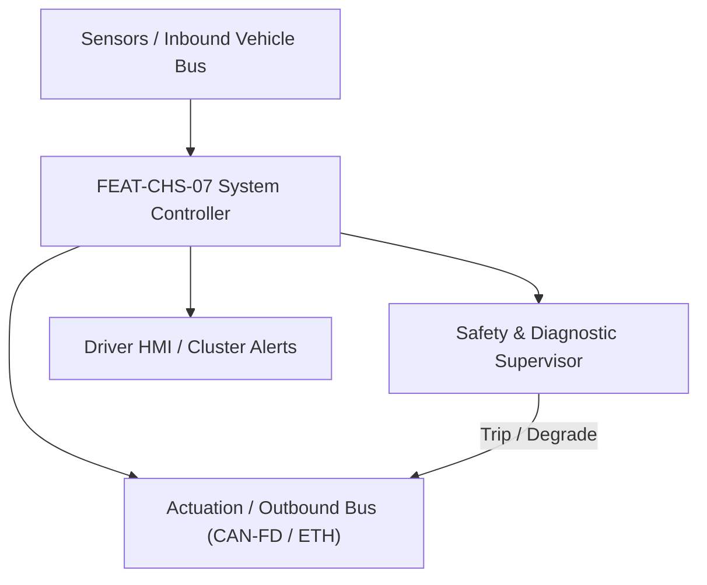
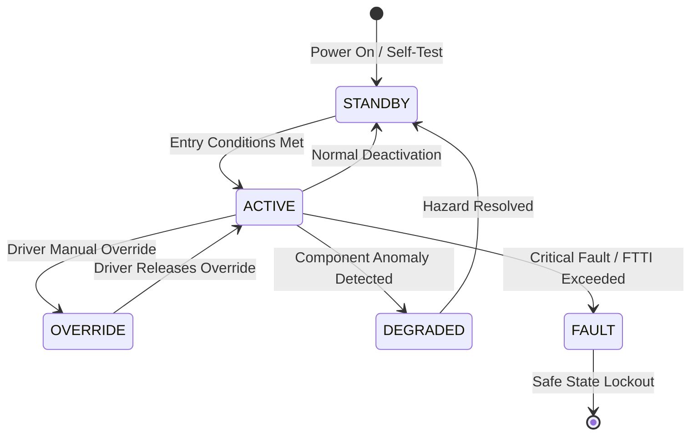

# System Requirements Specification: Rear-Wheel Steering with Co/Counter Steer (RWS)
**Feature ID:** `FEAT-CHS-07`  
**Domain:** Vehicle Motion & Chassis Control  
**Target ASIL:** ASIL D  
**Compliance Standard:** ISO 26262:2018 (Part 4 - System Development) / ASPICE PAM v3.1 (SYS.2, SYS.3)  
**Parent Master Specification:** [`spec.md`](file:///c:/Workset/AntiGravityProjects/TestOptimisationExperiement/spec.md#feat-chs-07-rws)  
**Derived Software Specification:** [`FEAT-CHS-07_RWS_SwReq.md`](file:///c:/Workset/AntiGravityProjects/TestOptimisationExperiement/software_requirements/FEAT-CHS-07_RWS_SwReq.md)

---

## 1. Feature Overview & Operational Scope

Dual-actuator rear-axle kinematic steering system providing up to +-10.0 degrees of rear wheel angle, executing low-speed counter-steering to slash turning circle and high-speed co-steering for lane-change yaw stability.

### Operational Context Architecture

---

## 2. Activation Logic & Operational States

- **Preconditions:** Dual redundant 12V power channels healthy, rear rack zero-center position calibrated, no active ABS/ESC fault.
- **Entry Conditions:** Ignition in RUN, vehicle moving in forward or reverse at speeds between 0 and 250 km/h.
- **Deactivation Conditions:** Actuator critical fault, dual power loss, or crash pyro trigger received.
- **Driver Override Behavior:** Rear steering angle demand is autonomously computed from front steering angle and vehicle velocity; driver can select 'Agile' or 'Comfort' dynamic mapping profiles.
- **Operational State Progression:**  
  `HOMING_ZERO` -> `COUNTER_STEER_AGILITY` -> `CO_STEER_STABILITY` -> `CRAB_WALK_DIAGONAL` -> `PARKING_TIGHT_RADIUS` -> `SINGLE_ACTUATOR_DEGRADED` -> `MECHANICAL_CENTER_LOCK`

### State Transition Diagram

---

## 3. Functional Safety & Failure Mitigation Concept

- **Functional Safety Goal:** SG-RWS-01: Prevent uncommanded asymmetric rear wheel steer > 0.5 degrees at speeds > 60 km/h; prevent sudden lockup in full counter-steer at highway speeds.
- **Fault Tolerant Time Interval (FTTI):** 25 ms
- **Safe State Definition:** De-energize rear steering BLDC motors; engage mechanical spring-loaded centering lock pin to lock rear wheels at 0.0 degrees.
- **Warning & Escalation Strategy:** Immediate red rear-axle steering icon on cluster; audible chime; prompt 'Rear Steering Locked to Center - Max Speed 100 km/h'.

### Failure Modes & Degradation Handling
- **Motor Inverter Overcurrent:** Open phase motor disconnect switches; allow mechanical spring pack to center rear rack within 80 ms.
- **Primary Resolver Loss:** Switch to redundant hall-effect position sensor in < 2 ms; clamp maximum steering rate to 5 deg/s.
- **Rear Wheel Angle Mismatch:** If left and right rear wheel angles diverge by > 0.3 degrees, trigger dual actuator emergency center lock.

---

## 4. System Requirements (SYS_REQ)
*(Note: Each System Requirement is systematically partitioned into multiple Child Software Requirements)*

### `SYS-CHS-07-01`: Vehicle Speed Dependent Ackermann Rear-Wheel Angle Computation
- **Planned Release:** R100
- **ASIL Rating:** ASIL D
- **Parent Feature:** [`FEAT-CHS-07`](file:///c:/Workset/AntiGravityProjects/TestOptimisationExperiement/spec.md#feat-chs-07)
- **Requirement Statement:**
  > The System SHALL compute target rear-wheel steering angle delta_r based on front steering angle delta_f and vehicle velocity v: Low speeds (< 50 km/h) counter-steer up to -10.0 deg; High speeds (> 70 km/h) co-steer up to +3.5 deg, with smooth linear interpolation through zero-transition zone (50-70 km/h) at <= 10 ms period.
- **Activation Logic:** Active at all times while vehicle is in motion.
- **Fault Tolerant Time Interval (FTTI):** 25 ms
- **Safe State Action:** Command target rear wheel angle to 0.0 degrees at controlled ramp rate (1.0 deg/s).
- **Failure Detection & Reaction:** If vehicle speed signal is lost or untrusted, default to 0.0 degrees rear steering angle.
- **Input Interfaces:** `Front_Steering_Angle_Deg, Vehicle_Speed_Kmph, Yaw_Rate_RadS, Lateral_Accel_Mps2`
- **Output Interfaces:** `Target_Rear_Wheel_Angle_Deg (float32), RWS_Dynamic_Mode_Enum`
- **System Verification Method:** Double lane-change (ISO 3888-2) and slalom dynamic vehicle proving ground testing.
- **Derived Child Software Requirements (1:N Link):**
  - [`SWR-CHS-07-01`](file:///c:/Workset/AntiGravityProjects/TestOptimisationExperiement/software_requirements/FEAT-CHS-07_RWS_SwReq.md#swr-chs-07-01)
  - [`SWR-CHS-07-02`](file:///c:/Workset/AntiGravityProjects/TestOptimisationExperiement/software_requirements/FEAT-CHS-07_RWS_SwReq.md#swr-chs-07-02)

### `SYS-CHS-07-02`: Dual-Redundant Rear Actuator Closed-Loop Angle Tracking & Mechanical Lock
- **Planned Release:** R100
- **ASIL Rating:** ASIL D
- **Parent Feature:** [`FEAT-CHS-07`](file:///c:/Workset/AntiGravityProjects/TestOptimisationExperiement/spec.md#feat-chs-07)
- **Requirement Statement:**
  > The System SHALL control dual brushless DC rack actuators to track target rear steering angle within +-0.1 deg accuracy and angular velocity up to 25 deg/s, engaging mechanical center-lock pin upon electrical fault in <= 50 ms.
- **Activation Logic:** Active when target rear wheel angle is computed.
- **Fault Tolerant Time Interval (FTTI):** 25 ms
- **Safe State Action:** Fire solenoid to drive mechanical centering wedge into rear tie rod rack.
- **Failure Detection & Reaction:** If single motor phase opens, run secondary actuator channel at 50% max torque.
- **Input Interfaces:** `Target_Rear_Wheel_Angle_Deg, Rear_Rack_Dual_Resolvers, Dual_Actuator_Current_Sensors`
- **Output Interfaces:** `Motor_PWM_Gates_ChannelA[6], Motor_PWM_Gates_ChannelB[6], Centering_Solenoid_Cmd`
- **System Verification Method:** Rear rack HIL endurance bench under 15 kN dynamic lateral tire load.
- **Derived Child Software Requirements (1:N Link):**
  - [`SWR-CHS-07-03`](file:///c:/Workset/AntiGravityProjects/TestOptimisationExperiement/software_requirements/FEAT-CHS-07_RWS_SwReq.md#swr-chs-07-03)
  - [`SWR-CHS-07-04`](file:///c:/Workset/AntiGravityProjects/TestOptimisationExperiement/software_requirements/FEAT-CHS-07_RWS_SwReq.md#swr-chs-07-04)

### `SYS-CHS-07-03`: Rear-Wheel Steering Low-Speed Counter-Phase Agility Angle Calculator
- **Planned Release:** R100
- **ASIL Rating:** ASIL D
- **Parent Feature:** [`FEAT-CHS-07`](file:///c:/Workset/AntiGravityProjects/TestOptimisationExperiement/spec.md#feat-chs-07)
- **Requirement Statement:**
  > The System SHALL Compute counter-phase rear wheel steering angle (up to -8.0° opposite to front wheels) at speeds < 40 km/h.
- **Activation Logic:** Active during normal vehicle operation when feature state is active.
- **Fault Tolerant Time Interval (FTTI):** 10 ms
- **Safe State Action:** Transition to safe state or safe degradation tier within FTTI budget.
- **Failure Detection & Reaction:** Isolate faulted channel, latch DEM diagnostic trouble code, and inform driver.
- **Input Interfaces:** `Sensor signals, vehicle dynamics data, and bus frames via RTE.`
- **Output Interfaces:** `Actuator commands, diagnostic event flags, and cluster alerts.`
- **System Verification Method:** HiL test bench and dynamometer automated verification.
- **Derived Child Software Requirements (1:N Link):**
  - [`SWR-CHS-07-05`](file:///c:/Workset/AntiGravityProjects/TestOptimisationExperiement/software_requirements/FEAT-CHS-07_RWS_SwReq.md#swr-chs-07-05)
  - [`SWR-CHS-07-06`](file:///c:/Workset/AntiGravityProjects/TestOptimisationExperiement/software_requirements/FEAT-CHS-07_RWS_SwReq.md#swr-chs-07-06)

### `SYS-CHS-07-04`: High-Speed Co-Phase Directional Stability Rear Steering Angle Calculator
- **Planned Release:** R100
- **ASIL Rating:** ASIL D
- **Parent Feature:** [`FEAT-CHS-07`](file:///c:/Workset/AntiGravityProjects/TestOptimisationExperiement/spec.md#feat-chs-07)
- **Requirement Statement:**
  > The System SHALL Compute co-phase rear wheel steering angle (up to +3.5° matching front wheels) at speeds > 70 km/h.
- **Activation Logic:** Active during normal vehicle operation when feature state is active.
- **Fault Tolerant Time Interval (FTTI):** 10 ms
- **Safe State Action:** Transition to safe state or safe degradation tier within FTTI budget.
- **Failure Detection & Reaction:** Isolate faulted channel, latch DEM diagnostic trouble code, and inform driver.
- **Input Interfaces:** `Sensor signals, vehicle dynamics data, and bus frames via RTE.`
- **Output Interfaces:** `Actuator commands, diagnostic event flags, and cluster alerts.`
- **System Verification Method:** HiL test bench and dynamometer automated verification.
- **Derived Child Software Requirements (1:N Link):**
  - [`SWR-CHS-07-07`](file:///c:/Workset/AntiGravityProjects/TestOptimisationExperiement/software_requirements/FEAT-CHS-07_RWS_SwReq.md#swr-chs-07-07)
  - [`SWR-CHS-07-08`](file:///c:/Workset/AntiGravityProjects/TestOptimisationExperiement/software_requirements/FEAT-CHS-07_RWS_SwReq.md#swr-chs-07-08)

### `SYS-CHS-07-05`: Zero-Yaw Dynamic Crab Angle & Lateral Lane Change Transition Law
- **Planned Release:** R200
- **ASIL Rating:** ASIL D
- **Parent Feature:** [`FEAT-CHS-07`](file:///c:/Workset/AntiGravityProjects/TestOptimisationExperiement/spec.md#feat-chs-07)
- **Requirement Statement:**
  > The System SHALL Synthesize co-phase steering angle to allow lateral lane translation with zero vehicle body yaw rotation.
- **Activation Logic:** Active during normal vehicle operation when feature state is active.
- **Fault Tolerant Time Interval (FTTI):** 10 ms
- **Safe State Action:** Transition to safe state or safe degradation tier within FTTI budget.
- **Failure Detection & Reaction:** Isolate faulted channel, latch DEM diagnostic trouble code, and inform driver.
- **Input Interfaces:** `Sensor signals, vehicle dynamics data, and bus frames via RTE.`
- **Output Interfaces:** `Actuator commands, diagnostic event flags, and cluster alerts.`
- **System Verification Method:** HiL test bench and dynamometer automated verification.
- **Derived Child Software Requirements (1:N Link):**
  - [`SWR-CHS-07-09`](file:///c:/Workset/AntiGravityProjects/TestOptimisationExperiement/software_requirements/FEAT-CHS-07_RWS_SwReq.md#swr-chs-07-09)
  - [`SWR-CHS-07-10`](file:///c:/Workset/AntiGravityProjects/TestOptimisationExperiement/software_requirements/FEAT-CHS-07_RWS_SwReq.md#swr-chs-07-10)

### `SYS-CHS-07-06`: Rear Steering Electromechanical Linear Actuator Closed-Loop Position Servo
- **Planned Release:** R200
- **ASIL Rating:** ASIL D
- **Parent Feature:** [`FEAT-CHS-07`](file:///c:/Workset/AntiGravityProjects/TestOptimisationExperiement/spec.md#feat-chs-07)
- **Requirement Statement:**
  > The System SHALL Drive brushless motor actuator to position rear toe links with positional accuracy <= 0.05°.
- **Activation Logic:** Active during normal vehicle operation when feature state is active.
- **Fault Tolerant Time Interval (FTTI):** 2 ms
- **Safe State Action:** Transition to safe state or safe degradation tier within FTTI budget.
- **Failure Detection & Reaction:** Isolate faulted channel, latch DEM diagnostic trouble code, and inform driver.
- **Input Interfaces:** `Sensor signals, vehicle dynamics data, and bus frames via RTE.`
- **Output Interfaces:** `Actuator commands, diagnostic event flags, and cluster alerts.`
- **System Verification Method:** HiL test bench and dynamometer automated verification.
- **Derived Child Software Requirements (1:N Link):**
  - [`SWR-CHS-07-11`](file:///c:/Workset/AntiGravityProjects/TestOptimisationExperiement/software_requirements/FEAT-CHS-07_RWS_SwReq.md#swr-chs-07-11)
  - [`SWR-CHS-07-12`](file:///c:/Workset/AntiGravityProjects/TestOptimisationExperiement/software_requirements/FEAT-CHS-07_RWS_SwReq.md#swr-chs-07-12)

### `SYS-CHS-07-07`: Dual Redundant Hall/Resolver Rear Toe-Angle Sensor Cross-Monitor
- **Planned Release:** R200
- **ASIL Rating:** ASIL D
- **Parent Feature:** [`FEAT-CHS-07`](file:///c:/Workset/AntiGravityProjects/TestOptimisationExperiement/spec.md#feat-chs-07)
- **Requirement Statement:**
  > The System SHALL Cross-check dual independent rear wheel angle sensors: Trip fault if discrepancy > 0.20° roadwheel angle.
- **Activation Logic:** Active during normal vehicle operation when feature state is active.
- **Fault Tolerant Time Interval (FTTI):** 2 ms
- **Safe State Action:** Transition to safe state or safe degradation tier within FTTI budget.
- **Failure Detection & Reaction:** Isolate faulted channel, latch DEM diagnostic trouble code, and inform driver.
- **Input Interfaces:** `Sensor signals, vehicle dynamics data, and bus frames via RTE.`
- **Output Interfaces:** `Actuator commands, diagnostic event flags, and cluster alerts.`
- **System Verification Method:** HiL test bench and dynamometer automated verification.
- **Derived Child Software Requirements (1:N Link):**
  - [`SWR-CHS-07-13`](file:///c:/Workset/AntiGravityProjects/TestOptimisationExperiement/software_requirements/FEAT-CHS-07_RWS_SwReq.md#swr-chs-07-13)
  - [`SWR-CHS-07-14`](file:///c:/Workset/AntiGravityProjects/TestOptimisationExperiement/software_requirements/FEAT-CHS-07_RWS_SwReq.md#swr-chs-07-14)

### `SYS-CHS-07-08`: Dual-Inverter Symmetrical Motor Winding Load Sharing Controller
- **Planned Release:** R500
- **ASIL Rating:** ASIL D
- **Parent Feature:** [`FEAT-CHS-07`](file:///c:/Workset/AntiGravityProjects/TestOptimisationExperiement/spec.md#feat-chs-07)
- **Requirement Statement:**
  > The System SHALL Partition demanded rear steering force 50/50 across dual independent inverter channels.
- **Activation Logic:** Active during normal vehicle operation when feature state is active.
- **Fault Tolerant Time Interval (FTTI):** 2 ms
- **Safe State Action:** Transition to safe state or safe degradation tier within FTTI budget.
- **Failure Detection & Reaction:** Isolate faulted channel, latch DEM diagnostic trouble code, and inform driver.
- **Input Interfaces:** `Sensor signals, vehicle dynamics data, and bus frames via RTE.`
- **Output Interfaces:** `Actuator commands, diagnostic event flags, and cluster alerts.`
- **System Verification Method:** HiL test bench and dynamometer automated verification.
- **Derived Child Software Requirements (1:N Link):**
  - [`SWR-CHS-07-15`](file:///c:/Workset/AntiGravityProjects/TestOptimisationExperiement/software_requirements/FEAT-CHS-07_RWS_SwReq.md#swr-chs-07-15)
  - [`SWR-CHS-07-16`](file:///c:/Workset/AntiGravityProjects/TestOptimisationExperiement/software_requirements/FEAT-CHS-07_RWS_SwReq.md#swr-chs-07-16)

### `SYS-CHS-07-09`: Single-Channel Fault Autonomous 100% Load Takeover in <= 5 ms
- **Planned Release:** R300
- **ASIL Rating:** ASIL D
- **Parent Feature:** [`FEAT-CHS-07`](file:///c:/Workset/AntiGravityProjects/TestOptimisationExperiement/spec.md#feat-chs-07)
- **Requirement Statement:**
  > The System SHALL Ramp healthy inverter to full power in <= 5 ms if one winding bridge reports electrical fault.
- **Activation Logic:** Active during normal vehicle operation when feature state is active.
- **Fault Tolerant Time Interval (FTTI):** 5 ms
- **Safe State Action:** Transition to safe state or safe degradation tier within FTTI budget.
- **Failure Detection & Reaction:** Isolate faulted channel, latch DEM diagnostic trouble code, and inform driver.
- **Input Interfaces:** `Sensor signals, vehicle dynamics data, and bus frames via RTE.`
- **Output Interfaces:** `Actuator commands, diagnostic event flags, and cluster alerts.`
- **System Verification Method:** HiL test bench and dynamometer automated verification.
- **Derived Child Software Requirements (1:N Link):**
  - [`SWR-CHS-07-17`](file:///c:/Workset/AntiGravityProjects/TestOptimisationExperiement/software_requirements/FEAT-CHS-07_RWS_SwReq.md#swr-chs-07-17)
  - [`SWR-CHS-07-18`](file:///c:/Workset/AntiGravityProjects/TestOptimisationExperiement/software_requirements/FEAT-CHS-07_RWS_SwReq.md#swr-chs-07-18)

### `SYS-CHS-07-10`: Rear Mechanical Spring-Loaded Center-Lock Fallback Mechanism
- **Planned Release:** R300
- **ASIL Rating:** ASIL D
- **Parent Feature:** [`FEAT-CHS-07`](file:///c:/Workset/AntiGravityProjects/TestOptimisationExperiement/spec.md#feat-chs-07)
- **Requirement Statement:**
  > The System SHALL De-energize electromagnetic brake to allow mechanical centering spring to lock rear wheels at 0.0° in <= 50 ms.
- **Activation Logic:** Active during normal vehicle operation when feature state is active.
- **Fault Tolerant Time Interval (FTTI):** 10 ms
- **Safe State Action:** Transition to safe state or safe degradation tier within FTTI budget.
- **Failure Detection & Reaction:** Isolate faulted channel, latch DEM diagnostic trouble code, and inform driver.
- **Input Interfaces:** `Sensor signals, vehicle dynamics data, and bus frames via RTE.`
- **Output Interfaces:** `Actuator commands, diagnostic event flags, and cluster alerts.`
- **System Verification Method:** HiL test bench and dynamometer automated verification.
- **Derived Child Software Requirements (1:N Link):**
  - [`SWR-CHS-07-19`](file:///c:/Workset/AntiGravityProjects/TestOptimisationExperiement/software_requirements/FEAT-CHS-07_RWS_SwReq.md#swr-chs-07-19)
  - [`SWR-CHS-07-20`](file:///c:/Workset/AntiGravityProjects/TestOptimisationExperiement/software_requirements/FEAT-CHS-07_RWS_SwReq.md#swr-chs-07-20)

### `SYS-CHS-07-11`: ESC Stability Override & Rear-Axle Active Counter-Steer Yaw Damper
- **Planned Release:** R400
- **ASIL Rating:** ASIL D
- **Parent Feature:** [`FEAT-CHS-07`](file:///c:/Workset/AntiGravityProjects/TestOptimisationExperiement/spec.md#feat-chs-07)
- **Requirement Statement:**
  > The System SHALL Apply up to +-2.5° fast rear counter-steer in <= 30 ms to stabilize split-mu braking or oversteer slides.
- **Activation Logic:** Active during normal vehicle operation when feature state is active.
- **Fault Tolerant Time Interval (FTTI):** 5 ms
- **Safe State Action:** Transition to safe state or safe degradation tier within FTTI budget.
- **Failure Detection & Reaction:** Isolate faulted channel, latch DEM diagnostic trouble code, and inform driver.
- **Input Interfaces:** `Sensor signals, vehicle dynamics data, and bus frames via RTE.`
- **Output Interfaces:** `Actuator commands, diagnostic event flags, and cluster alerts.`
- **System Verification Method:** HiL test bench and dynamometer automated verification.
- **Derived Child Software Requirements (1:N Link):**
  - [`SWR-CHS-07-21`](file:///c:/Workset/AntiGravityProjects/TestOptimisationExperiement/software_requirements/FEAT-CHS-07_RWS_SwReq.md#swr-chs-07-21)
  - [`SWR-CHS-07-22`](file:///c:/Workset/AntiGravityProjects/TestOptimisationExperiement/software_requirements/FEAT-CHS-07_RWS_SwReq.md#swr-chs-07-22)

### `SYS-CHS-07-12`: Rear Wheel Tire Kinematic Clearance & Suspension Bump Envelope Guard
- **Planned Release:** R400
- **ASIL Rating:** ASIL D
- **Parent Feature:** [`FEAT-CHS-07`](file:///c:/Workset/AntiGravityProjects/TestOptimisationExperiement/spec.md#feat-chs-07)
- **Requirement Statement:**
  > The System SHALL Clamp maximum rear steering angle as suspension compresses to prevent tire rubbing wheel arch liners.
- **Activation Logic:** Active during normal vehicle operation when feature state is active.
- **Fault Tolerant Time Interval (FTTI):** 10 ms
- **Safe State Action:** Transition to safe state or safe degradation tier within FTTI budget.
- **Failure Detection & Reaction:** Isolate faulted channel, latch DEM diagnostic trouble code, and inform driver.
- **Input Interfaces:** `Sensor signals, vehicle dynamics data, and bus frames via RTE.`
- **Output Interfaces:** `Actuator commands, diagnostic event flags, and cluster alerts.`
- **System Verification Method:** HiL test bench and dynamometer automated verification.
- **Derived Child Software Requirements (1:N Link):**
  - [`SWR-CHS-07-23`](file:///c:/Workset/AntiGravityProjects/TestOptimisationExperiement/software_requirements/FEAT-CHS-07_RWS_SwReq.md#swr-chs-07-23)
  - [`SWR-CHS-07-24`](file:///c:/Workset/AntiGravityProjects/TestOptimisationExperiement/software_requirements/FEAT-CHS-07_RWS_SwReq.md#swr-chs-07-24)

### `SYS-CHS-07-13`: Actuator Thermal Overload & Continuous High-Load Torque Derater
- **Planned Release:** R400
- **ASIL Rating:** ASIL B
- **Parent Feature:** [`FEAT-CHS-07`](file:///c:/Workset/AntiGravityProjects/TestOptimisationExperiement/spec.md#feat-chs-07)
- **Requirement Statement:**
  > The System SHALL Derate maximum rear steering rate if motor winding temperature exceeds 135 °C during repeated slaloms.
- **Activation Logic:** Active during normal vehicle operation when feature state is active.
- **Fault Tolerant Time Interval (FTTI):** 100 ms
- **Safe State Action:** Transition to safe state or safe degradation tier within FTTI budget.
- **Failure Detection & Reaction:** Isolate faulted channel, latch DEM diagnostic trouble code, and inform driver.
- **Input Interfaces:** `Sensor signals, vehicle dynamics data, and bus frames via RTE.`
- **Output Interfaces:** `Actuator commands, diagnostic event flags, and cluster alerts.`
- **System Verification Method:** HiL test bench and dynamometer automated verification.
- **Derived Child Software Requirements (1:N Link):**
  - [`SWR-CHS-07-25`](file:///c:/Workset/AntiGravityProjects/TestOptimisationExperiement/software_requirements/FEAT-CHS-07_RWS_SwReq.md#swr-chs-07-25)
  - [`SWR-CHS-07-26`](file:///c:/Workset/AntiGravityProjects/TestOptimisationExperiement/software_requirements/FEAT-CHS-07_RWS_SwReq.md#swr-chs-07-26)

### `SYS-CHS-07-14`: Dual Core Lockstep Microcontroller Safety Gatekeeper & Token Validator
- **Planned Release:** R400
- **ASIL Rating:** ASIL D
- **Parent Feature:** [`FEAT-CHS-07`](file:///c:/Workset/AntiGravityProjects/TestOptimisationExperiement/spec.md#feat-chs-07)
- **Requirement Statement:**
  > The System SHALL Verify execution tokens between Core 0 and Core 1; fire center-lock pin upon computation disagreement.
- **Activation Logic:** Active during normal vehicle operation when feature state is active.
- **Fault Tolerant Time Interval (FTTI):** 2 ms
- **Safe State Action:** Transition to safe state or safe degradation tier within FTTI budget.
- **Failure Detection & Reaction:** Isolate faulted channel, latch DEM diagnostic trouble code, and inform driver.
- **Input Interfaces:** `Sensor signals, vehicle dynamics data, and bus frames via RTE.`
- **Output Interfaces:** `Actuator commands, diagnostic event flags, and cluster alerts.`
- **System Verification Method:** HiL test bench and dynamometer automated verification.
- **Derived Child Software Requirements (1:N Link):**
  - [`SWR-CHS-07-27`](file:///c:/Workset/AntiGravityProjects/TestOptimisationExperiement/software_requirements/FEAT-CHS-07_RWS_SwReq.md#swr-chs-07-27)
  - [`SWR-CHS-07-28`](file:///c:/Workset/AntiGravityProjects/TestOptimisationExperiement/software_requirements/FEAT-CHS-07_RWS_SwReq.md#swr-chs-07-28)

### `SYS-CHS-07-15`: DEM Rear-Wheel Steering Diagnostic Event Manager & DTC Logger
- **Planned Release:** R500
- **ASIL Rating:** ASIL D
- **Parent Feature:** [`FEAT-CHS-07`](file:///c:/Workset/AntiGravityProjects/TestOptimisationExperiement/spec.md#feat-chs-07)
- **Requirement Statement:**
  > The System SHALL Qualify diagnostic fault codes for actuator jam, resolver error, and mechanical center-lock failures.
- **Activation Logic:** Active during normal vehicle operation when feature state is active.
- **Fault Tolerant Time Interval (FTTI):** 20 ms
- **Safe State Action:** Transition to safe state or safe degradation tier within FTTI budget.
- **Failure Detection & Reaction:** Isolate faulted channel, latch DEM diagnostic trouble code, and inform driver.
- **Input Interfaces:** `Sensor signals, vehicle dynamics data, and bus frames via RTE.`
- **Output Interfaces:** `Actuator commands, diagnostic event flags, and cluster alerts.`
- **System Verification Method:** HiL test bench and dynamometer automated verification.
- **Derived Child Software Requirements (1:N Link):**
  - [`SWR-CHS-07-29`](file:///c:/Workset/AntiGravityProjects/TestOptimisationExperiement/software_requirements/FEAT-CHS-07_RWS_SwReq.md#swr-chs-07-29)
  - [`SWR-CHS-07-30`](file:///c:/Workset/AntiGravityProjects/TestOptimisationExperiement/software_requirements/FEAT-CHS-07_RWS_SwReq.md#swr-chs-07-30)

### `SYS-CHS-07-16`: Instrument Cluster Rear-Wheel Steering Health Status & Turning Radius HMI
- **Planned Release:** R500
- **ASIL Rating:** ASIL B
- **Parent Feature:** [`FEAT-CHS-07`](file:///c:/Workset/AntiGravityProjects/TestOptimisationExperiement/spec.md#feat-chs-07)
- **Requirement Statement:**
  > The System SHALL Transmit RWS operational status, turning circle animation, and warning messages to cluster display.
- **Activation Logic:** Active during normal vehicle operation when feature state is active.
- **Fault Tolerant Time Interval (FTTI):** 50 ms
- **Safe State Action:** Transition to safe state or safe degradation tier within FTTI budget.
- **Failure Detection & Reaction:** Isolate faulted channel, latch DEM diagnostic trouble code, and inform driver.
- **Input Interfaces:** `Sensor signals, vehicle dynamics data, and bus frames via RTE.`
- **Output Interfaces:** `Actuator commands, diagnostic event flags, and cluster alerts.`
- **System Verification Method:** HiL test bench and dynamometer automated verification.
- **Derived Child Software Requirements (1:N Link):**
  - [`SWR-CHS-07-31`](file:///c:/Workset/AntiGravityProjects/TestOptimisationExperiement/software_requirements/FEAT-CHS-07_RWS_SwReq.md#swr-chs-07-31)
  - [`SWR-CHS-07-32`](file:///c:/Workset/AntiGravityProjects/TestOptimisationExperiement/software_requirements/FEAT-CHS-07_RWS_SwReq.md#swr-chs-07-32)

---

## 5. System-to-Software Traceability Summary

| System Requirement ID | Planned Release | ASIL | Title | Derived Software Requirements (1:N) | Verification Method |
| :--- | :---: | :--- | :--- | :--- | :--- |
| `SYS-CHS-07-01` | **`R100`** | ASIL D | Vehicle Speed Dependent Ackermann Rear-Wheel Angle Computation | [`SWR-CHS-07-01`](file:///c:/Workset/AntiGravityProjects/TestOptimisationExperiement/software_requirements/FEAT-CHS-07_RWS_SwReq.md#swr-chs-07-01), [`SWR-CHS-07-02`](file:///c:/Workset/AntiGravityProjects/TestOptimisationExperiement/software_requirements/FEAT-CHS-07_RWS_SwReq.md#swr-chs-07-02) | Double lane-change (ISO 3888-2) and slalom dynamic vehicle proving ground testing. |
| `SYS-CHS-07-02` | **`R100`** | ASIL D | Dual-Redundant Rear Actuator Closed-Loop Angle Tracking & Mechanical Lock | [`SWR-CHS-07-03`](file:///c:/Workset/AntiGravityProjects/TestOptimisationExperiement/software_requirements/FEAT-CHS-07_RWS_SwReq.md#swr-chs-07-03), [`SWR-CHS-07-04`](file:///c:/Workset/AntiGravityProjects/TestOptimisationExperiement/software_requirements/FEAT-CHS-07_RWS_SwReq.md#swr-chs-07-04) | Rear rack HIL endurance bench under 15 kN dynamic lateral tire load. |
| `SYS-CHS-07-03` | **`R100`** | ASIL D | Rear-Wheel Steering Low-Speed Counter-Phase Agility Angle Calculator | [`SWR-CHS-07-05`](file:///c:/Workset/AntiGravityProjects/TestOptimisationExperiement/software_requirements/FEAT-CHS-07_RWS_SwReq.md#swr-chs-07-05), [`SWR-CHS-07-06`](file:///c:/Workset/AntiGravityProjects/TestOptimisationExperiement/software_requirements/FEAT-CHS-07_RWS_SwReq.md#swr-chs-07-06) | HiL test bench and dynamometer automated verification. |
| `SYS-CHS-07-04` | **`R100`** | ASIL D | High-Speed Co-Phase Directional Stability Rear Steering Angle Calculator | [`SWR-CHS-07-07`](file:///c:/Workset/AntiGravityProjects/TestOptimisationExperiement/software_requirements/FEAT-CHS-07_RWS_SwReq.md#swr-chs-07-07), [`SWR-CHS-07-08`](file:///c:/Workset/AntiGravityProjects/TestOptimisationExperiement/software_requirements/FEAT-CHS-07_RWS_SwReq.md#swr-chs-07-08) | HiL test bench and dynamometer automated verification. |
| `SYS-CHS-07-05` | **`R200`** | ASIL D | Zero-Yaw Dynamic Crab Angle & Lateral Lane Change Transition Law | [`SWR-CHS-07-09`](file:///c:/Workset/AntiGravityProjects/TestOptimisationExperiement/software_requirements/FEAT-CHS-07_RWS_SwReq.md#swr-chs-07-09), [`SWR-CHS-07-10`](file:///c:/Workset/AntiGravityProjects/TestOptimisationExperiement/software_requirements/FEAT-CHS-07_RWS_SwReq.md#swr-chs-07-10) | HiL test bench and dynamometer automated verification. |
| `SYS-CHS-07-06` | **`R200`** | ASIL D | Rear Steering Electromechanical Linear Actuator Closed-Loop Position Servo | [`SWR-CHS-07-11`](file:///c:/Workset/AntiGravityProjects/TestOptimisationExperiement/software_requirements/FEAT-CHS-07_RWS_SwReq.md#swr-chs-07-11), [`SWR-CHS-07-12`](file:///c:/Workset/AntiGravityProjects/TestOptimisationExperiement/software_requirements/FEAT-CHS-07_RWS_SwReq.md#swr-chs-07-12) | HiL test bench and dynamometer automated verification. |
| `SYS-CHS-07-07` | **`R200`** | ASIL D | Dual Redundant Hall/Resolver Rear Toe-Angle Sensor Cross-Monitor | [`SWR-CHS-07-13`](file:///c:/Workset/AntiGravityProjects/TestOptimisationExperiement/software_requirements/FEAT-CHS-07_RWS_SwReq.md#swr-chs-07-13), [`SWR-CHS-07-14`](file:///c:/Workset/AntiGravityProjects/TestOptimisationExperiement/software_requirements/FEAT-CHS-07_RWS_SwReq.md#swr-chs-07-14) | HiL test bench and dynamometer automated verification. |
| `SYS-CHS-07-08` | **`R500`** | ASIL D | Dual-Inverter Symmetrical Motor Winding Load Sharing Controller | [`SWR-CHS-07-15`](file:///c:/Workset/AntiGravityProjects/TestOptimisationExperiement/software_requirements/FEAT-CHS-07_RWS_SwReq.md#swr-chs-07-15), [`SWR-CHS-07-16`](file:///c:/Workset/AntiGravityProjects/TestOptimisationExperiement/software_requirements/FEAT-CHS-07_RWS_SwReq.md#swr-chs-07-16) | HiL test bench and dynamometer automated verification. |
| `SYS-CHS-07-09` | **`R300`** | ASIL D | Single-Channel Fault Autonomous 100% Load Takeover in <= 5 ms | [`SWR-CHS-07-17`](file:///c:/Workset/AntiGravityProjects/TestOptimisationExperiement/software_requirements/FEAT-CHS-07_RWS_SwReq.md#swr-chs-07-17), [`SWR-CHS-07-18`](file:///c:/Workset/AntiGravityProjects/TestOptimisationExperiement/software_requirements/FEAT-CHS-07_RWS_SwReq.md#swr-chs-07-18) | HiL test bench and dynamometer automated verification. |
| `SYS-CHS-07-10` | **`R300`** | ASIL D | Rear Mechanical Spring-Loaded Center-Lock Fallback Mechanism | [`SWR-CHS-07-19`](file:///c:/Workset/AntiGravityProjects/TestOptimisationExperiement/software_requirements/FEAT-CHS-07_RWS_SwReq.md#swr-chs-07-19), [`SWR-CHS-07-20`](file:///c:/Workset/AntiGravityProjects/TestOptimisationExperiement/software_requirements/FEAT-CHS-07_RWS_SwReq.md#swr-chs-07-20) | HiL test bench and dynamometer automated verification. |
| `SYS-CHS-07-11` | **`R400`** | ASIL D | ESC Stability Override & Rear-Axle Active Counter-Steer Yaw Damper | [`SWR-CHS-07-21`](file:///c:/Workset/AntiGravityProjects/TestOptimisationExperiement/software_requirements/FEAT-CHS-07_RWS_SwReq.md#swr-chs-07-21), [`SWR-CHS-07-22`](file:///c:/Workset/AntiGravityProjects/TestOptimisationExperiement/software_requirements/FEAT-CHS-07_RWS_SwReq.md#swr-chs-07-22) | HiL test bench and dynamometer automated verification. |
| `SYS-CHS-07-12` | **`R400`** | ASIL D | Rear Wheel Tire Kinematic Clearance & Suspension Bump Envelope Guard | [`SWR-CHS-07-23`](file:///c:/Workset/AntiGravityProjects/TestOptimisationExperiement/software_requirements/FEAT-CHS-07_RWS_SwReq.md#swr-chs-07-23), [`SWR-CHS-07-24`](file:///c:/Workset/AntiGravityProjects/TestOptimisationExperiement/software_requirements/FEAT-CHS-07_RWS_SwReq.md#swr-chs-07-24) | HiL test bench and dynamometer automated verification. |
| `SYS-CHS-07-13` | **`R400`** | ASIL B | Actuator Thermal Overload & Continuous High-Load Torque Derater | [`SWR-CHS-07-25`](file:///c:/Workset/AntiGravityProjects/TestOptimisationExperiement/software_requirements/FEAT-CHS-07_RWS_SwReq.md#swr-chs-07-25), [`SWR-CHS-07-26`](file:///c:/Workset/AntiGravityProjects/TestOptimisationExperiement/software_requirements/FEAT-CHS-07_RWS_SwReq.md#swr-chs-07-26) | HiL test bench and dynamometer automated verification. |
| `SYS-CHS-07-14` | **`R400`** | ASIL D | Dual Core Lockstep Microcontroller Safety Gatekeeper & Token Validator | [`SWR-CHS-07-27`](file:///c:/Workset/AntiGravityProjects/TestOptimisationExperiement/software_requirements/FEAT-CHS-07_RWS_SwReq.md#swr-chs-07-27), [`SWR-CHS-07-28`](file:///c:/Workset/AntiGravityProjects/TestOptimisationExperiement/software_requirements/FEAT-CHS-07_RWS_SwReq.md#swr-chs-07-28) | HiL test bench and dynamometer automated verification. |
| `SYS-CHS-07-15` | **`R500`** | ASIL D | DEM Rear-Wheel Steering Diagnostic Event Manager & DTC Logger | [`SWR-CHS-07-29`](file:///c:/Workset/AntiGravityProjects/TestOptimisationExperiement/software_requirements/FEAT-CHS-07_RWS_SwReq.md#swr-chs-07-29), [`SWR-CHS-07-30`](file:///c:/Workset/AntiGravityProjects/TestOptimisationExperiement/software_requirements/FEAT-CHS-07_RWS_SwReq.md#swr-chs-07-30) | HiL test bench and dynamometer automated verification. |
| `SYS-CHS-07-16` | **`R500`** | ASIL B | Instrument Cluster Rear-Wheel Steering Health Status & Turning Radius HMI | [`SWR-CHS-07-31`](file:///c:/Workset/AntiGravityProjects/TestOptimisationExperiement/software_requirements/FEAT-CHS-07_RWS_SwReq.md#swr-chs-07-31), [`SWR-CHS-07-32`](file:///c:/Workset/AntiGravityProjects/TestOptimisationExperiement/software_requirements/FEAT-CHS-07_RWS_SwReq.md#swr-chs-07-32) | HiL test bench and dynamometer automated verification. |

- **Upstream Feature Link:** [`spec.md` (FEAT-CHS-07)](file:///c:/Workset/AntiGravityProjects/TestOptimisationExperiement/spec.md#feat-chs-07)
- **Software Requirements Specification:** [`FEAT-CHS-07_RWS_SwReq.md`](file:///c:/Workset/AntiGravityProjects/TestOptimisationExperiement/software_requirements/FEAT-CHS-07_RWS_SwReq.md)
