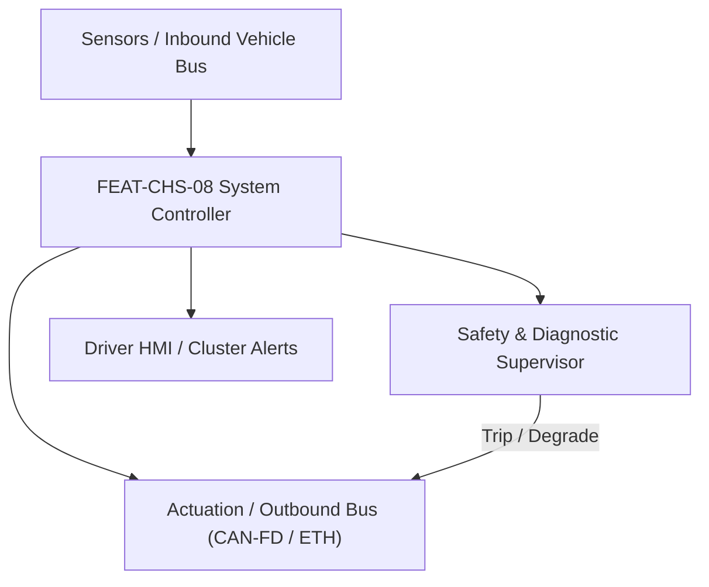
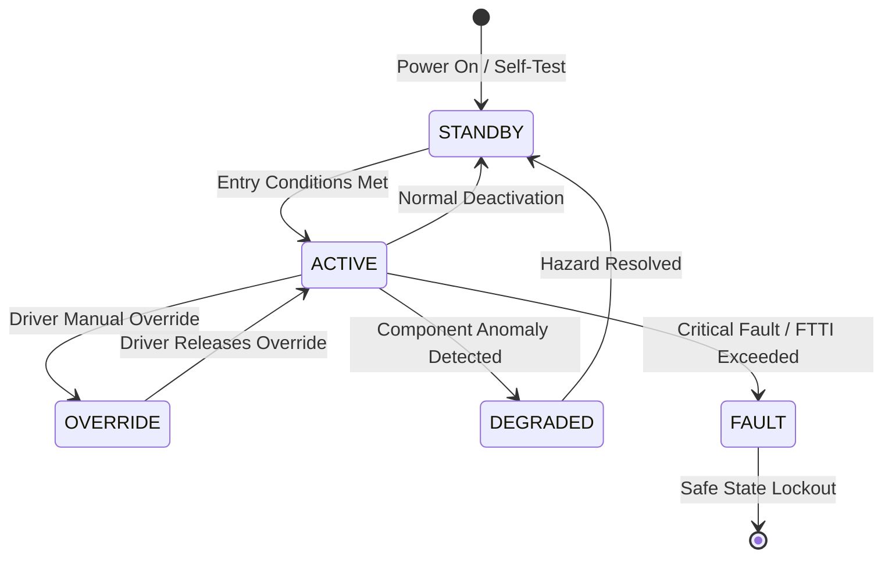

# System Requirements Specification: Electronic Active Roll Stabilization (e-ARS)
**Feature ID:** `FEAT-CHS-08`  
**Domain:** Vehicle Motion & Chassis Control  
**Target ASIL:** ASIL C  
**Compliance Standard:** ISO 26262:2018 (Part 4 - System Development) / ASPICE PAM v3.1 (SYS.2, SYS.3)  
**Parent Master Specification:** [`spec.md`](file:///c:/Workset/AntiGravityProjects/TestOptimisationExperiement/spec.md#feat-chs-08-e-ars)  
**Derived Software Specification:** [`FEAT-CHS-08_e-ARS_SwReq.md`](file:///c:/Workset/AntiGravityProjects/TestOptimisationExperiement/software_requirements/FEAT-CHS-08_e-ARS_SwReq.md)

---

## 1. Feature Overview & Operational Scope

High-dynamic electromechanical anti-roll bars front and rear powered by 48V / HV motors, decoupling suspension in straight-line driving for supple ride comfort while delivering up to 1400 Nm stabilizing torque to eliminate body roll in corners.

### Operational Context Architecture

---

## 2. Activation Logic & Operational States

- **Preconditions:** 48V DC-DC converter operational, front and rear actuator planetary gearboxes calibrated, chassis IMU calibrated.
- **Entry Conditions:** Ignition in RUN, vehicle speed > 15 km/h, lateral acceleration |a_y| > 0.5 m/s².
- **Deactivation Conditions:** Vehicle stationary, or driver engages off-road rock crawling mode (full bar decoupling).
- **Driver Override Behavior:** Driver selection of 'Dynamic' mode stiffens roll response and induces neutral steering balance; 'Comfort' prioritizes single-wheel bump isolation.
- **Operational State Progression:**  
  `DISCONNECTED_STRAIGHT` -> `ACTIVE_ROLL_STIFFENING` -> `DYNAMIC_CURVE_TILT` -> `OFF_ROAD_ARTICULATION` -> `48V_THERMAL_DERATE` -> `FAILSAFE_PASSIVE`

### State Transition Diagram

---

## 3. Functional Safety & Failure Mitigation Concept

- **Functional Safety Goal:** SG-EARS-01: Prevent uncommanded asymmetric roll torque > 300 Nm in straight-line driving; avoid sudden roll torque inversion during sustained cornering.
- **Fault Tolerant Time Interval (FTTI):** 50 ms
- **Safe State Definition:** Open motor winding relays; revert anti-roll bars to neutral passive torsional stiffness.
- **Warning & Escalation Strategy:** Display amber chassis icon on cluster; prompt 'Active Roll Stabilization Limited - Drive with Caution'.

### Failure Modes & Degradation Handling
- **Lateral Accel Sensor Fault:** If primary IMU lateral acceleration disagrees with front steering angle estimation by > 2.0 m/s², isolate sensor and revert to kinematic look-up.
- **Motor Temperature Overheat:** If 48V motor winding temp > 140°C, derate peak stabilizing torque by 50%; if > 160°C, open motor relays.

---

## 4. System Requirements (SYS_REQ)
*(Note: Each System Requirement is systematically partitioned into multiple Child Software Requirements)*

### `SYS-CHS-08-01`: Chassis Lateral Dynamics Roll Moment Distribution Calculator
- **Planned Release:** R500
- **ASIL Rating:** ASIL C
- **Parent Feature:** [`FEAT-CHS-08`](file:///c:/Workset/AntiGravityProjects/TestOptimisationExperiement/spec.md#feat-chs-08)
- **Requirement Statement:**
  > The System SHALL sample lateral acceleration, yaw rate, and steering angle at 100 Hz, calculating total vehicle roll moment demand and distributing torque between front axle (40-70%) and rear axle (30-60%) to suppress vehicle body roll angle to <= 1.5 deg up to 0.8g lateral acceleration.
- **Activation Logic:** Active at all times while vehicle speed > 15 km/h.
- **Fault Tolerant Time Interval (FTTI):** 40 ms
- **Safe State Action:** Zero active roll torque demand; revert to passive mechanical stiffness.
- **Failure Detection & Reaction:** If rear actuator faults, maintain front actuator at 50% torque to prevent oversteer instability.
- **Input Interfaces:** `IMU_Lateral_Accel_Mps2, IMU_Roll_Rate_RadS, Steering_Angle_Deg, Vehicle_Speed_Mps`
- **Output Interfaces:** `Front_Roll_Torque_Demand_Nm, Rear_Roll_Torque_Demand_Nm, Target_Roll_Angle_Deg`
- **System Verification Method:** Steady-state circular skidpad (ISO 4138) and transient frequency response testing.
- **Derived Child Software Requirements (1:N Link):**
  - [`SWR-CHS-08-01`](file:///c:/Workset/AntiGravityProjects/TestOptimisationExperiement/software_requirements/FEAT-CHS-08_e-ARS_SwReq.md#swr-chs-08-01)
  - [`SWR-CHS-08-02`](file:///c:/Workset/AntiGravityProjects/TestOptimisationExperiement/software_requirements/FEAT-CHS-08_e-ARS_SwReq.md#swr-chs-08-02)

### `SYS-CHS-08-02`: 48V Electromechanical Actuator Planetary Geartrain Servo Control
- **Planned Release:** R100
- **ASIL Rating:** ASIL C
- **Parent Feature:** [`FEAT-CHS-08`](file:///c:/Workset/AntiGravityProjects/TestOptimisationExperiement/spec.md#feat-chs-08)
- **Requirement Statement:**
  > The System SHALL drive front and rear 48V brushless servomotors through 1:120 planetary gearsets to deliver up to +-1400 Nm anti-roll torque with step response time <= 100 ms (0 to 90% peak torque).
- **Activation Logic:** Active when roll moment demand is non-zero.
- **Fault Tolerant Time Interval (FTTI):** 50 ms
- **Safe State Action:** De-energize 48V inverter bridge; open phase isolation relays.
- **Failure Detection & Reaction:** If 48V supply voltage drops below 36V, limit peak current to 30A.
- **Input Interfaces:** `Front_Roll_Torque_Demand_Nm, Rear_Roll_Torque_Demand_Nm, Motor_Angle_Resolvers, Inverter_48V_Voltage`
- **Output Interfaces:** `Front_Motor_PWM_Duty, Rear_Motor_PWM_Duty, Delivered_Roll_Torque_Nm`
- **System Verification Method:** Electro-hydraulic dynamic torsion test bench under high-frequency 15 Hz cyclic torque loading.
- **Derived Child Software Requirements (1:N Link):**
  - [`SWR-CHS-08-03`](file:///c:/Workset/AntiGravityProjects/TestOptimisationExperiement/software_requirements/FEAT-CHS-08_e-ARS_SwReq.md#swr-chs-08-03)
  - [`SWR-CHS-08-04`](file:///c:/Workset/AntiGravityProjects/TestOptimisationExperiement/software_requirements/FEAT-CHS-08_e-ARS_SwReq.md#swr-chs-08-04)

### `SYS-CHS-08-03`: Chassis Dynamic Body Roll Moment Lateral Acceleration Observer
- **Planned Release:** R100
- **ASIL Rating:** ASIL C
- **Parent Feature:** [`FEAT-CHS-08`](file:///c:/Workset/AntiGravityProjects/TestOptimisationExperiement/spec.md#feat-chs-08)
- **Requirement Statement:**
  > The System SHALL Estimate overturning roll moment from lateral accelerometer, steering angle rate, and vehicle mass.
- **Activation Logic:** Active during normal vehicle operation when feature state is active.
- **Fault Tolerant Time Interval (FTTI):** 10 ms
- **Safe State Action:** Transition to safe state or safe degradation tier within FTTI budget.
- **Failure Detection & Reaction:** Isolate faulted channel, latch DEM diagnostic trouble code, and inform driver.
- **Input Interfaces:** `Sensor signals, vehicle dynamics data, and bus frames via RTE.`
- **Output Interfaces:** `Actuator commands, diagnostic event flags, and cluster alerts.`
- **System Verification Method:** HiL test bench and dynamometer automated verification.
- **Derived Child Software Requirements (1:N Link):**
  - [`SWR-CHS-08-05`](file:///c:/Workset/AntiGravityProjects/TestOptimisationExperiement/software_requirements/FEAT-CHS-08_e-ARS_SwReq.md#swr-chs-08-05)
  - [`SWR-CHS-08-06`](file:///c:/Workset/AntiGravityProjects/TestOptimisationExperiement/software_requirements/FEAT-CHS-08_e-ARS_SwReq.md#swr-chs-08-06)

### `SYS-CHS-08-04`: Active Anti-Roll Bar Front/Rear Dynamic Roll Stiffness Proportioner
- **Planned Release:** R200
- **ASIL Rating:** ASIL C
- **Parent Feature:** [`FEAT-CHS-08`](file:///c:/Workset/AntiGravityProjects/TestOptimisationExperiement/spec.md#feat-chs-08)
- **Requirement Statement:**
  > The System SHALL Distribute roll stiffness between front and rear axles to modulate understeer/oversteer handling balance.
- **Activation Logic:** Active during normal vehicle operation when feature state is active.
- **Fault Tolerant Time Interval (FTTI):** 10 ms
- **Safe State Action:** Transition to safe state or safe degradation tier within FTTI budget.
- **Failure Detection & Reaction:** Isolate faulted channel, latch DEM diagnostic trouble code, and inform driver.
- **Input Interfaces:** `Sensor signals, vehicle dynamics data, and bus frames via RTE.`
- **Output Interfaces:** `Actuator commands, diagnostic event flags, and cluster alerts.`
- **System Verification Method:** HiL test bench and dynamometer automated verification.
- **Derived Child Software Requirements (1:N Link):**
  - [`SWR-CHS-08-07`](file:///c:/Workset/AntiGravityProjects/TestOptimisationExperiement/software_requirements/FEAT-CHS-08_e-ARS_SwReq.md#swr-chs-08-07)
  - [`SWR-CHS-08-08`](file:///c:/Workset/AntiGravityProjects/TestOptimisationExperiement/software_requirements/FEAT-CHS-08_e-ARS_SwReq.md#swr-chs-08-08)

### `SYS-CHS-08-05`: High-Torque 48V Electromechanical Roll Actuator Closed-Loop Servo
- **Planned Release:** R200
- **ASIL Rating:** ASIL C
- **Parent Feature:** [`FEAT-CHS-08`](file:///c:/Workset/AntiGravityProjects/TestOptimisationExperiement/spec.md#feat-chs-08)
- **Requirement Statement:**
  > The System SHALL Drive front/rear 48V brushless stabilizer motor actuators to deliver up to 1200 Nm anti-roll torque.
- **Activation Logic:** Active during normal vehicle operation when feature state is active.
- **Fault Tolerant Time Interval (FTTI):** 2 ms
- **Safe State Action:** Transition to safe state or safe degradation tier within FTTI budget.
- **Failure Detection & Reaction:** Isolate faulted channel, latch DEM diagnostic trouble code, and inform driver.
- **Input Interfaces:** `Sensor signals, vehicle dynamics data, and bus frames via RTE.`
- **Output Interfaces:** `Actuator commands, diagnostic event flags, and cluster alerts.`
- **System Verification Method:** HiL test bench and dynamometer automated verification.
- **Derived Child Software Requirements (1:N Link):**
  - [`SWR-CHS-08-09`](file:///c:/Workset/AntiGravityProjects/TestOptimisationExperiement/software_requirements/FEAT-CHS-08_e-ARS_SwReq.md#swr-chs-08-09)
  - [`SWR-CHS-08-10`](file:///c:/Workset/AntiGravityProjects/TestOptimisationExperiement/software_requirements/FEAT-CHS-08_e-ARS_SwReq.md#swr-chs-08-10)

### `SYS-CHS-08-06`: Straight-Line Single-Wheel Roughness Decoupling & Ride Comfort Optimizer
- **Planned Release:** R200
- **ASIL Rating:** ASIL C
- **Parent Feature:** [`FEAT-CHS-08`](file:///c:/Workset/AntiGravityProjects/TestOptimisationExperiement/spec.md#feat-chs-08)
- **Requirement Statement:**
  > The System SHALL Decouple left and right anti-roll bar halves on straight bumpy roads to eliminate single-wheel head toss.
- **Activation Logic:** Active during normal vehicle operation when feature state is active.
- **Fault Tolerant Time Interval (FTTI):** 10 ms
- **Safe State Action:** Transition to safe state or safe degradation tier within FTTI budget.
- **Failure Detection & Reaction:** Isolate faulted channel, latch DEM diagnostic trouble code, and inform driver.
- **Input Interfaces:** `Sensor signals, vehicle dynamics data, and bus frames via RTE.`
- **Output Interfaces:** `Actuator commands, diagnostic event flags, and cluster alerts.`
- **System Verification Method:** HiL test bench and dynamometer automated verification.
- **Derived Child Software Requirements (1:N Link):**
  - [`SWR-CHS-08-11`](file:///c:/Workset/AntiGravityProjects/TestOptimisationExperiement/software_requirements/FEAT-CHS-08_e-ARS_SwReq.md#swr-chs-08-11)
  - [`SWR-CHS-08-12`](file:///c:/Workset/AntiGravityProjects/TestOptimisationExperiement/software_requirements/FEAT-CHS-08_e-ARS_SwReq.md#swr-chs-08-12)

### `SYS-CHS-08-07`: High-G Emergency Evasive Swerve Dynamic Roll Suppression Commander
- **Planned Release:** R300
- **ASIL Rating:** ASIL C
- **Parent Feature:** [`FEAT-CHS-08`](file:///c:/Workset/AntiGravityProjects/TestOptimisationExperiement/spec.md#feat-chs-08)
- **Requirement Statement:**
  > The System SHALL Apply maximum counter-roll torque in <= 20 ms to keep vehicle body perfectly flat during double lane change.
- **Activation Logic:** Active during normal vehicle operation when feature state is active.
- **Fault Tolerant Time Interval (FTTI):** 5 ms
- **Safe State Action:** Transition to safe state or safe degradation tier within FTTI budget.
- **Failure Detection & Reaction:** Isolate faulted channel, latch DEM diagnostic trouble code, and inform driver.
- **Input Interfaces:** `Sensor signals, vehicle dynamics data, and bus frames via RTE.`
- **Output Interfaces:** `Actuator commands, diagnostic event flags, and cluster alerts.`
- **System Verification Method:** HiL test bench and dynamometer automated verification.
- **Derived Child Software Requirements (1:N Link):**
  - [`SWR-CHS-08-13`](file:///c:/Workset/AntiGravityProjects/TestOptimisationExperiement/software_requirements/FEAT-CHS-08_e-ARS_SwReq.md#swr-chs-08-13)
  - [`SWR-CHS-08-14`](file:///c:/Workset/AntiGravityProjects/TestOptimisationExperiement/software_requirements/FEAT-CHS-08_e-ARS_SwReq.md#swr-chs-08-14)

### `SYS-CHS-08-08`: Actuator Planetary Gearbox Torque Sensor Cross-Plausibility Monitor
- **Planned Release:** R300
- **ASIL Rating:** ASIL C
- **Parent Feature:** [`FEAT-CHS-08`](file:///c:/Workset/AntiGravityProjects/TestOptimisationExperiement/spec.md#feat-chs-08)
- **Requirement Statement:**
  > The System SHALL Cross-check dual strain-gauge torque transducers on anti-roll bar shaft: Trip if discrepancy > 35 Nm.
- **Activation Logic:** Active during normal vehicle operation when feature state is active.
- **Fault Tolerant Time Interval (FTTI):** 5 ms
- **Safe State Action:** Transition to safe state or safe degradation tier within FTTI budget.
- **Failure Detection & Reaction:** Isolate faulted channel, latch DEM diagnostic trouble code, and inform driver.
- **Input Interfaces:** `Sensor signals, vehicle dynamics data, and bus frames via RTE.`
- **Output Interfaces:** `Actuator commands, diagnostic event flags, and cluster alerts.`
- **System Verification Method:** HiL test bench and dynamometer automated verification.
- **Derived Child Software Requirements (1:N Link):**
  - [`SWR-CHS-08-15`](file:///c:/Workset/AntiGravityProjects/TestOptimisationExperiement/software_requirements/FEAT-CHS-08_e-ARS_SwReq.md#swr-chs-08-15)
  - [`SWR-CHS-08-16`](file:///c:/Workset/AntiGravityProjects/TestOptimisationExperiement/software_requirements/FEAT-CHS-08_e-ARS_SwReq.md#swr-chs-08-16)

### `SYS-CHS-08-09`: 48V Power Supply Brownout Current Clamping & Torque Derater
- **Planned Release:** R500
- **ASIL Rating:** ASIL C
- **Parent Feature:** [`FEAT-CHS-08`](file:///c:/Workset/AntiGravityProjects/TestOptimisationExperiement/spec.md#feat-chs-08)
- **Requirement Statement:**
  > The System SHALL Clamp peak motor current if 48V supply voltage sags below 40.0V during high-demand roll events.
- **Activation Logic:** Active during normal vehicle operation when feature state is active.
- **Fault Tolerant Time Interval (FTTI):** 10 ms
- **Safe State Action:** Transition to safe state or safe degradation tier within FTTI budget.
- **Failure Detection & Reaction:** Isolate faulted channel, latch DEM diagnostic trouble code, and inform driver.
- **Input Interfaces:** `Sensor signals, vehicle dynamics data, and bus frames via RTE.`
- **Output Interfaces:** `Actuator commands, diagnostic event flags, and cluster alerts.`
- **System Verification Method:** HiL test bench and dynamometer automated verification.
- **Derived Child Software Requirements (1:N Link):**
  - [`SWR-CHS-08-17`](file:///c:/Workset/AntiGravityProjects/TestOptimisationExperiement/software_requirements/FEAT-CHS-08_e-ARS_SwReq.md#swr-chs-08-17)
  - [`SWR-CHS-08-18`](file:///c:/Workset/AntiGravityProjects/TestOptimisationExperiement/software_requirements/FEAT-CHS-08_e-ARS_SwReq.md#swr-chs-08-18)

### `SYS-CHS-08-10`: Multi-Node Stabilizer Motor Stator Thermal Protection Derating Law
- **Planned Release:** R400
- **ASIL Rating:** ASIL B
- **Parent Feature:** [`FEAT-CHS-08`](file:///c:/Workset/AntiGravityProjects/TestOptimisationExperiement/spec.md#feat-chs-08)
- **Requirement Statement:**
  > The System SHALL Derate continuous anti-roll torque by 50% if actuator motor housing temperature exceeds 130 °C.
- **Activation Logic:** Active during normal vehicle operation when feature state is active.
- **Fault Tolerant Time Interval (FTTI):** 100 ms
- **Safe State Action:** Transition to safe state or safe degradation tier within FTTI budget.
- **Failure Detection & Reaction:** Isolate faulted channel, latch DEM diagnostic trouble code, and inform driver.
- **Input Interfaces:** `Sensor signals, vehicle dynamics data, and bus frames via RTE.`
- **Output Interfaces:** `Actuator commands, diagnostic event flags, and cluster alerts.`
- **System Verification Method:** HiL test bench and dynamometer automated verification.
- **Derived Child Software Requirements (1:N Link):**
  - [`SWR-CHS-08-19`](file:///c:/Workset/AntiGravityProjects/TestOptimisationExperiement/software_requirements/FEAT-CHS-08_e-ARS_SwReq.md#swr-chs-08-19)
  - [`SWR-CHS-08-20`](file:///c:/Workset/AntiGravityProjects/TestOptimisationExperiement/software_requirements/FEAT-CHS-08_e-ARS_SwReq.md#swr-chs-08-20)

### `SYS-CHS-08-11`: Actuator Mechanical Clutch Fail-Passive Decoupling Safing Engine
- **Planned Release:** R400
- **ASIL Rating:** ASIL C
- **Parent Feature:** [`FEAT-CHS-08`](file:///c:/Workset/AntiGravityProjects/TestOptimisationExperiement/spec.md#feat-chs-08)
- **Requirement Statement:**
  > The System SHALL De-energize electromagnetic actuator clutch to convert active bar into standard passive anti-roll bar.
- **Activation Logic:** Active during normal vehicle operation when feature state is active.
- **Fault Tolerant Time Interval (FTTI):** 10 ms
- **Safe State Action:** Transition to safe state or safe degradation tier within FTTI budget.
- **Failure Detection & Reaction:** Isolate faulted channel, latch DEM diagnostic trouble code, and inform driver.
- **Input Interfaces:** `Sensor signals, vehicle dynamics data, and bus frames via RTE.`
- **Output Interfaces:** `Actuator commands, diagnostic event flags, and cluster alerts.`
- **System Verification Method:** HiL test bench and dynamometer automated verification.
- **Derived Child Software Requirements (1:N Link):**
  - [`SWR-CHS-08-21`](file:///c:/Workset/AntiGravityProjects/TestOptimisationExperiement/software_requirements/FEAT-CHS-08_e-ARS_SwReq.md#swr-chs-08-21)
  - [`SWR-CHS-08-22`](file:///c:/Workset/AntiGravityProjects/TestOptimisationExperiement/software_requirements/FEAT-CHS-08_e-ARS_SwReq.md#swr-chs-08-22)

### `SYS-CHS-08-12`: Dual Core Lockstep Execution Supervisor & Safing Relay Trigger
- **Planned Release:** R500
- **ASIL Rating:** ASIL C
- **Parent Feature:** [`FEAT-CHS-08`](file:///c:/Workset/AntiGravityProjects/TestOptimisationExperiement/spec.md#feat-chs-08)
- **Requirement Statement:**
  > The System SHALL Cross-compare calculated torque demands across dual cores; trip hardware relay if outputs differ.
- **Activation Logic:** Active during normal vehicle operation when feature state is active.
- **Fault Tolerant Time Interval (FTTI):** 2 ms
- **Safe State Action:** Transition to safe state or safe degradation tier within FTTI budget.
- **Failure Detection & Reaction:** Isolate faulted channel, latch DEM diagnostic trouble code, and inform driver.
- **Input Interfaces:** `Sensor signals, vehicle dynamics data, and bus frames via RTE.`
- **Output Interfaces:** `Actuator commands, diagnostic event flags, and cluster alerts.`
- **System Verification Method:** HiL test bench and dynamometer automated verification.
- **Derived Child Software Requirements (1:N Link):**
  - [`SWR-CHS-08-23`](file:///c:/Workset/AntiGravityProjects/TestOptimisationExperiement/software_requirements/FEAT-CHS-08_e-ARS_SwReq.md#swr-chs-08-23)
  - [`SWR-CHS-08-24`](file:///c:/Workset/AntiGravityProjects/TestOptimisationExperiement/software_requirements/FEAT-CHS-08_e-ARS_SwReq.md#swr-chs-08-24)

### `SYS-CHS-08-13`: DEM Active Roll Stabilization Diagnostic Event Manager & DTC Latcher
- **Planned Release:** R500
- **ASIL Rating:** ASIL B
- **Parent Feature:** [`FEAT-CHS-08`](file:///c:/Workset/AntiGravityProjects/TestOptimisationExperiement/spec.md#feat-chs-08)
- **Requirement Statement:**
  > The System SHALL Qualify diagnostic trouble codes for motor stall, torque sensor failure, and clutch disconnect errors.
- **Activation Logic:** Active during normal vehicle operation when feature state is active.
- **Fault Tolerant Time Interval (FTTI):** 50 ms
- **Safe State Action:** Transition to safe state or safe degradation tier within FTTI budget.
- **Failure Detection & Reaction:** Isolate faulted channel, latch DEM diagnostic trouble code, and inform driver.
- **Input Interfaces:** `Sensor signals, vehicle dynamics data, and bus frames via RTE.`
- **Output Interfaces:** `Actuator commands, diagnostic event flags, and cluster alerts.`
- **System Verification Method:** HiL test bench and dynamometer automated verification.
- **Derived Child Software Requirements (1:N Link):**
  - [`SWR-CHS-08-25`](file:///c:/Workset/AntiGravityProjects/TestOptimisationExperiement/software_requirements/FEAT-CHS-08_e-ARS_SwReq.md#swr-chs-08-25)
  - [`SWR-CHS-08-26`](file:///c:/Workset/AntiGravityProjects/TestOptimisationExperiement/software_requirements/FEAT-CHS-08_e-ARS_SwReq.md#swr-chs-08-26)

### `SYS-CHS-08-14`: Instrument Cluster Dynamic Cornering G & Active Roll Bar Display HMI
- **Planned Release:** R500
- **ASIL Rating:** ASIL B
- **Parent Feature:** [`FEAT-CHS-08`](file:///c:/Workset/AntiGravityProjects/TestOptimisationExperiement/spec.md#feat-chs-08)
- **Requirement Statement:**
  > The System SHALL Broadcast vehicle roll angle suppression percentage and lateral G to digital instrument cluster.
- **Activation Logic:** Active during normal vehicle operation when feature state is active.
- **Fault Tolerant Time Interval (FTTI):** 50 ms
- **Safe State Action:** Transition to safe state or safe degradation tier within FTTI budget.
- **Failure Detection & Reaction:** Isolate faulted channel, latch DEM diagnostic trouble code, and inform driver.
- **Input Interfaces:** `Sensor signals, vehicle dynamics data, and bus frames via RTE.`
- **Output Interfaces:** `Actuator commands, diagnostic event flags, and cluster alerts.`
- **System Verification Method:** HiL test bench and dynamometer automated verification.
- **Derived Child Software Requirements (1:N Link):**
  - [`SWR-CHS-08-27`](file:///c:/Workset/AntiGravityProjects/TestOptimisationExperiement/software_requirements/FEAT-CHS-08_e-ARS_SwReq.md#swr-chs-08-27)
  - [`SWR-CHS-08-28`](file:///c:/Workset/AntiGravityProjects/TestOptimisationExperiement/software_requirements/FEAT-CHS-08_e-ARS_SwReq.md#swr-chs-08-28)

### `SYS-CHS-08-15`: Non-Volatile Severe Dynamic Lateral Maneuvers & Roll Stress Logger
- **Planned Release:** R500
- **ASIL Rating:** ASIL B
- **Parent Feature:** [`FEAT-CHS-08`](file:///c:/Workset/AntiGravityProjects/TestOptimisationExperiement/spec.md#feat-chs-08)
- **Requirement Statement:**
  > The System SHALL Log extreme roll moment events (> 1000 Nm) and cumulative chassis fatigue cycles in non-volatile flash.
- **Activation Logic:** Active during normal vehicle operation when feature state is active.
- **Fault Tolerant Time Interval (FTTI):** 1000 ms
- **Safe State Action:** Transition to safe state or safe degradation tier within FTTI budget.
- **Failure Detection & Reaction:** Isolate faulted channel, latch DEM diagnostic trouble code, and inform driver.
- **Input Interfaces:** `Sensor signals, vehicle dynamics data, and bus frames via RTE.`
- **Output Interfaces:** `Actuator commands, diagnostic event flags, and cluster alerts.`
- **System Verification Method:** HiL test bench and dynamometer automated verification.
- **Derived Child Software Requirements (1:N Link):**
  - [`SWR-CHS-08-29`](file:///c:/Workset/AntiGravityProjects/TestOptimisationExperiement/software_requirements/FEAT-CHS-08_e-ARS_SwReq.md#swr-chs-08-29)
  - [`SWR-CHS-08-30`](file:///c:/Workset/AntiGravityProjects/TestOptimisationExperiement/software_requirements/FEAT-CHS-08_e-ARS_SwReq.md#swr-chs-08-30)

---

## 5. System-to-Software Traceability Summary

| System Requirement ID | Planned Release | ASIL | Title | Derived Software Requirements (1:N) | Verification Method |
| :--- | :---: | :--- | :--- | :--- | :--- |
| `SYS-CHS-08-01` | **`R500`** | ASIL C | Chassis Lateral Dynamics Roll Moment Distribution Calculator | [`SWR-CHS-08-01`](file:///c:/Workset/AntiGravityProjects/TestOptimisationExperiement/software_requirements/FEAT-CHS-08_e-ARS_SwReq.md#swr-chs-08-01), [`SWR-CHS-08-02`](file:///c:/Workset/AntiGravityProjects/TestOptimisationExperiement/software_requirements/FEAT-CHS-08_e-ARS_SwReq.md#swr-chs-08-02) | Steady-state circular skidpad (ISO 4138) and transient frequency response testing. |
| `SYS-CHS-08-02` | **`R100`** | ASIL C | 48V Electromechanical Actuator Planetary Geartrain Servo Control | [`SWR-CHS-08-03`](file:///c:/Workset/AntiGravityProjects/TestOptimisationExperiement/software_requirements/FEAT-CHS-08_e-ARS_SwReq.md#swr-chs-08-03), [`SWR-CHS-08-04`](file:///c:/Workset/AntiGravityProjects/TestOptimisationExperiement/software_requirements/FEAT-CHS-08_e-ARS_SwReq.md#swr-chs-08-04) | Electro-hydraulic dynamic torsion test bench under high-frequency 15 Hz cyclic torque loading. |
| `SYS-CHS-08-03` | **`R100`** | ASIL C | Chassis Dynamic Body Roll Moment Lateral Acceleration Observer | [`SWR-CHS-08-05`](file:///c:/Workset/AntiGravityProjects/TestOptimisationExperiement/software_requirements/FEAT-CHS-08_e-ARS_SwReq.md#swr-chs-08-05), [`SWR-CHS-08-06`](file:///c:/Workset/AntiGravityProjects/TestOptimisationExperiement/software_requirements/FEAT-CHS-08_e-ARS_SwReq.md#swr-chs-08-06) | HiL test bench and dynamometer automated verification. |
| `SYS-CHS-08-04` | **`R200`** | ASIL C | Active Anti-Roll Bar Front/Rear Dynamic Roll Stiffness Proportioner | [`SWR-CHS-08-07`](file:///c:/Workset/AntiGravityProjects/TestOptimisationExperiement/software_requirements/FEAT-CHS-08_e-ARS_SwReq.md#swr-chs-08-07), [`SWR-CHS-08-08`](file:///c:/Workset/AntiGravityProjects/TestOptimisationExperiement/software_requirements/FEAT-CHS-08_e-ARS_SwReq.md#swr-chs-08-08) | HiL test bench and dynamometer automated verification. |
| `SYS-CHS-08-05` | **`R200`** | ASIL C | High-Torque 48V Electromechanical Roll Actuator Closed-Loop Servo | [`SWR-CHS-08-09`](file:///c:/Workset/AntiGravityProjects/TestOptimisationExperiement/software_requirements/FEAT-CHS-08_e-ARS_SwReq.md#swr-chs-08-09), [`SWR-CHS-08-10`](file:///c:/Workset/AntiGravityProjects/TestOptimisationExperiement/software_requirements/FEAT-CHS-08_e-ARS_SwReq.md#swr-chs-08-10) | HiL test bench and dynamometer automated verification. |
| `SYS-CHS-08-06` | **`R200`** | ASIL C | Straight-Line Single-Wheel Roughness Decoupling & Ride Comfort Optimizer | [`SWR-CHS-08-11`](file:///c:/Workset/AntiGravityProjects/TestOptimisationExperiement/software_requirements/FEAT-CHS-08_e-ARS_SwReq.md#swr-chs-08-11), [`SWR-CHS-08-12`](file:///c:/Workset/AntiGravityProjects/TestOptimisationExperiement/software_requirements/FEAT-CHS-08_e-ARS_SwReq.md#swr-chs-08-12) | HiL test bench and dynamometer automated verification. |
| `SYS-CHS-08-07` | **`R300`** | ASIL C | High-G Emergency Evasive Swerve Dynamic Roll Suppression Commander | [`SWR-CHS-08-13`](file:///c:/Workset/AntiGravityProjects/TestOptimisationExperiement/software_requirements/FEAT-CHS-08_e-ARS_SwReq.md#swr-chs-08-13), [`SWR-CHS-08-14`](file:///c:/Workset/AntiGravityProjects/TestOptimisationExperiement/software_requirements/FEAT-CHS-08_e-ARS_SwReq.md#swr-chs-08-14) | HiL test bench and dynamometer automated verification. |
| `SYS-CHS-08-08` | **`R300`** | ASIL C | Actuator Planetary Gearbox Torque Sensor Cross-Plausibility Monitor | [`SWR-CHS-08-15`](file:///c:/Workset/AntiGravityProjects/TestOptimisationExperiement/software_requirements/FEAT-CHS-08_e-ARS_SwReq.md#swr-chs-08-15), [`SWR-CHS-08-16`](file:///c:/Workset/AntiGravityProjects/TestOptimisationExperiement/software_requirements/FEAT-CHS-08_e-ARS_SwReq.md#swr-chs-08-16) | HiL test bench and dynamometer automated verification. |
| `SYS-CHS-08-09` | **`R500`** | ASIL C | 48V Power Supply Brownout Current Clamping & Torque Derater | [`SWR-CHS-08-17`](file:///c:/Workset/AntiGravityProjects/TestOptimisationExperiement/software_requirements/FEAT-CHS-08_e-ARS_SwReq.md#swr-chs-08-17), [`SWR-CHS-08-18`](file:///c:/Workset/AntiGravityProjects/TestOptimisationExperiement/software_requirements/FEAT-CHS-08_e-ARS_SwReq.md#swr-chs-08-18) | HiL test bench and dynamometer automated verification. |
| `SYS-CHS-08-10` | **`R400`** | ASIL B | Multi-Node Stabilizer Motor Stator Thermal Protection Derating Law | [`SWR-CHS-08-19`](file:///c:/Workset/AntiGravityProjects/TestOptimisationExperiement/software_requirements/FEAT-CHS-08_e-ARS_SwReq.md#swr-chs-08-19), [`SWR-CHS-08-20`](file:///c:/Workset/AntiGravityProjects/TestOptimisationExperiement/software_requirements/FEAT-CHS-08_e-ARS_SwReq.md#swr-chs-08-20) | HiL test bench and dynamometer automated verification. |
| `SYS-CHS-08-11` | **`R400`** | ASIL C | Actuator Mechanical Clutch Fail-Passive Decoupling Safing Engine | [`SWR-CHS-08-21`](file:///c:/Workset/AntiGravityProjects/TestOptimisationExperiement/software_requirements/FEAT-CHS-08_e-ARS_SwReq.md#swr-chs-08-21), [`SWR-CHS-08-22`](file:///c:/Workset/AntiGravityProjects/TestOptimisationExperiement/software_requirements/FEAT-CHS-08_e-ARS_SwReq.md#swr-chs-08-22) | HiL test bench and dynamometer automated verification. |
| `SYS-CHS-08-12` | **`R500`** | ASIL C | Dual Core Lockstep Execution Supervisor & Safing Relay Trigger | [`SWR-CHS-08-23`](file:///c:/Workset/AntiGravityProjects/TestOptimisationExperiement/software_requirements/FEAT-CHS-08_e-ARS_SwReq.md#swr-chs-08-23), [`SWR-CHS-08-24`](file:///c:/Workset/AntiGravityProjects/TestOptimisationExperiement/software_requirements/FEAT-CHS-08_e-ARS_SwReq.md#swr-chs-08-24) | HiL test bench and dynamometer automated verification. |
| `SYS-CHS-08-13` | **`R500`** | ASIL B | DEM Active Roll Stabilization Diagnostic Event Manager & DTC Latcher | [`SWR-CHS-08-25`](file:///c:/Workset/AntiGravityProjects/TestOptimisationExperiement/software_requirements/FEAT-CHS-08_e-ARS_SwReq.md#swr-chs-08-25), [`SWR-CHS-08-26`](file:///c:/Workset/AntiGravityProjects/TestOptimisationExperiement/software_requirements/FEAT-CHS-08_e-ARS_SwReq.md#swr-chs-08-26) | HiL test bench and dynamometer automated verification. |
| `SYS-CHS-08-14` | **`R500`** | ASIL B | Instrument Cluster Dynamic Cornering G & Active Roll Bar Display HMI | [`SWR-CHS-08-27`](file:///c:/Workset/AntiGravityProjects/TestOptimisationExperiement/software_requirements/FEAT-CHS-08_e-ARS_SwReq.md#swr-chs-08-27), [`SWR-CHS-08-28`](file:///c:/Workset/AntiGravityProjects/TestOptimisationExperiement/software_requirements/FEAT-CHS-08_e-ARS_SwReq.md#swr-chs-08-28) | HiL test bench and dynamometer automated verification. |
| `SYS-CHS-08-15` | **`R500`** | ASIL B | Non-Volatile Severe Dynamic Lateral Maneuvers & Roll Stress Logger | [`SWR-CHS-08-29`](file:///c:/Workset/AntiGravityProjects/TestOptimisationExperiement/software_requirements/FEAT-CHS-08_e-ARS_SwReq.md#swr-chs-08-29), [`SWR-CHS-08-30`](file:///c:/Workset/AntiGravityProjects/TestOptimisationExperiement/software_requirements/FEAT-CHS-08_e-ARS_SwReq.md#swr-chs-08-30) | HiL test bench and dynamometer automated verification. |

- **Upstream Feature Link:** [`spec.md` (FEAT-CHS-08)](file:///c:/Workset/AntiGravityProjects/TestOptimisationExperiement/spec.md#feat-chs-08)
- **Software Requirements Specification:** [`FEAT-CHS-08_e-ARS_SwReq.md`](file:///c:/Workset/AntiGravityProjects/TestOptimisationExperiement/software_requirements/FEAT-CHS-08_e-ARS_SwReq.md)
