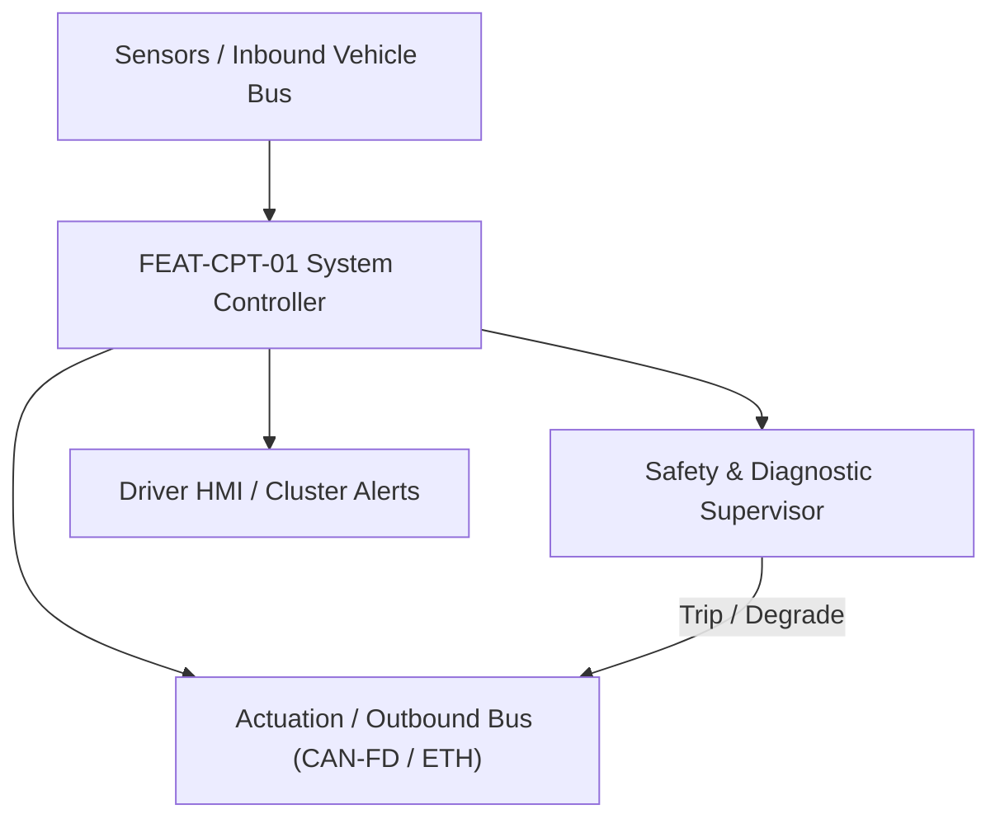
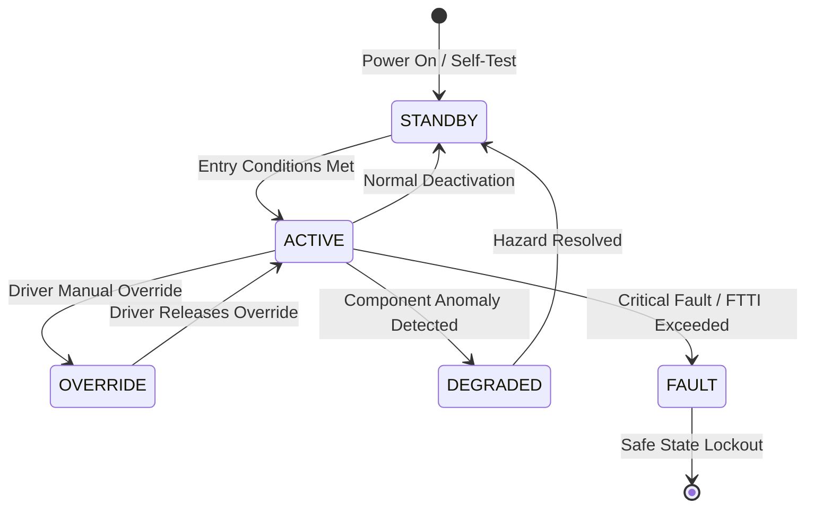

# System Requirements Specification: Driver Monitoring & Cabin Sensing (DMS/OMS)
**Feature ID:** `FEAT-CPT-01`  
**Domain:** Digital Cockpit, HMI & Cabin Sensing  
**Target ASIL:** ASIL B  
**Compliance Standard:** ISO 26262:2018 (Part 4 - System Development) / ASPICE PAM v3.1 (SYS.2, SYS.3)  
**Parent Master Specification:** [`spec.md`](file:///c:/Workset/AntiGravityProjects/TestOptimisationExperiement/spec.md#feat-cpt-01-dms)  
**Derived Software Specification:** [`FEAT-CPT-01_DMS_SwReq.md`](file:///c:/Workset/AntiGravityProjects/TestOptimisationExperiement/software_requirements/FEAT-CPT-01_DMS_SwReq.md)

---

## 1. Feature Overview & Operational Scope

Monitors driver gaze, eye closure (PERCLOS), head orientation, and cabin occupant presence (child left behind detection) using near-infrared cameras and 60 GHz radar.

### Operational Context Architecture

---

## 2. Activation Logic & Operational States

- **Preconditions:** 12V system active, cabin NIR camera stream running at 30 fps, cockpit domain controller healthy.
- **Entry Conditions:** Vehicle ignition in RUN, or vehicle parked with doors locked (for Occupant Child Left Behind detection).
- **Deactivation Conditions:** Driver monitoring inactive when ignition is completely OFF and vehicle unlocked.
- **Driver Override Behavior:** Driver gaze return to road forward cone for > 1.5s immediately clears distraction warning state.
- **Operational State Progression:**  
  `CABIN_SCANNING` -> `ATTENTIVE_DRIVING` -> `DISTRACTED_LEVEL_1` -> `DISTRACTED_LEVEL_2` -> `DROWSINESS_ALERT` -> `CHILD_LEFT_BEHIND_ALARM` -> `CAMERA_OCCLUSION`

### State Transition Diagram

---

## 3. Functional Safety & Failure Mitigation Concept

- **Functional Safety Goal:** SG-DMS-01: Detect driver microsleep or eyes-off-road inattention within 2.5 seconds; detect unattended child in parked vehicle.
- **Fault Tolerant Time Interval (FTTI):** 500 ms
- **Safe State Definition:** Report DMS_Status = DEGRADED to ADAS; disallow Level 2/3 hands-free automated driving modes.
- **Warning & Escalation Strategy:** Visual prompt on Cluster -> Audio chime -> Haptic seat vibration -> ADAS brake tap.

### Failure Modes & Degradation Handling
- **Camera Lens Blocked:** If driver covers lens or heavy dirt accumulates, detect occlusion in < 5s and prompt 'Clean Driver Camera'.
- **Sunglasses Occlusion:** If polarized infrared-blocking sunglasses worn, fallback from pupil gaze tracking to 3D head pose orientation.

---

## 4. System Requirements (SYS_REQ)
*(Note: Each System Requirement is systematically partitioned into multiple Child Software Requirements)*

### `SYS-CPT-01-01`: 3D Head Pose & Eyelid Closure (PERCLOS) Real-Time Inference
- **Planned Release:** R100
- **ASIL Rating:** ASIL B
- **Parent Feature:** [`FEAT-CPT-01`](file:///c:/Workset/AntiGravityProjects/TestOptimisationExperiement/spec.md#feat-cpt-01)
- **Requirement Statement:**
  > The System SHALL track driver eye gaze vector (+-10 deg accuracy), head pose (pitch, yaw, roll +-5 deg), and compute PERCLOS metric at >= 30 fps under day, night, and sunglasses conditions.
- **Activation Logic:** Active while vehicle speed > 15 km/h.
- **Fault Tolerant Time Interval (FTTI):** 250 ms
- **Safe State Action:** Set Driver_Attentive_Flag = FALSE; alert ADAS.
- **Failure Detection & Reaction:** If facial landmarks lost for > 2.0 seconds, trigger driver attentiveness check.
- **Input Interfaces:** `NIR_Camera_Video_Feed (MIPI-CSI, 30 fps, 1080p), NIR_LED_Illuminator_Status`
- **Output Interfaces:** `Driver_Gaze_Vector_XYZ, Head_Pose_Pitch_Yaw_Roll, PERCLOS_Drowsiness_Score`
- **System Verification Method:** Euro NCAP Driver Monitoring Assessment protocol test dataset.
- **Derived Child Software Requirements (1:N Link):**
  - [`SWR-CPT-01-01`](file:///c:/Workset/AntiGravityProjects/TestOptimisationExperiement/software_requirements/FEAT-CPT-01_DMS_SwReq.md#swr-cpt-01-01)
  - [`SWR-CPT-01-02`](file:///c:/Workset/AntiGravityProjects/TestOptimisationExperiement/software_requirements/FEAT-CPT-01_DMS_SwReq.md#swr-cpt-01-02)

### `SYS-CPT-01-02`: Parked Vehicle Child Presence Detection & Alarm Escalation
- **Planned Release:** R100
- **ASIL Rating:** ASIL B
- **Parent Feature:** [`FEAT-CPT-01`](file:///c:/Workset/AntiGravityProjects/TestOptimisationExperiement/spec.md#feat-cpt-01)
- **Requirement Statement:**
  > The System SHALL scan passenger cabin using 60 GHz in-cabin radar and camera within 60 seconds of vehicle locking to detect sub-millimeter chest movements of sleeping infants, escalating honk and cellular alerts.
- **Activation Logic:** Active after driver exits, locks vehicle, and walks away.
- **Fault Tolerant Time Interval (FTTI):** 5000 ms
- **Safe State Action:** Crack open power windows by 3 cm; activate maximum blower fan; notify owner smartphone.
- **Failure Detection & Reaction:** If radar sensor self-test fails, notify owner via mobile app of cabin sensor failure.
- **Input Interfaces:** `Cabin_Radar_MicroDoppler_Stream, Door_Lock_Confirmation, Cabin_Temp_C`
- **Output Interfaces:** `Child_Detected_Flag (boolean), Cellular_Emergency_Alert_Req, Alarm_Horn_Chirp_Cmd`
- **System Verification Method:** Euro NCAP Child Presence Detection (CPD) testing with breathing mannequin.
- **Derived Child Software Requirements (1:N Link):**
  - [`SWR-CPT-01-03`](file:///c:/Workset/AntiGravityProjects/TestOptimisationExperiement/software_requirements/FEAT-CPT-01_DMS_SwReq.md#swr-cpt-01-03)
  - [`SWR-CPT-01-04`](file:///c:/Workset/AntiGravityProjects/TestOptimisationExperiement/software_requirements/FEAT-CPT-01_DMS_SwReq.md#swr-cpt-01-04)

### `SYS-CPT-01-03`: Cabin 60 GHz Millimeter-Wave Radar Child Presence Detection (CPD)
- **Planned Release:** R100
- **ASIL Rating:** ASIL B / Euro NCAP
- **Parent Feature:** [`FEAT-CPT-01`](file:///c:/Workset/AntiGravityProjects/TestOptimisationExperiement/spec.md#feat-cpt-01)
- **Requirement Statement:**
  > The System SHALL sample cabin roof-mounted 60 GHz FMCW radar at 20 Hz, detecting micro-movements of breathing (sub-millimeter chest displacement 0.2 to 0.5 Hz) to detect unattended infants/children covered under blankets in <= 10 seconds of vehicle key-off.
- **Activation Logic:** Active upon driver leaving vehicle and locking doors.
- **Fault Tolerant Time Interval (FTTI):** 2000 ms
- **Safe State Action:** Lower windows 2 cm; trigger external horn chirp; send emergency smartphone push notification.
- **Failure Detection & Reaction:** If radar sensor reports RF fault, fallback to interior ultrasonic intrusion sensor.
- **Input Interfaces:** `Cabin_60GHz_Radar_Range_Doppler_Map, All_Doors_Locked_Bit, Ambient_Cabin_Temp_DegC`
- **Output Interfaces:** `Child_Presence_Detected_Flag, Infant_Breathing_Rate_BPM, CPD_Alarm_Trigger_Req`
- **System Verification Method:** Euro NCAP Child Presence Detection protocol tests with pediatric breathing simulator mannequins.
- **Derived Child Software Requirements (1:N Link):**
  - [`SWR-CPT-01-05`](file:///c:/Workset/AntiGravityProjects/TestOptimisationExperiement/software_requirements/FEAT-CPT-01_DMS_SwReq.md#swr-cpt-01-05)
  - [`SWR-CPT-01-06`](file:///c:/Workset/AntiGravityProjects/TestOptimisationExperiement/software_requirements/FEAT-CPT-01_DMS_SwReq.md#swr-cpt-01-06)

### `SYS-CPT-01-04`: Driver Cognitive Distraction & Handheld Mobile Phone Usage Classifier
- **Planned Release:** R200
- **ASIL Rating:** ASIL A
- **Parent Feature:** [`FEAT-CPT-01`](file:///c:/Workset/AntiGravityProjects/TestOptimisationExperiement/spec.md#feat-cpt-01)
- **Requirement Statement:**
  > The System SHALL track driver hand pose and facial gaze vectors: If driver is holding mobile phone to ear or texting while vehicle speed > 10 km/h for > 2.5 seconds, system SHALL trigger Level 1 visual and Level 2 acoustic distraction warnings.
- **Activation Logic:** Active at all vehicle driving speeds.
- **Fault Tolerant Time Interval (FTTI):** 500 ms
- **Safe State Action:** Display amber distraction prompt on instrument cluster.
- **Failure Detection & Reaction:** Suppress false alarms if driver is wearing sunglasses by relying on hand-to-ear skeletal pose.
- **Input Interfaces:** `Camera_Skeleton_Hand_Keypoints, Gaze_Direction_Yaw_Pitch, Phone_Object_Bounding_Box`
- **Output Interfaces:** `Driver_Phone_Distraction_Flag, Distraction_Duration_Sec, Cluster_Distraction_Alert_Cmd`
- **System Verification Method:** Driver naturalistic driving distraction video benchmark tests.
- **Derived Child Software Requirements (1:N Link):**
  - [`SWR-CPT-01-07`](file:///c:/Workset/AntiGravityProjects/TestOptimisationExperiement/software_requirements/FEAT-CPT-01_DMS_SwReq.md#swr-cpt-01-07)
  - [`SWR-CPT-01-08`](file:///c:/Workset/AntiGravityProjects/TestOptimisationExperiement/software_requirements/FEAT-CPT-01_DMS_SwReq.md#swr-cpt-01-08)

### `SYS-CPT-01-05`: Driver Medical Incapacitation & Emergency Safe Stop Coordinator
- **Planned Release:** R200
- **ASIL Rating:** ASIL D
- **Parent Feature:** [`FEAT-CPT-01`](file:///c:/Workset/AntiGravityProjects/TestOptimisationExperiement/spec.md#feat-cpt-01)
- **Requirement Statement:**
  > The System SHALL continuously monitor driver responsiveness: If driver head slumps forward (pitch < -40 deg) with eyes closed for > 4.0 seconds and zero hands on steering wheel, system SHALL declare Driver_Incapacitated, initiating autonomous in-lane stop and emergency hazard beacon.
- **Activation Logic:** Active during all driving modes.
- **Fault Tolerant Time Interval (FTTI):** 200 ms
- **Safe State Action:** Bring vehicle to controlled stop; unlock doors; initiate eCall medical alert.
- **Failure Detection & Reaction:** Cancel emergency stop immediately if driver lifts head and steers wheel.
- **Input Interfaces:** `Head_Pose_Pitch_Roll_Yaw, Eye_Closure_Duration_Sec, Capacitive_Steering_Hands_On_Flag`
- **Output Interfaces:** `Driver_Incapacitation_Confirmed_Flag, Emergency_Stop_Maneuver_Trigger`
- **System Verification Method:** Medical emergency simulated driver collapse evaluations on test track.
- **Derived Child Software Requirements (1:N Link):**
  - [`SWR-CPT-01-09`](file:///c:/Workset/AntiGravityProjects/TestOptimisationExperiement/software_requirements/FEAT-CPT-01_DMS_SwReq.md#swr-cpt-01-09)
  - [`SWR-CPT-01-10`](file:///c:/Workset/AntiGravityProjects/TestOptimisationExperiement/software_requirements/FEAT-CPT-01_DMS_SwReq.md#swr-cpt-01-10)

### `SYS-CPT-01-06`: Near-Infrared (NIR) 940nm LED Illumination Driver & Eye Exposure Safety
- **Planned Release:** R200
- **ASIL Rating:** ASIL B
- **Parent Feature:** [`FEAT-CPT-01`](file:///c:/Workset/AntiGravityProjects/TestOptimisationExperiement/spec.md#feat-cpt-01)
- **Requirement Statement:**
  > The System SHALL Modulate 940 nm NIR illumination strobes synchronized with camera shutter, conforming to IEC 62471 eye safety.
- **Activation Logic:** Active during normal vehicle operation when feature state is active.
- **Fault Tolerant Time Interval (FTTI):** 30 ms
- **Safe State Action:** Transition to safe state or safe degradation tier within FTTI budget.
- **Failure Detection & Reaction:** Isolate faulted channel, latch DEM diagnostic trouble code, and inform driver.
- **Input Interfaces:** `Sensor signals, vehicle dynamics data, and bus frames via RTE.`
- **Output Interfaces:** `Actuator commands, diagnostic event flags, and cluster alerts.`
- **System Verification Method:** HiL test bench and dynamometer automated verification.
- **Derived Child Software Requirements (1:N Link):**
  - [`SWR-CPT-01-11`](file:///c:/Workset/AntiGravityProjects/TestOptimisationExperiement/software_requirements/FEAT-CPT-01_DMS_SwReq.md#swr-cpt-01-11)
  - [`SWR-CPT-01-12`](file:///c:/Workset/AntiGravityProjects/TestOptimisationExperiement/software_requirements/FEAT-CPT-01_DMS_SwReq.md#swr-cpt-01-12)

### `SYS-CPT-01-07`: Driver Facial Landmark 68-Point Mesh Real-Time 3D Geometric Tracker
- **Planned Release:** R300
- **ASIL Rating:** ASIL B
- **Parent Feature:** [`FEAT-CPT-01`](file:///c:/Workset/AntiGravityProjects/TestOptimisationExperiement/spec.md#feat-cpt-01)
- **Requirement Statement:**
  > The System SHALL Track facial landmarks at 30 fps to reconstruct head pose orientation (pitch, yaw, roll +-1.5°).
- **Activation Logic:** Active during normal vehicle operation when feature state is active.
- **Fault Tolerant Time Interval (FTTI):** 33 ms
- **Safe State Action:** Transition to safe state or safe degradation tier within FTTI budget.
- **Failure Detection & Reaction:** Isolate faulted channel, latch DEM diagnostic trouble code, and inform driver.
- **Input Interfaces:** `Sensor signals, vehicle dynamics data, and bus frames via RTE.`
- **Output Interfaces:** `Actuator commands, diagnostic event flags, and cluster alerts.`
- **System Verification Method:** HiL test bench and dynamometer automated verification.
- **Derived Child Software Requirements (1:N Link):**
  - [`SWR-CPT-01-13`](file:///c:/Workset/AntiGravityProjects/TestOptimisationExperiement/software_requirements/FEAT-CPT-01_DMS_SwReq.md#swr-cpt-01-13)
  - [`SWR-CPT-01-14`](file:///c:/Workset/AntiGravityProjects/TestOptimisationExperiement/software_requirements/FEAT-CPT-01_DMS_SwReq.md#swr-cpt-01-14)

### `SYS-CPT-01-08`: Eye Gaze Vector Estimation & Instrument Cluster / Windshield Zone Classifier
- **Planned Release:** R300
- **ASIL Rating:** ASIL B
- **Parent Feature:** [`FEAT-CPT-01`](file:///c:/Workset/AntiGravityProjects/TestOptimisationExperiement/spec.md#feat-cpt-01)
- **Requirement Statement:**
  > The System SHALL Determine driver visual fixation zone (Road Ahead, Cluster, Center Display, Phone, Mirrors) at 30 Hz.
- **Activation Logic:** Active during normal vehicle operation when feature state is active.
- **Fault Tolerant Time Interval (FTTI):** 33 ms
- **Safe State Action:** Transition to safe state or safe degradation tier within FTTI budget.
- **Failure Detection & Reaction:** Isolate faulted channel, latch DEM diagnostic trouble code, and inform driver.
- **Input Interfaces:** `Sensor signals, vehicle dynamics data, and bus frames via RTE.`
- **Output Interfaces:** `Actuator commands, diagnostic event flags, and cluster alerts.`
- **System Verification Method:** HiL test bench and dynamometer automated verification.
- **Derived Child Software Requirements (1:N Link):**
  - [`SWR-CPT-01-15`](file:///c:/Workset/AntiGravityProjects/TestOptimisationExperiement/software_requirements/FEAT-CPT-01_DMS_SwReq.md#swr-cpt-01-15)
  - [`SWR-CPT-01-16`](file:///c:/Workset/AntiGravityProjects/TestOptimisationExperiement/software_requirements/FEAT-CPT-01_DMS_SwReq.md#swr-cpt-01-16)

### `SYS-CPT-01-09`: PERCLOS Percentage Eye Closure Drowsiness Index Evaluator
- **Planned Release:** R300
- **ASIL Rating:** ASIL B
- **Parent Feature:** [`FEAT-CPT-01`](file:///c:/Workset/AntiGravityProjects/TestOptimisationExperiement/spec.md#feat-cpt-01)
- **Requirement Statement:**
  > The System SHALL Compute percentage of eye closure over 60-second sliding window: Trigger fatigue alert if PERCLOS > 12.0%.
- **Activation Logic:** Active during normal vehicle operation when feature state is active.
- **Fault Tolerant Time Interval (FTTI):** 100 ms
- **Safe State Action:** Transition to safe state or safe degradation tier within FTTI budget.
- **Failure Detection & Reaction:** Isolate faulted channel, latch DEM diagnostic trouble code, and inform driver.
- **Input Interfaces:** `Sensor signals, vehicle dynamics data, and bus frames via RTE.`
- **Output Interfaces:** `Actuator commands, diagnostic event flags, and cluster alerts.`
- **System Verification Method:** HiL test bench and dynamometer automated verification.
- **Derived Child Software Requirements (1:N Link):**
  - [`SWR-CPT-01-17`](file:///c:/Workset/AntiGravityProjects/TestOptimisationExperiement/software_requirements/FEAT-CPT-01_DMS_SwReq.md#swr-cpt-01-17)
  - [`SWR-CPT-01-18`](file:///c:/Workset/AntiGravityProjects/TestOptimisationExperiement/software_requirements/FEAT-CPT-01_DMS_SwReq.md#swr-cpt-01-18)

### `SYS-CPT-01-10`: Visual Inattention & Extended Eye-Off-Road Distraction Time Tracker
- **Planned Release:** R400
- **ASIL Rating:** ASIL B
- **Parent Feature:** [`FEAT-CPT-01`](file:///c:/Workset/AntiGravityProjects/TestOptimisationExperiement/spec.md#feat-cpt-01)
- **Requirement Statement:**
  > The System SHALL Assert Level 1 audio/visual distraction alert if driver gaze looks away from road forward zone for > 2.0s.
- **Activation Logic:** Active during normal vehicle operation when feature state is active.
- **Fault Tolerant Time Interval (FTTI):** 50 ms
- **Safe State Action:** Transition to safe state or safe degradation tier within FTTI budget.
- **Failure Detection & Reaction:** Isolate faulted channel, latch DEM diagnostic trouble code, and inform driver.
- **Input Interfaces:** `Sensor signals, vehicle dynamics data, and bus frames via RTE.`
- **Output Interfaces:** `Actuator commands, diagnostic event flags, and cluster alerts.`
- **System Verification Method:** HiL test bench and dynamometer automated verification.
- **Derived Child Software Requirements (1:N Link):**
  - [`SWR-CPT-01-19`](file:///c:/Workset/AntiGravityProjects/TestOptimisationExperiement/software_requirements/FEAT-CPT-01_DMS_SwReq.md#swr-cpt-01-19)
  - [`SWR-CPT-01-20`](file:///c:/Workset/AntiGravityProjects/TestOptimisationExperiement/software_requirements/FEAT-CPT-01_DMS_SwReq.md#swr-cpt-01-20)

### `SYS-CPT-01-11`: Micro-Sleep & Closed Eyelid Acute Incapacitation Emergency Escalation
- **Planned Release:** R400
- **ASIL Rating:** ASIL B
- **Parent Feature:** [`FEAT-CPT-01`](file:///c:/Workset/AntiGravityProjects/TestOptimisationExperiement/spec.md#feat-cpt-01)
- **Requirement Statement:**
  > The System SHALL Detect continuous eye closure > 1.5s while vehicle moving (> 20 km/h); sound urgent high-pitch alarm chime.
- **Activation Logic:** Active during normal vehicle operation when feature state is active.
- **Fault Tolerant Time Interval (FTTI):** 30 ms
- **Safe State Action:** Transition to safe state or safe degradation tier within FTTI budget.
- **Failure Detection & Reaction:** Isolate faulted channel, latch DEM diagnostic trouble code, and inform driver.
- **Input Interfaces:** `Sensor signals, vehicle dynamics data, and bus frames via RTE.`
- **Output Interfaces:** `Actuator commands, diagnostic event flags, and cluster alerts.`
- **System Verification Method:** HiL test bench and dynamometer automated verification.
- **Derived Child Software Requirements (1:N Link):**
  - [`SWR-CPT-01-21`](file:///c:/Workset/AntiGravityProjects/TestOptimisationExperiement/software_requirements/FEAT-CPT-01_DMS_SwReq.md#swr-cpt-01-21)
  - [`SWR-CPT-01-22`](file:///c:/Workset/AntiGravityProjects/TestOptimisationExperiement/software_requirements/FEAT-CPT-01_DMS_SwReq.md#swr-cpt-01-22)

### `SYS-CPT-01-12`: Cabin Occupant Monitoring System (OMS) Rear Seat Passenger Presence Detector
- **Planned Release:** R400
- **ASIL Rating:** ASIL B
- **Parent Feature:** [`FEAT-CPT-01`](file:///c:/Workset/AntiGravityProjects/TestOptimisationExperiement/spec.md#feat-cpt-01)
- **Requirement Statement:**
  > The System SHALL Detect presence of adult, child, or pet in rear seating positions using wide-angle cabin camera.
- **Activation Logic:** Active during normal vehicle operation when feature state is active.
- **Fault Tolerant Time Interval (FTTI):** 200 ms
- **Safe State Action:** Transition to safe state or safe degradation tier within FTTI budget.
- **Failure Detection & Reaction:** Isolate faulted channel, latch DEM diagnostic trouble code, and inform driver.
- **Input Interfaces:** `Sensor signals, vehicle dynamics data, and bus frames via RTE.`
- **Output Interfaces:** `Actuator commands, diagnostic event flags, and cluster alerts.`
- **System Verification Method:** HiL test bench and dynamometer automated verification.
- **Derived Child Software Requirements (1:N Link):**
  - [`SWR-CPT-01-23`](file:///c:/Workset/AntiGravityProjects/TestOptimisationExperiement/software_requirements/FEAT-CPT-01_DMS_SwReq.md#swr-cpt-01-23)
  - [`SWR-CPT-01-24`](file:///c:/Workset/AntiGravityProjects/TestOptimisationExperiement/software_requirements/FEAT-CPT-01_DMS_SwReq.md#swr-cpt-01-24)

### `SYS-CPT-01-13`: Child Left Behind In-Cabin Heatstroke Prevention Emergency Warning
- **Planned Release:** R500
- **ASIL Rating:** ASIL B
- **Parent Feature:** [`FEAT-CPT-01`](file:///c:/Workset/AntiGravityProjects/TestOptimisationExperiement/spec.md#feat-cpt-01)
- **Requirement Statement:**
  > The System SHALL Detect forgotten child in locked vehicle: Sound horn, flash lights, and send smartphone app notification in <= 30s.
- **Activation Logic:** Active during normal vehicle operation when feature state is active.
- **Fault Tolerant Time Interval (FTTI):** 1000 ms
- **Safe State Action:** Transition to safe state or safe degradation tier within FTTI budget.
- **Failure Detection & Reaction:** Isolate faulted channel, latch DEM diagnostic trouble code, and inform driver.
- **Input Interfaces:** `Sensor signals, vehicle dynamics data, and bus frames via RTE.`
- **Output Interfaces:** `Actuator commands, diagnostic event flags, and cluster alerts.`
- **System Verification Method:** HiL test bench and dynamometer automated verification.
- **Derived Child Software Requirements (1:N Link):**
  - [`SWR-CPT-01-25`](file:///c:/Workset/AntiGravityProjects/TestOptimisationExperiement/software_requirements/FEAT-CPT-01_DMS_SwReq.md#swr-cpt-01-25)
  - [`SWR-CPT-01-26`](file:///c:/Workset/AntiGravityProjects/TestOptimisationExperiement/software_requirements/FEAT-CPT-01_DMS_SwReq.md#swr-cpt-01-26)

### `SYS-CPT-01-14`: Driver Face Identity Biometric Authentication & User Profile Switcher
- **Planned Release:** R500
- **ASIL Rating:** ASIL A
- **Parent Feature:** [`FEAT-CPT-01`](file:///c:/Workset/AntiGravityProjects/TestOptimisationExperiement/spec.md#feat-cpt-01)
- **Requirement Statement:**
  > The System SHALL Authenticate registered driver face in <= 1.0s to automatically restore seat, mirror, and climate presets.
- **Activation Logic:** Active during normal vehicle operation when feature state is active.
- **Fault Tolerant Time Interval (FTTI):** 500 ms
- **Safe State Action:** Transition to safe state or safe degradation tier within FTTI budget.
- **Failure Detection & Reaction:** Isolate faulted channel, latch DEM diagnostic trouble code, and inform driver.
- **Input Interfaces:** `Sensor signals, vehicle dynamics data, and bus frames via RTE.`
- **Output Interfaces:** `Actuator commands, diagnostic event flags, and cluster alerts.`
- **System Verification Method:** HiL test bench and dynamometer automated verification.
- **Derived Child Software Requirements (1:N Link):**
  - [`SWR-CPT-01-27`](file:///c:/Workset/AntiGravityProjects/TestOptimisationExperiement/software_requirements/FEAT-CPT-01_DMS_SwReq.md#swr-cpt-01-27)
  - [`SWR-CPT-01-28`](file:///c:/Workset/AntiGravityProjects/TestOptimisationExperiement/software_requirements/FEAT-CPT-01_DMS_SwReq.md#swr-cpt-01-28)

### `SYS-CPT-01-15`: Camera Lens Blockage, Sunglass Occlusion & Low Contrast Health Monitor
- **Planned Release:** R500
- **ASIL Rating:** ASIL B
- **Parent Feature:** [`FEAT-CPT-01`](file:///c:/Workset/AntiGravityProjects/TestOptimisationExperiement/spec.md#feat-cpt-01)
- **Requirement Statement:**
  > The System SHALL Detect hand covering camera lens or extreme specular reflection, alerting cluster if tracking degraded.
- **Activation Logic:** Active during normal vehicle operation when feature state is active.
- **Fault Tolerant Time Interval (FTTI):** 200 ms
- **Safe State Action:** Transition to safe state or safe degradation tier within FTTI budget.
- **Failure Detection & Reaction:** Isolate faulted channel, latch DEM diagnostic trouble code, and inform driver.
- **Input Interfaces:** `Sensor signals, vehicle dynamics data, and bus frames via RTE.`
- **Output Interfaces:** `Actuator commands, diagnostic event flags, and cluster alerts.`
- **System Verification Method:** HiL test bench and dynamometer automated verification.
- **Derived Child Software Requirements (1:N Link):**
  - [`SWR-CPT-01-29`](file:///c:/Workset/AntiGravityProjects/TestOptimisationExperiement/software_requirements/FEAT-CPT-01_DMS_SwReq.md#swr-cpt-01-29)
  - [`SWR-CPT-01-30`](file:///c:/Workset/AntiGravityProjects/TestOptimisationExperiement/software_requirements/FEAT-CPT-01_DMS_SwReq.md#swr-cpt-01-30)

---

## 5. System-to-Software Traceability Summary

| System Requirement ID | Planned Release | ASIL | Title | Derived Software Requirements (1:N) | Verification Method |
| :--- | :---: | :--- | :--- | :--- | :--- |
| `SYS-CPT-01-01` | **`R100`** | ASIL B | 3D Head Pose & Eyelid Closure (PERCLOS) Real-Time Inference | [`SWR-CPT-01-01`](file:///c:/Workset/AntiGravityProjects/TestOptimisationExperiement/software_requirements/FEAT-CPT-01_DMS_SwReq.md#swr-cpt-01-01), [`SWR-CPT-01-02`](file:///c:/Workset/AntiGravityProjects/TestOptimisationExperiement/software_requirements/FEAT-CPT-01_DMS_SwReq.md#swr-cpt-01-02) | Euro NCAP Driver Monitoring Assessment protocol test dataset. |
| `SYS-CPT-01-02` | **`R100`** | ASIL B | Parked Vehicle Child Presence Detection & Alarm Escalation | [`SWR-CPT-01-03`](file:///c:/Workset/AntiGravityProjects/TestOptimisationExperiement/software_requirements/FEAT-CPT-01_DMS_SwReq.md#swr-cpt-01-03), [`SWR-CPT-01-04`](file:///c:/Workset/AntiGravityProjects/TestOptimisationExperiement/software_requirements/FEAT-CPT-01_DMS_SwReq.md#swr-cpt-01-04) | Euro NCAP Child Presence Detection (CPD) testing with breathing mannequin. |
| `SYS-CPT-01-03` | **`R100`** | ASIL B / Euro NCAP | Cabin 60 GHz Millimeter-Wave Radar Child Presence Detection (CPD) | [`SWR-CPT-01-05`](file:///c:/Workset/AntiGravityProjects/TestOptimisationExperiement/software_requirements/FEAT-CPT-01_DMS_SwReq.md#swr-cpt-01-05), [`SWR-CPT-01-06`](file:///c:/Workset/AntiGravityProjects/TestOptimisationExperiement/software_requirements/FEAT-CPT-01_DMS_SwReq.md#swr-cpt-01-06) | Euro NCAP Child Presence Detection protocol tests with pediatric breathing simulator mannequins. |
| `SYS-CPT-01-04` | **`R200`** | ASIL A | Driver Cognitive Distraction & Handheld Mobile Phone Usage Classifier | [`SWR-CPT-01-07`](file:///c:/Workset/AntiGravityProjects/TestOptimisationExperiement/software_requirements/FEAT-CPT-01_DMS_SwReq.md#swr-cpt-01-07), [`SWR-CPT-01-08`](file:///c:/Workset/AntiGravityProjects/TestOptimisationExperiement/software_requirements/FEAT-CPT-01_DMS_SwReq.md#swr-cpt-01-08) | Driver naturalistic driving distraction video benchmark tests. |
| `SYS-CPT-01-05` | **`R200`** | ASIL D | Driver Medical Incapacitation & Emergency Safe Stop Coordinator | [`SWR-CPT-01-09`](file:///c:/Workset/AntiGravityProjects/TestOptimisationExperiement/software_requirements/FEAT-CPT-01_DMS_SwReq.md#swr-cpt-01-09), [`SWR-CPT-01-10`](file:///c:/Workset/AntiGravityProjects/TestOptimisationExperiement/software_requirements/FEAT-CPT-01_DMS_SwReq.md#swr-cpt-01-10) | Medical emergency simulated driver collapse evaluations on test track. |
| `SYS-CPT-01-06` | **`R200`** | ASIL B | Near-Infrared (NIR) 940nm LED Illumination Driver & Eye Exposure Safety | [`SWR-CPT-01-11`](file:///c:/Workset/AntiGravityProjects/TestOptimisationExperiement/software_requirements/FEAT-CPT-01_DMS_SwReq.md#swr-cpt-01-11), [`SWR-CPT-01-12`](file:///c:/Workset/AntiGravityProjects/TestOptimisationExperiement/software_requirements/FEAT-CPT-01_DMS_SwReq.md#swr-cpt-01-12) | HiL test bench and dynamometer automated verification. |
| `SYS-CPT-01-07` | **`R300`** | ASIL B | Driver Facial Landmark 68-Point Mesh Real-Time 3D Geometric Tracker | [`SWR-CPT-01-13`](file:///c:/Workset/AntiGravityProjects/TestOptimisationExperiement/software_requirements/FEAT-CPT-01_DMS_SwReq.md#swr-cpt-01-13), [`SWR-CPT-01-14`](file:///c:/Workset/AntiGravityProjects/TestOptimisationExperiement/software_requirements/FEAT-CPT-01_DMS_SwReq.md#swr-cpt-01-14) | HiL test bench and dynamometer automated verification. |
| `SYS-CPT-01-08` | **`R300`** | ASIL B | Eye Gaze Vector Estimation & Instrument Cluster / Windshield Zone Classifier | [`SWR-CPT-01-15`](file:///c:/Workset/AntiGravityProjects/TestOptimisationExperiement/software_requirements/FEAT-CPT-01_DMS_SwReq.md#swr-cpt-01-15), [`SWR-CPT-01-16`](file:///c:/Workset/AntiGravityProjects/TestOptimisationExperiement/software_requirements/FEAT-CPT-01_DMS_SwReq.md#swr-cpt-01-16) | HiL test bench and dynamometer automated verification. |
| `SYS-CPT-01-09` | **`R300`** | ASIL B | PERCLOS Percentage Eye Closure Drowsiness Index Evaluator | [`SWR-CPT-01-17`](file:///c:/Workset/AntiGravityProjects/TestOptimisationExperiement/software_requirements/FEAT-CPT-01_DMS_SwReq.md#swr-cpt-01-17), [`SWR-CPT-01-18`](file:///c:/Workset/AntiGravityProjects/TestOptimisationExperiement/software_requirements/FEAT-CPT-01_DMS_SwReq.md#swr-cpt-01-18) | HiL test bench and dynamometer automated verification. |
| `SYS-CPT-01-10` | **`R400`** | ASIL B | Visual Inattention & Extended Eye-Off-Road Distraction Time Tracker | [`SWR-CPT-01-19`](file:///c:/Workset/AntiGravityProjects/TestOptimisationExperiement/software_requirements/FEAT-CPT-01_DMS_SwReq.md#swr-cpt-01-19), [`SWR-CPT-01-20`](file:///c:/Workset/AntiGravityProjects/TestOptimisationExperiement/software_requirements/FEAT-CPT-01_DMS_SwReq.md#swr-cpt-01-20) | HiL test bench and dynamometer automated verification. |
| `SYS-CPT-01-11` | **`R400`** | ASIL B | Micro-Sleep & Closed Eyelid Acute Incapacitation Emergency Escalation | [`SWR-CPT-01-21`](file:///c:/Workset/AntiGravityProjects/TestOptimisationExperiement/software_requirements/FEAT-CPT-01_DMS_SwReq.md#swr-cpt-01-21), [`SWR-CPT-01-22`](file:///c:/Workset/AntiGravityProjects/TestOptimisationExperiement/software_requirements/FEAT-CPT-01_DMS_SwReq.md#swr-cpt-01-22) | HiL test bench and dynamometer automated verification. |
| `SYS-CPT-01-12` | **`R400`** | ASIL B | Cabin Occupant Monitoring System (OMS) Rear Seat Passenger Presence Detector | [`SWR-CPT-01-23`](file:///c:/Workset/AntiGravityProjects/TestOptimisationExperiement/software_requirements/FEAT-CPT-01_DMS_SwReq.md#swr-cpt-01-23), [`SWR-CPT-01-24`](file:///c:/Workset/AntiGravityProjects/TestOptimisationExperiement/software_requirements/FEAT-CPT-01_DMS_SwReq.md#swr-cpt-01-24) | HiL test bench and dynamometer automated verification. |
| `SYS-CPT-01-13` | **`R500`** | ASIL B | Child Left Behind In-Cabin Heatstroke Prevention Emergency Warning | [`SWR-CPT-01-25`](file:///c:/Workset/AntiGravityProjects/TestOptimisationExperiement/software_requirements/FEAT-CPT-01_DMS_SwReq.md#swr-cpt-01-25), [`SWR-CPT-01-26`](file:///c:/Workset/AntiGravityProjects/TestOptimisationExperiement/software_requirements/FEAT-CPT-01_DMS_SwReq.md#swr-cpt-01-26) | HiL test bench and dynamometer automated verification. |
| `SYS-CPT-01-14` | **`R500`** | ASIL A | Driver Face Identity Biometric Authentication & User Profile Switcher | [`SWR-CPT-01-27`](file:///c:/Workset/AntiGravityProjects/TestOptimisationExperiement/software_requirements/FEAT-CPT-01_DMS_SwReq.md#swr-cpt-01-27), [`SWR-CPT-01-28`](file:///c:/Workset/AntiGravityProjects/TestOptimisationExperiement/software_requirements/FEAT-CPT-01_DMS_SwReq.md#swr-cpt-01-28) | HiL test bench and dynamometer automated verification. |
| `SYS-CPT-01-15` | **`R500`** | ASIL B | Camera Lens Blockage, Sunglass Occlusion & Low Contrast Health Monitor | [`SWR-CPT-01-29`](file:///c:/Workset/AntiGravityProjects/TestOptimisationExperiement/software_requirements/FEAT-CPT-01_DMS_SwReq.md#swr-cpt-01-29), [`SWR-CPT-01-30`](file:///c:/Workset/AntiGravityProjects/TestOptimisationExperiement/software_requirements/FEAT-CPT-01_DMS_SwReq.md#swr-cpt-01-30) | HiL test bench and dynamometer automated verification. |

- **Upstream Feature Link:** [`spec.md` (FEAT-CPT-01)](file:///c:/Workset/AntiGravityProjects/TestOptimisationExperiement/spec.md#feat-cpt-01)
- **Software Requirements Specification:** [`FEAT-CPT-01_DMS_SwReq.md`](file:///c:/Workset/AntiGravityProjects/TestOptimisationExperiement/software_requirements/FEAT-CPT-01_DMS_SwReq.md)
