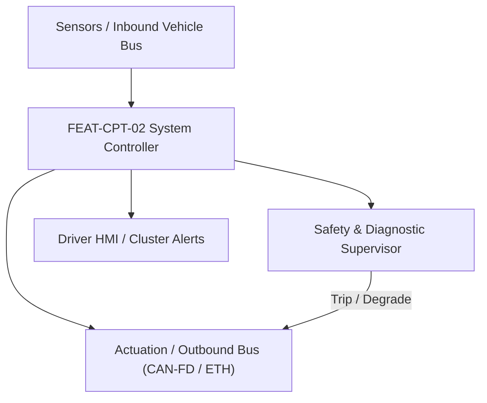
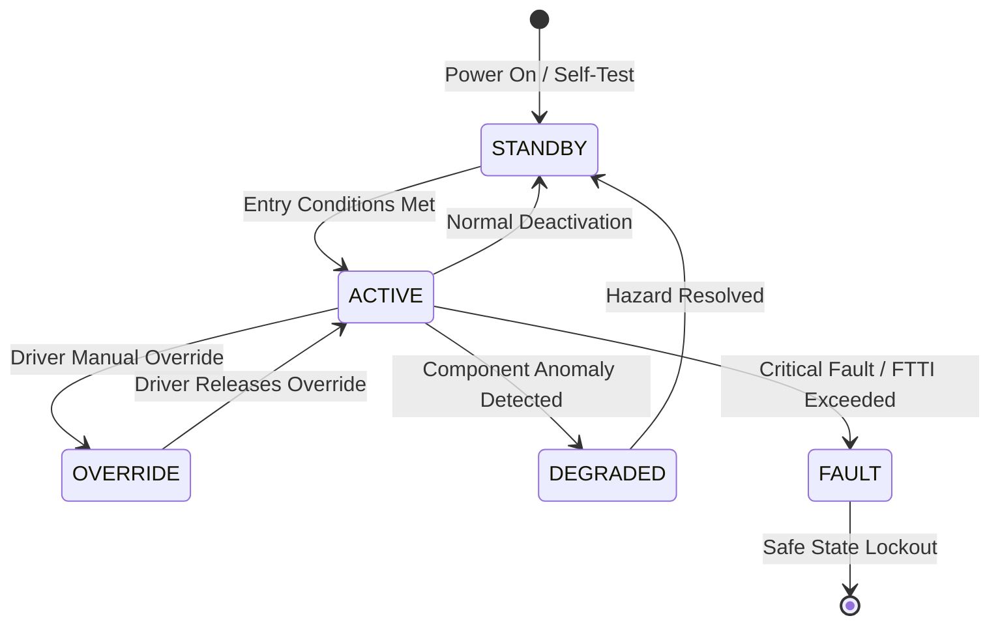

# System Requirements Specification: Augmented Reality Head-Up Display (AR-HUD)
**Feature ID:** `FEAT-CPT-02`  
**Domain:** Digital Cockpit, HMI & Cabin Sensing  
**Target ASIL:** ASIL B  
**Compliance Standard:** ISO 26262:2018 (Part 4 - System Development) / ASPICE PAM v3.1 (SYS.2, SYS.3)  
**Parent Master Specification:** [`spec.md`](file:///c:/Workset/AntiGravityProjects/TestOptimisationExperiement/spec.md#feat-cpt-02-hud)  
**Derived Software Specification:** [`FEAT-CPT-02_HUD_SwReq.md`](file:///c:/Workset/AntiGravityProjects/TestOptimisationExperiement/software_requirements/FEAT-CPT-02_HUD_SwReq.md)

---

## 1. Feature Overview & Operational Scope

Projects conformal optical graphics (navigation arrows, ADAS target boxes, lane boundaries) onto windshield at 10-meter virtual focal distance.

### Operational Context Architecture

---

## 2. Activation Logic & Operational States

- **Preconditions:** 12V system healthy, HUD optical picture generating unit (PGU) temperature normal, windshield projection mirror calibrated.
- **Entry Conditions:** Ignition in RUN; driver enables HUD in cockpit display settings.
- **Deactivation Conditions:** Driver toggles HUD OFF or ignition powered down.
- **Driver Override Behavior:** Driver can adjust virtual image height and rotation via steering wheel buttons.
- **Operational State Progression:**  
  `OFF` -> `HOMING_ALIGNMENT` -> `ACTIVE_PROJECTION` -> `BRIGHTNESS_ADAPTING` -> `THERMAL_DERATING` -> `FAULT_SHUTDOWN`

### State Transition Diagram

---

## 3. Functional Safety & Failure Mitigation Concept

- **Functional Safety Goal:** SG-HUD-01: Prevent visual obstruction of driver forward road view; ensure graphics align accurately with real-world objects (< 1.0 deg error).
- **Fault Tolerant Time Interval (FTTI):** 100 ms
- **Safe State Definition:** Immediately turn off PGU laser/TFT backlight to extinguish projected image.
- **Warning & Escalation Strategy:** Display 'Head-Up Display Unavailable' message on primary instrument cluster.

### Failure Modes & Degradation Handling
- **Misalignment:** If camera ego-pose estimation diverges, disable AR conformal overlays and revert to static 2D speed digits.
- **Pgu Overtemperature:** If PGU optical engine temp > 85°C, reduce backlight brightness by 50%; if > 95°C, shut off projection.

---

## 4. System Requirements (SYS_REQ)
*(Note: Each System Requirement is systematically partitioned into multiple Child Software Requirements)*

### `SYS-CPT-02-01`: Low-Latency Ego-Motion Graphic Conformal Alignment
- **Planned Release:** R100
- **ASIL Rating:** ASIL B
- **Parent Feature:** [`FEAT-CPT-02`](file:///c:/Workset/AntiGravityProjects/TestOptimisationExperiement/spec.md#feat-cpt-02)
- **Requirement Statement:**
  > The System SHALL render navigation arrows and ADAS hazard bounding boxes conformally aligned with real-world geometry (< 0.5 deg alignment error) with motion-to-photon latency <= 30 ms at 60 fps.
- **Activation Logic:** Active during driving.
- **Fault Tolerant Time Interval (FTTI):** 60 ms
- **Safe State Action:** Blank optical display if graphic lag exceeds 50 ms.
- **Failure Detection & Reaction:** Revert to simple static numeric speed display if AR pose tracker faults.
- **Input Interfaces:** `Camera_Lane_Polynomials, ADAS_Target_Boxes, Navigation_Maneuver_Point, IMU_HighRate`
- **Output Interfaces:** `HUD_Video_Stream (DisplayPort / FPD-Link III, 60 fps, 1920x1080)`
- **System Verification Method:** Motion-to-photon optical high-speed camera latency bench test.
- **Derived Child Software Requirements (1:N Link):**
  - [`SWR-CPT-02-01`](file:///c:/Workset/AntiGravityProjects/TestOptimisationExperiement/software_requirements/FEAT-CPT-02_HUD_SwReq.md#swr-cpt-02-01)
  - [`SWR-CPT-02-02`](file:///c:/Workset/AntiGravityProjects/TestOptimisationExperiement/software_requirements/FEAT-CPT-02_HUD_SwReq.md#swr-cpt-02-02)

### `SYS-CPT-02-02`: Ambient Light Ambient Adaptation & Solar Thermal Protection
- **Planned Release:** R300
- **ASIL Rating:** ASIL B
- **Parent Feature:** [`FEAT-CPT-02`](file:///c:/Workset/AntiGravityProjects/TestOptimisationExperiement/spec.md#feat-cpt-02)
- **Requirement Statement:**
  > The System SHALL adjust HUD projection luminance from 100 nits (night) to 15,000 nits (direct snow sunlight) in <= 200 ms, while monitoring cold-mirror thermal sensor to prevent sun-burn damage to TFT panel.
- **Activation Logic:** Active whenever HUD is projecting.
- **Fault Tolerant Time Interval (FTTI):** 200 ms
- **Safe State Action:** Close motorized optical glare trap shutter if solar thermal risk detected.
- **Failure Detection & Reaction:** If ambient lux sensor fails, set brightness to safe default 3,000 nits.
- **Input Interfaces:** `Forward_Facing_Lux_Sensor, PGU_Thermal_Thermistor_C, Windshield_Solar_Angle`
- **Output Interfaces:** `HUD_Backlight_Current_Cmd, Shutter_Solenoid_Cmd`
- **System Verification Method:** Solar radiation simulation chamber test evaluating thermal resistance.
- **Derived Child Software Requirements (1:N Link):**
  - [`SWR-CPT-02-03`](file:///c:/Workset/AntiGravityProjects/TestOptimisationExperiement/software_requirements/FEAT-CPT-02_HUD_SwReq.md#swr-cpt-02-03)
  - [`SWR-CPT-02-04`](file:///c:/Workset/AntiGravityProjects/TestOptimisationExperiement/software_requirements/FEAT-CPT-02_HUD_SwReq.md#swr-cpt-02-04)

### `SYS-CPT-02-03`: Real-Time World-Grounding Parallax & Eye-Box Pupil Tracking
- **Planned Release:** R100
- **ASIL Rating:** ASIL B
- **Parent Feature:** [`FEAT-CPT-02`](file:///c:/Workset/AntiGravityProjects/TestOptimisationExperiement/spec.md#feat-cpt-02)
- **Requirement Statement:**
  > The System SHALL sample driver pupil 3D coordinates via DMS camera at 60 Hz, adjusting AR projection ray matrix in <= 16 ms to eliminate motion parallax and keep virtual navigation arrows anchored to physical road lanes within +-0.5 degrees optical accuracy.
- **Activation Logic:** Active whenever AR-HUD display is enabled.
- **Fault Tolerant Time Interval (FTTI):** 30 ms
- **Safe State Action:** Switch AR graphics to static non-conformal 2D HUD projection.
- **Failure Detection & Reaction:** If driver eyes are obscured by sunglasses, default to average 50th percentile eye-box center.
- **Input Interfaces:** `Driver_Pupil_3D_Coordinates_Mm, Chassis_Suspension_Pitch_Roll_Deg, Ego_Vehicle_Speed_Mps`
- **Output Interfaces:** `EyeBox_Parallax_Correction_Matrix[4x4], Optical_Ray_Angle_Offsets`
- **System Verification Method:** Optical bench camera tracking test with motorized eye-box motion simulator.
- **Derived Child Software Requirements (1:N Link):**
  - [`SWR-CPT-02-05`](file:///c:/Workset/AntiGravityProjects/TestOptimisationExperiement/software_requirements/FEAT-CPT-02_HUD_SwReq.md#swr-cpt-02-05)
  - [`SWR-CPT-02-06`](file:///c:/Workset/AntiGravityProjects/TestOptimisationExperiement/software_requirements/FEAT-CPT-02_HUD_SwReq.md#swr-cpt-02-06)

### `SYS-CPT-02-04`: Optical DLP Laser Picture Generation Unit (PGU) Thermal Protector
- **Planned Release:** R200
- **ASIL Rating:** ASIL A
- **Parent Feature:** [`FEAT-CPT-02`](file:///c:/Workset/AntiGravityProjects/TestOptimisationExperiement/spec.md#feat-cpt-02)
- **Requirement Statement:**
  > The System SHALL monitor Digital Light Processing (DLP) RGB laser diode temperatures, dynamically scaling laser power (0 to 100% luminance up to 15,000 nits) to preserve daytime visibility under direct sunlight while preventing laser thermal burnout (> 75°C).
- **Activation Logic:** Continuous optical engine operation.
- **Fault Tolerant Time Interval (FTTI):** 200 ms
- **Safe State Action:** Dim laser power to 20% baseline luminance.
- **Failure Detection & Reaction:** Shut off laser diode driver if PGU internal temperature exceeds 85°C.
- **Input Interfaces:** `Laser_Diode_Temperature_Array[3], Forward_Ambient_Illuminance_Lux, Windshield_Solar_Flux_W_M2`
- **Output Interfaces:** `Laser_Drive_Current_RGB_mA, PGU_Cooling_Fan_Duty_PWM`
- **System Verification Method:** Direct solar simulator thermal soak test (1000 W/m²) on windshield HUD combiner.
- **Derived Child Software Requirements (1:N Link):**
  - [`SWR-CPT-02-07`](file:///c:/Workset/AntiGravityProjects/TestOptimisationExperiement/software_requirements/FEAT-CPT-02_HUD_SwReq.md#swr-cpt-02-07)
  - [`SWR-CPT-02-08`](file:///c:/Workset/AntiGravityProjects/TestOptimisationExperiement/software_requirements/FEAT-CPT-02_HUD_SwReq.md#swr-cpt-02-08)

### `SYS-CPT-02-05`: Digital Micro-Mirror (DMD) Optical Projection Engine Sub-Pixel Color Renderer
- **Planned Release:** R200
- **ASIL Rating:** ASIL B
- **Parent Feature:** [`FEAT-CPT-02`](file:///c:/Workset/AntiGravityProjects/TestOptimisationExperiement/spec.md#feat-cpt-02)
- **Requirement Statement:**
  > The System SHALL Render 1280x720 RGB projection graphics at 60 fps with high contrast ratio (>= 1500:1).
- **Activation Logic:** Active during normal vehicle operation when feature state is active.
- **Fault Tolerant Time Interval (FTTI):** 16 ms
- **Safe State Action:** Transition to safe state or safe degradation tier within FTTI budget.
- **Failure Detection & Reaction:** Isolate faulted channel, latch DEM diagnostic trouble code, and inform driver.
- **Input Interfaces:** `Sensor signals, vehicle dynamics data, and bus frames via RTE.`
- **Output Interfaces:** `Actuator commands, diagnostic event flags, and cluster alerts.`
- **System Verification Method:** HiL test bench and dynamometer automated verification.
- **Derived Child Software Requirements (1:N Link):**
  - [`SWR-CPT-02-09`](file:///c:/Workset/AntiGravityProjects/TestOptimisationExperiement/software_requirements/FEAT-CPT-02_HUD_SwReq.md#swr-cpt-02-09)
  - [`SWR-CPT-02-10`](file:///c:/Workset/AntiGravityProjects/TestOptimisationExperiement/software_requirements/FEAT-CPT-02_HUD_SwReq.md#swr-cpt-02-10)

### `SYS-CPT-02-06`: Augmented Reality Windshield Geometric Distortion & Curvature Warping Engine
- **Planned Release:** R200
- **ASIL Rating:** ASIL B
- **Parent Feature:** [`FEAT-CPT-02`](file:///c:/Workset/AntiGravityProjects/TestOptimisationExperiement/spec.md#feat-cpt-02)
- **Requirement Statement:**
  > The System SHALL Pre-warp graphic buffers to cancel out curved windshield optical distortion with latency < 10 ms.
- **Activation Logic:** Active during normal vehicle operation when feature state is active.
- **Fault Tolerant Time Interval (FTTI):** 16 ms
- **Safe State Action:** Transition to safe state or safe degradation tier within FTTI budget.
- **Failure Detection & Reaction:** Isolate faulted channel, latch DEM diagnostic trouble code, and inform driver.
- **Input Interfaces:** `Sensor signals, vehicle dynamics data, and bus frames via RTE.`
- **Output Interfaces:** `Actuator commands, diagnostic event flags, and cluster alerts.`
- **System Verification Method:** HiL test bench and dynamometer automated verification.
- **Derived Child Software Requirements (1:N Link):**
  - [`SWR-CPT-02-11`](file:///c:/Workset/AntiGravityProjects/TestOptimisationExperiement/software_requirements/FEAT-CPT-02_HUD_SwReq.md#swr-cpt-02-11)
  - [`SWR-CPT-02-12`](file:///c:/Workset/AntiGravityProjects/TestOptimisationExperiement/software_requirements/FEAT-CPT-02_HUD_SwReq.md#swr-cpt-02-12)

### `SYS-CPT-02-07`: Virtual Image Distance (VID) 7.5m / 10m Dual-Focal Plane Spatial Depth Aligner
- **Planned Release:** R300
- **ASIL Rating:** ASIL B
- **Parent Feature:** [`FEAT-CPT-02`](file:///c:/Workset/AntiGravityProjects/TestOptimisationExperiement/spec.md#feat-cpt-02)
- **Requirement Statement:**
  > The System SHALL Project near plane (speed, alerts at 3m) and far AR plane (navigation arrows, lanes at 10m virtual depth).
- **Activation Logic:** Active during normal vehicle operation when feature state is active.
- **Fault Tolerant Time Interval (FTTI):** 20 ms
- **Safe State Action:** Transition to safe state or safe degradation tier within FTTI budget.
- **Failure Detection & Reaction:** Isolate faulted channel, latch DEM diagnostic trouble code, and inform driver.
- **Input Interfaces:** `Sensor signals, vehicle dynamics data, and bus frames via RTE.`
- **Output Interfaces:** `Actuator commands, diagnostic event flags, and cluster alerts.`
- **System Verification Method:** HiL test bench and dynamometer automated verification.
- **Derived Child Software Requirements (1:N Link):**
  - [`SWR-CPT-02-13`](file:///c:/Workset/AntiGravityProjects/TestOptimisationExperiement/software_requirements/FEAT-CPT-02_HUD_SwReq.md#swr-cpt-02-13)
  - [`SWR-CPT-02-14`](file:///c:/Workset/AntiGravityProjects/TestOptimisationExperiement/software_requirements/FEAT-CPT-02_HUD_SwReq.md#swr-cpt-02-14)

### `SYS-CPT-02-08`: Vehicle 6-DOF Ego-Motion Pose Extrapolator & Eye-Box Jitter Canceler
- **Planned Release:** R300
- **ASIL Rating:** ASIL B
- **Parent Feature:** [`FEAT-CPT-02`](file:///c:/Workset/AntiGravityProjects/TestOptimisationExperiement/spec.md#feat-cpt-02)
- **Requirement Statement:**
  > The System SHALL Compensate for vehicle chassis pitch and roll road vibrations to lock AR arrows firmly onto physical road lanes.
- **Activation Logic:** Active during normal vehicle operation when feature state is active.
- **Fault Tolerant Time Interval (FTTI):** 10 ms
- **Safe State Action:** Transition to safe state or safe degradation tier within FTTI budget.
- **Failure Detection & Reaction:** Isolate faulted channel, latch DEM diagnostic trouble code, and inform driver.
- **Input Interfaces:** `Sensor signals, vehicle dynamics data, and bus frames via RTE.`
- **Output Interfaces:** `Actuator commands, diagnostic event flags, and cluster alerts.`
- **System Verification Method:** HiL test bench and dynamometer automated verification.
- **Derived Child Software Requirements (1:N Link):**
  - [`SWR-CPT-02-15`](file:///c:/Workset/AntiGravityProjects/TestOptimisationExperiement/software_requirements/FEAT-CPT-02_HUD_SwReq.md#swr-cpt-02-15)
  - [`SWR-CPT-02-16`](file:///c:/Workset/AntiGravityProjects/TestOptimisationExperiement/software_requirements/FEAT-CPT-02_HUD_SwReq.md#swr-cpt-02-16)

### `SYS-CPT-02-09`: High-Dynamic Range (HDR) Ambient Light Photodiode Brightness Auto-Adjuster
- **Planned Release:** R300
- **ASIL Rating:** ASIL B
- **Parent Feature:** [`FEAT-CPT-02`](file:///c:/Workset/AntiGravityProjects/TestOptimisationExperiement/spec.md#feat-cpt-02)
- **Requirement Statement:**
  > The System SHALL Regulate laser/LED backlight brightness from 20 nits (night) to 15,000 nits (direct noon sunlight).
- **Activation Logic:** Active during normal vehicle operation when feature state is active.
- **Fault Tolerant Time Interval (FTTI):** 50 ms
- **Safe State Action:** Transition to safe state or safe degradation tier within FTTI budget.
- **Failure Detection & Reaction:** Isolate faulted channel, latch DEM diagnostic trouble code, and inform driver.
- **Input Interfaces:** `Sensor signals, vehicle dynamics data, and bus frames via RTE.`
- **Output Interfaces:** `Actuator commands, diagnostic event flags, and cluster alerts.`
- **System Verification Method:** HiL test bench and dynamometer automated verification.
- **Derived Child Software Requirements (1:N Link):**
  - [`SWR-CPT-02-17`](file:///c:/Workset/AntiGravityProjects/TestOptimisationExperiement/software_requirements/FEAT-CPT-02_HUD_SwReq.md#swr-cpt-02-17)
  - [`SWR-CPT-02-18`](file:///c:/Workset/AntiGravityProjects/TestOptimisationExperiement/software_requirements/FEAT-CPT-02_HUD_SwReq.md#swr-cpt-02-18)

### `SYS-CPT-02-10`: ADAS Target Highlighting Bounding Box Graphic Overlay Serializer
- **Planned Release:** R400
- **ASIL Rating:** ASIL B
- **Parent Feature:** [`FEAT-CPT-02`](file:///c:/Workset/AntiGravityProjects/TestOptimisationExperiement/spec.md#feat-cpt-02)
- **Requirement Statement:**
  > The System SHALL Render colored conformal bounding boxes around forward vehicles and pedestrians highlighted by ADAS.
- **Activation Logic:** Active during normal vehicle operation when feature state is active.
- **Fault Tolerant Time Interval (FTTI):** 20 ms
- **Safe State Action:** Transition to safe state or safe degradation tier within FTTI budget.
- **Failure Detection & Reaction:** Isolate faulted channel, latch DEM diagnostic trouble code, and inform driver.
- **Input Interfaces:** `Sensor signals, vehicle dynamics data, and bus frames via RTE.`
- **Output Interfaces:** `Actuator commands, diagnostic event flags, and cluster alerts.`
- **System Verification Method:** HiL test bench and dynamometer automated verification.
- **Derived Child Software Requirements (1:N Link):**
  - [`SWR-CPT-02-19`](file:///c:/Workset/AntiGravityProjects/TestOptimisationExperiement/software_requirements/FEAT-CPT-02_HUD_SwReq.md#swr-cpt-02-19)
  - [`SWR-CPT-02-20`](file:///c:/Workset/AntiGravityProjects/TestOptimisationExperiement/software_requirements/FEAT-CPT-02_HUD_SwReq.md#swr-cpt-02-20)

### `SYS-CPT-02-11`: Navigation Turn-by-Turn Dynamic Floating Chevron Arrow Animator
- **Planned Release:** R400
- **ASIL Rating:** ASIL A
- **Parent Feature:** [`FEAT-CPT-02`](file:///c:/Workset/AntiGravityProjects/TestOptimisationExperiement/spec.md#feat-cpt-02)
- **Requirement Statement:**
  > The System SHALL Project animated 3D directional guide arrows floating above upcoming highway exit ramps and intersections.
- **Activation Logic:** Active during normal vehicle operation when feature state is active.
- **Fault Tolerant Time Interval (FTTI):** 33 ms
- **Safe State Action:** Transition to safe state or safe degradation tier within FTTI budget.
- **Failure Detection & Reaction:** Isolate faulted channel, latch DEM diagnostic trouble code, and inform driver.
- **Input Interfaces:** `Sensor signals, vehicle dynamics data, and bus frames via RTE.`
- **Output Interfaces:** `Actuator commands, diagnostic event flags, and cluster alerts.`
- **System Verification Method:** HiL test bench and dynamometer automated verification.
- **Derived Child Software Requirements (1:N Link):**
  - [`SWR-CPT-02-21`](file:///c:/Workset/AntiGravityProjects/TestOptimisationExperiement/software_requirements/FEAT-CPT-02_HUD_SwReq.md#swr-cpt-02-21)
  - [`SWR-CPT-02-22`](file:///c:/Workset/AntiGravityProjects/TestOptimisationExperiement/software_requirements/FEAT-CPT-02_HUD_SwReq.md#swr-cpt-02-22)

### `SYS-CPT-02-12`: Eyebox Motorized Mirror Tilt Position Driver Height Memory Storer
- **Planned Release:** R400
- **ASIL Rating:** ASIL A
- **Parent Feature:** [`FEAT-CPT-02`](file:///c:/Workset/AntiGravityProjects/TestOptimisationExperiement/spec.md#feat-cpt-02)
- **Requirement Statement:**
  > The System SHALL Position motorized HUD reflection mirror to align optical eyebox with driver eye coordinates from DMS.
- **Activation Logic:** Active during normal vehicle operation when feature state is active.
- **Fault Tolerant Time Interval (FTTI):** 100 ms
- **Safe State Action:** Transition to safe state or safe degradation tier within FTTI budget.
- **Failure Detection & Reaction:** Isolate faulted channel, latch DEM diagnostic trouble code, and inform driver.
- **Input Interfaces:** `Sensor signals, vehicle dynamics data, and bus frames via RTE.`
- **Output Interfaces:** `Actuator commands, diagnostic event flags, and cluster alerts.`
- **System Verification Method:** HiL test bench and dynamometer automated verification.
- **Derived Child Software Requirements (1:N Link):**
  - [`SWR-CPT-02-23`](file:///c:/Workset/AntiGravityProjects/TestOptimisationExperiement/software_requirements/FEAT-CPT-02_HUD_SwReq.md#swr-cpt-02-23)
  - [`SWR-CPT-02-24`](file:///c:/Workset/AntiGravityProjects/TestOptimisationExperiement/software_requirements/FEAT-CPT-02_HUD_SwReq.md#swr-cpt-02-24)

### `SYS-CPT-02-13`: Sunlight Trap & Thermal Mirror Heat Dissipation Overheat Guard
- **Planned Release:** R500
- **ASIL Rating:** ASIL B
- **Parent Feature:** [`FEAT-CPT-02`](file:///c:/Workset/AntiGravityProjects/TestOptimisationExperiement/spec.md#feat-cpt-02)
- **Requirement Statement:**
  > The System SHALL Detect thermal load from sunlight concentrated through combiner lens; activate protective cold shutter.
- **Activation Logic:** Active during normal vehicle operation when feature state is active.
- **Fault Tolerant Time Interval (FTTI):** 500 ms
- **Safe State Action:** Transition to safe state or safe degradation tier within FTTI budget.
- **Failure Detection & Reaction:** Isolate faulted channel, latch DEM diagnostic trouble code, and inform driver.
- **Input Interfaces:** `Sensor signals, vehicle dynamics data, and bus frames via RTE.`
- **Output Interfaces:** `Actuator commands, diagnostic event flags, and cluster alerts.`
- **System Verification Method:** HiL test bench and dynamometer automated verification.
- **Derived Child Software Requirements (1:N Link):**
  - [`SWR-CPT-02-25`](file:///c:/Workset/AntiGravityProjects/TestOptimisationExperiement/software_requirements/FEAT-CPT-02_HUD_SwReq.md#swr-cpt-02-25)
  - [`SWR-CPT-02-26`](file:///c:/Workset/AntiGravityProjects/TestOptimisationExperiement/software_requirements/FEAT-CPT-02_HUD_SwReq.md#swr-cpt-02-26)

### `SYS-CPT-02-14`: Optical Engine Pixel Burnout & Frame Freeze Hardware Watchdog Safing
- **Planned Release:** R400
- **ASIL Rating:** ASIL B
- **Parent Feature:** [`FEAT-CPT-02`](file:///c:/Workset/AntiGravityProjects/TestOptimisationExperiement/spec.md#feat-cpt-02)
- **Requirement Statement:**
  > The System SHALL Hardware FPGA monitors video stream CRC: Blank HUD display in <= 40 ms if graphic processor freezes.
- **Activation Logic:** Active during normal vehicle operation when feature state is active.
- **Fault Tolerant Time Interval (FTTI):** 20 ms
- **Safe State Action:** Transition to safe state or safe degradation tier within FTTI budget.
- **Failure Detection & Reaction:** Isolate faulted channel, latch DEM diagnostic trouble code, and inform driver.
- **Input Interfaces:** `Sensor signals, vehicle dynamics data, and bus frames via RTE.`
- **Output Interfaces:** `Actuator commands, diagnostic event flags, and cluster alerts.`
- **System Verification Method:** HiL test bench and dynamometer automated verification.
- **Derived Child Software Requirements (1:N Link):**
  - [`SWR-CPT-02-27`](file:///c:/Workset/AntiGravityProjects/TestOptimisationExperiement/software_requirements/FEAT-CPT-02_HUD_SwReq.md#swr-cpt-02-27)
  - [`SWR-CPT-02-28`](file:///c:/Workset/AntiGravityProjects/TestOptimisationExperiement/software_requirements/FEAT-CPT-02_HUD_SwReq.md#swr-cpt-02-28)

### `SYS-CPT-02-15`: DEM Head-Up Display Component Health Diagnostics & DTC Logger
- **Planned Release:** R500
- **ASIL Rating:** ASIL B
- **Parent Feature:** [`FEAT-CPT-02`](file:///c:/Workset/AntiGravityProjects/TestOptimisationExperiement/spec.md#feat-cpt-02)
- **Requirement Statement:**
  > The System SHALL Manage diagnostic trouble codes for mirror motor stall, backlight LED failure, and video serializer errors.
- **Activation Logic:** Active during normal vehicle operation when feature state is active.
- **Fault Tolerant Time Interval (FTTI):** 100 ms
- **Safe State Action:** Transition to safe state or safe degradation tier within FTTI budget.
- **Failure Detection & Reaction:** Isolate faulted channel, latch DEM diagnostic trouble code, and inform driver.
- **Input Interfaces:** `Sensor signals, vehicle dynamics data, and bus frames via RTE.`
- **Output Interfaces:** `Actuator commands, diagnostic event flags, and cluster alerts.`
- **System Verification Method:** HiL test bench and dynamometer automated verification.
- **Derived Child Software Requirements (1:N Link):**
  - [`SWR-CPT-02-29`](file:///c:/Workset/AntiGravityProjects/TestOptimisationExperiement/software_requirements/FEAT-CPT-02_HUD_SwReq.md#swr-cpt-02-29)
  - [`SWR-CPT-02-30`](file:///c:/Workset/AntiGravityProjects/TestOptimisationExperiement/software_requirements/FEAT-CPT-02_HUD_SwReq.md#swr-cpt-02-30)

---

## 5. System-to-Software Traceability Summary

| System Requirement ID | Planned Release | ASIL | Title | Derived Software Requirements (1:N) | Verification Method |
| :--- | :---: | :--- | :--- | :--- | :--- |
| `SYS-CPT-02-01` | **`R100`** | ASIL B | Low-Latency Ego-Motion Graphic Conformal Alignment | [`SWR-CPT-02-01`](file:///c:/Workset/AntiGravityProjects/TestOptimisationExperiement/software_requirements/FEAT-CPT-02_HUD_SwReq.md#swr-cpt-02-01), [`SWR-CPT-02-02`](file:///c:/Workset/AntiGravityProjects/TestOptimisationExperiement/software_requirements/FEAT-CPT-02_HUD_SwReq.md#swr-cpt-02-02) | Motion-to-photon optical high-speed camera latency bench test. |
| `SYS-CPT-02-02` | **`R300`** | ASIL B | Ambient Light Ambient Adaptation & Solar Thermal Protection | [`SWR-CPT-02-03`](file:///c:/Workset/AntiGravityProjects/TestOptimisationExperiement/software_requirements/FEAT-CPT-02_HUD_SwReq.md#swr-cpt-02-03), [`SWR-CPT-02-04`](file:///c:/Workset/AntiGravityProjects/TestOptimisationExperiement/software_requirements/FEAT-CPT-02_HUD_SwReq.md#swr-cpt-02-04) | Solar radiation simulation chamber test evaluating thermal resistance. |
| `SYS-CPT-02-03` | **`R100`** | ASIL B | Real-Time World-Grounding Parallax & Eye-Box Pupil Tracking | [`SWR-CPT-02-05`](file:///c:/Workset/AntiGravityProjects/TestOptimisationExperiement/software_requirements/FEAT-CPT-02_HUD_SwReq.md#swr-cpt-02-05), [`SWR-CPT-02-06`](file:///c:/Workset/AntiGravityProjects/TestOptimisationExperiement/software_requirements/FEAT-CPT-02_HUD_SwReq.md#swr-cpt-02-06) | Optical bench camera tracking test with motorized eye-box motion simulator. |
| `SYS-CPT-02-04` | **`R200`** | ASIL A | Optical DLP Laser Picture Generation Unit (PGU) Thermal Protector | [`SWR-CPT-02-07`](file:///c:/Workset/AntiGravityProjects/TestOptimisationExperiement/software_requirements/FEAT-CPT-02_HUD_SwReq.md#swr-cpt-02-07), [`SWR-CPT-02-08`](file:///c:/Workset/AntiGravityProjects/TestOptimisationExperiement/software_requirements/FEAT-CPT-02_HUD_SwReq.md#swr-cpt-02-08) | Direct solar simulator thermal soak test (1000 W/m²) on windshield HUD combiner. |
| `SYS-CPT-02-05` | **`R200`** | ASIL B | Digital Micro-Mirror (DMD) Optical Projection Engine Sub-Pixel Color Renderer | [`SWR-CPT-02-09`](file:///c:/Workset/AntiGravityProjects/TestOptimisationExperiement/software_requirements/FEAT-CPT-02_HUD_SwReq.md#swr-cpt-02-09), [`SWR-CPT-02-10`](file:///c:/Workset/AntiGravityProjects/TestOptimisationExperiement/software_requirements/FEAT-CPT-02_HUD_SwReq.md#swr-cpt-02-10) | HiL test bench and dynamometer automated verification. |
| `SYS-CPT-02-06` | **`R200`** | ASIL B | Augmented Reality Windshield Geometric Distortion & Curvature Warping Engine | [`SWR-CPT-02-11`](file:///c:/Workset/AntiGravityProjects/TestOptimisationExperiement/software_requirements/FEAT-CPT-02_HUD_SwReq.md#swr-cpt-02-11), [`SWR-CPT-02-12`](file:///c:/Workset/AntiGravityProjects/TestOptimisationExperiement/software_requirements/FEAT-CPT-02_HUD_SwReq.md#swr-cpt-02-12) | HiL test bench and dynamometer automated verification. |
| `SYS-CPT-02-07` | **`R300`** | ASIL B | Virtual Image Distance (VID) 7.5m / 10m Dual-Focal Plane Spatial Depth Aligner | [`SWR-CPT-02-13`](file:///c:/Workset/AntiGravityProjects/TestOptimisationExperiement/software_requirements/FEAT-CPT-02_HUD_SwReq.md#swr-cpt-02-13), [`SWR-CPT-02-14`](file:///c:/Workset/AntiGravityProjects/TestOptimisationExperiement/software_requirements/FEAT-CPT-02_HUD_SwReq.md#swr-cpt-02-14) | HiL test bench and dynamometer automated verification. |
| `SYS-CPT-02-08` | **`R300`** | ASIL B | Vehicle 6-DOF Ego-Motion Pose Extrapolator & Eye-Box Jitter Canceler | [`SWR-CPT-02-15`](file:///c:/Workset/AntiGravityProjects/TestOptimisationExperiement/software_requirements/FEAT-CPT-02_HUD_SwReq.md#swr-cpt-02-15), [`SWR-CPT-02-16`](file:///c:/Workset/AntiGravityProjects/TestOptimisationExperiement/software_requirements/FEAT-CPT-02_HUD_SwReq.md#swr-cpt-02-16) | HiL test bench and dynamometer automated verification. |
| `SYS-CPT-02-09` | **`R300`** | ASIL B | High-Dynamic Range (HDR) Ambient Light Photodiode Brightness Auto-Adjuster | [`SWR-CPT-02-17`](file:///c:/Workset/AntiGravityProjects/TestOptimisationExperiement/software_requirements/FEAT-CPT-02_HUD_SwReq.md#swr-cpt-02-17), [`SWR-CPT-02-18`](file:///c:/Workset/AntiGravityProjects/TestOptimisationExperiement/software_requirements/FEAT-CPT-02_HUD_SwReq.md#swr-cpt-02-18) | HiL test bench and dynamometer automated verification. |
| `SYS-CPT-02-10` | **`R400`** | ASIL B | ADAS Target Highlighting Bounding Box Graphic Overlay Serializer | [`SWR-CPT-02-19`](file:///c:/Workset/AntiGravityProjects/TestOptimisationExperiement/software_requirements/FEAT-CPT-02_HUD_SwReq.md#swr-cpt-02-19), [`SWR-CPT-02-20`](file:///c:/Workset/AntiGravityProjects/TestOptimisationExperiement/software_requirements/FEAT-CPT-02_HUD_SwReq.md#swr-cpt-02-20) | HiL test bench and dynamometer automated verification. |
| `SYS-CPT-02-11` | **`R400`** | ASIL A | Navigation Turn-by-Turn Dynamic Floating Chevron Arrow Animator | [`SWR-CPT-02-21`](file:///c:/Workset/AntiGravityProjects/TestOptimisationExperiement/software_requirements/FEAT-CPT-02_HUD_SwReq.md#swr-cpt-02-21), [`SWR-CPT-02-22`](file:///c:/Workset/AntiGravityProjects/TestOptimisationExperiement/software_requirements/FEAT-CPT-02_HUD_SwReq.md#swr-cpt-02-22) | HiL test bench and dynamometer automated verification. |
| `SYS-CPT-02-12` | **`R400`** | ASIL A | Eyebox Motorized Mirror Tilt Position Driver Height Memory Storer | [`SWR-CPT-02-23`](file:///c:/Workset/AntiGravityProjects/TestOptimisationExperiement/software_requirements/FEAT-CPT-02_HUD_SwReq.md#swr-cpt-02-23), [`SWR-CPT-02-24`](file:///c:/Workset/AntiGravityProjects/TestOptimisationExperiement/software_requirements/FEAT-CPT-02_HUD_SwReq.md#swr-cpt-02-24) | HiL test bench and dynamometer automated verification. |
| `SYS-CPT-02-13` | **`R500`** | ASIL B | Sunlight Trap & Thermal Mirror Heat Dissipation Overheat Guard | [`SWR-CPT-02-25`](file:///c:/Workset/AntiGravityProjects/TestOptimisationExperiement/software_requirements/FEAT-CPT-02_HUD_SwReq.md#swr-cpt-02-25), [`SWR-CPT-02-26`](file:///c:/Workset/AntiGravityProjects/TestOptimisationExperiement/software_requirements/FEAT-CPT-02_HUD_SwReq.md#swr-cpt-02-26) | HiL test bench and dynamometer automated verification. |
| `SYS-CPT-02-14` | **`R400`** | ASIL B | Optical Engine Pixel Burnout & Frame Freeze Hardware Watchdog Safing | [`SWR-CPT-02-27`](file:///c:/Workset/AntiGravityProjects/TestOptimisationExperiement/software_requirements/FEAT-CPT-02_HUD_SwReq.md#swr-cpt-02-27), [`SWR-CPT-02-28`](file:///c:/Workset/AntiGravityProjects/TestOptimisationExperiement/software_requirements/FEAT-CPT-02_HUD_SwReq.md#swr-cpt-02-28) | HiL test bench and dynamometer automated verification. |
| `SYS-CPT-02-15` | **`R500`** | ASIL B | DEM Head-Up Display Component Health Diagnostics & DTC Logger | [`SWR-CPT-02-29`](file:///c:/Workset/AntiGravityProjects/TestOptimisationExperiement/software_requirements/FEAT-CPT-02_HUD_SwReq.md#swr-cpt-02-29), [`SWR-CPT-02-30`](file:///c:/Workset/AntiGravityProjects/TestOptimisationExperiement/software_requirements/FEAT-CPT-02_HUD_SwReq.md#swr-cpt-02-30) | HiL test bench and dynamometer automated verification. |

- **Upstream Feature Link:** [`spec.md` (FEAT-CPT-02)](file:///c:/Workset/AntiGravityProjects/TestOptimisationExperiement/spec.md#feat-cpt-02)
- **Software Requirements Specification:** [`FEAT-CPT-02_HUD_SwReq.md`](file:///c:/Workset/AntiGravityProjects/TestOptimisationExperiement/software_requirements/FEAT-CPT-02_HUD_SwReq.md)
