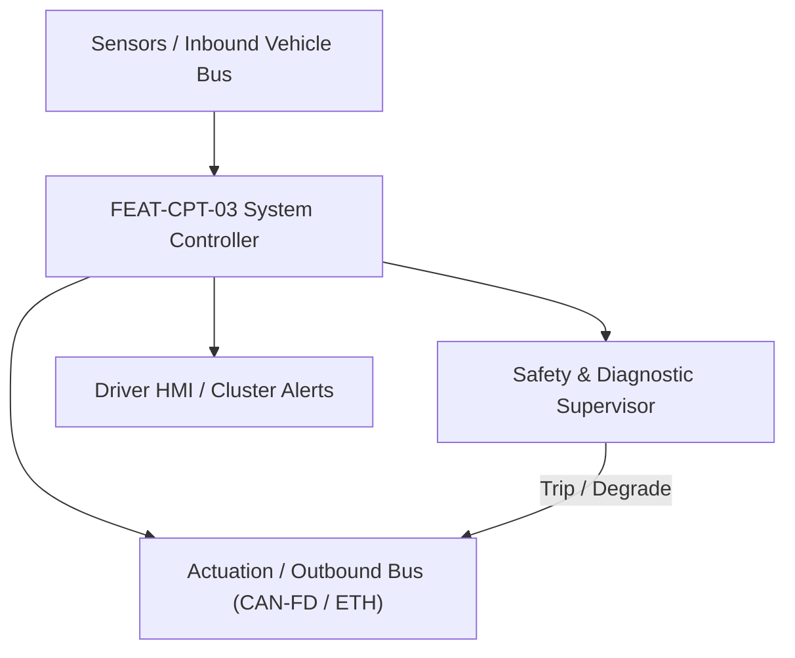
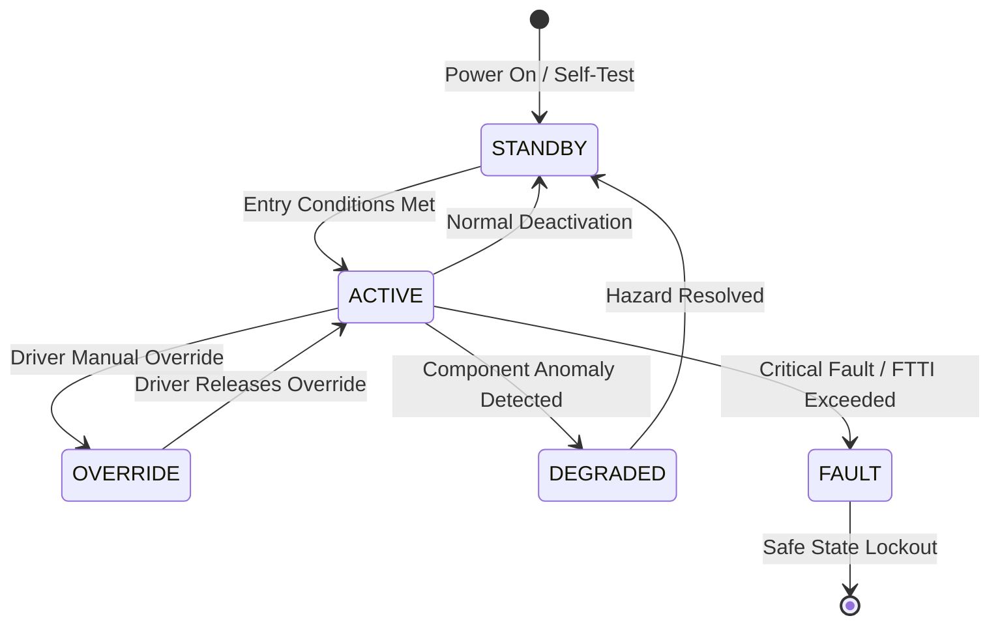

# System Requirements Specification: Digital Instrument Cluster with ASIL B Safety Island (DIC-SI)
**Feature ID:** `FEAT-CPT-03`  
**Domain:** Cockpit Electronics & Acoustic Safety  
**Target ASIL:** ASIL B / ISO 26262  
**Compliance Standard:** ISO 26262:2018 (Part 4 - System Development) / ASPICE PAM v3.1 (SYS.2, SYS.3)  
**Parent Master Specification:** [`spec.md`](file:///c:/Workset/AntiGravityProjects/TestOptimisationExperiement/spec.md#feat-cpt-03-cluster)  
**Derived Software Specification:** [`FEAT-CPT-03_CLUSTER_SwReq.md`](file:///c:/Workset/AntiGravityProjects/TestOptimisationExperiement/software_requirements/FEAT-CPT-03_CLUSTER_SwReq.md)

---

## 1. Feature Overview & Operational Scope

High-resolution digital driver instrument display combining rich 3D graphics on high-performance GPU with an independent ASIL B hardware safety island supervising critical tell-tales, vehicle speed display, and freeze-frame detection.

### Operational Context Architecture

---

## 2. Activation Logic & Operational States

- **Preconditions:** 12V system voltage >= 9.0V, Display LVDS/eDP serializer locked, Safety Island lockstep microcontroller energized.
- **Entry Conditions:** Driver door opened, remote key detected, or ignition switched to ACCESSORY / RUN.
- **Deactivation Conditions:** Ignition switched to OFF, driver door opened, and vehicle locked (transitions to quiescent sleep after 60s delay).
- **Driver Override Behavior:** If primary infotainment GPU crashes or freezes, Safety Island hardware multiplexer takes exclusive control of display within 50 ms to render essential speedometer and warnings.
- **Operational State Progression:**  
  `COLD_BOOT_SPLASH` -> `TELLTALE_BULB_CHECK` -> `NORMAL_DRIVE_RENDERING` -> `SAFETY_ISLAND_OVERLAY` -> `GPU_HANG_FALLBACK` -> `DISPLAY_OVERHEAT_DIMMING` -> `BLACKOUT_SAFE_STATE`

### State Transition Diagram

---

## 3. Functional Safety & Failure Mitigation Concept

- **Functional Safety Goal:** SG-CPT-01: Guarantee accurate display of vehicle speed (+-1 km/h) and safety tell-tales (Brakes, Airbags, ABS, ESC, Steering); prevent display freeze without driver warning.
- **Fault Tolerant Time Interval (FTTI):** 100 ms for frozen image detection; 50 ms for critical tell-tale activation.
- **Safe State Definition:** Safety Island asserts hardware 2D overlay; forces secondary display pipeline to render raw numerical speed and emergency tell-tales.
- **Warning & Escalation Strategy:** Sound emergency hardware buzzer (piezo) inside cluster housing if display panel fails completely.

### Failure Modes & Degradation Handling
- **Can Bus Loss For Speed:** If vehicle speed PDU times out (> 100 ms), display '--- km/h' and illuminate amber Master Caution icon.
- **Gpu Framebuffer Freeze:** Safety Island monitors pixel checksum CRC across dedicated signature registers: If CRC remains static for > 100 ms while speed > 0, declare GPU freeze and seize display controller.
- **Lvds Backlight Failure:** If display backlight LED string opens, increase audio alert volume and redirect critical alerts to Head-Up Display (HUD) and center screen.

---

## 4. System Requirements (SYS_REQ)
*(Note: Each System Requirement is systematically partitioned into multiple Child Software Requirements)*

### `SYS-CPT-03-01`: Hardware Safety Island Lockstep Supervisor & Frame Freeze Detector
- **Planned Release:** R400
- **ASIL Rating:** ASIL B
- **Parent Feature:** [`FEAT-CPT-03`](file:///c:/Workset/AntiGravityProjects/TestOptimisationExperiement/spec.md#feat-cpt-03)
- **Requirement Statement:**
  > The System SHALL implement an independent ASIL B dual-core lockstep microcontroller supervising the primary SoC GPU via hardware frame CRC-32 signatures and heartbeat ping-pong watchdog, seizing display panel control via hardware multiplexer in <= 50 ms upon GPU failure.
- **Activation Logic:** Active continuously whenever cluster display is energized.
- **Fault Tolerant Time Interval (FTTI):** 100 ms
- **Safe State Action:** Switch display multiplexer to Safety Island 2D emergency rendering pipeline.
- **Failure Detection & Reaction:** If SoC fails to respond to watchdog ping within 60 ms, assert SoC hardware reset line.
- **Input Interfaces:** `Display_Pixel_Stream_CRC32, SoC_Heartbeat_Watchdog_Pin, Vehicle_Speed_CANFD_PDU`
- **Output Interfaces:** `Display_Mux_Select_Pin, SoC_Hardware_Reset_Pin, Safety_Island_Overlay_Active`
- **System Verification Method:** Fault injection testing simulating SoC kernel panics, GPU hangs, and corrupted memory buffers.
- **Derived Child Software Requirements (1:N Link):**
  - [`SWR-CPT-03-01`](file:///c:/Workset/AntiGravityProjects/TestOptimisationExperiement/software_requirements/FEAT-CPT-03_CLUSTER_SwReq.md#swr-cpt-03-01)
  - [`SWR-CPT-03-02`](file:///c:/Workset/AntiGravityProjects/TestOptimisationExperiement/software_requirements/FEAT-CPT-03_CLUSTER_SwReq.md#swr-cpt-03-02)

### `SYS-CPT-03-02`: ISO 2575 Safety Tell-Tale Manager & Hardware Piezo Buzzer Chime
- **Planned Release:** R100
- **ASIL Rating:** ASIL B / FMVSS 101
- **Parent Feature:** [`FEAT-CPT-03`](file:///c:/Workset/AntiGravityProjects/TestOptimisationExperiement/spec.md#feat-cpt-03)
- **Requirement Statement:**
  > The System SHALL monitor safety-critical tell-tale status signals (Airbag, ABS, ESC, EPB, Red Brake Warning, EPS) over E2E-protected CAN-FD at 20 ms period, rendering dedicated compliant ISO 2575 warning icons and driving dual-coil hardware piezo chimes in <= 50 ms.
- **Activation Logic:** Active in all operational vehicle states.
- **Fault Tolerant Time Interval (FTTI):** 50 ms
- **Safe State Action:** Illuminate hardware-driven physical LED tell-tales; trigger continuous 1.2 kHz piezo buzzer chime.
- **Failure Detection & Reaction:** If tell-tale CAN-FD frame suffers E2E CRC error for >= 3 frames, illuminate corresponding tell-tale in latched fault state.
- **Input Interfaces:** `Brake_Fault_TellTale_Bit, Airbag_Deploy_TellTale_Bit, ESC_Off_TellTale_Bit, ABS_Fault_TellTale_Bit`
- **Output Interfaces:** `Display_TellTale_Bitmask[32], Hardware_LED_TellTale_Drivers[8], Piezo_Chime_Frequency_Hz`
- **System Verification Method:** Compliance testing according to FMVSS 101, ECE R121, and ISO 2575 standard symbols.
- **Derived Child Software Requirements (1:N Link):**
  - [`SWR-CPT-03-03`](file:///c:/Workset/AntiGravityProjects/TestOptimisationExperiement/software_requirements/FEAT-CPT-03_CLUSTER_SwReq.md#swr-cpt-03-03)
  - [`SWR-CPT-03-04`](file:///c:/Workset/AntiGravityProjects/TestOptimisationExperiement/software_requirements/FEAT-CPT-03_CLUSTER_SwReq.md#swr-cpt-03-04)

### `SYS-CPT-03-03`: Dual Microcontroller Core Architecture ASIL B Safety Island Hardware Core
- **Planned Release:** R100
- **ASIL Rating:** ASIL B
- **Parent Feature:** [`FEAT-CPT-03`](file:///c:/Workset/AntiGravityProjects/TestOptimisationExperiement/spec.md#feat-cpt-03)
- **Requirement Statement:**
  > The System SHALL Separate safety-critical tell-tales (brakes, airbag, steering) into isolated hardware domain from Linux UI.
- **Activation Logic:** Active during normal vehicle operation when feature state is active.
- **Fault Tolerant Time Interval (FTTI):** 10 ms
- **Safe State Action:** Transition to safe state or safe degradation tier within FTTI budget.
- **Failure Detection & Reaction:** Isolate faulted channel, latch DEM diagnostic trouble code, and inform driver.
- **Input Interfaces:** `Sensor signals, vehicle dynamics data, and bus frames via RTE.`
- **Output Interfaces:** `Actuator commands, diagnostic event flags, and cluster alerts.`
- **System Verification Method:** HiL test bench and dynamometer automated verification.
- **Derived Child Software Requirements (1:N Link):**
  - [`SWR-CPT-03-05`](file:///c:/Workset/AntiGravityProjects/TestOptimisationExperiement/software_requirements/FEAT-CPT-03_CLUSTER_SwReq.md#swr-cpt-03-05)
  - [`SWR-CPT-03-06`](file:///c:/Workset/AntiGravityProjects/TestOptimisationExperiement/software_requirements/FEAT-CPT-03_CLUSTER_SwReq.md#swr-cpt-03-06)

### `SYS-CPT-03-04`: Safety-Critical Optical Tell-Tale Lamp Display Controller & Pixel Echo Checker
- **Planned Release:** R200
- **ASIL Rating:** ASIL B
- **Parent Feature:** [`FEAT-CPT-03`](file:///c:/Workset/AntiGravityProjects/TestOptimisationExperiement/spec.md#feat-cpt-03)
- **Requirement Statement:**
  > The System SHALL Render brake, steering, and airbag warning icons, verifying framebuffer CRC via hardware pixel echo capture.
- **Activation Logic:** Active during normal vehicle operation when feature state is active.
- **Fault Tolerant Time Interval (FTTI):** 10 ms
- **Safe State Action:** Transition to safe state or safe degradation tier within FTTI budget.
- **Failure Detection & Reaction:** Isolate faulted channel, latch DEM diagnostic trouble code, and inform driver.
- **Input Interfaces:** `Sensor signals, vehicle dynamics data, and bus frames via RTE.`
- **Output Interfaces:** `Actuator commands, diagnostic event flags, and cluster alerts.`
- **System Verification Method:** HiL test bench and dynamometer automated verification.
- **Derived Child Software Requirements (1:N Link):**
  - [`SWR-CPT-03-07`](file:///c:/Workset/AntiGravityProjects/TestOptimisationExperiement/software_requirements/FEAT-CPT-03_CLUSTER_SwReq.md#swr-cpt-03-07)
  - [`SWR-CPT-03-08`](file:///c:/Workset/AntiGravityProjects/TestOptimisationExperiement/software_requirements/FEAT-CPT-03_CLUSTER_SwReq.md#swr-cpt-03-08)

### `SYS-CPT-03-05`: Vehicle Speedometer Digital Needle Value Verification & Plausibility Monitor
- **Planned Release:** R200
- **ASIL Rating:** ASIL B
- **Parent Feature:** [`FEAT-CPT-03`](file:///c:/Workset/AntiGravityProjects/TestOptimisationExperiement/spec.md#feat-cpt-03)
- **Requirement Statement:**
  > The System SHALL Cross-check displayed digital speed value against raw wheel speed CAN-FD frame; trip fault if error > 2 km/h.
- **Activation Logic:** Active during normal vehicle operation when feature state is active.
- **Fault Tolerant Time Interval (FTTI):** 20 ms
- **Safe State Action:** Transition to safe state or safe degradation tier within FTTI budget.
- **Failure Detection & Reaction:** Isolate faulted channel, latch DEM diagnostic trouble code, and inform driver.
- **Input Interfaces:** `Sensor signals, vehicle dynamics data, and bus frames via RTE.`
- **Output Interfaces:** `Actuator commands, diagnostic event flags, and cluster alerts.`
- **System Verification Method:** HiL test bench and dynamometer automated verification.
- **Derived Child Software Requirements (1:N Link):**
  - [`SWR-CPT-03-09`](file:///c:/Workset/AntiGravityProjects/TestOptimisationExperiement/software_requirements/FEAT-CPT-03_CLUSTER_SwReq.md#swr-cpt-03-09)
  - [`SWR-CPT-03-10`](file:///c:/Workset/AntiGravityProjects/TestOptimisationExperiement/software_requirements/FEAT-CPT-03_CLUSTER_SwReq.md#swr-cpt-03-10)

### `SYS-CPT-03-06`: Gear Selector State (P-R-N-D) Redundant Display Transmission Governor
- **Planned Release:** R200
- **ASIL Rating:** ASIL B
- **Parent Feature:** [`FEAT-CPT-03`](file:///c:/Workset/AntiGravityProjects/TestOptimisationExperiement/spec.md#feat-cpt-03)
- **Requirement Statement:**
  > The System SHALL Display active transmission gear position with zero graphic glitch and latency <= 50 ms from shift lever.
- **Activation Logic:** Active during normal vehicle operation when feature state is active.
- **Fault Tolerant Time Interval (FTTI):** 20 ms
- **Safe State Action:** Transition to safe state or safe degradation tier within FTTI budget.
- **Failure Detection & Reaction:** Isolate faulted channel, latch DEM diagnostic trouble code, and inform driver.
- **Input Interfaces:** `Sensor signals, vehicle dynamics data, and bus frames via RTE.`
- **Output Interfaces:** `Actuator commands, diagnostic event flags, and cluster alerts.`
- **System Verification Method:** HiL test bench and dynamometer automated verification.
- **Derived Child Software Requirements (1:N Link):**
  - [`SWR-CPT-03-11`](file:///c:/Workset/AntiGravityProjects/TestOptimisationExperiement/software_requirements/FEAT-CPT-03_CLUSTER_SwReq.md#swr-cpt-03-11)
  - [`SWR-CPT-03-12`](file:///c:/Workset/AntiGravityProjects/TestOptimisationExperiement/software_requirements/FEAT-CPT-03_CLUSTER_SwReq.md#swr-cpt-03-12)

### `SYS-CPT-03-07`: High-Speed CAN-FD / Automotive Ethernet Instrument Cluster Gateway Interface
- **Planned Release:** R300
- **ASIL Rating:** ASIL B
- **Parent Feature:** [`FEAT-CPT-03`](file:///c:/Workset/AntiGravityProjects/TestOptimisationExperiement/spec.md#feat-cpt-03)
- **Requirement Statement:**
  > The System SHALL Route safety messages from chassis CAN-FD to instrument cluster safety island with zero dropped packets.
- **Activation Logic:** Active during normal vehicle operation when feature state is active.
- **Fault Tolerant Time Interval (FTTI):** 10 ms
- **Safe State Action:** Transition to safe state or safe degradation tier within FTTI budget.
- **Failure Detection & Reaction:** Isolate faulted channel, latch DEM diagnostic trouble code, and inform driver.
- **Input Interfaces:** `Sensor signals, vehicle dynamics data, and bus frames via RTE.`
- **Output Interfaces:** `Actuator commands, diagnostic event flags, and cluster alerts.`
- **System Verification Method:** HiL test bench and dynamometer automated verification.
- **Derived Child Software Requirements (1:N Link):**
  - [`SWR-CPT-03-13`](file:///c:/Workset/AntiGravityProjects/TestOptimisationExperiement/software_requirements/FEAT-CPT-03_CLUSTER_SwReq.md#swr-cpt-03-13)
  - [`SWR-CPT-03-14`](file:///c:/Workset/AntiGravityProjects/TestOptimisationExperiement/software_requirements/FEAT-CPT-03_CLUSTER_SwReq.md#swr-cpt-03-14)

### `SYS-CPT-03-08`: Cluster LCD Backlight Dual-String LED Open/Short Hardware Supervisor
- **Planned Release:** R300
- **ASIL Rating:** ASIL B
- **Parent Feature:** [`FEAT-CPT-03`](file:///c:/Workset/AntiGravityProjects/TestOptimisationExperiement/spec.md#feat-cpt-03)
- **Requirement Statement:**
  > The System SHALL Monitor backlight LED strings: If primary string opens, boost secondary string to maintain cluster readability.
- **Activation Logic:** Active during normal vehicle operation when feature state is active.
- **Fault Tolerant Time Interval (FTTI):** 50 ms
- **Safe State Action:** Transition to safe state or safe degradation tier within FTTI budget.
- **Failure Detection & Reaction:** Isolate faulted channel, latch DEM diagnostic trouble code, and inform driver.
- **Input Interfaces:** `Sensor signals, vehicle dynamics data, and bus frames via RTE.`
- **Output Interfaces:** `Actuator commands, diagnostic event flags, and cluster alerts.`
- **System Verification Method:** HiL test bench and dynamometer automated verification.
- **Derived Child Software Requirements (1:N Link):**
  - [`SWR-CPT-03-15`](file:///c:/Workset/AntiGravityProjects/TestOptimisationExperiement/software_requirements/FEAT-CPT-03_CLUSTER_SwReq.md#swr-cpt-03-15)
  - [`SWR-CPT-03-16`](file:///c:/Workset/AntiGravityProjects/TestOptimisationExperiement/software_requirements/FEAT-CPT-03_CLUSTER_SwReq.md#swr-cpt-03-16)

### `SYS-CPT-03-09`: Graphic Processing Unit (GPU) Frame Rendering Freeze & Lockup Hardware Watchdog
- **Planned Release:** R400
- **ASIL Rating:** ASIL B
- **Parent Feature:** [`FEAT-CPT-03`](file:///c:/Workset/AntiGravityProjects/TestOptimisationExperiement/spec.md#feat-cpt-03)
- **Requirement Statement:**
  > The System SHALL External safety microcontroller trips GPU reset if rendering frame rate drops below 20 fps for > 200 ms.
- **Activation Logic:** Active during normal vehicle operation when feature state is active.
- **Fault Tolerant Time Interval (FTTI):** 20 ms
- **Safe State Action:** Transition to safe state or safe degradation tier within FTTI budget.
- **Failure Detection & Reaction:** Isolate faulted channel, latch DEM diagnostic trouble code, and inform driver.
- **Input Interfaces:** `Sensor signals, vehicle dynamics data, and bus frames via RTE.`
- **Output Interfaces:** `Actuator commands, diagnostic event flags, and cluster alerts.`
- **System Verification Method:** HiL test bench and dynamometer automated verification.
- **Derived Child Software Requirements (1:N Link):**
  - [`SWR-CPT-03-17`](file:///c:/Workset/AntiGravityProjects/TestOptimisationExperiement/software_requirements/FEAT-CPT-03_CLUSTER_SwReq.md#swr-cpt-03-17)
  - [`SWR-CPT-03-18`](file:///c:/Workset/AntiGravityProjects/TestOptimisationExperiement/software_requirements/FEAT-CPT-03_CLUSTER_SwReq.md#swr-cpt-03-18)

### `SYS-CPT-03-10`: Acoustic Master Chime Loudspeaker Continuity & Amplifier Impedance Tester
- **Planned Release:** R500
- **ASIL Rating:** ASIL B
- **Parent Feature:** [`FEAT-CPT-03`](file:///c:/Workset/AntiGravityProjects/TestOptimisationExperiement/spec.md#feat-cpt-03)
- **Requirement Statement:**
  > The System SHALL Perform continuous silent impedance check on warning chime speaker: Flag DTC if voice coil is open.
- **Activation Logic:** Active during normal vehicle operation when feature state is active.
- **Fault Tolerant Time Interval (FTTI):** 100 ms
- **Safe State Action:** Transition to safe state or safe degradation tier within FTTI budget.
- **Failure Detection & Reaction:** Isolate faulted channel, latch DEM diagnostic trouble code, and inform driver.
- **Input Interfaces:** `Sensor signals, vehicle dynamics data, and bus frames via RTE.`
- **Output Interfaces:** `Actuator commands, diagnostic event flags, and cluster alerts.`
- **System Verification Method:** HiL test bench and dynamometer automated verification.
- **Derived Child Software Requirements (1:N Link):**
  - [`SWR-CPT-03-19`](file:///c:/Workset/AntiGravityProjects/TestOptimisationExperiement/software_requirements/FEAT-CPT-03_CLUSTER_SwReq.md#swr-cpt-03-19)
  - [`SWR-CPT-03-20`](file:///c:/Workset/AntiGravityProjects/TestOptimisationExperiement/software_requirements/FEAT-CPT-03_CLUSTER_SwReq.md#swr-cpt-03-20)

### `SYS-CPT-03-11`: Ambient Cabin Illuminance Display Dimming Curve Generator
- **Planned Release:** R400
- **ASIL Rating:** ASIL A
- **Parent Feature:** [`FEAT-CPT-03`](file:///c:/Workset/AntiGravityProjects/TestOptimisationExperiement/spec.md#feat-cpt-03)
- **Requirement Statement:**
  > The System SHALL Smoothly adjust cluster display brightness across 0.5 nits to 1000 nits based on dashboard ambient sensor.
- **Activation Logic:** Active during normal vehicle operation when feature state is active.
- **Fault Tolerant Time Interval (FTTI):** 200 ms
- **Safe State Action:** Transition to safe state or safe degradation tier within FTTI budget.
- **Failure Detection & Reaction:** Isolate faulted channel, latch DEM diagnostic trouble code, and inform driver.
- **Input Interfaces:** `Sensor signals, vehicle dynamics data, and bus frames via RTE.`
- **Output Interfaces:** `Actuator commands, diagnostic event flags, and cluster alerts.`
- **System Verification Method:** HiL test bench and dynamometer automated verification.
- **Derived Child Software Requirements (1:N Link):**
  - [`SWR-CPT-03-21`](file:///c:/Workset/AntiGravityProjects/TestOptimisationExperiement/software_requirements/FEAT-CPT-03_CLUSTER_SwReq.md#swr-cpt-03-21)
  - [`SWR-CPT-03-22`](file:///c:/Workset/AntiGravityProjects/TestOptimisationExperiement/software_requirements/FEAT-CPT-03_CLUSTER_SwReq.md#swr-cpt-03-22)

### `SYS-CPT-03-12`: Trip Computer Energy Consumption & Estimated Range Calculation Law
- **Planned Release:** R400
- **ASIL Rating:** ASIL A
- **Parent Feature:** [`FEAT-CPT-03`](file:///c:/Workset/AntiGravityProjects/TestOptimisationExperiement/spec.md#feat-cpt-03)
- **Requirement Statement:**
  > The System SHALL Compute average electrical consumption (kWh/100 km) and remaining battery driving range based on terrain.
- **Activation Logic:** Active during normal vehicle operation when feature state is active.
- **Fault Tolerant Time Interval (FTTI):** 500 ms
- **Safe State Action:** Transition to safe state or safe degradation tier within FTTI budget.
- **Failure Detection & Reaction:** Isolate faulted channel, latch DEM diagnostic trouble code, and inform driver.
- **Input Interfaces:** `Sensor signals, vehicle dynamics data, and bus frames via RTE.`
- **Output Interfaces:** `Actuator commands, diagnostic event flags, and cluster alerts.`
- **System Verification Method:** HiL test bench and dynamometer automated verification.
- **Derived Child Software Requirements (1:N Link):**
  - [`SWR-CPT-03-23`](file:///c:/Workset/AntiGravityProjects/TestOptimisationExperiement/software_requirements/FEAT-CPT-03_CLUSTER_SwReq.md#swr-cpt-03-23)
  - [`SWR-CPT-03-24`](file:///c:/Workset/AntiGravityProjects/TestOptimisationExperiement/software_requirements/FEAT-CPT-03_CLUSTER_SwReq.md#swr-cpt-03-24)

### `SYS-CPT-03-13`: High-Priority Master Warning Message Text Overlay Pop-Up Manager
- **Planned Release:** R500
- **ASIL Rating:** ASIL B
- **Parent Feature:** [`FEAT-CPT-03`](file:///c:/Workset/AntiGravityProjects/TestOptimisationExperiement/spec.md#feat-cpt-03)
- **Requirement Statement:**
  > The System SHALL Display full-screen prioritized text prompts (e.g. 'Pull Over Immediately') upon critical ASIL D system trip.
- **Activation Logic:** Active during normal vehicle operation when feature state is active.
- **Fault Tolerant Time Interval (FTTI):** 50 ms
- **Safe State Action:** Transition to safe state or safe degradation tier within FTTI budget.
- **Failure Detection & Reaction:** Isolate faulted channel, latch DEM diagnostic trouble code, and inform driver.
- **Input Interfaces:** `Sensor signals, vehicle dynamics data, and bus frames via RTE.`
- **Output Interfaces:** `Actuator commands, diagnostic event flags, and cluster alerts.`
- **System Verification Method:** HiL test bench and dynamometer automated verification.
- **Derived Child Software Requirements (1:N Link):**
  - [`SWR-CPT-03-25`](file:///c:/Workset/AntiGravityProjects/TestOptimisationExperiement/software_requirements/FEAT-CPT-03_CLUSTER_SwReq.md#swr-cpt-03-25)
  - [`SWR-CPT-03-26`](file:///c:/Workset/AntiGravityProjects/TestOptimisationExperiement/software_requirements/FEAT-CPT-03_CLUSTER_SwReq.md#swr-cpt-03-26)

### `SYS-CPT-03-14`: DEM Instrument Cluster Diagnostic Trouble Code Qualification & Error Logger
- **Planned Release:** R500
- **ASIL Rating:** ASIL B
- **Parent Feature:** [`FEAT-CPT-03`](file:///c:/Workset/AntiGravityProjects/TestOptimisationExperiement/spec.md#feat-cpt-03)
- **Requirement Statement:**
  > The System SHALL Log diagnostic fault codes for display controller errors, CAN communication timeouts, and chime faults.
- **Activation Logic:** Active during normal vehicle operation when feature state is active.
- **Fault Tolerant Time Interval (FTTI):** 100 ms
- **Safe State Action:** Transition to safe state or safe degradation tier within FTTI budget.
- **Failure Detection & Reaction:** Isolate faulted channel, latch DEM diagnostic trouble code, and inform driver.
- **Input Interfaces:** `Sensor signals, vehicle dynamics data, and bus frames via RTE.`
- **Output Interfaces:** `Actuator commands, diagnostic event flags, and cluster alerts.`
- **System Verification Method:** HiL test bench and dynamometer automated verification.
- **Derived Child Software Requirements (1:N Link):**
  - [`SWR-CPT-03-27`](file:///c:/Workset/AntiGravityProjects/TestOptimisationExperiement/software_requirements/FEAT-CPT-03_CLUSTER_SwReq.md#swr-cpt-03-27)
  - [`SWR-CPT-03-28`](file:///c:/Workset/AntiGravityProjects/TestOptimisationExperiement/software_requirements/FEAT-CPT-03_CLUSTER_SwReq.md#swr-cpt-03-28)

### `SYS-CPT-03-15`: Non-Volatile Cluster Odometer Cumulative Mileage Anti-Tamper Counter
- **Planned Release:** R500
- **ASIL Rating:** ASIL B
- **Parent Feature:** [`FEAT-CPT-03`](file:///c:/Workset/AntiGravityProjects/TestOptimisationExperiement/spec.md#feat-cpt-03)
- **Requirement Statement:**
  > The System SHALL Store vehicle cumulative mileage in cryptographically signed redundant EEPROM sectors to prevent fraud.
- **Activation Logic:** Active during normal vehicle operation when feature state is active.
- **Fault Tolerant Time Interval (FTTI):** 1000 ms
- **Safe State Action:** Transition to safe state or safe degradation tier within FTTI budget.
- **Failure Detection & Reaction:** Isolate faulted channel, latch DEM diagnostic trouble code, and inform driver.
- **Input Interfaces:** `Sensor signals, vehicle dynamics data, and bus frames via RTE.`
- **Output Interfaces:** `Actuator commands, diagnostic event flags, and cluster alerts.`
- **System Verification Method:** HiL test bench and dynamometer automated verification.
- **Derived Child Software Requirements (1:N Link):**
  - [`SWR-CPT-03-29`](file:///c:/Workset/AntiGravityProjects/TestOptimisationExperiement/software_requirements/FEAT-CPT-03_CLUSTER_SwReq.md#swr-cpt-03-29)
  - [`SWR-CPT-03-30`](file:///c:/Workset/AntiGravityProjects/TestOptimisationExperiement/software_requirements/FEAT-CPT-03_CLUSTER_SwReq.md#swr-cpt-03-30)

---

## 5. System-to-Software Traceability Summary

| System Requirement ID | Planned Release | ASIL | Title | Derived Software Requirements (1:N) | Verification Method |
| :--- | :---: | :--- | :--- | :--- | :--- |
| `SYS-CPT-03-01` | **`R400`** | ASIL B | Hardware Safety Island Lockstep Supervisor & Frame Freeze Detector | [`SWR-CPT-03-01`](file:///c:/Workset/AntiGravityProjects/TestOptimisationExperiement/software_requirements/FEAT-CPT-03_CLUSTER_SwReq.md#swr-cpt-03-01), [`SWR-CPT-03-02`](file:///c:/Workset/AntiGravityProjects/TestOptimisationExperiement/software_requirements/FEAT-CPT-03_CLUSTER_SwReq.md#swr-cpt-03-02) | Fault injection testing simulating SoC kernel panics, GPU hangs, and corrupted memory buffers. |
| `SYS-CPT-03-02` | **`R100`** | ASIL B / FMVSS 101 | ISO 2575 Safety Tell-Tale Manager & Hardware Piezo Buzzer Chime | [`SWR-CPT-03-03`](file:///c:/Workset/AntiGravityProjects/TestOptimisationExperiement/software_requirements/FEAT-CPT-03_CLUSTER_SwReq.md#swr-cpt-03-03), [`SWR-CPT-03-04`](file:///c:/Workset/AntiGravityProjects/TestOptimisationExperiement/software_requirements/FEAT-CPT-03_CLUSTER_SwReq.md#swr-cpt-03-04) | Compliance testing according to FMVSS 101, ECE R121, and ISO 2575 standard symbols. |
| `SYS-CPT-03-03` | **`R100`** | ASIL B | Dual Microcontroller Core Architecture ASIL B Safety Island Hardware Core | [`SWR-CPT-03-05`](file:///c:/Workset/AntiGravityProjects/TestOptimisationExperiement/software_requirements/FEAT-CPT-03_CLUSTER_SwReq.md#swr-cpt-03-05), [`SWR-CPT-03-06`](file:///c:/Workset/AntiGravityProjects/TestOptimisationExperiement/software_requirements/FEAT-CPT-03_CLUSTER_SwReq.md#swr-cpt-03-06) | HiL test bench and dynamometer automated verification. |
| `SYS-CPT-03-04` | **`R200`** | ASIL B | Safety-Critical Optical Tell-Tale Lamp Display Controller & Pixel Echo Checker | [`SWR-CPT-03-07`](file:///c:/Workset/AntiGravityProjects/TestOptimisationExperiement/software_requirements/FEAT-CPT-03_CLUSTER_SwReq.md#swr-cpt-03-07), [`SWR-CPT-03-08`](file:///c:/Workset/AntiGravityProjects/TestOptimisationExperiement/software_requirements/FEAT-CPT-03_CLUSTER_SwReq.md#swr-cpt-03-08) | HiL test bench and dynamometer automated verification. |
| `SYS-CPT-03-05` | **`R200`** | ASIL B | Vehicle Speedometer Digital Needle Value Verification & Plausibility Monitor | [`SWR-CPT-03-09`](file:///c:/Workset/AntiGravityProjects/TestOptimisationExperiement/software_requirements/FEAT-CPT-03_CLUSTER_SwReq.md#swr-cpt-03-09), [`SWR-CPT-03-10`](file:///c:/Workset/AntiGravityProjects/TestOptimisationExperiement/software_requirements/FEAT-CPT-03_CLUSTER_SwReq.md#swr-cpt-03-10) | HiL test bench and dynamometer automated verification. |
| `SYS-CPT-03-06` | **`R200`** | ASIL B | Gear Selector State (P-R-N-D) Redundant Display Transmission Governor | [`SWR-CPT-03-11`](file:///c:/Workset/AntiGravityProjects/TestOptimisationExperiement/software_requirements/FEAT-CPT-03_CLUSTER_SwReq.md#swr-cpt-03-11), [`SWR-CPT-03-12`](file:///c:/Workset/AntiGravityProjects/TestOptimisationExperiement/software_requirements/FEAT-CPT-03_CLUSTER_SwReq.md#swr-cpt-03-12) | HiL test bench and dynamometer automated verification. |
| `SYS-CPT-03-07` | **`R300`** | ASIL B | High-Speed CAN-FD / Automotive Ethernet Instrument Cluster Gateway Interface | [`SWR-CPT-03-13`](file:///c:/Workset/AntiGravityProjects/TestOptimisationExperiement/software_requirements/FEAT-CPT-03_CLUSTER_SwReq.md#swr-cpt-03-13), [`SWR-CPT-03-14`](file:///c:/Workset/AntiGravityProjects/TestOptimisationExperiement/software_requirements/FEAT-CPT-03_CLUSTER_SwReq.md#swr-cpt-03-14) | HiL test bench and dynamometer automated verification. |
| `SYS-CPT-03-08` | **`R300`** | ASIL B | Cluster LCD Backlight Dual-String LED Open/Short Hardware Supervisor | [`SWR-CPT-03-15`](file:///c:/Workset/AntiGravityProjects/TestOptimisationExperiement/software_requirements/FEAT-CPT-03_CLUSTER_SwReq.md#swr-cpt-03-15), [`SWR-CPT-03-16`](file:///c:/Workset/AntiGravityProjects/TestOptimisationExperiement/software_requirements/FEAT-CPT-03_CLUSTER_SwReq.md#swr-cpt-03-16) | HiL test bench and dynamometer automated verification. |
| `SYS-CPT-03-09` | **`R400`** | ASIL B | Graphic Processing Unit (GPU) Frame Rendering Freeze & Lockup Hardware Watchdog | [`SWR-CPT-03-17`](file:///c:/Workset/AntiGravityProjects/TestOptimisationExperiement/software_requirements/FEAT-CPT-03_CLUSTER_SwReq.md#swr-cpt-03-17), [`SWR-CPT-03-18`](file:///c:/Workset/AntiGravityProjects/TestOptimisationExperiement/software_requirements/FEAT-CPT-03_CLUSTER_SwReq.md#swr-cpt-03-18) | HiL test bench and dynamometer automated verification. |
| `SYS-CPT-03-10` | **`R500`** | ASIL B | Acoustic Master Chime Loudspeaker Continuity & Amplifier Impedance Tester | [`SWR-CPT-03-19`](file:///c:/Workset/AntiGravityProjects/TestOptimisationExperiement/software_requirements/FEAT-CPT-03_CLUSTER_SwReq.md#swr-cpt-03-19), [`SWR-CPT-03-20`](file:///c:/Workset/AntiGravityProjects/TestOptimisationExperiement/software_requirements/FEAT-CPT-03_CLUSTER_SwReq.md#swr-cpt-03-20) | HiL test bench and dynamometer automated verification. |
| `SYS-CPT-03-11` | **`R400`** | ASIL A | Ambient Cabin Illuminance Display Dimming Curve Generator | [`SWR-CPT-03-21`](file:///c:/Workset/AntiGravityProjects/TestOptimisationExperiement/software_requirements/FEAT-CPT-03_CLUSTER_SwReq.md#swr-cpt-03-21), [`SWR-CPT-03-22`](file:///c:/Workset/AntiGravityProjects/TestOptimisationExperiement/software_requirements/FEAT-CPT-03_CLUSTER_SwReq.md#swr-cpt-03-22) | HiL test bench and dynamometer automated verification. |
| `SYS-CPT-03-12` | **`R400`** | ASIL A | Trip Computer Energy Consumption & Estimated Range Calculation Law | [`SWR-CPT-03-23`](file:///c:/Workset/AntiGravityProjects/TestOptimisationExperiement/software_requirements/FEAT-CPT-03_CLUSTER_SwReq.md#swr-cpt-03-23), [`SWR-CPT-03-24`](file:///c:/Workset/AntiGravityProjects/TestOptimisationExperiement/software_requirements/FEAT-CPT-03_CLUSTER_SwReq.md#swr-cpt-03-24) | HiL test bench and dynamometer automated verification. |
| `SYS-CPT-03-13` | **`R500`** | ASIL B | High-Priority Master Warning Message Text Overlay Pop-Up Manager | [`SWR-CPT-03-25`](file:///c:/Workset/AntiGravityProjects/TestOptimisationExperiement/software_requirements/FEAT-CPT-03_CLUSTER_SwReq.md#swr-cpt-03-25), [`SWR-CPT-03-26`](file:///c:/Workset/AntiGravityProjects/TestOptimisationExperiement/software_requirements/FEAT-CPT-03_CLUSTER_SwReq.md#swr-cpt-03-26) | HiL test bench and dynamometer automated verification. |
| `SYS-CPT-03-14` | **`R500`** | ASIL B | DEM Instrument Cluster Diagnostic Trouble Code Qualification & Error Logger | [`SWR-CPT-03-27`](file:///c:/Workset/AntiGravityProjects/TestOptimisationExperiement/software_requirements/FEAT-CPT-03_CLUSTER_SwReq.md#swr-cpt-03-27), [`SWR-CPT-03-28`](file:///c:/Workset/AntiGravityProjects/TestOptimisationExperiement/software_requirements/FEAT-CPT-03_CLUSTER_SwReq.md#swr-cpt-03-28) | HiL test bench and dynamometer automated verification. |
| `SYS-CPT-03-15` | **`R500`** | ASIL B | Non-Volatile Cluster Odometer Cumulative Mileage Anti-Tamper Counter | [`SWR-CPT-03-29`](file:///c:/Workset/AntiGravityProjects/TestOptimisationExperiement/software_requirements/FEAT-CPT-03_CLUSTER_SwReq.md#swr-cpt-03-29), [`SWR-CPT-03-30`](file:///c:/Workset/AntiGravityProjects/TestOptimisationExperiement/software_requirements/FEAT-CPT-03_CLUSTER_SwReq.md#swr-cpt-03-30) | HiL test bench and dynamometer automated verification. |

- **Upstream Feature Link:** [`spec.md` (FEAT-CPT-03)](file:///c:/Workset/AntiGravityProjects/TestOptimisationExperiement/spec.md#feat-cpt-03)
- **Software Requirements Specification:** [`FEAT-CPT-03_CLUSTER_SwReq.md`](file:///c:/Workset/AntiGravityProjects/TestOptimisationExperiement/software_requirements/FEAT-CPT-03_CLUSTER_SwReq.md)
