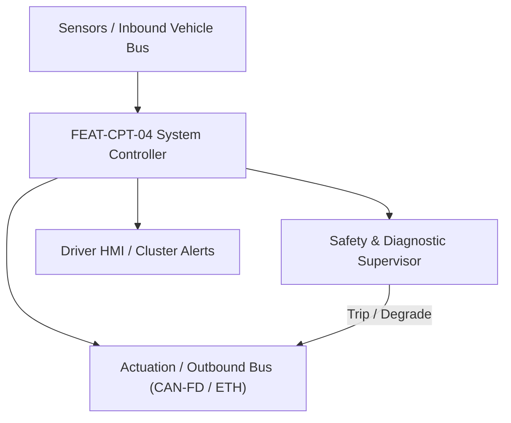
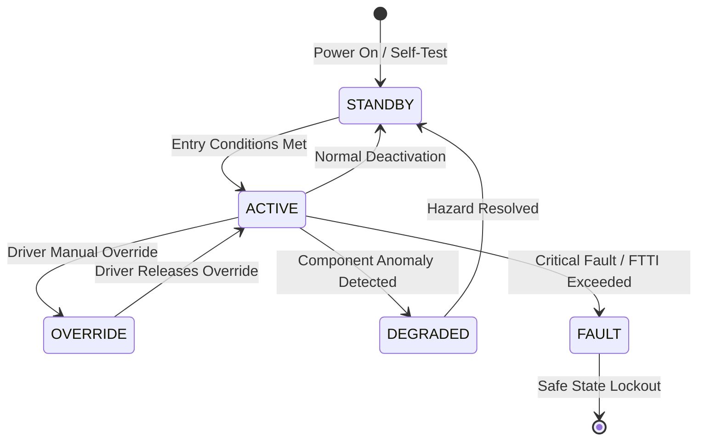

# System Requirements Specification: Acoustic Vehicle Alerting & Active Road Noise Cancellation (AVAS-RNC)
**Feature ID:** `FEAT-CPT-04`  
**Domain:** Cockpit Electronics & Acoustic Safety  
**Target ASIL:** ASIL B / UNECE R138  
**Compliance Standard:** ISO 26262:2018 (Part 4 - System Development) / ASPICE PAM v3.1 (SYS.2, SYS.3)  
**Parent Master Specification:** [`spec.md`](file:///c:/Workset/AntiGravityProjects/TestOptimisationExperiement/spec.md#feat-cpt-04-avas-rnc)  
**Derived Software Specification:** [`FEAT-CPT-04_AVAS-RNC_SwReq.md`](file:///c:/Workset/AntiGravityProjects/TestOptimisationExperiement/software_requirements/FEAT-CPT-04_AVAS-RNC_SwReq.md)

---

## 1. Feature Overview & Operational Scope

Dual external and internal acoustic system providing regulatory pedestrian warning sounds (AVAS) outside the vehicle and real-time active road noise cancellation (RNC) inside the cabin using chassis accelerometers.

### Operational Context Architecture

---

## 2. Activation Logic & Operational States

- **Preconditions:** 12V system voltage >= 11.0V, external waterproof speaker healthy, cabin audio DSP initialized.
- **Entry Conditions:** For AVAS: Vehicle powered and moving forward or reverse at speeds <= 30 km/h (UNECE R138 / FMVSS 141). For RNC: Vehicle speed > 20 km/h with windows closed.
- **Deactivation Conditions:** Vehicle speed > 30 km/h (AVAS automatically fades out); vehicle stopped or window open (RNC pauses).
- **Driver Override Behavior:** Temporary AVAS pause switch is prohibited in jurisdictions conforming to UNECE R138 Rev 1; reversing sound cannot be defeated.
- **Operational State Progression:**  
  `AVAS_STANDSTILL_HUM` -> `AVAS_FORWARD_SPEED_SOUND` -> `AVAS_REVERSE_BEEP` -> `AVAS_MUTED_ABOVE_30KMH` -> `RNC_CONVERGING` -> `RNC_ACTIVE_CANCELLATION` -> `SPEAKER_COIL_OVERHEAT_FAULT`

### State Transition Diagram

---

## 3. Functional Safety & Failure Mitigation Concept

- **Functional Safety Goal:** SG-AVAS-01: Ensure continuous acoustic pedestrian audibility for quiet electric vehicle operation (minimum sound pressure levels in 1/3-octave bands 160 Hz to 5000 Hz according to UNECE R138); prevent speaker coil disconnect without driver notice.
- **Fault Tolerant Time Interval (FTTI):** 200 ms for speaker impedance disconnect detection.
- **Safe State Definition:** Illuminate cluster 'AVAS Fault' warning tell-tale; sound low-speed warning via secondary backup horn if primary AVAS speaker open-circuited.
- **Warning & Escalation Strategy:** Display message on instrument cluster: 'Pedestrian Warning Sound Error - Service Required'.

### Failure Modes & Degradation Handling
- **Accelerometer Saturation:** If chassis suspension accelerometer signal clips due to severe pothole impact, freeze RNC adaptive filter weights for 500 ms to prevent audio pop.
- **Speaker Voice Coil Open:** Sensing circuit samples speaker voice coil impedance: If open-circuit (> 50 ohms) or short-circuit (< 2 ohms) detected, switch to backup transducer.

---

## 4. System Requirements (SYS_REQ)
*(Note: Each System Requirement is systematically partitioned into multiple Child Software Requirements)*

### `SYS-CPT-04-01`: UNECE R138 Speed-Proportional Acoustic Pedestrian Synthesis
- **Planned Release:** R100
- **ASIL Rating:** ASIL B / UNECE R138
- **Parent Feature:** [`FEAT-CPT-04`](file:///c:/Workset/AntiGravityProjects/TestOptimisationExperiement/spec.md#feat-cpt-04)
- **Requirement Statement:**
  > The System SHALL synthesize regulatory acoustic pedestrian warning sound streams from 0 km/h to 30 km/h with sound pressure level between 56 dB(A) and 75 dB(A) and pitch shift (+-0.8% per km/h) matching vehicle speed, broadcasting through front/rear waterproof speakers in <= 50 ms.
- **Activation Logic:** Active at speeds between 0 and 30 km/h in DRIVE or REVERSE.
- **Fault Tolerant Time Interval (FTTI):** 200 ms
- **Safe State Action:** Switch to backup external horn pulse mode; illuminate cluster warning.
- **Failure Detection & Reaction:** If vehicle speed CAN-FD signal lost, play baseline 20 km/h sound continuously while in DRIVE.
- **Input Interfaces:** `Vehicle_Speed_Kmph, Transmission_Gear_PRND, Ego_Acceleration_Mps2`
- **Output Interfaces:** `AVAS_Speaker_Audio_Waveform_DAC, AVAS_Sound_Level_Dba, AVAS_Status_Word`
- **System Verification Method:** Outdoor acoustic test pad testing conforming to ISO 16254 sound pressure measurement.
- **Derived Child Software Requirements (1:N Link):**
  - [`SWR-CPT-04-01`](file:///c:/Workset/AntiGravityProjects/TestOptimisationExperiement/software_requirements/FEAT-CPT-04_AVAS-RNC_SwReq.md#swr-cpt-04-01)
  - [`SWR-CPT-04-02`](file:///c:/Workset/AntiGravityProjects/TestOptimisationExperiement/software_requirements/FEAT-CPT-04_AVAS-RNC_SwReq.md#swr-cpt-04-02)

### `SYS-CPT-04-02`: Multi-Channel Chassis Accelerometer Active Road Noise Cancellation
- **Planned Release:** R100
- **ASIL Rating:** QM
- **Parent Feature:** [`FEAT-CPT-04`](file:///c:/Workset/AntiGravityProjects/TestOptimisationExperiement/spec.md#feat-cpt-04)
- **Requirement Statement:**
  > The System SHALL sample 4 structural suspension chassis accelerometers (up to 1000 Hz) and 4 cabin error microphones, computing anti-phase acoustic cancellation waveforms in <= 3 ms to attenuate low-frequency road rumble (30 Hz to 250 Hz) by >= 6 dB at occupant ear positions.
- **Activation Logic:** Active when vehicle speed > 20 km/h and all doors/windows closed.
- **Fault Tolerant Time Interval (FTTI):** N/A
- **Safe State Action:** Zero cancellation audio output; fade out anti-phase signals over 200 ms.
- **Failure Detection & Reaction:** If any error microphone detects positive feedback (howling), ramp anti-noise gain to 0.0 in < 20 ms.
- **Input Interfaces:** `Chassis_Accel_FL_FR_RL_RR_ADC, Cabin_Error_Mic_1_4_ADC, Vehicle_Speed_Kmph, Window_Position_Bits`
- **Output Interfaces:** `AntiNoise_Audio_Stream_FL_FR_RL_RR[4], Attenuation_Level_Db`
- **System Verification Method:** Acoustic transfer function measurement on rough coarse-chip asphalt test surface.
- **Derived Child Software Requirements (1:N Link):**
  - [`SWR-CPT-04-03`](file:///c:/Workset/AntiGravityProjects/TestOptimisationExperiement/software_requirements/FEAT-CPT-04_AVAS-RNC_SwReq.md#swr-cpt-04-03)
  - [`SWR-CPT-04-04`](file:///c:/Workset/AntiGravityProjects/TestOptimisationExperiement/software_requirements/FEAT-CPT-04_AVAS-RNC_SwReq.md#swr-cpt-04-04)

### `SYS-CPT-04-03`: Acoustic Vehicle Alerting System (AVAS) UNECE R138 Minimum Sound Pressure Level Synthesizer
- **Planned Release:** R100
- **ASIL Rating:** ASIL B
- **Parent Feature:** [`FEAT-CPT-04`](file:///c:/Workset/AntiGravityProjects/TestOptimisationExperiement/spec.md#feat-cpt-04)
- **Requirement Statement:**
  > The System SHALL Synthesize external engine-like sound at speeds 0 to 20 km/h conforming to 56 to 75 dBA sound pressure limits.
- **Activation Logic:** Active during normal vehicle operation when feature state is active.
- **Fault Tolerant Time Interval (FTTI):** 20 ms
- **Safe State Action:** Transition to safe state or safe degradation tier within FTTI budget.
- **Failure Detection & Reaction:** Isolate faulted channel, latch DEM diagnostic trouble code, and inform driver.
- **Input Interfaces:** `Sensor signals, vehicle dynamics data, and bus frames via RTE.`
- **Output Interfaces:** `Actuator commands, diagnostic event flags, and cluster alerts.`
- **System Verification Method:** HiL test bench and dynamometer automated verification.
- **Derived Child Software Requirements (1:N Link):**
  - [`SWR-CPT-04-05`](file:///c:/Workset/AntiGravityProjects/TestOptimisationExperiement/software_requirements/FEAT-CPT-04_AVAS-RNC_SwReq.md#swr-cpt-04-05)
  - [`SWR-CPT-04-06`](file:///c:/Workset/AntiGravityProjects/TestOptimisationExperiement/software_requirements/FEAT-CPT-04_AVAS-RNC_SwReq.md#swr-cpt-04-06)

### `SYS-CPT-04-04`: Forward / Reverse Directional Sound Pitch Shift Frequency Modulator
- **Planned Release:** R200
- **ASIL Rating:** ASIL B
- **Parent Feature:** [`FEAT-CPT-04`](file:///c:/Workset/AntiGravityProjects/TestOptimisationExperiement/spec.md#feat-cpt-04)
- **Requirement Statement:**
  > The System SHALL Modulate acoustic sound pitch proportionally to vehicle speed (minimum 0.8% frequency shift per km/h).
- **Activation Logic:** Active during normal vehicle operation when feature state is active.
- **Fault Tolerant Time Interval (FTTI):** 20 ms
- **Safe State Action:** Transition to safe state or safe degradation tier within FTTI budget.
- **Failure Detection & Reaction:** Isolate faulted channel, latch DEM diagnostic trouble code, and inform driver.
- **Input Interfaces:** `Sensor signals, vehicle dynamics data, and bus frames via RTE.`
- **Output Interfaces:** `Actuator commands, diagnostic event flags, and cluster alerts.`
- **System Verification Method:** HiL test bench and dynamometer automated verification.
- **Derived Child Software Requirements (1:N Link):**
  - [`SWR-CPT-04-07`](file:///c:/Workset/AntiGravityProjects/TestOptimisationExperiement/software_requirements/FEAT-CPT-04_AVAS-RNC_SwReq.md#swr-cpt-04-07)
  - [`SWR-CPT-04-08`](file:///c:/Workset/AntiGravityProjects/TestOptimisationExperiement/software_requirements/FEAT-CPT-04_AVAS-RNC_SwReq.md#swr-cpt-04-08)

### `SYS-CPT-04-05`: Dual Exterior Weather-Sealed Loudspeaker Impedance & Continuity Diagnostics
- **Planned Release:** R500
- **ASIL Rating:** ASIL B
- **Parent Feature:** [`FEAT-CPT-04`](file:///c:/Workset/AntiGravityProjects/TestOptimisationExperiement/spec.md#feat-cpt-04)
- **Requirement Statement:**
  > The System SHALL Measure front and rear exterior loudspeaker coil impedance at 10 Hz; flag DTC B1412 if speaker disconnected.
- **Activation Logic:** Active during normal vehicle operation when feature state is active.
- **Fault Tolerant Time Interval (FTTI):** 50 ms
- **Safe State Action:** Transition to safe state or safe degradation tier within FTTI budget.
- **Failure Detection & Reaction:** Isolate faulted channel, latch DEM diagnostic trouble code, and inform driver.
- **Input Interfaces:** `Sensor signals, vehicle dynamics data, and bus frames via RTE.`
- **Output Interfaces:** `Actuator commands, diagnostic event flags, and cluster alerts.`
- **System Verification Method:** HiL test bench and dynamometer automated verification.
- **Derived Child Software Requirements (1:N Link):**
  - [`SWR-CPT-04-09`](file:///c:/Workset/AntiGravityProjects/TestOptimisationExperiement/software_requirements/FEAT-CPT-04_AVAS-RNC_SwReq.md#swr-cpt-04-09)
  - [`SWR-CPT-04-10`](file:///c:/Workset/AntiGravityProjects/TestOptimisationExperiement/software_requirements/FEAT-CPT-04_AVAS-RNC_SwReq.md#swr-cpt-04-10)

### `SYS-CPT-04-06`: AVAS Sound Synthesis Temporary Driver Pause Switch Regulation (Restricted)
- **Planned Release:** R200
- **ASIL Rating:** ASIL B
- **Parent Feature:** [`FEAT-CPT-04`](file:///c:/Workset/AntiGravityProjects/TestOptimisationExperiement/spec.md#feat-cpt-04)
- **Requirement Statement:**
  > The System SHALL Inhibit temporary sound muting unless specifically permitted by local jurisdiction; re-arm at next key cycle.
- **Activation Logic:** Active during normal vehicle operation when feature state is active.
- **Fault Tolerant Time Interval (FTTI):** 100 ms
- **Safe State Action:** Transition to safe state or safe degradation tier within FTTI budget.
- **Failure Detection & Reaction:** Isolate faulted channel, latch DEM diagnostic trouble code, and inform driver.
- **Input Interfaces:** `Sensor signals, vehicle dynamics data, and bus frames via RTE.`
- **Output Interfaces:** `Actuator commands, diagnostic event flags, and cluster alerts.`
- **System Verification Method:** HiL test bench and dynamometer automated verification.
- **Derived Child Software Requirements (1:N Link):**
  - [`SWR-CPT-04-11`](file:///c:/Workset/AntiGravityProjects/TestOptimisationExperiement/software_requirements/FEAT-CPT-04_AVAS-RNC_SwReq.md#swr-cpt-04-11)
  - [`SWR-CPT-04-12`](file:///c:/Workset/AntiGravityProjects/TestOptimisationExperiement/software_requirements/FEAT-CPT-04_AVAS-RNC_SwReq.md#swr-cpt-04-12)

### `SYS-CPT-04-07`: Active Road Noise Cancellation (RNC) 4-Corner Accelerometer Vibration Acquisition
- **Planned Release:** R300
- **ASIL Rating:** ASIL B
- **Parent Feature:** [`FEAT-CPT-04`](file:///c:/Workset/AntiGravityProjects/TestOptimisationExperiement/spec.md#feat-cpt-04)
- **Requirement Statement:**
  > The System SHALL Sample chassis suspension structural accelerometers at 4000 Hz to detect tire impact road noise.
- **Activation Logic:** Active during normal vehicle operation when feature state is active.
- **Fault Tolerant Time Interval (FTTI):** 1 ms
- **Safe State Action:** Transition to safe state or safe degradation tier within FTTI budget.
- **Failure Detection & Reaction:** Isolate faulted channel, latch DEM diagnostic trouble code, and inform driver.
- **Input Interfaces:** `Sensor signals, vehicle dynamics data, and bus frames via RTE.`
- **Output Interfaces:** `Actuator commands, diagnostic event flags, and cluster alerts.`
- **System Verification Method:** HiL test bench and dynamometer automated verification.
- **Derived Child Software Requirements (1:N Link):**
  - [`SWR-CPT-04-13`](file:///c:/Workset/AntiGravityProjects/TestOptimisationExperiement/software_requirements/FEAT-CPT-04_AVAS-RNC_SwReq.md#swr-cpt-04-13)
  - [`SWR-CPT-04-14`](file:///c:/Workset/AntiGravityProjects/TestOptimisationExperiement/software_requirements/FEAT-CPT-04_AVAS-RNC_SwReq.md#swr-cpt-04-14)

### `SYS-CPT-04-08`: Cabin Interior Microphone Acoustic Noise Error Sensor Array Sampler
- **Planned Release:** R300
- **ASIL Rating:** ASIL B
- **Parent Feature:** [`FEAT-CPT-04`](file:///c:/Workset/AntiGravityProjects/TestOptimisationExperiement/spec.md#feat-cpt-04)
- **Requirement Statement:**
  > The System SHALL Sample 6 interior cabin roof microphones to capture low-frequency road rumble sound waves (40 to 300 Hz).
- **Activation Logic:** Active during normal vehicle operation when feature state is active.
- **Fault Tolerant Time Interval (FTTI):** 1 ms
- **Safe State Action:** Transition to safe state or safe degradation tier within FTTI budget.
- **Failure Detection & Reaction:** Isolate faulted channel, latch DEM diagnostic trouble code, and inform driver.
- **Input Interfaces:** `Sensor signals, vehicle dynamics data, and bus frames via RTE.`
- **Output Interfaces:** `Actuator commands, diagnostic event flags, and cluster alerts.`
- **System Verification Method:** HiL test bench and dynamometer automated verification.
- **Derived Child Software Requirements (1:N Link):**
  - [`SWR-CPT-04-15`](file:///c:/Workset/AntiGravityProjects/TestOptimisationExperiement/software_requirements/FEAT-CPT-04_AVAS-RNC_SwReq.md#swr-cpt-04-15)
  - [`SWR-CPT-04-16`](file:///c:/Workset/AntiGravityProjects/TestOptimisationExperiement/software_requirements/FEAT-CPT-04_AVAS-RNC_SwReq.md#swr-cpt-04-16)

### `SYS-CPT-04-09`: Filtered-X Least Mean Squares (FxLMS) Real-Time Adaptive Phase-Inversion DSP Engine
- **Planned Release:** R300
- **ASIL Rating:** ASIL B
- **Parent Feature:** [`FEAT-CPT-04`](file:///c:/Workset/AntiGravityProjects/TestOptimisationExperiement/spec.md#feat-cpt-04)
- **Requirement Statement:**
  > The System SHALL Compute 180-degree anti-noise audio waveforms using adaptive FIR filters to cancel cabin boom.
- **Activation Logic:** Active during normal vehicle operation when feature state is active.
- **Fault Tolerant Time Interval (FTTI):** 1 ms
- **Safe State Action:** Transition to safe state or safe degradation tier within FTTI budget.
- **Failure Detection & Reaction:** Isolate faulted channel, latch DEM diagnostic trouble code, and inform driver.
- **Input Interfaces:** `Sensor signals, vehicle dynamics data, and bus frames via RTE.`
- **Output Interfaces:** `Actuator commands, diagnostic event flags, and cluster alerts.`
- **System Verification Method:** HiL test bench and dynamometer automated verification.
- **Derived Child Software Requirements (1:N Link):**
  - [`SWR-CPT-04-17`](file:///c:/Workset/AntiGravityProjects/TestOptimisationExperiement/software_requirements/FEAT-CPT-04_AVAS-RNC_SwReq.md#swr-cpt-04-17)
  - [`SWR-CPT-04-18`](file:///c:/Workset/AntiGravityProjects/TestOptimisationExperiement/software_requirements/FEAT-CPT-04_AVAS-RNC_SwReq.md#swr-cpt-04-18)

### `SYS-CPT-04-10`: Premium Audio System Multi-Channel Subwoofer Anti-Noise Superposition Driver
- **Planned Release:** R400
- **ASIL Rating:** ASIL B
- **Parent Feature:** [`FEAT-CPT-04`](file:///c:/Workset/AntiGravityProjects/TestOptimisationExperiement/spec.md#feat-cpt-04)
- **Requirement Statement:**
  > The System SHALL Superimpose anti-noise audio signals onto cabin audio speakers without distorting music playback.
- **Activation Logic:** Active during normal vehicle operation when feature state is active.
- **Fault Tolerant Time Interval (FTTI):** 2 ms
- **Safe State Action:** Transition to safe state or safe degradation tier within FTTI budget.
- **Failure Detection & Reaction:** Isolate faulted channel, latch DEM diagnostic trouble code, and inform driver.
- **Input Interfaces:** `Sensor signals, vehicle dynamics data, and bus frames via RTE.`
- **Output Interfaces:** `Actuator commands, diagnostic event flags, and cluster alerts.`
- **System Verification Method:** HiL test bench and dynamometer automated verification.
- **Derived Child Software Requirements (1:N Link):**
  - [`SWR-CPT-04-19`](file:///c:/Workset/AntiGravityProjects/TestOptimisationExperiement/software_requirements/FEAT-CPT-04_AVAS-RNC_SwReq.md#swr-cpt-04-19)
  - [`SWR-CPT-04-20`](file:///c:/Workset/AntiGravityProjects/TestOptimisationExperiement/software_requirements/FEAT-CPT-04_AVAS-RNC_SwReq.md#swr-cpt-04-20)

### `SYS-CPT-04-11`: Vehicle Speed & Rough Road Surface RNC Control Gain Dynamic Scaler
- **Planned Release:** R400
- **ASIL Rating:** ASIL B
- **Parent Feature:** [`FEAT-CPT-04`](file:///c:/Workset/AntiGravityProjects/TestOptimisationExperiement/spec.md#feat-cpt-04)
- **Requirement Statement:**
  > The System SHALL Scale RNC attenuation gain dynamically: Suppress anti-noise generation if door or window is opened.
- **Activation Logic:** Active during normal vehicle operation when feature state is active.
- **Fault Tolerant Time Interval (FTTI):** 100 ms
- **Safe State Action:** Transition to safe state or safe degradation tier within FTTI budget.
- **Failure Detection & Reaction:** Isolate faulted channel, latch DEM diagnostic trouble code, and inform driver.
- **Input Interfaces:** `Sensor signals, vehicle dynamics data, and bus frames via RTE.`
- **Output Interfaces:** `Actuator commands, diagnostic event flags, and cluster alerts.`
- **System Verification Method:** HiL test bench and dynamometer automated verification.
- **Derived Child Software Requirements (1:N Link):**
  - [`SWR-CPT-04-21`](file:///c:/Workset/AntiGravityProjects/TestOptimisationExperiement/software_requirements/FEAT-CPT-04_AVAS-RNC_SwReq.md#swr-cpt-04-21)
  - [`SWR-CPT-04-22`](file:///c:/Workset/AntiGravityProjects/TestOptimisationExperiement/software_requirements/FEAT-CPT-04_AVAS-RNC_SwReq.md#swr-cpt-04-22)

### `SYS-CPT-04-12`: Audio Amplifier Thermal & High-Current Voltage Protection Supervisor
- **Planned Release:** R400
- **ASIL Rating:** ASIL B
- **Parent Feature:** [`FEAT-CPT-04`](file:///c:/Workset/AntiGravityProjects/TestOptimisationExperiement/spec.md#feat-cpt-04)
- **Requirement Statement:**
  > The System SHALL Derate anti-noise speaker drive amplitude if DSP power amplifier heat sink temperature exceeds 90 °C.
- **Activation Logic:** Active during normal vehicle operation when feature state is active.
- **Fault Tolerant Time Interval (FTTI):** 50 ms
- **Safe State Action:** Transition to safe state or safe degradation tier within FTTI budget.
- **Failure Detection & Reaction:** Isolate faulted channel, latch DEM diagnostic trouble code, and inform driver.
- **Input Interfaces:** `Sensor signals, vehicle dynamics data, and bus frames via RTE.`
- **Output Interfaces:** `Actuator commands, diagnostic event flags, and cluster alerts.`
- **System Verification Method:** HiL test bench and dynamometer automated verification.
- **Derived Child Software Requirements (1:N Link):**
  - [`SWR-CPT-04-23`](file:///c:/Workset/AntiGravityProjects/TestOptimisationExperiement/software_requirements/FEAT-CPT-04_AVAS-RNC_SwReq.md#swr-cpt-04-23)
  - [`SWR-CPT-04-24`](file:///c:/Workset/AntiGravityProjects/TestOptimisationExperiement/software_requirements/FEAT-CPT-04_AVAS-RNC_SwReq.md#swr-cpt-04-24)

### `SYS-CPT-04-13`: DEM Acoustic System Diagnostic Event Manager & Speaker Fault Latcher
- **Planned Release:** R500
- **ASIL Rating:** ASIL B
- **Parent Feature:** [`FEAT-CPT-04`](file:///c:/Workset/AntiGravityProjects/TestOptimisationExperiement/spec.md#feat-cpt-04)
- **Requirement Statement:**
  > The System SHALL Log diagnostic trouble codes for exterior AVAS speaker short-circuit and interior microphone failures.
- **Activation Logic:** Active during normal vehicle operation when feature state is active.
- **Fault Tolerant Time Interval (FTTI):** 100 ms
- **Safe State Action:** Transition to safe state or safe degradation tier within FTTI budget.
- **Failure Detection & Reaction:** Isolate faulted channel, latch DEM diagnostic trouble code, and inform driver.
- **Input Interfaces:** `Sensor signals, vehicle dynamics data, and bus frames via RTE.`
- **Output Interfaces:** `Actuator commands, diagnostic event flags, and cluster alerts.`
- **System Verification Method:** HiL test bench and dynamometer automated verification.
- **Derived Child Software Requirements (1:N Link):**
  - [`SWR-CPT-04-25`](file:///c:/Workset/AntiGravityProjects/TestOptimisationExperiement/software_requirements/FEAT-CPT-04_AVAS-RNC_SwReq.md#swr-cpt-04-25)
  - [`SWR-CPT-04-26`](file:///c:/Workset/AntiGravityProjects/TestOptimisationExperiement/software_requirements/FEAT-CPT-04_AVAS-RNC_SwReq.md#swr-cpt-04-26)

### `SYS-CPT-04-14`: Cockpit Sound Signature Customization & Pedestrian Welcome Sound Selector
- **Planned Release:** R500
- **ASIL Rating:** ASIL A
- **Parent Feature:** [`FEAT-CPT-04`](file:///c:/Workset/AntiGravityProjects/TestOptimisationExperiement/spec.md#feat-cpt-04)
- **Requirement Statement:**
  > The System SHALL Allow user to select branded vehicle exterior acoustic sound signatures through infotainment settings.
- **Activation Logic:** Active during normal vehicle operation when feature state is active.
- **Fault Tolerant Time Interval (FTTI):** 200 ms
- **Safe State Action:** Transition to safe state or safe degradation tier within FTTI budget.
- **Failure Detection & Reaction:** Isolate faulted channel, latch DEM diagnostic trouble code, and inform driver.
- **Input Interfaces:** `Sensor signals, vehicle dynamics data, and bus frames via RTE.`
- **Output Interfaces:** `Actuator commands, diagnostic event flags, and cluster alerts.`
- **System Verification Method:** HiL test bench and dynamometer automated verification.
- **Derived Child Software Requirements (1:N Link):**
  - [`SWR-CPT-04-27`](file:///c:/Workset/AntiGravityProjects/TestOptimisationExperiement/software_requirements/FEAT-CPT-04_AVAS-RNC_SwReq.md#swr-cpt-04-27)
  - [`SWR-CPT-04-28`](file:///c:/Workset/AntiGravityProjects/TestOptimisationExperiement/software_requirements/FEAT-CPT-04_AVAS-RNC_SwReq.md#swr-cpt-04-28)

### `SYS-CPT-04-15`: Non-Volatile AVAS Active Operating Hours & Safety Sound Output Audit Logger
- **Planned Release:** R500
- **ASIL Rating:** ASIL B
- **Parent Feature:** [`FEAT-CPT-04`](file:///c:/Workset/AntiGravityProjects/TestOptimisationExperiement/spec.md#feat-cpt-04)
- **Requirement Statement:**
  > The System SHALL Record lifetime acoustic sound generation hours and regulatory compliance tokens in secure memory.
- **Activation Logic:** Active during normal vehicle operation when feature state is active.
- **Fault Tolerant Time Interval (FTTI):** 2000 ms
- **Safe State Action:** Transition to safe state or safe degradation tier within FTTI budget.
- **Failure Detection & Reaction:** Isolate faulted channel, latch DEM diagnostic trouble code, and inform driver.
- **Input Interfaces:** `Sensor signals, vehicle dynamics data, and bus frames via RTE.`
- **Output Interfaces:** `Actuator commands, diagnostic event flags, and cluster alerts.`
- **System Verification Method:** HiL test bench and dynamometer automated verification.
- **Derived Child Software Requirements (1:N Link):**
  - [`SWR-CPT-04-29`](file:///c:/Workset/AntiGravityProjects/TestOptimisationExperiement/software_requirements/FEAT-CPT-04_AVAS-RNC_SwReq.md#swr-cpt-04-29)
  - [`SWR-CPT-04-30`](file:///c:/Workset/AntiGravityProjects/TestOptimisationExperiement/software_requirements/FEAT-CPT-04_AVAS-RNC_SwReq.md#swr-cpt-04-30)

---

## 5. System-to-Software Traceability Summary

| System Requirement ID | Planned Release | ASIL | Title | Derived Software Requirements (1:N) | Verification Method |
| :--- | :---: | :--- | :--- | :--- | :--- |
| `SYS-CPT-04-01` | **`R100`** | ASIL B / UNECE R138 | UNECE R138 Speed-Proportional Acoustic Pedestrian Synthesis | [`SWR-CPT-04-01`](file:///c:/Workset/AntiGravityProjects/TestOptimisationExperiement/software_requirements/FEAT-CPT-04_AVAS-RNC_SwReq.md#swr-cpt-04-01), [`SWR-CPT-04-02`](file:///c:/Workset/AntiGravityProjects/TestOptimisationExperiement/software_requirements/FEAT-CPT-04_AVAS-RNC_SwReq.md#swr-cpt-04-02) | Outdoor acoustic test pad testing conforming to ISO 16254 sound pressure measurement. |
| `SYS-CPT-04-02` | **`R100`** | QM | Multi-Channel Chassis Accelerometer Active Road Noise Cancellation | [`SWR-CPT-04-03`](file:///c:/Workset/AntiGravityProjects/TestOptimisationExperiement/software_requirements/FEAT-CPT-04_AVAS-RNC_SwReq.md#swr-cpt-04-03), [`SWR-CPT-04-04`](file:///c:/Workset/AntiGravityProjects/TestOptimisationExperiement/software_requirements/FEAT-CPT-04_AVAS-RNC_SwReq.md#swr-cpt-04-04) | Acoustic transfer function measurement on rough coarse-chip asphalt test surface. |
| `SYS-CPT-04-03` | **`R100`** | ASIL B | Acoustic Vehicle Alerting System (AVAS) UNECE R138 Minimum Sound Pressure Level Synthesizer | [`SWR-CPT-04-05`](file:///c:/Workset/AntiGravityProjects/TestOptimisationExperiement/software_requirements/FEAT-CPT-04_AVAS-RNC_SwReq.md#swr-cpt-04-05), [`SWR-CPT-04-06`](file:///c:/Workset/AntiGravityProjects/TestOptimisationExperiement/software_requirements/FEAT-CPT-04_AVAS-RNC_SwReq.md#swr-cpt-04-06) | HiL test bench and dynamometer automated verification. |
| `SYS-CPT-04-04` | **`R200`** | ASIL B | Forward / Reverse Directional Sound Pitch Shift Frequency Modulator | [`SWR-CPT-04-07`](file:///c:/Workset/AntiGravityProjects/TestOptimisationExperiement/software_requirements/FEAT-CPT-04_AVAS-RNC_SwReq.md#swr-cpt-04-07), [`SWR-CPT-04-08`](file:///c:/Workset/AntiGravityProjects/TestOptimisationExperiement/software_requirements/FEAT-CPT-04_AVAS-RNC_SwReq.md#swr-cpt-04-08) | HiL test bench and dynamometer automated verification. |
| `SYS-CPT-04-05` | **`R500`** | ASIL B | Dual Exterior Weather-Sealed Loudspeaker Impedance & Continuity Diagnostics | [`SWR-CPT-04-09`](file:///c:/Workset/AntiGravityProjects/TestOptimisationExperiement/software_requirements/FEAT-CPT-04_AVAS-RNC_SwReq.md#swr-cpt-04-09), [`SWR-CPT-04-10`](file:///c:/Workset/AntiGravityProjects/TestOptimisationExperiement/software_requirements/FEAT-CPT-04_AVAS-RNC_SwReq.md#swr-cpt-04-10) | HiL test bench and dynamometer automated verification. |
| `SYS-CPT-04-06` | **`R200`** | ASIL B | AVAS Sound Synthesis Temporary Driver Pause Switch Regulation (Restricted) | [`SWR-CPT-04-11`](file:///c:/Workset/AntiGravityProjects/TestOptimisationExperiement/software_requirements/FEAT-CPT-04_AVAS-RNC_SwReq.md#swr-cpt-04-11), [`SWR-CPT-04-12`](file:///c:/Workset/AntiGravityProjects/TestOptimisationExperiement/software_requirements/FEAT-CPT-04_AVAS-RNC_SwReq.md#swr-cpt-04-12) | HiL test bench and dynamometer automated verification. |
| `SYS-CPT-04-07` | **`R300`** | ASIL B | Active Road Noise Cancellation (RNC) 4-Corner Accelerometer Vibration Acquisition | [`SWR-CPT-04-13`](file:///c:/Workset/AntiGravityProjects/TestOptimisationExperiement/software_requirements/FEAT-CPT-04_AVAS-RNC_SwReq.md#swr-cpt-04-13), [`SWR-CPT-04-14`](file:///c:/Workset/AntiGravityProjects/TestOptimisationExperiement/software_requirements/FEAT-CPT-04_AVAS-RNC_SwReq.md#swr-cpt-04-14) | HiL test bench and dynamometer automated verification. |
| `SYS-CPT-04-08` | **`R300`** | ASIL B | Cabin Interior Microphone Acoustic Noise Error Sensor Array Sampler | [`SWR-CPT-04-15`](file:///c:/Workset/AntiGravityProjects/TestOptimisationExperiement/software_requirements/FEAT-CPT-04_AVAS-RNC_SwReq.md#swr-cpt-04-15), [`SWR-CPT-04-16`](file:///c:/Workset/AntiGravityProjects/TestOptimisationExperiement/software_requirements/FEAT-CPT-04_AVAS-RNC_SwReq.md#swr-cpt-04-16) | HiL test bench and dynamometer automated verification. |
| `SYS-CPT-04-09` | **`R300`** | ASIL B | Filtered-X Least Mean Squares (FxLMS) Real-Time Adaptive Phase-Inversion DSP Engine | [`SWR-CPT-04-17`](file:///c:/Workset/AntiGravityProjects/TestOptimisationExperiement/software_requirements/FEAT-CPT-04_AVAS-RNC_SwReq.md#swr-cpt-04-17), [`SWR-CPT-04-18`](file:///c:/Workset/AntiGravityProjects/TestOptimisationExperiement/software_requirements/FEAT-CPT-04_AVAS-RNC_SwReq.md#swr-cpt-04-18) | HiL test bench and dynamometer automated verification. |
| `SYS-CPT-04-10` | **`R400`** | ASIL B | Premium Audio System Multi-Channel Subwoofer Anti-Noise Superposition Driver | [`SWR-CPT-04-19`](file:///c:/Workset/AntiGravityProjects/TestOptimisationExperiement/software_requirements/FEAT-CPT-04_AVAS-RNC_SwReq.md#swr-cpt-04-19), [`SWR-CPT-04-20`](file:///c:/Workset/AntiGravityProjects/TestOptimisationExperiement/software_requirements/FEAT-CPT-04_AVAS-RNC_SwReq.md#swr-cpt-04-20) | HiL test bench and dynamometer automated verification. |
| `SYS-CPT-04-11` | **`R400`** | ASIL B | Vehicle Speed & Rough Road Surface RNC Control Gain Dynamic Scaler | [`SWR-CPT-04-21`](file:///c:/Workset/AntiGravityProjects/TestOptimisationExperiement/software_requirements/FEAT-CPT-04_AVAS-RNC_SwReq.md#swr-cpt-04-21), [`SWR-CPT-04-22`](file:///c:/Workset/AntiGravityProjects/TestOptimisationExperiement/software_requirements/FEAT-CPT-04_AVAS-RNC_SwReq.md#swr-cpt-04-22) | HiL test bench and dynamometer automated verification. |
| `SYS-CPT-04-12` | **`R400`** | ASIL B | Audio Amplifier Thermal & High-Current Voltage Protection Supervisor | [`SWR-CPT-04-23`](file:///c:/Workset/AntiGravityProjects/TestOptimisationExperiement/software_requirements/FEAT-CPT-04_AVAS-RNC_SwReq.md#swr-cpt-04-23), [`SWR-CPT-04-24`](file:///c:/Workset/AntiGravityProjects/TestOptimisationExperiement/software_requirements/FEAT-CPT-04_AVAS-RNC_SwReq.md#swr-cpt-04-24) | HiL test bench and dynamometer automated verification. |
| `SYS-CPT-04-13` | **`R500`** | ASIL B | DEM Acoustic System Diagnostic Event Manager & Speaker Fault Latcher | [`SWR-CPT-04-25`](file:///c:/Workset/AntiGravityProjects/TestOptimisationExperiement/software_requirements/FEAT-CPT-04_AVAS-RNC_SwReq.md#swr-cpt-04-25), [`SWR-CPT-04-26`](file:///c:/Workset/AntiGravityProjects/TestOptimisationExperiement/software_requirements/FEAT-CPT-04_AVAS-RNC_SwReq.md#swr-cpt-04-26) | HiL test bench and dynamometer automated verification. |
| `SYS-CPT-04-14` | **`R500`** | ASIL A | Cockpit Sound Signature Customization & Pedestrian Welcome Sound Selector | [`SWR-CPT-04-27`](file:///c:/Workset/AntiGravityProjects/TestOptimisationExperiement/software_requirements/FEAT-CPT-04_AVAS-RNC_SwReq.md#swr-cpt-04-27), [`SWR-CPT-04-28`](file:///c:/Workset/AntiGravityProjects/TestOptimisationExperiement/software_requirements/FEAT-CPT-04_AVAS-RNC_SwReq.md#swr-cpt-04-28) | HiL test bench and dynamometer automated verification. |
| `SYS-CPT-04-15` | **`R500`** | ASIL B | Non-Volatile AVAS Active Operating Hours & Safety Sound Output Audit Logger | [`SWR-CPT-04-29`](file:///c:/Workset/AntiGravityProjects/TestOptimisationExperiement/software_requirements/FEAT-CPT-04_AVAS-RNC_SwReq.md#swr-cpt-04-29), [`SWR-CPT-04-30`](file:///c:/Workset/AntiGravityProjects/TestOptimisationExperiement/software_requirements/FEAT-CPT-04_AVAS-RNC_SwReq.md#swr-cpt-04-30) | HiL test bench and dynamometer automated verification. |

- **Upstream Feature Link:** [`spec.md` (FEAT-CPT-04)](file:///c:/Workset/AntiGravityProjects/TestOptimisationExperiement/spec.md#feat-cpt-04)
- **Software Requirements Specification:** [`FEAT-CPT-04_AVAS-RNC_SwReq.md`](file:///c:/Workset/AntiGravityProjects/TestOptimisationExperiement/software_requirements/FEAT-CPT-04_AVAS-RNC_SwReq.md)
