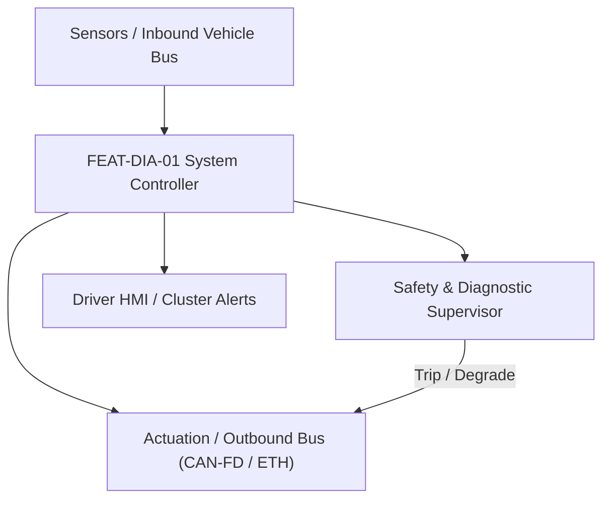
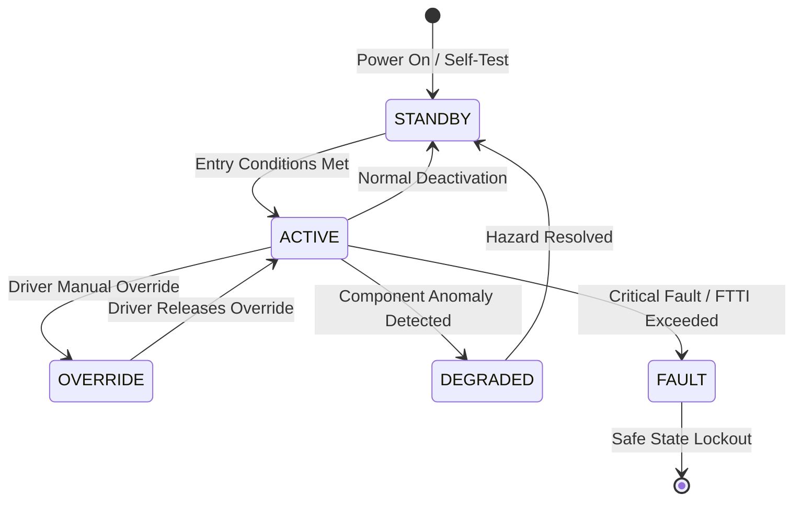

# System Requirements Specification: Unified Diagnostic Services & OBD-II Fault Management (UDS)
**Feature ID:** `FEAT-DIA-01`  
**Domain:** Connectivity, Security & Diagnostics  
**Target ASIL:** ASIL B / QM  
**Compliance Standard:** ISO 26262:2018 (Part 4 - System Development) / ASPICE PAM v3.1 (SYS.2, SYS.3)  
**Parent Master Specification:** [`spec.md`](file:///c:/Workset/AntiGravityProjects/TestOptimisationExperiement/spec.md#feat-dia-01-uds)  
**Derived Software Specification:** [`FEAT-DIA-01_UDS_SwReq.md`](file:///c:/Workset/AntiGravityProjects/TestOptimisationExperiement/software_requirements/FEAT-DIA-01_UDS_SwReq.md)

---

## 1. Feature Overview & Operational Scope

Implements ISO 14229-1 UDS diagnostic server, Diagnostic over IP (DoIP ISO 13400), Diagnostic Trouble Code (DTC) debouncing, freeze frame serialization, and OBD-II compliance.

### Operational Context Architecture

---

## 2. Activation Logic & Operational States

- **Preconditions:** 12V system active, diagnostic stack initialized.
- **Entry Conditions:** Diagnostic tester connects via OBD port (CAN-FD) or Ethernet RJ45 (DoIP), sending valid UDS request.
- **Deactivation Conditions:** Tester disconnects, S3 timeout (5000 ms) expires, or ignition powered down.
- **Driver Override Behavior:** Diagnostic Routine Control (Service 0x31) can command component test overrides only when vehicle speed == 0 km/h.
- **Operational State Progression:**  
  `DEFAULT_SESSION` -> `PROGRAMMING_SESSION` -> `EXTENDED_DIAGNOSTIC_SESSION` -> `SECURITY_UNLOCKED` -> `DTC_QUALIFYING` -> `FREEZE_FRAME_WRITING`

### State Transition Diagram

---

## 3. Functional Safety & Failure Mitigation Concept

- **Functional Safety Goal:** SG-DIA-01: Accurately record safety-critical system faults; prevent unauthorized diagnostic routine execution while driving.
- **Fault Tolerant Time Interval (FTTI):** N/A
- **Safe State Definition:** Reject actuator override requests (NRC 0x22: ConditionsNotCorrect) if vehicle is in motion.
- **Warning & Escalation Strategy:** Illumination of Malfunction Indicator Lamp (MIL) for emissions or safety-related DTCs.

### Failure Modes & Degradation Handling
- **Nvm Write Failure:** If EEPROM/Flash write fails, cache freeze frame record in RAM circular buffer and retry at next cycle.
- **Tester Timeout:** If S3_server timer expires without tester ping, automatically revert to Default Session.

---

## 4. System Requirements (SYS_REQ)
*(Note: Each System Requirement is systematically partitioned into multiple Child Software Requirements)*

### `SYS-DIA-01-01`: ISO 14229-1 UDS Diagnostic Services & DoIP Session Server
- **Planned Release:** R500
- **ASIL Rating:** QM
- **Parent Feature:** [`FEAT-DIA-01`](file:///c:/Workset/AntiGravityProjects/TestOptimisationExperiement/spec.md#feat-dia-01)
- **Requirement Statement:**
  > The System SHALL support UDS services: 0x10, 0x11, 0x14, 0x19, 0x22, 0x2E, 0x27, 0x28, 0x2F, 0x31 over DoIP (ISO 13400) and CAN-FD, conforming to response time P2_server <= 50 ms and P2*_server <= 5000 ms.
- **Activation Logic:** Active upon receipt of diagnostic request.
- **Fault Tolerant Time Interval (FTTI):** N/A
- **Safe State Action:** Return Negative Response Code (NRC 0x10 / 0x22 / 0x33).
- **Failure Detection & Reaction:** If requested service is disallowed in current session, return NRC 0x7F (ServiceNotSupportedInActiveSession).
- **Input Interfaces:** `Diagnostic_Request_PDU (DoIP / CAN-FD), Vehicle_Speed_Mps, Engine_RPM`
- **Output Interfaces:** `Diagnostic_Response_PDU, Active_Session_Enum, Security_Level_Enum`
- **System Verification Method:** Vector CANoe.DiVa automated protocol conformance test suite.
- **Derived Child Software Requirements (1:N Link):**
  - [`SWR-DIA-01-01`](file:///c:/Workset/AntiGravityProjects/TestOptimisationExperiement/software_requirements/FEAT-DIA-01_UDS_SwReq.md#swr-dia-01-01)
  - [`SWR-DIA-01-02`](file:///c:/Workset/AntiGravityProjects/TestOptimisationExperiement/software_requirements/FEAT-DIA-01_UDS_SwReq.md#swr-dia-01-02)

### `SYS-DIA-01-02`: DTC Fault Qualification, Freeze Frame Persistence & MIL Management
- **Planned Release:** R500
- **ASIL Rating:** ASIL B
- **Parent Feature:** [`FEAT-DIA-01`](file:///c:/Workset/AntiGravityProjects/TestOptimisationExperiement/spec.md#feat-dia-01)
- **Requirement Statement:**
  > The System SHALL qualify faults as confirmed when persistent for >= 500 ms, record associated freeze frame environment variables into non-volatile memory, and illuminate the Malfunction Indicator Lamp (MIL) within <= 1.0 second.
- **Activation Logic:** Active at all times during vehicle operation.
- **Fault Tolerant Time Interval (FTTI):** 500 ms
- **Safe State Action:** Persist fault record into redundant EEPROM sector.
- **Failure Detection & Reaction:** If EEPROM sector fails, write to secondary non-volatile flash partition.
- **Input Interfaces:** `SWC_Fault_Reports, Odometer_Km, Vehicle_Speed, Battery_Voltage, Timestamp`
- **Output Interfaces:** `DTC_Status_Byte (ISO 14229-1), Freeze_Frame_Record_Bytes, MIL_Lamp_Command`
- **System Verification Method:** Fault injection testing across all calibrated DTC fault monitors.
- **Derived Child Software Requirements (1:N Link):**
  - [`SWR-DIA-01-03`](file:///c:/Workset/AntiGravityProjects/TestOptimisationExperiement/software_requirements/FEAT-DIA-01_UDS_SwReq.md#swr-dia-01-03)
  - [`SWR-DIA-01-04`](file:///c:/Workset/AntiGravityProjects/TestOptimisationExperiement/software_requirements/FEAT-DIA-01_UDS_SwReq.md#swr-dia-01-04)

### `SYS-DIA-01-03`: 49 CFR Part 563 Crash Event Data Recorder (EDR) Blackbox Buffer
- **Planned Release:** R100
- **ASIL Rating:** ASIL D / 49 CFR Part 563
- **Parent Feature:** [`FEAT-DIA-01`](file:///c:/Workset/AntiGravityProjects/TestOptimisationExperiement/spec.md#feat-dia-01)
- **Requirement Statement:**
  > The System SHALL continuously record vehicle dynamic parameters at 100 Hz into circular FIFO RAM: Upon crash trigger (airbag deploy or delta-V > 8 km/h), system SHALL freeze and lock 5.0 seconds pre-crash and 300 ms post-crash telemetry into tamper-proof non-volatile flash memory.
- **Activation Logic:** Active at all times while vehicle is powered.
- **Fault Tolerant Time Interval (FTTI):** 10 ms
- **Safe State Action:** Lock EDR flash memory against overwrite; preserve crash record across power loss.
- **Failure Detection & Reaction:** If flash write errors occur, write to redundant secondary EEPROM chip.
- **Input Interfaces:** `Vehicle_Speed_100Hz, Accelerator_Pedal_Pct_100Hz, Brake_Status_100Hz, Steering_Angle_100Hz, Delta_V_X_Y`
- **Output Interfaces:** `EDR_Frozen_Record_Locked_Flag, NonVolatile_Flash_Write_Cmd`
- **System Verification Method:** Crash sled test and compliance verification against US NHTSA 49 CFR Part 563 regulatory data format.
- **Derived Child Software Requirements (1:N Link):**
  - [`SWR-DIA-01-05`](file:///c:/Workset/AntiGravityProjects/TestOptimisationExperiement/software_requirements/FEAT-DIA-01_UDS_SwReq.md#swr-dia-01-05)
  - [`SWR-DIA-01-06`](file:///c:/Workset/AntiGravityProjects/TestOptimisationExperiement/software_requirements/FEAT-DIA-01_UDS_SwReq.md#swr-dia-01-06)

### `SYS-DIA-01-04`: UDS ISO 14229 Service 0x27 Security Access Cryptographic Seed-Key
- **Planned Release:** R500
- **ASIL Rating:** ISO 21434 / ASIL B
- **Parent Feature:** [`FEAT-DIA-01`](file:///c:/Workset/AntiGravityProjects/TestOptimisationExperiement/spec.md#feat-dia-01)
- **Requirement Statement:**
  > The System SHALL protect sensitive diagnostic services (flashing, variant coding, actuator override) using UDS Service 0x27 Security Access: Generating 32-byte cryptographically random seed and validating HMAC-SHA256 key response with anti-brute-force delay lockout (10s delay after 3 failed attempts).
- **Activation Logic:** Active upon diagnostic session transition to Programming or Extended mode.
- **Fault Tolerant Time Interval (FTTI):** N/A
- **Safe State Action:** Reject diagnostic command; lock security access level.
- **Failure Detection & Reaction:** If invalid key is supplied, increment failed attempt counter and enforce exponential time penalty.
- **Input Interfaces:** `Diagnostic_Session_Type, UDS_Security_Key_Response[32], TRNG_Random_Seed_Bytes`
- **Output Interfaces:** `Security_Access_Unlocked_Level, NRC_Negative_Response_Code`
- **System Verification Method:** Diagnostic security penetration test attempting brute force dictionary attacks.
- **Derived Child Software Requirements (1:N Link):**
  - [`SWR-DIA-01-07`](file:///c:/Workset/AntiGravityProjects/TestOptimisationExperiement/software_requirements/FEAT-DIA-01_UDS_SwReq.md#swr-dia-01-07)
  - [`SWR-DIA-01-08`](file:///c:/Workset/AntiGravityProjects/TestOptimisationExperiement/software_requirements/FEAT-DIA-01_UDS_SwReq.md#swr-dia-01-08)

### `SYS-DIA-01-05`: ISO 14229 Unified Diagnostic Services (UDS) Multi-Client Protocol Server
- **Planned Release:** R500
- **ASIL Rating:** ASIL B
- **Parent Feature:** [`FEAT-DIA-01`](file:///c:/Workset/AntiGravityProjects/TestOptimisationExperiement/spec.md#feat-dia-01)
- **Requirement Statement:**
  > The System SHALL Execute UDS services ($10 DiagnosticSessionControl, $22 ReadDataByIdentifier, $2E WriteDataById).
- **Activation Logic:** Active during normal vehicle operation when feature state is active.
- **Fault Tolerant Time Interval (FTTI):** 10 ms
- **Safe State Action:** Transition to safe state or safe degradation tier within FTTI budget.
- **Failure Detection & Reaction:** Isolate faulted channel, latch DEM diagnostic trouble code, and inform driver.
- **Input Interfaces:** `Sensor signals, vehicle dynamics data, and bus frames via RTE.`
- **Output Interfaces:** `Actuator commands, diagnostic event flags, and cluster alerts.`
- **System Verification Method:** HiL test bench and dynamometer automated verification.
- **Derived Child Software Requirements (1:N Link):**
  - [`SWR-DIA-01-09`](file:///c:/Workset/AntiGravityProjects/TestOptimisationExperiement/software_requirements/FEAT-DIA-01_UDS_SwReq.md#swr-dia-01-09)
  - [`SWR-DIA-01-10`](file:///c:/Workset/AntiGravityProjects/TestOptimisationExperiement/software_requirements/FEAT-DIA-01_UDS_SwReq.md#swr-dia-01-10)

### `SYS-DIA-01-06`: Diagnostic Trouble Code (DTC) 3-Byte Standard Fault Status Byte State Machine
- **Planned Release:** R500
- **ASIL Rating:** ASIL B
- **Parent Feature:** [`FEAT-DIA-01`](file:///c:/Workset/AntiGravityProjects/TestOptimisationExperiement/spec.md#feat-dia-01)
- **Requirement Statement:**
  > The System SHALL Manage 8-bit status byte (TestFailed, ConfirmedDTC, PendingDTC) per ISO 14229 Service $19.
- **Activation Logic:** Active during normal vehicle operation when feature state is active.
- **Fault Tolerant Time Interval (FTTI):** 10 ms
- **Safe State Action:** Transition to safe state or safe degradation tier within FTTI budget.
- **Failure Detection & Reaction:** Isolate faulted channel, latch DEM diagnostic trouble code, and inform driver.
- **Input Interfaces:** `Sensor signals, vehicle dynamics data, and bus frames via RTE.`
- **Output Interfaces:** `Actuator commands, diagnostic event flags, and cluster alerts.`
- **System Verification Method:** HiL test bench and dynamometer automated verification.
- **Derived Child Software Requirements (1:N Link):**
  - [`SWR-DIA-01-11`](file:///c:/Workset/AntiGravityProjects/TestOptimisationExperiement/software_requirements/FEAT-DIA-01_UDS_SwReq.md#swr-dia-01-11)
  - [`SWR-DIA-01-12`](file:///c:/Workset/AntiGravityProjects/TestOptimisationExperiement/software_requirements/FEAT-DIA-01_UDS_SwReq.md#swr-dia-01-12)

### `SYS-DIA-01-07`: Fault Debounce Pre-Failed / Pre-Passed Counter-Based & Time-Based Filter
- **Planned Release:** R300
- **ASIL Rating:** ASIL B
- **Parent Feature:** [`FEAT-DIA-01`](file:///c:/Workset/AntiGravityProjects/TestOptimisationExperiement/spec.md#feat-dia-01)
- **Requirement Statement:**
  > The System SHALL Debounce fault signals (counter threshold 10, pre-failed step +2, pre-passed step -1) to prevent false trips.
- **Activation Logic:** Active during normal vehicle operation when feature state is active.
- **Fault Tolerant Time Interval (FTTI):** 10 ms
- **Safe State Action:** Transition to safe state or safe degradation tier within FTTI budget.
- **Failure Detection & Reaction:** Isolate faulted channel, latch DEM diagnostic trouble code, and inform driver.
- **Input Interfaces:** `Sensor signals, vehicle dynamics data, and bus frames via RTE.`
- **Output Interfaces:** `Actuator commands, diagnostic event flags, and cluster alerts.`
- **System Verification Method:** HiL test bench and dynamometer automated verification.
- **Derived Child Software Requirements (1:N Link):**
  - [`SWR-DIA-01-13`](file:///c:/Workset/AntiGravityProjects/TestOptimisationExperiement/software_requirements/FEAT-DIA-01_UDS_SwReq.md#swr-dia-01-13)
  - [`SWR-DIA-01-14`](file:///c:/Workset/AntiGravityProjects/TestOptimisationExperiement/software_requirements/FEAT-DIA-01_UDS_SwReq.md#swr-dia-01-14)

### `SYS-DIA-01-08`: Diagnostic Freeze-Frame Snapshot Buffer Non-Volatile Memory Serializer
- **Planned Release:** R500
- **ASIL Rating:** ASIL B
- **Parent Feature:** [`FEAT-DIA-01`](file:///c:/Workset/AntiGravityProjects/TestOptimisationExperiement/spec.md#feat-dia-01)
- **Requirement Statement:**
  > The System SHALL Capture and commit 64-byte freeze frame (speed, voltage, temperature, time) to EEPROM upon fault confirmation.
- **Activation Logic:** Active during normal vehicle operation when feature state is active.
- **Fault Tolerant Time Interval (FTTI):** 50 ms
- **Safe State Action:** Transition to safe state or safe degradation tier within FTTI budget.
- **Failure Detection & Reaction:** Isolate faulted channel, latch DEM diagnostic trouble code, and inform driver.
- **Input Interfaces:** `Sensor signals, vehicle dynamics data, and bus frames via RTE.`
- **Output Interfaces:** `Actuator commands, diagnostic event flags, and cluster alerts.`
- **System Verification Method:** HiL test bench and dynamometer automated verification.
- **Derived Child Software Requirements (1:N Link):**
  - [`SWR-DIA-01-15`](file:///c:/Workset/AntiGravityProjects/TestOptimisationExperiement/software_requirements/FEAT-DIA-01_UDS_SwReq.md#swr-dia-01-15)
  - [`SWR-DIA-01-16`](file:///c:/Workset/AntiGravityProjects/TestOptimisationExperiement/software_requirements/FEAT-DIA-01_UDS_SwReq.md#swr-dia-01-16)

### `SYS-DIA-01-09`: OBD-II California Air Resources Board (CARB) Readiness Monitor Evaluator
- **Planned Release:** R500
- **ASIL Rating:** ASIL B
- **Parent Feature:** [`FEAT-DIA-01`](file:///c:/Workset/AntiGravityProjects/TestOptimisationExperiement/spec.md#feat-dia-01)
- **Requirement Statement:**
  > The System SHALL Track completion of regulatory OBD-II drive cycle readiness monitors across catalytic, EVAP, and misfire.
- **Activation Logic:** Active during normal vehicle operation when feature state is active.
- **Fault Tolerant Time Interval (FTTI):** 100 ms
- **Safe State Action:** Transition to safe state or safe degradation tier within FTTI budget.
- **Failure Detection & Reaction:** Isolate faulted channel, latch DEM diagnostic trouble code, and inform driver.
- **Input Interfaces:** `Sensor signals, vehicle dynamics data, and bus frames via RTE.`
- **Output Interfaces:** `Actuator commands, diagnostic event flags, and cluster alerts.`
- **System Verification Method:** HiL test bench and dynamometer automated verification.
- **Derived Child Software Requirements (1:N Link):**
  - [`SWR-DIA-01-17`](file:///c:/Workset/AntiGravityProjects/TestOptimisationExperiement/software_requirements/FEAT-DIA-01_UDS_SwReq.md#swr-dia-01-17)
  - [`SWR-DIA-01-18`](file:///c:/Workset/AntiGravityProjects/TestOptimisationExperiement/software_requirements/FEAT-DIA-01_UDS_SwReq.md#swr-dia-01-18)

### `SYS-DIA-01-10`: Diagnostic Session Control ($10) Default, Programming, and Extended Mode Guard
- **Planned Release:** R400
- **ASIL Rating:** ASIL B
- **Parent Feature:** [`FEAT-DIA-01`](file:///c:/Workset/AntiGravityProjects/TestOptimisationExperiement/spec.md#feat-dia-01)
- **Requirement Statement:**
  > The System SHALL Transition between diagnostic sessions with automatic S3 timeout (5000 ms) return to default session.
- **Activation Logic:** Active during normal vehicle operation when feature state is active.
- **Fault Tolerant Time Interval (FTTI):** 20 ms
- **Safe State Action:** Transition to safe state or safe degradation tier within FTTI budget.
- **Failure Detection & Reaction:** Isolate faulted channel, latch DEM diagnostic trouble code, and inform driver.
- **Input Interfaces:** `Sensor signals, vehicle dynamics data, and bus frames via RTE.`
- **Output Interfaces:** `Actuator commands, diagnostic event flags, and cluster alerts.`
- **System Verification Method:** HiL test bench and dynamometer automated verification.
- **Derived Child Software Requirements (1:N Link):**
  - [`SWR-DIA-01-19`](file:///c:/Workset/AntiGravityProjects/TestOptimisationExperiement/software_requirements/FEAT-DIA-01_UDS_SwReq.md#swr-dia-01-19)
  - [`SWR-DIA-01-20`](file:///c:/Workset/AntiGravityProjects/TestOptimisationExperiement/software_requirements/FEAT-DIA-01_UDS_SwReq.md#swr-dia-01-20)

### `SYS-DIA-01-11`: Routine Control Service ($31) Actuator HIL Routine Self-Test Executive
- **Planned Release:** R400
- **ASIL Rating:** ASIL B
- **Parent Feature:** [`FEAT-DIA-01`](file:///c:/Workset/AntiGravityProjects/TestOptimisationExperiement/spec.md#feat-dia-01)
- **Requirement Statement:**
  > The System SHALL Execute commanded component routines (e.g. purge valve pulse, pump prime) with safety interlock checks.
- **Activation Logic:** Active during normal vehicle operation when feature state is active.
- **Fault Tolerant Time Interval (FTTI):** 50 ms
- **Safe State Action:** Transition to safe state or safe degradation tier within FTTI budget.
- **Failure Detection & Reaction:** Isolate faulted channel, latch DEM diagnostic trouble code, and inform driver.
- **Input Interfaces:** `Sensor signals, vehicle dynamics data, and bus frames via RTE.`
- **Output Interfaces:** `Actuator commands, diagnostic event flags, and cluster alerts.`
- **System Verification Method:** HiL test bench and dynamometer automated verification.
- **Derived Child Software Requirements (1:N Link):**
  - [`SWR-DIA-01-21`](file:///c:/Workset/AntiGravityProjects/TestOptimisationExperiement/software_requirements/FEAT-DIA-01_UDS_SwReq.md#swr-dia-01-21)
  - [`SWR-DIA-01-22`](file:///c:/Workset/AntiGravityProjects/TestOptimisationExperiement/software_requirements/FEAT-DIA-01_UDS_SwReq.md#swr-dia-01-22)

### `SYS-DIA-01-12`: Clear Diagnostic Information Service ($14) Non-Volatile Flash Sector Eraser
- **Planned Release:** R500
- **ASIL Rating:** ASIL B
- **Parent Feature:** [`FEAT-DIA-01`](file:///c:/Workset/AntiGravityProjects/TestOptimisationExperiement/spec.md#feat-dia-01)
- **Requirement Statement:**
  > The System SHALL Erase confirmed fault codes and freeze-frame buffers from flash upon authorized service command.
- **Activation Logic:** Active during normal vehicle operation when feature state is active.
- **Fault Tolerant Time Interval (FTTI):** 100 ms
- **Safe State Action:** Transition to safe state or safe degradation tier within FTTI budget.
- **Failure Detection & Reaction:** Isolate faulted channel, latch DEM diagnostic trouble code, and inform driver.
- **Input Interfaces:** `Sensor signals, vehicle dynamics data, and bus frames via RTE.`
- **Output Interfaces:** `Actuator commands, diagnostic event flags, and cluster alerts.`
- **System Verification Method:** HiL test bench and dynamometer automated verification.
- **Derived Child Software Requirements (1:N Link):**
  - [`SWR-DIA-01-23`](file:///c:/Workset/AntiGravityProjects/TestOptimisationExperiement/software_requirements/FEAT-DIA-01_UDS_SwReq.md#swr-dia-01-23)
  - [`SWR-DIA-01-24`](file:///c:/Workset/AntiGravityProjects/TestOptimisationExperiement/software_requirements/FEAT-DIA-01_UDS_SwReq.md#swr-dia-01-24)

### `SYS-DIA-01-13`: Input/Output Control by Identifier Service ($2F) Actuator Override Supervisor
- **Planned Release:** R500
- **ASIL Rating:** ASIL B
- **Parent Feature:** [`FEAT-DIA-01`](file:///c:/Workset/AntiGravityProjects/TestOptimisationExperiement/spec.md#feat-dia-01)
- **Requirement Statement:**
  > The System SHALL Allow diagnostic technician to temporarily override fan speed, window motor, or headlamp states safely.
- **Activation Logic:** Active during normal vehicle operation when feature state is active.
- **Fault Tolerant Time Interval (FTTI):** 20 ms
- **Safe State Action:** Transition to safe state or safe degradation tier within FTTI budget.
- **Failure Detection & Reaction:** Isolate faulted channel, latch DEM diagnostic trouble code, and inform driver.
- **Input Interfaces:** `Sensor signals, vehicle dynamics data, and bus frames via RTE.`
- **Output Interfaces:** `Actuator commands, diagnostic event flags, and cluster alerts.`
- **System Verification Method:** HiL test bench and dynamometer automated verification.
- **Derived Child Software Requirements (1:N Link):**
  - [`SWR-DIA-01-25`](file:///c:/Workset/AntiGravityProjects/TestOptimisationExperiement/software_requirements/FEAT-DIA-01_UDS_SwReq.md#swr-dia-01-25)
  - [`SWR-DIA-01-26`](file:///c:/Workset/AntiGravityProjects/TestOptimisationExperiement/software_requirements/FEAT-DIA-01_UDS_SwReq.md#swr-dia-01-26)

### `SYS-DIA-01-14`: Malfunction Indicator Lamp (MIL) Instrument Cluster Tell-Tale Illuminator
- **Planned Release:** R500
- **ASIL Rating:** ASIL B
- **Parent Feature:** [`FEAT-DIA-01`](file:///c:/Workset/AntiGravityProjects/TestOptimisationExperiement/spec.md#feat-dia-01)
- **Requirement Statement:**
  > The System SHALL Command steady or flashing amber MIL lamp on cluster when emissions-related fault confirmed.
- **Activation Logic:** Active during normal vehicle operation when feature state is active.
- **Fault Tolerant Time Interval (FTTI):** 100 ms
- **Safe State Action:** Transition to safe state or safe degradation tier within FTTI budget.
- **Failure Detection & Reaction:** Isolate faulted channel, latch DEM diagnostic trouble code, and inform driver.
- **Input Interfaces:** `Sensor signals, vehicle dynamics data, and bus frames via RTE.`
- **Output Interfaces:** `Actuator commands, diagnostic event flags, and cluster alerts.`
- **System Verification Method:** HiL test bench and dynamometer automated verification.
- **Derived Child Software Requirements (1:N Link):**
  - [`SWR-DIA-01-27`](file:///c:/Workset/AntiGravityProjects/TestOptimisationExperiement/software_requirements/FEAT-DIA-01_UDS_SwReq.md#swr-dia-01-27)
  - [`SWR-DIA-01-28`](file:///c:/Workset/AntiGravityProjects/TestOptimisationExperiement/software_requirements/FEAT-DIA-01_UDS_SwReq.md#swr-dia-01-28)

### `SYS-DIA-01-15`: On-Board Diagnostic Tester Physical CAN-FD 500 kbps / 2 Mbps Transceiver Driver
- **Planned Release:** R500
- **ASIL Rating:** ASIL B
- **Parent Feature:** [`FEAT-DIA-01`](file:///c:/Workset/AntiGravityProjects/TestOptimisationExperiement/spec.md#feat-dia-01)
- **Requirement Statement:**
  > The System SHALL Manage physical OBD-II DLC connector communication with auto baud-rate detection and ISO-TP transport.
- **Activation Logic:** Active during normal vehicle operation when feature state is active.
- **Fault Tolerant Time Interval (FTTI):** 10 ms
- **Safe State Action:** Transition to safe state or safe degradation tier within FTTI budget.
- **Failure Detection & Reaction:** Isolate faulted channel, latch DEM diagnostic trouble code, and inform driver.
- **Input Interfaces:** `Sensor signals, vehicle dynamics data, and bus frames via RTE.`
- **Output Interfaces:** `Actuator commands, diagnostic event flags, and cluster alerts.`
- **System Verification Method:** HiL test bench and dynamometer automated verification.
- **Derived Child Software Requirements (1:N Link):**
  - [`SWR-DIA-01-29`](file:///c:/Workset/AntiGravityProjects/TestOptimisationExperiement/software_requirements/FEAT-DIA-01_UDS_SwReq.md#swr-dia-01-29)
  - [`SWR-DIA-01-30`](file:///c:/Workset/AntiGravityProjects/TestOptimisationExperiement/software_requirements/FEAT-DIA-01_UDS_SwReq.md#swr-dia-01-30)

---

## 5. System-to-Software Traceability Summary

| System Requirement ID | Planned Release | ASIL | Title | Derived Software Requirements (1:N) | Verification Method |
| :--- | :---: | :--- | :--- | :--- | :--- |
| `SYS-DIA-01-01` | **`R500`** | QM | ISO 14229-1 UDS Diagnostic Services & DoIP Session Server | [`SWR-DIA-01-01`](file:///c:/Workset/AntiGravityProjects/TestOptimisationExperiement/software_requirements/FEAT-DIA-01_UDS_SwReq.md#swr-dia-01-01), [`SWR-DIA-01-02`](file:///c:/Workset/AntiGravityProjects/TestOptimisationExperiement/software_requirements/FEAT-DIA-01_UDS_SwReq.md#swr-dia-01-02) | Vector CANoe.DiVa automated protocol conformance test suite. |
| `SYS-DIA-01-02` | **`R500`** | ASIL B | DTC Fault Qualification, Freeze Frame Persistence & MIL Management | [`SWR-DIA-01-03`](file:///c:/Workset/AntiGravityProjects/TestOptimisationExperiement/software_requirements/FEAT-DIA-01_UDS_SwReq.md#swr-dia-01-03), [`SWR-DIA-01-04`](file:///c:/Workset/AntiGravityProjects/TestOptimisationExperiement/software_requirements/FEAT-DIA-01_UDS_SwReq.md#swr-dia-01-04) | Fault injection testing across all calibrated DTC fault monitors. |
| `SYS-DIA-01-03` | **`R100`** | ASIL D / 49 CFR Part 563 | 49 CFR Part 563 Crash Event Data Recorder (EDR) Blackbox Buffer | [`SWR-DIA-01-05`](file:///c:/Workset/AntiGravityProjects/TestOptimisationExperiement/software_requirements/FEAT-DIA-01_UDS_SwReq.md#swr-dia-01-05), [`SWR-DIA-01-06`](file:///c:/Workset/AntiGravityProjects/TestOptimisationExperiement/software_requirements/FEAT-DIA-01_UDS_SwReq.md#swr-dia-01-06) | Crash sled test and compliance verification against US NHTSA 49 CFR Part 563 regulatory data format. |
| `SYS-DIA-01-04` | **`R500`** | ISO 21434 / ASIL B | UDS ISO 14229 Service 0x27 Security Access Cryptographic Seed-Key | [`SWR-DIA-01-07`](file:///c:/Workset/AntiGravityProjects/TestOptimisationExperiement/software_requirements/FEAT-DIA-01_UDS_SwReq.md#swr-dia-01-07), [`SWR-DIA-01-08`](file:///c:/Workset/AntiGravityProjects/TestOptimisationExperiement/software_requirements/FEAT-DIA-01_UDS_SwReq.md#swr-dia-01-08) | Diagnostic security penetration test attempting brute force dictionary attacks. |
| `SYS-DIA-01-05` | **`R500`** | ASIL B | ISO 14229 Unified Diagnostic Services (UDS) Multi-Client Protocol Server | [`SWR-DIA-01-09`](file:///c:/Workset/AntiGravityProjects/TestOptimisationExperiement/software_requirements/FEAT-DIA-01_UDS_SwReq.md#swr-dia-01-09), [`SWR-DIA-01-10`](file:///c:/Workset/AntiGravityProjects/TestOptimisationExperiement/software_requirements/FEAT-DIA-01_UDS_SwReq.md#swr-dia-01-10) | HiL test bench and dynamometer automated verification. |
| `SYS-DIA-01-06` | **`R500`** | ASIL B | Diagnostic Trouble Code (DTC) 3-Byte Standard Fault Status Byte State Machine | [`SWR-DIA-01-11`](file:///c:/Workset/AntiGravityProjects/TestOptimisationExperiement/software_requirements/FEAT-DIA-01_UDS_SwReq.md#swr-dia-01-11), [`SWR-DIA-01-12`](file:///c:/Workset/AntiGravityProjects/TestOptimisationExperiement/software_requirements/FEAT-DIA-01_UDS_SwReq.md#swr-dia-01-12) | HiL test bench and dynamometer automated verification. |
| `SYS-DIA-01-07` | **`R300`** | ASIL B | Fault Debounce Pre-Failed / Pre-Passed Counter-Based & Time-Based Filter | [`SWR-DIA-01-13`](file:///c:/Workset/AntiGravityProjects/TestOptimisationExperiement/software_requirements/FEAT-DIA-01_UDS_SwReq.md#swr-dia-01-13), [`SWR-DIA-01-14`](file:///c:/Workset/AntiGravityProjects/TestOptimisationExperiement/software_requirements/FEAT-DIA-01_UDS_SwReq.md#swr-dia-01-14) | HiL test bench and dynamometer automated verification. |
| `SYS-DIA-01-08` | **`R500`** | ASIL B | Diagnostic Freeze-Frame Snapshot Buffer Non-Volatile Memory Serializer | [`SWR-DIA-01-15`](file:///c:/Workset/AntiGravityProjects/TestOptimisationExperiement/software_requirements/FEAT-DIA-01_UDS_SwReq.md#swr-dia-01-15), [`SWR-DIA-01-16`](file:///c:/Workset/AntiGravityProjects/TestOptimisationExperiement/software_requirements/FEAT-DIA-01_UDS_SwReq.md#swr-dia-01-16) | HiL test bench and dynamometer automated verification. |
| `SYS-DIA-01-09` | **`R500`** | ASIL B | OBD-II California Air Resources Board (CARB) Readiness Monitor Evaluator | [`SWR-DIA-01-17`](file:///c:/Workset/AntiGravityProjects/TestOptimisationExperiement/software_requirements/FEAT-DIA-01_UDS_SwReq.md#swr-dia-01-17), [`SWR-DIA-01-18`](file:///c:/Workset/AntiGravityProjects/TestOptimisationExperiement/software_requirements/FEAT-DIA-01_UDS_SwReq.md#swr-dia-01-18) | HiL test bench and dynamometer automated verification. |
| `SYS-DIA-01-10` | **`R400`** | ASIL B | Diagnostic Session Control ($10) Default, Programming, and Extended Mode Guard | [`SWR-DIA-01-19`](file:///c:/Workset/AntiGravityProjects/TestOptimisationExperiement/software_requirements/FEAT-DIA-01_UDS_SwReq.md#swr-dia-01-19), [`SWR-DIA-01-20`](file:///c:/Workset/AntiGravityProjects/TestOptimisationExperiement/software_requirements/FEAT-DIA-01_UDS_SwReq.md#swr-dia-01-20) | HiL test bench and dynamometer automated verification. |
| `SYS-DIA-01-11` | **`R400`** | ASIL B | Routine Control Service ($31) Actuator HIL Routine Self-Test Executive | [`SWR-DIA-01-21`](file:///c:/Workset/AntiGravityProjects/TestOptimisationExperiement/software_requirements/FEAT-DIA-01_UDS_SwReq.md#swr-dia-01-21), [`SWR-DIA-01-22`](file:///c:/Workset/AntiGravityProjects/TestOptimisationExperiement/software_requirements/FEAT-DIA-01_UDS_SwReq.md#swr-dia-01-22) | HiL test bench and dynamometer automated verification. |
| `SYS-DIA-01-12` | **`R500`** | ASIL B | Clear Diagnostic Information Service ($14) Non-Volatile Flash Sector Eraser | [`SWR-DIA-01-23`](file:///c:/Workset/AntiGravityProjects/TestOptimisationExperiement/software_requirements/FEAT-DIA-01_UDS_SwReq.md#swr-dia-01-23), [`SWR-DIA-01-24`](file:///c:/Workset/AntiGravityProjects/TestOptimisationExperiement/software_requirements/FEAT-DIA-01_UDS_SwReq.md#swr-dia-01-24) | HiL test bench and dynamometer automated verification. |
| `SYS-DIA-01-13` | **`R500`** | ASIL B | Input/Output Control by Identifier Service ($2F) Actuator Override Supervisor | [`SWR-DIA-01-25`](file:///c:/Workset/AntiGravityProjects/TestOptimisationExperiement/software_requirements/FEAT-DIA-01_UDS_SwReq.md#swr-dia-01-25), [`SWR-DIA-01-26`](file:///c:/Workset/AntiGravityProjects/TestOptimisationExperiement/software_requirements/FEAT-DIA-01_UDS_SwReq.md#swr-dia-01-26) | HiL test bench and dynamometer automated verification. |
| `SYS-DIA-01-14` | **`R500`** | ASIL B | Malfunction Indicator Lamp (MIL) Instrument Cluster Tell-Tale Illuminator | [`SWR-DIA-01-27`](file:///c:/Workset/AntiGravityProjects/TestOptimisationExperiement/software_requirements/FEAT-DIA-01_UDS_SwReq.md#swr-dia-01-27), [`SWR-DIA-01-28`](file:///c:/Workset/AntiGravityProjects/TestOptimisationExperiement/software_requirements/FEAT-DIA-01_UDS_SwReq.md#swr-dia-01-28) | HiL test bench and dynamometer automated verification. |
| `SYS-DIA-01-15` | **`R500`** | ASIL B | On-Board Diagnostic Tester Physical CAN-FD 500 kbps / 2 Mbps Transceiver Driver | [`SWR-DIA-01-29`](file:///c:/Workset/AntiGravityProjects/TestOptimisationExperiement/software_requirements/FEAT-DIA-01_UDS_SwReq.md#swr-dia-01-29), [`SWR-DIA-01-30`](file:///c:/Workset/AntiGravityProjects/TestOptimisationExperiement/software_requirements/FEAT-DIA-01_UDS_SwReq.md#swr-dia-01-30) | HiL test bench and dynamometer automated verification. |

- **Upstream Feature Link:** [`spec.md` (FEAT-DIA-01)](file:///c:/Workset/AntiGravityProjects/TestOptimisationExperiement/spec.md#feat-dia-01)
- **Software Requirements Specification:** [`FEAT-DIA-01_UDS_SwReq.md`](file:///c:/Workset/AntiGravityProjects/TestOptimisationExperiement/software_requirements/FEAT-DIA-01_UDS_SwReq.md)
