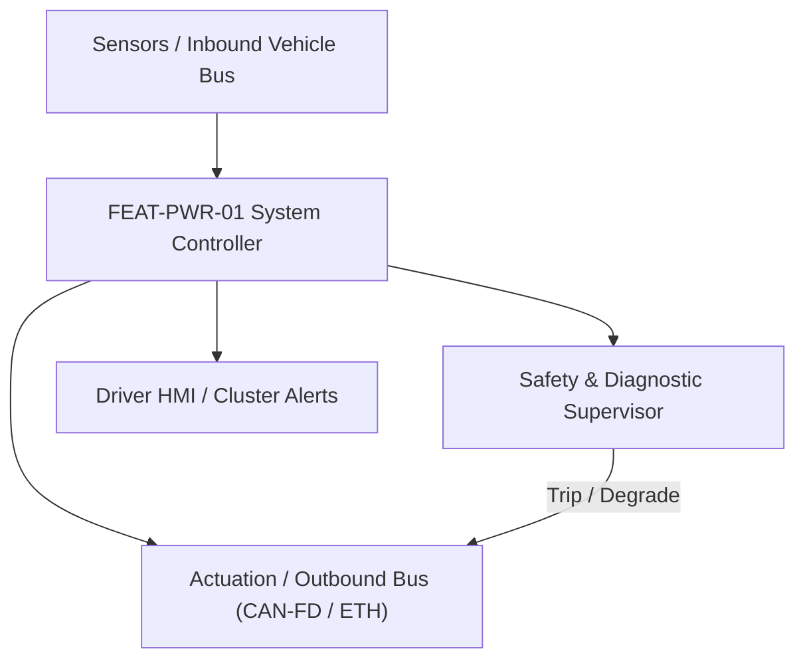
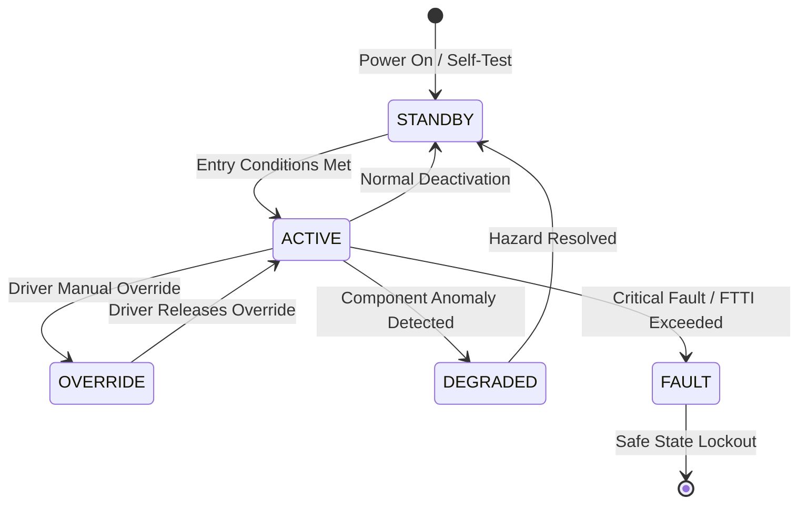

# System Requirements Specification: High-Voltage Battery Management System (BMS)
**Feature ID:** `FEAT-PWR-01`  
**Domain:** Electric Powertrain & Energy Management  
**Target ASIL:** ASIL D  
**Compliance Standard:** ISO 26262:2018 (Part 4 - System Development) / ASPICE PAM v3.1 (SYS.2, SYS.3)  
**Parent Master Specification:** [`spec.md`](file:///c:/Workset/AntiGravityProjects/TestOptimisationExperiement/spec.md#feat-pwr-01-bms)  
**Derived Software Specification:** [`FEAT-PWR-01_BMS_SwReq.md`](file:///c:/Workset/AntiGravityProjects/TestOptimisationExperiement/software_requirements/FEAT-PWR-01_BMS_SwReq.md)

---

## 1. Feature Overview & Operational Scope

Supervises cell voltages, pack current, temperatures, insulation resistance, state estimation (SOC/SOH/SOP), and controls high-voltage pyrofuses and contactors.

### Operational Context Architecture

---

## 2. Activation Logic & Operational States

- **Preconditions:** 12V auxiliary battery connected, BMS master micro energized, interlock loop (HVIL) closed.
- **Entry Conditions:** Wakeup trigger via CAN-FD (Ignition ON, Charging Plug insertion, or Remote Preconditioning).
- **Deactivation Conditions:** Ignition OFF with open contactor sequence completed, or HVIL loop broken, or crash pyro trigger received.
- **Driver Override Behavior:** Crash pyrofuse trigger line from Airbag ECU unconditionally overrides all software commands, mechanically blowing pyrofuse in < 2 ms.
- **Operational State Progression:**  
  `STANDBY` -> `PRECHARGE` -> `CLOSED_DRIVE` -> `CLOSED_CHARGE` -> `BALANCING` -> `EMERGENCY_ISOLATE` -> `WELD_CHECK` -> `PERMANENT_FAULT`

### State Transition Diagram

---

## 3. Functional Safety & Failure Mitigation Concept

- **Functional Safety Goal:** SG-BMS-01: Prevent thermal runaway, cell overcharge (> 4.25V), cell over-discharge (< 2.50V), and short-circuit fire hazard.
- **Fault Tolerant Time Interval (FTTI):** 10 ms for short circuit; 100 ms for cell overvoltage; 1000 ms for thermal limit.
- **Safe State Definition:** Open high-voltage main positive and negative contactors; isolate 400V/800V traction pack from vehicle chassis.
- **Warning & Escalation Strategy:** Level 1: Power derate icon on cluster; Level 2: Stop Safely vehicle prompt; Level 3: Immediate High-Voltage Hazard evacuation chime.

### Failure Modes & Degradation Handling
- **Cell Overtemperature:** If any cell module temp > 60°C, derate discharge/charge power by 50%; if > 70°C, derate to 0 kW; if > 85°C (thermal runaway precursor), fire pyrofuse within 5 ms.
- **Current Sensor Loss:** If primary Hall current sensor signal lost, switch to redundant shunt resistor with degraded Coulomb counting accuracy.
- **Hvil Open:** If High Voltage Interlock Loop breaks, ramp inverter torque to 0 Nm in 100 ms, then immediately open main contactors.

---

## 4. System Requirements (SYS_REQ)
*(Note: Each System Requirement is systematically partitioned into multiple Child Software Requirements)*

### `SYS-PWR-01-01`: Sub-Millivolt Cell Voltage & Micro-Ohm Shunt Current Sampling
- **Planned Release:** R100
- **ASIL Rating:** ASIL D
- **Parent Feature:** [`FEAT-PWR-01`](file:///c:/Workset/AntiGravityProjects/TestOptimisationExperiement/spec.md#feat-pwr-01)
- **Requirement Statement:**
  > The System SHALL sample 192 individual series cell voltages with +-2 mV accuracy at <= 10 ms period, and total pack current with +-0.5 A accuracy at <= 1 ms period, protected with CRC-15 daisy-chain validation.
- **Activation Logic:** Active at all times when BMS is awake.
- **Fault Tolerant Time Interval (FTTI):** 10 ms
- **Safe State Action:** Transition to EMERGENCY_ISOLATE if >= 3 cells become unreadable.
- **Failure Detection & Reaction:** If daisy-chain communication breaks, isolate communication loop and switch to dual-ring redundant return path.
- **Input Interfaces:** `Isolated_SPI_AFE_DaisyChain, Dual_Redundant_Shunt_ADC, Hall_Effect_Sensor`
- **Output Interfaces:** `Cell_Voltages_Array[192] (mV), Pack_Current_A (float32), Pack_Voltage_V (float32)`
- **System Verification Method:** Precision battery emulator HIL bench testing over -40°C to +85°C.
- **Derived Child Software Requirements (1:N Link):**
  - [`SWR-PWR-01-01`](file:///c:/Workset/AntiGravityProjects/TestOptimisationExperiement/software_requirements/FEAT-PWR-01_BMS_SwReq.md#swr-pwr-01-01)
  - [`SWR-PWR-01-02`](file:///c:/Workset/AntiGravityProjects/TestOptimisationExperiement/software_requirements/FEAT-PWR-01_BMS_SwReq.md#swr-pwr-01-02)
  - [`SWR-PWR-01-03`](file:///c:/Workset/AntiGravityProjects/TestOptimisationExperiement/software_requirements/FEAT-PWR-01_BMS_SwReq.md#swr-pwr-01-03)

### `SYS-PWR-01-02`: Multi-Model State of Charge (SOC) & Dynamic Power Envelope (SOP)
- **Planned Release:** R100
- **ASIL Rating:** ASIL C
- **Parent Feature:** [`FEAT-PWR-01`](file:///c:/Workset/AntiGravityProjects/TestOptimisationExperiement/spec.md#feat-pwr-01)
- **Requirement Statement:**
  > The System SHALL compute battery pack SOC within +-3.0% accuracy across lifetime aging, and broadcast dynamic charge and discharge power limits (P_chg_max, P_dis_max in kW) every 20 ms.
- **Activation Logic:** Active in CLOSED_DRIVE and CLOSED_CHARGE states.
- **Fault Tolerant Time Interval (FTTI):** 200 ms
- **Safe State Action:** Clamp discharge power limit to 20 kW (limp home) if SOC estimation confidence degrades.
- **Failure Detection & Reaction:** If OCV lookup table diverges from Coulomb counting by > 15%, latch DTC P0B0C.
- **Input Interfaces:** `Cell_Voltages_Array, Pack_Current_A, Cell_Temperatures_Array[32], SOH_Capacity_Ah`
- **Output Interfaces:** `Battery_SOC_Pct, P_Charge_Limit_kW, P_Discharge_Limit_kW`
- **System Verification Method:** Climatic chamber drive-cycle validation against electrochemical lab cell data.
- **Derived Child Software Requirements (1:N Link):**
  - [`SWR-PWR-01-04`](file:///c:/Workset/AntiGravityProjects/TestOptimisationExperiement/software_requirements/FEAT-PWR-01_BMS_SwReq.md#swr-pwr-01-04)
  - [`SWR-PWR-01-05`](file:///c:/Workset/AntiGravityProjects/TestOptimisationExperiement/software_requirements/FEAT-PWR-01_BMS_SwReq.md#swr-pwr-01-05)

### `SYS-PWR-01-03`: High-Voltage Contactor Precharge Sequencing & Pyrofuse Firing
- **Planned Release:** R100
- **ASIL Rating:** ASIL D
- **Parent Feature:** [`FEAT-PWR-01`](file:///c:/Workset/AntiGravityProjects/TestOptimisationExperiement/spec.md#feat-pwr-01)
- **Requirement Statement:**
  > The System SHALL execute precharge sequence (closing precharge relay until DC-link voltage reaches 95% of pack voltage in <= 300 ms), and command contactor opening and pyrofuse firing in <= 5 ms under short-circuit (> 1500 A) or crash.
- **Activation Logic:** Sequenced upon drive or charge activation request.
- **Fault Tolerant Time Interval (FTTI):** 5 ms
- **Safe State Action:** De-energize contactor coils; verify contactor auxiliary contact opens.
- **Failure Detection & Reaction:** If main contactor welds shut, detect via post-open voltage differential and latch permanent lockout.
- **Input Interfaces:** `Precharge_Feedback_Voltage, Pack_Current_A, Crash_Digital_Line, Contactor_Aux_Contacts`
- **Output Interfaces:** `Pos_Contactor_Driver, Neg_Contactor_Driver, Precharge_Relay_Driver, Pyro_Fire_Pulse`
- **System Verification Method:** High-voltage short-circuit bench test and contactor endurance rig.
- **Derived Child Software Requirements (1:N Link):**
  - [`SWR-PWR-01-06`](file:///c:/Workset/AntiGravityProjects/TestOptimisationExperiement/software_requirements/FEAT-PWR-01_BMS_SwReq.md#swr-pwr-01-06)
  - [`SWR-PWR-01-07`](file:///c:/Workset/AntiGravityProjects/TestOptimisationExperiement/software_requirements/FEAT-PWR-01_BMS_SwReq.md#swr-pwr-01-07)
  - [`SWR-PWR-01-08`](file:///c:/Workset/AntiGravityProjects/TestOptimisationExperiement/software_requirements/FEAT-PWR-01_BMS_SwReq.md#swr-pwr-01-08)

### `SYS-PWR-01-04`: Active & Passive High-Efficiency Cell Balancing Management
- **Planned Release:** R100
- **ASIL Rating:** ASIL C
- **Parent Feature:** [`FEAT-PWR-01`](file:///c:/Workset/AntiGravityProjects/TestOptimisationExperiement/spec.md#feat-pwr-01)
- **Requirement Statement:**
  > The System SHALL monitor cell delta voltage (|Delta_V_cell|) during charging: If Delta_V_cell > 15 mV, activate passive bleed resistors (up to 200 mA discharge per cell) or active inductive balancing to equalize cell voltages within +-5 mV at end-of-charge.
- **Activation Logic:** Active in CLOSED_CHARGE state and top balancing phase.
- **Fault Tolerant Time Interval (FTTI):** 500 ms
- **Safe State Action:** Open balancing FET switches; terminate cell discharge.
- **Failure Detection & Reaction:** If balance resistor temperature exceeds 85°C, pulse balance duty cycle down to 25%.
- **Input Interfaces:** `Cell_Voltages_Array[192], Balance_Resistor_Temperatures[16], Charge_Current_A`
- **Output Interfaces:** `Cell_Balancing_Switch_Bitmask[192], Balancing_Active_Flag`
- **System Verification Method:** Endurance top-balancing accuracy and thermal dissipation bench testing.
- **Derived Child Software Requirements (1:N Link):**
  - [`SWR-PWR-01-09`](file:///c:/Workset/AntiGravityProjects/TestOptimisationExperiement/software_requirements/FEAT-PWR-01_BMS_SwReq.md#swr-pwr-01-09)
  - [`SWR-PWR-01-10`](file:///c:/Workset/AntiGravityProjects/TestOptimisationExperiement/software_requirements/FEAT-PWR-01_BMS_SwReq.md#swr-pwr-01-10)

### `SYS-PWR-01-05`: High-Voltage Interlock Loop (HVIL) & Chassis Insulation Monitoring
- **Planned Release:** R200
- **ASIL Rating:** ASIL D
- **Parent Feature:** [`FEAT-PWR-01`](file:///c:/Workset/AntiGravityProjects/TestOptimisationExperiement/spec.md#feat-pwr-01)
- **Requirement Statement:**
  > The System SHALL sample High-Voltage Interlock Loop (HVIL) continuity at 1 kHz and evaluate insulation resistance between HV DC bus and 12V chassis ground (> 500 ohms/volt conforming to ISO 6469-1), opening main contactors in <= 20 ms if insulation degrades below 100 ohms/volt.
- **Activation Logic:** Active continuously whenever BMS is energized.
- **Fault Tolerant Time Interval (FTTI):** 20 ms
- **Safe State Action:** Open high-voltage contactors; discharge DC link inverters.
- **Failure Detection & Reaction:** If HVIL loop breaks while driving, ramp motor torque to 0 Nm in 100 ms then open contactors.
- **Input Interfaces:** `HVIL_Pilot_Current_ADC, Insulation_Monitor_AC_Injected_Leakage, Pack_Voltage_V`
- **Output Interfaces:** `Insulation_Resistance_kOhms, HVIL_Intact_Flag, Emergency_Open_Contactors_Cmd`
- **System Verification Method:** ISO 6469 electrical safety and deliberate human touch insulation fault injection.
- **Derived Child Software Requirements (1:N Link):**
  - [`SWR-PWR-01-11`](file:///c:/Workset/AntiGravityProjects/TestOptimisationExperiement/software_requirements/FEAT-PWR-01_BMS_SwReq.md#swr-pwr-01-11)
  - [`SWR-PWR-01-12`](file:///c:/Workset/AntiGravityProjects/TestOptimisationExperiement/software_requirements/FEAT-PWR-01_BMS_SwReq.md#swr-pwr-01-12)

### `SYS-PWR-01-06`: Cell Thermal Runaway Precursor Gas & Pressure Wave Detection
- **Planned Release:** R200
- **ASIL Rating:** ASIL D
- **Parent Feature:** [`FEAT-PWR-01`](file:///c:/Workset/AntiGravityProjects/TestOptimisationExperiement/spec.md#feat-pwr-01)
- **Requirement Statement:**
  > The System SHALL monitor battery pack internal cavity pressure sensors (Delta_P > 50 mbar/s) and hydrogen/CO electrochemical gas sensors at 100 Hz, firing the pyrofuse within <= 2 ms and opening emergency pack aerosol gas vents upon thermal runaway onset.
- **Activation Logic:** Active at all times, including parked sleeping state.
- **Fault Tolerant Time Interval (FTTI):** 5 ms
- **Safe State Action:** Blow pyrofuse disconnect; command cabin emergency evacuation siren.
- **Failure Detection & Reaction:** Wake up BMS micro instantly if pack enclosure burst disc switch activates.
- **Input Interfaces:** `Pack_Cavity_Pressure_Sensor_Bar, H2_Gas_Sensor_PPM, Module_Thermistor_Max_Rate_DegC_S`
- **Output Interfaces:** `Pyrofuse_Fire_Signal, Emergency_Vent_Valve_Cmd, Thermal_Runaway_Evacuation_Alarm`
- **System Verification Method:** UL 2580 cell nail penetration destructive runaway testing in explosion-proof chamber.
- **Derived Child Software Requirements (1:N Link):**
  - [`SWR-PWR-01-13`](file:///c:/Workset/AntiGravityProjects/TestOptimisationExperiement/software_requirements/FEAT-PWR-01_BMS_SwReq.md#swr-pwr-01-13)
  - [`SWR-PWR-01-14`](file:///c:/Workset/AntiGravityProjects/TestOptimisationExperiement/software_requirements/FEAT-PWR-01_BMS_SwReq.md#swr-pwr-01-14)

### `SYS-PWR-01-07`: Cell Over-Voltage Hardware Safing & Fast Contactor Trip
- **Planned Release:** R400
- **ASIL Rating:** ASIL D
- **Parent Feature:** [`FEAT-PWR-01`](file:///c:/Workset/AntiGravityProjects/TestOptimisationExperiement/spec.md#feat-pwr-01)
- **Requirement Statement:**
  > The System SHALL Monitor individual cell voltages via AFE: If any cell exceeds 4.25V for > 10 ms, fire pyrofuse and open main contactors.
- **Activation Logic:** Active during normal vehicle operation when feature state is active.
- **Fault Tolerant Time Interval (FTTI):** 10 ms
- **Safe State Action:** Transition to safe state or safe degradation tier within FTTI budget.
- **Failure Detection & Reaction:** Isolate faulted channel, latch DEM diagnostic trouble code, and inform driver.
- **Input Interfaces:** `Sensor signals, vehicle dynamics data, and bus frames via RTE.`
- **Output Interfaces:** `Actuator commands, diagnostic event flags, and cluster alerts.`
- **System Verification Method:** HiL test bench and dynamometer automated verification.
- **Derived Child Software Requirements (1:N Link):**
  - [`SWR-PWR-01-15`](file:///c:/Workset/AntiGravityProjects/TestOptimisationExperiement/software_requirements/FEAT-PWR-01_BMS_SwReq.md#swr-pwr-01-15)
  - [`SWR-PWR-01-16`](file:///c:/Workset/AntiGravityProjects/TestOptimisationExperiement/software_requirements/FEAT-PWR-01_BMS_SwReq.md#swr-pwr-01-16)

### `SYS-PWR-01-08`: Cell Under-Voltage Protection & Discharge Power Limiter
- **Planned Release:** R300
- **ASIL Rating:** ASIL D
- **Parent Feature:** [`FEAT-PWR-01`](file:///c:/Workset/AntiGravityProjects/TestOptimisationExperiement/spec.md#feat-pwr-01)
- **Requirement Statement:**
  > The System SHALL Derate propulsion discharge power to zero as cell voltage approaches 2.70V to prevent copper dendrite short circuits.
- **Activation Logic:** Active during normal vehicle operation when feature state is active.
- **Fault Tolerant Time Interval (FTTI):** 20 ms
- **Safe State Action:** Transition to safe state or safe degradation tier within FTTI budget.
- **Failure Detection & Reaction:** Isolate faulted channel, latch DEM diagnostic trouble code, and inform driver.
- **Input Interfaces:** `Sensor signals, vehicle dynamics data, and bus frames via RTE.`
- **Output Interfaces:** `Actuator commands, diagnostic event flags, and cluster alerts.`
- **System Verification Method:** HiL test bench and dynamometer automated verification.
- **Derived Child Software Requirements (1:N Link):**
  - [`SWR-PWR-01-17`](file:///c:/Workset/AntiGravityProjects/TestOptimisationExperiement/software_requirements/FEAT-PWR-01_BMS_SwReq.md#swr-pwr-01-17)
  - [`SWR-PWR-01-18`](file:///c:/Workset/AntiGravityProjects/TestOptimisationExperiement/software_requirements/FEAT-PWR-01_BMS_SwReq.md#swr-pwr-01-18)

### `SYS-PWR-01-09`: High-Voltage Isolation Resistance Continuous Earth Monitor
- **Planned Release:** R300
- **ASIL Rating:** ASIL D
- **Parent Feature:** [`FEAT-PWR-01`](file:///c:/Workset/AntiGravityProjects/TestOptimisationExperiement/spec.md#feat-pwr-01)
- **Requirement Statement:**
  > The System SHALL Measure isolation resistance between HV bus and chassis ground: Trigger warning if isolation drops below 500 Ohm/V.
- **Activation Logic:** Active during normal vehicle operation when feature state is active.
- **Fault Tolerant Time Interval (FTTI):** 100 ms
- **Safe State Action:** Transition to safe state or safe degradation tier within FTTI budget.
- **Failure Detection & Reaction:** Isolate faulted channel, latch DEM diagnostic trouble code, and inform driver.
- **Input Interfaces:** `Sensor signals, vehicle dynamics data, and bus frames via RTE.`
- **Output Interfaces:** `Actuator commands, diagnostic event flags, and cluster alerts.`
- **System Verification Method:** HiL test bench and dynamometer automated verification.
- **Derived Child Software Requirements (1:N Link):**
  - [`SWR-PWR-01-19`](file:///c:/Workset/AntiGravityProjects/TestOptimisationExperiement/software_requirements/FEAT-PWR-01_BMS_SwReq.md#swr-pwr-01-19)
  - [`SWR-PWR-01-20`](file:///c:/Workset/AntiGravityProjects/TestOptimisationExperiement/software_requirements/FEAT-PWR-01_BMS_SwReq.md#swr-pwr-01-20)

### `SYS-PWR-01-10`: High-Voltage Interlock Loop (HVIL) Wire-Break Detector
- **Planned Release:** R300
- **ASIL Rating:** ASIL D
- **Parent Feature:** [`FEAT-PWR-01`](file:///c:/Workset/AntiGravityProjects/TestOptimisationExperiement/spec.md#feat-pwr-01)
- **Requirement Statement:**
  > The System SHALL Drive continuous 20 mA square-wave through HVIL loop: If continuity is broken, de-energize contactors in <= 10 ms.
- **Activation Logic:** Active during normal vehicle operation when feature state is active.
- **Fault Tolerant Time Interval (FTTI):** 10 ms
- **Safe State Action:** Transition to safe state or safe degradation tier within FTTI budget.
- **Failure Detection & Reaction:** Isolate faulted channel, latch DEM diagnostic trouble code, and inform driver.
- **Input Interfaces:** `Sensor signals, vehicle dynamics data, and bus frames via RTE.`
- **Output Interfaces:** `Actuator commands, diagnostic event flags, and cluster alerts.`
- **System Verification Method:** HiL test bench and dynamometer automated verification.
- **Derived Child Software Requirements (1:N Link):**
  - [`SWR-PWR-01-21`](file:///c:/Workset/AntiGravityProjects/TestOptimisationExperiement/software_requirements/FEAT-PWR-01_BMS_SwReq.md#swr-pwr-01-21)
  - [`SWR-PWR-01-22`](file:///c:/Workset/AntiGravityProjects/TestOptimisationExperiement/software_requirements/FEAT-PWR-01_BMS_SwReq.md#swr-pwr-01-22)

### `SYS-PWR-01-11`: Battery Pack Multi-Point Thermal Runaway Early Warning
- **Planned Release:** R400
- **ASIL Rating:** ASIL D
- **Parent Feature:** [`FEAT-PWR-01`](file:///c:/Workset/AntiGravityProjects/TestOptimisationExperiement/spec.md#feat-pwr-01)
- **Requirement Statement:**
  > The System SHALL Detect sudden thermal gradient (> 2.0 °C/s) or off-gassing pressure spike, asserting emergency pack eject/cool down.
- **Activation Logic:** Active during normal vehicle operation when feature state is active.
- **Fault Tolerant Time Interval (FTTI):** 50 ms
- **Safe State Action:** Transition to safe state or safe degradation tier within FTTI budget.
- **Failure Detection & Reaction:** Isolate faulted channel, latch DEM diagnostic trouble code, and inform driver.
- **Input Interfaces:** `Sensor signals, vehicle dynamics data, and bus frames via RTE.`
- **Output Interfaces:** `Actuator commands, diagnostic event flags, and cluster alerts.`
- **System Verification Method:** HiL test bench and dynamometer automated verification.
- **Derived Child Software Requirements (1:N Link):**
  - [`SWR-PWR-01-23`](file:///c:/Workset/AntiGravityProjects/TestOptimisationExperiement/software_requirements/FEAT-PWR-01_BMS_SwReq.md#swr-pwr-01-23)
  - [`SWR-PWR-01-24`](file:///c:/Workset/AntiGravityProjects/TestOptimisationExperiement/software_requirements/FEAT-PWR-01_BMS_SwReq.md#swr-pwr-01-24)

### `SYS-PWR-01-12`: High-Current Pyro-Fuse Actuation & Short-Circuit Safing
- **Planned Release:** R400
- **ASIL Rating:** ASIL D
- **Parent Feature:** [`FEAT-PWR-01`](file:///c:/Workset/AntiGravityProjects/TestOptimisationExperiement/spec.md#feat-pwr-01)
- **Requirement Statement:**
  > The System SHALL Trigger pyrofuse squib firing in <= 2.0 ms upon detecting severe short-circuit current exceeding 3000 A.
- **Activation Logic:** Active during normal vehicle operation when feature state is active.
- **Fault Tolerant Time Interval (FTTI):** 5 ms
- **Safe State Action:** Transition to safe state or safe degradation tier within FTTI budget.
- **Failure Detection & Reaction:** Isolate faulted channel, latch DEM diagnostic trouble code, and inform driver.
- **Input Interfaces:** `Sensor signals, vehicle dynamics data, and bus frames via RTE.`
- **Output Interfaces:** `Actuator commands, diagnostic event flags, and cluster alerts.`
- **System Verification Method:** HiL test bench and dynamometer automated verification.
- **Derived Child Software Requirements (1:N Link):**
  - [`SWR-PWR-01-25`](file:///c:/Workset/AntiGravityProjects/TestOptimisationExperiement/software_requirements/FEAT-PWR-01_BMS_SwReq.md#swr-pwr-01-25)
  - [`SWR-PWR-01-26`](file:///c:/Workset/AntiGravityProjects/TestOptimisationExperiement/software_requirements/FEAT-PWR-01_BMS_SwReq.md#swr-pwr-01-26)

### `SYS-PWR-01-13`: State of Charge (SOC) Extended Kalman Filter Observer
- **Planned Release:** R400
- **ASIL Rating:** ASIL C
- **Parent Feature:** [`FEAT-PWR-01`](file:///c:/Workset/AntiGravityProjects/TestOptimisationExperiement/spec.md#feat-pwr-01)
- **Requirement Statement:**
  > The System SHALL Estimate battery pack state-of-charge with error <= 2.0% across complete charge/discharge lifecycle.
- **Activation Logic:** Active during normal vehicle operation when feature state is active.
- **Fault Tolerant Time Interval (FTTI):** 100 ms
- **Safe State Action:** Transition to safe state or safe degradation tier within FTTI budget.
- **Failure Detection & Reaction:** Isolate faulted channel, latch DEM diagnostic trouble code, and inform driver.
- **Input Interfaces:** `Sensor signals, vehicle dynamics data, and bus frames via RTE.`
- **Output Interfaces:** `Actuator commands, diagnostic event flags, and cluster alerts.`
- **System Verification Method:** HiL test bench and dynamometer automated verification.
- **Derived Child Software Requirements (1:N Link):**
  - [`SWR-PWR-01-27`](file:///c:/Workset/AntiGravityProjects/TestOptimisationExperiement/software_requirements/FEAT-PWR-01_BMS_SwReq.md#swr-pwr-01-27)
  - [`SWR-PWR-01-28`](file:///c:/Workset/AntiGravityProjects/TestOptimisationExperiement/software_requirements/FEAT-PWR-01_BMS_SwReq.md#swr-pwr-01-28)

### `SYS-PWR-01-14`: State of Health (SOH) Capacity & Internal Resistance Estimator
- **Planned Release:** R500
- **ASIL Rating:** ASIL B
- **Parent Feature:** [`FEAT-PWR-01`](file:///c:/Workset/AntiGravityProjects/TestOptimisationExperiement/spec.md#feat-pwr-01)
- **Requirement Statement:**
  > The System SHALL Estimate battery degradation, capacity fade, and cell internal resistance growth during charging cycles.
- **Activation Logic:** Active during normal vehicle operation when feature state is active.
- **Fault Tolerant Time Interval (FTTI):** 500 ms
- **Safe State Action:** Transition to safe state or safe degradation tier within FTTI budget.
- **Failure Detection & Reaction:** Isolate faulted channel, latch DEM diagnostic trouble code, and inform driver.
- **Input Interfaces:** `Sensor signals, vehicle dynamics data, and bus frames via RTE.`
- **Output Interfaces:** `Actuator commands, diagnostic event flags, and cluster alerts.`
- **System Verification Method:** HiL test bench and dynamometer automated verification.
- **Derived Child Software Requirements (1:N Link):**
  - [`SWR-PWR-01-29`](file:///c:/Workset/AntiGravityProjects/TestOptimisationExperiement/software_requirements/FEAT-PWR-01_BMS_SwReq.md#swr-pwr-01-29)
  - [`SWR-PWR-01-30`](file:///c:/Workset/AntiGravityProjects/TestOptimisationExperiement/software_requirements/FEAT-PWR-01_BMS_SwReq.md#swr-pwr-01-30)

### `SYS-PWR-01-15`: Active & Passive Cell Balancing Symmetrical Switched Resistor Matrix
- **Planned Release:** R500
- **ASIL Rating:** ASIL B
- **Parent Feature:** [`FEAT-PWR-01`](file:///c:/Workset/AntiGravityProjects/TestOptimisationExperiement/spec.md#feat-pwr-01)
- **Requirement Statement:**
  > The System SHALL Bleed charge from higher-voltage cells during top-balancing to maintain cell delta <= 15 mV at full charge.
- **Activation Logic:** Active during normal vehicle operation when feature state is active.
- **Fault Tolerant Time Interval (FTTI):** 500 ms
- **Safe State Action:** Transition to safe state or safe degradation tier within FTTI budget.
- **Failure Detection & Reaction:** Isolate faulted channel, latch DEM diagnostic trouble code, and inform driver.
- **Input Interfaces:** `Sensor signals, vehicle dynamics data, and bus frames via RTE.`
- **Output Interfaces:** `Actuator commands, diagnostic event flags, and cluster alerts.`
- **System Verification Method:** HiL test bench and dynamometer automated verification.
- **Derived Child Software Requirements (1:N Link):**
  - [`SWR-PWR-01-31`](file:///c:/Workset/AntiGravityProjects/TestOptimisationExperiement/software_requirements/FEAT-PWR-01_BMS_SwReq.md#swr-pwr-01-31)
  - [`SWR-PWR-01-32`](file:///c:/Workset/AntiGravityProjects/TestOptimisationExperiement/software_requirements/FEAT-PWR-01_BMS_SwReq.md#swr-pwr-01-32)

### `SYS-PWR-01-16`: DEM Non-Volatile Battery Cycle Life & Stress Buffer
- **Planned Release:** R500
- **ASIL Rating:** ASIL B
- **Parent Feature:** [`FEAT-PWR-01`](file:///c:/Workset/AntiGravityProjects/TestOptimisationExperiement/spec.md#feat-pwr-01)
- **Requirement Statement:**
  > The System SHALL Log cumulative Ah throughput, temperature extremes, and DTCs in non-volatile EEPROM memory.
- **Activation Logic:** Active during normal vehicle operation when feature state is active.
- **Fault Tolerant Time Interval (FTTI):** 100 ms
- **Safe State Action:** Transition to safe state or safe degradation tier within FTTI budget.
- **Failure Detection & Reaction:** Isolate faulted channel, latch DEM diagnostic trouble code, and inform driver.
- **Input Interfaces:** `Sensor signals, vehicle dynamics data, and bus frames via RTE.`
- **Output Interfaces:** `Actuator commands, diagnostic event flags, and cluster alerts.`
- **System Verification Method:** HiL test bench and dynamometer automated verification.
- **Derived Child Software Requirements (1:N Link):**
  - [`SWR-PWR-01-33`](file:///c:/Workset/AntiGravityProjects/TestOptimisationExperiement/software_requirements/FEAT-PWR-01_BMS_SwReq.md#swr-pwr-01-33)
  - [`SWR-PWR-01-34`](file:///c:/Workset/AntiGravityProjects/TestOptimisationExperiement/software_requirements/FEAT-PWR-01_BMS_SwReq.md#swr-pwr-01-34)

---

## 5. System-to-Software Traceability Summary

| System Requirement ID | Planned Release | ASIL | Title | Derived Software Requirements (1:N) | Verification Method |
| :--- | :---: | :--- | :--- | :--- | :--- |
| `SYS-PWR-01-01` | **`R100`** | ASIL D | Sub-Millivolt Cell Voltage & Micro-Ohm Shunt Current Sampling | [`SWR-PWR-01-01`](file:///c:/Workset/AntiGravityProjects/TestOptimisationExperiement/software_requirements/FEAT-PWR-01_BMS_SwReq.md#swr-pwr-01-01), [`SWR-PWR-01-02`](file:///c:/Workset/AntiGravityProjects/TestOptimisationExperiement/software_requirements/FEAT-PWR-01_BMS_SwReq.md#swr-pwr-01-02), [`SWR-PWR-01-03`](file:///c:/Workset/AntiGravityProjects/TestOptimisationExperiement/software_requirements/FEAT-PWR-01_BMS_SwReq.md#swr-pwr-01-03) | Precision battery emulator HIL bench testing over -40°C to +85°C. |
| `SYS-PWR-01-02` | **`R100`** | ASIL C | Multi-Model State of Charge (SOC) & Dynamic Power Envelope (SOP) | [`SWR-PWR-01-04`](file:///c:/Workset/AntiGravityProjects/TestOptimisationExperiement/software_requirements/FEAT-PWR-01_BMS_SwReq.md#swr-pwr-01-04), [`SWR-PWR-01-05`](file:///c:/Workset/AntiGravityProjects/TestOptimisationExperiement/software_requirements/FEAT-PWR-01_BMS_SwReq.md#swr-pwr-01-05) | Climatic chamber drive-cycle validation against electrochemical lab cell data. |
| `SYS-PWR-01-03` | **`R100`** | ASIL D | High-Voltage Contactor Precharge Sequencing & Pyrofuse Firing | [`SWR-PWR-01-06`](file:///c:/Workset/AntiGravityProjects/TestOptimisationExperiement/software_requirements/FEAT-PWR-01_BMS_SwReq.md#swr-pwr-01-06), [`SWR-PWR-01-07`](file:///c:/Workset/AntiGravityProjects/TestOptimisationExperiement/software_requirements/FEAT-PWR-01_BMS_SwReq.md#swr-pwr-01-07), [`SWR-PWR-01-08`](file:///c:/Workset/AntiGravityProjects/TestOptimisationExperiement/software_requirements/FEAT-PWR-01_BMS_SwReq.md#swr-pwr-01-08) | High-voltage short-circuit bench test and contactor endurance rig. |
| `SYS-PWR-01-04` | **`R100`** | ASIL C | Active & Passive High-Efficiency Cell Balancing Management | [`SWR-PWR-01-09`](file:///c:/Workset/AntiGravityProjects/TestOptimisationExperiement/software_requirements/FEAT-PWR-01_BMS_SwReq.md#swr-pwr-01-09), [`SWR-PWR-01-10`](file:///c:/Workset/AntiGravityProjects/TestOptimisationExperiement/software_requirements/FEAT-PWR-01_BMS_SwReq.md#swr-pwr-01-10) | Endurance top-balancing accuracy and thermal dissipation bench testing. |
| `SYS-PWR-01-05` | **`R200`** | ASIL D | High-Voltage Interlock Loop (HVIL) & Chassis Insulation Monitoring | [`SWR-PWR-01-11`](file:///c:/Workset/AntiGravityProjects/TestOptimisationExperiement/software_requirements/FEAT-PWR-01_BMS_SwReq.md#swr-pwr-01-11), [`SWR-PWR-01-12`](file:///c:/Workset/AntiGravityProjects/TestOptimisationExperiement/software_requirements/FEAT-PWR-01_BMS_SwReq.md#swr-pwr-01-12) | ISO 6469 electrical safety and deliberate human touch insulation fault injection. |
| `SYS-PWR-01-06` | **`R200`** | ASIL D | Cell Thermal Runaway Precursor Gas & Pressure Wave Detection | [`SWR-PWR-01-13`](file:///c:/Workset/AntiGravityProjects/TestOptimisationExperiement/software_requirements/FEAT-PWR-01_BMS_SwReq.md#swr-pwr-01-13), [`SWR-PWR-01-14`](file:///c:/Workset/AntiGravityProjects/TestOptimisationExperiement/software_requirements/FEAT-PWR-01_BMS_SwReq.md#swr-pwr-01-14) | UL 2580 cell nail penetration destructive runaway testing in explosion-proof chamber. |
| `SYS-PWR-01-07` | **`R400`** | ASIL D | Cell Over-Voltage Hardware Safing & Fast Contactor Trip | [`SWR-PWR-01-15`](file:///c:/Workset/AntiGravityProjects/TestOptimisationExperiement/software_requirements/FEAT-PWR-01_BMS_SwReq.md#swr-pwr-01-15), [`SWR-PWR-01-16`](file:///c:/Workset/AntiGravityProjects/TestOptimisationExperiement/software_requirements/FEAT-PWR-01_BMS_SwReq.md#swr-pwr-01-16) | HiL test bench and dynamometer automated verification. |
| `SYS-PWR-01-08` | **`R300`** | ASIL D | Cell Under-Voltage Protection & Discharge Power Limiter | [`SWR-PWR-01-17`](file:///c:/Workset/AntiGravityProjects/TestOptimisationExperiement/software_requirements/FEAT-PWR-01_BMS_SwReq.md#swr-pwr-01-17), [`SWR-PWR-01-18`](file:///c:/Workset/AntiGravityProjects/TestOptimisationExperiement/software_requirements/FEAT-PWR-01_BMS_SwReq.md#swr-pwr-01-18) | HiL test bench and dynamometer automated verification. |
| `SYS-PWR-01-09` | **`R300`** | ASIL D | High-Voltage Isolation Resistance Continuous Earth Monitor | [`SWR-PWR-01-19`](file:///c:/Workset/AntiGravityProjects/TestOptimisationExperiement/software_requirements/FEAT-PWR-01_BMS_SwReq.md#swr-pwr-01-19), [`SWR-PWR-01-20`](file:///c:/Workset/AntiGravityProjects/TestOptimisationExperiement/software_requirements/FEAT-PWR-01_BMS_SwReq.md#swr-pwr-01-20) | HiL test bench and dynamometer automated verification. |
| `SYS-PWR-01-10` | **`R300`** | ASIL D | High-Voltage Interlock Loop (HVIL) Wire-Break Detector | [`SWR-PWR-01-21`](file:///c:/Workset/AntiGravityProjects/TestOptimisationExperiement/software_requirements/FEAT-PWR-01_BMS_SwReq.md#swr-pwr-01-21), [`SWR-PWR-01-22`](file:///c:/Workset/AntiGravityProjects/TestOptimisationExperiement/software_requirements/FEAT-PWR-01_BMS_SwReq.md#swr-pwr-01-22) | HiL test bench and dynamometer automated verification. |
| `SYS-PWR-01-11` | **`R400`** | ASIL D | Battery Pack Multi-Point Thermal Runaway Early Warning | [`SWR-PWR-01-23`](file:///c:/Workset/AntiGravityProjects/TestOptimisationExperiement/software_requirements/FEAT-PWR-01_BMS_SwReq.md#swr-pwr-01-23), [`SWR-PWR-01-24`](file:///c:/Workset/AntiGravityProjects/TestOptimisationExperiement/software_requirements/FEAT-PWR-01_BMS_SwReq.md#swr-pwr-01-24) | HiL test bench and dynamometer automated verification. |
| `SYS-PWR-01-12` | **`R400`** | ASIL D | High-Current Pyro-Fuse Actuation & Short-Circuit Safing | [`SWR-PWR-01-25`](file:///c:/Workset/AntiGravityProjects/TestOptimisationExperiement/software_requirements/FEAT-PWR-01_BMS_SwReq.md#swr-pwr-01-25), [`SWR-PWR-01-26`](file:///c:/Workset/AntiGravityProjects/TestOptimisationExperiement/software_requirements/FEAT-PWR-01_BMS_SwReq.md#swr-pwr-01-26) | HiL test bench and dynamometer automated verification. |
| `SYS-PWR-01-13` | **`R400`** | ASIL C | State of Charge (SOC) Extended Kalman Filter Observer | [`SWR-PWR-01-27`](file:///c:/Workset/AntiGravityProjects/TestOptimisationExperiement/software_requirements/FEAT-PWR-01_BMS_SwReq.md#swr-pwr-01-27), [`SWR-PWR-01-28`](file:///c:/Workset/AntiGravityProjects/TestOptimisationExperiement/software_requirements/FEAT-PWR-01_BMS_SwReq.md#swr-pwr-01-28) | HiL test bench and dynamometer automated verification. |
| `SYS-PWR-01-14` | **`R500`** | ASIL B | State of Health (SOH) Capacity & Internal Resistance Estimator | [`SWR-PWR-01-29`](file:///c:/Workset/AntiGravityProjects/TestOptimisationExperiement/software_requirements/FEAT-PWR-01_BMS_SwReq.md#swr-pwr-01-29), [`SWR-PWR-01-30`](file:///c:/Workset/AntiGravityProjects/TestOptimisationExperiement/software_requirements/FEAT-PWR-01_BMS_SwReq.md#swr-pwr-01-30) | HiL test bench and dynamometer automated verification. |
| `SYS-PWR-01-15` | **`R500`** | ASIL B | Active & Passive Cell Balancing Symmetrical Switched Resistor Matrix | [`SWR-PWR-01-31`](file:///c:/Workset/AntiGravityProjects/TestOptimisationExperiement/software_requirements/FEAT-PWR-01_BMS_SwReq.md#swr-pwr-01-31), [`SWR-PWR-01-32`](file:///c:/Workset/AntiGravityProjects/TestOptimisationExperiement/software_requirements/FEAT-PWR-01_BMS_SwReq.md#swr-pwr-01-32) | HiL test bench and dynamometer automated verification. |
| `SYS-PWR-01-16` | **`R500`** | ASIL B | DEM Non-Volatile Battery Cycle Life & Stress Buffer | [`SWR-PWR-01-33`](file:///c:/Workset/AntiGravityProjects/TestOptimisationExperiement/software_requirements/FEAT-PWR-01_BMS_SwReq.md#swr-pwr-01-33), [`SWR-PWR-01-34`](file:///c:/Workset/AntiGravityProjects/TestOptimisationExperiement/software_requirements/FEAT-PWR-01_BMS_SwReq.md#swr-pwr-01-34) | HiL test bench and dynamometer automated verification. |

- **Upstream Feature Link:** [`spec.md` (FEAT-PWR-01)](file:///c:/Workset/AntiGravityProjects/TestOptimisationExperiement/spec.md#feat-pwr-01)
- **Software Requirements Specification:** [`FEAT-PWR-01_BMS_SwReq.md`](file:///c:/Workset/AntiGravityProjects/TestOptimisationExperiement/software_requirements/FEAT-PWR-01_BMS_SwReq.md)
