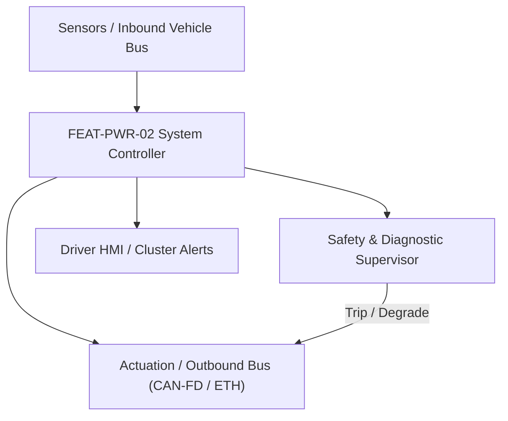
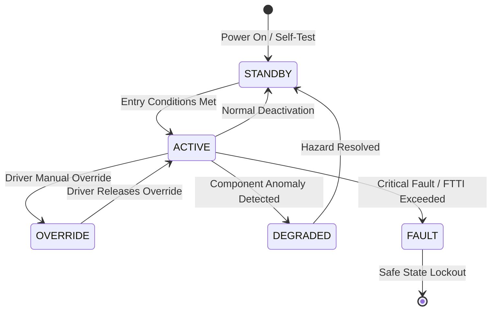

# System Requirements Specification: Traction Motor Torque Delivery & Arbitration (VCU)
**Feature ID:** `FEAT-PWR-02`  
**Domain:** Electric Powertrain & Energy Management  
**Target ASIL:** ASIL D  
**Compliance Standard:** ISO 26262:2018 (Part 4 - System Development) / ASPICE PAM v3.1 (SYS.2, SYS.3)  
**Parent Master Specification:** [`spec.md`](file:///c:/Workset/AntiGravityProjects/TestOptimisationExperiement/spec.md#feat-pwr-02-torque)  
**Derived Software Specification:** [`FEAT-PWR-02_Torque_SwReq.md`](file:///c:/Workset/AntiGravityProjects/TestOptimisationExperiement/software_requirements/FEAT-PWR-02_Torque_SwReq.md)

---

## 1. Feature Overview & Operational Scope

Interprets driver pedal demands, arbitrates with ADAS/TCS/ESC, applies safety torque envelopes, and commands inverter Field-Oriented Control setpoints.

### Operational Context Architecture

---

## 2. Activation Logic & Operational States

- **Preconditions:** High-voltage system energized, inverter ready, transmission in D or R, driver seatbelt fastened, parking brake released.
- **Entry Conditions:** Driver depresses accelerator pedal OR active ADAS cruise controller issues torque demand.
- **Deactivation Conditions:** Transmission shifted to P or N, brake pedal depressed simultaneously with accelerator (brake pedal override), or critical powertrain fault.
- **Driver Override Behavior:** Brake pedal press unconditionally overrides accelerator pedal, forcing requested drive torque to 0 Nm within <= 50 ms.
- **Operational State Progression:**  
  `TORQUE_OFF` -> `DRIVE_READY` -> `ACTIVE_PROPULSION` -> `ACTIVE_CREEP` -> `TORQUE_DERATING` -> `SAFETY_CLAMP` -> `FAULT_SHUTDOWN`

### State Transition Diagram

---

## 3. Functional Safety & Failure Mitigation Concept

- **Functional Safety Goal:** SG-VCU-01: Prevent unintended acceleration or torque direction reversal; ensure torque response matches driver intent within +-5%.
- **Fault Tolerant Time Interval (FTTI):** 50 ms
- **Safe State Definition:** Zero inverter torque command (T_cmd = 0 Nm); open inverter gate drives (freewheel/active short circuit).
- **Warning & Escalation Strategy:** Immediate powertrain wrench icon on cluster; audible alert; limp-home mode banner.

### Failure Modes & Degradation Handling
- **Inverter Overtemp:** If IGBT junction temp exceeds 150°C, apply linear derating slope up to 175°C (complete shutdown).
- **Pedal Sensor Rationality Error:** If dual potentiometer channels disagree by > 5%, force torque request to 0 Nm and ignore pedal.
- **Resolver Loss:** If motor rotor position resolver loses tracking, inverter trips Active Short Circuit (ASC) to prevent uncontrolled torque.

---

## 4. System Requirements (SYS_REQ)
*(Note: Each System Requirement is systematically partitioned into multiple Child Software Requirements)*

### `SYS-PWR-02-01`: Dual Accelerator Pedal Position Cross-Validation
- **Planned Release:** R100
- **ASIL Rating:** ASIL D
- **Parent Feature:** [`FEAT-PWR-02`](file:///c:/Workset/AntiGravityProjects/TestOptimisationExperiement/spec.md#feat-pwr-02)
- **Requirement Statement:**
  > The System SHALL sample two galvanically isolated, opposite-slope accelerator pedal position sensors (APP1: 0.5-4.5V, APP2: 4.5-0.5V) at <= 5 ms period. Discrepancy > 5.0% for > 100 ms SHALL force torque output to 0 Nm.
- **Activation Logic:** Active whenever vehicle is powered.
- **Fault Tolerant Time Interval (FTTI):** 50 ms
- **Safe State Action:** Zero driver torque request; illuminate powertrain malfunction lamp.
- **Failure Detection & Reaction:** If one sensor open-circuits, set Normalized_Pedal = 0% and report DTC P0121.
- **Input Interfaces:** `ADC_Raw_APP1_Voltage, ADC_Raw_APP2_Voltage`
- **Output Interfaces:** `Normalized_Driver_Pedal_Pct (float32), APP_Sensor_Healthy (boolean)`
- **System Verification Method:** Sensor pin disconnect and short-to-battery fault injection testing.
- **Derived Child Software Requirements (1:N Link):**
  - [`SWR-PWR-02-01`](file:///c:/Workset/AntiGravityProjects/TestOptimisationExperiement/software_requirements/FEAT-PWR-02_Torque_SwReq.md#swr-pwr-02-01)
  - [`SWR-PWR-02-02`](file:///c:/Workset/AntiGravityProjects/TestOptimisationExperiement/software_requirements/FEAT-PWR-02_Torque_SwReq.md#swr-pwr-02-02)

### `SYS-PWR-02-02`: Multi-Source Torque Arbitration & Dynamic Limits Envelope
- **Planned Release:** R500
- **ASIL Rating:** ASIL D
- **Parent Feature:** [`FEAT-PWR-02`](file:///c:/Workset/AntiGravityProjects/TestOptimisationExperiement/spec.md#feat-pwr-02)
- **Requirement Statement:**
  > The System SHALL arbitrate driver torque demands, ADAS/ACC cruise demands, Traction Control (TCS) limits, and ESC stability clamping at 5 ms period, giving strict override priority to chassis safety limits.
- **Activation Logic:** Active in ACTIVE_PROPULSION state.
- **Fault Tolerant Time Interval (FTTI):** 50 ms
- **Safe State Action:** Clamp torque to minimum of safe allowable boundary; zero torque on arbitration failure.
- **Failure Detection & Reaction:** If arbitration module detects conflicting demands, default to lowest torque request.
- **Input Interfaces:** `Normalized_Driver_Pedal_Pct, ADAS_Torque_Req, TCS_Max_Torque_Limit, BMS_Discharge_Limit`
- **Output Interfaces:** `Arbitrated_Motor_Torque_Nm, Torque_Active_Source_Enum`
- **System Verification Method:** Powertrain dynamometer torque response validation and boundary testing.
- **Derived Child Software Requirements (1:N Link):**
  - [`SWR-PWR-02-03`](file:///c:/Workset/AntiGravityProjects/TestOptimisationExperiement/software_requirements/FEAT-PWR-02_Torque_SwReq.md#swr-pwr-02-03)
  - [`SWR-PWR-02-04`](file:///c:/Workset/AntiGravityProjects/TestOptimisationExperiement/software_requirements/FEAT-PWR-02_Torque_SwReq.md#swr-pwr-02-04)

### `SYS-PWR-02-03`: Inverter FOC Vector Stator Current Command Generation
- **Planned Release:** R100
- **ASIL Rating:** ASIL D
- **Parent Feature:** [`FEAT-PWR-02`](file:///c:/Workset/AntiGravityProjects/TestOptimisationExperiement/spec.md#feat-pwr-02)
- **Requirement Statement:**
  > The System SHALL translate arbitrated torque into Field-Oriented Control (FOC) stator current references (Id*, Iq*) using MTPA and field-weakening maps, updating inverter PWM controllers at 1 kHz (<= 1 ms).
- **Activation Logic:** Active when inverter is in RUN mode.
- **Fault Tolerant Time Interval (FTTI):** 10 ms
- **Safe State Action:** Inverter PWM gate disable; trigger Safe Torque Off (STO).
- **Failure Detection & Reaction:** If rotor position tracking error > 2.0 electrical degrees, disable gate pulses.
- **Input Interfaces:** `Arbitrated_Motor_Torque_Nm, Rotor_Position_Theta, Motor_RPM, DC_Bus_Voltage`
- **Output Interfaces:** `Inverter_Id_Reference_A, Inverter_Iq_Reference_A, Gate_Drive_Enable`
- **System Verification Method:** Motor dyno testing measuring torque linearity, efficiency, and transient response.
- **Derived Child Software Requirements (1:N Link):**
  - [`SWR-PWR-02-05`](file:///c:/Workset/AntiGravityProjects/TestOptimisationExperiement/software_requirements/FEAT-PWR-02_Torque_SwReq.md#swr-pwr-02-05)
  - [`SWR-PWR-02-06`](file:///c:/Workset/AntiGravityProjects/TestOptimisationExperiement/software_requirements/FEAT-PWR-02_Torque_SwReq.md#swr-pwr-02-06)

### `SYS-PWR-02-04`: Low-Speed Creep & Hill-Hold Anti-Rollback Controller
- **Planned Release:** R200
- **ASIL Rating:** ASIL C
- **Parent Feature:** [`FEAT-PWR-02`](file:///c:/Workset/AntiGravityProjects/TestOptimisationExperiement/spec.md#feat-pwr-02)
- **Requirement Statement:**
  > The System SHALL simulate automatic transmission creep torque (up to 40 Nm @ 0-5 km/h) when brake is released in DRIVE, and execute active motor zero-speed electrical hill-hold on inclines up to 30% without vehicle rollback (> 2 cm).
- **Activation Logic:** Active at speeds < 5 km/h in forward or reverse gears.
- **Fault Tolerant Time Interval (FTTI):** 40 ms
- **Safe State Action:** Engage hydraulic ESP brake clamping; zero motor electrical hold.
- **Failure Detection & Reaction:** If electric motor overheats during sustained hill hold (> 10s), clamp foundation brakes.
- **Input Interfaces:** `Road_Incline_Grade_Pct, Brake_Pedal_Released_Flag, Motor_Rotor_Position_Resolver`
- **Output Interfaces:** `Creep_Torque_Demand_Nm, Anti_Rollback_Hold_Torque_Nm, Hill_Hold_Active_Flag`
- **System Verification Method:** 30% steep ramp vehicle stop and roll-back prevention proving ground testing.
- **Derived Child Software Requirements (1:N Link):**
  - [`SWR-PWR-02-08`](file:///c:/Workset/AntiGravityProjects/TestOptimisationExperiement/software_requirements/FEAT-PWR-02_Torque_SwReq.md#swr-pwr-02-08)
  - [`SWR-PWR-02-09`](file:///c:/Workset/AntiGravityProjects/TestOptimisationExperiement/software_requirements/FEAT-PWR-02_Torque_SwReq.md#swr-pwr-02-09)

### `SYS-PWR-02-05`: Multi-Component Thermal Derating & Motor Over-Temperature Limiter
- **Planned Release:** R500
- **ASIL Rating:** ASIL B
- **Parent Feature:** [`FEAT-PWR-02`](file:///c:/Workset/AntiGravityProjects/TestOptimisationExperiement/spec.md#feat-pwr-02)
- **Requirement Statement:**
  > The System SHALL monitor stator winding temperatures (FL, FR, Rear motors) and inverter SiC MOSFET junction temperatures, smoothly derating maximum allowable drive torque (from 100% to 20% over 140°C to 175°C) to prevent thermal demagnetization.
- **Activation Logic:** Active at all times during vehicle propulsion.
- **Fault Tolerant Time Interval (FTTI):** 200 ms
- **Safe State Action:** Limit motor torque to 50 Nm limp-home mode.
- **Failure Detection & Reaction:** If stator temperature exceeds 185°C, disconnect motor inverter gate drives immediately.
- **Input Interfaces:** `Motor_Stator_Temp_DegC, Inverter_SiC_Temp_DegC, Coolant_Flow_Rate_Lpm`
- **Output Interfaces:** `Thermal_Derated_Torque_Limit_Nm, Motor_Cooling_Pump_Target_RPM`
- **System Verification Method:** Dynamometer high-speed autobahn top-speed thermal saturation endurance testing.
- **Derived Child Software Requirements (1:N Link):**
  - [`SWR-PWR-02-10`](file:///c:/Workset/AntiGravityProjects/TestOptimisationExperiement/software_requirements/FEAT-PWR-02_Torque_SwReq.md#swr-pwr-02-10)
  - [`SWR-PWR-02-11`](file:///c:/Workset/AntiGravityProjects/TestOptimisationExperiement/software_requirements/FEAT-PWR-02_Torque_SwReq.md#swr-pwr-02-11)

### `SYS-PWR-02-06`: Traction Motor Multi-Channel Accelerator Pedal Cross-Check
- **Planned Release:** R200
- **ASIL Rating:** ASIL D
- **Parent Feature:** [`FEAT-PWR-02`](file:///c:/Workset/AntiGravityProjects/TestOptimisationExperiement/spec.md#feat-pwr-02)
- **Requirement Statement:**
  > The System SHALL Sample dual potentiometric/Hall pedal sensors: If disagreement > 5.0% for > 30 ms, drop torque request to zero.
- **Activation Logic:** Active during normal vehicle operation when feature state is active.
- **Fault Tolerant Time Interval (FTTI):** 10 ms
- **Safe State Action:** Transition to safe state or safe degradation tier within FTTI budget.
- **Failure Detection & Reaction:** Isolate faulted channel, latch DEM diagnostic trouble code, and inform driver.
- **Input Interfaces:** `Sensor signals, vehicle dynamics data, and bus frames via RTE.`
- **Output Interfaces:** `Actuator commands, diagnostic event flags, and cluster alerts.`
- **System Verification Method:** HiL test bench and dynamometer automated verification.
- **Derived Child Software Requirements (1:N Link):**
  - [`SWR-PWR-02-11`](file:///c:/Workset/AntiGravityProjects/TestOptimisationExperiement/software_requirements/FEAT-PWR-02_Torque_SwReq.md#swr-pwr-02-11)
  - [`SWR-PWR-02-12`](file:///c:/Workset/AntiGravityProjects/TestOptimisationExperiement/software_requirements/FEAT-PWR-02_Torque_SwReq.md#swr-pwr-02-12)

### `SYS-PWR-02-07`: Inverter Space Vector Modulation (SVM) Stator Flux Controller
- **Planned Release:** R300
- **ASIL Rating:** ASIL D
- **Parent Feature:** [`FEAT-PWR-02`](file:///c:/Workset/AntiGravityProjects/TestOptimisationExperiement/spec.md#feat-pwr-02)
- **Requirement Statement:**
  > The System SHALL Compute d-q axis direct and quadrature current setpoints to deliver motor electromagnetic torque with precision +-2.0 Nm.
- **Activation Logic:** Active during normal vehicle operation when feature state is active.
- **Fault Tolerant Time Interval (FTTI):** 1 ms
- **Safe State Action:** Transition to safe state or safe degradation tier within FTTI budget.
- **Failure Detection & Reaction:** Isolate faulted channel, latch DEM diagnostic trouble code, and inform driver.
- **Input Interfaces:** `Sensor signals, vehicle dynamics data, and bus frames via RTE.`
- **Output Interfaces:** `Actuator commands, diagnostic event flags, and cluster alerts.`
- **System Verification Method:** HiL test bench and dynamometer automated verification.
- **Derived Child Software Requirements (1:N Link):**
  - [`SWR-PWR-02-13`](file:///c:/Workset/AntiGravityProjects/TestOptimisationExperiement/software_requirements/FEAT-PWR-02_Torque_SwReq.md#swr-pwr-02-13)
  - [`SWR-PWR-02-14`](file:///c:/Workset/AntiGravityProjects/TestOptimisationExperiement/software_requirements/FEAT-PWR-02_Torque_SwReq.md#swr-pwr-02-14)

### `SYS-PWR-02-08`: Powertrain Dynamic Torque Arbitration (Driver vs ACC vs ESC)
- **Planned Release:** R500
- **ASIL Rating:** ASIL D
- **Parent Feature:** [`FEAT-PWR-02`](file:///c:/Workset/AntiGravityProjects/TestOptimisationExperiement/spec.md#feat-pwr-02)
- **Requirement Statement:**
  > The System SHALL Arbitrate between driver demand, ADAS cruise commands, and ESC stability torque clamps with strict safety priority.
- **Activation Logic:** Active during normal vehicle operation when feature state is active.
- **Fault Tolerant Time Interval (FTTI):** 5 ms
- **Safe State Action:** Transition to safe state or safe degradation tier within FTTI budget.
- **Failure Detection & Reaction:** Isolate faulted channel, latch DEM diagnostic trouble code, and inform driver.
- **Input Interfaces:** `Sensor signals, vehicle dynamics data, and bus frames via RTE.`
- **Output Interfaces:** `Actuator commands, diagnostic event flags, and cluster alerts.`
- **System Verification Method:** HiL test bench and dynamometer automated verification.
- **Derived Child Software Requirements (1:N Link):**
  - [`SWR-PWR-02-15`](file:///c:/Workset/AntiGravityProjects/TestOptimisationExperiement/software_requirements/FEAT-PWR-02_Torque_SwReq.md#swr-pwr-02-15)
  - [`SWR-PWR-02-16`](file:///c:/Workset/AntiGravityProjects/TestOptimisationExperiement/software_requirements/FEAT-PWR-02_Torque_SwReq.md#swr-pwr-02-16)

### `SYS-PWR-02-09`: Motor Rotor Resolver-to-Digital Angle Decoding & Position Observer
- **Planned Release:** R300
- **ASIL Rating:** ASIL D
- **Parent Feature:** [`FEAT-PWR-02`](file:///c:/Workset/AntiGravityProjects/TestOptimisationExperiement/spec.md#feat-pwr-02)
- **Requirement Statement:**
  > The System SHALL Decode high-speed resolver feedback with 16-bit resolution to synchronize stator rotating magnetic field.
- **Activation Logic:** Active during normal vehicle operation when feature state is active.
- **Fault Tolerant Time Interval (FTTI):** 1 ms
- **Safe State Action:** Transition to safe state or safe degradation tier within FTTI budget.
- **Failure Detection & Reaction:** Isolate faulted channel, latch DEM diagnostic trouble code, and inform driver.
- **Input Interfaces:** `Sensor signals, vehicle dynamics data, and bus frames via RTE.`
- **Output Interfaces:** `Actuator commands, diagnostic event flags, and cluster alerts.`
- **System Verification Method:** HiL test bench and dynamometer automated verification.
- **Derived Child Software Requirements (1:N Link):**
  - [`SWR-PWR-02-17`](file:///c:/Workset/AntiGravityProjects/TestOptimisationExperiement/software_requirements/FEAT-PWR-02_Torque_SwReq.md#swr-pwr-02-17)
  - [`SWR-PWR-02-18`](file:///c:/Workset/AntiGravityProjects/TestOptimisationExperiement/software_requirements/FEAT-PWR-02_Torque_SwReq.md#swr-pwr-02-18)

### `SYS-PWR-02-10`: Active Inverter Discharge & DC Link Capacitor Bleed Resistor Manager
- **Planned Release:** R400
- **ASIL Rating:** ASIL D
- **Parent Feature:** [`FEAT-PWR-02`](file:///c:/Workset/AntiGravityProjects/TestOptimisationExperiement/spec.md#feat-pwr-02)
- **Requirement Statement:**
  > The System SHALL Discharge 800V DC link capacitor to < 60V in <= 2.0 seconds upon crash signal or ignition shutdown.
- **Activation Logic:** Active during normal vehicle operation when feature state is active.
- **Fault Tolerant Time Interval (FTTI):** 20 ms
- **Safe State Action:** Transition to safe state or safe degradation tier within FTTI budget.
- **Failure Detection & Reaction:** Isolate faulted channel, latch DEM diagnostic trouble code, and inform driver.
- **Input Interfaces:** `Sensor signals, vehicle dynamics data, and bus frames via RTE.`
- **Output Interfaces:** `Actuator commands, diagnostic event flags, and cluster alerts.`
- **System Verification Method:** HiL test bench and dynamometer automated verification.
- **Derived Child Software Requirements (1:N Link):**
  - [`SWR-PWR-02-19`](file:///c:/Workset/AntiGravityProjects/TestOptimisationExperiement/software_requirements/FEAT-PWR-02_Torque_SwReq.md#swr-pwr-02-19)
  - [`SWR-PWR-02-20`](file:///c:/Workset/AntiGravityProjects/TestOptimisationExperiement/software_requirements/FEAT-PWR-02_Torque_SwReq.md#swr-pwr-02-20)

### `SYS-PWR-02-11`: Traction Inverter Phase Over-Current Hardware Trip Monitor
- **Planned Release:** R400
- **ASIL Rating:** ASIL D
- **Parent Feature:** [`FEAT-PWR-02`](file:///c:/Workset/AntiGravityProjects/TestOptimisationExperiement/spec.md#feat-pwr-02)
- **Requirement Statement:**
  > The System SHALL Hardware comparator trips all 6 IGBT/SiC gate drives in < 2.0 µs upon current exceeding 850 A peak.
- **Activation Logic:** Active during normal vehicle operation when feature state is active.
- **Fault Tolerant Time Interval (FTTI):** 1 ms
- **Safe State Action:** Transition to safe state or safe degradation tier within FTTI budget.
- **Failure Detection & Reaction:** Isolate faulted channel, latch DEM diagnostic trouble code, and inform driver.
- **Input Interfaces:** `Sensor signals, vehicle dynamics data, and bus frames via RTE.`
- **Output Interfaces:** `Actuator commands, diagnostic event flags, and cluster alerts.`
- **System Verification Method:** HiL test bench and dynamometer automated verification.
- **Derived Child Software Requirements (1:N Link):**
  - [`SWR-PWR-02-21`](file:///c:/Workset/AntiGravityProjects/TestOptimisationExperiement/software_requirements/FEAT-PWR-02_Torque_SwReq.md#swr-pwr-02-21)
  - [`SWR-PWR-02-22`](file:///c:/Workset/AntiGravityProjects/TestOptimisationExperiement/software_requirements/FEAT-PWR-02_Torque_SwReq.md#swr-pwr-02-22)

### `SYS-PWR-02-12`: Motor Stator Winding & Rotor Magnet Multi-Zone Thermal Derater
- **Planned Release:** R400
- **ASIL Rating:** ASIL B
- **Parent Feature:** [`FEAT-PWR-02`](file:///c:/Workset/AntiGravityProjects/TestOptimisationExperiement/spec.md#feat-pwr-02)
- **Requirement Statement:**
  > The System SHALL Derate peak motor torque continuously from 400 Nm to 120 Nm as winding temperature rises from 140 °C to 165 °C.
- **Activation Logic:** Active during normal vehicle operation when feature state is active.
- **Fault Tolerant Time Interval (FTTI):** 100 ms
- **Safe State Action:** Transition to safe state or safe degradation tier within FTTI budget.
- **Failure Detection & Reaction:** Isolate faulted channel, latch DEM diagnostic trouble code, and inform driver.
- **Input Interfaces:** `Sensor signals, vehicle dynamics data, and bus frames via RTE.`
- **Output Interfaces:** `Actuator commands, diagnostic event flags, and cluster alerts.`
- **System Verification Method:** HiL test bench and dynamometer automated verification.
- **Derived Child Software Requirements (1:N Link):**
  - [`SWR-PWR-02-23`](file:///c:/Workset/AntiGravityProjects/TestOptimisationExperiement/software_requirements/FEAT-PWR-02_Torque_SwReq.md#swr-pwr-02-23)
  - [`SWR-PWR-02-24`](file:///c:/Workset/AntiGravityProjects/TestOptimisationExperiement/software_requirements/FEAT-PWR-02_Torque_SwReq.md#swr-pwr-02-24)

### `SYS-PWR-02-13`: Creep Torque & Hill Hold Powertrain Standstill Speed Governor
- **Planned Release:** R500
- **ASIL Rating:** ASIL B
- **Parent Feature:** [`FEAT-PWR-02`](file:///c:/Workset/AntiGravityProjects/TestOptimisationExperiement/spec.md#feat-pwr-02)
- **Requirement Statement:**
  > The System SHALL Govern low-speed vehicle creep velocity to 4.0 km/h and prevent vehicle roll-back on 20% slopes.
- **Activation Logic:** Active during normal vehicle operation when feature state is active.
- **Fault Tolerant Time Interval (FTTI):** 20 ms
- **Safe State Action:** Transition to safe state or safe degradation tier within FTTI budget.
- **Failure Detection & Reaction:** Isolate faulted channel, latch DEM diagnostic trouble code, and inform driver.
- **Input Interfaces:** `Sensor signals, vehicle dynamics data, and bus frames via RTE.`
- **Output Interfaces:** `Actuator commands, diagnostic event flags, and cluster alerts.`
- **System Verification Method:** HiL test bench and dynamometer automated verification.
- **Derived Child Software Requirements (1:N Link):**
  - [`SWR-PWR-02-25`](file:///c:/Workset/AntiGravityProjects/TestOptimisationExperiement/software_requirements/FEAT-PWR-02_Torque_SwReq.md#swr-pwr-02-25)
  - [`SWR-PWR-02-26`](file:///c:/Workset/AntiGravityProjects/TestOptimisationExperiement/software_requirements/FEAT-PWR-02_Torque_SwReq.md#swr-pwr-02-26)

### `SYS-PWR-02-14`: Dual Core Lockstep Execution Flow & Watchdog Supervisor
- **Planned Release:** R400
- **ASIL Rating:** ASIL D
- **Parent Feature:** [`FEAT-PWR-02`](file:///c:/Workset/AntiGravityProjects/TestOptimisationExperiement/spec.md#feat-pwr-02)
- **Requirement Statement:**
  > The System SHALL Supervise lockstep CPU execution tokens and trip independent safing relay upon ALU discrepancies.
- **Activation Logic:** Active during normal vehicle operation when feature state is active.
- **Fault Tolerant Time Interval (FTTI):** 2 ms
- **Safe State Action:** Transition to safe state or safe degradation tier within FTTI budget.
- **Failure Detection & Reaction:** Isolate faulted channel, latch DEM diagnostic trouble code, and inform driver.
- **Input Interfaces:** `Sensor signals, vehicle dynamics data, and bus frames via RTE.`
- **Output Interfaces:** `Actuator commands, diagnostic event flags, and cluster alerts.`
- **System Verification Method:** HiL test bench and dynamometer automated verification.
- **Derived Child Software Requirements (1:N Link):**
  - [`SWR-PWR-02-27`](file:///c:/Workset/AntiGravityProjects/TestOptimisationExperiement/software_requirements/FEAT-PWR-02_Torque_SwReq.md#swr-pwr-02-27)
  - [`SWR-PWR-02-28`](file:///c:/Workset/AntiGravityProjects/TestOptimisationExperiement/software_requirements/FEAT-PWR-02_Torque_SwReq.md#swr-pwr-02-28)

### `SYS-PWR-02-15`: DEM Powertrain DTC Qualification & Torque Limitation Logging
- **Planned Release:** R500
- **ASIL Rating:** ASIL B
- **Parent Feature:** [`FEAT-PWR-02`](file:///c:/Workset/AntiGravityProjects/TestOptimisationExperiement/spec.md#feat-pwr-02)
- **Requirement Statement:**
  > The System SHALL Qualify diagnostic trouble codes for inverter communication loss and latch freeze-frame snapshots.
- **Activation Logic:** Active during normal vehicle operation when feature state is active.
- **Fault Tolerant Time Interval (FTTI):** 50 ms
- **Safe State Action:** Transition to safe state or safe degradation tier within FTTI budget.
- **Failure Detection & Reaction:** Isolate faulted channel, latch DEM diagnostic trouble code, and inform driver.
- **Input Interfaces:** `Sensor signals, vehicle dynamics data, and bus frames via RTE.`
- **Output Interfaces:** `Actuator commands, diagnostic event flags, and cluster alerts.`
- **System Verification Method:** HiL test bench and dynamometer automated verification.
- **Derived Child Software Requirements (1:N Link):**
  - [`SWR-PWR-02-29`](file:///c:/Workset/AntiGravityProjects/TestOptimisationExperiement/software_requirements/FEAT-PWR-02_Torque_SwReq.md#swr-pwr-02-29)
  - [`SWR-PWR-02-30`](file:///c:/Workset/AntiGravityProjects/TestOptimisationExperiement/software_requirements/FEAT-PWR-02_Torque_SwReq.md#swr-pwr-02-30)

---

## 5. System-to-Software Traceability Summary

| System Requirement ID | Planned Release | ASIL | Title | Derived Software Requirements (1:N) | Verification Method |
| :--- | :---: | :--- | :--- | :--- | :--- |
| `SYS-PWR-02-01` | **`R100`** | ASIL D | Dual Accelerator Pedal Position Cross-Validation | [`SWR-PWR-02-01`](file:///c:/Workset/AntiGravityProjects/TestOptimisationExperiement/software_requirements/FEAT-PWR-02_Torque_SwReq.md#swr-pwr-02-01), [`SWR-PWR-02-02`](file:///c:/Workset/AntiGravityProjects/TestOptimisationExperiement/software_requirements/FEAT-PWR-02_Torque_SwReq.md#swr-pwr-02-02) | Sensor pin disconnect and short-to-battery fault injection testing. |
| `SYS-PWR-02-02` | **`R500`** | ASIL D | Multi-Source Torque Arbitration & Dynamic Limits Envelope | [`SWR-PWR-02-03`](file:///c:/Workset/AntiGravityProjects/TestOptimisationExperiement/software_requirements/FEAT-PWR-02_Torque_SwReq.md#swr-pwr-02-03), [`SWR-PWR-02-04`](file:///c:/Workset/AntiGravityProjects/TestOptimisationExperiement/software_requirements/FEAT-PWR-02_Torque_SwReq.md#swr-pwr-02-04) | Powertrain dynamometer torque response validation and boundary testing. |
| `SYS-PWR-02-03` | **`R100`** | ASIL D | Inverter FOC Vector Stator Current Command Generation | [`SWR-PWR-02-05`](file:///c:/Workset/AntiGravityProjects/TestOptimisationExperiement/software_requirements/FEAT-PWR-02_Torque_SwReq.md#swr-pwr-02-05), [`SWR-PWR-02-06`](file:///c:/Workset/AntiGravityProjects/TestOptimisationExperiement/software_requirements/FEAT-PWR-02_Torque_SwReq.md#swr-pwr-02-06) | Motor dyno testing measuring torque linearity, efficiency, and transient response. |
| `SYS-PWR-02-04` | **`R200`** | ASIL C | Low-Speed Creep & Hill-Hold Anti-Rollback Controller | [`SWR-PWR-02-08`](file:///c:/Workset/AntiGravityProjects/TestOptimisationExperiement/software_requirements/FEAT-PWR-02_Torque_SwReq.md#swr-pwr-02-08), [`SWR-PWR-02-09`](file:///c:/Workset/AntiGravityProjects/TestOptimisationExperiement/software_requirements/FEAT-PWR-02_Torque_SwReq.md#swr-pwr-02-09) | 30% steep ramp vehicle stop and roll-back prevention proving ground testing. |
| `SYS-PWR-02-05` | **`R500`** | ASIL B | Multi-Component Thermal Derating & Motor Over-Temperature Limiter | [`SWR-PWR-02-10`](file:///c:/Workset/AntiGravityProjects/TestOptimisationExperiement/software_requirements/FEAT-PWR-02_Torque_SwReq.md#swr-pwr-02-10), [`SWR-PWR-02-11`](file:///c:/Workset/AntiGravityProjects/TestOptimisationExperiement/software_requirements/FEAT-PWR-02_Torque_SwReq.md#swr-pwr-02-11) | Dynamometer high-speed autobahn top-speed thermal saturation endurance testing. |
| `SYS-PWR-02-06` | **`R200`** | ASIL D | Traction Motor Multi-Channel Accelerator Pedal Cross-Check | [`SWR-PWR-02-11`](file:///c:/Workset/AntiGravityProjects/TestOptimisationExperiement/software_requirements/FEAT-PWR-02_Torque_SwReq.md#swr-pwr-02-11), [`SWR-PWR-02-12`](file:///c:/Workset/AntiGravityProjects/TestOptimisationExperiement/software_requirements/FEAT-PWR-02_Torque_SwReq.md#swr-pwr-02-12) | HiL test bench and dynamometer automated verification. |
| `SYS-PWR-02-07` | **`R300`** | ASIL D | Inverter Space Vector Modulation (SVM) Stator Flux Controller | [`SWR-PWR-02-13`](file:///c:/Workset/AntiGravityProjects/TestOptimisationExperiement/software_requirements/FEAT-PWR-02_Torque_SwReq.md#swr-pwr-02-13), [`SWR-PWR-02-14`](file:///c:/Workset/AntiGravityProjects/TestOptimisationExperiement/software_requirements/FEAT-PWR-02_Torque_SwReq.md#swr-pwr-02-14) | HiL test bench and dynamometer automated verification. |
| `SYS-PWR-02-08` | **`R500`** | ASIL D | Powertrain Dynamic Torque Arbitration (Driver vs ACC vs ESC) | [`SWR-PWR-02-15`](file:///c:/Workset/AntiGravityProjects/TestOptimisationExperiement/software_requirements/FEAT-PWR-02_Torque_SwReq.md#swr-pwr-02-15), [`SWR-PWR-02-16`](file:///c:/Workset/AntiGravityProjects/TestOptimisationExperiement/software_requirements/FEAT-PWR-02_Torque_SwReq.md#swr-pwr-02-16) | HiL test bench and dynamometer automated verification. |
| `SYS-PWR-02-09` | **`R300`** | ASIL D | Motor Rotor Resolver-to-Digital Angle Decoding & Position Observer | [`SWR-PWR-02-17`](file:///c:/Workset/AntiGravityProjects/TestOptimisationExperiement/software_requirements/FEAT-PWR-02_Torque_SwReq.md#swr-pwr-02-17), [`SWR-PWR-02-18`](file:///c:/Workset/AntiGravityProjects/TestOptimisationExperiement/software_requirements/FEAT-PWR-02_Torque_SwReq.md#swr-pwr-02-18) | HiL test bench and dynamometer automated verification. |
| `SYS-PWR-02-10` | **`R400`** | ASIL D | Active Inverter Discharge & DC Link Capacitor Bleed Resistor Manager | [`SWR-PWR-02-19`](file:///c:/Workset/AntiGravityProjects/TestOptimisationExperiement/software_requirements/FEAT-PWR-02_Torque_SwReq.md#swr-pwr-02-19), [`SWR-PWR-02-20`](file:///c:/Workset/AntiGravityProjects/TestOptimisationExperiement/software_requirements/FEAT-PWR-02_Torque_SwReq.md#swr-pwr-02-20) | HiL test bench and dynamometer automated verification. |
| `SYS-PWR-02-11` | **`R400`** | ASIL D | Traction Inverter Phase Over-Current Hardware Trip Monitor | [`SWR-PWR-02-21`](file:///c:/Workset/AntiGravityProjects/TestOptimisationExperiement/software_requirements/FEAT-PWR-02_Torque_SwReq.md#swr-pwr-02-21), [`SWR-PWR-02-22`](file:///c:/Workset/AntiGravityProjects/TestOptimisationExperiement/software_requirements/FEAT-PWR-02_Torque_SwReq.md#swr-pwr-02-22) | HiL test bench and dynamometer automated verification. |
| `SYS-PWR-02-12` | **`R400`** | ASIL B | Motor Stator Winding & Rotor Magnet Multi-Zone Thermal Derater | [`SWR-PWR-02-23`](file:///c:/Workset/AntiGravityProjects/TestOptimisationExperiement/software_requirements/FEAT-PWR-02_Torque_SwReq.md#swr-pwr-02-23), [`SWR-PWR-02-24`](file:///c:/Workset/AntiGravityProjects/TestOptimisationExperiement/software_requirements/FEAT-PWR-02_Torque_SwReq.md#swr-pwr-02-24) | HiL test bench and dynamometer automated verification. |
| `SYS-PWR-02-13` | **`R500`** | ASIL B | Creep Torque & Hill Hold Powertrain Standstill Speed Governor | [`SWR-PWR-02-25`](file:///c:/Workset/AntiGravityProjects/TestOptimisationExperiement/software_requirements/FEAT-PWR-02_Torque_SwReq.md#swr-pwr-02-25), [`SWR-PWR-02-26`](file:///c:/Workset/AntiGravityProjects/TestOptimisationExperiement/software_requirements/FEAT-PWR-02_Torque_SwReq.md#swr-pwr-02-26) | HiL test bench and dynamometer automated verification. |
| `SYS-PWR-02-14` | **`R400`** | ASIL D | Dual Core Lockstep Execution Flow & Watchdog Supervisor | [`SWR-PWR-02-27`](file:///c:/Workset/AntiGravityProjects/TestOptimisationExperiement/software_requirements/FEAT-PWR-02_Torque_SwReq.md#swr-pwr-02-27), [`SWR-PWR-02-28`](file:///c:/Workset/AntiGravityProjects/TestOptimisationExperiement/software_requirements/FEAT-PWR-02_Torque_SwReq.md#swr-pwr-02-28) | HiL test bench and dynamometer automated verification. |
| `SYS-PWR-02-15` | **`R500`** | ASIL B | DEM Powertrain DTC Qualification & Torque Limitation Logging | [`SWR-PWR-02-29`](file:///c:/Workset/AntiGravityProjects/TestOptimisationExperiement/software_requirements/FEAT-PWR-02_Torque_SwReq.md#swr-pwr-02-29), [`SWR-PWR-02-30`](file:///c:/Workset/AntiGravityProjects/TestOptimisationExperiement/software_requirements/FEAT-PWR-02_Torque_SwReq.md#swr-pwr-02-30) | HiL test bench and dynamometer automated verification. |

- **Upstream Feature Link:** [`spec.md` (FEAT-PWR-02)](file:///c:/Workset/AntiGravityProjects/TestOptimisationExperiement/spec.md#feat-pwr-02)
- **Software Requirements Specification:** [`FEAT-PWR-02_Torque_SwReq.md`](file:///c:/Workset/AntiGravityProjects/TestOptimisationExperiement/software_requirements/FEAT-PWR-02_Torque_SwReq.md)
