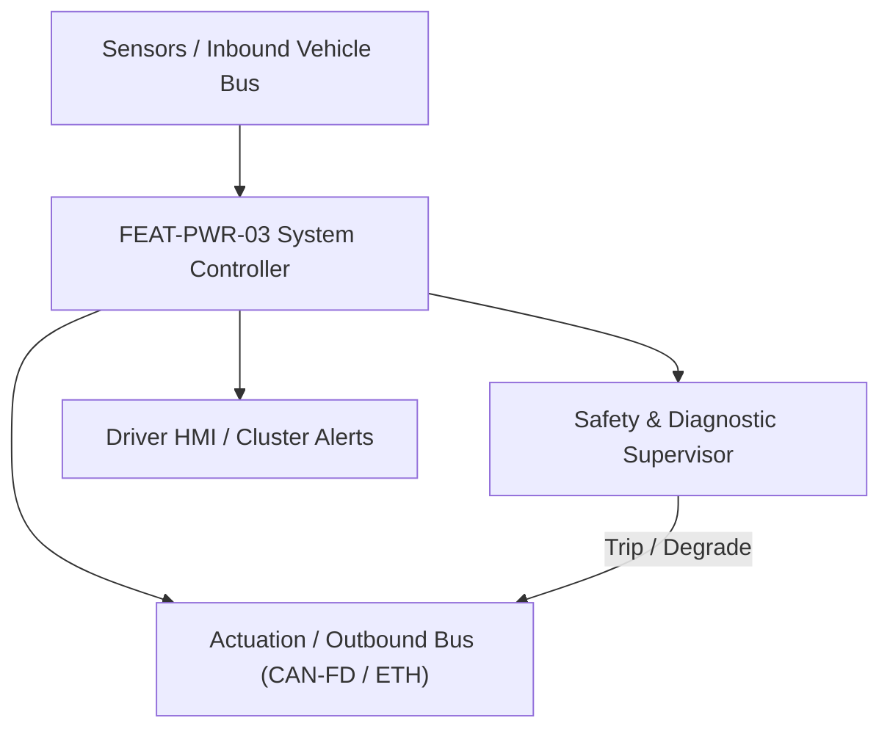
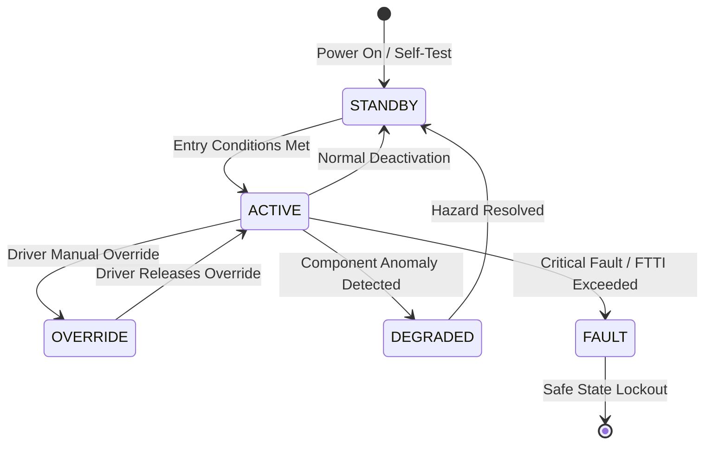

# System Requirements Specification: Regenerative Braking & One-Pedal Drive Coordination (RBC)
**Feature ID:** `FEAT-PWR-03`  
**Domain:** Electric Powertrain & Energy Management  
**Target ASIL:** ASIL D  
**Compliance Standard:** ISO 26262:2018 (Part 4 - System Development) / ASPICE PAM v3.1 (SYS.2, SYS.3)  
**Parent Master Specification:** [`spec.md`](file:///c:/Workset/AntiGravityProjects/TestOptimisationExperiement/spec.md#feat-pwr-03-regen)  
**Derived Software Specification:** [`FEAT-PWR-03_Regen_SwReq.md`](file:///c:/Workset/AntiGravityProjects/TestOptimisationExperiement/software_requirements/FEAT-PWR-03_Regen_SwReq.md)

---

## 1. Feature Overview & Operational Scope

Recuperates kinetic energy during deceleration, blends electric regeneration with friction brakes, provides One-Pedal Drive standstill hold, and cuts off regen during ABS events.

### Operational Context Architecture

---

## 2. Activation Logic & Operational States

- **Preconditions:** High-voltage battery accepting charge, inverter operational, transmission in D, vehicle speed > 3 km/h.
- **Entry Conditions:** Driver lifts foot off accelerator pedal (coast-down regen) OR depresses brake pedal (blended brake regen).
- **Deactivation Conditions:** Battery SOC > 98%, ABS intervention active, ESC active, vehicle stationary, or reverse gear selected.
- **Driver Override Behavior:** Driver hard brake pedal press adds hydraulic friction braking seamlessly without lag.
- **Operational State Progression:**  
  `INACTIVE` -> `COAST_REGEN_ACTIVE` -> `BLENDED_BRAKE_REGEN` -> `ONE_PEDAL_STOP_HOLD` -> `ABS_REGEN_CUTOFF` -> `BATTERY_FULL_DERATE`

### State Transition Diagram

---

## 3. Functional Safety & Failure Mitigation Concept

- **Functional Safety Goal:** SG-RBC-01: Prevent rear-axle lockup or vehicle instability during regenerative braking; ensure seamless brake pedal deceleration feel.
- **Fault Tolerant Time Interval (FTTI):** 20 ms for ABS cutoff; 100 ms for blended torque transitions.
- **Safe State Definition:** Zero regenerative braking torque (T_regen = 0 Nm); transfer 100% deceleration demand to hydraulic foundation brakes.
- **Warning & Escalation Strategy:** Cluster regen power bar indicator turns gray when regen is restricted due to cold battery or full charge.

### Failure Modes & Degradation Handling
- **Abs Trigger:** Upon ABS active flag from chassis ECU, ramp regen torque down to 0 Nm at 2500 Nm/s in <= 15 ms.
- **Inverter Fault During Regen:** If inverter trips during regen braking, electro-hydraulic brake booster instantly increases hydraulic pressure to match driver decel demand.

---

## 4. System Requirements (SYS_REQ)
*(Note: Each System Requirement is systematically partitioned into multiple Child Software Requirements)*

### `SYS-PWR-03-01`: Deceleration Blending Allocation Between Regen & Hydraulic Brakes
- **Planned Release:** R100
- **ASIL Rating:** ASIL C
- **Parent Feature:** [`FEAT-PWR-03`](file:///c:/Workset/AntiGravityProjects/TestOptimisationExperiement/spec.md#feat-pwr-03)
- **Requirement Statement:**
  > The System SHALL allocate up to -0.35 g deceleration to electric generator recuperation before applying hydraulic friction brakes, accounting for battery charge power limits and motor thermal status at 10 ms period.
- **Activation Logic:** Active during vehicle deceleration when driver presses brake pedal.
- **Fault Tolerant Time Interval (FTTI):** 100 ms
- **Safe State Action:** Disengage regen; satisfy 100% deceleration demand via hydraulic friction brakes.
- **Failure Detection & Reaction:** If brake pedal stroke sensor reports erratic values, disable regen blending.
- **Input Interfaces:** `Brake_Pedal_Travel_Stroke_Mm, Vehicle_Speed_Kmph, BMS_Charge_Power_Limit_kW`
- **Output Interfaces:** `Target_Regen_Torque_Nm, Target_Hydraulic_Brake_Pressure_Bar`
- **System Verification Method:** Brake dynamometer blending efficiency and pedal feel measurement.
- **Derived Child Software Requirements (1:N Link):**
  - [`SWR-PWR-03-01`](file:///c:/Workset/AntiGravityProjects/TestOptimisationExperiement/software_requirements/FEAT-PWR-03_Regen_SwReq.md#swr-pwr-03-01)
  - [`SWR-PWR-03-02`](file:///c:/Workset/AntiGravityProjects/TestOptimisationExperiement/software_requirements/FEAT-PWR-03_Regen_SwReq.md#swr-pwr-03-02)

### `SYS-PWR-03-02`: High-Speed ABS/ESC Intervention Regeneration Cutoff
- **Planned Release:** R100
- **ASIL Rating:** ASIL D
- **Parent Feature:** [`FEAT-PWR-03`](file:///c:/Workset/AntiGravityProjects/TestOptimisationExperiement/spec.md#feat-pwr-03)
- **Requirement Statement:**
  > The System SHALL ramp regenerative motor braking torque to 0.0 Nm in <= 20 ms upon receipt of ABS_Active == TRUE or ESC_Intervention == TRUE from chassis controller to maintain lateral tire traction.
- **Activation Logic:** Active at all times during regenerative deceleration.
- **Fault Tolerant Time Interval (FTTI):** 20 ms
- **Safe State Action:** Zero regen torque output; withhold regen for 500 ms post-event.
- **Failure Detection & Reaction:** If chassis communication packet times out, unconditionally disable regen braking.
- **Input Interfaces:** `ABS_Active_Flag (CAN-FD, 100 Hz), ESC_Intervention_Flag (CAN-FD, 100 Hz)`
- **Output Interfaces:** `Regen_Cutoff_Active (boolean), Fast_Ramp_Torque_Cmd_Nm`
- **System Verification Method:** Split-mu (ice/asphalt) surface HIL braking and ABS triggering test.
- **Derived Child Software Requirements (1:N Link):**
  - [`SWR-PWR-03-03`](file:///c:/Workset/AntiGravityProjects/TestOptimisationExperiement/software_requirements/FEAT-PWR-03_Regen_SwReq.md#swr-pwr-03-03)
  - [`SWR-PWR-03-04`](file:///c:/Workset/AntiGravityProjects/TestOptimisationExperiement/software_requirements/FEAT-PWR-03_Regen_SwReq.md#swr-pwr-03-04)

### `SYS-PWR-03-03`: ABS Wheel Slip Fast Regeneration Cutback & Surface Coordination
- **Planned Release:** R100
- **ASIL Rating:** ASIL D
- **Parent Feature:** [`FEAT-PWR-03`](file:///c:/Workset/AntiGravityProjects/TestOptimisationExperiement/spec.md#feat-pwr-03)
- **Requirement Statement:**
  > The System SHALL reduce regenerative motor braking torque to 0 Nm in <= 20 ms upon ESP detecting wheel slip (slip ratio lambda > 12% on low-friction road surfaces), transferring 100% deceleration to modulated hydraulic ABS.
- **Activation Logic:** Active during regenerative deceleration on slippery roads.
- **Fault Tolerant Time Interval (FTTI):** 20 ms
- **Safe State Action:** Zero electric motor regen torque; enable hydraulic ABS.
- **Failure Detection & Reaction:** If motor torque ramp-down is delayed > 25 ms, open inverter PWM gates.
- **Input Interfaces:** `Wheel_Slip_Ratio_Array[4], ABS_Intervention_Active_Flag, ESP_Friction_Mu_Est`
- **Output Interfaces:** `Regen_Cutback_Command (boolean), Motor_Regen_Torque_Clamp_Nm`
- **System Verification Method:** Split-mu ice-asphalt braking deceleration stability tests.
- **Derived Child Software Requirements (1:N Link):**
  - [`SWR-PWR-03-05`](file:///c:/Workset/AntiGravityProjects/TestOptimisationExperiement/software_requirements/FEAT-PWR-03_Regen_SwReq.md#swr-pwr-03-05)
  - [`SWR-PWR-03-06`](file:///c:/Workset/AntiGravityProjects/TestOptimisationExperiement/software_requirements/FEAT-PWR-03_Regen_SwReq.md#swr-pwr-03-06)

### `SYS-PWR-03-04`: Battery Low-Temperature & High SOC Regeneration Envelope Limiter
- **Planned Release:** R200
- **ASIL Rating:** ASIL C
- **Parent Feature:** [`FEAT-PWR-03`](file:///c:/Workset/AntiGravityProjects/TestOptimisationExperiement/spec.md#feat-pwr-03)
- **Requirement Statement:**
  > The System SHALL dynamically scale regenerative deceleration based on battery BMS charge acceptance limit (P_chg_max): Seamlessly substituting hydraulic friction braking to maintain consistent driver pedal decel feel when battery is cold (< 0°C) or fully charged (> 95% SOC).
- **Activation Logic:** Active whenever regenerative braking is engaged.
- **Fault Tolerant Time Interval (FTTI):** 100 ms
- **Safe State Action:** Rely 100% on foundation hydraulic brakes for deceleration.
- **Failure Detection & Reaction:** If BMS broadcast drops, restrict regen power to 0 kW.
- **Input Interfaces:** `BMS_Max_Charge_Power_Limit_kW, Battery_Pack_SOC_Pct, Battery_Pack_Min_Temp_DegC`
- **Output Interfaces:** `Allowable_Regen_Power_kW, Friction_Brake_Compensation_Demand_Bar`
- **System Verification Method:** Winter cold soak (-20°C) braking deceleration consistency test.
- **Derived Child Software Requirements (1:N Link):**
  - [`SWR-PWR-03-07`](file:///c:/Workset/AntiGravityProjects/TestOptimisationExperiement/software_requirements/FEAT-PWR-03_Regen_SwReq.md#swr-pwr-03-07)
  - [`SWR-PWR-03-08`](file:///c:/Workset/AntiGravityProjects/TestOptimisationExperiement/software_requirements/FEAT-PWR-03_Regen_SwReq.md#swr-pwr-03-08)

### `SYS-PWR-03-05`: Regenerative Braking Deceleration Intent & Pedal Stroke Mapper
- **Planned Release:** R200
- **ASIL Rating:** ASIL D
- **Parent Feature:** [`FEAT-PWR-03`](file:///c:/Workset/AntiGravityProjects/TestOptimisationExperiement/spec.md#feat-pwr-03)
- **Requirement Statement:**
  > The System SHALL Map brake pedal initial stroke (0 to 15 mm) to regenerative deceleration torque (up to -0.3g) seamlessly.
- **Activation Logic:** Active during normal vehicle operation when feature state is active.
- **Fault Tolerant Time Interval (FTTI):** 10 ms
- **Safe State Action:** Transition to safe state or safe degradation tier within FTTI budget.
- **Failure Detection & Reaction:** Isolate faulted channel, latch DEM diagnostic trouble code, and inform driver.
- **Input Interfaces:** `Sensor signals, vehicle dynamics data, and bus frames via RTE.`
- **Output Interfaces:** `Actuator commands, diagnostic event flags, and cluster alerts.`
- **System Verification Method:** HiL test bench and dynamometer automated verification.
- **Derived Child Software Requirements (1:N Link):**
  - [`SWR-PWR-03-09`](file:///c:/Workset/AntiGravityProjects/TestOptimisationExperiement/software_requirements/FEAT-PWR-03_Regen_SwReq.md#swr-pwr-03-09)
  - [`SWR-PWR-03-10`](file:///c:/Workset/AntiGravityProjects/TestOptimisationExperiement/software_requirements/FEAT-PWR-03_Regen_SwReq.md#swr-pwr-03-10)

### `SYS-PWR-03-06`: One-Pedal Drive Accelerator Lift-Off Deceleration Synthesizer
- **Planned Release:** R200
- **ASIL Rating:** ASIL B
- **Parent Feature:** [`FEAT-PWR-03`](file:///c:/Workset/AntiGravityProjects/TestOptimisationExperiement/spec.md#feat-pwr-03)
- **Requirement Statement:**
  > The System SHALL Synthesize progressive deceleration (up to -0.22g) as driver lifts off accelerator pedal, bringing car to complete stop.
- **Activation Logic:** Active during normal vehicle operation when feature state is active.
- **Fault Tolerant Time Interval (FTTI):** 20 ms
- **Safe State Action:** Transition to safe state or safe degradation tier within FTTI budget.
- **Failure Detection & Reaction:** Isolate faulted channel, latch DEM diagnostic trouble code, and inform driver.
- **Input Interfaces:** `Sensor signals, vehicle dynamics data, and bus frames via RTE.`
- **Output Interfaces:** `Actuator commands, diagnostic event flags, and cluster alerts.`
- **System Verification Method:** HiL test bench and dynamometer automated verification.
- **Derived Child Software Requirements (1:N Link):**
  - [`SWR-PWR-03-11`](file:///c:/Workset/AntiGravityProjects/TestOptimisationExperiement/software_requirements/FEAT-PWR-03_Regen_SwReq.md#swr-pwr-03-11)
  - [`SWR-PWR-03-12`](file:///c:/Workset/AntiGravityProjects/TestOptimisationExperiement/software_requirements/FEAT-PWR-03_Regen_SwReq.md#swr-pwr-03-12)

### `SYS-PWR-03-07`: Hydraulic Foundation & Electric Motor Torque Blending Coordinator
- **Planned Release:** R300
- **ASIL Rating:** ASIL D
- **Parent Feature:** [`FEAT-PWR-03`](file:///c:/Workset/AntiGravityProjects/TestOptimisationExperiement/spec.md#feat-pwr-03)
- **Requirement Statement:**
  > The System SHALL Blend electric regen torque with hydraulic friction brakes: Prioritize regen while preserving total driver deceleration.
- **Activation Logic:** Active during normal vehicle operation when feature state is active.
- **Fault Tolerant Time Interval (FTTI):** 10 ms
- **Safe State Action:** Transition to safe state or safe degradation tier within FTTI budget.
- **Failure Detection & Reaction:** Isolate faulted channel, latch DEM diagnostic trouble code, and inform driver.
- **Input Interfaces:** `Sensor signals, vehicle dynamics data, and bus frames via RTE.`
- **Output Interfaces:** `Actuator commands, diagnostic event flags, and cluster alerts.`
- **System Verification Method:** HiL test bench and dynamometer automated verification.
- **Derived Child Software Requirements (1:N Link):**
  - [`SWR-PWR-03-13`](file:///c:/Workset/AntiGravityProjects/TestOptimisationExperiement/software_requirements/FEAT-PWR-03_Regen_SwReq.md#swr-pwr-03-13)
  - [`SWR-PWR-03-14`](file:///c:/Workset/AntiGravityProjects/TestOptimisationExperiement/software_requirements/FEAT-PWR-03_Regen_SwReq.md#swr-pwr-03-14)

### `SYS-PWR-03-08`: ABS Wheel Slip Detection & Instantaneous Regen Cutoff Safing
- **Planned Release:** R400
- **ASIL Rating:** ASIL D
- **Parent Feature:** [`FEAT-PWR-03`](file:///c:/Workset/AntiGravityProjects/TestOptimisationExperiement/spec.md#feat-pwr-03)
- **Requirement Statement:**
  > The System SHALL Cut electric regenerative braking torque to zero in <= 20 ms upon ABS activation to ensure directional stability.
- **Activation Logic:** Active during normal vehicle operation when feature state is active.
- **Fault Tolerant Time Interval (FTTI):** 10 ms
- **Safe State Action:** Transition to safe state or safe degradation tier within FTTI budget.
- **Failure Detection & Reaction:** Isolate faulted channel, latch DEM diagnostic trouble code, and inform driver.
- **Input Interfaces:** `Sensor signals, vehicle dynamics data, and bus frames via RTE.`
- **Output Interfaces:** `Actuator commands, diagnostic event flags, and cluster alerts.`
- **System Verification Method:** HiL test bench and dynamometer automated verification.
- **Derived Child Software Requirements (1:N Link):**
  - [`SWR-PWR-03-15`](file:///c:/Workset/AntiGravityProjects/TestOptimisationExperiement/software_requirements/FEAT-PWR-03_Regen_SwReq.md#swr-pwr-03-15)
  - [`SWR-PWR-03-16`](file:///c:/Workset/AntiGravityProjects/TestOptimisationExperiement/software_requirements/FEAT-PWR-03_Regen_SwReq.md#swr-pwr-03-16)

### `SYS-PWR-03-09`: High-Voltage Battery Full Charge (SOC > 95%) Regen Derating Envelope
- **Planned Release:** R300
- **ASIL Rating:** ASIL C
- **Parent Feature:** [`FEAT-PWR-03`](file:///c:/Workset/AntiGravityProjects/TestOptimisationExperiement/spec.md#feat-pwr-03)
- **Requirement Statement:**
  > The System SHALL Smoothly reduce regenerative braking capability from 100% to 0% as battery SOC rises from 92% to 98%.
- **Activation Logic:** Active during normal vehicle operation when feature state is active.
- **Fault Tolerant Time Interval (FTTI):** 50 ms
- **Safe State Action:** Transition to safe state or safe degradation tier within FTTI budget.
- **Failure Detection & Reaction:** Isolate faulted channel, latch DEM diagnostic trouble code, and inform driver.
- **Input Interfaces:** `Sensor signals, vehicle dynamics data, and bus frames via RTE.`
- **Output Interfaces:** `Actuator commands, diagnostic event flags, and cluster alerts.`
- **System Verification Method:** HiL test bench and dynamometer automated verification.
- **Derived Child Software Requirements (1:N Link):**
  - [`SWR-PWR-03-17`](file:///c:/Workset/AntiGravityProjects/TestOptimisationExperiement/software_requirements/FEAT-PWR-03_Regen_SwReq.md#swr-pwr-03-17)
  - [`SWR-PWR-03-18`](file:///c:/Workset/AntiGravityProjects/TestOptimisationExperiement/software_requirements/FEAT-PWR-03_Regen_SwReq.md#swr-pwr-03-18)

### `SYS-PWR-03-10`: Low-Temperature Battery Pack Regen Current Ingestion Limiter
- **Planned Release:** R400
- **ASIL Rating:** ASIL C
- **Parent Feature:** [`FEAT-PWR-03`](file:///c:/Workset/AntiGravityProjects/TestOptimisationExperiement/spec.md#feat-pwr-03)
- **Requirement Statement:**
  > The System SHALL Limit maximum regen charging current when battery temperature < 0 °C to prevent lithium plating damage.
- **Activation Logic:** Active during normal vehicle operation when feature state is active.
- **Fault Tolerant Time Interval (FTTI):** 100 ms
- **Safe State Action:** Transition to safe state or safe degradation tier within FTTI budget.
- **Failure Detection & Reaction:** Isolate faulted channel, latch DEM diagnostic trouble code, and inform driver.
- **Input Interfaces:** `Sensor signals, vehicle dynamics data, and bus frames via RTE.`
- **Output Interfaces:** `Actuator commands, diagnostic event flags, and cluster alerts.`
- **System Verification Method:** HiL test bench and dynamometer automated verification.
- **Derived Child Software Requirements (1:N Link):**
  - [`SWR-PWR-03-19`](file:///c:/Workset/AntiGravityProjects/TestOptimisationExperiement/software_requirements/FEAT-PWR-03_Regen_SwReq.md#swr-pwr-03-19)
  - [`SWR-PWR-03-20`](file:///c:/Workset/AntiGravityProjects/TestOptimisationExperiement/software_requirements/FEAT-PWR-03_Regen_SwReq.md#swr-pwr-03-20)

### `SYS-PWR-03-11`: Front/Rear Axle Regen Braking Stability Distribution Law
- **Planned Release:** R400
- **ASIL Rating:** ASIL D
- **Parent Feature:** [`FEAT-PWR-03`](file:///c:/Workset/AntiGravityProjects/TestOptimisationExperiement/spec.md#feat-pwr-03)
- **Requirement Statement:**
  > The System SHALL Distribute regenerative deceleration between front and rear e-axles according to dynamic tire friction limits.
- **Activation Logic:** Active during normal vehicle operation when feature state is active.
- **Fault Tolerant Time Interval (FTTI):** 10 ms
- **Safe State Action:** Transition to safe state or safe degradation tier within FTTI budget.
- **Failure Detection & Reaction:** Isolate faulted channel, latch DEM diagnostic trouble code, and inform driver.
- **Input Interfaces:** `Sensor signals, vehicle dynamics data, and bus frames via RTE.`
- **Output Interfaces:** `Actuator commands, diagnostic event flags, and cluster alerts.`
- **System Verification Method:** HiL test bench and dynamometer automated verification.
- **Derived Child Software Requirements (1:N Link):**
  - [`SWR-PWR-03-21`](file:///c:/Workset/AntiGravityProjects/TestOptimisationExperiement/software_requirements/FEAT-PWR-03_Regen_SwReq.md#swr-pwr-03-21)
  - [`SWR-PWR-03-22`](file:///c:/Workset/AntiGravityProjects/TestOptimisationExperiement/software_requirements/FEAT-PWR-03_Regen_SwReq.md#swr-pwr-03-22)

### `SYS-PWR-03-12`: Powertrain Regen Active Driveline Damping & Anti-Shudder Filter
- **Planned Release:** R500
- **ASIL Rating:** ASIL B
- **Parent Feature:** [`FEAT-PWR-03`](file:///c:/Workset/AntiGravityProjects/TestOptimisationExperiement/spec.md#feat-pwr-03)
- **Requirement Statement:**
  > The System SHALL Apply anti-resonance notch filter to regen torque demands to eliminate driveline backlash clunk and judder.
- **Activation Logic:** Active during normal vehicle operation when feature state is active.
- **Fault Tolerant Time Interval (FTTI):** 10 ms
- **Safe State Action:** Transition to safe state or safe degradation tier within FTTI budget.
- **Failure Detection & Reaction:** Isolate faulted channel, latch DEM diagnostic trouble code, and inform driver.
- **Input Interfaces:** `Sensor signals, vehicle dynamics data, and bus frames via RTE.`
- **Output Interfaces:** `Actuator commands, diagnostic event flags, and cluster alerts.`
- **System Verification Method:** HiL test bench and dynamometer automated verification.
- **Derived Child Software Requirements (1:N Link):**
  - [`SWR-PWR-03-23`](file:///c:/Workset/AntiGravityProjects/TestOptimisationExperiement/software_requirements/FEAT-PWR-03_Regen_SwReq.md#swr-pwr-03-23)
  - [`SWR-PWR-03-24`](file:///c:/Workset/AntiGravityProjects/TestOptimisationExperiement/software_requirements/FEAT-PWR-03_Regen_SwReq.md#swr-pwr-03-24)

### `SYS-PWR-03-13`: Regenerative Deceleration Brake Lamp Automatic Illumination
- **Planned Release:** R500
- **ASIL Rating:** ASIL B
- **Parent Feature:** [`FEAT-PWR-03`](file:///c:/Workset/AntiGravityProjects/TestOptimisationExperiement/spec.md#feat-pwr-03)
- **Requirement Statement:**
  > The System SHALL Illuminate vehicle rear brake lamps automatically whenever regenerative deceleration exceeds -0.7 m/s² (ECE R13H).
- **Activation Logic:** Active during normal vehicle operation when feature state is active.
- **Fault Tolerant Time Interval (FTTI):** 50 ms
- **Safe State Action:** Transition to safe state or safe degradation tier within FTTI budget.
- **Failure Detection & Reaction:** Isolate faulted channel, latch DEM diagnostic trouble code, and inform driver.
- **Input Interfaces:** `Sensor signals, vehicle dynamics data, and bus frames via RTE.`
- **Output Interfaces:** `Actuator commands, diagnostic event flags, and cluster alerts.`
- **System Verification Method:** HiL test bench and dynamometer automated verification.
- **Derived Child Software Requirements (1:N Link):**
  - [`SWR-PWR-03-25`](file:///c:/Workset/AntiGravityProjects/TestOptimisationExperiement/software_requirements/FEAT-PWR-03_Regen_SwReq.md#swr-pwr-03-25)
  - [`SWR-PWR-03-26`](file:///c:/Workset/AntiGravityProjects/TestOptimisationExperiement/software_requirements/FEAT-PWR-03_Regen_SwReq.md#swr-pwr-03-26)

### `SYS-PWR-03-14`: DEM Regenerative Braking Fault Isolation & Hydraulic Handover Manager
- **Planned Release:** R500
- **ASIL Rating:** ASIL D
- **Parent Feature:** [`FEAT-PWR-03`](file:///c:/Workset/AntiGravityProjects/TestOptimisationExperiement/spec.md#feat-pwr-03)
- **Requirement Statement:**
  > The System SHALL Seamlessly transfer 100% braking authority to hydraulic friction brakes upon inverter communication fault.
- **Activation Logic:** Active during normal vehicle operation when feature state is active.
- **Fault Tolerant Time Interval (FTTI):** 20 ms
- **Safe State Action:** Transition to safe state or safe degradation tier within FTTI budget.
- **Failure Detection & Reaction:** Isolate faulted channel, latch DEM diagnostic trouble code, and inform driver.
- **Input Interfaces:** `Sensor signals, vehicle dynamics data, and bus frames via RTE.`
- **Output Interfaces:** `Actuator commands, diagnostic event flags, and cluster alerts.`
- **System Verification Method:** HiL test bench and dynamometer automated verification.
- **Derived Child Software Requirements (1:N Link):**
  - [`SWR-PWR-03-27`](file:///c:/Workset/AntiGravityProjects/TestOptimisationExperiement/software_requirements/FEAT-PWR-03_Regen_SwReq.md#swr-pwr-03-27)
  - [`SWR-PWR-03-28`](file:///c:/Workset/AntiGravityProjects/TestOptimisationExperiement/software_requirements/FEAT-PWR-03_Regen_SwReq.md#swr-pwr-03-28)

### `SYS-PWR-03-15`: Non-Volatile Regeneration Energy Harvest Efficiency Recorder
- **Planned Release:** R500
- **ASIL Rating:** ASIL B
- **Parent Feature:** [`FEAT-PWR-03`](file:///c:/Workset/AntiGravityProjects/TestOptimisationExperiement/spec.md#feat-pwr-03)
- **Requirement Statement:**
  > The System SHALL Log cumulative kilowatt-hours of kinetic energy recovered per drive cycle in non-volatile flash.
- **Activation Logic:** Active during normal vehicle operation when feature state is active.
- **Fault Tolerant Time Interval (FTTI):** 500 ms
- **Safe State Action:** Transition to safe state or safe degradation tier within FTTI budget.
- **Failure Detection & Reaction:** Isolate faulted channel, latch DEM diagnostic trouble code, and inform driver.
- **Input Interfaces:** `Sensor signals, vehicle dynamics data, and bus frames via RTE.`
- **Output Interfaces:** `Actuator commands, diagnostic event flags, and cluster alerts.`
- **System Verification Method:** HiL test bench and dynamometer automated verification.
- **Derived Child Software Requirements (1:N Link):**
  - [`SWR-PWR-03-29`](file:///c:/Workset/AntiGravityProjects/TestOptimisationExperiement/software_requirements/FEAT-PWR-03_Regen_SwReq.md#swr-pwr-03-29)
  - [`SWR-PWR-03-30`](file:///c:/Workset/AntiGravityProjects/TestOptimisationExperiement/software_requirements/FEAT-PWR-03_Regen_SwReq.md#swr-pwr-03-30)

---

## 5. System-to-Software Traceability Summary

| System Requirement ID | Planned Release | ASIL | Title | Derived Software Requirements (1:N) | Verification Method |
| :--- | :---: | :--- | :--- | :--- | :--- |
| `SYS-PWR-03-01` | **`R100`** | ASIL C | Deceleration Blending Allocation Between Regen & Hydraulic Brakes | [`SWR-PWR-03-01`](file:///c:/Workset/AntiGravityProjects/TestOptimisationExperiement/software_requirements/FEAT-PWR-03_Regen_SwReq.md#swr-pwr-03-01), [`SWR-PWR-03-02`](file:///c:/Workset/AntiGravityProjects/TestOptimisationExperiement/software_requirements/FEAT-PWR-03_Regen_SwReq.md#swr-pwr-03-02) | Brake dynamometer blending efficiency and pedal feel measurement. |
| `SYS-PWR-03-02` | **`R100`** | ASIL D | High-Speed ABS/ESC Intervention Regeneration Cutoff | [`SWR-PWR-03-03`](file:///c:/Workset/AntiGravityProjects/TestOptimisationExperiement/software_requirements/FEAT-PWR-03_Regen_SwReq.md#swr-pwr-03-03), [`SWR-PWR-03-04`](file:///c:/Workset/AntiGravityProjects/TestOptimisationExperiement/software_requirements/FEAT-PWR-03_Regen_SwReq.md#swr-pwr-03-04) | Split-mu (ice/asphalt) surface HIL braking and ABS triggering test. |
| `SYS-PWR-03-03` | **`R100`** | ASIL D | ABS Wheel Slip Fast Regeneration Cutback & Surface Coordination | [`SWR-PWR-03-05`](file:///c:/Workset/AntiGravityProjects/TestOptimisationExperiement/software_requirements/FEAT-PWR-03_Regen_SwReq.md#swr-pwr-03-05), [`SWR-PWR-03-06`](file:///c:/Workset/AntiGravityProjects/TestOptimisationExperiement/software_requirements/FEAT-PWR-03_Regen_SwReq.md#swr-pwr-03-06) | Split-mu ice-asphalt braking deceleration stability tests. |
| `SYS-PWR-03-04` | **`R200`** | ASIL C | Battery Low-Temperature & High SOC Regeneration Envelope Limiter | [`SWR-PWR-03-07`](file:///c:/Workset/AntiGravityProjects/TestOptimisationExperiement/software_requirements/FEAT-PWR-03_Regen_SwReq.md#swr-pwr-03-07), [`SWR-PWR-03-08`](file:///c:/Workset/AntiGravityProjects/TestOptimisationExperiement/software_requirements/FEAT-PWR-03_Regen_SwReq.md#swr-pwr-03-08) | Winter cold soak (-20°C) braking deceleration consistency test. |
| `SYS-PWR-03-05` | **`R200`** | ASIL D | Regenerative Braking Deceleration Intent & Pedal Stroke Mapper | [`SWR-PWR-03-09`](file:///c:/Workset/AntiGravityProjects/TestOptimisationExperiement/software_requirements/FEAT-PWR-03_Regen_SwReq.md#swr-pwr-03-09), [`SWR-PWR-03-10`](file:///c:/Workset/AntiGravityProjects/TestOptimisationExperiement/software_requirements/FEAT-PWR-03_Regen_SwReq.md#swr-pwr-03-10) | HiL test bench and dynamometer automated verification. |
| `SYS-PWR-03-06` | **`R200`** | ASIL B | One-Pedal Drive Accelerator Lift-Off Deceleration Synthesizer | [`SWR-PWR-03-11`](file:///c:/Workset/AntiGravityProjects/TestOptimisationExperiement/software_requirements/FEAT-PWR-03_Regen_SwReq.md#swr-pwr-03-11), [`SWR-PWR-03-12`](file:///c:/Workset/AntiGravityProjects/TestOptimisationExperiement/software_requirements/FEAT-PWR-03_Regen_SwReq.md#swr-pwr-03-12) | HiL test bench and dynamometer automated verification. |
| `SYS-PWR-03-07` | **`R300`** | ASIL D | Hydraulic Foundation & Electric Motor Torque Blending Coordinator | [`SWR-PWR-03-13`](file:///c:/Workset/AntiGravityProjects/TestOptimisationExperiement/software_requirements/FEAT-PWR-03_Regen_SwReq.md#swr-pwr-03-13), [`SWR-PWR-03-14`](file:///c:/Workset/AntiGravityProjects/TestOptimisationExperiement/software_requirements/FEAT-PWR-03_Regen_SwReq.md#swr-pwr-03-14) | HiL test bench and dynamometer automated verification. |
| `SYS-PWR-03-08` | **`R400`** | ASIL D | ABS Wheel Slip Detection & Instantaneous Regen Cutoff Safing | [`SWR-PWR-03-15`](file:///c:/Workset/AntiGravityProjects/TestOptimisationExperiement/software_requirements/FEAT-PWR-03_Regen_SwReq.md#swr-pwr-03-15), [`SWR-PWR-03-16`](file:///c:/Workset/AntiGravityProjects/TestOptimisationExperiement/software_requirements/FEAT-PWR-03_Regen_SwReq.md#swr-pwr-03-16) | HiL test bench and dynamometer automated verification. |
| `SYS-PWR-03-09` | **`R300`** | ASIL C | High-Voltage Battery Full Charge (SOC > 95%) Regen Derating Envelope | [`SWR-PWR-03-17`](file:///c:/Workset/AntiGravityProjects/TestOptimisationExperiement/software_requirements/FEAT-PWR-03_Regen_SwReq.md#swr-pwr-03-17), [`SWR-PWR-03-18`](file:///c:/Workset/AntiGravityProjects/TestOptimisationExperiement/software_requirements/FEAT-PWR-03_Regen_SwReq.md#swr-pwr-03-18) | HiL test bench and dynamometer automated verification. |
| `SYS-PWR-03-10` | **`R400`** | ASIL C | Low-Temperature Battery Pack Regen Current Ingestion Limiter | [`SWR-PWR-03-19`](file:///c:/Workset/AntiGravityProjects/TestOptimisationExperiement/software_requirements/FEAT-PWR-03_Regen_SwReq.md#swr-pwr-03-19), [`SWR-PWR-03-20`](file:///c:/Workset/AntiGravityProjects/TestOptimisationExperiement/software_requirements/FEAT-PWR-03_Regen_SwReq.md#swr-pwr-03-20) | HiL test bench and dynamometer automated verification. |
| `SYS-PWR-03-11` | **`R400`** | ASIL D | Front/Rear Axle Regen Braking Stability Distribution Law | [`SWR-PWR-03-21`](file:///c:/Workset/AntiGravityProjects/TestOptimisationExperiement/software_requirements/FEAT-PWR-03_Regen_SwReq.md#swr-pwr-03-21), [`SWR-PWR-03-22`](file:///c:/Workset/AntiGravityProjects/TestOptimisationExperiement/software_requirements/FEAT-PWR-03_Regen_SwReq.md#swr-pwr-03-22) | HiL test bench and dynamometer automated verification. |
| `SYS-PWR-03-12` | **`R500`** | ASIL B | Powertrain Regen Active Driveline Damping & Anti-Shudder Filter | [`SWR-PWR-03-23`](file:///c:/Workset/AntiGravityProjects/TestOptimisationExperiement/software_requirements/FEAT-PWR-03_Regen_SwReq.md#swr-pwr-03-23), [`SWR-PWR-03-24`](file:///c:/Workset/AntiGravityProjects/TestOptimisationExperiement/software_requirements/FEAT-PWR-03_Regen_SwReq.md#swr-pwr-03-24) | HiL test bench and dynamometer automated verification. |
| `SYS-PWR-03-13` | **`R500`** | ASIL B | Regenerative Deceleration Brake Lamp Automatic Illumination | [`SWR-PWR-03-25`](file:///c:/Workset/AntiGravityProjects/TestOptimisationExperiement/software_requirements/FEAT-PWR-03_Regen_SwReq.md#swr-pwr-03-25), [`SWR-PWR-03-26`](file:///c:/Workset/AntiGravityProjects/TestOptimisationExperiement/software_requirements/FEAT-PWR-03_Regen_SwReq.md#swr-pwr-03-26) | HiL test bench and dynamometer automated verification. |
| `SYS-PWR-03-14` | **`R500`** | ASIL D | DEM Regenerative Braking Fault Isolation & Hydraulic Handover Manager | [`SWR-PWR-03-27`](file:///c:/Workset/AntiGravityProjects/TestOptimisationExperiement/software_requirements/FEAT-PWR-03_Regen_SwReq.md#swr-pwr-03-27), [`SWR-PWR-03-28`](file:///c:/Workset/AntiGravityProjects/TestOptimisationExperiement/software_requirements/FEAT-PWR-03_Regen_SwReq.md#swr-pwr-03-28) | HiL test bench and dynamometer automated verification. |
| `SYS-PWR-03-15` | **`R500`** | ASIL B | Non-Volatile Regeneration Energy Harvest Efficiency Recorder | [`SWR-PWR-03-29`](file:///c:/Workset/AntiGravityProjects/TestOptimisationExperiement/software_requirements/FEAT-PWR-03_Regen_SwReq.md#swr-pwr-03-29), [`SWR-PWR-03-30`](file:///c:/Workset/AntiGravityProjects/TestOptimisationExperiement/software_requirements/FEAT-PWR-03_Regen_SwReq.md#swr-pwr-03-30) | HiL test bench and dynamometer automated verification. |

- **Upstream Feature Link:** [`spec.md` (FEAT-PWR-03)](file:///c:/Workset/AntiGravityProjects/TestOptimisationExperiement/spec.md#feat-pwr-03)
- **Software Requirements Specification:** [`FEAT-PWR-03_Regen_SwReq.md`](file:///c:/Workset/AntiGravityProjects/TestOptimisationExperiement/software_requirements/FEAT-PWR-03_Regen_SwReq.md)
