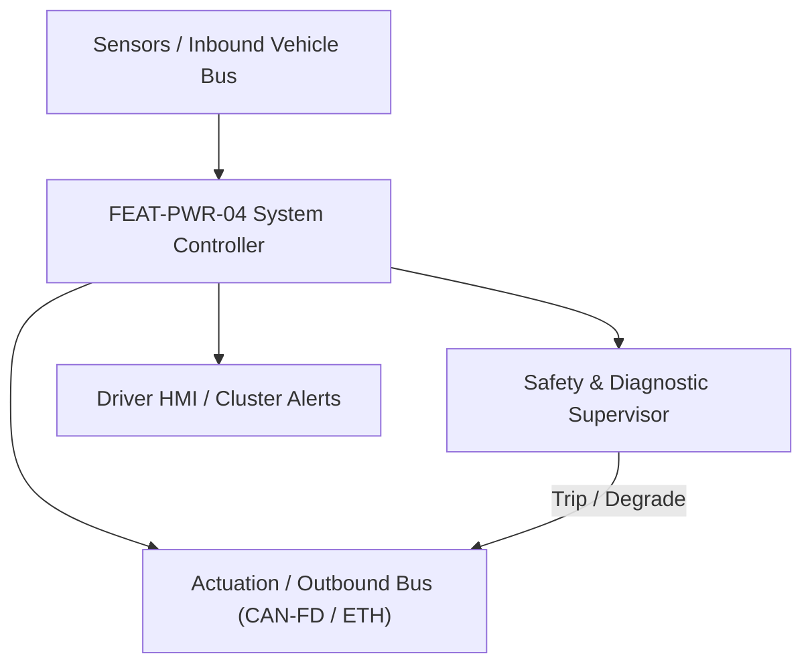
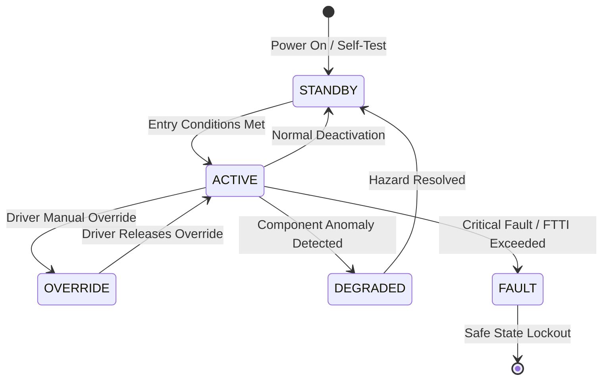

# System Requirements Specification: Thermal Management & Heat Pump System (TMS)
**Feature ID:** `FEAT-PWR-04`  
**Domain:** Electric Powertrain & Energy Management  
**Target ASIL:** ASIL B  
**Compliance Standard:** ISO 26262:2018 (Part 4 - System Development) / ASPICE PAM v3.1 (SYS.2, SYS.3)  
**Parent Master Specification:** [`spec.md`](file:///c:/Workset/AntiGravityProjects/TestOptimisationExperiement/spec.md#feat-pwr-04-tms)  
**Derived Software Specification:** [`FEAT-PWR-04_TMS_SwReq.md`](file:///c:/Workset/AntiGravityProjects/TestOptimisationExperiement/software_requirements/FEAT-PWR-04_TMS_SwReq.md)

---

## 1. Feature Overview & Operational Scope

Coordinates battery chillers, electric coolant pumps, multi-way valves, and refrigerant heat pump to optimize cabin comfort, battery temperature, and powertrain cooling.

### Operational Context Architecture

---

## 2. Activation Logic & Operational States

- **Preconditions:** 12V electrical system powered, high-voltage battery ready, ambient temperature sensors functional.
- **Entry Conditions:** Battery preconditioning request, cabin HVAC on, or component temperature exceeds thermal target.
- **Deactivation Conditions:** Ignition OFF and component temperatures within rest targets, or high-voltage crash isolation.
- **Driver Override Behavior:** Battery thermal runaway precursor temperature (> 60°C) unconditionally prioritizes 100% cooling capacity to battery pack.
- **Operational State Progression:**  
  `IDLE_OFF` -> `PASSIVE_COOLING` -> `ACTIVE_CHILLER_COOLING` -> `BATTERY_HEATING` -> `CABIN_HEAT_PUMP` -> `DEICE_CYCLE` -> `THERMAL_RUNAWAY_PURGE`

### State Transition Diagram

---

## 3. Functional Safety & Failure Mitigation Concept

- **Functional Safety Goal:** SG-TMS-01: Prevent battery pack overheating and maintain safe component temperatures during fast charging.
- **Fault Tolerant Time Interval (FTTI):** 2000 ms
- **Safe State Definition:** Open high-voltage coolant heaters; command cooling fans and water pumps to 100% maximum speed.
- **Warning & Escalation Strategy:** Display 'High Powertrain Temperature - Power Reduced' message on dashboard.

### Failure Modes & Degradation Handling
- **Coolant Pump Failure:** If primary battery pump feedback indicates stall, switch 4-way valve to cross-connect powertrain loop.
- **Refrigerant Leak:** If high-pressure refrigerant sensor detects pressure loss (< 2 bar), disable AC compressor to prevent mechanical seizure.

---

## 4. System Requirements (SYS_REQ)
*(Note: Each System Requirement is systematically partitioned into multiple Child Software Requirements)*

### `SYS-PWR-04-01`: Battery Pack Temperature Regulation & Fast-Charge Preconditioning
- **Planned Release:** R100
- **ASIL Rating:** ASIL B
- **Parent Feature:** [`FEAT-PWR-04`](file:///c:/Workset/AntiGravityProjects/TestOptimisationExperiement/spec.md#feat-pwr-04)
- **Requirement Statement:**
  > The System SHALL maintain battery cell temperatures within optimal window (20°C to 35°C during driving, 25°C to 45°C during DC fast charging) by modulating 5-way coolant valves and electric chillers at 100 ms period.
- **Activation Logic:** Active during driving and DC fast-charge sessions.
- **Fault Tolerant Time Interval (FTTI):** 1000 ms
- **Safe State Action:** Derate DC fast-charge rate if coolant temperature exceeds 45°C.
- **Failure Detection & Reaction:** If chiller expansion valve fails, command max radiator fan bypass.
- **Input Interfaces:** `Module_Temperatures[32], Ambient_Temp_C, Navigation_Target_Is_Charger, DC_Charge_Active`
- **Output Interfaces:** `Coolant_Pump_Speed_RPM, Multiway_Valve_Position_Deg, Chiller_EXV_Opening_Pct`
- **System Verification Method:** Climatic wind tunnel test from -30°C to +50°C ambient.
- **Derived Child Software Requirements (1:N Link):**
  - [`SWR-PWR-04-01`](file:///c:/Workset/AntiGravityProjects/TestOptimisationExperiement/software_requirements/FEAT-PWR-04_TMS_SwReq.md#swr-pwr-04-01)
  - [`SWR-PWR-04-02`](file:///c:/Workset/AntiGravityProjects/TestOptimisationExperiement/software_requirements/FEAT-PWR-04_TMS_SwReq.md#swr-pwr-04-02)

### `SYS-PWR-04-02`: Powertrain Inverter & Motor Waste Heat Recovery Loop
- **Planned Release:** R100
- **ASIL Rating:** ASIL B
- **Parent Feature:** [`FEAT-PWR-04`](file:///c:/Workset/AntiGravityProjects/TestOptimisationExperiement/spec.md#feat-pwr-04)
- **Requirement Statement:**
  > The System SHALL scavenge waste heat from traction motor and inverter (up to 4 kW thermal power) using refrigerant heat pump loop to heat vehicle cabin in winter environments (-20°C to +10°C).
- **Activation Logic:** Active when Ambient_Temp < 10°C and Cabin_Heating_Required == TRUE.
- **Fault Tolerant Time Interval (FTTI):** 2000 ms
- **Safe State Action:** Engage high-voltage PTC auxiliary heater if waste heat is insufficient.
- **Failure Detection & Reaction:** If heat pump loop pressure exceeds 32 bar, cycle compressor off.
- **Input Interfaces:** `Inverter_Coolant_Temp, Motor_Coolant_Temp, Cabin_Set_Temp, Ambient_Temp`
- **Output Interfaces:** `HeatPump_Compressor_Speed_RPM, PTC_Heater_Power_kW`
- **System Verification Method:** Winter cold-chamber heating efficiency (COP) measurement.
- **Derived Child Software Requirements (1:N Link):**
  - [`SWR-PWR-04-03`](file:///c:/Workset/AntiGravityProjects/TestOptimisationExperiement/software_requirements/FEAT-PWR-04_TMS_SwReq.md#swr-pwr-04-03)
  - [`SWR-PWR-04-04`](file:///c:/Workset/AntiGravityProjects/TestOptimisationExperiement/software_requirements/FEAT-PWR-04_TMS_SwReq.md#swr-pwr-04-04)

### `SYS-PWR-04-03`: Heat Pump Multi-Port Coolant Valve Position Servocontrol
- **Planned Release:** R100
- **ASIL Rating:** ASIL B
- **Parent Feature:** [`FEAT-PWR-04`](file:///c:/Workset/AntiGravityProjects/TestOptimisationExperiement/spec.md#feat-pwr-04)
- **Requirement Statement:**
  > The System SHALL Position 8-way octovalve coolant manifold stepper motors with angular accuracy +-1.5° to route thermal loops.
- **Activation Logic:** Active during normal vehicle operation when feature state is active.
- **Fault Tolerant Time Interval (FTTI):** 50 ms
- **Safe State Action:** Transition to safe state or safe degradation tier within FTTI budget.
- **Failure Detection & Reaction:** Isolate faulted channel, latch DEM diagnostic trouble code, and inform driver.
- **Input Interfaces:** `Sensor signals, vehicle dynamics data, and bus frames via RTE.`
- **Output Interfaces:** `Actuator commands, diagnostic event flags, and cluster alerts.`
- **System Verification Method:** HiL test bench and dynamometer automated verification.
- **Derived Child Software Requirements (1:N Link):**
  - [`SWR-PWR-04-05`](file:///c:/Workset/AntiGravityProjects/TestOptimisationExperiement/software_requirements/FEAT-PWR-04_TMS_SwReq.md#swr-pwr-04-05)
  - [`SWR-PWR-04-06`](file:///c:/Workset/AntiGravityProjects/TestOptimisationExperiement/software_requirements/FEAT-PWR-04_TMS_SwReq.md#swr-pwr-04-06)

### `SYS-PWR-04-04`: Electric Scroll AC Compressor High-Voltage Inverter Speed Governor
- **Planned Release:** R200
- **ASIL Rating:** ASIL B
- **Parent Feature:** [`FEAT-PWR-04`](file:///c:/Workset/AntiGravityProjects/TestOptimisationExperiement/spec.md#feat-pwr-04)
- **Requirement Statement:**
  > The System SHALL Regulate 800V electric compressor rotational speed between 800 RPM and 8500 RPM via CAN-FD setpoints.
- **Activation Logic:** Active during normal vehicle operation when feature state is active.
- **Fault Tolerant Time Interval (FTTI):** 100 ms
- **Safe State Action:** Transition to safe state or safe degradation tier within FTTI budget.
- **Failure Detection & Reaction:** Isolate faulted channel, latch DEM diagnostic trouble code, and inform driver.
- **Input Interfaces:** `Sensor signals, vehicle dynamics data, and bus frames via RTE.`
- **Output Interfaces:** `Actuator commands, diagnostic event flags, and cluster alerts.`
- **System Verification Method:** HiL test bench and dynamometer automated verification.
- **Derived Child Software Requirements (1:N Link):**
  - [`SWR-PWR-04-07`](file:///c:/Workset/AntiGravityProjects/TestOptimisationExperiement/software_requirements/FEAT-PWR-04_TMS_SwReq.md#swr-pwr-04-07)
  - [`SWR-PWR-04-08`](file:///c:/Workset/AntiGravityProjects/TestOptimisationExperiement/software_requirements/FEAT-PWR-04_TMS_SwReq.md#swr-pwr-04-08)

### `SYS-PWR-04-05`: Battery Pack Liquid Chiller Heat Exchanger Thermal Regulator
- **Planned Release:** R200
- **ASIL Rating:** ASIL B
- **Parent Feature:** [`FEAT-PWR-04`](file:///c:/Workset/AntiGravityProjects/TestOptimisationExperiement/spec.md#feat-pwr-04)
- **Requirement Statement:**
  > The System SHALL Maintain battery coolant inlet temperature within optimal 25 °C to 35 °C window during DC fast charging.
- **Activation Logic:** Active during normal vehicle operation when feature state is active.
- **Fault Tolerant Time Interval (FTTI):** 100 ms
- **Safe State Action:** Transition to safe state or safe degradation tier within FTTI budget.
- **Failure Detection & Reaction:** Isolate faulted channel, latch DEM diagnostic trouble code, and inform driver.
- **Input Interfaces:** `Sensor signals, vehicle dynamics data, and bus frames via RTE.`
- **Output Interfaces:** `Actuator commands, diagnostic event flags, and cluster alerts.`
- **System Verification Method:** HiL test bench and dynamometer automated verification.
- **Derived Child Software Requirements (1:N Link):**
  - [`SWR-PWR-04-09`](file:///c:/Workset/AntiGravityProjects/TestOptimisationExperiement/software_requirements/FEAT-PWR-04_TMS_SwReq.md#swr-pwr-04-09)
  - [`SWR-PWR-04-10`](file:///c:/Workset/AntiGravityProjects/TestOptimisationExperiement/software_requirements/FEAT-PWR-04_TMS_SwReq.md#swr-pwr-04-10)

### `SYS-PWR-04-06`: Traction Inverter & Motor Waste Heat Scavenging Recirculator
- **Planned Release:** R200
- **ASIL Rating:** ASIL B
- **Parent Feature:** [`FEAT-PWR-04`](file:///c:/Workset/AntiGravityProjects/TestOptimisationExperiement/spec.md#feat-pwr-04)
- **Requirement Statement:**
  > The System SHALL Scavenge powertrain waste heat from drive units to heat cabin during sub-zero ambient winter driving.
- **Activation Logic:** Active during normal vehicle operation when feature state is active.
- **Fault Tolerant Time Interval (FTTI):** 100 ms
- **Safe State Action:** Transition to safe state or safe degradation tier within FTTI budget.
- **Failure Detection & Reaction:** Isolate faulted channel, latch DEM diagnostic trouble code, and inform driver.
- **Input Interfaces:** `Sensor signals, vehicle dynamics data, and bus frames via RTE.`
- **Output Interfaces:** `Actuator commands, diagnostic event flags, and cluster alerts.`
- **System Verification Method:** HiL test bench and dynamometer automated verification.
- **Derived Child Software Requirements (1:N Link):**
  - [`SWR-PWR-04-11`](file:///c:/Workset/AntiGravityProjects/TestOptimisationExperiement/software_requirements/FEAT-PWR-04_TMS_SwReq.md#swr-pwr-04-11)
  - [`SWR-PWR-04-12`](file:///c:/Workset/AntiGravityProjects/TestOptimisationExperiement/software_requirements/FEAT-PWR-04_TMS_SwReq.md#swr-pwr-04-12)

### `SYS-PWR-04-07`: Cabin Evaporator Anti-Frost & Electronic Expansion Valve (EXV) Controller
- **Planned Release:** R300
- **ASIL Rating:** ASIL B
- **Parent Feature:** [`FEAT-PWR-04`](file:///c:/Workset/AntiGravityProjects/TestOptimisationExperiement/spec.md#feat-pwr-04)
- **Requirement Statement:**
  > The System SHALL Modulate EXV orifice opening via PWM to maintain superheat target (5.0 K) and prevent evaporator core freeze-up.
- **Activation Logic:** Active during normal vehicle operation when feature state is active.
- **Fault Tolerant Time Interval (FTTI):** 50 ms
- **Safe State Action:** Transition to safe state or safe degradation tier within FTTI budget.
- **Failure Detection & Reaction:** Isolate faulted channel, latch DEM diagnostic trouble code, and inform driver.
- **Input Interfaces:** `Sensor signals, vehicle dynamics data, and bus frames via RTE.`
- **Output Interfaces:** `Actuator commands, diagnostic event flags, and cluster alerts.`
- **System Verification Method:** HiL test bench and dynamometer automated verification.
- **Derived Child Software Requirements (1:N Link):**
  - [`SWR-PWR-04-13`](file:///c:/Workset/AntiGravityProjects/TestOptimisationExperiement/software_requirements/FEAT-PWR-04_TMS_SwReq.md#swr-pwr-04-13)
  - [`SWR-PWR-04-14`](file:///c:/Workset/AntiGravityProjects/TestOptimisationExperiement/software_requirements/FEAT-PWR-04_TMS_SwReq.md#swr-pwr-04-14)

### `SYS-PWR-04-08`: High-Voltage Positive Temperature Coefficient (PTC) Cabin Heater Driver
- **Planned Release:** R300
- **ASIL Rating:** ASIL B
- **Parent Feature:** [`FEAT-PWR-04`](file:///c:/Workset/AntiGravityProjects/TestOptimisationExperiement/spec.md#feat-pwr-04)
- **Requirement Statement:**
  > The System SHALL Modulate 6.0 kW HV PTC ceramic heater current using PWM power stage to deliver rapid cabin warmup.
- **Activation Logic:** Active during normal vehicle operation when feature state is active.
- **Fault Tolerant Time Interval (FTTI):** 100 ms
- **Safe State Action:** Transition to safe state or safe degradation tier within FTTI budget.
- **Failure Detection & Reaction:** Isolate faulted channel, latch DEM diagnostic trouble code, and inform driver.
- **Input Interfaces:** `Sensor signals, vehicle dynamics data, and bus frames via RTE.`
- **Output Interfaces:** `Actuator commands, diagnostic event flags, and cluster alerts.`
- **System Verification Method:** HiL test bench and dynamometer automated verification.
- **Derived Child Software Requirements (1:N Link):**
  - [`SWR-PWR-04-15`](file:///c:/Workset/AntiGravityProjects/TestOptimisationExperiement/software_requirements/FEAT-PWR-04_TMS_SwReq.md#swr-pwr-04-15)
  - [`SWR-PWR-04-16`](file:///c:/Workset/AntiGravityProjects/TestOptimisationExperiement/software_requirements/FEAT-PWR-04_TMS_SwReq.md#swr-pwr-04-16)

### `SYS-PWR-04-09`: Refrigerant Circuit High/Low Pressure Transducer Plausibility Monitor
- **Planned Release:** R300
- **ASIL Rating:** ASIL B
- **Parent Feature:** [`FEAT-PWR-04`](file:///c:/Workset/AntiGravityProjects/TestOptimisationExperiement/spec.md#feat-pwr-04)
- **Requirement Statement:**
  > The System SHALL Sample pressure transducers: Trip compressor shutdown if discharge pressure exceeds 32.0 bar.
- **Activation Logic:** Active during normal vehicle operation when feature state is active.
- **Fault Tolerant Time Interval (FTTI):** 50 ms
- **Safe State Action:** Transition to safe state or safe degradation tier within FTTI budget.
- **Failure Detection & Reaction:** Isolate faulted channel, latch DEM diagnostic trouble code, and inform driver.
- **Input Interfaces:** `Sensor signals, vehicle dynamics data, and bus frames via RTE.`
- **Output Interfaces:** `Actuator commands, diagnostic event flags, and cluster alerts.`
- **System Verification Method:** HiL test bench and dynamometer automated verification.
- **Derived Child Software Requirements (1:N Link):**
  - [`SWR-PWR-04-17`](file:///c:/Workset/AntiGravityProjects/TestOptimisationExperiement/software_requirements/FEAT-PWR-04_TMS_SwReq.md#swr-pwr-04-17)
  - [`SWR-PWR-04-18`](file:///c:/Workset/AntiGravityProjects/TestOptimisationExperiement/software_requirements/FEAT-PWR-04_TMS_SwReq.md#swr-pwr-04-18)

### `SYS-PWR-04-10`: Radiator Active Grille Shutter (AGS) Aerodynamic Drag Optimizer
- **Planned Release:** R500
- **ASIL Rating:** ASIL B
- **Parent Feature:** [`FEAT-PWR-04`](file:///c:/Workset/AntiGravityProjects/TestOptimisationExperiement/spec.md#feat-pwr-04)
- **Requirement Statement:**
  > The System SHALL Modulate motorized aerodynamic grille shutters (0% closed to 100% open) based on vehicle speed and thermal demand.
- **Activation Logic:** Active during normal vehicle operation when feature state is active.
- **Fault Tolerant Time Interval (FTTI):** 200 ms
- **Safe State Action:** Transition to safe state or safe degradation tier within FTTI budget.
- **Failure Detection & Reaction:** Isolate faulted channel, latch DEM diagnostic trouble code, and inform driver.
- **Input Interfaces:** `Sensor signals, vehicle dynamics data, and bus frames via RTE.`
- **Output Interfaces:** `Actuator commands, diagnostic event flags, and cluster alerts.`
- **System Verification Method:** HiL test bench and dynamometer automated verification.
- **Derived Child Software Requirements (1:N Link):**
  - [`SWR-PWR-04-19`](file:///c:/Workset/AntiGravityProjects/TestOptimisationExperiement/software_requirements/FEAT-PWR-04_TMS_SwReq.md#swr-pwr-04-19)
  - [`SWR-PWR-04-20`](file:///c:/Workset/AntiGravityProjects/TestOptimisationExperiement/software_requirements/FEAT-PWR-04_TMS_SwReq.md#swr-pwr-04-20)

### `SYS-PWR-04-11`: Coolant Loop Degas Reservoir Fluid Level Sensor Debouncer
- **Planned Release:** R400
- **ASIL Rating:** ASIL B
- **Parent Feature:** [`FEAT-PWR-04`](file:///c:/Workset/AntiGravityProjects/TestOptimisationExperiement/spec.md#feat-pwr-04)
- **Requirement Statement:**
  > The System SHALL Debounce reed-switch coolant level sensor to alert driver to coolant loss before pump cavitates.
- **Activation Logic:** Active during normal vehicle operation when feature state is active.
- **Fault Tolerant Time Interval (FTTI):** 500 ms
- **Safe State Action:** Transition to safe state or safe degradation tier within FTTI budget.
- **Failure Detection & Reaction:** Isolate faulted channel, latch DEM diagnostic trouble code, and inform driver.
- **Input Interfaces:** `Sensor signals, vehicle dynamics data, and bus frames via RTE.`
- **Output Interfaces:** `Actuator commands, diagnostic event flags, and cluster alerts.`
- **System Verification Method:** HiL test bench and dynamometer automated verification.
- **Derived Child Software Requirements (1:N Link):**
  - [`SWR-PWR-04-21`](file:///c:/Workset/AntiGravityProjects/TestOptimisationExperiement/software_requirements/FEAT-PWR-04_TMS_SwReq.md#swr-pwr-04-21)
  - [`SWR-PWR-04-22`](file:///c:/Workset/AntiGravityProjects/TestOptimisationExperiement/software_requirements/FEAT-PWR-04_TMS_SwReq.md#swr-pwr-04-22)

### `SYS-PWR-04-12`: Sub-Zero Ambient Battery Preconditioning Target Thermal Scheduler
- **Planned Release:** R400
- **ASIL Rating:** ASIL B
- **Parent Feature:** [`FEAT-PWR-04`](file:///c:/Workset/AntiGravityProjects/TestOptimisationExperiement/spec.md#feat-pwr-04)
- **Requirement Statement:**
  > The System SHALL Pre-heat battery pack to 30 °C prior to scheduled DC fast charging arrival using route navigation cues.
- **Activation Logic:** Active during normal vehicle operation when feature state is active.
- **Fault Tolerant Time Interval (FTTI):** 1000 ms
- **Safe State Action:** Transition to safe state or safe degradation tier within FTTI budget.
- **Failure Detection & Reaction:** Isolate faulted channel, latch DEM diagnostic trouble code, and inform driver.
- **Input Interfaces:** `Sensor signals, vehicle dynamics data, and bus frames via RTE.`
- **Output Interfaces:** `Actuator commands, diagnostic event flags, and cluster alerts.`
- **System Verification Method:** HiL test bench and dynamometer automated verification.
- **Derived Child Software Requirements (1:N Link):**
  - [`SWR-PWR-04-23`](file:///c:/Workset/AntiGravityProjects/TestOptimisationExperiement/software_requirements/FEAT-PWR-04_TMS_SwReq.md#swr-pwr-04-23)
  - [`SWR-PWR-04-24`](file:///c:/Workset/AntiGravityProjects/TestOptimisationExperiement/software_requirements/FEAT-PWR-04_TMS_SwReq.md#swr-pwr-04-24)

### `SYS-PWR-04-13`: Thermal System Sensor Diagnostic Event Management & DTC Latching
- **Planned Release:** R500
- **ASIL Rating:** ASIL B
- **Parent Feature:** [`FEAT-PWR-04`](file:///c:/Workset/AntiGravityProjects/TestOptimisationExperiement/spec.md#feat-pwr-04)
- **Requirement Statement:**
  > The System SHALL Qualify diagnostic trouble codes for refrigerant leaks, valve stiction, and temperature sensor drift.
- **Activation Logic:** Active during normal vehicle operation when feature state is active.
- **Fault Tolerant Time Interval (FTTI):** 100 ms
- **Safe State Action:** Transition to safe state or safe degradation tier within FTTI budget.
- **Failure Detection & Reaction:** Isolate faulted channel, latch DEM diagnostic trouble code, and inform driver.
- **Input Interfaces:** `Sensor signals, vehicle dynamics data, and bus frames via RTE.`
- **Output Interfaces:** `Actuator commands, diagnostic event flags, and cluster alerts.`
- **System Verification Method:** HiL test bench and dynamometer automated verification.
- **Derived Child Software Requirements (1:N Link):**
  - [`SWR-PWR-04-25`](file:///c:/Workset/AntiGravityProjects/TestOptimisationExperiement/software_requirements/FEAT-PWR-04_TMS_SwReq.md#swr-pwr-04-25)
  - [`SWR-PWR-04-26`](file:///c:/Workset/AntiGravityProjects/TestOptimisationExperiement/software_requirements/FEAT-PWR-04_TMS_SwReq.md#swr-pwr-04-26)

### `SYS-PWR-04-14`: Thermal Loop Power Budget Arbitration with Powertrain Energy Manager
- **Planned Release:** R500
- **ASIL Rating:** ASIL B
- **Parent Feature:** [`FEAT-PWR-04`](file:///c:/Workset/AntiGravityProjects/TestOptimisationExperiement/spec.md#feat-pwr-04)
- **Requirement Statement:**
  > The System SHALL Throttle thermal system electric power consumption to <= 2.5 kW during low-battery limp-home mode.
- **Activation Logic:** Active during normal vehicle operation when feature state is active.
- **Fault Tolerant Time Interval (FTTI):** 100 ms
- **Safe State Action:** Transition to safe state or safe degradation tier within FTTI budget.
- **Failure Detection & Reaction:** Isolate faulted channel, latch DEM diagnostic trouble code, and inform driver.
- **Input Interfaces:** `Sensor signals, vehicle dynamics data, and bus frames via RTE.`
- **Output Interfaces:** `Actuator commands, diagnostic event flags, and cluster alerts.`
- **System Verification Method:** HiL test bench and dynamometer automated verification.
- **Derived Child Software Requirements (1:N Link):**
  - [`SWR-PWR-04-27`](file:///c:/Workset/AntiGravityProjects/TestOptimisationExperiement/software_requirements/FEAT-PWR-04_TMS_SwReq.md#swr-pwr-04-27)
  - [`SWR-PWR-04-28`](file:///c:/Workset/AntiGravityProjects/TestOptimisationExperiement/software_requirements/FEAT-PWR-04_TMS_SwReq.md#swr-pwr-04-28)

### `SYS-PWR-04-15`: Non-Volatile Thermal System Component Operating Hours Logger
- **Planned Release:** R500
- **ASIL Rating:** ASIL B
- **Parent Feature:** [`FEAT-PWR-04`](file:///c:/Workset/AntiGravityProjects/TestOptimisationExperiement/spec.md#feat-pwr-04)
- **Requirement Statement:**
  > The System SHALL Log cumulative compressor runtime, pump cycles, and thermal duty cycles to flash memory.
- **Activation Logic:** Active during normal vehicle operation when feature state is active.
- **Fault Tolerant Time Interval (FTTI):** 5000 ms
- **Safe State Action:** Transition to safe state or safe degradation tier within FTTI budget.
- **Failure Detection & Reaction:** Isolate faulted channel, latch DEM diagnostic trouble code, and inform driver.
- **Input Interfaces:** `Sensor signals, vehicle dynamics data, and bus frames via RTE.`
- **Output Interfaces:** `Actuator commands, diagnostic event flags, and cluster alerts.`
- **System Verification Method:** HiL test bench and dynamometer automated verification.
- **Derived Child Software Requirements (1:N Link):**
  - [`SWR-PWR-04-29`](file:///c:/Workset/AntiGravityProjects/TestOptimisationExperiement/software_requirements/FEAT-PWR-04_TMS_SwReq.md#swr-pwr-04-29)
  - [`SWR-PWR-04-30`](file:///c:/Workset/AntiGravityProjects/TestOptimisationExperiement/software_requirements/FEAT-PWR-04_TMS_SwReq.md#swr-pwr-04-30)

---

## 5. System-to-Software Traceability Summary

| System Requirement ID | Planned Release | ASIL | Title | Derived Software Requirements (1:N) | Verification Method |
| :--- | :---: | :--- | :--- | :--- | :--- |
| `SYS-PWR-04-01` | **`R100`** | ASIL B | Battery Pack Temperature Regulation & Fast-Charge Preconditioning | [`SWR-PWR-04-01`](file:///c:/Workset/AntiGravityProjects/TestOptimisationExperiement/software_requirements/FEAT-PWR-04_TMS_SwReq.md#swr-pwr-04-01), [`SWR-PWR-04-02`](file:///c:/Workset/AntiGravityProjects/TestOptimisationExperiement/software_requirements/FEAT-PWR-04_TMS_SwReq.md#swr-pwr-04-02) | Climatic wind tunnel test from -30°C to +50°C ambient. |
| `SYS-PWR-04-02` | **`R100`** | ASIL B | Powertrain Inverter & Motor Waste Heat Recovery Loop | [`SWR-PWR-04-03`](file:///c:/Workset/AntiGravityProjects/TestOptimisationExperiement/software_requirements/FEAT-PWR-04_TMS_SwReq.md#swr-pwr-04-03), [`SWR-PWR-04-04`](file:///c:/Workset/AntiGravityProjects/TestOptimisationExperiement/software_requirements/FEAT-PWR-04_TMS_SwReq.md#swr-pwr-04-04) | Winter cold-chamber heating efficiency (COP) measurement. |
| `SYS-PWR-04-03` | **`R100`** | ASIL B | Heat Pump Multi-Port Coolant Valve Position Servocontrol | [`SWR-PWR-04-05`](file:///c:/Workset/AntiGravityProjects/TestOptimisationExperiement/software_requirements/FEAT-PWR-04_TMS_SwReq.md#swr-pwr-04-05), [`SWR-PWR-04-06`](file:///c:/Workset/AntiGravityProjects/TestOptimisationExperiement/software_requirements/FEAT-PWR-04_TMS_SwReq.md#swr-pwr-04-06) | HiL test bench and dynamometer automated verification. |
| `SYS-PWR-04-04` | **`R200`** | ASIL B | Electric Scroll AC Compressor High-Voltage Inverter Speed Governor | [`SWR-PWR-04-07`](file:///c:/Workset/AntiGravityProjects/TestOptimisationExperiement/software_requirements/FEAT-PWR-04_TMS_SwReq.md#swr-pwr-04-07), [`SWR-PWR-04-08`](file:///c:/Workset/AntiGravityProjects/TestOptimisationExperiement/software_requirements/FEAT-PWR-04_TMS_SwReq.md#swr-pwr-04-08) | HiL test bench and dynamometer automated verification. |
| `SYS-PWR-04-05` | **`R200`** | ASIL B | Battery Pack Liquid Chiller Heat Exchanger Thermal Regulator | [`SWR-PWR-04-09`](file:///c:/Workset/AntiGravityProjects/TestOptimisationExperiement/software_requirements/FEAT-PWR-04_TMS_SwReq.md#swr-pwr-04-09), [`SWR-PWR-04-10`](file:///c:/Workset/AntiGravityProjects/TestOptimisationExperiement/software_requirements/FEAT-PWR-04_TMS_SwReq.md#swr-pwr-04-10) | HiL test bench and dynamometer automated verification. |
| `SYS-PWR-04-06` | **`R200`** | ASIL B | Traction Inverter & Motor Waste Heat Scavenging Recirculator | [`SWR-PWR-04-11`](file:///c:/Workset/AntiGravityProjects/TestOptimisationExperiement/software_requirements/FEAT-PWR-04_TMS_SwReq.md#swr-pwr-04-11), [`SWR-PWR-04-12`](file:///c:/Workset/AntiGravityProjects/TestOptimisationExperiement/software_requirements/FEAT-PWR-04_TMS_SwReq.md#swr-pwr-04-12) | HiL test bench and dynamometer automated verification. |
| `SYS-PWR-04-07` | **`R300`** | ASIL B | Cabin Evaporator Anti-Frost & Electronic Expansion Valve (EXV) Controller | [`SWR-PWR-04-13`](file:///c:/Workset/AntiGravityProjects/TestOptimisationExperiement/software_requirements/FEAT-PWR-04_TMS_SwReq.md#swr-pwr-04-13), [`SWR-PWR-04-14`](file:///c:/Workset/AntiGravityProjects/TestOptimisationExperiement/software_requirements/FEAT-PWR-04_TMS_SwReq.md#swr-pwr-04-14) | HiL test bench and dynamometer automated verification. |
| `SYS-PWR-04-08` | **`R300`** | ASIL B | High-Voltage Positive Temperature Coefficient (PTC) Cabin Heater Driver | [`SWR-PWR-04-15`](file:///c:/Workset/AntiGravityProjects/TestOptimisationExperiement/software_requirements/FEAT-PWR-04_TMS_SwReq.md#swr-pwr-04-15), [`SWR-PWR-04-16`](file:///c:/Workset/AntiGravityProjects/TestOptimisationExperiement/software_requirements/FEAT-PWR-04_TMS_SwReq.md#swr-pwr-04-16) | HiL test bench and dynamometer automated verification. |
| `SYS-PWR-04-09` | **`R300`** | ASIL B | Refrigerant Circuit High/Low Pressure Transducer Plausibility Monitor | [`SWR-PWR-04-17`](file:///c:/Workset/AntiGravityProjects/TestOptimisationExperiement/software_requirements/FEAT-PWR-04_TMS_SwReq.md#swr-pwr-04-17), [`SWR-PWR-04-18`](file:///c:/Workset/AntiGravityProjects/TestOptimisationExperiement/software_requirements/FEAT-PWR-04_TMS_SwReq.md#swr-pwr-04-18) | HiL test bench and dynamometer automated verification. |
| `SYS-PWR-04-10` | **`R500`** | ASIL B | Radiator Active Grille Shutter (AGS) Aerodynamic Drag Optimizer | [`SWR-PWR-04-19`](file:///c:/Workset/AntiGravityProjects/TestOptimisationExperiement/software_requirements/FEAT-PWR-04_TMS_SwReq.md#swr-pwr-04-19), [`SWR-PWR-04-20`](file:///c:/Workset/AntiGravityProjects/TestOptimisationExperiement/software_requirements/FEAT-PWR-04_TMS_SwReq.md#swr-pwr-04-20) | HiL test bench and dynamometer automated verification. |
| `SYS-PWR-04-11` | **`R400`** | ASIL B | Coolant Loop Degas Reservoir Fluid Level Sensor Debouncer | [`SWR-PWR-04-21`](file:///c:/Workset/AntiGravityProjects/TestOptimisationExperiement/software_requirements/FEAT-PWR-04_TMS_SwReq.md#swr-pwr-04-21), [`SWR-PWR-04-22`](file:///c:/Workset/AntiGravityProjects/TestOptimisationExperiement/software_requirements/FEAT-PWR-04_TMS_SwReq.md#swr-pwr-04-22) | HiL test bench and dynamometer automated verification. |
| `SYS-PWR-04-12` | **`R400`** | ASIL B | Sub-Zero Ambient Battery Preconditioning Target Thermal Scheduler | [`SWR-PWR-04-23`](file:///c:/Workset/AntiGravityProjects/TestOptimisationExperiement/software_requirements/FEAT-PWR-04_TMS_SwReq.md#swr-pwr-04-23), [`SWR-PWR-04-24`](file:///c:/Workset/AntiGravityProjects/TestOptimisationExperiement/software_requirements/FEAT-PWR-04_TMS_SwReq.md#swr-pwr-04-24) | HiL test bench and dynamometer automated verification. |
| `SYS-PWR-04-13` | **`R500`** | ASIL B | Thermal System Sensor Diagnostic Event Management & DTC Latching | [`SWR-PWR-04-25`](file:///c:/Workset/AntiGravityProjects/TestOptimisationExperiement/software_requirements/FEAT-PWR-04_TMS_SwReq.md#swr-pwr-04-25), [`SWR-PWR-04-26`](file:///c:/Workset/AntiGravityProjects/TestOptimisationExperiement/software_requirements/FEAT-PWR-04_TMS_SwReq.md#swr-pwr-04-26) | HiL test bench and dynamometer automated verification. |
| `SYS-PWR-04-14` | **`R500`** | ASIL B | Thermal Loop Power Budget Arbitration with Powertrain Energy Manager | [`SWR-PWR-04-27`](file:///c:/Workset/AntiGravityProjects/TestOptimisationExperiement/software_requirements/FEAT-PWR-04_TMS_SwReq.md#swr-pwr-04-27), [`SWR-PWR-04-28`](file:///c:/Workset/AntiGravityProjects/TestOptimisationExperiement/software_requirements/FEAT-PWR-04_TMS_SwReq.md#swr-pwr-04-28) | HiL test bench and dynamometer automated verification. |
| `SYS-PWR-04-15` | **`R500`** | ASIL B | Non-Volatile Thermal System Component Operating Hours Logger | [`SWR-PWR-04-29`](file:///c:/Workset/AntiGravityProjects/TestOptimisationExperiement/software_requirements/FEAT-PWR-04_TMS_SwReq.md#swr-pwr-04-29), [`SWR-PWR-04-30`](file:///c:/Workset/AntiGravityProjects/TestOptimisationExperiement/software_requirements/FEAT-PWR-04_TMS_SwReq.md#swr-pwr-04-30) | HiL test bench and dynamometer automated verification. |

- **Upstream Feature Link:** [`spec.md` (FEAT-PWR-04)](file:///c:/Workset/AntiGravityProjects/TestOptimisationExperiement/spec.md#feat-pwr-04)
- **Software Requirements Specification:** [`FEAT-PWR-04_TMS_SwReq.md`](file:///c:/Workset/AntiGravityProjects/TestOptimisationExperiement/software_requirements/FEAT-PWR-04_TMS_SwReq.md)
