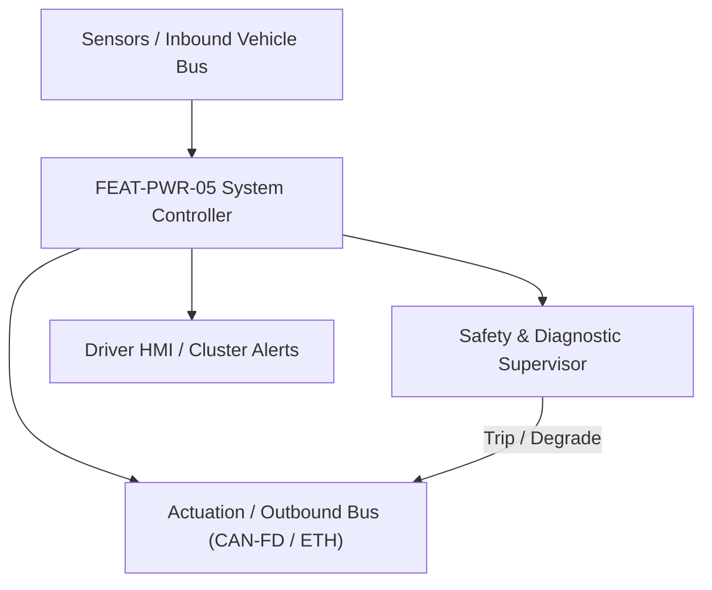
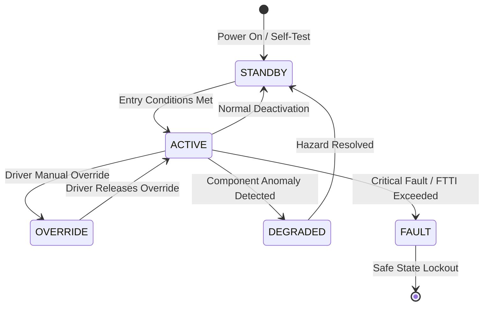

# System Requirements Specification: On-Board Charger & DC Fast Charging System (OBC-DCFC)
**Feature ID:** `FEAT-PWR-05`  
**Domain:** Electric Powertrain & Energy Management  
**Target ASIL:** ASIL C  
**Compliance Standard:** ISO 26262:2018 (Part 4 - System Development) / ASPICE PAM v3.1 (SYS.2, SYS.3)  
**Parent Master Specification:** [`spec.md`](file:///c:/Workset/AntiGravityProjects/TestOptimisationExperiement/spec.md#feat-pwr-05-obc)  
**Derived Software Specification:** [`FEAT-PWR-05_OBC_SwReq.md`](file:///c:/Workset/AntiGravityProjects/TestOptimisationExperiement/software_requirements/FEAT-PWR-05_OBC_SwReq.md)

---

## 1. Feature Overview & Operational Scope

Controls AC Level 2 charging via 11 kW/22 kW on-board converter, communicates with DC fast chargers via ISO 15118 (Plug & Charge), and manages inlet lock actuators.

### Operational Context Architecture

---

## 2. Activation Logic & Operational States

- **Preconditions:** Vehicle parked in PARK, charging inlet door opened, charging cable plugged in.
- **Entry Conditions:** Control Pilot (CP) signal detected; Proximity Pilot (PP) resistance validated; authentication handshake completed.
- **Deactivation Conditions:** User commands stop via app, connector unlocked, battery reaches 100% target, or ground fault detected.
- **Driver Override Behavior:** Emergency charge stop button or mechanical emergency release cable immediately halts charging and opens contactors in < 10 ms.
- **Operational State Progression:**  
  `UNPLUGGED` -> `CABLE_CONNECTED` -> `PILOT_NEGOTIATION` -> `AUTHENTICATION_ISO15118` -> `PRECHARGE` -> `FAST_CHARGING` -> `CHARGE_COMPLETE` -> `FAULT_TERMINATION`

### State Transition Diagram

---

## 3. Functional Safety & Failure Mitigation Concept

- **Functional Safety Goal:** SG-OBC-01: Prevent electrical shock, vehicle drive-away with cable plugged in, and high-voltage DC arcing during disconnect.
- **Fault Tolerant Time Interval (FTTI):** 20 ms for ground fault; 100 ms for pilot disconnect.
- **Safe State Definition:** Open high-voltage charging contactors; lock vehicle immobilizer in PARK.
- **Warning & Escalation Strategy:** Charging LED indicator at charge port: Green (pulsing: charging), Solid (complete), Red (fault).

### Failure Modes & Degradation Handling
- **Inlet Overtemperature:** If charge port terminal temp reaches 90°C, derate charge current by 50%; if > 100°C, terminate charging immediately.
- **Pilot Signal Loss:** If Control Pilot duty cycle is lost during fast charging, command DC charger current to 0 A in < 50 ms.

---

## 4. System Requirements (SYS_REQ)
*(Note: Each System Requirement is systematically partitioned into multiple Child Software Requirements)*

### `SYS-PWR-05-01`: Control Pilot & Proximity Pilot State Evaluation (IEC 61851 / SAE J1772)
- **Planned Release:** R100
- **ASIL Rating:** ASIL C
- **Parent Feature:** [`FEAT-PWR-05`](file:///c:/Workset/AntiGravityProjects/TestOptimisationExperiement/spec.md#feat-pwr-05)
- **Requirement Statement:**
  > The System SHALL sample Control Pilot (CP +-12V PWM) duty cycle and Proximity Pilot (PP) resistance at <= 5 ms period, deriving maximum available grid current (6A to 80A) and verifying cable latch engagement.
- **Activation Logic:** Active at all times when charge cable is plugged in.
- **Fault Tolerant Time Interval (FTTI):** 20 ms
- **Safe State Action:** De-energize on-board charger power stages if CP voltage drops from State C to State A/B.
- **Failure Detection & Reaction:** If inlet latch motor fails to lock, disallow charging to prevent hot disconnect arcing.
- **Input Interfaces:** `CP_Voltage_Level_V, CP_PWM_Duty_Cycle_Pct, PP_Resistance_Ohms, Inlet_Lock_Feedback`
- **Output Interfaces:** `Max_Grid_Current_Limit_A, Charging_Cable_State_Enum, Inlet_Lock_Motor_Cmd`
- **System Verification Method:** Automated charging test stand (Comemso) verifying IEC 61851 compliance.
- **Derived Child Software Requirements (1:N Link):**
  - [`SWR-PWR-05-01`](file:///c:/Workset/AntiGravityProjects/TestOptimisationExperiement/software_requirements/FEAT-PWR-05_OBC_SwReq.md#swr-pwr-05-01)
  - [`SWR-PWR-05-02`](file:///c:/Workset/AntiGravityProjects/TestOptimisationExperiement/software_requirements/FEAT-PWR-05_OBC_SwReq.md#swr-pwr-05-02)

### `SYS-PWR-05-02`: ISO 15118 High-Level Communication & Plug & Charge Handshake
- **Planned Release:** R100
- **ASIL Rating:** ASIL B / ISO 21434
- **Parent Feature:** [`FEAT-PWR-05`](file:///c:/Workset/AntiGravityProjects/TestOptimisationExperiement/spec.md#feat-pwr-05)
- **Requirement Statement:**
  > The System SHALL negotiate charging parameters with external DC fast chargers via HomePlug Green PHY Power-Line Communication (PLC) using ISO 15118-2/20 protocols, supporting TLS 1.3 cryptographic authentication within <= 5.0 seconds.
- **Activation Logic:** Active upon CCS DC fast-charging plug insertion.
- **Fault Tolerant Time Interval (FTTI):** 500 ms
- **Safe State Action:** Terminate session; open charging contactors.
- **Failure Detection & Reaction:** If certificate validation fails, display 'Authentication Error' on central screen.
- **Input Interfaces:** `PLC_Ethernet_Packets, Contract_Certificate (HSM Key Store), BMS_Max_Voltage_V`
- **Output Interfaces:** `Target_Charge_Voltage_V, Target_Charge_Current_A, Session_Authenticated_Flag`
- **System Verification Method:** Interoperability conformance testing against multiple DC charger vendors.
- **Derived Child Software Requirements (1:N Link):**
  - [`SWR-PWR-05-03`](file:///c:/Workset/AntiGravityProjects/TestOptimisationExperiement/software_requirements/FEAT-PWR-05_OBC_SwReq.md#swr-pwr-05-03)
  - [`SWR-PWR-05-04`](file:///c:/Workset/AntiGravityProjects/TestOptimisationExperiement/software_requirements/FEAT-PWR-05_OBC_SwReq.md#swr-pwr-05-04)

### `SYS-PWR-05-03`: AC Grid L1/L2/L3 Voltage & Phase Angle Phase-Locked Loop (PLL) Tracker
- **Planned Release:** R100
- **ASIL Rating:** ASIL C
- **Parent Feature:** [`FEAT-PWR-05`](file:///c:/Workset/AntiGravityProjects/TestOptimisationExperiement/spec.md#feat-pwr-05)
- **Requirement Statement:**
  > The System SHALL Synchronize on-board charger active power factor correction (PFC) bridge with grid AC line frequency (50/60 Hz).
- **Activation Logic:** Active during normal vehicle operation when feature state is active.
- **Fault Tolerant Time Interval (FTTI):** 1 ms
- **Safe State Action:** Transition to safe state or safe degradation tier within FTTI budget.
- **Failure Detection & Reaction:** Isolate faulted channel, latch DEM diagnostic trouble code, and inform driver.
- **Input Interfaces:** `Sensor signals, vehicle dynamics data, and bus frames via RTE.`
- **Output Interfaces:** `Actuator commands, diagnostic event flags, and cluster alerts.`
- **System Verification Method:** HiL test bench and dynamometer automated verification.
- **Derived Child Software Requirements (1:N Link):**
  - [`SWR-PWR-05-05`](file:///c:/Workset/AntiGravityProjects/TestOptimisationExperiement/software_requirements/FEAT-PWR-05_OBC_SwReq.md#swr-pwr-05-05)
  - [`SWR-PWR-05-06`](file:///c:/Workset/AntiGravityProjects/TestOptimisationExperiement/software_requirements/FEAT-PWR-05_OBC_SwReq.md#swr-pwr-05-06)

### `SYS-PWR-05-04`: On-Board Charger Bidirectional PFC Bridge PWM Space Vector Modulator
- **Planned Release:** R200
- **ASIL Rating:** ASIL C
- **Parent Feature:** [`FEAT-PWR-05`](file:///c:/Workset/AntiGravityProjects/TestOptimisationExperiement/spec.md#feat-pwr-05)
- **Requirement Statement:**
  > The System SHALL Regulate AC mains current to achieve unity power factor (PF > 0.99) and THD < 3.0% at up to 22 kW AC charge.
- **Activation Logic:** Active during normal vehicle operation when feature state is active.
- **Fault Tolerant Time Interval (FTTI):** 1 ms
- **Safe State Action:** Transition to safe state or safe degradation tier within FTTI budget.
- **Failure Detection & Reaction:** Isolate faulted channel, latch DEM diagnostic trouble code, and inform driver.
- **Input Interfaces:** `Sensor signals, vehicle dynamics data, and bus frames via RTE.`
- **Output Interfaces:** `Actuator commands, diagnostic event flags, and cluster alerts.`
- **System Verification Method:** HiL test bench and dynamometer automated verification.
- **Derived Child Software Requirements (1:N Link):**
  - [`SWR-PWR-05-07`](file:///c:/Workset/AntiGravityProjects/TestOptimisationExperiement/software_requirements/FEAT-PWR-05_OBC_SwReq.md#swr-pwr-05-07)
  - [`SWR-PWR-05-08`](file:///c:/Workset/AntiGravityProjects/TestOptimisationExperiement/software_requirements/FEAT-PWR-05_OBC_SwReq.md#swr-pwr-05-08)

### `SYS-PWR-05-05`: Galvanic Isolated LLC Resonant DC-DC Converter Secondary Rectifier
- **Planned Release:** R200
- **ASIL Rating:** ASIL C
- **Parent Feature:** [`FEAT-PWR-05`](file:///c:/Workset/AntiGravityProjects/TestOptimisationExperiement/spec.md#feat-pwr-05)
- **Requirement Statement:**
  > The System SHALL Control high-frequency resonant LLC converter switching frequency (100-250 kHz) to step DC voltage to battery.
- **Activation Logic:** Active during normal vehicle operation when feature state is active.
- **Fault Tolerant Time Interval (FTTI):** 1 ms
- **Safe State Action:** Transition to safe state or safe degradation tier within FTTI budget.
- **Failure Detection & Reaction:** Isolate faulted channel, latch DEM diagnostic trouble code, and inform driver.
- **Input Interfaces:** `Sensor signals, vehicle dynamics data, and bus frames via RTE.`
- **Output Interfaces:** `Actuator commands, diagnostic event flags, and cluster alerts.`
- **System Verification Method:** HiL test bench and dynamometer automated verification.
- **Derived Child Software Requirements (1:N Link):**
  - [`SWR-PWR-05-09`](file:///c:/Workset/AntiGravityProjects/TestOptimisationExperiement/software_requirements/FEAT-PWR-05_OBC_SwReq.md#swr-pwr-05-09)
  - [`SWR-PWR-05-10`](file:///c:/Workset/AntiGravityProjects/TestOptimisationExperiement/software_requirements/FEAT-PWR-05_OBC_SwReq.md#swr-pwr-05-10)

### `SYS-PWR-05-06`: DC Fast Charging Combined Charging System (CCS2) ISO 15118 Protocol Handler
- **Planned Release:** R200
- **ASIL Rating:** ASIL C
- **Parent Feature:** [`FEAT-PWR-05`](file:///c:/Workset/AntiGravityProjects/TestOptimisationExperiement/spec.md#feat-pwr-05)
- **Requirement Statement:**
  > The System SHALL Execute HomePlug Green PHY high-level communication, session setup, and TLS certificate exchange.
- **Activation Logic:** Active during normal vehicle operation when feature state is active.
- **Fault Tolerant Time Interval (FTTI):** 20 ms
- **Safe State Action:** Transition to safe state or safe degradation tier within FTTI budget.
- **Failure Detection & Reaction:** Isolate faulted channel, latch DEM diagnostic trouble code, and inform driver.
- **Input Interfaces:** `Sensor signals, vehicle dynamics data, and bus frames via RTE.`
- **Output Interfaces:** `Actuator commands, diagnostic event flags, and cluster alerts.`
- **System Verification Method:** HiL test bench and dynamometer automated verification.
- **Derived Child Software Requirements (1:N Link):**
  - [`SWR-PWR-05-11`](file:///c:/Workset/AntiGravityProjects/TestOptimisationExperiement/software_requirements/FEAT-PWR-05_OBC_SwReq.md#swr-pwr-05-11)
  - [`SWR-PWR-05-12`](file:///c:/Workset/AntiGravityProjects/TestOptimisationExperiement/software_requirements/FEAT-PWR-05_OBC_SwReq.md#swr-pwr-05-12)

### `SYS-PWR-05-07`: DIN 70121 & ISO 15118 DC Fast Charge Current Setpoint Negotiator
- **Planned Release:** R300
- **ASIL Rating:** ASIL C
- **Parent Feature:** [`FEAT-PWR-05`](file:///c:/Workset/AntiGravityProjects/TestOptimisationExperiement/spec.md#feat-pwr-05)
- **Requirement Statement:**
  > The System SHALL Transmit real-time battery maximum voltage and current limits to external DC charger every 50 ms.
- **Activation Logic:** Active during normal vehicle operation when feature state is active.
- **Fault Tolerant Time Interval (FTTI):** 20 ms
- **Safe State Action:** Transition to safe state or safe degradation tier within FTTI budget.
- **Failure Detection & Reaction:** Isolate faulted channel, latch DEM diagnostic trouble code, and inform driver.
- **Input Interfaces:** `Sensor signals, vehicle dynamics data, and bus frames via RTE.`
- **Output Interfaces:** `Actuator commands, diagnostic event flags, and cluster alerts.`
- **System Verification Method:** HiL test bench and dynamometer automated verification.
- **Derived Child Software Requirements (1:N Link):**
  - [`SWR-PWR-05-13`](file:///c:/Workset/AntiGravityProjects/TestOptimisationExperiement/software_requirements/FEAT-PWR-05_OBC_SwReq.md#swr-pwr-05-13)
  - [`SWR-PWR-05-14`](file:///c:/Workset/AntiGravityProjects/TestOptimisationExperiement/software_requirements/FEAT-PWR-05_OBC_SwReq.md#swr-pwr-05-14)

### `SYS-PWR-05-08`: Charging Inlet Mechanical Locking Pin Actuator & Microswitch Interlock
- **Planned Release:** R300
- **ASIL Rating:** ASIL C
- **Parent Feature:** [`FEAT-PWR-05`](file:///c:/Workset/AntiGravityProjects/TestOptimisationExperiement/spec.md#feat-pwr-05)
- **Requirement Statement:**
  > The System SHALL Drive solenoid lock pin to lock charging plug into vehicle inlet; confirm lock engagement before high-voltage flow.
- **Activation Logic:** Active during normal vehicle operation when feature state is active.
- **Fault Tolerant Time Interval (FTTI):** 50 ms
- **Safe State Action:** Transition to safe state or safe degradation tier within FTTI budget.
- **Failure Detection & Reaction:** Isolate faulted channel, latch DEM diagnostic trouble code, and inform driver.
- **Input Interfaces:** `Sensor signals, vehicle dynamics data, and bus frames via RTE.`
- **Output Interfaces:** `Actuator commands, diagnostic event flags, and cluster alerts.`
- **System Verification Method:** HiL test bench and dynamometer automated verification.
- **Derived Child Software Requirements (1:N Link):**
  - [`SWR-PWR-05-15`](file:///c:/Workset/AntiGravityProjects/TestOptimisationExperiement/software_requirements/FEAT-PWR-05_OBC_SwReq.md#swr-pwr-05-15)
  - [`SWR-PWR-05-16`](file:///c:/Workset/AntiGravityProjects/TestOptimisationExperiement/software_requirements/FEAT-PWR-05_OBC_SwReq.md#swr-pwr-05-16)

### `SYS-PWR-05-09`: Control Pilot (CP) PWM Duty Cycle Decoder & Proximity Pilot (PP) Sensor
- **Planned Release:** R300
- **ASIL Rating:** ASIL C
- **Parent Feature:** [`FEAT-PWR-05`](file:///c:/Workset/AntiGravityProjects/TestOptimisationExperiement/spec.md#feat-pwr-05)
- **Requirement Statement:**
  > The System SHALL Measure CP 1 kHz PWM duty cycle to decode grid EVSE current capacity (e.g. 16A, 32A) and detect cord uncoupling.
- **Activation Logic:** Active during normal vehicle operation when feature state is active.
- **Fault Tolerant Time Interval (FTTI):** 10 ms
- **Safe State Action:** Transition to safe state or safe degradation tier within FTTI budget.
- **Failure Detection & Reaction:** Isolate faulted channel, latch DEM diagnostic trouble code, and inform driver.
- **Input Interfaces:** `Sensor signals, vehicle dynamics data, and bus frames via RTE.`
- **Output Interfaces:** `Actuator commands, diagnostic event flags, and cluster alerts.`
- **System Verification Method:** HiL test bench and dynamometer automated verification.
- **Derived Child Software Requirements (1:N Link):**
  - [`SWR-PWR-05-17`](file:///c:/Workset/AntiGravityProjects/TestOptimisationExperiement/software_requirements/FEAT-PWR-05_OBC_SwReq.md#swr-pwr-05-17)
  - [`SWR-PWR-05-18`](file:///c:/Workset/AntiGravityProjects/TestOptimisationExperiement/software_requirements/FEAT-PWR-05_OBC_SwReq.md#swr-pwr-05-18)

### `SYS-PWR-05-10`: DC Fast Charge Inlet Dual Thermocouple Over-Temperature Monitor
- **Planned Release:** R400
- **ASIL Rating:** ASIL C
- **Parent Feature:** [`FEAT-PWR-05`](file:///c:/Workset/AntiGravityProjects/TestOptimisationExperiement/spec.md#feat-pwr-05)
- **Requirement Statement:**
  > The System SHALL Monitor DC+ and DC- pin temperatures: Throttle charge current if pin temperature exceeds 90 °C; cut at 105 °C.
- **Activation Logic:** Active during normal vehicle operation when feature state is active.
- **Fault Tolerant Time Interval (FTTI):** 50 ms
- **Safe State Action:** Transition to safe state or safe degradation tier within FTTI budget.
- **Failure Detection & Reaction:** Isolate faulted channel, latch DEM diagnostic trouble code, and inform driver.
- **Input Interfaces:** `Sensor signals, vehicle dynamics data, and bus frames via RTE.`
- **Output Interfaces:** `Actuator commands, diagnostic event flags, and cluster alerts.`
- **System Verification Method:** HiL test bench and dynamometer automated verification.
- **Derived Child Software Requirements (1:N Link):**
  - [`SWR-PWR-05-19`](file:///c:/Workset/AntiGravityProjects/TestOptimisationExperiement/software_requirements/FEAT-PWR-05_OBC_SwReq.md#swr-pwr-05-19)
  - [`SWR-PWR-05-20`](file:///c:/Workset/AntiGravityProjects/TestOptimisationExperiement/software_requirements/FEAT-PWR-05_OBC_SwReq.md#swr-pwr-05-20)

### `SYS-PWR-05-11`: HV DC Fast Charge Pre-Charge Contactor Sequencing & Inrush Limiter
- **Planned Release:** R400
- **ASIL Rating:** ASIL D
- **Parent Feature:** [`FEAT-PWR-05`](file:///c:/Workset/AntiGravityProjects/TestOptimisationExperiement/spec.md#feat-pwr-05)
- **Requirement Statement:**
  > The System SHALL Close pre-charge circuit to match off-board charger DC voltage within +-10V of battery pack before main contactors.
- **Activation Logic:** Active during normal vehicle operation when feature state is active.
- **Fault Tolerant Time Interval (FTTI):** 10 ms
- **Safe State Action:** Transition to safe state or safe degradation tier within FTTI budget.
- **Failure Detection & Reaction:** Isolate faulted channel, latch DEM diagnostic trouble code, and inform driver.
- **Input Interfaces:** `Sensor signals, vehicle dynamics data, and bus frames via RTE.`
- **Output Interfaces:** `Actuator commands, diagnostic event flags, and cluster alerts.`
- **System Verification Method:** HiL test bench and dynamometer automated verification.
- **Derived Child Software Requirements (1:N Link):**
  - [`SWR-PWR-05-21`](file:///c:/Workset/AntiGravityProjects/TestOptimisationExperiement/software_requirements/FEAT-PWR-05_OBC_SwReq.md#swr-pwr-05-21)
  - [`SWR-PWR-05-22`](file:///c:/Workset/AntiGravityProjects/TestOptimisationExperiement/software_requirements/FEAT-PWR-05_OBC_SwReq.md#swr-pwr-05-22)

### `SYS-PWR-05-12`: AC/DC Residual Current Detection (RCD Type B) Earth Leakage Trip
- **Planned Release:** R400
- **ASIL Rating:** ASIL C
- **Parent Feature:** [`FEAT-PWR-05`](file:///c:/Workset/AntiGravityProjects/TestOptimisationExperiement/spec.md#feat-pwr-05)
- **Requirement Statement:**
  > The System SHALL Hardware leakage sensor trips charging contactors within <= 20 ms if DC leakage current > 6 mA or AC > 30 mA.
- **Activation Logic:** Active during normal vehicle operation when feature state is active.
- **Fault Tolerant Time Interval (FTTI):** 5 ms
- **Safe State Action:** Transition to safe state or safe degradation tier within FTTI budget.
- **Failure Detection & Reaction:** Isolate faulted channel, latch DEM diagnostic trouble code, and inform driver.
- **Input Interfaces:** `Sensor signals, vehicle dynamics data, and bus frames via RTE.`
- **Output Interfaces:** `Actuator commands, diagnostic event flags, and cluster alerts.`
- **System Verification Method:** HiL test bench and dynamometer automated verification.
- **Derived Child Software Requirements (1:N Link):**
  - [`SWR-PWR-05-23`](file:///c:/Workset/AntiGravityProjects/TestOptimisationExperiement/software_requirements/FEAT-PWR-05_OBC_SwReq.md#swr-pwr-05-23)
  - [`SWR-PWR-05-24`](file:///c:/Workset/AntiGravityProjects/TestOptimisationExperiement/software_requirements/FEAT-PWR-05_OBC_SwReq.md#swr-pwr-05-24)

### `SYS-PWR-05-13`: Charging System Emergency Stop Remote E-Trip Signal Supervisor
- **Planned Release:** R500
- **ASIL Rating:** ASIL D
- **Parent Feature:** [`FEAT-PWR-05`](file:///c:/Workset/AntiGravityProjects/TestOptimisationExperiement/spec.md#feat-pwr-05)
- **Requirement Statement:**
  > The System SHALL De-energize main charging contactors in <= 10 ms upon emergency stop button push or EVSE disconnect.
- **Activation Logic:** Active during normal vehicle operation when feature state is active.
- **Fault Tolerant Time Interval (FTTI):** 10 ms
- **Safe State Action:** Transition to safe state or safe degradation tier within FTTI budget.
- **Failure Detection & Reaction:** Isolate faulted channel, latch DEM diagnostic trouble code, and inform driver.
- **Input Interfaces:** `Sensor signals, vehicle dynamics data, and bus frames via RTE.`
- **Output Interfaces:** `Actuator commands, diagnostic event flags, and cluster alerts.`
- **System Verification Method:** HiL test bench and dynamometer automated verification.
- **Derived Child Software Requirements (1:N Link):**
  - [`SWR-PWR-05-25`](file:///c:/Workset/AntiGravityProjects/TestOptimisationExperiement/software_requirements/FEAT-PWR-05_OBC_SwReq.md#swr-pwr-05-25)
  - [`SWR-PWR-05-26`](file:///c:/Workset/AntiGravityProjects/TestOptimisationExperiement/software_requirements/FEAT-PWR-05_OBC_SwReq.md#swr-pwr-05-26)

### `SYS-PWR-05-14`: DEM Charging Session Diagnostic Event Manager & Error Logger
- **Planned Release:** R500
- **ASIL Rating:** ASIL B
- **Parent Feature:** [`FEAT-PWR-05`](file:///c:/Workset/AntiGravityProjects/TestOptimisationExperiement/spec.md#feat-pwr-05)
- **Requirement Statement:**
  > The System SHALL Log diagnostic fault codes for pilot anomalies, insulation breakdown, and communication timeouts.
- **Activation Logic:** Active during normal vehicle operation when feature state is active.
- **Fault Tolerant Time Interval (FTTI):** 50 ms
- **Safe State Action:** Transition to safe state or safe degradation tier within FTTI budget.
- **Failure Detection & Reaction:** Isolate faulted channel, latch DEM diagnostic trouble code, and inform driver.
- **Input Interfaces:** `Sensor signals, vehicle dynamics data, and bus frames via RTE.`
- **Output Interfaces:** `Actuator commands, diagnostic event flags, and cluster alerts.`
- **System Verification Method:** HiL test bench and dynamometer automated verification.
- **Derived Child Software Requirements (1:N Link):**
  - [`SWR-PWR-05-27`](file:///c:/Workset/AntiGravityProjects/TestOptimisationExperiement/software_requirements/FEAT-PWR-05_OBC_SwReq.md#swr-pwr-05-27)
  - [`SWR-PWR-05-28`](file:///c:/Workset/AntiGravityProjects/TestOptimisationExperiement/software_requirements/FEAT-PWR-05_OBC_SwReq.md#swr-pwr-05-28)

### `SYS-PWR-05-15`: Non-Volatile Charging Energy Metering & Battery Degradation Profiler
- **Planned Release:** R500
- **ASIL Rating:** ASIL B
- **Parent Feature:** [`FEAT-PWR-05`](file:///c:/Workset/AntiGravityProjects/TestOptimisationExperiement/spec.md#feat-pwr-05)
- **Requirement Statement:**
  > The System SHALL Record revenue-grade energy ingestion (kWh) and charging history profiles in secure storage.
- **Activation Logic:** Active during normal vehicle operation when feature state is active.
- **Fault Tolerant Time Interval (FTTI):** 1000 ms
- **Safe State Action:** Transition to safe state or safe degradation tier within FTTI budget.
- **Failure Detection & Reaction:** Isolate faulted channel, latch DEM diagnostic trouble code, and inform driver.
- **Input Interfaces:** `Sensor signals, vehicle dynamics data, and bus frames via RTE.`
- **Output Interfaces:** `Actuator commands, diagnostic event flags, and cluster alerts.`
- **System Verification Method:** HiL test bench and dynamometer automated verification.
- **Derived Child Software Requirements (1:N Link):**
  - [`SWR-PWR-05-29`](file:///c:/Workset/AntiGravityProjects/TestOptimisationExperiement/software_requirements/FEAT-PWR-05_OBC_SwReq.md#swr-pwr-05-29)
  - [`SWR-PWR-05-30`](file:///c:/Workset/AntiGravityProjects/TestOptimisationExperiement/software_requirements/FEAT-PWR-05_OBC_SwReq.md#swr-pwr-05-30)

---

## 5. System-to-Software Traceability Summary

| System Requirement ID | Planned Release | ASIL | Title | Derived Software Requirements (1:N) | Verification Method |
| :--- | :---: | :--- | :--- | :--- | :--- |
| `SYS-PWR-05-01` | **`R100`** | ASIL C | Control Pilot & Proximity Pilot State Evaluation (IEC 61851 / SAE J1772) | [`SWR-PWR-05-01`](file:///c:/Workset/AntiGravityProjects/TestOptimisationExperiement/software_requirements/FEAT-PWR-05_OBC_SwReq.md#swr-pwr-05-01), [`SWR-PWR-05-02`](file:///c:/Workset/AntiGravityProjects/TestOptimisationExperiement/software_requirements/FEAT-PWR-05_OBC_SwReq.md#swr-pwr-05-02) | Automated charging test stand (Comemso) verifying IEC 61851 compliance. |
| `SYS-PWR-05-02` | **`R100`** | ASIL B / ISO 21434 | ISO 15118 High-Level Communication & Plug & Charge Handshake | [`SWR-PWR-05-03`](file:///c:/Workset/AntiGravityProjects/TestOptimisationExperiement/software_requirements/FEAT-PWR-05_OBC_SwReq.md#swr-pwr-05-03), [`SWR-PWR-05-04`](file:///c:/Workset/AntiGravityProjects/TestOptimisationExperiement/software_requirements/FEAT-PWR-05_OBC_SwReq.md#swr-pwr-05-04) | Interoperability conformance testing against multiple DC charger vendors. |
| `SYS-PWR-05-03` | **`R100`** | ASIL C | AC Grid L1/L2/L3 Voltage & Phase Angle Phase-Locked Loop (PLL) Tracker | [`SWR-PWR-05-05`](file:///c:/Workset/AntiGravityProjects/TestOptimisationExperiement/software_requirements/FEAT-PWR-05_OBC_SwReq.md#swr-pwr-05-05), [`SWR-PWR-05-06`](file:///c:/Workset/AntiGravityProjects/TestOptimisationExperiement/software_requirements/FEAT-PWR-05_OBC_SwReq.md#swr-pwr-05-06) | HiL test bench and dynamometer automated verification. |
| `SYS-PWR-05-04` | **`R200`** | ASIL C | On-Board Charger Bidirectional PFC Bridge PWM Space Vector Modulator | [`SWR-PWR-05-07`](file:///c:/Workset/AntiGravityProjects/TestOptimisationExperiement/software_requirements/FEAT-PWR-05_OBC_SwReq.md#swr-pwr-05-07), [`SWR-PWR-05-08`](file:///c:/Workset/AntiGravityProjects/TestOptimisationExperiement/software_requirements/FEAT-PWR-05_OBC_SwReq.md#swr-pwr-05-08) | HiL test bench and dynamometer automated verification. |
| `SYS-PWR-05-05` | **`R200`** | ASIL C | Galvanic Isolated LLC Resonant DC-DC Converter Secondary Rectifier | [`SWR-PWR-05-09`](file:///c:/Workset/AntiGravityProjects/TestOptimisationExperiement/software_requirements/FEAT-PWR-05_OBC_SwReq.md#swr-pwr-05-09), [`SWR-PWR-05-10`](file:///c:/Workset/AntiGravityProjects/TestOptimisationExperiement/software_requirements/FEAT-PWR-05_OBC_SwReq.md#swr-pwr-05-10) | HiL test bench and dynamometer automated verification. |
| `SYS-PWR-05-06` | **`R200`** | ASIL C | DC Fast Charging Combined Charging System (CCS2) ISO 15118 Protocol Handler | [`SWR-PWR-05-11`](file:///c:/Workset/AntiGravityProjects/TestOptimisationExperiement/software_requirements/FEAT-PWR-05_OBC_SwReq.md#swr-pwr-05-11), [`SWR-PWR-05-12`](file:///c:/Workset/AntiGravityProjects/TestOptimisationExperiement/software_requirements/FEAT-PWR-05_OBC_SwReq.md#swr-pwr-05-12) | HiL test bench and dynamometer automated verification. |
| `SYS-PWR-05-07` | **`R300`** | ASIL C | DIN 70121 & ISO 15118 DC Fast Charge Current Setpoint Negotiator | [`SWR-PWR-05-13`](file:///c:/Workset/AntiGravityProjects/TestOptimisationExperiement/software_requirements/FEAT-PWR-05_OBC_SwReq.md#swr-pwr-05-13), [`SWR-PWR-05-14`](file:///c:/Workset/AntiGravityProjects/TestOptimisationExperiement/software_requirements/FEAT-PWR-05_OBC_SwReq.md#swr-pwr-05-14) | HiL test bench and dynamometer automated verification. |
| `SYS-PWR-05-08` | **`R300`** | ASIL C | Charging Inlet Mechanical Locking Pin Actuator & Microswitch Interlock | [`SWR-PWR-05-15`](file:///c:/Workset/AntiGravityProjects/TestOptimisationExperiement/software_requirements/FEAT-PWR-05_OBC_SwReq.md#swr-pwr-05-15), [`SWR-PWR-05-16`](file:///c:/Workset/AntiGravityProjects/TestOptimisationExperiement/software_requirements/FEAT-PWR-05_OBC_SwReq.md#swr-pwr-05-16) | HiL test bench and dynamometer automated verification. |
| `SYS-PWR-05-09` | **`R300`** | ASIL C | Control Pilot (CP) PWM Duty Cycle Decoder & Proximity Pilot (PP) Sensor | [`SWR-PWR-05-17`](file:///c:/Workset/AntiGravityProjects/TestOptimisationExperiement/software_requirements/FEAT-PWR-05_OBC_SwReq.md#swr-pwr-05-17), [`SWR-PWR-05-18`](file:///c:/Workset/AntiGravityProjects/TestOptimisationExperiement/software_requirements/FEAT-PWR-05_OBC_SwReq.md#swr-pwr-05-18) | HiL test bench and dynamometer automated verification. |
| `SYS-PWR-05-10` | **`R400`** | ASIL C | DC Fast Charge Inlet Dual Thermocouple Over-Temperature Monitor | [`SWR-PWR-05-19`](file:///c:/Workset/AntiGravityProjects/TestOptimisationExperiement/software_requirements/FEAT-PWR-05_OBC_SwReq.md#swr-pwr-05-19), [`SWR-PWR-05-20`](file:///c:/Workset/AntiGravityProjects/TestOptimisationExperiement/software_requirements/FEAT-PWR-05_OBC_SwReq.md#swr-pwr-05-20) | HiL test bench and dynamometer automated verification. |
| `SYS-PWR-05-11` | **`R400`** | ASIL D | HV DC Fast Charge Pre-Charge Contactor Sequencing & Inrush Limiter | [`SWR-PWR-05-21`](file:///c:/Workset/AntiGravityProjects/TestOptimisationExperiement/software_requirements/FEAT-PWR-05_OBC_SwReq.md#swr-pwr-05-21), [`SWR-PWR-05-22`](file:///c:/Workset/AntiGravityProjects/TestOptimisationExperiement/software_requirements/FEAT-PWR-05_OBC_SwReq.md#swr-pwr-05-22) | HiL test bench and dynamometer automated verification. |
| `SYS-PWR-05-12` | **`R400`** | ASIL C | AC/DC Residual Current Detection (RCD Type B) Earth Leakage Trip | [`SWR-PWR-05-23`](file:///c:/Workset/AntiGravityProjects/TestOptimisationExperiement/software_requirements/FEAT-PWR-05_OBC_SwReq.md#swr-pwr-05-23), [`SWR-PWR-05-24`](file:///c:/Workset/AntiGravityProjects/TestOptimisationExperiement/software_requirements/FEAT-PWR-05_OBC_SwReq.md#swr-pwr-05-24) | HiL test bench and dynamometer automated verification. |
| `SYS-PWR-05-13` | **`R500`** | ASIL D | Charging System Emergency Stop Remote E-Trip Signal Supervisor | [`SWR-PWR-05-25`](file:///c:/Workset/AntiGravityProjects/TestOptimisationExperiement/software_requirements/FEAT-PWR-05_OBC_SwReq.md#swr-pwr-05-25), [`SWR-PWR-05-26`](file:///c:/Workset/AntiGravityProjects/TestOptimisationExperiement/software_requirements/FEAT-PWR-05_OBC_SwReq.md#swr-pwr-05-26) | HiL test bench and dynamometer automated verification. |
| `SYS-PWR-05-14` | **`R500`** | ASIL B | DEM Charging Session Diagnostic Event Manager & Error Logger | [`SWR-PWR-05-27`](file:///c:/Workset/AntiGravityProjects/TestOptimisationExperiement/software_requirements/FEAT-PWR-05_OBC_SwReq.md#swr-pwr-05-27), [`SWR-PWR-05-28`](file:///c:/Workset/AntiGravityProjects/TestOptimisationExperiement/software_requirements/FEAT-PWR-05_OBC_SwReq.md#swr-pwr-05-28) | HiL test bench and dynamometer automated verification. |
| `SYS-PWR-05-15` | **`R500`** | ASIL B | Non-Volatile Charging Energy Metering & Battery Degradation Profiler | [`SWR-PWR-05-29`](file:///c:/Workset/AntiGravityProjects/TestOptimisationExperiement/software_requirements/FEAT-PWR-05_OBC_SwReq.md#swr-pwr-05-29), [`SWR-PWR-05-30`](file:///c:/Workset/AntiGravityProjects/TestOptimisationExperiement/software_requirements/FEAT-PWR-05_OBC_SwReq.md#swr-pwr-05-30) | HiL test bench and dynamometer automated verification. |

- **Upstream Feature Link:** [`spec.md` (FEAT-PWR-05)](file:///c:/Workset/AntiGravityProjects/TestOptimisationExperiement/spec.md#feat-pwr-05)
- **Software Requirements Specification:** [`FEAT-PWR-05_OBC_SwReq.md`](file:///c:/Workset/AntiGravityProjects/TestOptimisationExperiement/software_requirements/FEAT-PWR-05_OBC_SwReq.md)
