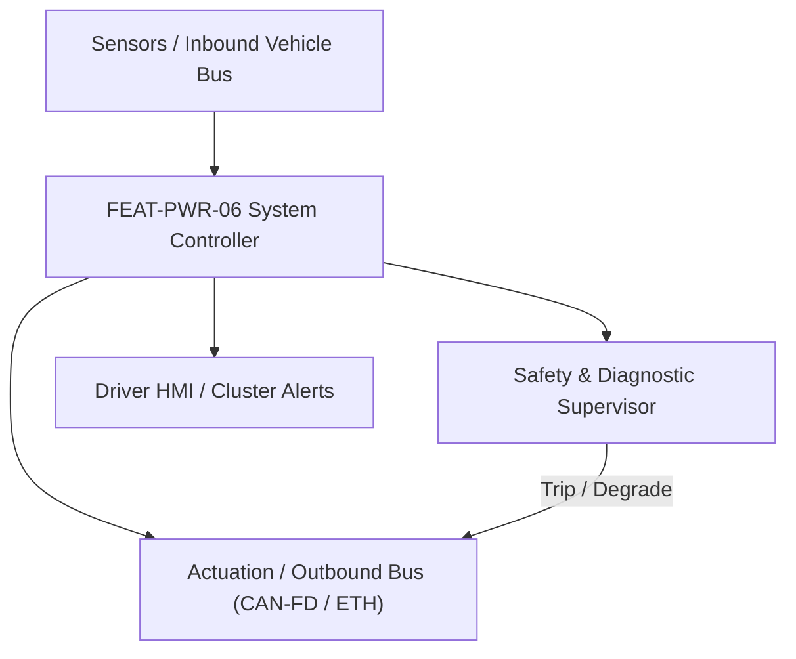
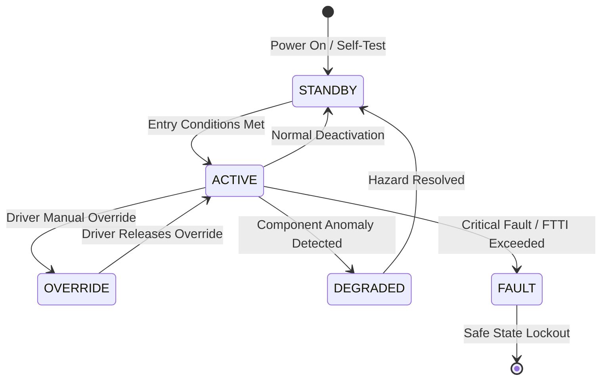

# System Requirements Specification: Bidirectional Vehicle-to-Load & Vehicle-to-Grid (V2L / V2G)
**Feature ID:** `FEAT-PWR-06`  
**Domain:** Electric Powertrain & Energy Management  
**Target ASIL:** ASIL C  
**Compliance Standard:** ISO 26262:2018 (Part 4 - System Development) / ASPICE PAM v3.1 (SYS.2, SYS.3)  
**Parent Master Specification:** [`spec.md`](file:///c:/Workset/AntiGravityProjects/TestOptimisationExperiement/spec.md#feat-pwr-06-v2l)  
**Derived Software Specification:** [`FEAT-PWR-06_V2L_SwReq.md`](file:///c:/Workset/AntiGravityProjects/TestOptimisationExperiement/software_requirements/FEAT-PWR-06_V2L_SwReq.md)

---

## 1. Feature Overview & Operational Scope

Transforms the vehicle into an off-grid AC power station (up to 3.6 kW V2L / 11 kW V2H/V2G), managing galvanic isolation, anti-islanding, and household grid synchronization.

### Operational Context Architecture

---

## 2. Activation Logic & Operational States

- **Preconditions:** Vehicle parked in PARK, battery SOC between 20% and 100%, V2L adapter plugged into charge port, ground loop verified.
- **Entry Conditions:** User activates 'V2L Power Outlet' via infotainment screen or smartphone app; selects minimum battery reserve cutoff (e.g. 20%).
- **Deactivation Conditions:** User commands stop, battery reaches reserve cutoff, ground fault detected, or plug physically removed.
- **Driver Override Behavior:** Emergency release of charging plug or detection of grid backfeed immediately disconnects AC contactors in < 10 ms.
- **Operational State Progression:**  
  `V2L_STANDBY` -> `GROUND_CHECK` -> `INVERTER_STARTUP` -> `AC_POWER_EXPORT` -> `OVERLOAD_CURRENT_TRIP` -> `BATTERY_RESERVE_DEPLETED` -> `ISLANDING_FAULT`

### State Transition Diagram

---

## 3. Functional Safety & Failure Mitigation Concept

- **Functional Safety Goal:** SG-V2L-01: Prevent lethal electric shock (touch voltage < 50V AC); prevent islanding backfeed into unpowered utility grid (IEEE 1547 / UL 1741).
- **Fault Tolerant Time Interval (FTTI):** 20 ms for residual current ground fault; 100 ms for anti-islanding trip.
- **Safe State Definition:** Open bidirectional inverter AC relays; discharge inverter bridge filter capacitors.
- **Warning & Escalation Strategy:** Display remaining export runtime and wattage on cluster; audible chirp if export draws > 16A continuous.

### Failure Modes & Degradation Handling
- **Ambient Grid Blackout:** During V2G home backup mode, disconnect vehicle inverter from main grid transfer switch before supplying home loads.
- **Ground Fault Leakage:** If residual current device (RCD) detects earth leakage > 30 mA, trip optical isolation switch in <= 20 ms.

---

## 4. System Requirements (SYS_REQ)
*(Note: Each System Requirement is systematically partitioned into multiple Child Software Requirements)*

### `SYS-PWR-06-01`: Residual Current & Earth Bonding Impedance Verification
- **Planned Release:** R100
- **ASIL Rating:** ASIL C
- **Parent Feature:** [`FEAT-PWR-06`](file:///c:/Workset/AntiGravityProjects/TestOptimisationExperiement/spec.md#feat-pwr-06)
- **Requirement Statement:**
  > The System SHALL verify earth bonding resistance (< 5 ohms) and continuously monitor residual AC and DC leakage current (tripping at AC > 30 mA or DC > 6 mA) in <= 20 ms.
- **Activation Logic:** Active at all times when V2L AC discharge mode is engaged.
- **Fault Tolerant Time Interval (FTTI):** 20 ms
- **Safe State Action:** De-energize AC output relays; isolate 230V/120V outlet socket.
- **Failure Detection & Reaction:** If ground bonding missing, prohibit inverter startup and display 'Earth Fault'.
- **Input Interfaces:** `RCD_Current_Transformer_Sensor, Earth_Bonding_Pilot_Voltage, Ambient_Temp`
- **Output Interfaces:** `AC_Discharge_Contactor_Cmd, RCD_Fault_Trip_Flag`
- **System Verification Method:** UL 1741 and IEC 62752 portable EV charging/discharging test suite.
- **Derived Child Software Requirements (1:N Link):**
  - [`SWR-PWR-06-01`](file:///c:/Workset/AntiGravityProjects/TestOptimisationExperiement/software_requirements/FEAT-PWR-06_V2L_SwReq.md#swr-pwr-06-01)
  - [`SWR-PWR-06-02`](file:///c:/Workset/AntiGravityProjects/TestOptimisationExperiement/software_requirements/FEAT-PWR-06_V2L_SwReq.md#swr-pwr-06-02)

### `SYS-PWR-06-02`: Pure Sine-Wave AC Inverter Voltage & Frequency Regulation
- **Planned Release:** R100
- **ASIL Rating:** ASIL C
- **Parent Feature:** [`FEAT-PWR-06`](file:///c:/Workset/AntiGravityProjects/TestOptimisationExperiement/spec.md#feat-pwr-06)
- **Requirement Statement:**
  > The System SHALL synthesize pure sine wave AC voltage (230V +-3% @ 50 Hz or 120V +-3% @ 60 Hz) with Total Harmonic Distortion (THD) < 3.0% under loads up to 3600 W (continuous) and 4500 W (10s peak).
- **Activation Logic:** Active when power export is enabled.
- **Fault Tolerant Time Interval (FTTI):** 50 ms
- **Safe State Action:** Clamp PWM duty cycle to zero; shutdown DC-AC H-bridge.
- **Failure Detection & Reaction:** If load current exceeds 20A for > 1.0 second, shut down on thermal overload.
- **Input Interfaces:** `BMS_Pack_DC_Voltage, AC_Load_Current_Feedback, AC_Output_Voltage_Feedback`
- **Output Interfaces:** `Inverter_HBridge_PWM_Gates[4], AC_Output_Active_Flag`
- **System Verification Method:** Resistive, inductive, and nonlinear load bank transient testing.
- **Derived Child Software Requirements (1:N Link):**
  - [`SWR-PWR-06-03`](file:///c:/Workset/AntiGravityProjects/TestOptimisationExperiement/software_requirements/FEAT-PWR-06_V2L_SwReq.md#swr-pwr-06-03)
  - [`SWR-PWR-06-04`](file:///c:/Workset/AntiGravityProjects/TestOptimisationExperiement/software_requirements/FEAT-PWR-06_V2L_SwReq.md#swr-pwr-06-04)

### `SYS-PWR-06-03`: V2L AC Islanding Grid Synthesizer & Autonomous Voltage Regulator
- **Planned Release:** R100
- **ASIL Rating:** ASIL C
- **Parent Feature:** [`FEAT-PWR-06`](file:///c:/Workset/AntiGravityProjects/TestOptimisationExperiement/spec.md#feat-pwr-06)
- **Requirement Statement:**
  > The System SHALL Synthesize stable 230V / 120V single-phase AC island grid (50/60 Hz +-0.1 Hz) supplying up to 3.6 kW off-grid load.
- **Activation Logic:** Active during normal vehicle operation when feature state is active.
- **Fault Tolerant Time Interval (FTTI):** 1 ms
- **Safe State Action:** Transition to safe state or safe degradation tier within FTTI budget.
- **Failure Detection & Reaction:** Isolate faulted channel, latch DEM diagnostic trouble code, and inform driver.
- **Input Interfaces:** `Sensor signals, vehicle dynamics data, and bus frames via RTE.`
- **Output Interfaces:** `Actuator commands, diagnostic event flags, and cluster alerts.`
- **System Verification Method:** HiL test bench and dynamometer automated verification.
- **Derived Child Software Requirements (1:N Link):**
  - [`SWR-PWR-06-05`](file:///c:/Workset/AntiGravityProjects/TestOptimisationExperiement/software_requirements/FEAT-PWR-06_V2L_SwReq.md#swr-pwr-06-05)
  - [`SWR-PWR-06-06`](file:///c:/Workset/AntiGravityProjects/TestOptimisationExperiement/software_requirements/FEAT-PWR-06_V2L_SwReq.md#swr-pwr-06-06)

### `SYS-PWR-06-04`: V2G Bi-Directional Grid-Tied Synchronization & Active Power Dispatcher
- **Planned Release:** R200
- **ASIL Rating:** ASIL C
- **Parent Feature:** [`FEAT-PWR-06`](file:///c:/Workset/AntiGravityProjects/TestOptimisationExperiement/spec.md#feat-pwr-06)
- **Requirement Statement:**
  > The System SHALL Synchronize inverter output with utility grid phase and dispatch active/reactive power (P/Q) per utility request.
- **Activation Logic:** Active during normal vehicle operation when feature state is active.
- **Fault Tolerant Time Interval (FTTI):** 5 ms
- **Safe State Action:** Transition to safe state or safe degradation tier within FTTI budget.
- **Failure Detection & Reaction:** Isolate faulted channel, latch DEM diagnostic trouble code, and inform driver.
- **Input Interfaces:** `Sensor signals, vehicle dynamics data, and bus frames via RTE.`
- **Output Interfaces:** `Actuator commands, diagnostic event flags, and cluster alerts.`
- **System Verification Method:** HiL test bench and dynamometer automated verification.
- **Derived Child Software Requirements (1:N Link):**
  - [`SWR-PWR-06-07`](file:///c:/Workset/AntiGravityProjects/TestOptimisationExperiement/software_requirements/FEAT-PWR-06_V2L_SwReq.md#swr-pwr-06-07)
  - [`SWR-PWR-06-08`](file:///c:/Workset/AntiGravityProjects/TestOptimisationExperiement/software_requirements/FEAT-PWR-06_V2L_SwReq.md#swr-pwr-06-08)

### `SYS-PWR-06-05`: V2L Inrush Current & Overload Electronic Circuit Breaker Safing
- **Planned Release:** R400
- **ASIL Rating:** ASIL C
- **Parent Feature:** [`FEAT-PWR-06`](file:///c:/Workset/AntiGravityProjects/TestOptimisationExperiement/spec.md#feat-pwr-06)
- **Requirement Statement:**
  > The System SHALL Trip electronic inverter output in <= 5 ms upon detecting load overcurrent exceeding 150% rating.
- **Activation Logic:** Active during normal vehicle operation when feature state is active.
- **Fault Tolerant Time Interval (FTTI):** 2 ms
- **Safe State Action:** Transition to safe state or safe degradation tier within FTTI budget.
- **Failure Detection & Reaction:** Isolate faulted channel, latch DEM diagnostic trouble code, and inform driver.
- **Input Interfaces:** `Sensor signals, vehicle dynamics data, and bus frames via RTE.`
- **Output Interfaces:** `Actuator commands, diagnostic event flags, and cluster alerts.`
- **System Verification Method:** HiL test bench and dynamometer automated verification.
- **Derived Child Software Requirements (1:N Link):**
  - [`SWR-PWR-06-09`](file:///c:/Workset/AntiGravityProjects/TestOptimisationExperiement/software_requirements/FEAT-PWR-06_V2L_SwReq.md#swr-pwr-06-09)
  - [`SWR-PWR-06-10`](file:///c:/Workset/AntiGravityProjects/TestOptimisationExperiement/software_requirements/FEAT-PWR-06_V2L_SwReq.md#swr-pwr-06-10)

### `SYS-PWR-06-06`: Anti-Islanding Utility Power Cut Detection & Immediate Disconnect
- **Planned Release:** R200
- **ASIL Rating:** ASIL C
- **Parent Feature:** [`FEAT-PWR-06`](file:///c:/Workset/AntiGravityProjects/TestOptimisationExperiement/spec.md#feat-pwr-06)
- **Requirement Statement:**
  > The System SHALL Detect utility grid blackout via active frequency drift: Disconnect from grid within <= 100 ms (IEEE 1547).
- **Activation Logic:** Active during normal vehicle operation when feature state is active.
- **Fault Tolerant Time Interval (FTTI):** 5 ms
- **Safe State Action:** Transition to safe state or safe degradation tier within FTTI budget.
- **Failure Detection & Reaction:** Isolate faulted channel, latch DEM diagnostic trouble code, and inform driver.
- **Input Interfaces:** `Sensor signals, vehicle dynamics data, and bus frames via RTE.`
- **Output Interfaces:** `Actuator commands, diagnostic event flags, and cluster alerts.`
- **System Verification Method:** HiL test bench and dynamometer automated verification.
- **Derived Child Software Requirements (1:N Link):**
  - [`SWR-PWR-06-11`](file:///c:/Workset/AntiGravityProjects/TestOptimisationExperiement/software_requirements/FEAT-PWR-06_V2L_SwReq.md#swr-pwr-06-11)
  - [`SWR-PWR-06-12`](file:///c:/Workset/AntiGravityProjects/TestOptimisationExperiement/software_requirements/FEAT-PWR-06_V2L_SwReq.md#swr-pwr-06-12)

### `SYS-PWR-06-07`: V2L Discharge Lower Battery SOC Cutoff Threshold Governor
- **Planned Release:** R300
- **ASIL Rating:** ASIL B
- **Parent Feature:** [`FEAT-PWR-06`](file:///c:/Workset/AntiGravityProjects/TestOptimisationExperiement/spec.md#feat-pwr-06)
- **Requirement Statement:**
  > The System SHALL Halt V2L power export when vehicle battery state-of-charge drops below user-selected threshold (e.g. 20%).
- **Activation Logic:** Active during normal vehicle operation when feature state is active.
- **Fault Tolerant Time Interval (FTTI):** 500 ms
- **Safe State Action:** Transition to safe state or safe degradation tier within FTTI budget.
- **Failure Detection & Reaction:** Isolate faulted channel, latch DEM diagnostic trouble code, and inform driver.
- **Input Interfaces:** `Sensor signals, vehicle dynamics data, and bus frames via RTE.`
- **Output Interfaces:** `Actuator commands, diagnostic event flags, and cluster alerts.`
- **System Verification Method:** HiL test bench and dynamometer automated verification.
- **Derived Child Software Requirements (1:N Link):**
  - [`SWR-PWR-06-13`](file:///c:/Workset/AntiGravityProjects/TestOptimisationExperiement/software_requirements/FEAT-PWR-06_V2L_SwReq.md#swr-pwr-06-13)
  - [`SWR-PWR-06-14`](file:///c:/Workset/AntiGravityProjects/TestOptimisationExperiement/software_requirements/FEAT-PWR-06_V2L_SwReq.md#swr-pwr-06-14)

### `SYS-PWR-06-08`: Vehicle External Power Outlet Thermal & Weather Enclosure Interlock
- **Planned Release:** R300
- **ASIL Rating:** ASIL B
- **Parent Feature:** [`FEAT-PWR-06`](file:///c:/Workset/AntiGravityProjects/TestOptimisationExperiement/spec.md#feat-pwr-06)
- **Requirement Statement:**
  > The System SHALL Verify V2L external socket lid closure and internal socket temperature <= 65 °C prior to power delivery.
- **Activation Logic:** Active during normal vehicle operation when feature state is active.
- **Fault Tolerant Time Interval (FTTI):** 100 ms
- **Safe State Action:** Transition to safe state or safe degradation tier within FTTI budget.
- **Failure Detection & Reaction:** Isolate faulted channel, latch DEM diagnostic trouble code, and inform driver.
- **Input Interfaces:** `Sensor signals, vehicle dynamics data, and bus frames via RTE.`
- **Output Interfaces:** `Actuator commands, diagnostic event flags, and cluster alerts.`
- **System Verification Method:** HiL test bench and dynamometer automated verification.
- **Derived Child Software Requirements (1:N Link):**
  - [`SWR-PWR-06-15`](file:///c:/Workset/AntiGravityProjects/TestOptimisationExperiement/software_requirements/FEAT-PWR-06_V2L_SwReq.md#swr-pwr-06-15)
  - [`SWR-PWR-06-16`](file:///c:/Workset/AntiGravityProjects/TestOptimisationExperiement/software_requirements/FEAT-PWR-06_V2L_SwReq.md#swr-pwr-06-16)

### `SYS-PWR-06-09`: V2G Smart Charging Schedule Optimization via ISO 15118-20 Dynamic Pricing
- **Planned Release:** R300
- **ASIL Rating:** ASIL B
- **Parent Feature:** [`FEAT-PWR-06`](file:///c:/Workset/AntiGravityProjects/TestOptimisationExperiement/spec.md#feat-pwr-06)
- **Requirement Statement:**
  > The System SHALL Optimize vehicle discharge timing according to spot market electricity prices and user departure deadline.
- **Activation Logic:** Active during normal vehicle operation when feature state is active.
- **Fault Tolerant Time Interval (FTTI):** 1000 ms
- **Safe State Action:** Transition to safe state or safe degradation tier within FTTI budget.
- **Failure Detection & Reaction:** Isolate faulted channel, latch DEM diagnostic trouble code, and inform driver.
- **Input Interfaces:** `Sensor signals, vehicle dynamics data, and bus frames via RTE.`
- **Output Interfaces:** `Actuator commands, diagnostic event flags, and cluster alerts.`
- **System Verification Method:** HiL test bench and dynamometer automated verification.
- **Derived Child Software Requirements (1:N Link):**
  - [`SWR-PWR-06-17`](file:///c:/Workset/AntiGravityProjects/TestOptimisationExperiement/software_requirements/FEAT-PWR-06_V2L_SwReq.md#swr-pwr-06-17)
  - [`SWR-PWR-06-18`](file:///c:/Workset/AntiGravityProjects/TestOptimisationExperiement/software_requirements/FEAT-PWR-06_V2L_SwReq.md#swr-pwr-06-18)

### `SYS-PWR-06-10`: Galvanic Output Neutral-Ground Bond Switch State Coordinator
- **Planned Release:** R400
- **ASIL Rating:** ASIL C
- **Parent Feature:** [`FEAT-PWR-06`](file:///c:/Workset/AntiGravityProjects/TestOptimisationExperiement/spec.md#feat-pwr-06)
- **Requirement Statement:**
  > The System SHALL Engage internal neutral-ground bonding relay in stand-alone V2L island mode; open bond in grid-tied V2G mode.
- **Activation Logic:** Active during normal vehicle operation when feature state is active.
- **Fault Tolerant Time Interval (FTTI):** 20 ms
- **Safe State Action:** Transition to safe state or safe degradation tier within FTTI budget.
- **Failure Detection & Reaction:** Isolate faulted channel, latch DEM diagnostic trouble code, and inform driver.
- **Input Interfaces:** `Sensor signals, vehicle dynamics data, and bus frames via RTE.`
- **Output Interfaces:** `Actuator commands, diagnostic event flags, and cluster alerts.`
- **System Verification Method:** HiL test bench and dynamometer automated verification.
- **Derived Child Software Requirements (1:N Link):**
  - [`SWR-PWR-06-19`](file:///c:/Workset/AntiGravityProjects/TestOptimisationExperiement/software_requirements/FEAT-PWR-06_V2L_SwReq.md#swr-pwr-06-19)
  - [`SWR-PWR-06-20`](file:///c:/Workset/AntiGravityProjects/TestOptimisationExperiement/software_requirements/FEAT-PWR-06_V2L_SwReq.md#swr-pwr-06-20)

### `SYS-PWR-06-11`: Inverter Power Semiconductor Symmetrical Thermal Derater
- **Planned Release:** R400
- **ASIL Rating:** ASIL B
- **Parent Feature:** [`FEAT-PWR-06`](file:///c:/Workset/AntiGravityProjects/TestOptimisationExperiement/spec.md#feat-pwr-06)
- **Requirement Statement:**
  > The System SHALL Derate continuous V2L export power if bidirectional converter junction temperature exceeds 110 °C.
- **Activation Logic:** Active during normal vehicle operation when feature state is active.
- **Fault Tolerant Time Interval (FTTI):** 100 ms
- **Safe State Action:** Transition to safe state or safe degradation tier within FTTI budget.
- **Failure Detection & Reaction:** Isolate faulted channel, latch DEM diagnostic trouble code, and inform driver.
- **Input Interfaces:** `Sensor signals, vehicle dynamics data, and bus frames via RTE.`
- **Output Interfaces:** `Actuator commands, diagnostic event flags, and cluster alerts.`
- **System Verification Method:** HiL test bench and dynamometer automated verification.
- **Derived Child Software Requirements (1:N Link):**
  - [`SWR-PWR-06-21`](file:///c:/Workset/AntiGravityProjects/TestOptimisationExperiement/software_requirements/FEAT-PWR-06_V2L_SwReq.md#swr-pwr-06-21)
  - [`SWR-PWR-06-22`](file:///c:/Workset/AntiGravityProjects/TestOptimisationExperiement/software_requirements/FEAT-PWR-06_V2L_SwReq.md#swr-pwr-06-22)

### `SYS-PWR-06-12`: High-Voltage Battery DC Injection Prevention Inverter Filter
- **Planned Release:** R400
- **ASIL Rating:** ASIL C
- **Parent Feature:** [`FEAT-PWR-06`](file:///c:/Workset/AntiGravityProjects/TestOptimisationExperiement/spec.md#feat-pwr-06)
- **Requirement Statement:**
  > The System SHALL Filter and monitor DC component of exported AC current: Trip if DC current injection exceeds 0.5% rating.
- **Activation Logic:** Active during normal vehicle operation when feature state is active.
- **Fault Tolerant Time Interval (FTTI):** 10 ms
- **Safe State Action:** Transition to safe state or safe degradation tier within FTTI budget.
- **Failure Detection & Reaction:** Isolate faulted channel, latch DEM diagnostic trouble code, and inform driver.
- **Input Interfaces:** `Sensor signals, vehicle dynamics data, and bus frames via RTE.`
- **Output Interfaces:** `Actuator commands, diagnostic event flags, and cluster alerts.`
- **System Verification Method:** HiL test bench and dynamometer automated verification.
- **Derived Child Software Requirements (1:N Link):**
  - [`SWR-PWR-06-23`](file:///c:/Workset/AntiGravityProjects/TestOptimisationExperiement/software_requirements/FEAT-PWR-06_V2L_SwReq.md#swr-pwr-06-23)
  - [`SWR-PWR-06-24`](file:///c:/Workset/AntiGravityProjects/TestOptimisationExperiement/software_requirements/FEAT-PWR-06_V2L_SwReq.md#swr-pwr-06-24)

### `SYS-PWR-06-13`: V2L/V2G System Diagnostic Event Manager & Islanding Event Recorder
- **Planned Release:** R500
- **ASIL Rating:** ASIL B
- **Parent Feature:** [`FEAT-PWR-06`](file:///c:/Workset/AntiGravityProjects/TestOptimisationExperiement/spec.md#feat-pwr-06)
- **Requirement Statement:**
  > The System SHALL Log diagnostic fault codes and historical energy exported to household or grid in non-volatile flash.
- **Activation Logic:** Active during normal vehicle operation when feature state is active.
- **Fault Tolerant Time Interval (FTTI):** 50 ms
- **Safe State Action:** Transition to safe state or safe degradation tier within FTTI budget.
- **Failure Detection & Reaction:** Isolate faulted channel, latch DEM diagnostic trouble code, and inform driver.
- **Input Interfaces:** `Sensor signals, vehicle dynamics data, and bus frames via RTE.`
- **Output Interfaces:** `Actuator commands, diagnostic event flags, and cluster alerts.`
- **System Verification Method:** HiL test bench and dynamometer automated verification.
- **Derived Child Software Requirements (1:N Link):**
  - [`SWR-PWR-06-25`](file:///c:/Workset/AntiGravityProjects/TestOptimisationExperiement/software_requirements/FEAT-PWR-06_V2L_SwReq.md#swr-pwr-06-25)
  - [`SWR-PWR-06-26`](file:///c:/Workset/AntiGravityProjects/TestOptimisationExperiement/software_requirements/FEAT-PWR-06_V2L_SwReq.md#swr-pwr-06-26)

### `SYS-PWR-06-14`: Driver Cockpit & Smartphone App Bi-Directional Power Control Interface
- **Planned Release:** R500
- **ASIL Rating:** ASIL B
- **Parent Feature:** [`FEAT-PWR-06`](file:///c:/Workset/AntiGravityProjects/TestOptimisationExperiement/spec.md#feat-pwr-06)
- **Requirement Statement:**
  > The System SHALL Broadcast exported power (kW), remaining battery range, and export status to driver cockpit and mobile app.
- **Activation Logic:** Active during normal vehicle operation when feature state is active.
- **Fault Tolerant Time Interval (FTTI):** 100 ms
- **Safe State Action:** Transition to safe state or safe degradation tier within FTTI budget.
- **Failure Detection & Reaction:** Isolate faulted channel, latch DEM diagnostic trouble code, and inform driver.
- **Input Interfaces:** `Sensor signals, vehicle dynamics data, and bus frames via RTE.`
- **Output Interfaces:** `Actuator commands, diagnostic event flags, and cluster alerts.`
- **System Verification Method:** HiL test bench and dynamometer automated verification.
- **Derived Child Software Requirements (1:N Link):**
  - [`SWR-PWR-06-27`](file:///c:/Workset/AntiGravityProjects/TestOptimisationExperiement/software_requirements/FEAT-PWR-06_V2L_SwReq.md#swr-pwr-06-27)
  - [`SWR-PWR-06-28`](file:///c:/Workset/AntiGravityProjects/TestOptimisationExperiement/software_requirements/FEAT-PWR-06_V2L_SwReq.md#swr-pwr-06-28)

### `SYS-PWR-06-15`: Non-Volatile Utility Grid Compliance Certification Audit Logger
- **Planned Release:** R500
- **ASIL Rating:** ASIL B
- **Parent Feature:** [`FEAT-PWR-06`](file:///c:/Workset/AntiGravityProjects/TestOptimisationExperiement/spec.md#feat-pwr-06)
- **Requirement Statement:**
  > The System SHALL Store IEEE 1547 and VDE-AR-N 4105 grid compliance audit records in tamper-proof non-volatile memory.
- **Activation Logic:** Active during normal vehicle operation when feature state is active.
- **Fault Tolerant Time Interval (FTTI):** 2000 ms
- **Safe State Action:** Transition to safe state or safe degradation tier within FTTI budget.
- **Failure Detection & Reaction:** Isolate faulted channel, latch DEM diagnostic trouble code, and inform driver.
- **Input Interfaces:** `Sensor signals, vehicle dynamics data, and bus frames via RTE.`
- **Output Interfaces:** `Actuator commands, diagnostic event flags, and cluster alerts.`
- **System Verification Method:** HiL test bench and dynamometer automated verification.
- **Derived Child Software Requirements (1:N Link):**
  - [`SWR-PWR-06-29`](file:///c:/Workset/AntiGravityProjects/TestOptimisationExperiement/software_requirements/FEAT-PWR-06_V2L_SwReq.md#swr-pwr-06-29)
  - [`SWR-PWR-06-30`](file:///c:/Workset/AntiGravityProjects/TestOptimisationExperiement/software_requirements/FEAT-PWR-06_V2L_SwReq.md#swr-pwr-06-30)

---

## 5. System-to-Software Traceability Summary

| System Requirement ID | Planned Release | ASIL | Title | Derived Software Requirements (1:N) | Verification Method |
| :--- | :---: | :--- | :--- | :--- | :--- |
| `SYS-PWR-06-01` | **`R100`** | ASIL C | Residual Current & Earth Bonding Impedance Verification | [`SWR-PWR-06-01`](file:///c:/Workset/AntiGravityProjects/TestOptimisationExperiement/software_requirements/FEAT-PWR-06_V2L_SwReq.md#swr-pwr-06-01), [`SWR-PWR-06-02`](file:///c:/Workset/AntiGravityProjects/TestOptimisationExperiement/software_requirements/FEAT-PWR-06_V2L_SwReq.md#swr-pwr-06-02) | UL 1741 and IEC 62752 portable EV charging/discharging test suite. |
| `SYS-PWR-06-02` | **`R100`** | ASIL C | Pure Sine-Wave AC Inverter Voltage & Frequency Regulation | [`SWR-PWR-06-03`](file:///c:/Workset/AntiGravityProjects/TestOptimisationExperiement/software_requirements/FEAT-PWR-06_V2L_SwReq.md#swr-pwr-06-03), [`SWR-PWR-06-04`](file:///c:/Workset/AntiGravityProjects/TestOptimisationExperiement/software_requirements/FEAT-PWR-06_V2L_SwReq.md#swr-pwr-06-04) | Resistive, inductive, and nonlinear load bank transient testing. |
| `SYS-PWR-06-03` | **`R100`** | ASIL C | V2L AC Islanding Grid Synthesizer & Autonomous Voltage Regulator | [`SWR-PWR-06-05`](file:///c:/Workset/AntiGravityProjects/TestOptimisationExperiement/software_requirements/FEAT-PWR-06_V2L_SwReq.md#swr-pwr-06-05), [`SWR-PWR-06-06`](file:///c:/Workset/AntiGravityProjects/TestOptimisationExperiement/software_requirements/FEAT-PWR-06_V2L_SwReq.md#swr-pwr-06-06) | HiL test bench and dynamometer automated verification. |
| `SYS-PWR-06-04` | **`R200`** | ASIL C | V2G Bi-Directional Grid-Tied Synchronization & Active Power Dispatcher | [`SWR-PWR-06-07`](file:///c:/Workset/AntiGravityProjects/TestOptimisationExperiement/software_requirements/FEAT-PWR-06_V2L_SwReq.md#swr-pwr-06-07), [`SWR-PWR-06-08`](file:///c:/Workset/AntiGravityProjects/TestOptimisationExperiement/software_requirements/FEAT-PWR-06_V2L_SwReq.md#swr-pwr-06-08) | HiL test bench and dynamometer automated verification. |
| `SYS-PWR-06-05` | **`R400`** | ASIL C | V2L Inrush Current & Overload Electronic Circuit Breaker Safing | [`SWR-PWR-06-09`](file:///c:/Workset/AntiGravityProjects/TestOptimisationExperiement/software_requirements/FEAT-PWR-06_V2L_SwReq.md#swr-pwr-06-09), [`SWR-PWR-06-10`](file:///c:/Workset/AntiGravityProjects/TestOptimisationExperiement/software_requirements/FEAT-PWR-06_V2L_SwReq.md#swr-pwr-06-10) | HiL test bench and dynamometer automated verification. |
| `SYS-PWR-06-06` | **`R200`** | ASIL C | Anti-Islanding Utility Power Cut Detection & Immediate Disconnect | [`SWR-PWR-06-11`](file:///c:/Workset/AntiGravityProjects/TestOptimisationExperiement/software_requirements/FEAT-PWR-06_V2L_SwReq.md#swr-pwr-06-11), [`SWR-PWR-06-12`](file:///c:/Workset/AntiGravityProjects/TestOptimisationExperiement/software_requirements/FEAT-PWR-06_V2L_SwReq.md#swr-pwr-06-12) | HiL test bench and dynamometer automated verification. |
| `SYS-PWR-06-07` | **`R300`** | ASIL B | V2L Discharge Lower Battery SOC Cutoff Threshold Governor | [`SWR-PWR-06-13`](file:///c:/Workset/AntiGravityProjects/TestOptimisationExperiement/software_requirements/FEAT-PWR-06_V2L_SwReq.md#swr-pwr-06-13), [`SWR-PWR-06-14`](file:///c:/Workset/AntiGravityProjects/TestOptimisationExperiement/software_requirements/FEAT-PWR-06_V2L_SwReq.md#swr-pwr-06-14) | HiL test bench and dynamometer automated verification. |
| `SYS-PWR-06-08` | **`R300`** | ASIL B | Vehicle External Power Outlet Thermal & Weather Enclosure Interlock | [`SWR-PWR-06-15`](file:///c:/Workset/AntiGravityProjects/TestOptimisationExperiement/software_requirements/FEAT-PWR-06_V2L_SwReq.md#swr-pwr-06-15), [`SWR-PWR-06-16`](file:///c:/Workset/AntiGravityProjects/TestOptimisationExperiement/software_requirements/FEAT-PWR-06_V2L_SwReq.md#swr-pwr-06-16) | HiL test bench and dynamometer automated verification. |
| `SYS-PWR-06-09` | **`R300`** | ASIL B | V2G Smart Charging Schedule Optimization via ISO 15118-20 Dynamic Pricing | [`SWR-PWR-06-17`](file:///c:/Workset/AntiGravityProjects/TestOptimisationExperiement/software_requirements/FEAT-PWR-06_V2L_SwReq.md#swr-pwr-06-17), [`SWR-PWR-06-18`](file:///c:/Workset/AntiGravityProjects/TestOptimisationExperiement/software_requirements/FEAT-PWR-06_V2L_SwReq.md#swr-pwr-06-18) | HiL test bench and dynamometer automated verification. |
| `SYS-PWR-06-10` | **`R400`** | ASIL C | Galvanic Output Neutral-Ground Bond Switch State Coordinator | [`SWR-PWR-06-19`](file:///c:/Workset/AntiGravityProjects/TestOptimisationExperiement/software_requirements/FEAT-PWR-06_V2L_SwReq.md#swr-pwr-06-19), [`SWR-PWR-06-20`](file:///c:/Workset/AntiGravityProjects/TestOptimisationExperiement/software_requirements/FEAT-PWR-06_V2L_SwReq.md#swr-pwr-06-20) | HiL test bench and dynamometer automated verification. |
| `SYS-PWR-06-11` | **`R400`** | ASIL B | Inverter Power Semiconductor Symmetrical Thermal Derater | [`SWR-PWR-06-21`](file:///c:/Workset/AntiGravityProjects/TestOptimisationExperiement/software_requirements/FEAT-PWR-06_V2L_SwReq.md#swr-pwr-06-21), [`SWR-PWR-06-22`](file:///c:/Workset/AntiGravityProjects/TestOptimisationExperiement/software_requirements/FEAT-PWR-06_V2L_SwReq.md#swr-pwr-06-22) | HiL test bench and dynamometer automated verification. |
| `SYS-PWR-06-12` | **`R400`** | ASIL C | High-Voltage Battery DC Injection Prevention Inverter Filter | [`SWR-PWR-06-23`](file:///c:/Workset/AntiGravityProjects/TestOptimisationExperiement/software_requirements/FEAT-PWR-06_V2L_SwReq.md#swr-pwr-06-23), [`SWR-PWR-06-24`](file:///c:/Workset/AntiGravityProjects/TestOptimisationExperiement/software_requirements/FEAT-PWR-06_V2L_SwReq.md#swr-pwr-06-24) | HiL test bench and dynamometer automated verification. |
| `SYS-PWR-06-13` | **`R500`** | ASIL B | V2L/V2G System Diagnostic Event Manager & Islanding Event Recorder | [`SWR-PWR-06-25`](file:///c:/Workset/AntiGravityProjects/TestOptimisationExperiement/software_requirements/FEAT-PWR-06_V2L_SwReq.md#swr-pwr-06-25), [`SWR-PWR-06-26`](file:///c:/Workset/AntiGravityProjects/TestOptimisationExperiement/software_requirements/FEAT-PWR-06_V2L_SwReq.md#swr-pwr-06-26) | HiL test bench and dynamometer automated verification. |
| `SYS-PWR-06-14` | **`R500`** | ASIL B | Driver Cockpit & Smartphone App Bi-Directional Power Control Interface | [`SWR-PWR-06-27`](file:///c:/Workset/AntiGravityProjects/TestOptimisationExperiement/software_requirements/FEAT-PWR-06_V2L_SwReq.md#swr-pwr-06-27), [`SWR-PWR-06-28`](file:///c:/Workset/AntiGravityProjects/TestOptimisationExperiement/software_requirements/FEAT-PWR-06_V2L_SwReq.md#swr-pwr-06-28) | HiL test bench and dynamometer automated verification. |
| `SYS-PWR-06-15` | **`R500`** | ASIL B | Non-Volatile Utility Grid Compliance Certification Audit Logger | [`SWR-PWR-06-29`](file:///c:/Workset/AntiGravityProjects/TestOptimisationExperiement/software_requirements/FEAT-PWR-06_V2L_SwReq.md#swr-pwr-06-29), [`SWR-PWR-06-30`](file:///c:/Workset/AntiGravityProjects/TestOptimisationExperiement/software_requirements/FEAT-PWR-06_V2L_SwReq.md#swr-pwr-06-30) | HiL test bench and dynamometer automated verification. |

- **Upstream Feature Link:** [`spec.md` (FEAT-PWR-06)](file:///c:/Workset/AntiGravityProjects/TestOptimisationExperiement/spec.md#feat-pwr-06)
- **Software Requirements Specification:** [`FEAT-PWR-06_V2L_SwReq.md`](file:///c:/Workset/AntiGravityProjects/TestOptimisationExperiement/software_requirements/FEAT-PWR-06_V2L_SwReq.md)
