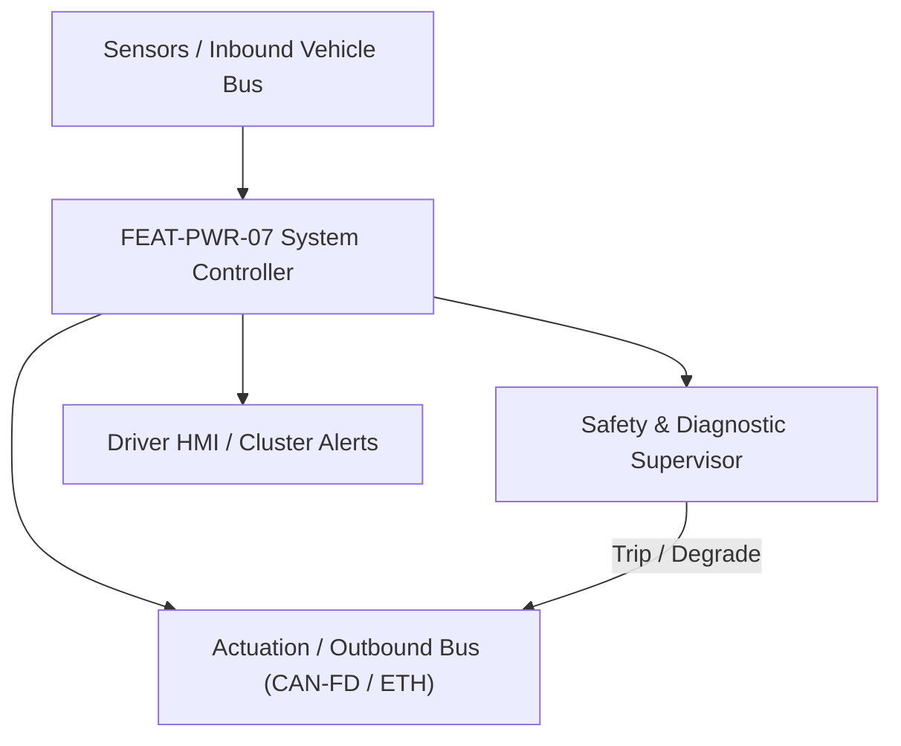
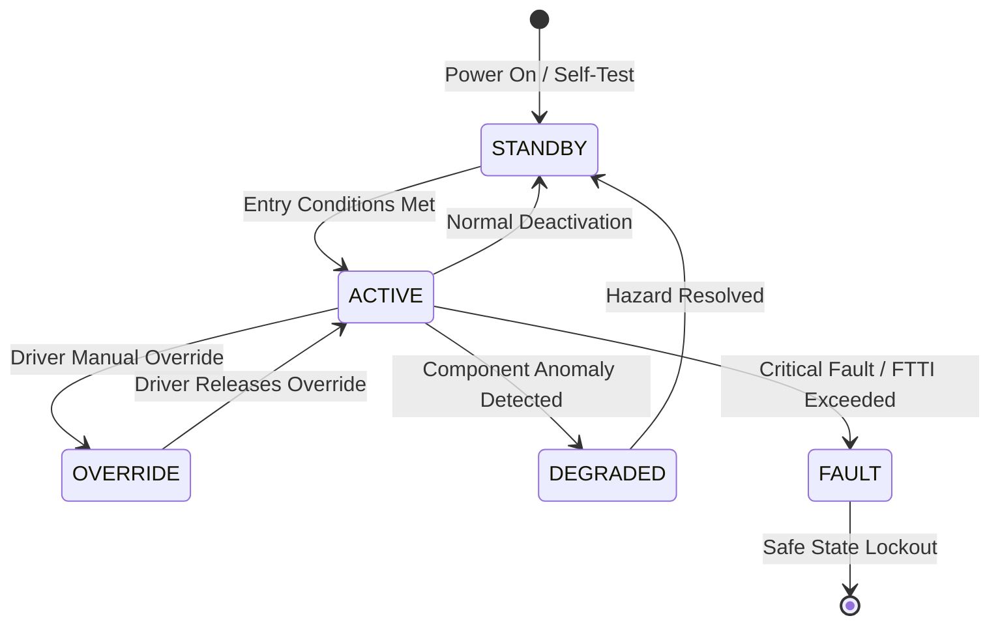

# System Requirements Specification: Electric Axle Disconnect & Multi-Speed Shifting (e-Axle)
**Feature ID:** `FEAT-PWR-07`  
**Domain:** Electric Powertrain & Energy Management  
**Target ASIL:** ASIL C  
**Compliance Standard:** ISO 26262:2018 (Part 4 - System Development) / ASPICE PAM v3.1 (SYS.2, SYS.3)  
**Parent Master Specification:** [`spec.md`](file:///c:/Workset/AntiGravityProjects/TestOptimisationExperiement/spec.md#feat-pwr-07-eaxle)  
**Derived Software Specification:** [`FEAT-PWR-07_eAxle_SwReq.md`](file:///c:/Workset/AntiGravityProjects/TestOptimisationExperiement/software_requirements/FEAT-PWR-07_eAxle_SwReq.md)

---

## 1. Feature Overview & Operational Scope

Coordinates electro-mechanical dog clutch disconnects and multi-speed EV transmission shifting to optimize high-speed highway efficiency and low-speed wheel torque.

### Operational Context Architecture

---

## 2. Activation Logic & Operational States

- **Preconditions:** 12V system healthy, transmission oil temperature within range (-30°C to +120°C), motor speed synchronization operational.
- **Entry Conditions:** Vehicle cruising at highway speeds in ECO mode (disconnect front axle) OR hard acceleration tip-in (downshift Gear 2 to Gear 1).
- **Deactivation Conditions:** Vehicle stationary or transmission shifted to PARK.
- **Driver Override Behavior:** Kickdown pedal press or slip detection immediately forces low gear engagement and re-connects disconnected axle in <= 150 ms.
- **Operational State Progression:**  
  `1ST_GEAR_COUPLED` -> `SHIFT_PREPARATION` -> `MOTOR_SPEED_SYNC` -> `DOG_CLUTCH_DISENGAGED` -> `2ND_GEAR_COUPLED` -> `AXLE_DISCONNECTED_IDLE` -> `SHIFT_ABORT_RECOVERY`

### State Transition Diagram

---

## 3. Functional Safety & Failure Mitigation Concept

- **Functional Safety Goal:** SG-AXLE-01: Prevent unintended driveline disconnect during regenerative braking; prevent dog clutch mechanical clash or gear locking at high speed.
- **Fault Tolerant Time Interval (FTTI):** 80 ms
- **Safe State Definition:** Synchronize motor speed; hold dog clutch in locked coupled position.
- **Warning & Escalation Strategy:** Display 'Driveline System Service' alert if gear shift fails to complete within 500 ms.

### Failure Modes & Degradation Handling
- **Disconnect Actuator Jam:** If electromagnetic shift fork jams in neutral, command limp-home single axle propulsion.
- **Synchronization Timeout:** If motor fails to match transmission shaft speed within +-20 RPM in 300 ms, abort shift and re-engage origin gear.

---

## 4. System Requirements (SYS_REQ)
*(Note: Each System Requirement is systematically partitioned into multiple Child Software Requirements)*

### `SYS-PWR-07-01`: High-Speed Speed-Match Synchronization & Shift Coordination
- **Planned Release:** R100
- **ASIL Rating:** ASIL C
- **Parent Feature:** [`FEAT-PWR-07`](file:///c:/Workset/AntiGravityProjects/TestOptimisationExperiement/spec.md#feat-pwr-07)
- **Requirement Statement:**
  > The System SHALL zero traction motor torque, ramp motor RPM to match target transmission gear shaft speed within +-20 RPM in <= 200 ms, and actuate dog clutch sleeve to complete gear shift in <= 350 ms.
- **Activation Logic:** Active during transmission gear shifting events.
- **Fault Tolerant Time Interval (FTTI):** 80 ms
- **Safe State Action:** Abort gear shift; re-engage previous gear; limit motor torque to 50%.
- **Failure Detection & Reaction:** If sleeve position sensor reports stuck-in-neutral, ramp motor torque to zero.
- **Input Interfaces:** `Traction_Motor_RPM, Transmission_Output_Shaft_RPM, Target_Gear_Selection`
- **Output Interfaces:** `Motor_Speed_Sync_Cmd_RPM, Shift_Fork_Solenoid_PWM`
- **System Verification Method:** Transmission dyno shift test rig evaluating shift time and torque hole duration.
- **Derived Child Software Requirements (1:N Link):**
  - [`SWR-PWR-07-01`](file:///c:/Workset/AntiGravityProjects/TestOptimisationExperiement/software_requirements/FEAT-PWR-07_eAxle_SwReq.md#swr-pwr-07-01)
  - [`SWR-PWR-07-02`](file:///c:/Workset/AntiGravityProjects/TestOptimisationExperiement/software_requirements/FEAT-PWR-07_eAxle_SwReq.md#swr-pwr-07-02)

### `SYS-PWR-07-02`: Front-Axle Disconnect Dog Clutch Mechanical Decoupling
- **Planned Release:** R100
- **ASIL Rating:** ASIL C
- **Parent Feature:** [`FEAT-PWR-07`](file:///c:/Workset/AntiGravityProjects/TestOptimisationExperiement/spec.md#feat-pwr-07)
- **Requirement Statement:**
  > The System SHALL actuate an electromagnetic dog clutch to mechanically decouple secondary front e-Axle during steady-state cruising, eliminating rotor windage and drag losses in <= 100 ms.
- **Activation Logic:** Active in ECO mode at vehicle speed > 65 km/h.
- **Fault Tolerant Time Interval (FTTI):** 80 ms
- **Safe State Action:** Keep clutch energized in CLOSED coupled position.
- **Failure Detection & Reaction:** If clutch position feedback uncertain, default to 100% AWD coupled state.
- **Input Interfaces:** `Vehicle_Speed_Kmph, ECO_Mode_Flag, Driver_Torque_Demand_Nm, Slip_Detected`
- **Output Interfaces:** `Axle_Disconnect_Actuator_Cmd, AWD_Coupling_State_Enum`
- **System Verification Method:** Chassis roll dyno efficiency evaluation comparing coupled vs decoupled drag.
- **Derived Child Software Requirements (1:N Link):**
  - [`SWR-PWR-07-03`](file:///c:/Workset/AntiGravityProjects/TestOptimisationExperiement/software_requirements/FEAT-PWR-07_eAxle_SwReq.md#swr-pwr-07-03)
  - [`SWR-PWR-07-04`](file:///c:/Workset/AntiGravityProjects/TestOptimisationExperiement/software_requirements/FEAT-PWR-07_eAxle_SwReq.md#swr-pwr-07-04)

### `SYS-PWR-07-03`: Electric Axle Dog-Clutch Disconnect Solenoid Actuator Position Controller
- **Planned Release:** R100
- **ASIL Rating:** ASIL C
- **Parent Feature:** [`FEAT-PWR-07`](file:///c:/Workset/AntiGravityProjects/TestOptimisationExperiement/spec.md#feat-pwr-07)
- **Requirement Statement:**
  > The System SHALL Control hydraulic/electromechanical dog clutch actuator to connect/disconnect secondary axle in <= 150 ms.
- **Activation Logic:** Active during normal vehicle operation when feature state is active.
- **Fault Tolerant Time Interval (FTTI):** 10 ms
- **Safe State Action:** Transition to safe state or safe degradation tier within FTTI budget.
- **Failure Detection & Reaction:** Isolate faulted channel, latch DEM diagnostic trouble code, and inform driver.
- **Input Interfaces:** `Sensor signals, vehicle dynamics data, and bus frames via RTE.`
- **Output Interfaces:** `Actuator commands, diagnostic event flags, and cluster alerts.`
- **System Verification Method:** HiL test bench and dynamometer automated verification.
- **Derived Child Software Requirements (1:N Link):**
  - [`SWR-PWR-07-05`](file:///c:/Workset/AntiGravityProjects/TestOptimisationExperiement/software_requirements/FEAT-PWR-07_eAxle_SwReq.md#swr-pwr-07-05)
  - [`SWR-PWR-07-06`](file:///c:/Workset/AntiGravityProjects/TestOptimisationExperiement/software_requirements/FEAT-PWR-07_eAxle_SwReq.md#swr-pwr-07-06)

### `SYS-PWR-07-04`: Secondary Motor Zero-Torque Speed Synchronization Prior to Engagement
- **Planned Release:** R200
- **ASIL Rating:** ASIL C
- **Parent Feature:** [`FEAT-PWR-07`](file:///c:/Workset/AntiGravityProjects/TestOptimisationExperiement/spec.md#feat-pwr-07)
- **Requirement Statement:**
  > The System SHALL Synchronize secondary traction motor speed to road speed within +-20 RPM before engaging mechanical clutch.
- **Activation Logic:** Active during normal vehicle operation when feature state is active.
- **Fault Tolerant Time Interval (FTTI):** 10 ms
- **Safe State Action:** Transition to safe state or safe degradation tier within FTTI budget.
- **Failure Detection & Reaction:** Isolate faulted channel, latch DEM diagnostic trouble code, and inform driver.
- **Input Interfaces:** `Sensor signals, vehicle dynamics data, and bus frames via RTE.`
- **Output Interfaces:** `Actuator commands, diagnostic event flags, and cluster alerts.`
- **System Verification Method:** HiL test bench and dynamometer automated verification.
- **Derived Child Software Requirements (1:N Link):**
  - [`SWR-PWR-07-07`](file:///c:/Workset/AntiGravityProjects/TestOptimisationExperiement/software_requirements/FEAT-PWR-07_eAxle_SwReq.md#swr-pwr-07-07)
  - [`SWR-PWR-07-08`](file:///c:/Workset/AntiGravityProjects/TestOptimisationExperiement/software_requirements/FEAT-PWR-07_eAxle_SwReq.md#swr-pwr-07-08)

### `SYS-PWR-07-05`: 2-Speed Planetary Gearbox Dual-Brake Shift Sequencing Engine
- **Planned Release:** R200
- **ASIL Rating:** ASIL C
- **Parent Feature:** [`FEAT-PWR-07`](file:///c:/Workset/AntiGravityProjects/TestOptimisationExperiement/spec.md#feat-pwr-07)
- **Requirement Statement:**
  > The System SHALL Coordinate friction clutch release and brake band apply to execute 1st to 2nd gear shift in <= 300 ms without torque hole.
- **Activation Logic:** Active during normal vehicle operation when feature state is active.
- **Fault Tolerant Time Interval (FTTI):** 10 ms
- **Safe State Action:** Transition to safe state or safe degradation tier within FTTI budget.
- **Failure Detection & Reaction:** Isolate faulted channel, latch DEM diagnostic trouble code, and inform driver.
- **Input Interfaces:** `Sensor signals, vehicle dynamics data, and bus frames via RTE.`
- **Output Interfaces:** `Actuator commands, diagnostic event flags, and cluster alerts.`
- **System Verification Method:** HiL test bench and dynamometer automated verification.
- **Derived Child Software Requirements (1:N Link):**
  - [`SWR-PWR-07-09`](file:///c:/Workset/AntiGravityProjects/TestOptimisationExperiement/software_requirements/FEAT-PWR-07_eAxle_SwReq.md#swr-pwr-07-09)
  - [`SWR-PWR-07-10`](file:///c:/Workset/AntiGravityProjects/TestOptimisationExperiement/software_requirements/FEAT-PWR-07_eAxle_SwReq.md#swr-pwr-07-10)

### `SYS-PWR-07-06`: Shift Drum Electromechanical Rotary Encoder Angle Closed-Loop Servo
- **Planned Release:** R200
- **ASIL Rating:** ASIL C
- **Parent Feature:** [`FEAT-PWR-07`](file:///c:/Workset/AntiGravityProjects/TestOptimisationExperiement/spec.md#feat-pwr-07)
- **Requirement Statement:**
  > The System SHALL Position shifting drum stepper motor with angular accuracy <= 0.5° across neutral, low, and high gear detents.
- **Activation Logic:** Active during normal vehicle operation when feature state is active.
- **Fault Tolerant Time Interval (FTTI):** 5 ms
- **Safe State Action:** Transition to safe state or safe degradation tier within FTTI budget.
- **Failure Detection & Reaction:** Isolate faulted channel, latch DEM diagnostic trouble code, and inform driver.
- **Input Interfaces:** `Sensor signals, vehicle dynamics data, and bus frames via RTE.`
- **Output Interfaces:** `Actuator commands, diagnostic event flags, and cluster alerts.`
- **System Verification Method:** HiL test bench and dynamometer automated verification.
- **Derived Child Software Requirements (1:N Link):**
  - [`SWR-PWR-07-11`](file:///c:/Workset/AntiGravityProjects/TestOptimisationExperiement/software_requirements/FEAT-PWR-07_eAxle_SwReq.md#swr-pwr-07-11)
  - [`SWR-PWR-07-12`](file:///c:/Workset/AntiGravityProjects/TestOptimisationExperiement/software_requirements/FEAT-PWR-07_eAxle_SwReq.md#swr-pwr-07-12)

### `SYS-PWR-07-07`: Mechanical Jam & Spline Tooth-on-Tooth Collision Re-Try Logic
- **Planned Release:** R300
- **ASIL Rating:** ASIL C
- **Parent Feature:** [`FEAT-PWR-07`](file:///c:/Workset/AntiGravityProjects/TestOptimisationExperiement/spec.md#feat-pwr-07)
- **Requirement Statement:**
  > The System SHALL Detect spline misalignment upon engagement; oscillate motor speed by +-50 RPM to facilitate smooth tooth engagement.
- **Activation Logic:** Active during normal vehicle operation when feature state is active.
- **Fault Tolerant Time Interval (FTTI):** 20 ms
- **Safe State Action:** Transition to safe state or safe degradation tier within FTTI budget.
- **Failure Detection & Reaction:** Isolate faulted channel, latch DEM diagnostic trouble code, and inform driver.
- **Input Interfaces:** `Sensor signals, vehicle dynamics data, and bus frames via RTE.`
- **Output Interfaces:** `Actuator commands, diagnostic event flags, and cluster alerts.`
- **System Verification Method:** HiL test bench and dynamometer automated verification.
- **Derived Child Software Requirements (1:N Link):**
  - [`SWR-PWR-07-13`](file:///c:/Workset/AntiGravityProjects/TestOptimisationExperiement/software_requirements/FEAT-PWR-07_eAxle_SwReq.md#swr-pwr-07-13)
  - [`SWR-PWR-07-14`](file:///c:/Workset/AntiGravityProjects/TestOptimisationExperiement/software_requirements/FEAT-PWR-07_eAxle_SwReq.md#swr-pwr-07-14)

### `SYS-PWR-07-08`: Axle Disconnect Drag Reduction Efficiency Maximizer
- **Planned Release:** R300
- **ASIL Rating:** ASIL B
- **Parent Feature:** [`FEAT-PWR-07`](file:///c:/Workset/AntiGravityProjects/TestOptimisationExperiement/spec.md#feat-pwr-07)
- **Requirement Statement:**
  > The System SHALL Automatically disconnect secondary front/rear e-axle during steady-state highway cruising to eliminate spin drag.
- **Activation Logic:** Active during normal vehicle operation when feature state is active.
- **Fault Tolerant Time Interval (FTTI):** 100 ms
- **Safe State Action:** Transition to safe state or safe degradation tier within FTTI budget.
- **Failure Detection & Reaction:** Isolate faulted channel, latch DEM diagnostic trouble code, and inform driver.
- **Input Interfaces:** `Sensor signals, vehicle dynamics data, and bus frames via RTE.`
- **Output Interfaces:** `Actuator commands, diagnostic event flags, and cluster alerts.`
- **System Verification Method:** HiL test bench and dynamometer automated verification.
- **Derived Child Software Requirements (1:N Link):**
  - [`SWR-PWR-07-15`](file:///c:/Workset/AntiGravityProjects/TestOptimisationExperiement/software_requirements/FEAT-PWR-07_eAxle_SwReq.md#swr-pwr-07-15)
  - [`SWR-PWR-07-16`](file:///c:/Workset/AntiGravityProjects/TestOptimisationExperiement/software_requirements/FEAT-PWR-07_eAxle_SwReq.md#swr-pwr-07-16)

### `SYS-PWR-07-09`: Cold Temperature Gearbox Oil Viscosity Warming & Shift Inhibit Governor
- **Planned Release:** R300
- **ASIL Rating:** ASIL B
- **Parent Feature:** [`FEAT-PWR-07`](file:///c:/Workset/AntiGravityProjects/TestOptimisationExperiement/spec.md#feat-pwr-07)
- **Requirement Statement:**
  > The System SHALL Inhibit high-speed 2nd-gear shifting when gearbox transmission oil temperature < -10 °C until warmed up.
- **Activation Logic:** Active during normal vehicle operation when feature state is active.
- **Fault Tolerant Time Interval (FTTI):** 500 ms
- **Safe State Action:** Transition to safe state or safe degradation tier within FTTI budget.
- **Failure Detection & Reaction:** Isolate faulted channel, latch DEM diagnostic trouble code, and inform driver.
- **Input Interfaces:** `Sensor signals, vehicle dynamics data, and bus frames via RTE.`
- **Output Interfaces:** `Actuator commands, diagnostic event flags, and cluster alerts.`
- **System Verification Method:** HiL test bench and dynamometer automated verification.
- **Derived Child Software Requirements (1:N Link):**
  - [`SWR-PWR-07-17`](file:///c:/Workset/AntiGravityProjects/TestOptimisationExperiement/software_requirements/FEAT-PWR-07_eAxle_SwReq.md#swr-pwr-07-17)
  - [`SWR-PWR-07-18`](file:///c:/Workset/AntiGravityProjects/TestOptimisationExperiement/software_requirements/FEAT-PWR-07_eAxle_SwReq.md#swr-pwr-07-18)

### `SYS-PWR-07-10`: Emergency All-Wheel Drive Instantaneous Axle Re-Connect Dispatcher
- **Planned Release:** R400
- **ASIL Rating:** ASIL C
- **Parent Feature:** [`FEAT-PWR-07`](file:///c:/Workset/AntiGravityProjects/TestOptimisationExperiement/spec.md#feat-pwr-07)
- **Requirement Statement:**
  > The System SHALL Re-engage disconnected e-axle in <= 200 ms upon detecting wheel slip or ESC stability intervention trigger.
- **Activation Logic:** Active during normal vehicle operation when feature state is active.
- **Fault Tolerant Time Interval (FTTI):** 10 ms
- **Safe State Action:** Transition to safe state or safe degradation tier within FTTI budget.
- **Failure Detection & Reaction:** Isolate faulted channel, latch DEM diagnostic trouble code, and inform driver.
- **Input Interfaces:** `Sensor signals, vehicle dynamics data, and bus frames via RTE.`
- **Output Interfaces:** `Actuator commands, diagnostic event flags, and cluster alerts.`
- **System Verification Method:** HiL test bench and dynamometer automated verification.
- **Derived Child Software Requirements (1:N Link):**
  - [`SWR-PWR-07-19`](file:///c:/Workset/AntiGravityProjects/TestOptimisationExperiement/software_requirements/FEAT-PWR-07_eAxle_SwReq.md#swr-pwr-07-19)
  - [`SWR-PWR-07-20`](file:///c:/Workset/AntiGravityProjects/TestOptimisationExperiement/software_requirements/FEAT-PWR-07_eAxle_SwReq.md#swr-pwr-07-20)

### `SYS-PWR-07-11`: Multi-Disk Clutches Wear Life & Friction Lining Degradation Observer
- **Planned Release:** R400
- **ASIL Rating:** ASIL B
- **Parent Feature:** [`FEAT-PWR-07`](file:///c:/Workset/AntiGravityProjects/TestOptimisationExperiement/spec.md#feat-pwr-07)
- **Requirement Statement:**
  > The System SHALL Estimate cumulative clutch thermal slip energy dissipation to predict mechanical lining wear life.
- **Activation Logic:** Active during normal vehicle operation when feature state is active.
- **Fault Tolerant Time Interval (FTTI):** 1000 ms
- **Safe State Action:** Transition to safe state or safe degradation tier within FTTI budget.
- **Failure Detection & Reaction:** Isolate faulted channel, latch DEM diagnostic trouble code, and inform driver.
- **Input Interfaces:** `Sensor signals, vehicle dynamics data, and bus frames via RTE.`
- **Output Interfaces:** `Actuator commands, diagnostic event flags, and cluster alerts.`
- **System Verification Method:** HiL test bench and dynamometer automated verification.
- **Derived Child Software Requirements (1:N Link):**
  - [`SWR-PWR-07-21`](file:///c:/Workset/AntiGravityProjects/TestOptimisationExperiement/software_requirements/FEAT-PWR-07_eAxle_SwReq.md#swr-pwr-07-21)
  - [`SWR-PWR-07-22`](file:///c:/Workset/AntiGravityProjects/TestOptimisationExperiement/software_requirements/FEAT-PWR-07_eAxle_SwReq.md#swr-pwr-07-22)

### `SYS-PWR-07-12`: Dual Redundant Clutch Position Proximity Hall Sensor Plausibility Monitor
- **Planned Release:** R400
- **ASIL Rating:** ASIL C
- **Parent Feature:** [`FEAT-PWR-07`](file:///c:/Workset/AntiGravityProjects/TestOptimisationExperiement/spec.md#feat-pwr-07)
- **Requirement Statement:**
  > The System SHALL Cross-check dual Hall sensors on disconnect fork: Trip fault if position discrepancy > 1.5 mm.
- **Activation Logic:** Active during normal vehicle operation when feature state is active.
- **Fault Tolerant Time Interval (FTTI):** 10 ms
- **Safe State Action:** Transition to safe state or safe degradation tier within FTTI budget.
- **Failure Detection & Reaction:** Isolate faulted channel, latch DEM diagnostic trouble code, and inform driver.
- **Input Interfaces:** `Sensor signals, vehicle dynamics data, and bus frames via RTE.`
- **Output Interfaces:** `Actuator commands, diagnostic event flags, and cluster alerts.`
- **System Verification Method:** HiL test bench and dynamometer automated verification.
- **Derived Child Software Requirements (1:N Link):**
  - [`SWR-PWR-07-23`](file:///c:/Workset/AntiGravityProjects/TestOptimisationExperiement/software_requirements/FEAT-PWR-07_eAxle_SwReq.md#swr-pwr-07-23)
  - [`SWR-PWR-07-24`](file:///c:/Workset/AntiGravityProjects/TestOptimisationExperiement/software_requirements/FEAT-PWR-07_eAxle_SwReq.md#swr-pwr-07-24)

### `SYS-PWR-07-13`: DEM Transmission Shifting Fault Diagnostics & Limp-Gear Latching
- **Planned Release:** R500
- **ASIL Rating:** ASIL C
- **Parent Feature:** [`FEAT-PWR-07`](file:///c:/Workset/AntiGravityProjects/TestOptimisationExperiement/spec.md#feat-pwr-07)
- **Requirement Statement:**
  > The System SHALL Lock transmission in safe 1st gear and latch diagnostic fault code if shift actuator faults.
- **Activation Logic:** Active during normal vehicle operation when feature state is active.
- **Fault Tolerant Time Interval (FTTI):** 50 ms
- **Safe State Action:** Transition to safe state or safe degradation tier within FTTI budget.
- **Failure Detection & Reaction:** Isolate faulted channel, latch DEM diagnostic trouble code, and inform driver.
- **Input Interfaces:** `Sensor signals, vehicle dynamics data, and bus frames via RTE.`
- **Output Interfaces:** `Actuator commands, diagnostic event flags, and cluster alerts.`
- **System Verification Method:** HiL test bench and dynamometer automated verification.
- **Derived Child Software Requirements (1:N Link):**
  - [`SWR-PWR-07-25`](file:///c:/Workset/AntiGravityProjects/TestOptimisationExperiement/software_requirements/FEAT-PWR-07_eAxle_SwReq.md#swr-pwr-07-25)
  - [`SWR-PWR-07-26`](file:///c:/Workset/AntiGravityProjects/TestOptimisationExperiement/software_requirements/FEAT-PWR-07_eAxle_SwReq.md#swr-pwr-07-26)

### `SYS-PWR-07-14`: Instrument Cluster e-Axle Active Drive Mode & Gear Display Serializer
- **Planned Release:** R500
- **ASIL Rating:** ASIL B
- **Parent Feature:** [`FEAT-PWR-07`](file:///c:/Workset/AntiGravityProjects/TestOptimisationExperiement/spec.md#feat-pwr-07)
- **Requirement Statement:**
  > The System SHALL Transmit active gear ratio (1st, 2nd, Disconnected) and AWD torque split percentage to cluster display.
- **Activation Logic:** Active during normal vehicle operation when feature state is active.
- **Fault Tolerant Time Interval (FTTI):** 50 ms
- **Safe State Action:** Transition to safe state or safe degradation tier within FTTI budget.
- **Failure Detection & Reaction:** Isolate faulted channel, latch DEM diagnostic trouble code, and inform driver.
- **Input Interfaces:** `Sensor signals, vehicle dynamics data, and bus frames via RTE.`
- **Output Interfaces:** `Actuator commands, diagnostic event flags, and cluster alerts.`
- **System Verification Method:** HiL test bench and dynamometer automated verification.
- **Derived Child Software Requirements (1:N Link):**
  - [`SWR-PWR-07-27`](file:///c:/Workset/AntiGravityProjects/TestOptimisationExperiement/software_requirements/FEAT-PWR-07_eAxle_SwReq.md#swr-pwr-07-27)
  - [`SWR-PWR-07-28`](file:///c:/Workset/AntiGravityProjects/TestOptimisationExperiement/software_requirements/FEAT-PWR-07_eAxle_SwReq.md#swr-pwr-07-28)

### `SYS-PWR-07-15`: Non-Volatile Transmission Shift Counts & Actuator Cycles Audit Recorder
- **Planned Release:** R500
- **ASIL Rating:** ASIL B
- **Parent Feature:** [`FEAT-PWR-07`](file:///c:/Workset/AntiGravityProjects/TestOptimisationExperiement/spec.md#feat-pwr-07)
- **Requirement Statement:**
  > The System SHALL Log total lifetime shift cycles and dog-clutch engagement counts in non-volatile flash memory.
- **Activation Logic:** Active during normal vehicle operation when feature state is active.
- **Fault Tolerant Time Interval (FTTI):** 2000 ms
- **Safe State Action:** Transition to safe state or safe degradation tier within FTTI budget.
- **Failure Detection & Reaction:** Isolate faulted channel, latch DEM diagnostic trouble code, and inform driver.
- **Input Interfaces:** `Sensor signals, vehicle dynamics data, and bus frames via RTE.`
- **Output Interfaces:** `Actuator commands, diagnostic event flags, and cluster alerts.`
- **System Verification Method:** HiL test bench and dynamometer automated verification.
- **Derived Child Software Requirements (1:N Link):**
  - [`SWR-PWR-07-29`](file:///c:/Workset/AntiGravityProjects/TestOptimisationExperiement/software_requirements/FEAT-PWR-07_eAxle_SwReq.md#swr-pwr-07-29)
  - [`SWR-PWR-07-30`](file:///c:/Workset/AntiGravityProjects/TestOptimisationExperiement/software_requirements/FEAT-PWR-07_eAxle_SwReq.md#swr-pwr-07-30)

---

## 5. System-to-Software Traceability Summary

| System Requirement ID | Planned Release | ASIL | Title | Derived Software Requirements (1:N) | Verification Method |
| :--- | :---: | :--- | :--- | :--- | :--- |
| `SYS-PWR-07-01` | **`R100`** | ASIL C | High-Speed Speed-Match Synchronization & Shift Coordination | [`SWR-PWR-07-01`](file:///c:/Workset/AntiGravityProjects/TestOptimisationExperiement/software_requirements/FEAT-PWR-07_eAxle_SwReq.md#swr-pwr-07-01), [`SWR-PWR-07-02`](file:///c:/Workset/AntiGravityProjects/TestOptimisationExperiement/software_requirements/FEAT-PWR-07_eAxle_SwReq.md#swr-pwr-07-02) | Transmission dyno shift test rig evaluating shift time and torque hole duration. |
| `SYS-PWR-07-02` | **`R100`** | ASIL C | Front-Axle Disconnect Dog Clutch Mechanical Decoupling | [`SWR-PWR-07-03`](file:///c:/Workset/AntiGravityProjects/TestOptimisationExperiement/software_requirements/FEAT-PWR-07_eAxle_SwReq.md#swr-pwr-07-03), [`SWR-PWR-07-04`](file:///c:/Workset/AntiGravityProjects/TestOptimisationExperiement/software_requirements/FEAT-PWR-07_eAxle_SwReq.md#swr-pwr-07-04) | Chassis roll dyno efficiency evaluation comparing coupled vs decoupled drag. |
| `SYS-PWR-07-03` | **`R100`** | ASIL C | Electric Axle Dog-Clutch Disconnect Solenoid Actuator Position Controller | [`SWR-PWR-07-05`](file:///c:/Workset/AntiGravityProjects/TestOptimisationExperiement/software_requirements/FEAT-PWR-07_eAxle_SwReq.md#swr-pwr-07-05), [`SWR-PWR-07-06`](file:///c:/Workset/AntiGravityProjects/TestOptimisationExperiement/software_requirements/FEAT-PWR-07_eAxle_SwReq.md#swr-pwr-07-06) | HiL test bench and dynamometer automated verification. |
| `SYS-PWR-07-04` | **`R200`** | ASIL C | Secondary Motor Zero-Torque Speed Synchronization Prior to Engagement | [`SWR-PWR-07-07`](file:///c:/Workset/AntiGravityProjects/TestOptimisationExperiement/software_requirements/FEAT-PWR-07_eAxle_SwReq.md#swr-pwr-07-07), [`SWR-PWR-07-08`](file:///c:/Workset/AntiGravityProjects/TestOptimisationExperiement/software_requirements/FEAT-PWR-07_eAxle_SwReq.md#swr-pwr-07-08) | HiL test bench and dynamometer automated verification. |
| `SYS-PWR-07-05` | **`R200`** | ASIL C | 2-Speed Planetary Gearbox Dual-Brake Shift Sequencing Engine | [`SWR-PWR-07-09`](file:///c:/Workset/AntiGravityProjects/TestOptimisationExperiement/software_requirements/FEAT-PWR-07_eAxle_SwReq.md#swr-pwr-07-09), [`SWR-PWR-07-10`](file:///c:/Workset/AntiGravityProjects/TestOptimisationExperiement/software_requirements/FEAT-PWR-07_eAxle_SwReq.md#swr-pwr-07-10) | HiL test bench and dynamometer automated verification. |
| `SYS-PWR-07-06` | **`R200`** | ASIL C | Shift Drum Electromechanical Rotary Encoder Angle Closed-Loop Servo | [`SWR-PWR-07-11`](file:///c:/Workset/AntiGravityProjects/TestOptimisationExperiement/software_requirements/FEAT-PWR-07_eAxle_SwReq.md#swr-pwr-07-11), [`SWR-PWR-07-12`](file:///c:/Workset/AntiGravityProjects/TestOptimisationExperiement/software_requirements/FEAT-PWR-07_eAxle_SwReq.md#swr-pwr-07-12) | HiL test bench and dynamometer automated verification. |
| `SYS-PWR-07-07` | **`R300`** | ASIL C | Mechanical Jam & Spline Tooth-on-Tooth Collision Re-Try Logic | [`SWR-PWR-07-13`](file:///c:/Workset/AntiGravityProjects/TestOptimisationExperiement/software_requirements/FEAT-PWR-07_eAxle_SwReq.md#swr-pwr-07-13), [`SWR-PWR-07-14`](file:///c:/Workset/AntiGravityProjects/TestOptimisationExperiement/software_requirements/FEAT-PWR-07_eAxle_SwReq.md#swr-pwr-07-14) | HiL test bench and dynamometer automated verification. |
| `SYS-PWR-07-08` | **`R300`** | ASIL B | Axle Disconnect Drag Reduction Efficiency Maximizer | [`SWR-PWR-07-15`](file:///c:/Workset/AntiGravityProjects/TestOptimisationExperiement/software_requirements/FEAT-PWR-07_eAxle_SwReq.md#swr-pwr-07-15), [`SWR-PWR-07-16`](file:///c:/Workset/AntiGravityProjects/TestOptimisationExperiement/software_requirements/FEAT-PWR-07_eAxle_SwReq.md#swr-pwr-07-16) | HiL test bench and dynamometer automated verification. |
| `SYS-PWR-07-09` | **`R300`** | ASIL B | Cold Temperature Gearbox Oil Viscosity Warming & Shift Inhibit Governor | [`SWR-PWR-07-17`](file:///c:/Workset/AntiGravityProjects/TestOptimisationExperiement/software_requirements/FEAT-PWR-07_eAxle_SwReq.md#swr-pwr-07-17), [`SWR-PWR-07-18`](file:///c:/Workset/AntiGravityProjects/TestOptimisationExperiement/software_requirements/FEAT-PWR-07_eAxle_SwReq.md#swr-pwr-07-18) | HiL test bench and dynamometer automated verification. |
| `SYS-PWR-07-10` | **`R400`** | ASIL C | Emergency All-Wheel Drive Instantaneous Axle Re-Connect Dispatcher | [`SWR-PWR-07-19`](file:///c:/Workset/AntiGravityProjects/TestOptimisationExperiement/software_requirements/FEAT-PWR-07_eAxle_SwReq.md#swr-pwr-07-19), [`SWR-PWR-07-20`](file:///c:/Workset/AntiGravityProjects/TestOptimisationExperiement/software_requirements/FEAT-PWR-07_eAxle_SwReq.md#swr-pwr-07-20) | HiL test bench and dynamometer automated verification. |
| `SYS-PWR-07-11` | **`R400`** | ASIL B | Multi-Disk Clutches Wear Life & Friction Lining Degradation Observer | [`SWR-PWR-07-21`](file:///c:/Workset/AntiGravityProjects/TestOptimisationExperiement/software_requirements/FEAT-PWR-07_eAxle_SwReq.md#swr-pwr-07-21), [`SWR-PWR-07-22`](file:///c:/Workset/AntiGravityProjects/TestOptimisationExperiement/software_requirements/FEAT-PWR-07_eAxle_SwReq.md#swr-pwr-07-22) | HiL test bench and dynamometer automated verification. |
| `SYS-PWR-07-12` | **`R400`** | ASIL C | Dual Redundant Clutch Position Proximity Hall Sensor Plausibility Monitor | [`SWR-PWR-07-23`](file:///c:/Workset/AntiGravityProjects/TestOptimisationExperiement/software_requirements/FEAT-PWR-07_eAxle_SwReq.md#swr-pwr-07-23), [`SWR-PWR-07-24`](file:///c:/Workset/AntiGravityProjects/TestOptimisationExperiement/software_requirements/FEAT-PWR-07_eAxle_SwReq.md#swr-pwr-07-24) | HiL test bench and dynamometer automated verification. |
| `SYS-PWR-07-13` | **`R500`** | ASIL C | DEM Transmission Shifting Fault Diagnostics & Limp-Gear Latching | [`SWR-PWR-07-25`](file:///c:/Workset/AntiGravityProjects/TestOptimisationExperiement/software_requirements/FEAT-PWR-07_eAxle_SwReq.md#swr-pwr-07-25), [`SWR-PWR-07-26`](file:///c:/Workset/AntiGravityProjects/TestOptimisationExperiement/software_requirements/FEAT-PWR-07_eAxle_SwReq.md#swr-pwr-07-26) | HiL test bench and dynamometer automated verification. |
| `SYS-PWR-07-14` | **`R500`** | ASIL B | Instrument Cluster e-Axle Active Drive Mode & Gear Display Serializer | [`SWR-PWR-07-27`](file:///c:/Workset/AntiGravityProjects/TestOptimisationExperiement/software_requirements/FEAT-PWR-07_eAxle_SwReq.md#swr-pwr-07-27), [`SWR-PWR-07-28`](file:///c:/Workset/AntiGravityProjects/TestOptimisationExperiement/software_requirements/FEAT-PWR-07_eAxle_SwReq.md#swr-pwr-07-28) | HiL test bench and dynamometer automated verification. |
| `SYS-PWR-07-15` | **`R500`** | ASIL B | Non-Volatile Transmission Shift Counts & Actuator Cycles Audit Recorder | [`SWR-PWR-07-29`](file:///c:/Workset/AntiGravityProjects/TestOptimisationExperiement/software_requirements/FEAT-PWR-07_eAxle_SwReq.md#swr-pwr-07-29), [`SWR-PWR-07-30`](file:///c:/Workset/AntiGravityProjects/TestOptimisationExperiement/software_requirements/FEAT-PWR-07_eAxle_SwReq.md#swr-pwr-07-30) | HiL test bench and dynamometer automated verification. |

- **Upstream Feature Link:** [`spec.md` (FEAT-PWR-07)](file:///c:/Workset/AntiGravityProjects/TestOptimisationExperiement/spec.md#feat-pwr-07)
- **Software Requirements Specification:** [`FEAT-PWR-07_eAxle_SwReq.md`](file:///c:/Workset/AntiGravityProjects/TestOptimisationExperiement/software_requirements/FEAT-PWR-07_eAxle_SwReq.md)
