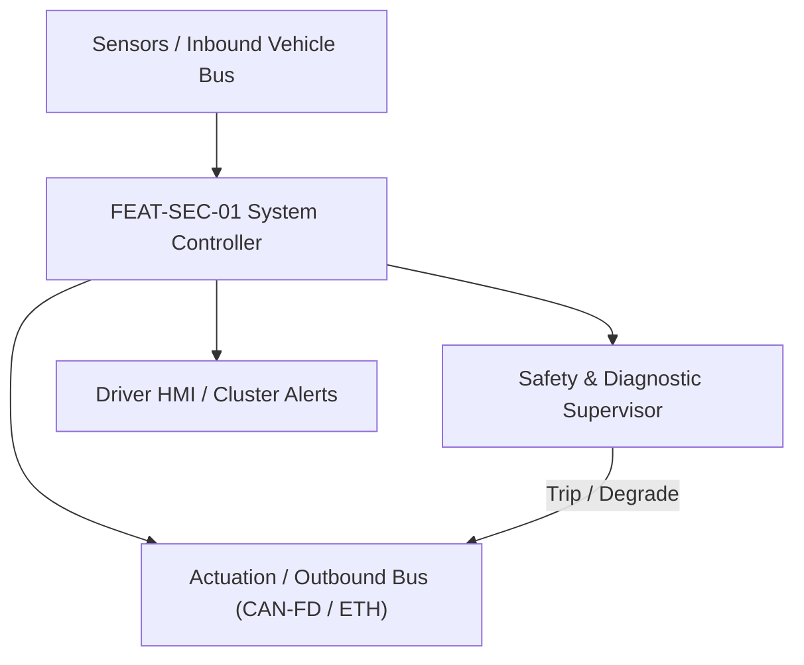
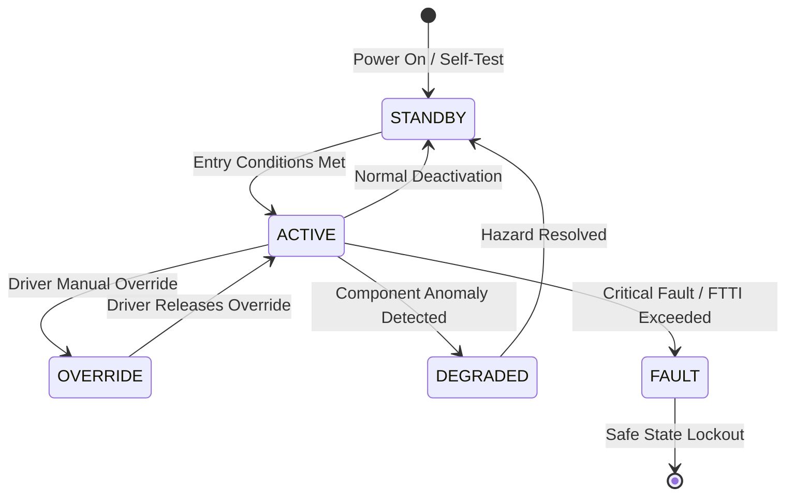

# System Requirements Specification: Central Security Gateway & SecOC Intrusion Detection
**Feature ID:** `FEAT-SEC-01`  
**Domain:** Connectivity, Security & Diagnostics  
**Target ASIL:** ASIL B / ISO 21434  
**Compliance Standard:** ISO 26262:2018 (Part 4 - System Development) / ASPICE PAM v3.1 (SYS.2, SYS.3)  
**Parent Master Specification:** [`spec.md`](file:///c:/Workset/AntiGravityProjects/TestOptimisationExperiement/spec.md#feat-sec-01-secoc)  
**Derived Software Specification:** [`FEAT-SEC-01_SecOC_SwReq.md`](file:///c:/Workset/AntiGravityProjects/TestOptimisationExperiement/software_requirements/FEAT-SEC-01_SecOC_SwReq.md)

---

## 1. Feature Overview & Operational Scope

Authenticates critical in-vehicle bus communication using AES-128-CMAC and monotonic freshness values, filtering unauthorized packets and detecting Denial-of-Service attacks.

### Operational Context Architecture

---

## 2. Activation Logic & Operational States

- **Preconditions:** Hardware Security Module (HSM) secure boot verified, cryptographic session keys loaded into hardware keystore.
- **Entry Conditions:** Central Gateway powered up and forwarding in-vehicle bus traffic.
- **Deactivation Conditions:** Gateway power down.
- **Driver Override Behavior:** UDS Diagnostic Security Access (Service 0x27) temporarily unlocks engineering routing tables upon valid cryptographic key handshake.
- **Operational State Progression:**  
  `SECURE_FORWARDING` -> `SYNC_FRESHNESS_EXCHANGE` -> `ANOMALY_LOGGING` -> `PORT_RATE_LIMITING` -> `INTRUSION_CONTAINMENT` -> `SECURITY_LOCKOUT`

### State Transition Diagram

---

## 3. Functional Safety & Failure Mitigation Concept

- **Functional Safety Goal:** SG-SEC-01: Prevent unauthorized command injection, replay attacks, or bus-flooding denial of service on safety-critical chassis and powertrain networks.
- **Fault Tolerant Time Interval (FTTI):** 10 ms
- **Safe State Definition:** Drop unauthenticated frames immediately; isolate compromised network segments.
- **Warning & Escalation Strategy:** Log RFC 5424 security event record into tamper-resistant security log; notify fleet SOC via telematics.

### Failure Modes & Degradation Handling
- **Freshness Counter Desync:** If freshness counter drifts outside acceptance window, initiate authenticated sync frame exchange.
- **Mac Verification Failure:** If received MAC does not match computed MAC, drop frame instantly in <= 1.0 ms and increment ECU security anomaly counter.

---

## 4. System Requirements (SYS_REQ)
*(Note: Each System Requirement is systematically partitioned into multiple Child Software Requirements)*

### `SYS-SEC-01-01`: AUTOSAR SecOC Cryptographic Message Authentication & Freshness Counter
- **Planned Release:** R100
- **ASIL Rating:** ASIL B / ISO 21434
- **Parent Feature:** [`FEAT-SEC-01`](file:///c:/Workset/AntiGravityProjects/TestOptimisationExperiement/spec.md#feat-sec-01)
- **Requirement Statement:**
  > The System SHALL compute and verify a 64-bit truncated AES-128-CMAC and monotonic Freshness Value on all safety-critical CAN-FD and SOME/IP messages with <= 1.0 ms processing latency per message.
- **Activation Logic:** Active at all times on safety-critical network interfaces.
- **Fault Tolerant Time Interval (FTTI):** 5 ms
- **Safe State Action:** Discard unauthenticated PDU; do not pass to application SWCs.
- **Failure Detection & Reaction:** If 5 consecutive verification failures occur from an ECU, flag ECU as compromised.
- **Input Interfaces:** `Raw_CANFD_Frame_Payload, Hardware_Keystore, Local_Freshness_Value_Manager`
- **Output Interfaces:** `SecOC_Verified_PDU, Verification_Result_Status (PASS/FAIL)`
- **System Verification Method:** CAN bus fuzzing, payload tampering, and replay injection test suite.
- **Derived Child Software Requirements (1:N Link):**
  - [`SWR-SEC-01-01`](file:///c:/Workset/AntiGravityProjects/TestOptimisationExperiement/software_requirements/FEAT-SEC-01_SecOC_SwReq.md#swr-sec-01-01)
  - [`SWR-SEC-01-02`](file:///c:/Workset/AntiGravityProjects/TestOptimisationExperiement/software_requirements/FEAT-SEC-01_SecOC_SwReq.md#swr-sec-01-02)

### `SYS-SEC-01-02`: Central Gateway Firewall Whitelist Filtering & DoS Rate Limiting
- **Planned Release:** R100
- **ASIL Rating:** QM / ISO 21434
- **Parent Feature:** [`FEAT-SEC-01`](file:///c:/Workset/AntiGravityProjects/TestOptimisationExperiement/spec.md#feat-sec-01)
- **Requirement Statement:**
  > The Central Gateway SHALL filter Ethernet SOME/IP and CAN-FD routing tables against a static whitelist, dropping unauthorized message IDs and rate-limiting broadcast packets exceeding 1000 msg/s.
- **Activation Logic:** Active across all gateway routing channels.
- **Fault Tolerant Time Interval (FTTI):** 10 ms
- **Safe State Action:** Halt routing on flooded port; preserve bandwidth on remaining critical ports.
- **Failure Detection & Reaction:** If port flood exceeds 5000 msg/s, isolate physical Ethernet switch port.
- **Input Interfaces:** `Inbound_Packet_Headers, Static_Routing_Whitelist_Table, Port_Traffic_Counters`
- **Output Interfaces:** `Forwarded_Network_Packets, Dropped_Frame_Counter, IDS_Security_Alert_Log`
- **System Verification Method:** Line-rate network traffic flood injection testing on Automotive Ethernet switch.
- **Derived Child Software Requirements (1:N Link):**
  - [`SWR-SEC-01-03`](file:///c:/Workset/AntiGravityProjects/TestOptimisationExperiement/software_requirements/FEAT-SEC-01_SecOC_SwReq.md#swr-sec-01-03)
  - [`SWR-SEC-01-04`](file:///c:/Workset/AntiGravityProjects/TestOptimisationExperiement/software_requirements/FEAT-SEC-01_SecOC_SwReq.md#swr-sec-01-04)

### `SYS-SEC-01-03`: Hardware Security Module (HSM) Isolated Key Store & Secure Boot
- **Planned Release:** R100
- **ASIL Rating:** ASIL D / ISO 21434
- **Parent Feature:** [`FEAT-SEC-01`](file:///c:/Workset/AntiGravityProjects/TestOptimisationExperiement/spec.md#feat-sec-01)
- **Requirement Statement:**
  > The System SHALL implement an isolated on-chip Hardware Security Module (HSM with dedicated crypto core, RAM, and ROM) storing symmetric AES-128 keys and private ECC keys, executing authenticated Secure Boot in <= 35 ms from reset to prevent untrusted firmware execution.
- **Activation Logic:** Continuous hardware root-of-trust from power-on reset.
- **Fault Tolerant Time Interval (FTTI):** 10 ms
- **Safe State Action:** Lock microcontroller in bootloader quarantine mode; assert external reset pin.
- **Failure Detection & Reaction:** If Secure Boot cryptographic signature check fails, halt execution and illuminate security indicator.
- **Input Interfaces:** `Reset_Vector_Trigger, HSM_Secure_ROM_Keys, Application_Flash_Signature`
- **Output Interfaces:** `Secure_Boot_Success_Flag (boolean), HSM_Isolated_Key_Handles`
- **System Verification Method:** Hardware side-channel analysis (DPA) and fault-injection glitched clock attack testing.
- **Derived Child Software Requirements (1:N Link):**
  - [`SWR-SEC-01-05`](file:///c:/Workset/AntiGravityProjects/TestOptimisationExperiement/software_requirements/FEAT-SEC-01_SecOC_SwReq.md#swr-sec-01-05)
  - [`SWR-SEC-01-06`](file:///c:/Workset/AntiGravityProjects/TestOptimisationExperiement/software_requirements/FEAT-SEC-01_SecOC_SwReq.md#swr-sec-01-06)

### `SYS-SEC-01-04`: Vehicle Network Intrusion Detection System (IDS) & Anomaly Firewall
- **Planned Release:** R200
- **ASIL Rating:** ISO 21434 / UNECE R155
- **Parent Feature:** [`FEAT-SEC-01`](file:///c:/Workset/AntiGravityProjects/TestOptimisationExperiement/spec.md#feat-sec-01)
- **Requirement Statement:**
  > The System SHALL monitor CAN-FD, LIN, and Automotive Ethernet traffic at line rate, detecting bus flooding (> 85% bus load), unexpected CAN ID spoofing, diagnostic service brute-force attempts, and unauthorized cyclic frame jitter, logging security events in <= 5 ms.
- **Activation Logic:** Active at all times on all external gateways.
- **Fault Tolerant Time Interval (FTTI):** 20 ms
- **Safe State Action:** Quarantine offending network segment; filter malicious frames at hardware gateway.
- **Failure Detection & Reaction:** Block corrupted CAN ID messages while keeping safety-critical chassis communication open.
- **Input Interfaces:** `Gateway_Ethernet_Packets, CANFD_Raw_Frames, Bus_Load_Counter_Array[8]`
- **Output Interfaces:** `IDS_Security_Alert_PDU, Firewall_Drop_Packet_Command, Intrusion_Severity_Enum`
- **System Verification Method:** Automotive penetration testing (CAN bus fuzzing, spoofing, denial-of-service attack suite).
- **Derived Child Software Requirements (1:N Link):**
  - [`SWR-SEC-01-07`](file:///c:/Workset/AntiGravityProjects/TestOptimisationExperiement/software_requirements/FEAT-SEC-01_SecOC_SwReq.md#swr-sec-01-07)
  - [`SWR-SEC-01-08`](file:///c:/Workset/AntiGravityProjects/TestOptimisationExperiement/software_requirements/FEAT-SEC-01_SecOC_SwReq.md#swr-sec-01-08)

### `SYS-SEC-01-05`: AUTOSAR Secure On-Board Communication (SecOC) AES-128 CMAC Verifier
- **Planned Release:** R200
- **ASIL Rating:** ASIL B
- **Parent Feature:** [`FEAT-SEC-01`](file:///c:/Workset/AntiGravityProjects/TestOptimisationExperiement/spec.md#feat-sec-01)
- **Requirement Statement:**
  > The System SHALL Verify 64-bit truncated AES-128 CMAC on critical chassis and powertrain CAN-FD frames in <= 2.0 ms.
- **Activation Logic:** Active during normal vehicle operation when feature state is active.
- **Fault Tolerant Time Interval (FTTI):** 5 ms
- **Safe State Action:** Transition to safe state or safe degradation tier within FTTI budget.
- **Failure Detection & Reaction:** Isolate faulted channel, latch DEM diagnostic trouble code, and inform driver.
- **Input Interfaces:** `Sensor signals, vehicle dynamics data, and bus frames via RTE.`
- **Output Interfaces:** `Actuator commands, diagnostic event flags, and cluster alerts.`
- **System Verification Method:** HiL test bench and dynamometer automated verification.
- **Derived Child Software Requirements (1:N Link):**
  - [`SWR-SEC-01-09`](file:///c:/Workset/AntiGravityProjects/TestOptimisationExperiement/software_requirements/FEAT-SEC-01_SecOC_SwReq.md#swr-sec-01-09)
  - [`SWR-SEC-01-10`](file:///c:/Workset/AntiGravityProjects/TestOptimisationExperiement/software_requirements/FEAT-SEC-01_SecOC_SwReq.md#swr-sec-01-10)

### `SYS-SEC-01-06`: SecOC Freshness Value Manager (FVM) Synchronization & Trip Counter Engine
- **Planned Release:** R200
- **ASIL Rating:** ASIL B
- **Parent Feature:** [`FEAT-SEC-01`](file:///c:/Workset/AntiGravityProjects/TestOptimisationExperiement/spec.md#feat-sec-01)
- **Requirement Statement:**
  > The System SHALL Manage synchronized monotonic trip counter and reset counters to eliminate message replay attacks.
- **Activation Logic:** Active during normal vehicle operation when feature state is active.
- **Fault Tolerant Time Interval (FTTI):** 5 ms
- **Safe State Action:** Transition to safe state or safe degradation tier within FTTI budget.
- **Failure Detection & Reaction:** Isolate faulted channel, latch DEM diagnostic trouble code, and inform driver.
- **Input Interfaces:** `Sensor signals, vehicle dynamics data, and bus frames via RTE.`
- **Output Interfaces:** `Actuator commands, diagnostic event flags, and cluster alerts.`
- **System Verification Method:** HiL test bench and dynamometer automated verification.
- **Derived Child Software Requirements (1:N Link):**
  - [`SWR-SEC-01-11`](file:///c:/Workset/AntiGravityProjects/TestOptimisationExperiement/software_requirements/FEAT-SEC-01_SecOC_SwReq.md#swr-sec-01-11)
  - [`SWR-SEC-01-12`](file:///c:/Workset/AntiGravityProjects/TestOptimisationExperiement/software_requirements/FEAT-SEC-01_SecOC_SwReq.md#swr-sec-01-12)

### `SYS-SEC-01-07`: Central Security Gateway CAN-FD / Ethernet Stateful Packet Firewall
- **Planned Release:** R300
- **ASIL Rating:** ASIL B
- **Parent Feature:** [`FEAT-SEC-01`](file:///c:/Workset/AntiGravityProjects/TestOptimisationExperiement/spec.md#feat-sec-01)
- **Requirement Statement:**
  > The System SHALL Filter network traffic across domain buses: Drop unauthorized CAN IDs and illegal payload formats in < 1 ms.
- **Activation Logic:** Active during normal vehicle operation when feature state is active.
- **Fault Tolerant Time Interval (FTTI):** 2 ms
- **Safe State Action:** Transition to safe state or safe degradation tier within FTTI budget.
- **Failure Detection & Reaction:** Isolate faulted channel, latch DEM diagnostic trouble code, and inform driver.
- **Input Interfaces:** `Sensor signals, vehicle dynamics data, and bus frames via RTE.`
- **Output Interfaces:** `Actuator commands, diagnostic event flags, and cluster alerts.`
- **System Verification Method:** HiL test bench and dynamometer automated verification.
- **Derived Child Software Requirements (1:N Link):**
  - [`SWR-SEC-01-13`](file:///c:/Workset/AntiGravityProjects/TestOptimisationExperiement/software_requirements/FEAT-SEC-01_SecOC_SwReq.md#swr-sec-01-13)
  - [`SWR-SEC-01-14`](file:///c:/Workset/AntiGravityProjects/TestOptimisationExperiement/software_requirements/FEAT-SEC-01_SecOC_SwReq.md#swr-sec-01-14)

### `SYS-SEC-01-08`: Hardware Security Module (HSM) Cryptographic Key Storage & Secure Boot Interlock
- **Planned Release:** R300
- **ASIL Rating:** ASIL B
- **Parent Feature:** [`FEAT-SEC-01`](file:///c:/Workset/AntiGravityProjects/TestOptimisationExperiement/spec.md#feat-sec-01)
- **Requirement Statement:**
  > The System SHALL Secure cryptographic root keys in tamper-proof HSM silicon; execute secure boot chain of trust.
- **Activation Logic:** Active during normal vehicle operation when feature state is active.
- **Fault Tolerant Time Interval (FTTI):** 10 ms
- **Safe State Action:** Transition to safe state or safe degradation tier within FTTI budget.
- **Failure Detection & Reaction:** Isolate faulted channel, latch DEM diagnostic trouble code, and inform driver.
- **Input Interfaces:** `Sensor signals, vehicle dynamics data, and bus frames via RTE.`
- **Output Interfaces:** `Actuator commands, diagnostic event flags, and cluster alerts.`
- **System Verification Method:** HiL test bench and dynamometer automated verification.
- **Derived Child Software Requirements (1:N Link):**
  - [`SWR-SEC-01-15`](file:///c:/Workset/AntiGravityProjects/TestOptimisationExperiement/software_requirements/FEAT-SEC-01_SecOC_SwReq.md#swr-sec-01-15)
  - [`SWR-SEC-01-16`](file:///c:/Workset/AntiGravityProjects/TestOptimisationExperiement/software_requirements/FEAT-SEC-01_SecOC_SwReq.md#swr-sec-01-16)

### `SYS-SEC-01-09`: Controller Area Network Intrusion Detection System (CAN-IDS) Rate Anomaly Detector
- **Planned Release:** R300
- **ASIL Rating:** ASIL B
- **Parent Feature:** [`FEAT-SEC-01`](file:///c:/Workset/AntiGravityProjects/TestOptimisationExperiement/spec.md#feat-sec-01)
- **Requirement Statement:**
  > The System SHALL Detect bus flooding attacks, frame frequency anomalies, and spoofed diagnostic requests on CAN buses.
- **Activation Logic:** Active during normal vehicle operation when feature state is active.
- **Fault Tolerant Time Interval (FTTI):** 5 ms
- **Safe State Action:** Transition to safe state or safe degradation tier within FTTI budget.
- **Failure Detection & Reaction:** Isolate faulted channel, latch DEM diagnostic trouble code, and inform driver.
- **Input Interfaces:** `Sensor signals, vehicle dynamics data, and bus frames via RTE.`
- **Output Interfaces:** `Actuator commands, diagnostic event flags, and cluster alerts.`
- **System Verification Method:** HiL test bench and dynamometer automated verification.
- **Derived Child Software Requirements (1:N Link):**
  - [`SWR-SEC-01-17`](file:///c:/Workset/AntiGravityProjects/TestOptimisationExperiement/software_requirements/FEAT-SEC-01_SecOC_SwReq.md#swr-sec-01-17)
  - [`SWR-SEC-01-18`](file:///c:/Workset/AntiGravityProjects/TestOptimisationExperiement/software_requirements/FEAT-SEC-01_SecOC_SwReq.md#swr-sec-01-18)

### `SYS-SEC-01-10`: Automotive Ethernet IEEE 802.1Q MACsec Hardware Encryption Layer
- **Planned Release:** R400
- **ASIL Rating:** ASIL B
- **Parent Feature:** [`FEAT-SEC-01`](file:///c:/Workset/AntiGravityProjects/TestOptimisationExperiement/spec.md#feat-sec-01)
- **Requirement Statement:**
  > The System SHALL Encrypt inter-domain Ethernet communications at wire speed (100/1000BASE-T1) using MACsec GCM-AES.
- **Activation Logic:** Active during normal vehicle operation when feature state is active.
- **Fault Tolerant Time Interval (FTTI):** 2 ms
- **Safe State Action:** Transition to safe state or safe degradation tier within FTTI budget.
- **Failure Detection & Reaction:** Isolate faulted channel, latch DEM diagnostic trouble code, and inform driver.
- **Input Interfaces:** `Sensor signals, vehicle dynamics data, and bus frames via RTE.`
- **Output Interfaces:** `Actuator commands, diagnostic event flags, and cluster alerts.`
- **System Verification Method:** HiL test bench and dynamometer automated verification.
- **Derived Child Software Requirements (1:N Link):**
  - [`SWR-SEC-01-19`](file:///c:/Workset/AntiGravityProjects/TestOptimisationExperiement/software_requirements/FEAT-SEC-01_SecOC_SwReq.md#swr-sec-01-19)
  - [`SWR-SEC-01-20`](file:///c:/Workset/AntiGravityProjects/TestOptimisationExperiement/software_requirements/FEAT-SEC-01_SecOC_SwReq.md#swr-sec-01-20)

### `SYS-SEC-01-11`: Diagnostic Service UDS $27 SecurityAccess 256-Bit Challenge-Response Engine
- **Planned Release:** R500
- **ASIL Rating:** ASIL B
- **Parent Feature:** [`FEAT-SEC-01`](file:///c:/Workset/AntiGravityProjects/TestOptimisationExperiement/spec.md#feat-sec-01)
- **Requirement Statement:**
  > The System SHALL Generate cryptographic pseudo-random seed and authenticate workshop tool response before unlock.
- **Activation Logic:** Active during normal vehicle operation when feature state is active.
- **Fault Tolerant Time Interval (FTTI):** 50 ms
- **Safe State Action:** Transition to safe state or safe degradation tier within FTTI budget.
- **Failure Detection & Reaction:** Isolate faulted channel, latch DEM diagnostic trouble code, and inform driver.
- **Input Interfaces:** `Sensor signals, vehicle dynamics data, and bus frames via RTE.`
- **Output Interfaces:** `Actuator commands, diagnostic event flags, and cluster alerts.`
- **System Verification Method:** HiL test bench and dynamometer automated verification.
- **Derived Child Software Requirements (1:N Link):**
  - [`SWR-SEC-01-21`](file:///c:/Workset/AntiGravityProjects/TestOptimisationExperiement/software_requirements/FEAT-SEC-01_SecOC_SwReq.md#swr-sec-01-21)
  - [`SWR-SEC-01-22`](file:///c:/Workset/AntiGravityProjects/TestOptimisationExperiement/software_requirements/FEAT-SEC-01_SecOC_SwReq.md#swr-sec-01-22)

### `SYS-SEC-01-12`: Security Gateway Cyber Incident Logging & Intrusion Detection Dispatcher (IDS-M)
- **Planned Release:** R400
- **ASIL Rating:** ASIL B
- **Parent Feature:** [`FEAT-SEC-01`](file:///c:/Workset/AntiGravityProjects/TestOptimisationExperiement/spec.md#feat-sec-01)
- **Requirement Statement:**
  > The System SHALL Aggregate security events from ECUs and transmit standardized IDS-M security reports to backend SIEM.
- **Activation Logic:** Active during normal vehicle operation when feature state is active.
- **Fault Tolerant Time Interval (FTTI):** 100 ms
- **Safe State Action:** Transition to safe state or safe degradation tier within FTTI budget.
- **Failure Detection & Reaction:** Isolate faulted channel, latch DEM diagnostic trouble code, and inform driver.
- **Input Interfaces:** `Sensor signals, vehicle dynamics data, and bus frames via RTE.`
- **Output Interfaces:** `Actuator commands, diagnostic event flags, and cluster alerts.`
- **System Verification Method:** HiL test bench and dynamometer automated verification.
- **Derived Child Software Requirements (1:N Link):**
  - [`SWR-SEC-01-23`](file:///c:/Workset/AntiGravityProjects/TestOptimisationExperiement/software_requirements/FEAT-SEC-01_SecOC_SwReq.md#swr-sec-01-23)
  - [`SWR-SEC-01-24`](file:///c:/Workset/AntiGravityProjects/TestOptimisationExperiement/software_requirements/FEAT-SEC-01_SecOC_SwReq.md#swr-sec-01-24)

### `SYS-SEC-01-13`: Automotive Denial-of-Service (DoS) Bus-Off Prevention & Babbling Idiot Clamp
- **Planned Release:** R500
- **ASIL Rating:** ASIL B
- **Parent Feature:** [`FEAT-SEC-01`](file:///c:/Workset/AntiGravityProjects/TestOptimisationExperiement/spec.md#feat-sec-01)
- **Requirement Statement:**
  > The System SHALL Isolate babbling idiot transceivers within <= 5 ms by opening transceiver bus disconnect switches.
- **Activation Logic:** Active during normal vehicle operation when feature state is active.
- **Fault Tolerant Time Interval (FTTI):** 5 ms
- **Safe State Action:** Transition to safe state or safe degradation tier within FTTI budget.
- **Failure Detection & Reaction:** Isolate faulted channel, latch DEM diagnostic trouble code, and inform driver.
- **Input Interfaces:** `Sensor signals, vehicle dynamics data, and bus frames via RTE.`
- **Output Interfaces:** `Actuator commands, diagnostic event flags, and cluster alerts.`
- **System Verification Method:** HiL test bench and dynamometer automated verification.
- **Derived Child Software Requirements (1:N Link):**
  - [`SWR-SEC-01-25`](file:///c:/Workset/AntiGravityProjects/TestOptimisationExperiement/software_requirements/FEAT-SEC-01_SecOC_SwReq.md#swr-sec-01-25)
  - [`SWR-SEC-01-26`](file:///c:/Workset/AntiGravityProjects/TestOptimisationExperiement/software_requirements/FEAT-SEC-01_SecOC_SwReq.md#swr-sec-01-26)

### `SYS-SEC-01-14`: Diagnostic Port (OBD-II) Hardware Physical Access Firewalled Gateway Gatekeeper
- **Planned Release:** R500
- **ASIL Rating:** ASIL B
- **Parent Feature:** [`FEAT-SEC-01`](file:///c:/Workset/AntiGravityProjects/TestOptimisationExperiement/spec.md#feat-sec-01)
- **Requirement Statement:**
  > The System SHALL Lock down OBD-II diagnostic port from accessing internal vehicle control networks while moving.
- **Activation Logic:** Active during normal vehicle operation when feature state is active.
- **Fault Tolerant Time Interval (FTTI):** 20 ms
- **Safe State Action:** Transition to safe state or safe degradation tier within FTTI budget.
- **Failure Detection & Reaction:** Isolate faulted channel, latch DEM diagnostic trouble code, and inform driver.
- **Input Interfaces:** `Sensor signals, vehicle dynamics data, and bus frames via RTE.`
- **Output Interfaces:** `Actuator commands, diagnostic event flags, and cluster alerts.`
- **System Verification Method:** HiL test bench and dynamometer automated verification.
- **Derived Child Software Requirements (1:N Link):**
  - [`SWR-SEC-01-27`](file:///c:/Workset/AntiGravityProjects/TestOptimisationExperiement/software_requirements/FEAT-SEC-01_SecOC_SwReq.md#swr-sec-01-27)
  - [`SWR-SEC-01-28`](file:///c:/Workset/AntiGravityProjects/TestOptimisationExperiement/software_requirements/FEAT-SEC-01_SecOC_SwReq.md#swr-sec-01-28)

### `SYS-SEC-01-15`: DEM Cybersecurity Event Diagnostic Event Manager & Security Quorum Buffer
- **Planned Release:** R500
- **ASIL Rating:** ASIL B
- **Parent Feature:** [`FEAT-SEC-01`](file:///c:/Workset/AntiGravityProjects/TestOptimisationExperiement/spec.md#feat-sec-01)
- **Requirement Statement:**
  > The System SHALL Log security violation trouble codes and trigger protective limp-home mode upon severe bus attack.
- **Activation Logic:** Active during normal vehicle operation when feature state is active.
- **Fault Tolerant Time Interval (FTTI):** 50 ms
- **Safe State Action:** Transition to safe state or safe degradation tier within FTTI budget.
- **Failure Detection & Reaction:** Isolate faulted channel, latch DEM diagnostic trouble code, and inform driver.
- **Input Interfaces:** `Sensor signals, vehicle dynamics data, and bus frames via RTE.`
- **Output Interfaces:** `Actuator commands, diagnostic event flags, and cluster alerts.`
- **System Verification Method:** HiL test bench and dynamometer automated verification.
- **Derived Child Software Requirements (1:N Link):**
  - [`SWR-SEC-01-29`](file:///c:/Workset/AntiGravityProjects/TestOptimisationExperiement/software_requirements/FEAT-SEC-01_SecOC_SwReq.md#swr-sec-01-29)
  - [`SWR-SEC-01-30`](file:///c:/Workset/AntiGravityProjects/TestOptimisationExperiement/software_requirements/FEAT-SEC-01_SecOC_SwReq.md#swr-sec-01-30)

---

## 5. System-to-Software Traceability Summary

| System Requirement ID | Planned Release | ASIL | Title | Derived Software Requirements (1:N) | Verification Method |
| :--- | :---: | :--- | :--- | :--- | :--- |
| `SYS-SEC-01-01` | **`R100`** | ASIL B / ISO 21434 | AUTOSAR SecOC Cryptographic Message Authentication & Freshness Counter | [`SWR-SEC-01-01`](file:///c:/Workset/AntiGravityProjects/TestOptimisationExperiement/software_requirements/FEAT-SEC-01_SecOC_SwReq.md#swr-sec-01-01), [`SWR-SEC-01-02`](file:///c:/Workset/AntiGravityProjects/TestOptimisationExperiement/software_requirements/FEAT-SEC-01_SecOC_SwReq.md#swr-sec-01-02) | CAN bus fuzzing, payload tampering, and replay injection test suite. |
| `SYS-SEC-01-02` | **`R100`** | QM / ISO 21434 | Central Gateway Firewall Whitelist Filtering & DoS Rate Limiting | [`SWR-SEC-01-03`](file:///c:/Workset/AntiGravityProjects/TestOptimisationExperiement/software_requirements/FEAT-SEC-01_SecOC_SwReq.md#swr-sec-01-03), [`SWR-SEC-01-04`](file:///c:/Workset/AntiGravityProjects/TestOptimisationExperiement/software_requirements/FEAT-SEC-01_SecOC_SwReq.md#swr-sec-01-04) | Line-rate network traffic flood injection testing on Automotive Ethernet switch. |
| `SYS-SEC-01-03` | **`R100`** | ASIL D / ISO 21434 | Hardware Security Module (HSM) Isolated Key Store & Secure Boot | [`SWR-SEC-01-05`](file:///c:/Workset/AntiGravityProjects/TestOptimisationExperiement/software_requirements/FEAT-SEC-01_SecOC_SwReq.md#swr-sec-01-05), [`SWR-SEC-01-06`](file:///c:/Workset/AntiGravityProjects/TestOptimisationExperiement/software_requirements/FEAT-SEC-01_SecOC_SwReq.md#swr-sec-01-06) | Hardware side-channel analysis (DPA) and fault-injection glitched clock attack testing. |
| `SYS-SEC-01-04` | **`R200`** | ISO 21434 / UNECE R155 | Vehicle Network Intrusion Detection System (IDS) & Anomaly Firewall | [`SWR-SEC-01-07`](file:///c:/Workset/AntiGravityProjects/TestOptimisationExperiement/software_requirements/FEAT-SEC-01_SecOC_SwReq.md#swr-sec-01-07), [`SWR-SEC-01-08`](file:///c:/Workset/AntiGravityProjects/TestOptimisationExperiement/software_requirements/FEAT-SEC-01_SecOC_SwReq.md#swr-sec-01-08) | Automotive penetration testing (CAN bus fuzzing, spoofing, denial-of-service attack suite). |
| `SYS-SEC-01-05` | **`R200`** | ASIL B | AUTOSAR Secure On-Board Communication (SecOC) AES-128 CMAC Verifier | [`SWR-SEC-01-09`](file:///c:/Workset/AntiGravityProjects/TestOptimisationExperiement/software_requirements/FEAT-SEC-01_SecOC_SwReq.md#swr-sec-01-09), [`SWR-SEC-01-10`](file:///c:/Workset/AntiGravityProjects/TestOptimisationExperiement/software_requirements/FEAT-SEC-01_SecOC_SwReq.md#swr-sec-01-10) | HiL test bench and dynamometer automated verification. |
| `SYS-SEC-01-06` | **`R200`** | ASIL B | SecOC Freshness Value Manager (FVM) Synchronization & Trip Counter Engine | [`SWR-SEC-01-11`](file:///c:/Workset/AntiGravityProjects/TestOptimisationExperiement/software_requirements/FEAT-SEC-01_SecOC_SwReq.md#swr-sec-01-11), [`SWR-SEC-01-12`](file:///c:/Workset/AntiGravityProjects/TestOptimisationExperiement/software_requirements/FEAT-SEC-01_SecOC_SwReq.md#swr-sec-01-12) | HiL test bench and dynamometer automated verification. |
| `SYS-SEC-01-07` | **`R300`** | ASIL B | Central Security Gateway CAN-FD / Ethernet Stateful Packet Firewall | [`SWR-SEC-01-13`](file:///c:/Workset/AntiGravityProjects/TestOptimisationExperiement/software_requirements/FEAT-SEC-01_SecOC_SwReq.md#swr-sec-01-13), [`SWR-SEC-01-14`](file:///c:/Workset/AntiGravityProjects/TestOptimisationExperiement/software_requirements/FEAT-SEC-01_SecOC_SwReq.md#swr-sec-01-14) | HiL test bench and dynamometer automated verification. |
| `SYS-SEC-01-08` | **`R300`** | ASIL B | Hardware Security Module (HSM) Cryptographic Key Storage & Secure Boot Interlock | [`SWR-SEC-01-15`](file:///c:/Workset/AntiGravityProjects/TestOptimisationExperiement/software_requirements/FEAT-SEC-01_SecOC_SwReq.md#swr-sec-01-15), [`SWR-SEC-01-16`](file:///c:/Workset/AntiGravityProjects/TestOptimisationExperiement/software_requirements/FEAT-SEC-01_SecOC_SwReq.md#swr-sec-01-16) | HiL test bench and dynamometer automated verification. |
| `SYS-SEC-01-09` | **`R300`** | ASIL B | Controller Area Network Intrusion Detection System (CAN-IDS) Rate Anomaly Detector | [`SWR-SEC-01-17`](file:///c:/Workset/AntiGravityProjects/TestOptimisationExperiement/software_requirements/FEAT-SEC-01_SecOC_SwReq.md#swr-sec-01-17), [`SWR-SEC-01-18`](file:///c:/Workset/AntiGravityProjects/TestOptimisationExperiement/software_requirements/FEAT-SEC-01_SecOC_SwReq.md#swr-sec-01-18) | HiL test bench and dynamometer automated verification. |
| `SYS-SEC-01-10` | **`R400`** | ASIL B | Automotive Ethernet IEEE 802.1Q MACsec Hardware Encryption Layer | [`SWR-SEC-01-19`](file:///c:/Workset/AntiGravityProjects/TestOptimisationExperiement/software_requirements/FEAT-SEC-01_SecOC_SwReq.md#swr-sec-01-19), [`SWR-SEC-01-20`](file:///c:/Workset/AntiGravityProjects/TestOptimisationExperiement/software_requirements/FEAT-SEC-01_SecOC_SwReq.md#swr-sec-01-20) | HiL test bench and dynamometer automated verification. |
| `SYS-SEC-01-11` | **`R500`** | ASIL B | Diagnostic Service UDS $27 SecurityAccess 256-Bit Challenge-Response Engine | [`SWR-SEC-01-21`](file:///c:/Workset/AntiGravityProjects/TestOptimisationExperiement/software_requirements/FEAT-SEC-01_SecOC_SwReq.md#swr-sec-01-21), [`SWR-SEC-01-22`](file:///c:/Workset/AntiGravityProjects/TestOptimisationExperiement/software_requirements/FEAT-SEC-01_SecOC_SwReq.md#swr-sec-01-22) | HiL test bench and dynamometer automated verification. |
| `SYS-SEC-01-12` | **`R400`** | ASIL B | Security Gateway Cyber Incident Logging & Intrusion Detection Dispatcher (IDS-M) | [`SWR-SEC-01-23`](file:///c:/Workset/AntiGravityProjects/TestOptimisationExperiement/software_requirements/FEAT-SEC-01_SecOC_SwReq.md#swr-sec-01-23), [`SWR-SEC-01-24`](file:///c:/Workset/AntiGravityProjects/TestOptimisationExperiement/software_requirements/FEAT-SEC-01_SecOC_SwReq.md#swr-sec-01-24) | HiL test bench and dynamometer automated verification. |
| `SYS-SEC-01-13` | **`R500`** | ASIL B | Automotive Denial-of-Service (DoS) Bus-Off Prevention & Babbling Idiot Clamp | [`SWR-SEC-01-25`](file:///c:/Workset/AntiGravityProjects/TestOptimisationExperiement/software_requirements/FEAT-SEC-01_SecOC_SwReq.md#swr-sec-01-25), [`SWR-SEC-01-26`](file:///c:/Workset/AntiGravityProjects/TestOptimisationExperiement/software_requirements/FEAT-SEC-01_SecOC_SwReq.md#swr-sec-01-26) | HiL test bench and dynamometer automated verification. |
| `SYS-SEC-01-14` | **`R500`** | ASIL B | Diagnostic Port (OBD-II) Hardware Physical Access Firewalled Gateway Gatekeeper | [`SWR-SEC-01-27`](file:///c:/Workset/AntiGravityProjects/TestOptimisationExperiement/software_requirements/FEAT-SEC-01_SecOC_SwReq.md#swr-sec-01-27), [`SWR-SEC-01-28`](file:///c:/Workset/AntiGravityProjects/TestOptimisationExperiement/software_requirements/FEAT-SEC-01_SecOC_SwReq.md#swr-sec-01-28) | HiL test bench and dynamometer automated verification. |
| `SYS-SEC-01-15` | **`R500`** | ASIL B | DEM Cybersecurity Event Diagnostic Event Manager & Security Quorum Buffer | [`SWR-SEC-01-29`](file:///c:/Workset/AntiGravityProjects/TestOptimisationExperiement/software_requirements/FEAT-SEC-01_SecOC_SwReq.md#swr-sec-01-29), [`SWR-SEC-01-30`](file:///c:/Workset/AntiGravityProjects/TestOptimisationExperiement/software_requirements/FEAT-SEC-01_SecOC_SwReq.md#swr-sec-01-30) | HiL test bench and dynamometer automated verification. |

- **Upstream Feature Link:** [`spec.md` (FEAT-SEC-01)](file:///c:/Workset/AntiGravityProjects/TestOptimisationExperiement/spec.md#feat-sec-01)
- **Software Requirements Specification:** [`FEAT-SEC-01_SecOC_SwReq.md`](file:///c:/Workset/AntiGravityProjects/TestOptimisationExperiement/software_requirements/FEAT-SEC-01_SecOC_SwReq.md)
