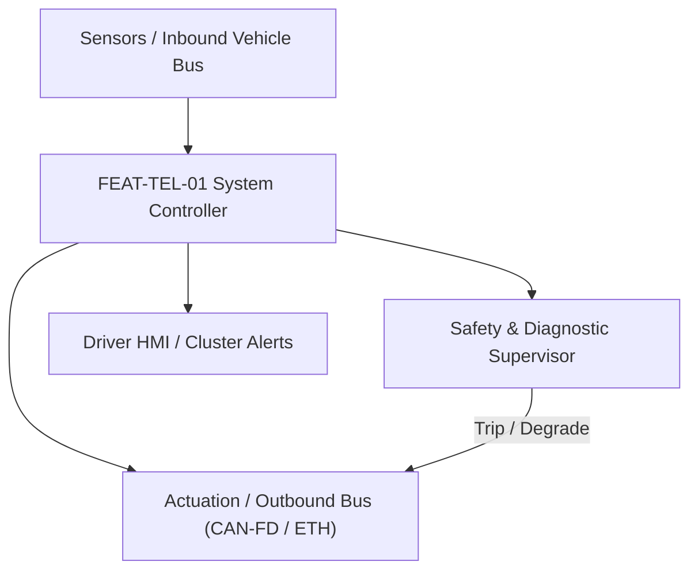
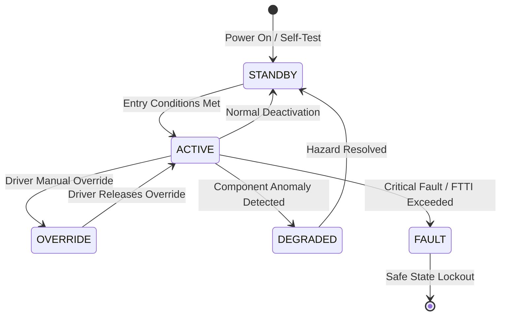

# System Requirements Specification: Firmware Over-The-Air (FOTA) Update Orchestrator
**Feature ID:** `FEAT-TEL-01`  
**Domain:** Connectivity, Security & Diagnostics  
**Target ASIL:** ASIL B / ISO 21434 / UNECE R156  
**Compliance Standard:** ISO 26262:2018 (Part 4 - System Development) / ASPICE PAM v3.1 (SYS.2, SYS.3)  
**Parent Master Specification:** [`spec.md`](file:///c:/Workset/AntiGravityProjects/TestOptimisationExperiement/spec.md#feat-tel-01-fota)  
**Derived Software Specification:** [`FEAT-TEL-01_FOTA_SwReq.md`](file:///c:/Workset/AntiGravityProjects/TestOptimisationExperiement/software_requirements/FEAT-TEL-01_FOTA_SwReq.md)

---

## 1. Feature Overview & Operational Scope

Downloads, cryptographically verifies, stages, and flashes firmware updates across vehicle ECUs with A/B dual-bank memory rollback protection.

### Operational Context Architecture

---

## 2. Activation Logic & Operational States

- **Preconditions:** Vehicle parked in PARK, battery SOC > 50%, 12V auxiliary battery > 12.4V, vehicle speed == 0 km/h, cellular connection stable.
- **Entry Conditions:** Cloud manifest downloaded and verified; user confirms 'Update Now' or scheduled overnight install window opens.
- **Deactivation Conditions:** Update sequence successfully completed, or pre-condition violation forces abort prior to flashing.
- **Driver Override Behavior:** Driver opening door or turning ignition on during installation is prohibited by software lock until critical flashing phase completes.
- **Operational State Progression:**  
  `IDLE_CHECKING` -> `DOWNLOADING_CHUNKS` -> `CRYPTO_VERIFICATION` -> `USER_CONSENT_PENDING` -> `PRECONDITION_GATEWAY` -> `FLASHING_BANK_B` -> `POST_INSTALL_VERIFICATION` -> `ROLLBACK_EXECUTION`

### State Transition Diagram

---

## 3. Functional Safety & Failure Mitigation Concept

- **Functional Safety Goal:** SG-FOTA-01: Prevent execution of corrupted or malicious firmware; prevent bricking ECUs; prevent vehicle immobilization.
- **Fault Tolerant Time Interval (FTTI):** N/A (Quiescent safe state)
- **Safe State Definition:** Autonomous hardware watchdog rollback to intact Bank A flash memory if new Bank B fails post-install boot self-test.
- **Warning & Escalation Strategy:** Display install countdown on central screen; warning 'Do Not Drive - Update in Progress (Est: 20 min)'.

### Failure Modes & Degradation Handling
- **Power Loss During Flashing:** Target ECUs utilize A/B dual-bank flash; power interruption leaves original Bank A untouched, allowing instant reboot.
- **Signature Verification Failure:** If binary SHA-256 hash or RSA-4096 signature check fails, delete staged chunks immediately and report security audit alert.

---

## 4. System Requirements (SYS_REQ)
*(Note: Each System Requirement is systematically partitioned into multiple Child Software Requirements)*

### `SYS-TEL-01-01`: Cryptographic Package Signature & Integrity Verification
- **Planned Release:** R100
- **ASIL Rating:** ISO 21434 / ASIL B
- **Parent Feature:** [`FEAT-TEL-01`](file:///c:/Workset/AntiGravityProjects/TestOptimisationExperiement/spec.md#feat-tel-01)
- **Requirement Statement:**
  > The System SHALL verify digital signatures of received update manifests and firmware binaries using RSA-4096 / ECDSA-P384 and SHA-256 with Hardware Security Module (HSM) root-of-trust prior to staging.
- **Activation Logic:** Active upon completion of download package assembly.
- **Fault Tolerant Time Interval (FTTI):** N/A
- **Safe State Action:** Purge staged flash memory; report failed authentication to cloud backend.
- **Failure Detection & Reaction:** If root certificate chain is invalid, terminate session and quarantine package.
- **Input Interfaces:** `5G_Modem_Package_Stream, HSM_Root_Public_Key, Manifest_XML_Signature`
- **Output Interfaces:** `Package_Integrity_Confirmed (boolean), Decrypted_Binary_Stream`
- **System Verification Method:** Penetration testing with tampered bytes and forged digital certificates.
- **Derived Child Software Requirements (1:N Link):**
  - [`SWR-TEL-01-01`](file:///c:/Workset/AntiGravityProjects/TestOptimisationExperiement/software_requirements/FEAT-TEL-01_FOTA_SwReq.md#swr-tel-01-01)
  - [`SWR-TEL-01-02`](file:///c:/Workset/AntiGravityProjects/TestOptimisationExperiement/software_requirements/FEAT-TEL-01_FOTA_SwReq.md#swr-tel-01-02)

### `SYS-TEL-01-02`: Vehicle Pre-Condition Safety Interlocks Verification
- **Planned Release:** R100
- **ASIL Rating:** ASIL B
- **Parent Feature:** [`FEAT-TEL-01`](file:///c:/Workset/AntiGravityProjects/TestOptimisationExperiement/spec.md#feat-tel-01)
- **Requirement Statement:**
  > The System SHALL prohibit flash execution unless: Vehicle in PARK, Vehicle Speed == 0 km/h, 12V Battery >= 12.4V, High-Voltage SOC >= 50%, Hazard Lights functional, and driver consent confirmed.
- **Activation Logic:** Active immediately prior to initiating flashing sequence.
- **Fault Tolerant Time Interval (FTTI):** 100 ms
- **Safe State Action:** Abort update; keep vehicle in drivable state.
- **Failure Detection & Reaction:** If 12V battery drops below 12.0V during staging, abort update and engage 12V DC-DC charger.
- **Input Interfaces:** `Gear_Position_PRND, Vehicle_Speed_Mps, Battery_12V_Voltage, Battery_HV_SOC`
- **Output Interfaces:** `Preconditions_Satisfied (boolean), Blocked_Precondition_Code`
- **System Verification Method:** Boundary test suite across gear selections, vehicle speeds, and battery voltages.
- **Derived Child Software Requirements (1:N Link):**
  - [`SWR-TEL-01-03`](file:///c:/Workset/AntiGravityProjects/TestOptimisationExperiement/software_requirements/FEAT-TEL-01_FOTA_SwReq.md#swr-tel-01-03)
  - [`SWR-TEL-01-04`](file:///c:/Workset/AntiGravityProjects/TestOptimisationExperiement/software_requirements/FEAT-TEL-01_FOTA_SwReq.md#swr-tel-01-04)

### `SYS-TEL-01-03`: A/B Dual-Bank Flash Orchestration & Self-Test Rollback
- **Planned Release:** R100
- **ASIL Rating:** ASIL B
- **Parent Feature:** [`FEAT-TEL-01`](file:///c:/Workset/AntiGravityProjects/TestOptimisationExperiement/spec.md#feat-tel-01)
- **Requirement Statement:**
  > The System SHALL write new software into secondary flash bank (Bank B). If target ECU fails startup self-tests within 60 seconds post-boot, the system SHALL autonomously revert boot flags to Bank A in <= 5 seconds.
- **Activation Logic:** Active during flashing and reboot verification.
- **Fault Tolerant Time Interval (FTTI):** 5000 ms
- **Safe State Action:** Revert to known good Bank A firmware; restore full vehicle drivability.
- **Failure Detection & Reaction:** If Bank B crashes micro, hardware watchdog toggles boot pin to Bank A.
- **Input Interfaces:** `Post_Boot_Health_PDU, Target_ECU_UDS_Diagnostic_Status, Boot_Timer_Sec`
- **Output Interfaces:** `Active_Bank_Select_Register, Flash_Rollback_Audit_Code`
- **System Verification Method:** Power cut and intentional corrupt binary injection during flash updates.
- **Derived Child Software Requirements (1:N Link):**
  - [`SWR-TEL-01-05`](file:///c:/Workset/AntiGravityProjects/TestOptimisationExperiement/software_requirements/FEAT-TEL-01_FOTA_SwReq.md#swr-tel-01-05)
  - [`SWR-TEL-01-06`](file:///c:/Workset/AntiGravityProjects/TestOptimisationExperiement/software_requirements/FEAT-TEL-01_FOTA_SwReq.md#swr-tel-01-06)

### `SYS-TEL-01-04`: Cellular 5G Differential Delta Binary Compression & Chunk Stager
- **Planned Release:** R200
- **ASIL Rating:** ASIL B / UNECE R156
- **Parent Feature:** [`FEAT-TEL-01`](file:///c:/Workset/AntiGravityProjects/TestOptimisationExperiement/spec.md#feat-tel-01)
- **Requirement Statement:**
  > The System SHALL download compressed differential delta patches (reducing payload size by >= 75% compared to full binary images) over 5G/4G, reconstructing target flash binary in external non-volatile eMMC staging memory with SHA-256 chunk verification.
- **Activation Logic:** Active upon cloud campaign notification.
- **Fault Tolerant Time Interval (FTTI):** N/A (Quiescent download)
- **Safe State Action:** Purge corrupted chunks; resume download from last valid byte offset.
- **Failure Detection & Reaction:** If cellular signal drops below -115 dBm RSRP, pause download and resume when signal recovers.
- **Input Interfaces:** `5G_Modem_Chunk_Stream, Base_Firmware_Hash_ROM, Staged_Patch_Metadata`
- **Output Interfaces:** `Reconstructed_Target_Binary, Chunk_Download_Progress_Pct, Download_Complete_Flag`
- **System Verification Method:** Delta patch reconstruction accuracy and bit-for-bit binary comparison test.
- **Derived Child Software Requirements (1:N Link):**
  - [`SWR-TEL-01-07`](file:///c:/Workset/AntiGravityProjects/TestOptimisationExperiement/software_requirements/FEAT-TEL-01_FOTA_SwReq.md#swr-tel-01-07)
  - [`SWR-TEL-01-08`](file:///c:/Workset/AntiGravityProjects/TestOptimisationExperiement/software_requirements/FEAT-TEL-01_FOTA_SwReq.md#swr-tel-01-08)

### `SYS-TEL-01-05`: Fleet Campaign Management, User Scheduling & Rollback Logger
- **Planned Release:** R500
- **ASIL Rating:** ISO 24089 / UNECE R156
- **Parent Feature:** [`FEAT-TEL-01`](file:///c:/Workset/AntiGravityProjects/TestOptimisationExperiement/spec.md#feat-tel-01)
- **Requirement Statement:**
  > The System SHALL interface with OEM cloud campaign servers to report install progress, allow driver to schedule overnight installation windows (e.g. 02:00 AM), and securely record diagnostic rollback events into non-volatile audit log upon installation failure.
- **Activation Logic:** Active during vehicle connected states.
- **Fault Tolerant Time Interval (FTTI):** N/A
- **Safe State Action:** Keep current operational firmware intact; notify backend of campaign pause.
- **Failure Detection & Reaction:** If user initiates vehicle drive during scheduled window, postpone update automatically.
- **Input Interfaces:** `Cloud_Campaign_Schedule_Request, User_Consent_Selection, Rollback_Diagnostic_Codes`
- **Output Interfaces:** `Campaign_Status_Telemetry_PDU, Central_Display_Schedule_UI_State`
- **System Verification Method:** End-to-end cloud-to-vehicle fleet deployment and rollback telemetry validation.
- **Derived Child Software Requirements (1:N Link):**
  - [`SWR-TEL-01-09`](file:///c:/Workset/AntiGravityProjects/TestOptimisationExperiement/software_requirements/FEAT-TEL-01_FOTA_SwReq.md#swr-tel-01-09)
  - [`SWR-TEL-01-10`](file:///c:/Workset/AntiGravityProjects/TestOptimisationExperiement/software_requirements/FEAT-TEL-01_FOTA_SwReq.md#swr-tel-01-10)

### `SYS-TEL-01-06`: UNECE R156 Software Update Management System (SUMS) Cryptographic Manifest Validator
- **Planned Release:** R500
- **ASIL Rating:** ASIL B
- **Parent Feature:** [`FEAT-TEL-01`](file:///c:/Workset/AntiGravityProjects/TestOptimisationExperiement/spec.md#feat-tel-01)
- **Requirement Statement:**
  > The System SHALL Verify RSA-3072 / ECDSA digital signature and SHA-256 hash of inbound firmware update manifest.
- **Activation Logic:** Active during normal vehicle operation when feature state is active.
- **Fault Tolerant Time Interval (FTTI):** 500 ms
- **Safe State Action:** Transition to safe state or safe degradation tier within FTTI budget.
- **Failure Detection & Reaction:** Isolate faulted channel, latch DEM diagnostic trouble code, and inform driver.
- **Input Interfaces:** `Sensor signals, vehicle dynamics data, and bus frames via RTE.`
- **Output Interfaces:** `Actuator commands, diagnostic event flags, and cluster alerts.`
- **System Verification Method:** HiL test bench and dynamometer automated verification.
- **Derived Child Software Requirements (1:N Link):**
  - [`SWR-TEL-01-11`](file:///c:/Workset/AntiGravityProjects/TestOptimisationExperiement/software_requirements/FEAT-TEL-01_FOTA_SwReq.md#swr-tel-01-11)
  - [`SWR-TEL-01-12`](file:///c:/Workset/AntiGravityProjects/TestOptimisationExperiement/software_requirements/FEAT-TEL-01_FOTA_SwReq.md#swr-tel-01-12)

### `SYS-TEL-01-07`: A/B Dual-Bank Flash Memory Hardware Swap & Atomic Rollback Engine
- **Planned Release:** R300
- **ASIL Rating:** ASIL B
- **Parent Feature:** [`FEAT-TEL-01`](file:///c:/Workset/AntiGravityProjects/TestOptimisationExperiement/spec.md#feat-tel-01)
- **Requirement Statement:**
  > The System SHALL Flash secondary memory bank in background; execute atomic bank switchover during vehicle sleep mode.
- **Activation Logic:** Active during normal vehicle operation when feature state is active.
- **Fault Tolerant Time Interval (FTTI):** 200 ms
- **Safe State Action:** Transition to safe state or safe degradation tier within FTTI budget.
- **Failure Detection & Reaction:** Isolate faulted channel, latch DEM diagnostic trouble code, and inform driver.
- **Input Interfaces:** `Sensor signals, vehicle dynamics data, and bus frames via RTE.`
- **Output Interfaces:** `Actuator commands, diagnostic event flags, and cluster alerts.`
- **System Verification Method:** HiL test bench and dynamometer automated verification.
- **Derived Child Software Requirements (1:N Link):**
  - [`SWR-TEL-01-13`](file:///c:/Workset/AntiGravityProjects/TestOptimisationExperiement/software_requirements/FEAT-TEL-01_FOTA_SwReq.md#swr-tel-01-13)
  - [`SWR-TEL-01-14`](file:///c:/Workset/AntiGravityProjects/TestOptimisationExperiement/software_requirements/FEAT-TEL-01_FOTA_SwReq.md#swr-tel-01-14)

### `SYS-TEL-01-08`: Cellular 5G / Wi-Fi Delta-Compression Firmware Package Downloader
- **Planned Release:** R300
- **ASIL Rating:** ASIL B
- **Parent Feature:** [`FEAT-TEL-01`](file:///c:/Workset/AntiGravityProjects/TestOptimisationExperiement/spec.md#feat-tel-01)
- **Requirement Statement:**
  > The System SHALL Download delta binary patches over HTTPS with resume-on-disconnect and cellular signal quality gating.
- **Activation Logic:** Active during normal vehicle operation when feature state is active.
- **Fault Tolerant Time Interval (FTTI):** 1000 ms
- **Safe State Action:** Transition to safe state or safe degradation tier within FTTI budget.
- **Failure Detection & Reaction:** Isolate faulted channel, latch DEM diagnostic trouble code, and inform driver.
- **Input Interfaces:** `Sensor signals, vehicle dynamics data, and bus frames via RTE.`
- **Output Interfaces:** `Actuator commands, diagnostic event flags, and cluster alerts.`
- **System Verification Method:** HiL test bench and dynamometer automated verification.
- **Derived Child Software Requirements (1:N Link):**
  - [`SWR-TEL-01-15`](file:///c:/Workset/AntiGravityProjects/TestOptimisationExperiement/software_requirements/FEAT-TEL-01_FOTA_SwReq.md#swr-tel-01-15)
  - [`SWR-TEL-01-16`](file:///c:/Workset/AntiGravityProjects/TestOptimisationExperiement/software_requirements/FEAT-TEL-01_FOTA_SwReq.md#swr-tel-01-16)

### `SYS-TEL-01-09`: Vehicle State-of-Charge & Parked Safety Precondition Evaluator
- **Planned Release:** R300
- **ASIL Rating:** ASIL B
- **Parent Feature:** [`FEAT-TEL-01`](file:///c:/Workset/AntiGravityProjects/TestOptimisationExperiement/spec.md#feat-tel-01)
- **Requirement Statement:**
  > The System SHALL Confirm vehicle is parked in PARK, charging cable connected, and battery SOC > 50% prior to update.
- **Activation Logic:** Active during normal vehicle operation when feature state is active.
- **Fault Tolerant Time Interval (FTTI):** 500 ms
- **Safe State Action:** Transition to safe state or safe degradation tier within FTTI budget.
- **Failure Detection & Reaction:** Isolate faulted channel, latch DEM diagnostic trouble code, and inform driver.
- **Input Interfaces:** `Sensor signals, vehicle dynamics data, and bus frames via RTE.`
- **Output Interfaces:** `Actuator commands, diagnostic event flags, and cluster alerts.`
- **System Verification Method:** HiL test bench and dynamometer automated verification.
- **Derived Child Software Requirements (1:N Link):**
  - [`SWR-TEL-01-17`](file:///c:/Workset/AntiGravityProjects/TestOptimisationExperiement/software_requirements/FEAT-TEL-01_FOTA_SwReq.md#swr-tel-01-17)
  - [`SWR-TEL-01-18`](file:///c:/Workset/AntiGravityProjects/TestOptimisationExperiement/software_requirements/FEAT-TEL-01_FOTA_SwReq.md#swr-tel-01-18)

### `SYS-TEL-01-10`: Driver Consent & Scheduled Overnight Installation Calendar Manager
- **Planned Release:** R400
- **ASIL Rating:** ASIL A
- **Parent Feature:** [`FEAT-TEL-01`](file:///c:/Workset/AntiGravityProjects/TestOptimisationExperiement/spec.md#feat-tel-01)
- **Requirement Statement:**
  > The System SHALL Prompt driver for installation approval on central screen and schedule automated 3:00 AM execution.
- **Activation Logic:** Active during normal vehicle operation when feature state is active.
- **Fault Tolerant Time Interval (FTTI):** 1000 ms
- **Safe State Action:** Transition to safe state or safe degradation tier within FTTI budget.
- **Failure Detection & Reaction:** Isolate faulted channel, latch DEM diagnostic trouble code, and inform driver.
- **Input Interfaces:** `Sensor signals, vehicle dynamics data, and bus frames via RTE.`
- **Output Interfaces:** `Actuator commands, diagnostic event flags, and cluster alerts.`
- **System Verification Method:** HiL test bench and dynamometer automated verification.
- **Derived Child Software Requirements (1:N Link):**
  - [`SWR-TEL-01-19`](file:///c:/Workset/AntiGravityProjects/TestOptimisationExperiement/software_requirements/FEAT-TEL-01_FOTA_SwReq.md#swr-tel-01-19)
  - [`SWR-TEL-01-20`](file:///c:/Workset/AntiGravityProjects/TestOptimisationExperiement/software_requirements/FEAT-TEL-01_FOTA_SwReq.md#swr-tel-01-20)

### `SYS-TEL-01-11`: ECU Flash Programming Routine Control & UDS Diagnostics Orchestrator
- **Planned Release:** R500
- **ASIL Rating:** ASIL B
- **Parent Feature:** [`FEAT-TEL-01`](file:///c:/Workset/AntiGravityProjects/TestOptimisationExperiement/spec.md#feat-tel-01)
- **Requirement Statement:**
  > The System SHALL Coordinate UDS Service $34 (RequestDownload), $36 (TransferData), and $37 (RequestTransferExit) across ECUs.
- **Activation Logic:** Active during normal vehicle operation when feature state is active.
- **Fault Tolerant Time Interval (FTTI):** 100 ms
- **Safe State Action:** Transition to safe state or safe degradation tier within FTTI budget.
- **Failure Detection & Reaction:** Isolate faulted channel, latch DEM diagnostic trouble code, and inform driver.
- **Input Interfaces:** `Sensor signals, vehicle dynamics data, and bus frames via RTE.`
- **Output Interfaces:** `Actuator commands, diagnostic event flags, and cluster alerts.`
- **System Verification Method:** HiL test bench and dynamometer automated verification.
- **Derived Child Software Requirements (1:N Link):**
  - [`SWR-TEL-01-21`](file:///c:/Workset/AntiGravityProjects/TestOptimisationExperiement/software_requirements/FEAT-TEL-01_FOTA_SwReq.md#swr-tel-01-21)
  - [`SWR-TEL-01-22`](file:///c:/Workset/AntiGravityProjects/TestOptimisationExperiement/software_requirements/FEAT-TEL-01_FOTA_SwReq.md#swr-tel-01-22)

### `SYS-TEL-01-12`: Post-Flash Microcontroller Memory Integrity CRC-32 & Self-Test Verifier
- **Planned Release:** R400
- **ASIL Rating:** ASIL B
- **Parent Feature:** [`FEAT-TEL-01`](file:///c:/Workset/AntiGravityProjects/TestOptimisationExperiement/spec.md#feat-tel-01)
- **Requirement Statement:**
  > The System SHALL Perform hardware memory CRC-32 verification across all flashed sectors prior to confirming success.
- **Activation Logic:** Active during normal vehicle operation when feature state is active.
- **Fault Tolerant Time Interval (FTTI):** 500 ms
- **Safe State Action:** Transition to safe state or safe degradation tier within FTTI budget.
- **Failure Detection & Reaction:** Isolate faulted channel, latch DEM diagnostic trouble code, and inform driver.
- **Input Interfaces:** `Sensor signals, vehicle dynamics data, and bus frames via RTE.`
- **Output Interfaces:** `Actuator commands, diagnostic event flags, and cluster alerts.`
- **System Verification Method:** HiL test bench and dynamometer automated verification.
- **Derived Child Software Requirements (1:N Link):**
  - [`SWR-TEL-01-23`](file:///c:/Workset/AntiGravityProjects/TestOptimisationExperiement/software_requirements/FEAT-TEL-01_FOTA_SwReq.md#swr-tel-01-23)
  - [`SWR-TEL-01-24`](file:///c:/Workset/AntiGravityProjects/TestOptimisationExperiement/software_requirements/FEAT-TEL-01_FOTA_SwReq.md#swr-tel-01-24)

### `SYS-TEL-01-13`: Automated Rollback Trigger on ECU Boot-Failure or Watchdog Crash
- **Planned Release:** R400
- **ASIL Rating:** ASIL B
- **Parent Feature:** [`FEAT-TEL-01`](file:///c:/Workset/AntiGravityProjects/TestOptimisationExperiement/spec.md#feat-tel-01)
- **Requirement Statement:**
  > The System SHALL Revert automatically to previous operational Bank A firmware if updated Bank B fails boot within 15s.
- **Activation Logic:** Active during normal vehicle operation when feature state is active.
- **Fault Tolerant Time Interval (FTTI):** 100 ms
- **Safe State Action:** Transition to safe state or safe degradation tier within FTTI budget.
- **Failure Detection & Reaction:** Isolate faulted channel, latch DEM diagnostic trouble code, and inform driver.
- **Input Interfaces:** `Sensor signals, vehicle dynamics data, and bus frames via RTE.`
- **Output Interfaces:** `Actuator commands, diagnostic event flags, and cluster alerts.`
- **System Verification Method:** HiL test bench and dynamometer automated verification.
- **Derived Child Software Requirements (1:N Link):**
  - [`SWR-TEL-01-25`](file:///c:/Workset/AntiGravityProjects/TestOptimisationExperiement/software_requirements/FEAT-TEL-01_FOTA_SwReq.md#swr-tel-01-25)
  - [`SWR-TEL-01-26`](file:///c:/Workset/AntiGravityProjects/TestOptimisationExperiement/software_requirements/FEAT-TEL-01_FOTA_SwReq.md#swr-tel-01-26)

### `SYS-TEL-01-14`: Cloud Telematics Server Installation Status & Campaign Completion Dispatcher
- **Planned Release:** R500
- **ASIL Rating:** ASIL B
- **Parent Feature:** [`FEAT-TEL-01`](file:///c:/Workset/AntiGravityProjects/TestOptimisationExperiement/spec.md#feat-tel-01)
- **Requirement Statement:**
  > The System SHALL Transmit encrypted completion telemetry report to OEM cloud backend server upon successful update.
- **Activation Logic:** Active during normal vehicle operation when feature state is active.
- **Fault Tolerant Time Interval (FTTI):** 1000 ms
- **Safe State Action:** Transition to safe state or safe degradation tier within FTTI budget.
- **Failure Detection & Reaction:** Isolate faulted channel, latch DEM diagnostic trouble code, and inform driver.
- **Input Interfaces:** `Sensor signals, vehicle dynamics data, and bus frames via RTE.`
- **Output Interfaces:** `Actuator commands, diagnostic event flags, and cluster alerts.`
- **System Verification Method:** HiL test bench and dynamometer automated verification.
- **Derived Child Software Requirements (1:N Link):**
  - [`SWR-TEL-01-27`](file:///c:/Workset/AntiGravityProjects/TestOptimisationExperiement/software_requirements/FEAT-TEL-01_FOTA_SwReq.md#swr-tel-01-27)
  - [`SWR-TEL-01-28`](file:///c:/Workset/AntiGravityProjects/TestOptimisationExperiement/software_requirements/FEAT-TEL-01_FOTA_SwReq.md#swr-tel-01-28)

### `SYS-TEL-01-15`: DEM FOTA Diagnostic Trouble Code Qualification & Error History Logger
- **Planned Release:** R500
- **ASIL Rating:** ASIL B
- **Parent Feature:** [`FEAT-TEL-01`](file:///c:/Workset/AntiGravityProjects/TestOptimisationExperiement/spec.md#feat-tel-01)
- **Requirement Statement:**
  > The System SHALL Log diagnostic fault codes for download corruption, signature failure, and flash write aborts.
- **Activation Logic:** Active during normal vehicle operation when feature state is active.
- **Fault Tolerant Time Interval (FTTI):** 100 ms
- **Safe State Action:** Transition to safe state or safe degradation tier within FTTI budget.
- **Failure Detection & Reaction:** Isolate faulted channel, latch DEM diagnostic trouble code, and inform driver.
- **Input Interfaces:** `Sensor signals, vehicle dynamics data, and bus frames via RTE.`
- **Output Interfaces:** `Actuator commands, diagnostic event flags, and cluster alerts.`
- **System Verification Method:** HiL test bench and dynamometer automated verification.
- **Derived Child Software Requirements (1:N Link):**
  - [`SWR-TEL-01-29`](file:///c:/Workset/AntiGravityProjects/TestOptimisationExperiement/software_requirements/FEAT-TEL-01_FOTA_SwReq.md#swr-tel-01-29)
  - [`SWR-TEL-01-30`](file:///c:/Workset/AntiGravityProjects/TestOptimisationExperiement/software_requirements/FEAT-TEL-01_FOTA_SwReq.md#swr-tel-01-30)

---

## 5. System-to-Software Traceability Summary

| System Requirement ID | Planned Release | ASIL | Title | Derived Software Requirements (1:N) | Verification Method |
| :--- | :---: | :--- | :--- | :--- | :--- |
| `SYS-TEL-01-01` | **`R100`** | ISO 21434 / ASIL B | Cryptographic Package Signature & Integrity Verification | [`SWR-TEL-01-01`](file:///c:/Workset/AntiGravityProjects/TestOptimisationExperiement/software_requirements/FEAT-TEL-01_FOTA_SwReq.md#swr-tel-01-01), [`SWR-TEL-01-02`](file:///c:/Workset/AntiGravityProjects/TestOptimisationExperiement/software_requirements/FEAT-TEL-01_FOTA_SwReq.md#swr-tel-01-02) | Penetration testing with tampered bytes and forged digital certificates. |
| `SYS-TEL-01-02` | **`R100`** | ASIL B | Vehicle Pre-Condition Safety Interlocks Verification | [`SWR-TEL-01-03`](file:///c:/Workset/AntiGravityProjects/TestOptimisationExperiement/software_requirements/FEAT-TEL-01_FOTA_SwReq.md#swr-tel-01-03), [`SWR-TEL-01-04`](file:///c:/Workset/AntiGravityProjects/TestOptimisationExperiement/software_requirements/FEAT-TEL-01_FOTA_SwReq.md#swr-tel-01-04) | Boundary test suite across gear selections, vehicle speeds, and battery voltages. |
| `SYS-TEL-01-03` | **`R100`** | ASIL B | A/B Dual-Bank Flash Orchestration & Self-Test Rollback | [`SWR-TEL-01-05`](file:///c:/Workset/AntiGravityProjects/TestOptimisationExperiement/software_requirements/FEAT-TEL-01_FOTA_SwReq.md#swr-tel-01-05), [`SWR-TEL-01-06`](file:///c:/Workset/AntiGravityProjects/TestOptimisationExperiement/software_requirements/FEAT-TEL-01_FOTA_SwReq.md#swr-tel-01-06) | Power cut and intentional corrupt binary injection during flash updates. |
| `SYS-TEL-01-04` | **`R200`** | ASIL B / UNECE R156 | Cellular 5G Differential Delta Binary Compression & Chunk Stager | [`SWR-TEL-01-07`](file:///c:/Workset/AntiGravityProjects/TestOptimisationExperiement/software_requirements/FEAT-TEL-01_FOTA_SwReq.md#swr-tel-01-07), [`SWR-TEL-01-08`](file:///c:/Workset/AntiGravityProjects/TestOptimisationExperiement/software_requirements/FEAT-TEL-01_FOTA_SwReq.md#swr-tel-01-08) | Delta patch reconstruction accuracy and bit-for-bit binary comparison test. |
| `SYS-TEL-01-05` | **`R500`** | ISO 24089 / UNECE R156 | Fleet Campaign Management, User Scheduling & Rollback Logger | [`SWR-TEL-01-09`](file:///c:/Workset/AntiGravityProjects/TestOptimisationExperiement/software_requirements/FEAT-TEL-01_FOTA_SwReq.md#swr-tel-01-09), [`SWR-TEL-01-10`](file:///c:/Workset/AntiGravityProjects/TestOptimisationExperiement/software_requirements/FEAT-TEL-01_FOTA_SwReq.md#swr-tel-01-10) | End-to-end cloud-to-vehicle fleet deployment and rollback telemetry validation. |
| `SYS-TEL-01-06` | **`R500`** | ASIL B | UNECE R156 Software Update Management System (SUMS) Cryptographic Manifest Validator | [`SWR-TEL-01-11`](file:///c:/Workset/AntiGravityProjects/TestOptimisationExperiement/software_requirements/FEAT-TEL-01_FOTA_SwReq.md#swr-tel-01-11), [`SWR-TEL-01-12`](file:///c:/Workset/AntiGravityProjects/TestOptimisationExperiement/software_requirements/FEAT-TEL-01_FOTA_SwReq.md#swr-tel-01-12) | HiL test bench and dynamometer automated verification. |
| `SYS-TEL-01-07` | **`R300`** | ASIL B | A/B Dual-Bank Flash Memory Hardware Swap & Atomic Rollback Engine | [`SWR-TEL-01-13`](file:///c:/Workset/AntiGravityProjects/TestOptimisationExperiement/software_requirements/FEAT-TEL-01_FOTA_SwReq.md#swr-tel-01-13), [`SWR-TEL-01-14`](file:///c:/Workset/AntiGravityProjects/TestOptimisationExperiement/software_requirements/FEAT-TEL-01_FOTA_SwReq.md#swr-tel-01-14) | HiL test bench and dynamometer automated verification. |
| `SYS-TEL-01-08` | **`R300`** | ASIL B | Cellular 5G / Wi-Fi Delta-Compression Firmware Package Downloader | [`SWR-TEL-01-15`](file:///c:/Workset/AntiGravityProjects/TestOptimisationExperiement/software_requirements/FEAT-TEL-01_FOTA_SwReq.md#swr-tel-01-15), [`SWR-TEL-01-16`](file:///c:/Workset/AntiGravityProjects/TestOptimisationExperiement/software_requirements/FEAT-TEL-01_FOTA_SwReq.md#swr-tel-01-16) | HiL test bench and dynamometer automated verification. |
| `SYS-TEL-01-09` | **`R300`** | ASIL B | Vehicle State-of-Charge & Parked Safety Precondition Evaluator | [`SWR-TEL-01-17`](file:///c:/Workset/AntiGravityProjects/TestOptimisationExperiement/software_requirements/FEAT-TEL-01_FOTA_SwReq.md#swr-tel-01-17), [`SWR-TEL-01-18`](file:///c:/Workset/AntiGravityProjects/TestOptimisationExperiement/software_requirements/FEAT-TEL-01_FOTA_SwReq.md#swr-tel-01-18) | HiL test bench and dynamometer automated verification. |
| `SYS-TEL-01-10` | **`R400`** | ASIL A | Driver Consent & Scheduled Overnight Installation Calendar Manager | [`SWR-TEL-01-19`](file:///c:/Workset/AntiGravityProjects/TestOptimisationExperiement/software_requirements/FEAT-TEL-01_FOTA_SwReq.md#swr-tel-01-19), [`SWR-TEL-01-20`](file:///c:/Workset/AntiGravityProjects/TestOptimisationExperiement/software_requirements/FEAT-TEL-01_FOTA_SwReq.md#swr-tel-01-20) | HiL test bench and dynamometer automated verification. |
| `SYS-TEL-01-11` | **`R500`** | ASIL B | ECU Flash Programming Routine Control & UDS Diagnostics Orchestrator | [`SWR-TEL-01-21`](file:///c:/Workset/AntiGravityProjects/TestOptimisationExperiement/software_requirements/FEAT-TEL-01_FOTA_SwReq.md#swr-tel-01-21), [`SWR-TEL-01-22`](file:///c:/Workset/AntiGravityProjects/TestOptimisationExperiement/software_requirements/FEAT-TEL-01_FOTA_SwReq.md#swr-tel-01-22) | HiL test bench and dynamometer automated verification. |
| `SYS-TEL-01-12` | **`R400`** | ASIL B | Post-Flash Microcontroller Memory Integrity CRC-32 & Self-Test Verifier | [`SWR-TEL-01-23`](file:///c:/Workset/AntiGravityProjects/TestOptimisationExperiement/software_requirements/FEAT-TEL-01_FOTA_SwReq.md#swr-tel-01-23), [`SWR-TEL-01-24`](file:///c:/Workset/AntiGravityProjects/TestOptimisationExperiement/software_requirements/FEAT-TEL-01_FOTA_SwReq.md#swr-tel-01-24) | HiL test bench and dynamometer automated verification. |
| `SYS-TEL-01-13` | **`R400`** | ASIL B | Automated Rollback Trigger on ECU Boot-Failure or Watchdog Crash | [`SWR-TEL-01-25`](file:///c:/Workset/AntiGravityProjects/TestOptimisationExperiement/software_requirements/FEAT-TEL-01_FOTA_SwReq.md#swr-tel-01-25), [`SWR-TEL-01-26`](file:///c:/Workset/AntiGravityProjects/TestOptimisationExperiement/software_requirements/FEAT-TEL-01_FOTA_SwReq.md#swr-tel-01-26) | HiL test bench and dynamometer automated verification. |
| `SYS-TEL-01-14` | **`R500`** | ASIL B | Cloud Telematics Server Installation Status & Campaign Completion Dispatcher | [`SWR-TEL-01-27`](file:///c:/Workset/AntiGravityProjects/TestOptimisationExperiement/software_requirements/FEAT-TEL-01_FOTA_SwReq.md#swr-tel-01-27), [`SWR-TEL-01-28`](file:///c:/Workset/AntiGravityProjects/TestOptimisationExperiement/software_requirements/FEAT-TEL-01_FOTA_SwReq.md#swr-tel-01-28) | HiL test bench and dynamometer automated verification. |
| `SYS-TEL-01-15` | **`R500`** | ASIL B | DEM FOTA Diagnostic Trouble Code Qualification & Error History Logger | [`SWR-TEL-01-29`](file:///c:/Workset/AntiGravityProjects/TestOptimisationExperiement/software_requirements/FEAT-TEL-01_FOTA_SwReq.md#swr-tel-01-29), [`SWR-TEL-01-30`](file:///c:/Workset/AntiGravityProjects/TestOptimisationExperiement/software_requirements/FEAT-TEL-01_FOTA_SwReq.md#swr-tel-01-30) | HiL test bench and dynamometer automated verification. |

- **Upstream Feature Link:** [`spec.md` (FEAT-TEL-01)](file:///c:/Workset/AntiGravityProjects/TestOptimisationExperiement/spec.md#feat-tel-01)
- **Software Requirements Specification:** [`FEAT-TEL-01_FOTA_SwReq.md`](file:///c:/Workset/AntiGravityProjects/TestOptimisationExperiement/software_requirements/FEAT-TEL-01_FOTA_SwReq.md)
