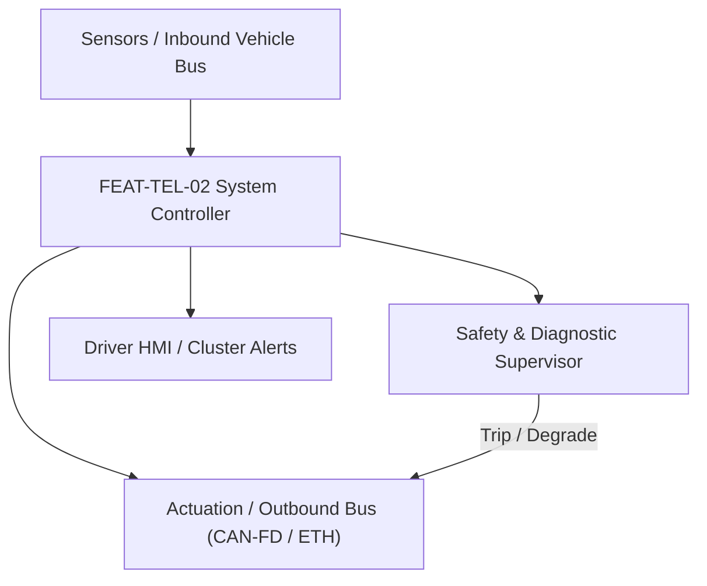
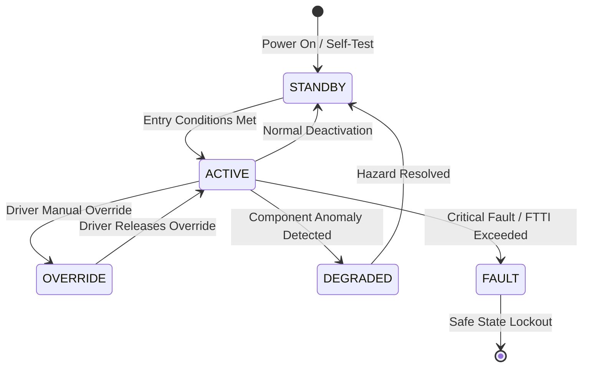

# System Requirements Specification: Cellular Vehicle-to-Everything Safety Warnings (C-V2X)
**Feature ID:** `FEAT-TEL-02`  
**Domain:** Connectivity, Security & Diagnostics  
**Target ASIL:** ASIL B  
**Compliance Standard:** ISO 26262:2018 (Part 4 - System Development) / ASPICE PAM v3.1 (SYS.2, SYS.3)  
**Parent Master Specification:** [`spec.md`](file:///c:/Workset/AntiGravityProjects/TestOptimisationExperiement/spec.md#feat-tel-02-v2x)  
**Derived Software Specification:** [`FEAT-TEL-02_V2X_SwReq.md`](file:///c:/Workset/AntiGravityProjects/TestOptimisationExperiement/software_requirements/FEAT-TEL-02_V2X_SwReq.md)

---

## 1. Feature Overview & Operational Scope

Transmits and receives 5.9 GHz PC5 direct sidelink V2X messages (BSM / CAM / DENM) to warn driver of non-line-of-sight collisions, emergency vehicles, and road hazards.

### Operational Context Architecture

---

## 2. Activation Logic & Operational States

- **Preconditions:** 12V system active, V2X transceiver RF frontend healthy, GNSS time synchronization achieved (< 1 us).
- **Entry Conditions:** Vehicle powered up; C-V2X PC5 direct mode enabled.
- **Deactivation Conditions:** Vehicle powered down or GNSS time synchronization lost for > 60 seconds.
- **Driver Override Behavior:** Driver can dismiss visual V2X information popups; safety critical warnings cannot be muted.
- **Operational State Progression:**  
  `SEARCHING_TIME_SYNC` -> `BEACONING_BSM` -> `HAZARD_LISTENING` -> `EMERGENCY_VEHICLE_ALERT` -> `COLLISION_WARNING_EEBL` -> `FAILSAFE_SILENT`

### State Transition Diagram

---

## 3. Functional Safety & Failure Mitigation Concept

- **Functional Safety Goal:** SG-V2X-01: Provide timely warnings for non-line-of-sight collisions (blind intersections, curve hazards); prevent false warnings caused by spoofed V2X packets.
- **Fault Tolerant Time Interval (FTTI):** 100 ms
- **Safe State Definition:** Silence unverified V2X warnings; revert to on-board radar/camera detection only.
- **Warning & Escalation Strategy:** Visual overlay on Cluster and Head-Up Display; audible alert tone (1.0 kHz).

### Failure Modes & Degradation Handling
- **Certificate Revoked:** If received V2X message is signed by a certificate on the Certificate Revocation List (CRL), discard packet instantly.
- **Gnss Sync Lost:** If GNSS satellite time lost, free-run internal oscillator for up to 60s before transitioning to passive listening.

---

## 4. System Requirements (SYS_REQ)
*(Note: Each System Requirement is systematically partitioned into multiple Child Software Requirements)*

### `SYS-TEL-02-01`: 5.9 GHz PC5 Direct Sidelink BSM Broadcast & Reception
- **Planned Release:** R100
- **ASIL Rating:** ASIL B
- **Parent Feature:** [`FEAT-TEL-02`](file:///c:/Workset/AntiGravityProjects/TestOptimisationExperiement/spec.md#feat-tel-02)
- **Requirement Statement:**
  > The System SHALL broadcast Basic Safety Messages (BSM / CAM) containing vehicle position, speed, heading, and curvature at 10 Hz (100 ms), and process inbound peer messages within <= 20 ms.
- **Activation Logic:** Active while vehicle is moving.
- **Fault Tolerant Time Interval (FTTI):** 100 ms
- **Safe State Action:** Halt transmission if positioning accuracy degrades > 5.0 m.
- **Failure Detection & Reaction:** If RF power amplifier overheats, reduce transmit power from 23 dBm to 10 dBm.
- **Input Interfaces:** `GNSS_Position_Time, Ego_Kinematics, 5.9GHz_PC5_Antenna_Array`
- **Output Interfaces:** `Outbound_BSM_Packets, Inbound_V2X_Target_List`
- **System Verification Method:** SDR (Software Defined Radio) RF testing adhering to 3GPP Rel-14/15 standards.
- **Derived Child Software Requirements (1:N Link):**
  - [`SWR-TEL-02-01`](file:///c:/Workset/AntiGravityProjects/TestOptimisationExperiement/software_requirements/FEAT-TEL-02_V2X_SwReq.md#swr-tel-02-01)
  - [`SWR-TEL-02-02`](file:///c:/Workset/AntiGravityProjects/TestOptimisationExperiement/software_requirements/FEAT-TEL-02_V2X_SwReq.md#swr-tel-02-02)

### `SYS-TEL-02-02`: Non-Line-of-Sight Hazard Evaluation & Driver Alerting
- **Planned Release:** R100
- **ASIL Rating:** ASIL B
- **Parent Feature:** [`FEAT-TEL-02`](file:///c:/Workset/AntiGravityProjects/TestOptimisationExperiement/spec.md#feat-tel-02)
- **Requirement Statement:**
  > The System SHALL evaluate inbound V2X messages to detect Emergency Electronic Brake Lights (EEBL), Blind Intersection Collision Warning (ICW), and Approaching Emergency Vehicle (EVW) up to 300 m away, issuing alerts <= 50 ms post-reception.
- **Activation Logic:** Active when valid peer messages are received.
- **Fault Tolerant Time Interval (FTTI):** 50 ms
- **Safe State Action:** Do not alert driver if packet cryptographic certificate cannot be validated.
- **Failure Detection & Reaction:** If peer packet timestamp is skewed > 500 ms from local time, drop packet as replay.
- **Input Interfaces:** `Inbound_V2X_Target_List, Ego_Vehicle_Route, V2X_Security_Trust_Store`
- **Output Interfaces:** `V2X_Alert_HUD_Icon, V2X_Warning_Audio_Cmd`
- **System Verification Method:** Test track intersection collision warning demonstration with obstruction walls.
- **Derived Child Software Requirements (1:N Link):**
  - [`SWR-TEL-02-03`](file:///c:/Workset/AntiGravityProjects/TestOptimisationExperiement/software_requirements/FEAT-TEL-02_V2X_SwReq.md#swr-tel-02-03)
  - [`SWR-TEL-02-04`](file:///c:/Workset/AntiGravityProjects/TestOptimisationExperiement/software_requirements/FEAT-TEL-02_V2X_SwReq.md#swr-tel-02-04)

### `SYS-TEL-02-03`: Cellular V2X (C-V2X) PC5 Direct Sidelink 5.9 GHz RF Transceiver Interface
- **Planned Release:** R100
- **ASIL Rating:** ASIL B
- **Parent Feature:** [`FEAT-TEL-02`](file:///c:/Workset/AntiGravityProjects/TestOptimisationExperiement/spec.md#feat-tel-02)
- **Requirement Statement:**
  > The System SHALL Interface with PC5 direct communication chipset to broadcast and receive safety messages at 5.9 GHz.
- **Activation Logic:** Active during normal vehicle operation when feature state is active.
- **Fault Tolerant Time Interval (FTTI):** 10 ms
- **Safe State Action:** Transition to safe state or safe degradation tier within FTTI budget.
- **Failure Detection & Reaction:** Isolate faulted channel, latch DEM diagnostic trouble code, and inform driver.
- **Input Interfaces:** `Sensor signals, vehicle dynamics data, and bus frames via RTE.`
- **Output Interfaces:** `Actuator commands, diagnostic event flags, and cluster alerts.`
- **System Verification Method:** HiL test bench and dynamometer automated verification.
- **Derived Child Software Requirements (1:N Link):**
  - [`SWR-TEL-02-05`](file:///c:/Workset/AntiGravityProjects/TestOptimisationExperiement/software_requirements/FEAT-TEL-02_V2X_SwReq.md#swr-tel-02-05)
  - [`SWR-TEL-02-06`](file:///c:/Workset/AntiGravityProjects/TestOptimisationExperiement/software_requirements/FEAT-TEL-02_V2X_SwReq.md#swr-tel-02-06)

### `SYS-TEL-02-04`: SAE J2735 / ETSI Basic Safety Message (BSM / CAM) Dynamic Encoder
- **Planned Release:** R200
- **ASIL Rating:** ASIL B
- **Parent Feature:** [`FEAT-TEL-02`](file:///c:/Workset/AntiGravityProjects/TestOptimisationExperiement/spec.md#feat-tel-02)
- **Requirement Statement:**
  > The System SHALL Encode vehicle position, heading, velocity, acceleration, and brake status into BSM frames at 10 Hz.
- **Activation Logic:** Active during normal vehicle operation when feature state is active.
- **Fault Tolerant Time Interval (FTTI):** 20 ms
- **Safe State Action:** Transition to safe state or safe degradation tier within FTTI budget.
- **Failure Detection & Reaction:** Isolate faulted channel, latch DEM diagnostic trouble code, and inform driver.
- **Input Interfaces:** `Sensor signals, vehicle dynamics data, and bus frames via RTE.`
- **Output Interfaces:** `Actuator commands, diagnostic event flags, and cluster alerts.`
- **System Verification Method:** HiL test bench and dynamometer automated verification.
- **Derived Child Software Requirements (1:N Link):**
  - [`SWR-TEL-02-07`](file:///c:/Workset/AntiGravityProjects/TestOptimisationExperiement/software_requirements/FEAT-TEL-02_V2X_SwReq.md#swr-tel-02-07)
  - [`SWR-TEL-02-08`](file:///c:/Workset/AntiGravityProjects/TestOptimisationExperiement/software_requirements/FEAT-TEL-02_V2X_SwReq.md#swr-tel-02-08)

### `SYS-TEL-02-05`: Intersection Collision Warning (ICW) Blind Crossing Path Evaluator
- **Planned Release:** R200
- **ASIL Rating:** ASIL B
- **Parent Feature:** [`FEAT-TEL-02`](file:///c:/Workset/AntiGravityProjects/TestOptimisationExperiement/spec.md#feat-tel-02)
- **Requirement Statement:**
  > The System SHALL Compute collision risk with cross-traffic vehicles transmitting BSMs at non-line-of-sight intersections.
- **Activation Logic:** Active during normal vehicle operation when feature state is active.
- **Fault Tolerant Time Interval (FTTI):** 20 ms
- **Safe State Action:** Transition to safe state or safe degradation tier within FTTI budget.
- **Failure Detection & Reaction:** Isolate faulted channel, latch DEM diagnostic trouble code, and inform driver.
- **Input Interfaces:** `Sensor signals, vehicle dynamics data, and bus frames via RTE.`
- **Output Interfaces:** `Actuator commands, diagnostic event flags, and cluster alerts.`
- **System Verification Method:** HiL test bench and dynamometer automated verification.
- **Derived Child Software Requirements (1:N Link):**
  - [`SWR-TEL-02-09`](file:///c:/Workset/AntiGravityProjects/TestOptimisationExperiement/software_requirements/FEAT-TEL-02_V2X_SwReq.md#swr-tel-02-09)
  - [`SWR-TEL-02-10`](file:///c:/Workset/AntiGravityProjects/TestOptimisationExperiement/software_requirements/FEAT-TEL-02_V2X_SwReq.md#swr-tel-02-10)

### `SYS-TEL-02-06`: Emergency Electronic Brake Light (EEBL) Remote Vehicle Hard Braking Receiver
- **Planned Release:** R200
- **ASIL Rating:** ASIL B
- **Parent Feature:** [`FEAT-TEL-02`](file:///c:/Workset/AntiGravityProjects/TestOptimisationExperiement/spec.md#feat-tel-02)
- **Requirement Statement:**
  > The System SHALL Receive EEBL alert from lead vehicle braking heavily beyond sightline (300 m ahead); notify driver.
- **Activation Logic:** Active during normal vehicle operation when feature state is active.
- **Fault Tolerant Time Interval (FTTI):** 20 ms
- **Safe State Action:** Transition to safe state or safe degradation tier within FTTI budget.
- **Failure Detection & Reaction:** Isolate faulted channel, latch DEM diagnostic trouble code, and inform driver.
- **Input Interfaces:** `Sensor signals, vehicle dynamics data, and bus frames via RTE.`
- **Output Interfaces:** `Actuator commands, diagnostic event flags, and cluster alerts.`
- **System Verification Method:** HiL test bench and dynamometer automated verification.
- **Derived Child Software Requirements (1:N Link):**
  - [`SWR-TEL-02-11`](file:///c:/Workset/AntiGravityProjects/TestOptimisationExperiement/software_requirements/FEAT-TEL-02_V2X_SwReq.md#swr-tel-02-11)
  - [`SWR-TEL-02-12`](file:///c:/Workset/AntiGravityProjects/TestOptimisationExperiement/software_requirements/FEAT-TEL-02_V2X_SwReq.md#swr-tel-02-12)

### `SYS-TEL-02-07`: Emergency Vehicle Approaching (EVA) Siren & Trajectory Audible Clear Alert
- **Planned Release:** R300
- **ASIL Rating:** ASIL B
- **Parent Feature:** [`FEAT-TEL-02`](file:///c:/Workset/AntiGravityProjects/TestOptimisationExperiement/spec.md#feat-tel-02)
- **Requirement Statement:**
  > The System SHALL Detect approaching ambulance or fire truck transmitting EVA packets; prompt driver to clear lane.
- **Activation Logic:** Active during normal vehicle operation when feature state is active.
- **Fault Tolerant Time Interval (FTTI):** 50 ms
- **Safe State Action:** Transition to safe state or safe degradation tier within FTTI budget.
- **Failure Detection & Reaction:** Isolate faulted channel, latch DEM diagnostic trouble code, and inform driver.
- **Input Interfaces:** `Sensor signals, vehicle dynamics data, and bus frames via RTE.`
- **Output Interfaces:** `Actuator commands, diagnostic event flags, and cluster alerts.`
- **System Verification Method:** HiL test bench and dynamometer automated verification.
- **Derived Child Software Requirements (1:N Link):**
  - [`SWR-TEL-02-13`](file:///c:/Workset/AntiGravityProjects/TestOptimisationExperiement/software_requirements/FEAT-TEL-02_V2X_SwReq.md#swr-tel-02-13)
  - [`SWR-TEL-02-14`](file:///c:/Workset/AntiGravityProjects/TestOptimisationExperiement/software_requirements/FEAT-TEL-02_V2X_SwReq.md#swr-tel-02-14)

### `SYS-TEL-02-08`: Signal Phase and Timing (SPaT) Green Light Optimal Speed Advisory (GLOSA)
- **Planned Release:** R300
- **ASIL Rating:** ASIL A
- **Parent Feature:** [`FEAT-TEL-02`](file:///c:/Workset/AntiGravityProjects/TestOptimisationExperiement/spec.md#feat-tel-02)
- **Requirement Statement:**
  > The System SHALL Calculate recommended cruising speed to pass upcoming traffic light on green based on SPaT timing.
- **Activation Logic:** Active during normal vehicle operation when feature state is active.
- **Fault Tolerant Time Interval (FTTI):** 100 ms
- **Safe State Action:** Transition to safe state or safe degradation tier within FTTI budget.
- **Failure Detection & Reaction:** Isolate faulted channel, latch DEM diagnostic trouble code, and inform driver.
- **Input Interfaces:** `Sensor signals, vehicle dynamics data, and bus frames via RTE.`
- **Output Interfaces:** `Actuator commands, diagnostic event flags, and cluster alerts.`
- **System Verification Method:** HiL test bench and dynamometer automated verification.
- **Derived Child Software Requirements (1:N Link):**
  - [`SWR-TEL-02-15`](file:///c:/Workset/AntiGravityProjects/TestOptimisationExperiement/software_requirements/FEAT-TEL-02_V2X_SwReq.md#swr-tel-02-15)
  - [`SWR-TEL-02-16`](file:///c:/Workset/AntiGravityProjects/TestOptimisationExperiement/software_requirements/FEAT-TEL-02_V2X_SwReq.md#swr-tel-02-16)

### `SYS-TEL-02-09`: V2X Security Credential Management System (SCMS) Certificate Pseudonym Verifier
- **Planned Release:** R300
- **ASIL Rating:** ASIL B
- **Parent Feature:** [`FEAT-TEL-02`](file:///c:/Workset/AntiGravityProjects/TestOptimisationExperiement/spec.md#feat-tel-02)
- **Requirement Statement:**
  > The System SHALL Verify IEEE 1609.2 digital signature of received V2X packets and rotate pseudonyms to ensure privacy.
- **Activation Logic:** Active during normal vehicle operation when feature state is active.
- **Fault Tolerant Time Interval (FTTI):** 20 ms
- **Safe State Action:** Transition to safe state or safe degradation tier within FTTI budget.
- **Failure Detection & Reaction:** Isolate faulted channel, latch DEM diagnostic trouble code, and inform driver.
- **Input Interfaces:** `Sensor signals, vehicle dynamics data, and bus frames via RTE.`
- **Output Interfaces:** `Actuator commands, diagnostic event flags, and cluster alerts.`
- **System Verification Method:** HiL test bench and dynamometer automated verification.
- **Derived Child Software Requirements (1:N Link):**
  - [`SWR-TEL-02-17`](file:///c:/Workset/AntiGravityProjects/TestOptimisationExperiement/software_requirements/FEAT-TEL-02_V2X_SwReq.md#swr-tel-02-17)
  - [`SWR-TEL-02-18`](file:///c:/Workset/AntiGravityProjects/TestOptimisationExperiement/software_requirements/FEAT-TEL-02_V2X_SwReq.md#swr-tel-02-18)

### `SYS-TEL-02-10`: V2X Message GPS Timestamp Plausibility & Replay Attack Defense Filter
- **Planned Release:** R400
- **ASIL Rating:** ASIL B
- **Parent Feature:** [`FEAT-TEL-02`](file:///c:/Workset/AntiGravityProjects/TestOptimisationExperiement/spec.md#feat-tel-02)
- **Requirement Statement:**
  > The System SHALL Reject received V2X frames with GNSS timestamps deviating by > 100 ms from local synchronized time.
- **Activation Logic:** Active during normal vehicle operation when feature state is active.
- **Fault Tolerant Time Interval (FTTI):** 10 ms
- **Safe State Action:** Transition to safe state or safe degradation tier within FTTI budget.
- **Failure Detection & Reaction:** Isolate faulted channel, latch DEM diagnostic trouble code, and inform driver.
- **Input Interfaces:** `Sensor signals, vehicle dynamics data, and bus frames via RTE.`
- **Output Interfaces:** `Actuator commands, diagnostic event flags, and cluster alerts.`
- **System Verification Method:** HiL test bench and dynamometer automated verification.
- **Derived Child Software Requirements (1:N Link):**
  - [`SWR-TEL-02-19`](file:///c:/Workset/AntiGravityProjects/TestOptimisationExperiement/software_requirements/FEAT-TEL-02_V2X_SwReq.md#swr-tel-02-19)
  - [`SWR-TEL-02-20`](file:///c:/Workset/AntiGravityProjects/TestOptimisationExperiement/software_requirements/FEAT-TEL-02_V2X_SwReq.md#swr-tel-02-20)

### `SYS-TEL-02-11`: Instrument Cluster & Head-Up Display V2X Warning Visual Graphic Dispatcher
- **Planned Release:** R400
- **ASIL Rating:** ASIL B
- **Parent Feature:** [`FEAT-TEL-02`](file:///c:/Workset/AntiGravityProjects/TestOptimisationExperiement/spec.md#feat-tel-02)
- **Requirement Statement:**
  > The System SHALL Display amber intersection hazard icons and emergency vehicle direction arrows on HUD and cluster.
- **Activation Logic:** Active during normal vehicle operation when feature state is active.
- **Fault Tolerant Time Interval (FTTI):** 50 ms
- **Safe State Action:** Transition to safe state or safe degradation tier within FTTI budget.
- **Failure Detection & Reaction:** Isolate faulted channel, latch DEM diagnostic trouble code, and inform driver.
- **Input Interfaces:** `Sensor signals, vehicle dynamics data, and bus frames via RTE.`
- **Output Interfaces:** `Actuator commands, diagnostic event flags, and cluster alerts.`
- **System Verification Method:** HiL test bench and dynamometer automated verification.
- **Derived Child Software Requirements (1:N Link):**
  - [`SWR-TEL-02-21`](file:///c:/Workset/AntiGravityProjects/TestOptimisationExperiement/software_requirements/FEAT-TEL-02_V2X_SwReq.md#swr-tel-02-21)
  - [`SWR-TEL-02-22`](file:///c:/Workset/AntiGravityProjects/TestOptimisationExperiement/software_requirements/FEAT-TEL-02_V2X_SwReq.md#swr-tel-02-22)

### `SYS-TEL-02-12`: DEM V2X RF Transceiver Diagnostics & Communication Loss Monitor
- **Planned Release:** R500
- **ASIL Rating:** ASIL B
- **Parent Feature:** [`FEAT-TEL-02`](file:///c:/Workset/AntiGravityProjects/TestOptimisationExperiement/spec.md#feat-tel-02)
- **Requirement Statement:**
  > The System SHALL Monitor PC5 transceiver antenna VSWR and GPS lock; log DTC upon V2X communication system fault.
- **Activation Logic:** Active during normal vehicle operation when feature state is active.
- **Fault Tolerant Time Interval (FTTI):** 100 ms
- **Safe State Action:** Transition to safe state or safe degradation tier within FTTI budget.
- **Failure Detection & Reaction:** Isolate faulted channel, latch DEM diagnostic trouble code, and inform driver.
- **Input Interfaces:** `Sensor signals, vehicle dynamics data, and bus frames via RTE.`
- **Output Interfaces:** `Actuator commands, diagnostic event flags, and cluster alerts.`
- **System Verification Method:** HiL test bench and dynamometer automated verification.
- **Derived Child Software Requirements (1:N Link):**
  - [`SWR-TEL-02-23`](file:///c:/Workset/AntiGravityProjects/TestOptimisationExperiement/software_requirements/FEAT-TEL-02_V2X_SwReq.md#swr-tel-02-23)
  - [`SWR-TEL-02-24`](file:///c:/Workset/AntiGravityProjects/TestOptimisationExperiement/software_requirements/FEAT-TEL-02_V2X_SwReq.md#swr-tel-02-24)

### `SYS-TEL-02-13`: Non-Volatile V2X Safety Alerts & Hazardous Road Weather Incident Logger
- **Planned Release:** R500
- **ASIL Rating:** ASIL B
- **Parent Feature:** [`FEAT-TEL-02`](file:///c:/Workset/AntiGravityProjects/TestOptimisationExperiement/spec.md#feat-tel-02)
- **Requirement Statement:**
  > The System SHALL Record received road hazard warnings, bridge ice alerts, and collision near-miss events in NVM.
- **Activation Logic:** Active during normal vehicle operation when feature state is active.
- **Fault Tolerant Time Interval (FTTI):** 1000 ms
- **Safe State Action:** Transition to safe state or safe degradation tier within FTTI budget.
- **Failure Detection & Reaction:** Isolate faulted channel, latch DEM diagnostic trouble code, and inform driver.
- **Input Interfaces:** `Sensor signals, vehicle dynamics data, and bus frames via RTE.`
- **Output Interfaces:** `Actuator commands, diagnostic event flags, and cluster alerts.`
- **System Verification Method:** HiL test bench and dynamometer automated verification.
- **Derived Child Software Requirements (1:N Link):**
  - [`SWR-TEL-02-25`](file:///c:/Workset/AntiGravityProjects/TestOptimisationExperiement/software_requirements/FEAT-TEL-02_V2X_SwReq.md#swr-tel-02-25)
  - [`SWR-TEL-02-26`](file:///c:/Workset/AntiGravityProjects/TestOptimisationExperiement/software_requirements/FEAT-TEL-02_V2X_SwReq.md#swr-tel-02-26)

### `SYS-TEL-02-14`: Road Works Warning (RWW) Construction Lane Closure Decoupler
- **Planned Release:** R500
- **ASIL Rating:** ASIL B
- **Parent Feature:** [`FEAT-TEL-02`](file:///c:/Workset/AntiGravityProjects/TestOptimisationExperiement/spec.md#feat-tel-02)
- **Requirement Statement:**
  > The System SHALL Parse RWW digital construction alerts to notify driver of lane closures 1.0 km ahead of work zones.
- **Activation Logic:** Active during normal vehicle operation when feature state is active.
- **Fault Tolerant Time Interval (FTTI):** 100 ms
- **Safe State Action:** Transition to safe state or safe degradation tier within FTTI budget.
- **Failure Detection & Reaction:** Isolate faulted channel, latch DEM diagnostic trouble code, and inform driver.
- **Input Interfaces:** `Sensor signals, vehicle dynamics data, and bus frames via RTE.`
- **Output Interfaces:** `Actuator commands, diagnostic event flags, and cluster alerts.`
- **System Verification Method:** HiL test bench and dynamometer automated verification.
- **Derived Child Software Requirements (1:N Link):**
  - [`SWR-TEL-02-27`](file:///c:/Workset/AntiGravityProjects/TestOptimisationExperiement/software_requirements/FEAT-TEL-02_V2X_SwReq.md#swr-tel-02-27)
  - [`SWR-TEL-02-28`](file:///c:/Workset/AntiGravityProjects/TestOptimisationExperiement/software_requirements/FEAT-TEL-02_V2X_SwReq.md#swr-tel-02-28)

### `SYS-TEL-02-15`: V2X Congestion Control Sidelink Channel Busy Ratio (CBR) Power Manager
- **Planned Release:** R500
- **ASIL Rating:** ASIL B
- **Parent Feature:** [`FEAT-TEL-02`](file:///c:/Workset/AntiGravityProjects/TestOptimisationExperiement/spec.md#feat-tel-02)
- **Requirement Statement:**
  > The System SHALL Scale transmit power and message rate (1 to 10 Hz) based on CBR to prevent RF channel saturation.
- **Activation Logic:** Active during normal vehicle operation when feature state is active.
- **Fault Tolerant Time Interval (FTTI):** 50 ms
- **Safe State Action:** Transition to safe state or safe degradation tier within FTTI budget.
- **Failure Detection & Reaction:** Isolate faulted channel, latch DEM diagnostic trouble code, and inform driver.
- **Input Interfaces:** `Sensor signals, vehicle dynamics data, and bus frames via RTE.`
- **Output Interfaces:** `Actuator commands, diagnostic event flags, and cluster alerts.`
- **System Verification Method:** HiL test bench and dynamometer automated verification.
- **Derived Child Software Requirements (1:N Link):**
  - [`SWR-TEL-02-29`](file:///c:/Workset/AntiGravityProjects/TestOptimisationExperiement/software_requirements/FEAT-TEL-02_V2X_SwReq.md#swr-tel-02-29)
  - [`SWR-TEL-02-30`](file:///c:/Workset/AntiGravityProjects/TestOptimisationExperiement/software_requirements/FEAT-TEL-02_V2X_SwReq.md#swr-tel-02-30)

---

## 5. System-to-Software Traceability Summary

| System Requirement ID | Planned Release | ASIL | Title | Derived Software Requirements (1:N) | Verification Method |
| :--- | :---: | :--- | :--- | :--- | :--- |
| `SYS-TEL-02-01` | **`R100`** | ASIL B | 5.9 GHz PC5 Direct Sidelink BSM Broadcast & Reception | [`SWR-TEL-02-01`](file:///c:/Workset/AntiGravityProjects/TestOptimisationExperiement/software_requirements/FEAT-TEL-02_V2X_SwReq.md#swr-tel-02-01), [`SWR-TEL-02-02`](file:///c:/Workset/AntiGravityProjects/TestOptimisationExperiement/software_requirements/FEAT-TEL-02_V2X_SwReq.md#swr-tel-02-02) | SDR (Software Defined Radio) RF testing adhering to 3GPP Rel-14/15 standards. |
| `SYS-TEL-02-02` | **`R100`** | ASIL B | Non-Line-of-Sight Hazard Evaluation & Driver Alerting | [`SWR-TEL-02-03`](file:///c:/Workset/AntiGravityProjects/TestOptimisationExperiement/software_requirements/FEAT-TEL-02_V2X_SwReq.md#swr-tel-02-03), [`SWR-TEL-02-04`](file:///c:/Workset/AntiGravityProjects/TestOptimisationExperiement/software_requirements/FEAT-TEL-02_V2X_SwReq.md#swr-tel-02-04) | Test track intersection collision warning demonstration with obstruction walls. |
| `SYS-TEL-02-03` | **`R100`** | ASIL B | Cellular V2X (C-V2X) PC5 Direct Sidelink 5.9 GHz RF Transceiver Interface | [`SWR-TEL-02-05`](file:///c:/Workset/AntiGravityProjects/TestOptimisationExperiement/software_requirements/FEAT-TEL-02_V2X_SwReq.md#swr-tel-02-05), [`SWR-TEL-02-06`](file:///c:/Workset/AntiGravityProjects/TestOptimisationExperiement/software_requirements/FEAT-TEL-02_V2X_SwReq.md#swr-tel-02-06) | HiL test bench and dynamometer automated verification. |
| `SYS-TEL-02-04` | **`R200`** | ASIL B | SAE J2735 / ETSI Basic Safety Message (BSM / CAM) Dynamic Encoder | [`SWR-TEL-02-07`](file:///c:/Workset/AntiGravityProjects/TestOptimisationExperiement/software_requirements/FEAT-TEL-02_V2X_SwReq.md#swr-tel-02-07), [`SWR-TEL-02-08`](file:///c:/Workset/AntiGravityProjects/TestOptimisationExperiement/software_requirements/FEAT-TEL-02_V2X_SwReq.md#swr-tel-02-08) | HiL test bench and dynamometer automated verification. |
| `SYS-TEL-02-05` | **`R200`** | ASIL B | Intersection Collision Warning (ICW) Blind Crossing Path Evaluator | [`SWR-TEL-02-09`](file:///c:/Workset/AntiGravityProjects/TestOptimisationExperiement/software_requirements/FEAT-TEL-02_V2X_SwReq.md#swr-tel-02-09), [`SWR-TEL-02-10`](file:///c:/Workset/AntiGravityProjects/TestOptimisationExperiement/software_requirements/FEAT-TEL-02_V2X_SwReq.md#swr-tel-02-10) | HiL test bench and dynamometer automated verification. |
| `SYS-TEL-02-06` | **`R200`** | ASIL B | Emergency Electronic Brake Light (EEBL) Remote Vehicle Hard Braking Receiver | [`SWR-TEL-02-11`](file:///c:/Workset/AntiGravityProjects/TestOptimisationExperiement/software_requirements/FEAT-TEL-02_V2X_SwReq.md#swr-tel-02-11), [`SWR-TEL-02-12`](file:///c:/Workset/AntiGravityProjects/TestOptimisationExperiement/software_requirements/FEAT-TEL-02_V2X_SwReq.md#swr-tel-02-12) | HiL test bench and dynamometer automated verification. |
| `SYS-TEL-02-07` | **`R300`** | ASIL B | Emergency Vehicle Approaching (EVA) Siren & Trajectory Audible Clear Alert | [`SWR-TEL-02-13`](file:///c:/Workset/AntiGravityProjects/TestOptimisationExperiement/software_requirements/FEAT-TEL-02_V2X_SwReq.md#swr-tel-02-13), [`SWR-TEL-02-14`](file:///c:/Workset/AntiGravityProjects/TestOptimisationExperiement/software_requirements/FEAT-TEL-02_V2X_SwReq.md#swr-tel-02-14) | HiL test bench and dynamometer automated verification. |
| `SYS-TEL-02-08` | **`R300`** | ASIL A | Signal Phase and Timing (SPaT) Green Light Optimal Speed Advisory (GLOSA) | [`SWR-TEL-02-15`](file:///c:/Workset/AntiGravityProjects/TestOptimisationExperiement/software_requirements/FEAT-TEL-02_V2X_SwReq.md#swr-tel-02-15), [`SWR-TEL-02-16`](file:///c:/Workset/AntiGravityProjects/TestOptimisationExperiement/software_requirements/FEAT-TEL-02_V2X_SwReq.md#swr-tel-02-16) | HiL test bench and dynamometer automated verification. |
| `SYS-TEL-02-09` | **`R300`** | ASIL B | V2X Security Credential Management System (SCMS) Certificate Pseudonym Verifier | [`SWR-TEL-02-17`](file:///c:/Workset/AntiGravityProjects/TestOptimisationExperiement/software_requirements/FEAT-TEL-02_V2X_SwReq.md#swr-tel-02-17), [`SWR-TEL-02-18`](file:///c:/Workset/AntiGravityProjects/TestOptimisationExperiement/software_requirements/FEAT-TEL-02_V2X_SwReq.md#swr-tel-02-18) | HiL test bench and dynamometer automated verification. |
| `SYS-TEL-02-10` | **`R400`** | ASIL B | V2X Message GPS Timestamp Plausibility & Replay Attack Defense Filter | [`SWR-TEL-02-19`](file:///c:/Workset/AntiGravityProjects/TestOptimisationExperiement/software_requirements/FEAT-TEL-02_V2X_SwReq.md#swr-tel-02-19), [`SWR-TEL-02-20`](file:///c:/Workset/AntiGravityProjects/TestOptimisationExperiement/software_requirements/FEAT-TEL-02_V2X_SwReq.md#swr-tel-02-20) | HiL test bench and dynamometer automated verification. |
| `SYS-TEL-02-11` | **`R400`** | ASIL B | Instrument Cluster & Head-Up Display V2X Warning Visual Graphic Dispatcher | [`SWR-TEL-02-21`](file:///c:/Workset/AntiGravityProjects/TestOptimisationExperiement/software_requirements/FEAT-TEL-02_V2X_SwReq.md#swr-tel-02-21), [`SWR-TEL-02-22`](file:///c:/Workset/AntiGravityProjects/TestOptimisationExperiement/software_requirements/FEAT-TEL-02_V2X_SwReq.md#swr-tel-02-22) | HiL test bench and dynamometer automated verification. |
| `SYS-TEL-02-12` | **`R500`** | ASIL B | DEM V2X RF Transceiver Diagnostics & Communication Loss Monitor | [`SWR-TEL-02-23`](file:///c:/Workset/AntiGravityProjects/TestOptimisationExperiement/software_requirements/FEAT-TEL-02_V2X_SwReq.md#swr-tel-02-23), [`SWR-TEL-02-24`](file:///c:/Workset/AntiGravityProjects/TestOptimisationExperiement/software_requirements/FEAT-TEL-02_V2X_SwReq.md#swr-tel-02-24) | HiL test bench and dynamometer automated verification. |
| `SYS-TEL-02-13` | **`R500`** | ASIL B | Non-Volatile V2X Safety Alerts & Hazardous Road Weather Incident Logger | [`SWR-TEL-02-25`](file:///c:/Workset/AntiGravityProjects/TestOptimisationExperiement/software_requirements/FEAT-TEL-02_V2X_SwReq.md#swr-tel-02-25), [`SWR-TEL-02-26`](file:///c:/Workset/AntiGravityProjects/TestOptimisationExperiement/software_requirements/FEAT-TEL-02_V2X_SwReq.md#swr-tel-02-26) | HiL test bench and dynamometer automated verification. |
| `SYS-TEL-02-14` | **`R500`** | ASIL B | Road Works Warning (RWW) Construction Lane Closure Decoupler | [`SWR-TEL-02-27`](file:///c:/Workset/AntiGravityProjects/TestOptimisationExperiement/software_requirements/FEAT-TEL-02_V2X_SwReq.md#swr-tel-02-27), [`SWR-TEL-02-28`](file:///c:/Workset/AntiGravityProjects/TestOptimisationExperiement/software_requirements/FEAT-TEL-02_V2X_SwReq.md#swr-tel-02-28) | HiL test bench and dynamometer automated verification. |
| `SYS-TEL-02-15` | **`R500`** | ASIL B | V2X Congestion Control Sidelink Channel Busy Ratio (CBR) Power Manager | [`SWR-TEL-02-29`](file:///c:/Workset/AntiGravityProjects/TestOptimisationExperiement/software_requirements/FEAT-TEL-02_V2X_SwReq.md#swr-tel-02-29), [`SWR-TEL-02-30`](file:///c:/Workset/AntiGravityProjects/TestOptimisationExperiement/software_requirements/FEAT-TEL-02_V2X_SwReq.md#swr-tel-02-30) | HiL test bench and dynamometer automated verification. |

- **Upstream Feature Link:** [`spec.md` (FEAT-TEL-02)](file:///c:/Workset/AntiGravityProjects/TestOptimisationExperiement/spec.md#feat-tel-02)
- **Software Requirements Specification:** [`FEAT-TEL-02_V2X_SwReq.md`](file:///c:/Workset/AntiGravityProjects/TestOptimisationExperiement/software_requirements/FEAT-TEL-02_V2X_SwReq.md)
