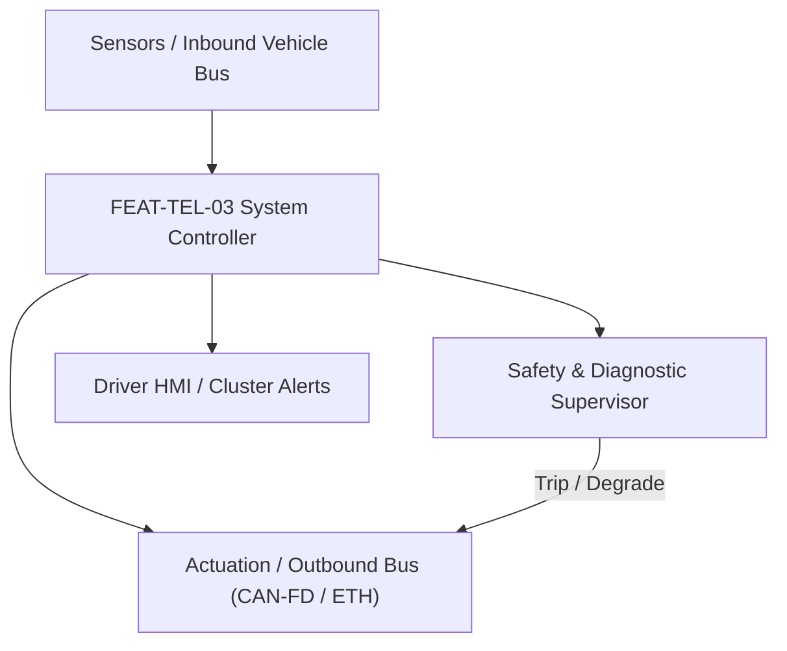
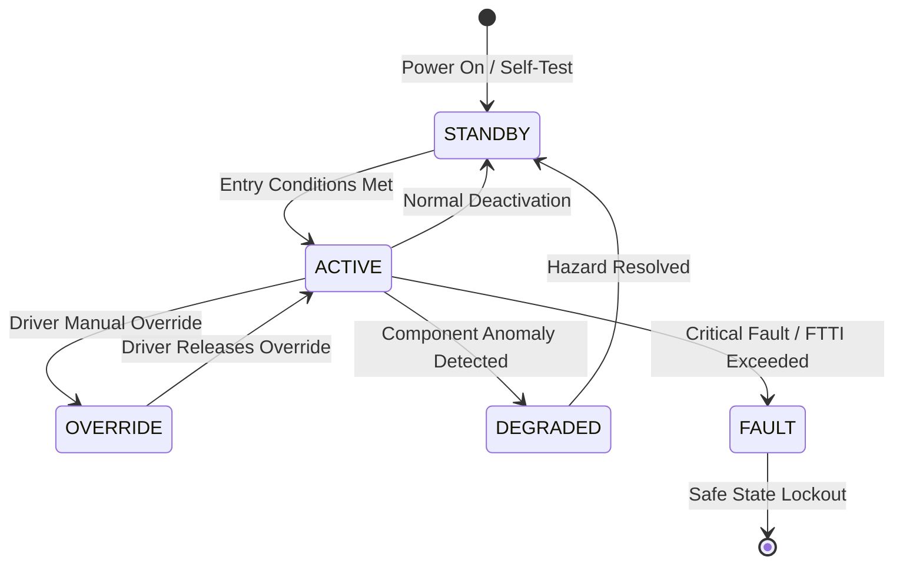

# System Requirements Specification: Automatic Emergency Call & Crash Data Dispatch (eCall / ERA-GLONASS)
**Feature ID:** `FEAT-TEL-03`  
**Domain:** Connectivity, Security & Diagnostics  
**Target ASIL:** ASIL B / UNECE R144  
**Compliance Standard:** ISO 26262:2018 (Part 4 - System Development) / ASPICE PAM v3.1 (SYS.2, SYS.3)  
**Parent Master Specification:** [`spec.md`](file:///c:/Workset/AntiGravityProjects/TestOptimisationExperiement/spec.md#feat-tel-03-ecall)  
**Derived Software Specification:** [`FEAT-TEL-03_eCall_SwReq.md`](file:///c:/Workset/AntiGravityProjects/TestOptimisationExperiement/software_requirements/FEAT-TEL-03_eCall_SwReq.md)

---

## 1. Feature Overview & Operational Scope

Autonomous regulatory crash notification and emergency voice dispatch system transmitting Minimum Set of Data (MSD) to emergency PSAP over cellular 4G/5G IMS VoLTE or 2G/3G in-band modem with autonomous backup battery.

### Operational Context Architecture

---

## 2. Activation Logic & Operational States

- **Preconditions:** NAD cellular modem registered, GNSS receiver locked, internal backup battery SOC >= 70%, audio mic and crash speaker connected.
- **Entry Conditions:** Automatic trigger: Airbag ECU crash pulse discrete line pulled LOW; OR Manual trigger: Driver presses overhead SOS button for >= 2.0 seconds.
- **Deactivation Conditions:** Call successfully ended by PSAP emergency operator; manual cancel button pressed within 5.0 seconds grace window (manual triggers only).
- **Driver Override Behavior:** Automatic crash trigger CANNOT be cancelled by occupants under any circumstances; manual SOS trigger allows 5-second countdown cancel before cellular dialing.
- **Operational State Progression:**  
  `IDLE_SUPERVISION` -> `CRASH_PULSE_VALIDATED` -> `MSD_ENCODING` -> `EMERGENCY_SIP_DIALING` -> `MSD_ACKNOWLEDGED` -> `DUPLEX_VOICE_CALL_ACTIVE` -> `PSAP_TERMINATION` -> `BACKUP_BATTERY_LOW_DEGRADED`

### State Transition Diagram

---

## 3. Functional Safety & Failure Mitigation Concept

- **Functional Safety Goal:** SG-ECALL-01: Guarantee MSD transmission and two-way voice connection to emergency services within 30 seconds of severe collision (UNECE R144); operate for >= 60 minutes on internal backup battery if main 12V supply severed.
- **Fault Tolerant Time Interval (FTTI):** 50 ms for crash pulse latching; 2000 ms for cellular dialing.
- **Safe State Definition:** Switch to internal 3.7V / 6.4V telematics backup battery; lock crash MSD into flash memory; prioritize emergency call over all consumer cellular data traffic.
- **Warning & Escalation Strategy:** Continuous red SOS indicator LED on overhead console; audible voice prompt: 'Emergency call connected, stay calm'.

### Failure Modes & Degradation Handling
- **Cellular Network No Carrier:** Retry dialing across all available terrestrial mobile operators (national roaming override) adhering to 3GPP TS 22.101.
- **Main Vehicle 12V Severed:** Switch within 50 microseconds to internal Li-ion / LiFePO4 backup battery via ideal diode controller.
- **Primary Antenna Crushed:** If main roof shark-fin antenna SWR rises > 3.0, switch RF path to internal windshield-mounted secondary emergency antenna in < 10 ms.

---

## 4. System Requirements (SYS_REQ)
*(Note: Each System Requirement is systematically partitioned into multiple Child Software Requirements)*

### `SYS-TEL-03-01`: Hardware Crash Pulse Discrete Ingestion & CEN EN 15722 MSD Assembler
- **Planned Release:** R100
- **ASIL Rating:** ASIL B
- **Parent Feature:** [`FEAT-TEL-03`](file:///c:/Workset/AntiGravityProjects/TestOptimisationExperiement/spec.md#feat-tel-03)
- **Requirement Statement:**
  > The System SHALL sample hardwired discrete crash output lines from Airbag ECU at 1 kHz, validating crash pulse in <= 5 ms, and assemble standard Minimum Set of Data (MSD conforming to CEN EN 15722 / GOST R 54620) containing VIN, timestamp, accurate GNSS position (+-5 m), heading, passenger count, and collision delta-V in <= 500 ms.
- **Activation Logic:** Active at all times, including vehicle key-off parked state.
- **Fault Tolerant Time Interval (FTTI):** 10 ms
- **Safe State Action:** Persist MSD to non-volatile flash memory; initiate emergency call sequence.
- **Failure Detection & Reaction:** If GNSS position is lost at crash moment, extrapolate last valid fix using dead-reckoning IMU heading and wheel distance.
- **Input Interfaces:** `Airbag_ECU_Crash_Discrete_Pin, GNSS_Coordinates_Lat_Long_Alt, Vehicle_VIN_ROM, SRS_Buckled_Seatbelts_Bitmask, IMU_Delta_Velocity_Mps`
- **Output Interfaces:** `Encoded_MSD_Binary_Stream[140], Crash_Severity_Level_Enum, SOS_Trigger_Source`
- **System Verification Method:** SLED crash facility destructive sled tests at 56 km/h with high-G data capture.
- **Derived Child Software Requirements (1:N Link):**
  - [`SWR-TEL-03-01`](file:///c:/Workset/AntiGravityProjects/TestOptimisationExperiement/software_requirements/FEAT-TEL-03_eCall_SwReq.md#swr-tel-03-01)
  - [`SWR-TEL-03-02`](file:///c:/Workset/AntiGravityProjects/TestOptimisationExperiement/software_requirements/FEAT-TEL-03_eCall_SwReq.md#swr-tel-03-02)

### `SYS-TEL-03-02`: Next-Gen VoLTE Emergency Call Orchestration & Power Cutover
- **Planned Release:** R500
- **ASIL Rating:** ASIL B / UNECE R144
- **Parent Feature:** [`FEAT-TEL-03`](file:///c:/Workset/AntiGravityProjects/TestOptimisationExperiement/spec.md#feat-tel-03)
- **Requirement Statement:**
  > The System SHALL initiate Next-Gen eCall SIP INVITE (RFC 8147) over LTE/5G IMS with in-band modem fallback in <= 5.0 seconds of trigger, routing full-duplex voice to dedicated crash speaker and microphone, while maintaining operation on autonomous internal backup battery for >= 60 minutes after main 12V bus loss.
- **Activation Logic:** Active upon crash pulse validation or manual SOS trigger.
- **Fault Tolerant Time Interval (FTTI):** 2000 ms
- **Safe State Action:** Maintain emergency session across cellular handover; retry call until PSAP terminates.
- **Failure Detection & Reaction:** If VoLTE IMS registration fails, drop to legacy circuit-switched 2G/3G in-band modem transmission within 10.0 seconds.
- **Input Interfaces:** `Encoded_MSD_Binary_Stream, Vehicle_12V_Bus_Voltage, Backup_Battery_Voltage_ADC, Cellular_Signal_RSRP`
- **Output Interfaces:** `VoLTE_SIP_Call_State, Power_Source_Select_Relay, Crash_Audio_Mute_Infotainment_Cmd`
- **System Verification Method:** Mobile network simulator testing across VoLTE, VoNR, and legacy in-band modem eCall profiles.
- **Derived Child Software Requirements (1:N Link):**
  - [`SWR-TEL-03-03`](file:///c:/Workset/AntiGravityProjects/TestOptimisationExperiement/software_requirements/FEAT-TEL-03_eCall_SwReq.md#swr-tel-03-03)
  - [`SWR-TEL-03-04`](file:///c:/Workset/AntiGravityProjects/TestOptimisationExperiement/software_requirements/FEAT-TEL-03_eCall_SwReq.md#swr-tel-03-04)

### `SYS-TEL-03-03`: UNECE R144 Minimum Set of Data (MSD) Crash Telemetry Message Assembler
- **Planned Release:** R100
- **ASIL Rating:** ASIL B
- **Parent Feature:** [`FEAT-TEL-03`](file:///c:/Workset/AntiGravityProjects/TestOptimisationExperiement/spec.md#feat-tel-03)
- **Requirement Statement:**
  > The System SHALL Assemble 140-byte MSD packet containing GPS coordinates, vehicle VIN, propulsion type, and direction.
- **Activation Logic:** Active during normal vehicle operation when feature state is active.
- **Fault Tolerant Time Interval (FTTI):** 50 ms
- **Safe State Action:** Transition to safe state or safe degradation tier within FTTI budget.
- **Failure Detection & Reaction:** Isolate faulted channel, latch DEM diagnostic trouble code, and inform driver.
- **Input Interfaces:** `Sensor signals, vehicle dynamics data, and bus frames via RTE.`
- **Output Interfaces:** `Actuator commands, diagnostic event flags, and cluster alerts.`
- **System Verification Method:** HiL test bench and dynamometer automated verification.
- **Derived Child Software Requirements (1:N Link):**
  - [`SWR-TEL-03-05`](file:///c:/Workset/AntiGravityProjects/TestOptimisationExperiement/software_requirements/FEAT-TEL-03_eCall_SwReq.md#swr-tel-03-05)
  - [`SWR-TEL-03-06`](file:///c:/Workset/AntiGravityProjects/TestOptimisationExperiement/software_requirements/FEAT-TEL-03_eCall_SwReq.md#swr-tel-03-06)

### `SYS-TEL-03-04`: Automatic Crash Detection Airbag Deployment Pyrotechnic Trigger Interface
- **Planned Release:** R200
- **ASIL Rating:** ASIL B
- **Parent Feature:** [`FEAT-TEL-03`](file:///c:/Workset/AntiGravityProjects/TestOptimisationExperiement/spec.md#feat-tel-03)
- **Requirement Statement:**
  > The System SHALL Trigger automated eCall sequence within <= 100 ms of receiving airbag pyrotechnic deployment signal.
- **Activation Logic:** Active during normal vehicle operation when feature state is active.
- **Fault Tolerant Time Interval (FTTI):** 10 ms
- **Safe State Action:** Transition to safe state or safe degradation tier within FTTI budget.
- **Failure Detection & Reaction:** Isolate faulted channel, latch DEM diagnostic trouble code, and inform driver.
- **Input Interfaces:** `Sensor signals, vehicle dynamics data, and bus frames via RTE.`
- **Output Interfaces:** `Actuator commands, diagnostic event flags, and cluster alerts.`
- **System Verification Method:** HiL test bench and dynamometer automated verification.
- **Derived Child Software Requirements (1:N Link):**
  - [`SWR-TEL-03-07`](file:///c:/Workset/AntiGravityProjects/TestOptimisationExperiement/software_requirements/FEAT-TEL-03_eCall_SwReq.md#swr-tel-03-07)
  - [`SWR-TEL-03-08`](file:///c:/Workset/AntiGravityProjects/TestOptimisationExperiement/software_requirements/FEAT-TEL-03_eCall_SwReq.md#swr-tel-03-08)

### `SYS-TEL-03-05`: Manual Emergency SOS Overhead Console Switch Debouncer & Confirm Interlock
- **Planned Release:** R200
- **ASIL Rating:** ASIL B
- **Parent Feature:** [`FEAT-TEL-03`](file:///c:/Workset/AntiGravityProjects/TestOptimisationExperiement/spec.md#feat-tel-03)
- **Requirement Statement:**
  > The System SHALL Debounce overhead SOS button press (> 2.0s) to initiate emergency operator voice call without false alarms.
- **Activation Logic:** Active during normal vehicle operation when feature state is active.
- **Fault Tolerant Time Interval (FTTI):** 50 ms
- **Safe State Action:** Transition to safe state or safe degradation tier within FTTI budget.
- **Failure Detection & Reaction:** Isolate faulted channel, latch DEM diagnostic trouble code, and inform driver.
- **Input Interfaces:** `Sensor signals, vehicle dynamics data, and bus frames via RTE.`
- **Output Interfaces:** `Actuator commands, diagnostic event flags, and cluster alerts.`
- **System Verification Method:** HiL test bench and dynamometer automated verification.
- **Derived Child Software Requirements (1:N Link):**
  - [`SWR-TEL-03-09`](file:///c:/Workset/AntiGravityProjects/TestOptimisationExperiement/software_requirements/FEAT-TEL-03_eCall_SwReq.md#swr-tel-03-09)
  - [`SWR-TEL-03-10`](file:///c:/Workset/AntiGravityProjects/TestOptimisationExperiement/software_requirements/FEAT-TEL-03_eCall_SwReq.md#swr-tel-03-10)

### `SYS-TEL-03-06`: Cellular Modem Emergency Call (112 / 911 / ERA-GLONASS) Voice & In-Band Modem
- **Planned Release:** R500
- **ASIL Rating:** ASIL B
- **Parent Feature:** [`FEAT-TEL-03`](file:///c:/Workset/AntiGravityProjects/TestOptimisationExperiement/spec.md#feat-tel-03)
- **Requirement Statement:**
  > The System SHALL Establish priority cellular voice call to Public Safety Answering Point (PSAP) with in-band modem data.
- **Activation Logic:** Active during normal vehicle operation when feature state is active.
- **Fault Tolerant Time Interval (FTTI):** 100 ms
- **Safe State Action:** Transition to safe state or safe degradation tier within FTTI budget.
- **Failure Detection & Reaction:** Isolate faulted channel, latch DEM diagnostic trouble code, and inform driver.
- **Input Interfaces:** `Sensor signals, vehicle dynamics data, and bus frames via RTE.`
- **Output Interfaces:** `Actuator commands, diagnostic event flags, and cluster alerts.`
- **System Verification Method:** HiL test bench and dynamometer automated verification.
- **Derived Child Software Requirements (1:N Link):**
  - [`SWR-TEL-03-11`](file:///c:/Workset/AntiGravityProjects/TestOptimisationExperiement/software_requirements/FEAT-TEL-03_eCall_SwReq.md#swr-tel-03-11)
  - [`SWR-TEL-03-12`](file:///c:/Workset/AntiGravityProjects/TestOptimisationExperiement/software_requirements/FEAT-TEL-03_eCall_SwReq.md#swr-tel-03-12)

### `SYS-TEL-03-07`: Dual GNSS / GPS / GLONASS Multi-Constellation Emergency Location Engine
- **Planned Release:** R300
- **ASIL Rating:** ASIL B
- **Parent Feature:** [`FEAT-TEL-03`](file:///c:/Workset/AntiGravityProjects/TestOptimisationExperiement/spec.md#feat-tel-03)
- **Requirement Statement:**
  > The System SHALL Acquire accurate vehicle crash coordinates (+-5.0 m) even in poor satellite coverage conditions.
- **Activation Logic:** Active during normal vehicle operation when feature state is active.
- **Fault Tolerant Time Interval (FTTI):** 50 ms
- **Safe State Action:** Transition to safe state or safe degradation tier within FTTI budget.
- **Failure Detection & Reaction:** Isolate faulted channel, latch DEM diagnostic trouble code, and inform driver.
- **Input Interfaces:** `Sensor signals, vehicle dynamics data, and bus frames via RTE.`
- **Output Interfaces:** `Actuator commands, diagnostic event flags, and cluster alerts.`
- **System Verification Method:** HiL test bench and dynamometer automated verification.
- **Derived Child Software Requirements (1:N Link):**
  - [`SWR-TEL-03-13`](file:///c:/Workset/AntiGravityProjects/TestOptimisationExperiement/software_requirements/FEAT-TEL-03_eCall_SwReq.md#swr-tel-03-13)
  - [`SWR-TEL-03-14`](file:///c:/Workset/AntiGravityProjects/TestOptimisationExperiement/software_requirements/FEAT-TEL-03_eCall_SwReq.md#swr-tel-03-14)

### `SYS-TEL-03-08`: Crash-Proof Back-Up Lithium Battery Pack (6.0V / 1200 mAh) Power Monitor
- **Planned Release:** R300
- **ASIL Rating:** ASIL B
- **Parent Feature:** [`FEAT-TEL-03`](file:///c:/Workset/AntiGravityProjects/TestOptimisationExperiement/spec.md#feat-tel-03)
- **Requirement Statement:**
  > The System SHALL Monitor dedicated eCall internal backup battery: Ensure 20 minutes of talk time after 12V battery cut.
- **Activation Logic:** Active during normal vehicle operation when feature state is active.
- **Fault Tolerant Time Interval (FTTI):** 100 ms
- **Safe State Action:** Transition to safe state or safe degradation tier within FTTI budget.
- **Failure Detection & Reaction:** Isolate faulted channel, latch DEM diagnostic trouble code, and inform driver.
- **Input Interfaces:** `Sensor signals, vehicle dynamics data, and bus frames via RTE.`
- **Output Interfaces:** `Actuator commands, diagnostic event flags, and cluster alerts.`
- **System Verification Method:** HiL test bench and dynamometer automated verification.
- **Derived Child Software Requirements (1:N Link):**
  - [`SWR-TEL-03-15`](file:///c:/Workset/AntiGravityProjects/TestOptimisationExperiement/software_requirements/FEAT-TEL-03_eCall_SwReq.md#swr-tel-03-15)
  - [`SWR-TEL-03-16`](file:///c:/Workset/AntiGravityProjects/TestOptimisationExperiement/software_requirements/FEAT-TEL-03_eCall_SwReq.md#swr-tel-03-16)

### `SYS-TEL-03-09`: Crash-Resistant Internal Emergency Loudspeaker & Microphone Audio Driver
- **Planned Release:** R500
- **ASIL Rating:** ASIL B
- **Parent Feature:** [`FEAT-TEL-03`](file:///c:/Workset/AntiGravityProjects/TestOptimisationExperiement/spec.md#feat-tel-03)
- **Requirement Statement:**
  > The System SHALL Route PSAP emergency operator audio through dedicated crash-resistant cabin microphone and speaker.
- **Activation Logic:** Active during normal vehicle operation when feature state is active.
- **Fault Tolerant Time Interval (FTTI):** 50 ms
- **Safe State Action:** Transition to safe state or safe degradation tier within FTTI budget.
- **Failure Detection & Reaction:** Isolate faulted channel, latch DEM diagnostic trouble code, and inform driver.
- **Input Interfaces:** `Sensor signals, vehicle dynamics data, and bus frames via RTE.`
- **Output Interfaces:** `Actuator commands, diagnostic event flags, and cluster alerts.`
- **System Verification Method:** HiL test bench and dynamometer automated verification.
- **Derived Child Software Requirements (1:N Link):**
  - [`SWR-TEL-03-17`](file:///c:/Workset/AntiGravityProjects/TestOptimisationExperiement/software_requirements/FEAT-TEL-03_eCall_SwReq.md#swr-tel-03-17)
  - [`SWR-TEL-03-18`](file:///c:/Workset/AntiGravityProjects/TestOptimisationExperiement/software_requirements/FEAT-TEL-03_eCall_SwReq.md#swr-tel-03-18)

### `SYS-TEL-03-10`: Emergency eCall Cellular Call Priority Pre-Emption & Automatic Re-Dialer
- **Planned Release:** R400
- **ASIL Rating:** ASIL B
- **Parent Feature:** [`FEAT-TEL-03`](file:///c:/Workset/AntiGravityProjects/TestOptimisationExperiement/spec.md#feat-tel-03)
- **Requirement Statement:**
  > The System SHALL Drop non-emergency data sessions and re-dial PSAP up to 3 times if emergency cellular call is dropped.
- **Activation Logic:** Active during normal vehicle operation when feature state is active.
- **Fault Tolerant Time Interval (FTTI):** 500 ms
- **Safe State Action:** Transition to safe state or safe degradation tier within FTTI budget.
- **Failure Detection & Reaction:** Isolate faulted channel, latch DEM diagnostic trouble code, and inform driver.
- **Input Interfaces:** `Sensor signals, vehicle dynamics data, and bus frames via RTE.`
- **Output Interfaces:** `Actuator commands, diagnostic event flags, and cluster alerts.`
- **System Verification Method:** HiL test bench and dynamometer automated verification.
- **Derived Child Software Requirements (1:N Link):**
  - [`SWR-TEL-03-19`](file:///c:/Workset/AntiGravityProjects/TestOptimisationExperiement/software_requirements/FEAT-TEL-03_eCall_SwReq.md#swr-tel-03-19)
  - [`SWR-TEL-03-20`](file:///c:/Workset/AntiGravityProjects/TestOptimisationExperiement/software_requirements/FEAT-TEL-03_eCall_SwReq.md#swr-tel-03-20)

### `SYS-TEL-03-11`: Acoustic Call Progress & Visual Red/Green LED Overhead Console Indicator
- **Planned Release:** R400
- **ASIL Rating:** ASIL A
- **Parent Feature:** [`FEAT-TEL-03`](file:///c:/Workset/AntiGravityProjects/TestOptimisationExperiement/spec.md#feat-tel-03)
- **Requirement Statement:**
  > The System SHALL Drive overhead red/green status LEDs and play acoustic prompts ('Emergency Call Connected') to occupants.
- **Activation Logic:** Active during normal vehicle operation when feature state is active.
- **Fault Tolerant Time Interval (FTTI):** 100 ms
- **Safe State Action:** Transition to safe state or safe degradation tier within FTTI budget.
- **Failure Detection & Reaction:** Isolate faulted channel, latch DEM diagnostic trouble code, and inform driver.
- **Input Interfaces:** `Sensor signals, vehicle dynamics data, and bus frames via RTE.`
- **Output Interfaces:** `Actuator commands, diagnostic event flags, and cluster alerts.`
- **System Verification Method:** HiL test bench and dynamometer automated verification.
- **Derived Child Software Requirements (1:N Link):**
  - [`SWR-TEL-03-21`](file:///c:/Workset/AntiGravityProjects/TestOptimisationExperiement/software_requirements/FEAT-TEL-03_eCall_SwReq.md#swr-tel-03-21)
  - [`SWR-TEL-03-22`](file:///c:/Workset/AntiGravityProjects/TestOptimisationExperiement/software_requirements/FEAT-TEL-03_eCall_SwReq.md#swr-tel-03-22)

### `SYS-TEL-03-12`: DEM eCall Component Health Diagnostics & Periodic Self-Test Manager
- **Planned Release:** R500
- **ASIL Rating:** ASIL B
- **Parent Feature:** [`FEAT-TEL-03`](file:///c:/Workset/AntiGravityProjects/TestOptimisationExperiement/spec.md#feat-tel-03)
- **Requirement Statement:**
  > The System SHALL Perform monthly automated self-test of backup battery, antenna continuity, and modem hardware.
- **Activation Logic:** Active during normal vehicle operation when feature state is active.
- **Fault Tolerant Time Interval (FTTI):** 100 ms
- **Safe State Action:** Transition to safe state or safe degradation tier within FTTI budget.
- **Failure Detection & Reaction:** Isolate faulted channel, latch DEM diagnostic trouble code, and inform driver.
- **Input Interfaces:** `Sensor signals, vehicle dynamics data, and bus frames via RTE.`
- **Output Interfaces:** `Actuator commands, diagnostic event flags, and cluster alerts.`
- **System Verification Method:** HiL test bench and dynamometer automated verification.
- **Derived Child Software Requirements (1:N Link):**
  - [`SWR-TEL-03-23`](file:///c:/Workset/AntiGravityProjects/TestOptimisationExperiement/software_requirements/FEAT-TEL-03_eCall_SwReq.md#swr-tel-03-23)
  - [`SWR-TEL-03-24`](file:///c:/Workset/AntiGravityProjects/TestOptimisationExperiement/software_requirements/FEAT-TEL-03_eCall_SwReq.md#swr-tel-03-24)

### `SYS-TEL-03-13`: Non-Volatile Emergency Dispatch Record & PSAP Acknowledgment Buffer
- **Planned Release:** R500
- **ASIL Rating:** ASIL B
- **Parent Feature:** [`FEAT-TEL-03`](file:///c:/Workset/AntiGravityProjects/TestOptimisationExperiement/spec.md#feat-tel-03)
- **Requirement Statement:**
  > The System SHALL Store cryptographically signed MSD transmission record and PSAP confirmation token in flash memory.
- **Activation Logic:** Active during normal vehicle operation when feature state is active.
- **Fault Tolerant Time Interval (FTTI):** 1000 ms
- **Safe State Action:** Transition to safe state or safe degradation tier within FTTI budget.
- **Failure Detection & Reaction:** Isolate faulted channel, latch DEM diagnostic trouble code, and inform driver.
- **Input Interfaces:** `Sensor signals, vehicle dynamics data, and bus frames via RTE.`
- **Output Interfaces:** `Actuator commands, diagnostic event flags, and cluster alerts.`
- **System Verification Method:** HiL test bench and dynamometer automated verification.
- **Derived Child Software Requirements (1:N Link):**
  - [`SWR-TEL-03-25`](file:///c:/Workset/AntiGravityProjects/TestOptimisationExperiement/software_requirements/FEAT-TEL-03_eCall_SwReq.md#swr-tel-03-25)
  - [`SWR-TEL-03-26`](file:///c:/Workset/AntiGravityProjects/TestOptimisationExperiement/software_requirements/FEAT-TEL-03_eCall_SwReq.md#swr-tel-03-26)

### `SYS-TEL-03-14`: Rollover Sensor Secondary Severe Incident Trigger Interlock
- **Planned Release:** R500
- **ASIL Rating:** ASIL B
- **Parent Feature:** [`FEAT-TEL-03`](file:///c:/Workset/AntiGravityProjects/TestOptimisationExperiement/spec.md#feat-tel-03)
- **Requirement Statement:**
  > The System SHALL Initiate automatic eCall if vehicle rollover angle exceeds 90 degrees even if airbags did not deploy.
- **Activation Logic:** Active during normal vehicle operation when feature state is active.
- **Fault Tolerant Time Interval (FTTI):** 50 ms
- **Safe State Action:** Transition to safe state or safe degradation tier within FTTI budget.
- **Failure Detection & Reaction:** Isolate faulted channel, latch DEM diagnostic trouble code, and inform driver.
- **Input Interfaces:** `Sensor signals, vehicle dynamics data, and bus frames via RTE.`
- **Output Interfaces:** `Actuator commands, diagnostic event flags, and cluster alerts.`
- **System Verification Method:** HiL test bench and dynamometer automated verification.
- **Derived Child Software Requirements (1:N Link):**
  - [`SWR-TEL-03-27`](file:///c:/Workset/AntiGravityProjects/TestOptimisationExperiement/software_requirements/FEAT-TEL-03_eCall_SwReq.md#swr-tel-03-27)
  - [`SWR-TEL-03-28`](file:///c:/Workset/AntiGravityProjects/TestOptimisationExperiement/software_requirements/FEAT-TEL-03_eCall_SwReq.md#swr-tel-03-28)

### `SYS-TEL-03-15`: eCall SIM Card / eSIM Profile Health & Network Registration Supervisor
- **Planned Release:** R500
- **ASIL Rating:** ASIL B
- **Parent Feature:** [`FEAT-TEL-03`](file:///c:/Workset/AntiGravityProjects/TestOptimisationExperiement/spec.md#feat-tel-03)
- **Requirement Statement:**
  > The System SHALL Verify eSIM emergency profile registration on any available cellular carrier network (national roaming).
- **Activation Logic:** Active during normal vehicle operation when feature state is active.
- **Fault Tolerant Time Interval (FTTI):** 500 ms
- **Safe State Action:** Transition to safe state or safe degradation tier within FTTI budget.
- **Failure Detection & Reaction:** Isolate faulted channel, latch DEM diagnostic trouble code, and inform driver.
- **Input Interfaces:** `Sensor signals, vehicle dynamics data, and bus frames via RTE.`
- **Output Interfaces:** `Actuator commands, diagnostic event flags, and cluster alerts.`
- **System Verification Method:** HiL test bench and dynamometer automated verification.
- **Derived Child Software Requirements (1:N Link):**
  - [`SWR-TEL-03-29`](file:///c:/Workset/AntiGravityProjects/TestOptimisationExperiement/software_requirements/FEAT-TEL-03_eCall_SwReq.md#swr-tel-03-29)
  - [`SWR-TEL-03-30`](file:///c:/Workset/AntiGravityProjects/TestOptimisationExperiement/software_requirements/FEAT-TEL-03_eCall_SwReq.md#swr-tel-03-30)

---

## 5. System-to-Software Traceability Summary

| System Requirement ID | Planned Release | ASIL | Title | Derived Software Requirements (1:N) | Verification Method |
| :--- | :---: | :--- | :--- | :--- | :--- |
| `SYS-TEL-03-01` | **`R100`** | ASIL B | Hardware Crash Pulse Discrete Ingestion & CEN EN 15722 MSD Assembler | [`SWR-TEL-03-01`](file:///c:/Workset/AntiGravityProjects/TestOptimisationExperiement/software_requirements/FEAT-TEL-03_eCall_SwReq.md#swr-tel-03-01), [`SWR-TEL-03-02`](file:///c:/Workset/AntiGravityProjects/TestOptimisationExperiement/software_requirements/FEAT-TEL-03_eCall_SwReq.md#swr-tel-03-02) | SLED crash facility destructive sled tests at 56 km/h with high-G data capture. |
| `SYS-TEL-03-02` | **`R500`** | ASIL B / UNECE R144 | Next-Gen VoLTE Emergency Call Orchestration & Power Cutover | [`SWR-TEL-03-03`](file:///c:/Workset/AntiGravityProjects/TestOptimisationExperiement/software_requirements/FEAT-TEL-03_eCall_SwReq.md#swr-tel-03-03), [`SWR-TEL-03-04`](file:///c:/Workset/AntiGravityProjects/TestOptimisationExperiement/software_requirements/FEAT-TEL-03_eCall_SwReq.md#swr-tel-03-04) | Mobile network simulator testing across VoLTE, VoNR, and legacy in-band modem eCall profiles. |
| `SYS-TEL-03-03` | **`R100`** | ASIL B | UNECE R144 Minimum Set of Data (MSD) Crash Telemetry Message Assembler | [`SWR-TEL-03-05`](file:///c:/Workset/AntiGravityProjects/TestOptimisationExperiement/software_requirements/FEAT-TEL-03_eCall_SwReq.md#swr-tel-03-05), [`SWR-TEL-03-06`](file:///c:/Workset/AntiGravityProjects/TestOptimisationExperiement/software_requirements/FEAT-TEL-03_eCall_SwReq.md#swr-tel-03-06) | HiL test bench and dynamometer automated verification. |
| `SYS-TEL-03-04` | **`R200`** | ASIL B | Automatic Crash Detection Airbag Deployment Pyrotechnic Trigger Interface | [`SWR-TEL-03-07`](file:///c:/Workset/AntiGravityProjects/TestOptimisationExperiement/software_requirements/FEAT-TEL-03_eCall_SwReq.md#swr-tel-03-07), [`SWR-TEL-03-08`](file:///c:/Workset/AntiGravityProjects/TestOptimisationExperiement/software_requirements/FEAT-TEL-03_eCall_SwReq.md#swr-tel-03-08) | HiL test bench and dynamometer automated verification. |
| `SYS-TEL-03-05` | **`R200`** | ASIL B | Manual Emergency SOS Overhead Console Switch Debouncer & Confirm Interlock | [`SWR-TEL-03-09`](file:///c:/Workset/AntiGravityProjects/TestOptimisationExperiement/software_requirements/FEAT-TEL-03_eCall_SwReq.md#swr-tel-03-09), [`SWR-TEL-03-10`](file:///c:/Workset/AntiGravityProjects/TestOptimisationExperiement/software_requirements/FEAT-TEL-03_eCall_SwReq.md#swr-tel-03-10) | HiL test bench and dynamometer automated verification. |
| `SYS-TEL-03-06` | **`R500`** | ASIL B | Cellular Modem Emergency Call (112 / 911 / ERA-GLONASS) Voice & In-Band Modem | [`SWR-TEL-03-11`](file:///c:/Workset/AntiGravityProjects/TestOptimisationExperiement/software_requirements/FEAT-TEL-03_eCall_SwReq.md#swr-tel-03-11), [`SWR-TEL-03-12`](file:///c:/Workset/AntiGravityProjects/TestOptimisationExperiement/software_requirements/FEAT-TEL-03_eCall_SwReq.md#swr-tel-03-12) | HiL test bench and dynamometer automated verification. |
| `SYS-TEL-03-07` | **`R300`** | ASIL B | Dual GNSS / GPS / GLONASS Multi-Constellation Emergency Location Engine | [`SWR-TEL-03-13`](file:///c:/Workset/AntiGravityProjects/TestOptimisationExperiement/software_requirements/FEAT-TEL-03_eCall_SwReq.md#swr-tel-03-13), [`SWR-TEL-03-14`](file:///c:/Workset/AntiGravityProjects/TestOptimisationExperiement/software_requirements/FEAT-TEL-03_eCall_SwReq.md#swr-tel-03-14) | HiL test bench and dynamometer automated verification. |
| `SYS-TEL-03-08` | **`R300`** | ASIL B | Crash-Proof Back-Up Lithium Battery Pack (6.0V / 1200 mAh) Power Monitor | [`SWR-TEL-03-15`](file:///c:/Workset/AntiGravityProjects/TestOptimisationExperiement/software_requirements/FEAT-TEL-03_eCall_SwReq.md#swr-tel-03-15), [`SWR-TEL-03-16`](file:///c:/Workset/AntiGravityProjects/TestOptimisationExperiement/software_requirements/FEAT-TEL-03_eCall_SwReq.md#swr-tel-03-16) | HiL test bench and dynamometer automated verification. |
| `SYS-TEL-03-09` | **`R500`** | ASIL B | Crash-Resistant Internal Emergency Loudspeaker & Microphone Audio Driver | [`SWR-TEL-03-17`](file:///c:/Workset/AntiGravityProjects/TestOptimisationExperiement/software_requirements/FEAT-TEL-03_eCall_SwReq.md#swr-tel-03-17), [`SWR-TEL-03-18`](file:///c:/Workset/AntiGravityProjects/TestOptimisationExperiement/software_requirements/FEAT-TEL-03_eCall_SwReq.md#swr-tel-03-18) | HiL test bench and dynamometer automated verification. |
| `SYS-TEL-03-10` | **`R400`** | ASIL B | Emergency eCall Cellular Call Priority Pre-Emption & Automatic Re-Dialer | [`SWR-TEL-03-19`](file:///c:/Workset/AntiGravityProjects/TestOptimisationExperiement/software_requirements/FEAT-TEL-03_eCall_SwReq.md#swr-tel-03-19), [`SWR-TEL-03-20`](file:///c:/Workset/AntiGravityProjects/TestOptimisationExperiement/software_requirements/FEAT-TEL-03_eCall_SwReq.md#swr-tel-03-20) | HiL test bench and dynamometer automated verification. |
| `SYS-TEL-03-11` | **`R400`** | ASIL A | Acoustic Call Progress & Visual Red/Green LED Overhead Console Indicator | [`SWR-TEL-03-21`](file:///c:/Workset/AntiGravityProjects/TestOptimisationExperiement/software_requirements/FEAT-TEL-03_eCall_SwReq.md#swr-tel-03-21), [`SWR-TEL-03-22`](file:///c:/Workset/AntiGravityProjects/TestOptimisationExperiement/software_requirements/FEAT-TEL-03_eCall_SwReq.md#swr-tel-03-22) | HiL test bench and dynamometer automated verification. |
| `SYS-TEL-03-12` | **`R500`** | ASIL B | DEM eCall Component Health Diagnostics & Periodic Self-Test Manager | [`SWR-TEL-03-23`](file:///c:/Workset/AntiGravityProjects/TestOptimisationExperiement/software_requirements/FEAT-TEL-03_eCall_SwReq.md#swr-tel-03-23), [`SWR-TEL-03-24`](file:///c:/Workset/AntiGravityProjects/TestOptimisationExperiement/software_requirements/FEAT-TEL-03_eCall_SwReq.md#swr-tel-03-24) | HiL test bench and dynamometer automated verification. |
| `SYS-TEL-03-13` | **`R500`** | ASIL B | Non-Volatile Emergency Dispatch Record & PSAP Acknowledgment Buffer | [`SWR-TEL-03-25`](file:///c:/Workset/AntiGravityProjects/TestOptimisationExperiement/software_requirements/FEAT-TEL-03_eCall_SwReq.md#swr-tel-03-25), [`SWR-TEL-03-26`](file:///c:/Workset/AntiGravityProjects/TestOptimisationExperiement/software_requirements/FEAT-TEL-03_eCall_SwReq.md#swr-tel-03-26) | HiL test bench and dynamometer automated verification. |
| `SYS-TEL-03-14` | **`R500`** | ASIL B | Rollover Sensor Secondary Severe Incident Trigger Interlock | [`SWR-TEL-03-27`](file:///c:/Workset/AntiGravityProjects/TestOptimisationExperiement/software_requirements/FEAT-TEL-03_eCall_SwReq.md#swr-tel-03-27), [`SWR-TEL-03-28`](file:///c:/Workset/AntiGravityProjects/TestOptimisationExperiement/software_requirements/FEAT-TEL-03_eCall_SwReq.md#swr-tel-03-28) | HiL test bench and dynamometer automated verification. |
| `SYS-TEL-03-15` | **`R500`** | ASIL B | eCall SIM Card / eSIM Profile Health & Network Registration Supervisor | [`SWR-TEL-03-29`](file:///c:/Workset/AntiGravityProjects/TestOptimisationExperiement/software_requirements/FEAT-TEL-03_eCall_SwReq.md#swr-tel-03-29), [`SWR-TEL-03-30`](file:///c:/Workset/AntiGravityProjects/TestOptimisationExperiement/software_requirements/FEAT-TEL-03_eCall_SwReq.md#swr-tel-03-30) | HiL test bench and dynamometer automated verification. |

- **Upstream Feature Link:** [`spec.md` (FEAT-TEL-03)](file:///c:/Workset/AntiGravityProjects/TestOptimisationExperiement/spec.md#feat-tel-03)
- **Software Requirements Specification:** [`FEAT-TEL-03_eCall_SwReq.md`](file:///c:/Workset/AntiGravityProjects/TestOptimisationExperiement/software_requirements/FEAT-TEL-03_eCall_SwReq.md)
